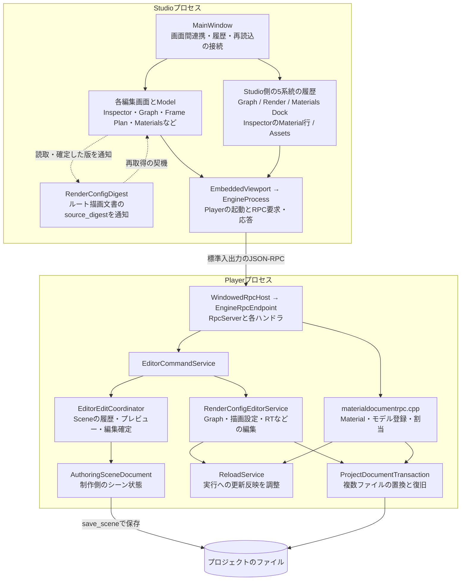
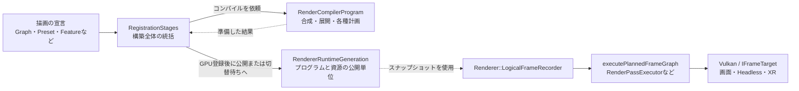
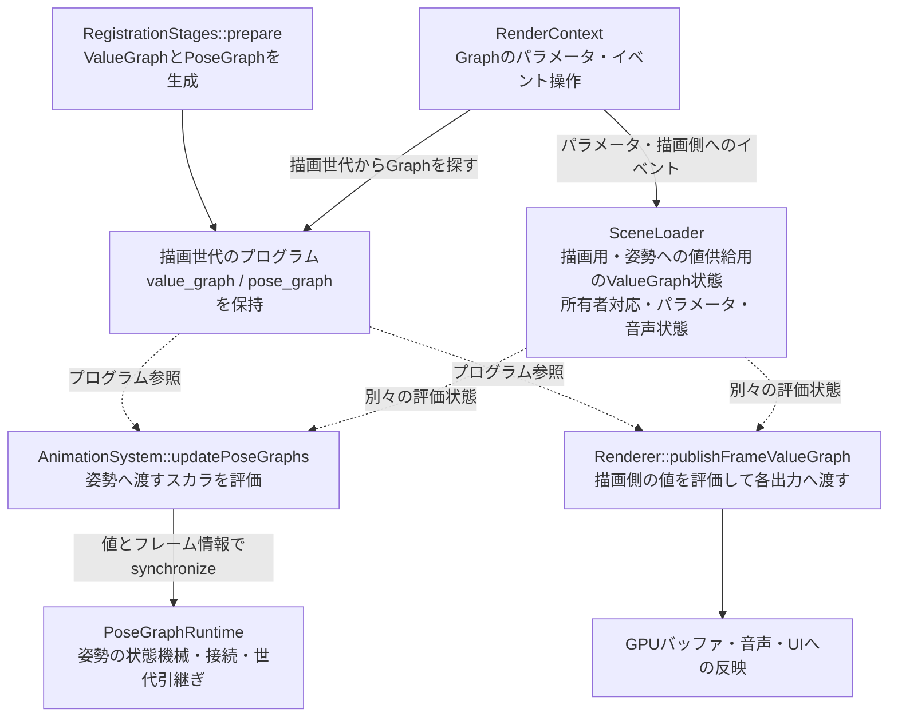

# Pelican2 Studioとエンジンの責務再編レビュー案（Claude返答後の改訂）

Studioの編集基盤を整理し、エンジンの共通Graphと編集結果の扱いを見直す案について、コードに照らした独立レビューを依頼する。目的は、機能追加や修正のたびに複数の画面・履歴・保存経路を手作業で同期する負担を減らし、利用者が機能と操作の関係を説明書から理解できるようにすること。

改訂後の推奨は、**説明書の対応関係を先に整え、コードは描画編集のチケット追跡と結果の読み取りを中心に、小さく再編する**こと。SceneLoaderからGraph状態を別サービスへ移す提案は撤回する。構造の変更はv0のtag後を基本とし、tag前のコード変更は確認できた不具合に絞る。これは進め方の提案であり、実装着手やリリース日変更の決定ではない。

| 項目 | 内容 |
|---|---|
| 作成日 | 2026-10-06 |
| 改訂日 | 2026-10-06、Claude返答の主要な根拠をコードで再確認した後 |
| 作成者 | Codex |
| レビュー先 | Claude |
| 対象リポジトリ | Pelican2 |
| 調査基準 | `668624f040c34a09c299e5da1928fae900270d61` |
| 基準コミットの件名 | `fix(studio): keep node drags responsive through selection and saving` |
| 状態 | 実装前の改訂案。初稿への返答を反映。作業指示書や確定仕様ではない |
| 調査方法 | 主要経路の静的なコード追跡と関連テストの読解。今回の調査でビルド・テストの再実行・性能測定はしていない |

コードへのリンクと行番号は上のコミットを基準とする。別のコミットでレビューする場合は差分を確認し、行番号だけでなく記載したシンボルを検索してほしい。

## 0 初稿から変更した判断

[Claudeの返答](2026-10-06_studio_engine_responsibility_review_reply.md)は初稿を対象にしている。対応を追えるよう、第6章の候補番号は維持した。返答文書自体は変更していない。

| 初稿の不足・提案 | 改訂後の扱い |
|---|---|
| Studioの編集状態・文書の版を広く共通管理する | まず描画編集のチケット追跡だけを部品化する。要求を組み立てた文脈とbase digestは各panelが保持する |
| Graph画面の履歴振分けを共通台帳へ移す | 単なる移動の優先度を下げる。対象entryの識別と、commit・拒否に沿った順序記録を先に検討する |
| Graph状態をSceneLoaderから抽出する | 別サービスへの移管を撤回。scene単位の所有を保ち、必要性を確認したAPI整理だけを任意の候補とする |
| 履歴が5系統、Materialの反映状態に`rebuilt`がない | InspectorのMaterial行を加えた6系統と、`applied`の4値へ訂正する |
| 姿勢側のGraph状態をSceneLoaderの評価状態とまとめて説明 | 姿勢へ値を供給するValueGraph状態と、PoseGraphRuntimeの状態機械を分ける |
| 説明書全体の混在として扱う | 第13章の混在と、第6・10・13章のRPC記述の重複に焦点を絞る |

返答の行数・重複量・工数は静的調査による概算であり、本改訂で全件を再集計した数値ではない。UndoのD1〜D5も未再現の指摘として扱う。共通化後の性能向上や、「scenarioが1本あれば十分」という検証範囲は、まだ確定できない。

## 1 レビューで判断してほしいこと

次の問いに答えてほしい。案に賛成することを前提にせず、必要な分離を誤って共通化しようとしていないかも確認してほしい。

1. 現状の呼出し関係、状態の所有者、保存と実行反映の説明に誤りがないか。
2. 再編候補のうち、実際に責任が分散しているものと、必要な分業をしているだけのものはどれか。
3. 既存の共通実装を接続し直すだけで足りる箇所はないか。
4. 共通化すると、かえって状態や依存が増える箇所はないか。
5. 挙動を維持して責任を移す範囲と、利用者向けの仕様変更になる範囲を正しく分けられているか。
6. 段階的に変更・検証・着地できる順番になっているか。
7. この案で不足している再編対象、または削るべき対象はあるか。

まずは読み取りによるレビューを想定する。評価を揃える前に、本案に合わせてproductionコードやテスト期待値を書き換えることは依頼していない。

## 2 背景と問題の切り分け

利用者からは、Studioのノード移動・選択の応答性と、説明書・操作体系の複雑さについて指摘があった。直近のコミットにはノード操作の応答性修正が含まれるが、本案はその効果を再計測した報告ではない。現在の構造だけを根拠に、残る遅延の原因や再編後の速度向上を断定しない。

議論は、説明書の章を箱にした図から、実装の責任を追う調査へ進んだ。概念・操作・RPC・開発履歴の混在は特に第13章に集中している。同章は7,300行で、`docs/manual/*.md`の19,340行の約37.7%を占める（本改訂で再集計）。文書の再構成だけで改善できる部分が大きい。一方、コードにも同じ要求追跡を各画面が実装している箇所がある。この二つを同じ問題として扱わない。

第11章の[更新ルール6](../manual/11_status.md#L629)はRPC追加時に第10章と編集系の第13章を更新するよう求め、[v0一覧](../v0_freeze.md#L93)はparamsと戻り値の正本を第10章としている。本文を移すだけでは再び重複するため、正本と参照元の役割、更新ルールを一緒に直す必要がある。個々のRPCの食い違いと欠落の全件確認は、文書整理時の作業とする。

用語は次の意味で使う。

| 用語 | このレビューでの意味 |
|---|---|
| 共通Graph | `pelican.graph` の文書・語彙と、値・描画・姿勢・音声・UIなどへの利用。すべてが一つの実行器で動くという意味ではない |
| Sceneの編集文書 | `AuthoringSceneDocument` が扱う制作側の状態。実行中のECSと同一ではない |
| 実行への反映 | 編集内容を実行中のエンジンが使用する状態に切り替えること。ファイル保存と必ず同時ではない |
| 描画の世代 | `RendererRuntimeGeneration` などが表す、プログラムと資源をまとめた公開単位 |
| 共通化 | 同じ規則の実装と責任を一か所へ寄せること。すべての分野を同じアルゴリズムで処理することではない |
| 責任の移管 | 処理の意味を維持して、保持・更新・破棄を担当する実装を変えること |

## 3 調査した範囲と限界

主に以下を追った。

- StudioからPlayerを起動し、RPC要求・応答を処理する経路。
- Scene、Graph、描画設定、Materialを編集する経路。
- Graph、描画設定、Materials、InspectorのMaterial行、Assetsの履歴と、Sceneのエンジン側履歴。
- 描画文書の版通知、外部変更の監視、再読込。
- Playerの起動、フレーム更新、描画構成のコンパイルと公開。
- 共通Graphの生成、評価状態、姿勢・描画・音声・UIへの接続、世代引継ぎ。
- これらの仕様を示す一部の既存テスト。

すべての関数・プラグイン・ビルド構成を監査したものではない。特に、全種類のMaterial変更、全Graph操作、再生中の編集、XR、失敗注入の全組合せを動的に確認したわけではない。以下の「現状」は記載した経路で確認した事実、「判断」はその事実からの推論、「案」は未実装の選択肢である。

過去の [2026-09-17のリファクタ監査](2026-09-17_refactor_audit.md) は別コミットを対象とし、Studioを対象外としている。そこにある指摘を、現在も未修正の事実として本案へ移していない。重複や解消済みの項目がないか、レビュー時の比較材料にはできる。

## 4 現在の実装関係

図の実線は呼出しや処理の流れ、点線は状態の参照・共有・通知を表す。併記した箱は複数実装の集合であり、一つのクラスを意味しない。機能フラグ、エラー処理、すべてのRPCは省略している。

### 4.1 Studioから編集する経路



Studioはエンジン内部を直接リンクするクライアントではない。共有の形式・検証処理を使い、実行中のエンジンへの操作は公開RPCを通す。この境界は [StudioのCMake定義](../../src/devstudio/CMakeLists.txt#L47) で確認できる。

`MainWindow::createRenderHistory()` はRPCの送信前・送信後を観測し、対象メソッドの履歴を記録する。RenderEditHistoryは送信元panelとは別に同じticketを追跡する経路も持つ。[履歴側の追跡](../../src/devstudio/model/renderedithistory.cpp#L447)

`EngineRpcEndpoint::Impl` は `makeEditorRuntimeService()` でSceneと描画の編集サービスを構築する。一方、Materialのハンドラは `configureMaterialDocumentRpcHandlers()` で別に登録される。Material文書編集などはticketを返して後から結果を照会する方式ではなく、一つのRPC応答で結果を返す。StudioのGUIスレッドを同期的に待たせる、という意味ではない。

主要な根拠は [MainWindow](../../src/devstudio/view/mainwindow.cpp#L1374)、[EngineRpcEndpoint](../../src/core/communication/rpcserver.cpp#L2810)、[編集サービスの構築](../../src/core/communication/editorruntimefactory.cpp#L2040)、[Materialのハンドラ登録](../../src/core/communication/materialdocumentrpc.cpp#L2666)。

この図は「すべての編集が同じキュー・同じ確定規則を通る」ことを意味しない。RPCを受け付ける場所と、編集を確定・保存する場所は別である。

### 4.2 起動とフレームの進行

`PelicanCore::run()` は設定を準備し、Rendererを初期化した後で起動シーンをロードし、素材コンテナと監視を準備してLoopへ入る。[起動処理](../../src/core/userpublic/pelican_core.cpp#L100)

通常のウィンドウ経路では `runInteractive()` が `FrameStep` を使って時間の進行、状態更新、描画、記録を進める。`updateFrameState()` の中には再読込の反映と編集確定用フックがあり、入力・イベント・ECS・ゲームSystem・姿勢・シーケンスなどの更新を行う。ウィンドウRPCの要求処理は `updateFrameState()` の後で呼ばれる。この順序を、単純な「RPCを処理してからゲーム更新」という説明に置き換えない。[ループ](../../src/core/appflow/loop.cpp#L695)、[状態更新](../../src/core/appflow/framephase.cpp#L152)

### 4.3 描画構成の構築と公開



`registerRenderingPassConfigVariantsData()` は `prepare → allocate → registerVariants → publish` を呼ぶ。コンパイル、GPU登録、公開はすでに役割を分けた一つの経路で調整されている。[統括処理](../../src/core/renderingpass/renderingpassconfigregistration.cpp#L1606)、[コンパイルのインターフェース](../../src/core/renderingpass/rendercompilerprogram.hpp)

実行中の世代、準備した世代、GPUが参照する資源には異なる寿命がある。ここを単純な設定オブジェクトの即時差替えに変更する案は採らない。

### 4.4 共通Graphの現在の分担



値と姿勢のGraphは [描画登録処理](../../src/core/renderingpass/renderingpassconfigregistration.cpp#L1028) で生成される。SceneLoaderの`evaluation`と`pose_evaluation`は、どちらもValueGraphの評価状態である。後者は姿勢へ供給する値の時計などを独立に進めるための状態で、姿勢の状態機械そのものではない。[SceneLoader内の状態](../../src/core/loader/scene.hpp#L82)

姿勢側では`AnimationSystem::updatePoseGraphs()`がスカラを評価し、PoseGraphRuntimeへ渡す。`updateGraphs()`はAnimationComponentのanim_graphを処理する別の入口で、末尾から`updatePoseGraphs()`を呼ぶ。PoseGraphRuntimeは別実装で、アクセサ内のstaticインスタンスが状態を持つ。[姿勢への値供給](../../src/core/ecs/predefined/animationsystem.cpp#L369)、[PoseGraphRuntimeの所有](../../src/core/animation/posegraphruntime.cpp#L1028)

Rendererの `publishFrameValueGraph()` は値を評価し、GPUバッファへの書込、音声の操作、UIの値・可視性の変更へ接続する。また、評価済みの値をSceneLoaderへ公開する。参照のために再評価すると時計やイベントを進めてしまうため、観測値の公開にも意味がある。[描画側の評価](../../src/core/vkcore/renderer.cpp#L6307)

世代変更時には、描画用と姿勢への値供給用の評価状態を一緒に引き継ぐ。所有者は次のGraphから再計算し、所有者が変わったscopeは両評価状態でリセットする。保持可能なパラメータ・音声・sound epochには引継ぎ処理があるが、`voice_status`をそのままコピーしてはいない。[CPU側の引継ぎ](../../src/core/loader/scenegraphruntime.cpp#L358)

CPU側の状態移行だけで公開を説明し切ることはできない。以下も区別して追う必要がある。

- Renderer内の移行準備には[公開前フック](../../src/core/vkcore/renderer.cpp#L4006)と[staged描画時](../../src/core/vkcore/renderer.cpp#L6307)の経路がある。
- [所有者変化の検出](../../src/core/vkcore/renderer.cpp#L3598)から再公開する経路と、所有者だけが変わった場合の[GPU永続バッファ複写](../../src/core/renderingpass/renderingpassconfigregistration.cpp#L1402)がある。
- PoseGraphRuntimeは姿勢の状態を別に管理する。SceneLoaderの`pose_evaluation`の転送だけで代替できない。
- 準備中の音声操作は[公開後](../../src/core/vkcore/renderer.cpp#L6774)に反映する。状態を準備した時点で再生してよいわけではない。

また、`SceneLoader::emitGraphEvent()`は描画側の`evaluation`だけにイベントを送る。[実装](../../src/core/loader/scenegraphruntime.cpp#L158)と[既存の記録](../implementation_plan.md#L23659)が一致している。姿勢側にも同じイベントを届けるかは、責任の移動と分けて検討する仕様である。

## 5 現状の確定方法と履歴の違い

### 5.1 編集と保存と実行反映

| 対象 | 主要な経路 | 区別すべき状態 |
|---|---|---|
| Scene | EditorEditCoordinatorで編集し、save_sceneで保存 | 編集文書のrevision、実行への反映、ディスクへの保存 |
| Graph・描画設定 | RenderConfigEditorServiceのチケットから候補の処理へ | 受付、処理中、文書の確定、公開世代、再起動の要否 |
| ノードの配置だけの変更 | source_onlyの経路で文書を保存 | 文書の版は進むが描画の再構築はしない |
| Material | ticketを使わないRPC。対象文書を保存した後、値の適用や構造の再構築を試みる経路がある | `applied`は`live`・`rebuilt`・`restart_required`・`unusable`。保存の確定とは別に読む |

Sceneの保存前のbusy判定は [EditorCommandService::saveScene](../../src/core/communication/editorcommandservice.cpp#L1147) にある。描画編集には保存しても再起動が必要な結果があり、Studioは [RenderEditCompletion](../../src/devstudio/model/rendereditcompletion.hpp#L12) で共通に解釈する。Materialは [commitDocumentsの後](../../src/core/communication/materialdocumentrpc.cpp#L1227) で実行への適用を進める。

Materialの`live`・`restart_required`・`unusable`は[応答生成関数](../../src/core/communication/materialdocumentrpc.cpp#L532)、`rebuilt`は[構造の再構築完了](../../src/core/communication/materialdocumentrpc.cpp#L1019)で設定される。`rebuilt`を「再起動待ち」に読み替えない。

したがって、すべてを「成功か失敗か」の一つの値へ畳む案は不適切である。保存できたが実行には使えない状態を、保存失敗として表示しても、完全に反映済みとして表示しても誤る。

### 5.2 履歴

| 履歴 | 現在の保持・復元方法の要点 |
|---|---|
| Scene | エンジンのEditorEditCoordinator側にjournalとUndo・Redoがある |
| Graph | GraphCanvasModelが操作と逆操作を持つ |
| 描画設定 | RenderEditHistoryが変更した文書を記録し、版の検査を伴って復元する |
| Materials Dock | MaterialsDockSessionが編集・削除・改名・割当などの戻し方を選ぶ。Redoはない |
| InspectorのMaterial行 | MaterialAssignSessionがモデル全体へのbind_materialの逆操作を保持する。Redoはない。objectだけへのset_object_materialはScene履歴へ行く |
| Assets | AssetsDockSessionが変更前の設定値を持つUndoを実装する |

同じGraph画面から送った操作でも、Graphの履歴へ行くものと描画共通の履歴へ行くものがある。`GraphCanvasScene::undoEdit()` は `tab_edits_` を見てその二つを振り分ける。[画面内の振分け](../../src/devstudio/view/graphcanvaswidget.cpp#L4254)、[Graphの逆操作の送信](../../src/devstudio/model/graphcanvasmodel.cpp#L2752)、[MaterialのUndo](../../src/devstudio/model/materialsmodel.cpp#L910)

これは過去から残った不要な仕組みではなく、GL-5g（`cfa9859f8`、2026-10-05）が「Graphタブから送った編集の順」を保つために加えたもの。`df1e07f15`の履歴修正も踏まえて評価する。6系統は[automationのHistoryKinds](../../src/devstudio/automation/automationcommands.cpp#L2349)でも区別されている。[MaterialAssignSession](../../src/devstudio/model/materialsmodel.hpp#L630)をMaterials Dockで使用する場合は、[bindingCommitted](../../src/devstudio/view/materialsdock.cpp#L239)でDock側の履歴へ渡し、二重に保持しない。

外部ファイルの再読込時にはGraphと描画の履歴を区切る経路がある。これは現在の規則であり、単に履歴を失わないようにするのが改善とは限らない。[再読込後の処理](../../src/devstudio/view/mainwindow.cpp#L1720)

## 6 再編候補とレビュー論点

### 6.1 描画編集のチケット追跡を共通にする：範囲を縮めて進める

**現状。** 描画編集では、要求ID、ticket、pending・runningの再問い合わせ、終端結果の受信を各画面が扱う。Claudeは18クラス・同形部分約1,200行と見積もった。これは本改訂で全件を再計数した値ではないが、RSX（`6a1069c81`）にはRender Featuresで再起動要求の扱いが漏れた修正記録があり、同じ契約の実装漏れという問題には根拠がある。Material文書編集をこのticket共通化の対象に含めない。

`RenderConfigDigest`が保持するのはルート文書の`source_digest`一つと購読者で、全文書の版の台帳ではない。各panelは読み取った文脈のdigestを保持する。[Q-13の設計理由](../../src/devstudio/view/renderconfigdigest.hpp#L12)には、古い文脈で作った要求を新しいdigestで送らないため、と明記されている。Pass Editorのpreset digestも別に保持される。[presetの読取](../../src/devstudio/view/fullscreenpasswidget.cpp#L2729)

**改訂案。** 仮称`RenderEditTicket`を、送信から終端結果までの追跡部品とする。要求内容の組立て、base digest、競合後の要求の作り直し、分野ごとの再取得、Undoの逆操作は呼出し側に残す。終端結果の解釈は既存のRenderEditCompletionを使う。Scene・Materialまで統一する状態機械やStudio全体の直列キューは作らない。

最初はRender Featuresの小さいdialog群、Rendering Settings、Ray Layout、Graph Attachmentのような経路で抽出の妥当性を確認する。Graph・Frame Plan・Pass Editorは、複雑な再取得・再試行の規則を分けた後に接続する。Frame Planなどの[再取得](../../src/devstudio/view/frameplanwidget.cpp#L1914)をそのまま共通部品へ押し込めない。

**守る条件。**

- 要求ごとの文脈とbase digestは維持する。最新digestの機械的な付替えを行わない。
- 終端結果が持つルートdigestの通知と、要求に使用した版の保持を区別する。presetの変更をルートdigestだけで検知できるとはみなさない。
- UIが追跡を離れることと、engineの編集を取り消すことを区別する。接続断後の結果を勝手に「未commit」にしない。
- 接続先・projectの切替後の古い応答を除外し、重複した終端通知を一回だけ処理する。
- 分野ごとの競合再試行を、正しさを確認せず一律の再送に変えない。
- ローカルな選択・ドラッグをRPC完了待ちにしない。

RenderEditHistoryとの二重ポーリング解消は次の段階とする。同一ticketの完了を購読する共有レジストリが候補だが、まずRPC数と通知順序を記録する。panelの文脈を奪わず、履歴の確定を一度だけ通知できることを採用条件にする。

### 6.2 GraphのUndo順序：移管よりentryの識別を先にする

**現状。** Ctrl+Zはフォーカスに応じて対象が異なり、文字入力欄には文字編集のUndoがある。[キー操作のテスト](../../test/devstudio_render_undo_keys_test.cpp#L1)がその境界を持つ。GraphタブだけはGraph履歴と共通の描画履歴の順を`std::vector<bool> tab_edits_`で補う。単にこのvectorを別クラスへ移しても、記録できる情報は増えない。

ClaudeのD1〜D5について、以下はコードから読む懸念と再現時に確認すべき条件である。**このレビューでは動的な再現はしていない。** [QD1_FINDINGS](../../test/studio_scenarios/QD1_FINDINGS.md#L23)の既存の未解決記録と、D1〜D5が一対一に一致することも確認していない。

| 指摘 | 読み取れる危険箇所 | 再現・判定の要点 |
|---|---|---|
| D1 別panelの後発編集を戻す | boolは描画履歴を選ぶだけで、共有履歴のtopがGraphタブの操作かを比較しない | Graphから描画編集A、別panelからB、その後GraphでUndo。実際に戻る対象と通知を調べる |
| D2 拒否でも順序記録が先に動く | QActionの発火がtrueを返すとtabの記録を移す。trueはcommitの確認ではない | 同期拒否と非同期のCAS拒否を分け、Undo再試行・Redoで誤った記録が残るか確認する |
| D3 詳細列のGraph編集が順序に入らない | 一部の詳細列編集はmodelを直接変更し、sceneのafterEditを通らない | 描画編集Aと詳細列のGraph編集Bを交互に行い、Bから戻せるか確認する |
| D4 描画Undoが無効の間に古いGraph編集を戻す | 描画側の条件を満たさないとmodelのUndoへ進む | 処理中の連打と履歴のbarrierを区別し、新しい編集を飛び越すか確認する |
| D5 履歴の区切りとtabの記録がずれる | documentsReloadedFromDiskはmodelの履歴を消すが、同経路でtabのbool列は消していない | 外部再読込とproject切替を別々に試し、古い順序記録が後の編集に影響するか確認する |

根拠は[undoEdit](../../src/devstudio/view/graphcanvaswidget.cpp#L4254)、[QActionの発火](../../src/devstudio/view/graphcanvaswidget.cpp#L10314)、[詳細列からの直接編集](../../src/devstudio/view/graphcanvaswidget.cpp#L7084)、[外部再読込](../../src/devstudio/view/graphcanvaswidget.cpp#L10476)。

**改訂案。** GL-5gの「タブが送った編集の順」を保つため、履歴の種別だけでなく対象entryを識別し、成功・拒否に応じて記録を動かす。詳細列を含むGraph操作の記録点は、画面の送信処理より[GraphCanvasModel::commitHistory](../../src/devstudio/model/graphcanvasmodel.cpp#L2803)に近い所が候補となる。別々のticketを照会しているため、完了通知の到着順をそのまま操作順にせず、送信時の順序との対応も維持する。移動先クラスの設計は、この契約を決めてから行う。

ただし「ticket IDは既にあるので届けるだけ」とはまだ言い切れない。描画側の[Entry](../../src/devstudio/model/renderedithistory.hpp#L93)には`serial`がある一方、Graph側の[HistoryEntry](../../src/devstudio/model/graphcanvasmodel.hpp#L1147)はforward・inverse・paramsだけを持つ。要求のticket、要求ID、Undo・Redoをまたいで同じentryを指すIDを区別し、再試行とprojectの寿命も含めて対応を定める必要がある。既存のserialを使える所は使い、新しい公開RPCが必要だとは先に決めない。

共有描画履歴のtopが別panelの操作だった場合は、勝手にその操作を戻したり、さらに古いGraph操作へ飛んだりしない規則が必要になる。「このタブから今は戻せない」と止めるのか、別の操作を案内するのかを再現例とともに決める。全体Undoへの変更は別仕様であり、この修正の前提にしない。

再現できない項目は未確認の調査項目として残す。「既知の制限」として利用者向けマニュアルへ断定して載せない。再現済みのQD-1項目は、それぞれの証拠を保持する。

### 6.3 描画文書のwatcher：所有だけを小さく整理する

**現状。** MainWindowはRenderDocumentReloadを持つが、描画文書のファイル監視をFrame PlanのShaderReloadFollowerへ接続する。[接続](../../src/devstudio/view/mainwindow.cpp#L1519)と[document_files_の特別扱い](../../src/devstudio/view/shaderreloadfollower.cpp#L27)が根拠である。

FramePlanWidgetは[MainWindow生成時](../../src/devstudio/view/mainwindow.cpp#L627)に常設される。dockを閉じると破棄されるから監視が失われる、という不具合の証拠ではない。現状の寿命と所有場所の分かりにくさを混同しない。

**改訂案。** 描画文書のwatcherだけをMainWindowのrender_reload_の近くへ移す。plan modelから作るshaderの監視、Assetsの再走査・適用追跡、Graphのcompute shaderポート監視は、それぞれの役割を保つ。約30行というClaudeの見積りは接続部分の目安であり、検証を含む工数ではない。

自分の保存を再処理しないdigest照合、連続書込みへの対処、busy時の再試行、ファイル置換後の再監視、壊れたファイルからの回復を維持する。engineのReloadServiceまでまとめる理由にはしない。

### 6.4 結果の読み取り：共通の状態機械を作らず不足を埋める

**現状。** Scene、描画、Materialの確定規則は異なる。ファイルの置換・復旧は[ProjectDocumentTransactionへ共通化済み](../../src/core/communication/renderconfigtransaction.hpp)である。保存・履歴・実行を一つの万能な結果型へまとめる必要性は示せていない。

**改訂案は二つ。**

1. ticketを使わない応答の`applied`と`restart_required`を読む小さい部品を検討する。`live / rebuilt / restart_required / unusable`、reason・problem・再構築した対象などの情報を失わず、未知・欠落した値をliveと決めつけない。材料は[MaterialsDockSession](../../src/devstudio/model/materialsmodel.cpp#L1343)と[MaterialAssignSession](../../src/devstudio/model/materialsmodel.cpp#L1885)などの既存処理である。
2. 描画のRenderEditCompletionで欠けている`post_commit_error`の扱いを調べ、利用者向け通知へ接続する。engineは[committed応答にこのfieldを付ける](../../src/core/communication/renderconfigeditor.cpp#L8121)が、[Studioの共通読取](../../src/devstudio/model/rendereditcompletion.cpp#L15)は読まず、`src/devstudio`内にも同名の参照がない。この読取漏れは静的に確認した。実際の表示・ログ経路と発生条件は、実装前に失敗注入で確かめる。

後者は、commit済みの編集を「保存失敗」にしたり、Undo履歴から消したりする修正ではない。変更は確定していることと、確定後の処理に問題が出たことを両方伝える。`preview`もこの共通読取には含まれないが、そのfieldを読まない事実だけで別経路のプレビュー表示まで欠陥と断定しない。

`readAppliedState`の抽出自体はリファクタである。具体的な誤表示を直す必要がなければ、tag前に入れる必須のバグ修正には数えない。

### 6.5 Graph状態の別サービス化：撤回し、必要ならAPIを整理する

**現状。** SceneLoader内のGraph状態はprivateで、実装は既にscenegraphruntime.cppへ分かれている。[scene単位のownerのメモ](../../src/core/loader/scene.hpp#L109)にも寿命の理由がある。Renderer・AnimationSystem・RenderContextは、所有オブジェクトの解決やscene timeなどのためにSceneLoaderを引き続き参照する。[RenderContextのGraph操作](../../src/core/userpublic/gamecontext.cpp#L615)

**改訂判断。** 初稿の状態移管だけでは、これらのSceneLoader依存は消えない。新サービスからSceneへ戻る参照や中継APIが増える可能性がある。独立moduleへの移管を勧める根拠が不足していたため撤回する。描画世代・Scene・PoseGraphRuntime・GPUの異なる寿命を、図の箱の数を減らす目的で一つにしない。

tag後の任意の候補は次の範囲に絞る。

- 第4.4節の公開・引継ぎ経路と、scene単位の状態・世代単位の状態の対応を一か所に記述する。
- PreparedGraphRuntimeTransferがSceneLoader内部を直接触る[境界](../../src/core/loader/scenegraphruntime.cpp#L428)を、scene所有のまま整理できるか検討する。クラスを一つ増やすこと自体を目的にしない。
- 入力収集などの同じ準備処理だけが共通化できるかを比べる。Rendererはpublishと各出力への適用、AnimationSystemはevaluateLoweredでスカラを読むため、処理全体は同じではない。

Claudeが挙げた「評価手順3か所」のうち[音声側](../../test/audio_test.cpp#L384)はテストの補助実装である。productionに同じ評価器が三つあるという根拠にはならない。テストとproductionを同じhelperへ結び、独立した検証まで減らさないことも考慮する。

eventを姿勢側へ送る、評価回数や順序を変える、GraphをGPUなしで独立実行する、描画世代から公開単位を外す、といった変更は別設計にする。静的なAPI整理のついでに挙動を変えない。

### 6.6 描画編集サービスの分野外の仕事：後回し

RenderConfigEditorServiceには音声解析の焼き込みやpackage操作もある。[公開操作](../../src/core/communication/renderconfigeditor.hpp#L729)の集約は分かりにくさの一因だが、移動だけを最初の目標にしない。

[音声解析](../../src/core/communication/renderconfigaudioanalysis.cpp#L66)はticketの番号空間・結果保持・結果の回収を共有する一方、独自の非同期処理と出力先ごとの排他を使う。描画編集のpendingキュー・gate・CASをそのまま共用している、と説明してはいけない。package操作も描画ticketの処理に一律に含めない。

将来、service追加や保守上の必要が出たときに、分野固有の処理と要求の進行管理を分けて検討する。engine各serviceのticket・結果保持の重複はClaudeが挙げた追加調査候補であり、今回Studio側の部品と同時に共通化する対象にはしない。

## 7 再編の規模の比較

| 選択肢 | 範囲 | 得られるもの | 残る問題と負担 | 暫定判断 |
|---|---|---|---|---|
| 局所改善 | 説明書の対応表・正本整理、結果の読取不足、再現したUndo不具合 | 利用者の理解と正しさを先に改善できる | ticket追跡の重複は残る | v0内の優先候補。文書と不具合を別々に検証する |
| 限定した共通化 | 描画ticket追跡、描画文書watcher、結果parser、必要なら完了通知の共有 | 同じ要求追跡を直す場所が減る | 各panelの文脈と復元方式は引き続き分かれる | tag後の推奨範囲。小さい経路で効果を確認して広げる |
| 所有モデルの広い変更 | 全文書の版管理、全履歴の統一、Graph状態の別サービス化 | 統一した枠組みを作れる可能性 | 既存の分担理由を崩し、中継や状態が増える危険がある | 現時点では採らない |
| 大規模 | 新しい文書形式、統一保存方式、全面的なGraph実行モデル、描画世代の再設計 | より大きな概念統一が可能 | 仕様移行、公開API、GPUと音声の整合、広い再検証が必要 | 現在の根拠だけでは勧めない |

工数や削減率の数値見積りはしていない。行数が大きいこと自体を再編の根拠にせず、同じ規則を変更するときに何か所を修正するか、誰が状態を持つか、失敗時に誰が決着を付けるかで判断したい。

## 8 提案する移行順序

### 8.1 文書を先行する

コード再編の着手前に「概念 → 操作 → Studioの場所 → RPC → 履歴の行き先 → 反映の状態」の通し表を作る。まず現状の6系統の履歴と保存規則を記述し、再編後の理想図を現状として載せない。この表をコード変更後も同じ操作ができるかの受け入れ条件にする。

第13章は、概念の説明、panel別の操作、編集RPCの参照、開発の着地記録に分ける。RPC契約の本文は一か所を正本とし、他章は要約とリンクを持つ。現在第10章を正本とする規則を維持して補完するか、編集RPCの正本を別ページにするかは、欠落を棚卸しして選ぶ。分割先の名前だけを先に決めない。

文書だけなら無条件に安全、とは扱わない。[panelhelp.hpp](../../src/devstudio/view/panelhelp.hpp#L29)は第13章のパスと3種類のanchorを参照している。旧見出しを案内として残す方法も含め、Studioの`?`、manualの目次、相互リンク、doclinkの台帳、配布物での参照先を確認する。本文の移動では過去の決定日・commitを改変しない。

実際の分割ではdoclinkの基準を更新し、移動後の`update → check → audit`とstrictな文書buildを通す。既存の検査を緩めず、ヘルプ側を変えた場合は該当するStudioの検査も行う。今回のレビュー改訂は、その分割作業や文書buildを実施した報告ではない。

### 8.2 tag前のコードは確認した不具合に絞る

既存の[実装計画](../implementation_plan.md#L28061)には10/9凍結の記録がある。これを尊重し、構造変更のためにtagを遅らせることは勧めない。ただし、現在の全数実行・push・tagの完了状況を、この静的レビューだけで再判定しない。

優先して切り分ける候補は次の通り。

| 候補 | 先に確かめること | tag前に含める条件 |
|---|---|---|
| post_commit_errorの通知 | commit後の失敗を注入し、RPC結果・履歴・表示を確認する | 保存済みの意味を保って通知でき、再起動や重複通知への影響を検証できる |
| UndoのD1・D3 | 第6.2節の操作列を再現し、既存のQD-1記録とも照合する | GL-5gの契約への局所修正で収まり、拒否・Redo・他panelへの影響を確かめられる |
| appliedの読取 | 現在誤表示する具体的な応答があるか調べる | 誤表示の修正が必要な場合だけ。単なるhelper抽出はtag後へ回す |

scenarioの本数を先に固定しない。成功例だけでは拒否・接続断・履歴順序を検証できないため、変更する境界に応じた単体・結合・GUIの検査を選ぶ。D1・D3が局所修正で済まないなら、広い履歴再編をtag前へ持ち込まず、問題と影響を示してリリース判断へ戻す。

### 8.3 tag後に小さい追跡部品から広げる

ClaudeのWP名を比較用に借りる。以下は未起票・未実装の順序案で、並列agentや別branchの作成を今回実行する指示ではない。

| 順 | 候補 | 到達点と進む条件 |
|---|---|---|
| 1 | RT-A 描画ticket追跡 | 小さいdialog・Settingsなどで重複する追跡だけを外せる。base digestや分野ごとの再試行は移さない |
| 2 | RT-B 描画文書watcher | reloadの所有者の近くへ移す。shader・Assets・Graph固有の監視は維持する |
| 3 | RT-C 結果の読取 | applied parserを整理する。post_commit_error修正が先行していたら取り込む |
| 4 | RT-D Undo順序 | 再現とentry識別の仕様を確定した分だけ実装する。tag前の修正があれば再実装しない |
| 5 | RT-E 複雑なpanelへ適用 | Graph・Frame Plan・Pass Editorの再取得・競合処理を分野側に残して接続する |
| 6 | RT-F 完了通知の共有 | 同じticketの二重ポーリングを減らす。通知順序・履歴の一回性とRPC数を実測する |
| 任意 | GR-1 GraphのAPI整理 | SceneLoader所有のまま具体的な直接操作・重複を減らせる場合だけ。別サービス化は行わない |

RT-Aの時点で分野ごとの分岐や新しい待ち行列が増えるなら、適用範囲を縮める。共有レジストリのために要求のbase digestを失うなら採用しない。GR-1は新しいincludeが一つ増えたかで機械的に判定せず、依存方向・寿命・APIの契約が実際に改善するかで決める。

対象を変更する時点でHEADと進行中の作業を再確認し、同じファイルを同時に変更しないよう統合順序を決める。Claudeが示した「約1週間＋全数1回」は見積りとして扱い、確定日程にはしない。

## 9 変更しない前提と検討し直す条件

今回の推奨範囲では、次を維持する。

- Studioが公開APIを通じてエンジンを操作する境界。
- Sceneの編集文書と実行中の状態の区別。
- ファイル保存と実行への反映の区別。
- 編集時とUndo時の競合検査。SceneRevisionやdigestを検査する意味。
- 要求を組み立てた時点の文脈とbase digest。通知された最新の版とは区別する。
- 文字入力欄のUndoと、エンジンの編集操作のUndoの区別。
- 6系統の履歴の適用範囲と、現在存在しないRedoを追加したことにしない規則。
- 描画の準備・公開・巻戻し・GPU資源の寿命管理。
- 複数の描画variantを整合した単位で扱う規則。
- Graph所有者のメモのscene単位の寿命、両ValueGraph評価状態の引継ぎ、PoseGraphRuntimeの独立した状態。
- staged世代の音声を確定前に外へ出さない順序。
- 外部ファイルの変更を拾った際の履歴の境界。
- 分野固有の拒否理由・エラー情報。
- committed後の問題を、未commitや保存失敗へ読み替えないこと。

これらを変えた方がよいと判断する場合は、利用者への効果、壊れる互換性、必要な移行と検証を添えて別案として示してほしい。「共通化のため」だけでは十分な変更理由にならない。

## 10 検証する振舞いと既存テスト

以下は実装時の検証計画であり、今回通過を確認したという意味ではない。記載したファイルだけで全条件を網羅しているとは限らない。

| 領域 | 必ず維持・確認する振舞い | 既存テストの入口 |
|---|---|---|
| 要求と応答 | 切断、再起動、プロジェクト切替、遅い応答、拒否、重複通知で状態を壊さない | `devstudio_graphcanvas_test.cpp`、`devstudio_frameplan_test.cpp` |
| Graph操作 | 選択やドラッグが保存待ちで止まらず、配置保存が描画の再構築を起こさない | `devstudio_graphcanvas_scene_test.cpp`、`devstudio_frameplan_graph_test.cpp` |
| 履歴 | 複数文書の一括復元、競合拒否、配置の保持、異なるpanelと詳細列の操作順、拒否後の再試行、entryの識別 | `devstudio_render_history_test.cpp`、`devstudio_render_undo_keys_test.cpp`、`editorjournal_test.cpp`、`studio_scenarios/render_undo_roundtrip.json` |
| 外部変更 | 自分の保存は再読込しない、壊れたファイルから回復する、busyで再試行する、履歴を正しく区切る | `devstudio_render_reload_test.cpp` |
| Material | appliedの4値、reason・problem、保存の確定を区別する。Inspector行とDockの履歴を混同しない | `materialdocumentrpc_test.cpp` |
| 確定後の問題 | post_commit_errorを表示し、committedと履歴を維持する。再起動の要否と重複通知も区別する | `renderconfigeditor_test.cpp`とStudioの結果読取・通知経路 |
| 文書更新 | 複数ファイルの途中失敗、競合、復旧、保存形式の保持 | `renderconfigtransactionreplace_test.cpp`、`renderconfigeditor_test.cpp` |
| 描画の公開 | 準備中は見えない、古い候補で上書きしない、失敗時に旧世代を保つ | `renderpipelinetransaction_test.cpp`、`rendercompilerprogram_test.cpp` |
| Graph状態 | 時計・イベント・所有者・パラメータの引継ぎとリセット、姿勢側と描画側の関係、音声の寿命 | `curve_test.cpp`、`posegraph_test.cpp`、`audio_test.cpp`と実際の統合経路 |
| フレームとScene | フレーム内の順序、編集の確定境界、シーン切替の巻戻し | `framephase_test.cpp`、`scene_transaction_contract_test.cpp` |

既存テストには、[外部再読込で履歴を区切る規則](../../test/devstudio_render_reload_test.cpp#L337)、[文書の版を検査してUndoする規則](../../test/devstudio_render_history_test.cpp#L192)、[準備中の描画世代を公開しない規則](../../test/renderpipelinetransaction_test.cpp#L141)が明示されている。リファクタに合わせてこれらの期待値を安易に緩めない。

新しい検証を足すなら、共通化で実際に変わる境界を狙う。例えばGraphで編集した後にFrame Planで編集して戻す、保存中に画面を切り替える、外部編集と自分の保存が連続する、Graph世代の切替失敗時に音声や時計が旧状態を保つ、といったケースである。新クラスの内部呼出し回数をなぞるだけのテストは優先しない。

Undoの既存scenarioが通ることと、D1〜D5を再現して修正できたことは別に記録する。`known_red`でCTestが成功していても、その不変条件が満たされたことにはならない。文書整理ではリンク・anchor・ヘルプの移動先を確認し、必要な検査をコードのgateと区別する。

性能は同じプロジェクト、同じビルド条件、同じ操作列で比較する。選択・ドラッグ中のUI時間、RPC数、再取得数、再構築回数を分けて見る。共通管理を導入しただけで高速化したとは評価しない。

## 11 完了の判断基準

次の条件を満たす範囲までを再編の目標とする。

1. 対象の描画編集画面を足すとき、ticket追跡を一式コピーしなくてよい。要求の文脈と競合時の再構築は画面・Model側に残せる。
2. 一つの操作について、送信・確定・変更文書・実行反映・履歴の行き先を追える。全分野を同じ状態機械へ入れる必要はない。
3. 修正したUndo経路では、対象entryを取り違えず、拒否で順序記録だけが進まず、詳細列の操作も同じ規則で扱える。
4. 描画文書の監視はreloadの責任の近くにあり、用途が違う監視の規則を無理に統一していない。
5. Graphのscene状態・pose状態・描画世代・GPU資源の所有と引継ぎを、移管しなくても説明できる。
6. 移行した経路では旧追跡処理を削除できる。既存のpanelと履歴の二重ポーリングは、RT-Fで解消するまでは残件として明示する。
7. 説明書の通し表から、概念・操作・Studioの場所・RPC正本・履歴・反映状態へ辿れ、ヘルプの参照先も一致する。

すべての機能を一つの管理クラスへ入れること、クラス数を減らすこと、ファイルを小さく分けること自体は完了条件ではない。

## 12 Claude返答への採否と、次に詰める点

主要な訂正と範囲縮小を採用した。6.1はticket追跡へ限定、6.2はentry識別と確定に沿った順序管理へ限定、6.3は描画文書watcherだけ、6.4は結果の読取、6.5の別サービス化は撤回、6.6は後回しとする。

次の点は返答の提案をそのまま確定仕様にはしない。

1. **UndoのID。** ticketが見えることと、履歴entryを継続して識別できることは別である。GraphのHistoryEntryには現在IDがない。serial・ticket・再試行・Undo/Redo・project切替の対応を先に決める。
2. **Undoの拒否条件。** 他panelの編集が共有履歴のtopにあるとき、Graph側が古い操作へ飛ばずに止まる規則と表示を具体化する。ID追加だけで解決済みとしない。
3. **未再現の扱い。** D1〜D5を再現できなかった場合は、調査項目として残す。再現できないことを理由に「既知の制限」へ格上げしない。
4. **検証範囲。** scenario1本と関連gateで十分かは、変更した経路と失敗条件による。特にUndoは拒否・Redo・他panel、通知はcommit後の失敗・再起動・重複を分けて確認する。
5. **Graphのhelper。** 3か所のうち1か所はテスト補助であり、描画と姿勢の評価全体も同一ではない。共通化できる準備処理と、独立させる出力・状態を切り分ける。
6. **時期と費用。** 文書にもヘルプ・anchorの互換性がある。readAppliedStateの抽出は不具合の証拠がなければtag後でよい。返答の概算工数や進行中作業の記述は、実着手時に現況を再確認する。

全体Undo、MaterialのRedo追加、Graph eventの姿勢側への配送、push型の編集結果通知、RPC正本の配置は、責任の移動だけでは決まらない事項として残す。この改訂を根拠に公開RPCや保存形式を先に変更しない。

## 13 Claudeへ渡す再確認用の短い依頼文

```text
返答を受けてPelican2の責務再編案を改訂しました。採否と残る設計条件を
確認してください。

読む文書:
docs/design_reviews/2026-10-06_studio_engine_responsibility_review.md
docs/design_reviews/2026-10-06_studio_engine_responsibility_review_reply.md

調査基準コミット:
668624f040c34a09c299e5da1928fae900270d61

初稿への主な訂正を採用し、Graph状態の別サービス化を撤回しました。
描画ticket追跡だけを共通化し、panelの文脈・base digestは維持します。
文書を先行し、構造変更はtag後、tag前は確認できた不具合に絞る案です。

特に第6.2節と第12節を確認してください。要求のticketと履歴entryのID、
他panelの後発編集がある場合のUndo拒否、commit後の問題を表示しつつ
履歴を維持する規則、テスト補助を含む評価処理の共通化範囲を詰めたいです。
D1〜D5はこの改訂でも未再現です。既存のQD-1記録との対応を推測せず、
事実・仮説・仕様案を分けてください。

残る誤認と、最小の修正範囲・必要な検証を返してください。
まずはレビューだけで、productionコードやテスト期待値は変更しないでください。
```
