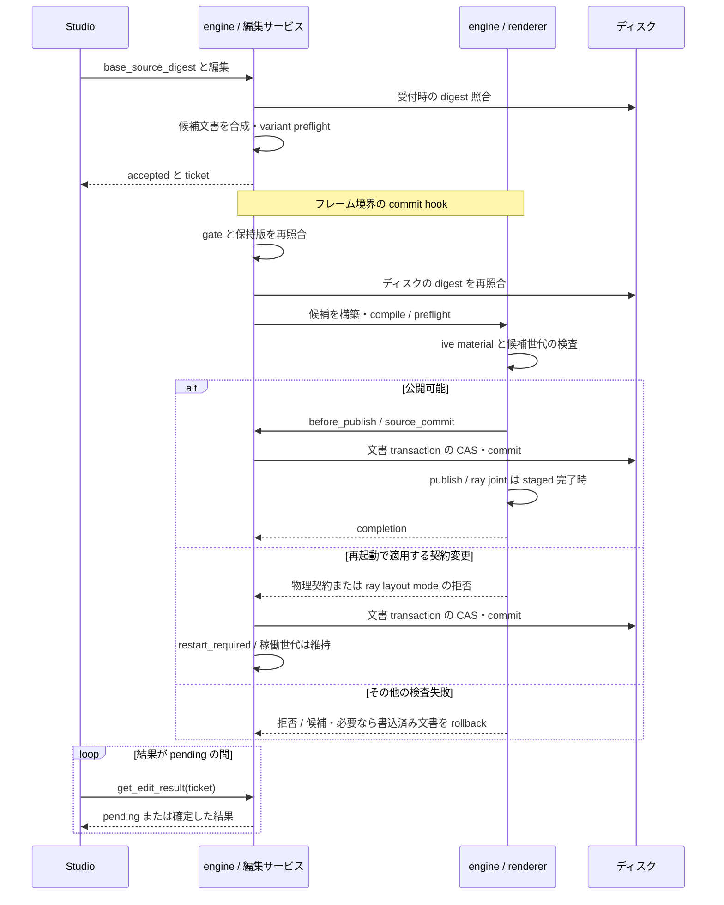

# 第13章 編集 RPC リファレンス

最終確認: 2026-10-07

Studio の panel ごとの操作は [第15章 Studio の操作](15_studio.md) にあります。この章は Studio と外部のツールが呼ぶ編集 RPC の契約です。

## この章で学ぶこと

- **`pelican_player` が「編集サーバ」になった**という今回いちばん大きな変化
- 編集の正本 `AuthoringSceneDocument` と、シーンファイルとの関係
- 編集の実行モデル — チケット・フレーム境界コミット・global CAS
- 編集 RPC のリファレンスとエラーの読み方(**総数は挙げない** —— メソッドが増えるたび腐るため)
- プレビューの 4 段梯子(どこまでが「本物の絵」か)
- 保存(`save_scene`)・スナップショット・ImGui のエディタパネル・Python クライアント

**編集 RPC の全体像(接続 → 問い合わせ → 編集 → 保存)**

1. **接続** —— `pelican_player --rpc` を起動し、stdin/stdout の JSON-RPC で `open_editor_session` を呼んで `actor_id` を受け取ります(§13.4)。
2. **問い合わせ** —— `scene_tree` と `get_components` で今のシーンと各コンポーネントの値・schema を読み、`get_scene_revision` で「自分が見ている版」(`SceneRevision`)を控えます(§13.5)。
3. **編集** —— 控えた版を `base_revision` に添えて `edit` を呼びます。返るのは結果ではなく**チケット**で、実際の適用は次のフレーム境界です。結果は `get_edit_result`(ヘッドレスなら `step_frame` の応答の `edit_results[]`)で受け取ります(§13.3)。取り消しは `undo` / `redo`(§13.4)。
4. **保存** —— `save_scene` でメモリ上のオーサリング文書をシーンファイルへ原子的に書き出します(§13.8)。**これを呼ぶまでディスクは変わりません。**

エラーの読み方だけは先に §13.6 を見てください —— `edit` 系の失敗は JSON-RPC の `error` ではなく**成功応答の中の `result.status`** に出ます。

<a id="digest-cas"></a>

### digest・CAS・external_modification

**digest** は文書の bytes から計算する SHA-256(64 桁の小文字 hex)です。読み取り応答の `source_digest` が読んだ版を示し、要求はその版を `base_source_digest` に入れます。**CAS** は「想定した版と現在の版が一致するときだけ変更する」比較付き更新です。JSON の意味が同じでも、bytes が変われば digest は変わります。

| 照合する段階 | 比較対象と拒否 |
|---|---|
| 受付 | `base_source_digest` と engine が保持する root、さらに保持版とディスクを照合し、不一致なら `external_modification` |
| commit hook | 受付済み ticket の base と現在の保持版が違えば `stale_source_digest`(同じ root の別 ticket が先に commit) |
| commit hook のディスク再検査 | ディスクが期待値と違えば `external_modification`。reload の期待値は「読み直した候補の digest」 |
| 文書の transaction | root 以外の preset / feature なども期待 digest で照合し、書き込み直前の変更を拒否 |

`stale_source_digest` と `external_modification` の上の区別は **commitPending 内**のものです。受付での `external_modification` には古い panel の保持版も含まれるため、コード名だけで「別のアプリが保存した」とは断定できません。拒否後は文書と編集内容を読み直し、digest だけを新しい値に差し替えて古い操作を送り直さないでください([受付](../../src/core/communication/renderconfigeditor.cpp#L2122)、[commit 時](../../src/core/communication/renderconfigeditor.cpp#L8256))。

Studio の `RenderConfigDigest` は panel が読んだり commit した digest を他 panel に通知して再読込を促します。ただし各 panel は**自分が読んだ文脈と対になる digest の写し**を保持します。共有の最新値だけを送ると、古い文脈から作った要求が新しい版を装ってしまうためです([注釈と実装](../../src/devstudio/view/renderconfigdigest.hpp#L13))。

`project.json` の `project_digest` / `base_project_digest` も bytes の CAS で、描画文書と同じ project document transaction を使いますが、照合する文書と値は別です([project.json の保存形式](03_project_format.md#project-settings-cas)、[共通 transaction の別名](../../src/core/communication/renderconfigtransaction.hpp#L11))。scene 編集の `base_revision` はメモリ上の文書の revision で、digest とは交換できません(§13.4)。

<a id="render-edit-sequence"></a>

### 描画編集が確定するまで

通常の root 編集は受付時に候補を検査し、フレーム境界で再検査して文書と描画世代を確定します。

受付前の variant preflight は **preview を合成しません**。flat が合成できる候補では、XR が有効な engine に限り xr も検査します。xr の合成失敗は `render_pipeline_preflight_failed` と `variant: "xr"` で拒否され、文書は変わりません。graph の名前付き拒否や運搬対象の `<code>: <fields>` の拒否は元の code・fields に `variant: "xr"` を添えます([variant 検査](../../src/core/renderingpass/previewgraph.cpp#L210)、[拒否変換](../../src/core/communication/renderconfigeditor.cpp#L1379))。flat が合成できない候補は通常の flat の構築・検証経路で拒否されます。

preview だけが合成できない候補は編集を拒否せず、確定結果の `preview.available` が `false` になります。利用可否は `get_status` / `get_frame_plan` の `preview` でも取得できます。状態と理由の形は[プレビューの梯子](#137-プレビューの梯子どこまでが本物か)を参照してください。`set_layout` だけの graph 編集(再 compose を要求する `material_route_default` を伴わないもの)と読取要求は合成しません。


根拠: [renderconfigeditor.cpp:2148](../../src/core/communication/renderconfigeditor.cpp#L2176)、[renderconfigeditor.cpp:8172](../../src/core/communication/renderconfigeditor.cpp#L8224)、[renderer_config.cpp:672](../../src/core/vkcore/renderer_config.cpp#L673)、[renderconfigeditor.cpp:7876](../../src/core/communication/renderconfigeditor.cpp#L7924)、[renderconfigtransaction.hpp:22](../../src/core/communication/renderconfigtransaction.hpp#L22)。

注: 受付・再照合で拒否すれば後続処理へ進みません。`edit_batch` は最後の候補を一度だけ preflight します。配置などの `source_only` 編集は文書だけを commit し `recomposed: false`、変更なしなら `no_change` で世代を替えません。reload は書き込みをせず読み取った bytes の一致を確認します。ray joint の staged ticket は completion が来るまで pending です。GPU 資源と状態の扱いは[描画世代の所有節](06_rendering.md#render-generation)を参照してください。

注: 文書 rollback 自体の失敗は `render_config_rollback_failed`、確定後の適用エラーは `post_commit_error` として結果に残ります。`committed` は文書の確定を示し、常に新世代で描画中という意味ではありません。Studio の各 panel は共通の `RenderEditTicket` で ticket を追跡し、結果が確認できない間は 500 ms ごとに再確認するため「Saving…」が続きます。

## 13.1 全体像 — 何ができるようになったか

実行中の `pelican_player` に対して、外部からシーンを編集する API を使えます。オブジェクトの生成・削除・親子付け替え・コンポーネントの追加削除・値の変更・undo/redo・プレビュー・保存が、すべて JSON-RPC のメソッドとして呼べます。

> **設計決定(D0 の具体化 — 編集 API は RPC ひとつだけ):** 編集操作は**まず RPC メソッドとして定義**され、エンジン内の ImGui インスペクタも、外部の Python クライアントも、将来の Qt エディタも、**同じ関数を呼ぶ**。エディタ専用の裏口 API は作らない。結果として「人間の GUI 操作」と「エージェントの自動操作」が同じ意味論・同じテストになる。
> (**D0** = 「エディタ特権の禁止」。2026-07-08 のユーザー決定で、標準エディタも公開契約の上に建つ 1 クライアントにすぎない、という規則です — [../design_devstudio_direction.md](../design_devstudio_direction.md) §0.5・[第1章 §1.0](01_overview.md)・[第14章 用語集](14_glossary.md#d0))

⚠ 用語の注意: この章でいう「エディタ」は次の 2 つを指します。Qt 版の Pelican
Studio(`pelican_studio`)は別 process player の native viewport を持ち、schema-driven Inspector と
gizmo からもこの章と同じ編集 RPC / preview lease を呼びます([第10章](10_tools.md) §10.7)。

**Studio が呼ぶ編集面はこの 1 つではありません。**render-tools dock の Features タブは
`edit_render_features`(`add` / `remove` / `set_parameters` / `materialize`)を、Graph タブと
Inspector の「装着したグラフ」欄は `edit_graph_document` / `edit_graph_instances` を呼びます。
後者はシーン編集とは別の実行モデルで、preview lease と scene journal を通りません。
Graph タブの編集には独自の Undo / Redo 履歴があります。同じ project の engine 再起動・再接続では保持し、次の読みの digest が履歴と違う場合や別 project へ切り替えた場合に破棄します。
Features と Inspector の装着操作はその履歴の対象外です(§13.5「グラフの装着を編集する」)。

1. **編集 RPC**(この章の §13.3〜§13.8)
2. **エンジン内蔵の ImGui パネル**(§13.9 — Object Tree / Inspector / Asset Browser)

### Studio の未保存変更

→ [第15章 §15.1「Studio の未保存変更」](15_studio.md#studio-の未保存変更)

### Studio で新しい project を作る

→ [第15章 §15.1「Studio で新しい project を作る」](15_studio.md#studio-で新しい-project-を作る)

### Studioでcomponentを追加する

→ [第15章 §15.2「Studioでcomponentを追加する」](15_studio.md#studioでcomponentを追加する)

`get_component_add_candidates`は`get_components`と同じobject指定を受け、
`object_id`・`scene_revision`・`candidates[]`を返します。各候補は選択用の`key`、componentの`name`・`available`と、
既定値だけで追加可能なら初期`component` JSON、追加の入力が必要なら`unavailable_reason`を持ちます。
全候補の`component_template`を宣言の初期値にし、`schema_fields`から項目名と型を取得します。
asset選択に対応する型は`asset_selection`に対象`field`、`multiple`、`choices`(id/path/status)を返します。
procedural geometryの`single_field`は1件選択時に使う項目名です。
通常componentの装着済み型は候補に含めません。

behaviorは登録済みの各型を **Behavior: 型名** として表示し、
既に装着した型も追加できます。`params`に初期パラメータを指定し、`name`と`type`は選択した型のままにします。
behavior候補の`key`は`behavior:型名`、`behavior_type`は登録名です。`schema_fields`はparamsの項目で、
再帰schemaを持つ型には`schema_node`も返します。候補取得はbehavior instanceを生成しません。

<a id="studio-で-object-を置くg-2"></a>

### Studio で object を置く

→ [第15章 §15.3「Studio で object を置く」](15_studio.md#studio-で-object-を置くg-2)

<a id="studio-で外の-model-を持ち込むmi-1s"></a>

### Studio で外の model を持ち込む

→ [第15章 §15.3「Studio で外の model を持ち込む」](15_studio.md#studio-で外の-model-を持ち込むmi-1s)

<a id="studio-の-outliner-で複製削除付け替えるol-1"></a>

### Studio の Outliner で複製・削除・付け替える

→ [第15章 §15.3「Studio の Outliner で複製・削除・付け替える」](15_studio.md#studio-の-outliner-で複製削除付け替えるol-1)

<a id="studio-の-outliner-と-inspector-が読む一覧ux-13c"></a>

### Studio の Outliner と Inspector が読む一覧

→ [第15章 §15.3「Studio の Outliner と Inspector が読む一覧」](15_studio.md#studio-の-outliner-と-inspector-が読む一覧ux-13c)

<a id="studio-で旧版の-project-を開くmg-1"></a>

### Studio で旧版の project を開く

→ [第15章 §15.1「Studio で旧版の project を開く」](15_studio.md#studio-で旧版の-project-を開くmg-1)

<a id="studio-の-assets-のドック--外の保存を反映する素材と素材の照合hw-2s--av-1s"></a>

### Studio の Assets のドック —— 外の保存を反映する素材と、素材の照合

→ [第15章 §15.5「Studio の Assets のドック —— 外の保存を反映する素材と、素材の照合」](15_studio.md#studio-の-assets-のドック--外の保存を反映する素材と素材の照合hw-2s--av-1s)

<a id="studio-の-materials-のドック--surface-の宣言から作る欄new-materialobject-への割り当てmt-1s"></a>

### Studio の Materials のドック —— surface の宣言から作る欄、New material…、object への割り当て

→ [第15章 §15.4「Studio の Materials のドック —— surface の宣言から作る欄、New material…、object への割り当て」](15_studio.md#studio-の-materials-のドック--surface-の宣言から作る欄new-materialobject-への割り当てmt-1s)

<a id="studio-の-problems-のドック--今の問題の一覧と直す場所へ飛ぶ行pb-1s"></a>

### Studio の Problems のドック —— 今の問題の一覧と、直す場所へ飛ぶ行

→ [第15章 §15.16「Studio の Problems のドック —— 今の問題の一覧と、直す場所へ飛ぶ行」](15_studio.md#studio-の-problems-のドック--今の問題の一覧と直す場所へ飛ぶ行pb-1s)

<a id="studio-で-game-を再生停止するpm-3a--pm-3b--pm-3c"></a>

### Studio で game を再生・停止する

→ [第15章 §15.17「Studio で game を再生・停止する」](15_studio.md#studio-で-game-を再生停止するpm-3a--pm-3b--pm-3c)

### 起動のしかた

```sh
# ウィンドウを出しながら外部ツールから編集する
pelican_player --project mygame --rpc

# ヘッドレスで編集(CI・エージェント向け)
pelican_player --project mygame --headless --rpc
```

**`--rpc` はもう `--headless` を必要としません。** ウィンドウモードでは、リクエストは有界キュー(既定 64 件)に積まれてフレーム境界で処理されます。溢れた場合は `windowed rpc request queue is busy` のアプリケーションエラー(`data.reason = "busy"`)が即返ります。

> ⚠ **`--rpc` を付けると ImGui の開発者 UI は丸ごと無効になります。** 「ウィンドウで GUI を触りながら、同じプロセスに外部エージェントも繋ぐ」ことは現状できません(設計では想定されていますが未実装)。GUI で編集するか、RPC で編集するかのどちらかです。

<a id="132-編集の正本--authoringscenedocumentwp149"></a>

## 13.2 編集の正本 — AuthoringSceneDocument

> **設計決定(オーサリングとランタイムの分離):** 編集が書き換えるのは**メモリ上のオーサリング文書**であって、動いている ECS ではない。ECS 側は文書からの**投影**にすぎない。理由: 名前を持たないオブジェクトや、ライトだけ・collider だけのオブジェクトも一意に指せる ID が必要で、かつ「編集 → 失敗 → 完全に元通り」を保証するには、真実の置き場所を 1 つにする必要があるため。

- 文書 1 つ = **シーンファイル 1 本**です。`pelican.scene` v2 のエンベロープ丸ごと —— そのファイルの `scenes` が宣言する全シーン、その中の全オブジェクト、その全コンポーネントの生 JSON —— を保持します([authoringscenedocument.hpp](../../src/core/loader/authoringscenedocument.hpp#L115))。プロジェクトに複数のシーンファイルがあれば文書も複数で、`export_scene_snapshot` はその全部を返します。
- 編集の座標系はセッション内で安定した `AuthoringObjectId` と[SceneRevision](#134-同時編集--actor-と-revision)です。ランタイムの `EntityId` は再生成で変わるため、同一性の代用にしません。
- コンポーネントの受理・正規化は [第4章](04_scene_ecs.md) §4.2 の component codec が担当します。値を書くと**必ず codec の正規形に書き直されて**保存されます。ここでいう**正規形**は、書いた JSON をいったん codec で読み(`decodeAuthored()`)、その値からもう一度書き出した(`encodeCanonical()`)形のことです —— 鍵の並び・省略した既定値・数値の型が一意に決まるので、同じ意味の JSON は必ず同じバイト列になります([componentcodec.hpp](../../src/core/loader/componentcodec.hpp#L342))。

### 保存の往復について(weak round-trip)

保存時に書き出される JSON は、**キーの順序が辞書順に正規化**されます(配列の順序とスカラの型はそのまま)。手で書いた `project.json` 風の並び順は保たれません:

```json
// 入力
{"schema":"pelican.scene","version":2,"scenes":{"main":{"objects":[]}}}
// 保存・スナップショット出力
{"scenes":{"main":{"objects":[]}},"schema":"pelican.scene","version":2}
```

(実物: `test/fixtures/editor_command_service/export_scene_snapshot_v1.json`。ファイル名に `v1` が残っていますが、中身は MG-2b から SnapshotV2 の要求と scene v2 の文書です)

## 13.3 編集の実行モデル — チケットとフレーム境界

ここでの編集の publish と scene load の段は区別します。scene load は publish 後に activate で失敗する可能性があり、commit_metadata までは反映済みの状態も巻き戻します([第4章 §4.3](04_scene_ecs.md#43-シーンロードの流れ))。

編集メソッドは**その場で編集しません**。「受け付けた」という**チケット**(= 受付番号。後から `get_edit_result` で結果を引き取るための ID)を返し、実際の適用は次のフレーム境界の一点で行われます。

1. `edit` 呼び出し。
2. 受付(前提条件チェック)。
3. `{ticket, status:"accepted"}` を返す。
4. 次のフレーム境界へ進む(reload 適用の後・入力凍結の前)。
5. 前提条件を再検査。
6. 編集の `prepare`。
7. `publish`・適用結果の確定。
8. 結果は `get_edit_result` か `step_frame` の `edit_results[]` で受け取る。

> **設計決定(コミット点は 1 フレームに 1 箇所):** 編集の適用点はフレーム境界の一点だけ。理由は決定性 — ゲームシステムの実行中に ECS の構造が変わらないことを保証し、リプレイとゴールデンテストの前提を壊さないため。同じ理由で、**受付時に通った前提条件はコミット時にもう一度すべて検査**されます(その間に他の編集が入るため)。

- **ウィンドウモードの `step_frame` は断られます**(PM-1a。JSON-RPC の `-32000`、`data.code` が `step_frame_windowed`)。フレームは engine が自分で描き続けているので、結果は `get_edit_result` / `get_scene_revision` をポーリングして取ります。game を 1 歩ずつ進めたいときは、`set_play_state {"state": "paused"}` の後に `advance_frames {"count": n}` を使います(§13.5 の「一時停止と 1 歩ずつ進める」)。
- ヘッドレスでは `step_frame` を呼んで進め、応答の `edit_results[]` で結果を受け取るのが基本形です。

### 編集操作(operations)の 13 種

`edit` の `operations[]` には次の 13 種を並べます(正は
[`prepareRpcOperation()`](../../src/core/communication/editorjournal.cpp#L1609) の op 分岐)。1 回の `edit` は**全部成功か全部失敗**で、
表に無い `op` は `method_unavailable{method, adapter}` です。

| op | 主なフィールド | 意味 |
|---|---|---|
| `set_component_value` | `object_id`, `component_slot`, `field_path`(JSON pointer), `value` | 値の変更。`/name` への書き込みは拒否 |
| `add_component` | `object_id`, `component`(コンポーネント JSON) | コンポーネント追加 |
| `remove_component` | `object_id`, `component_slot`(behavior は `attachment_index` も必須) | コンポーネント削除 |
| `insert_component_field` | `address`, `value`, `position?`(behavior は `attachment_handle` / `attachment_seq`) | 可変長宣言(`List` / `$list`)に行を追加([insert の受理キー](../../src/core/communication/editorjournalops.cpp#L407)) |
| `remove_component_field` | `address`(同上) | 行、または行の中の 1 フィールドを削除([remove の受理キー](../../src/core/communication/editorjournalops.cpp#L601)) |
| `move_component_field` | `address`(`row_id`), `position`(`{"before":行ID}` か `{"end":true}`) | 行の並べ替え([move の受理キー](../../src/core/communication/editorjournalops.cpp#L568)。§13.12) |
| `spawn` | `object`(+ `scene_id`) | オブジェクト生成。ID は engine が採番 |
| `destroy` | `object_id` | 子孫ごと削除(逆操作用に全 JSON を保存) |
| `reparent` | `object_id`, `new_parent_id`(null = ルート), `preserve`(`"local"` / `"world"`) | 親子の付け替え |
| `set_prefab_parameter` | `object`(**`object_id` ではない**), `parameter`, `value` | prefab インスタンスのパラメータ上書き |
| `unset_prefab_parameter` | `object`, `parameter` | 上書きを外して prefab 側の既定へ戻す(既定が無ければ拒否) |
| `unpack_prefab` | `object`(このほかのキーは拒否) | prefab インスタンスを素のオブジェクトへ展開 |
| `duplicate` | `object_id`, `declaration_index?`(このほかのキーは拒否) | 子孫ごと複製(OL-1。下記) |

`get_procedural_assets` / `edit_procedural_asset` は **`edit` の op ではなく独立した RPC メソッド**です ([登録](../../src/core/communication/editorrpchandlers.cpp#L318))。`edit_procedural_asset` は `base_source_digest` と `asset_name` を取り、編集は `aabb` / `record`、新規は `operation: "create"` と両方の値、 削除は `operation: "delete"` だけです。照合の意味は[digest / CAS の所有節](#digest-cas)を参照してください。
ほかの RPC が asset_data を書いて engine が publish した後も `external_modification` になりません(§13.5 の 「project の中の model ファイルを登録する・外す」)。

**JSON pointer**(RFC 6901)は `/intensity` や `/pos/1` のように `/` 区切りで JSON 内の位置を指す文字列です。配列は 0 始まりの添字で指し、鍵に含まれる `/` と `~` はそれぞれ `~1` / `~0` と書きます。

> ⚠ `set_component_value` は既存の値を置き換え、行を新しく作りません。行の操作は[専用 op の表](#編集操作operationsの-13-種)を参照してください。

実物(`test/editorjournal_test.cpp` より):

```json
{"op":"set_component_value","object_id":1,"component_slot":"light","field_path":"/intensity","value":2.0}
{"op":"add_component","object_id":1,"component":{"name":"collider","shape":"box","half_extents":[1,1,1]}}
{"op":"spawn","scene_id":"main","object":{"name":"Spawned","components":[
   {"name":"transform","pos":[0,0,0],"rotation":[0,0,0,1],"scale":[1,1,1]},
   {"name":"behavior","type":"fixture_behavior"}]}}
{"op":"reparent","object_id":3,"new_parent_id":1,"preserve":"local"}
```

- `behavior` を対象にするときは `component_slot: "behavior"` + `attachment_index` を指定し、`field_path` は `/params/...` に限られます([第8章](08_gameplay.md) §8.5)。
- 数値は **2^53−1 以下の非負整数**が上限です(JSON の安全整数域)。
- `spawn` した ID は undo → redo で**同じ ID に戻ります**(生成物の同一性が保たれる)。

<a id="duplicate--子孫ごと複製するol-1"></a>

#### `duplicate` — 子孫ごと複製する

`{"op":"duplicate","object_id":2}` は、object 2 とその子孫を 1 つのかたまりとして複製します([`prepareDuplicate()`](../../src/core/communication/editorjournalops.cpp#L1296))。

- **置き場所**: 既定では元の subtree の直後に、元の宣言順のまま並びます。`declaration_index` を書くとそこに置きます。シーンの object 数を超える値は `schema_violation` です。
- **名前**: 各 copy は `<名>_copy<N>` になります。`N` はそのシーンでまだ使われていない最小の番号で、object ごとに決まります(`Leaf_copy1` が既にあれば `Middle_copy1` と `Leaf_copy2`)。copy をもう一度複製すると `Middle_copy1_copy1` です([`copyName()`](../../src/core/communication/editorjournalops.cpp#L1279))。
- **親**: subtree の中の `parent` は、付け替えた名前に向け直します。いちばん上の copy は元と同じ親の下に入ります。
- **ID**: copy は新しい `AuthoringObjectId` を取ります。undo は 1 手で、copy をすべて消します。redo は同じ ID で戻します。
- **prefab instance**: instance ごと複製し、copy の `prefab.instance_id` は engine が新しく付けます(`<元の instance_id>_copy<N>`)。
- **feature 検査**: copy はそれぞれ `add_component` / `spawn` と同じ PG-1 の検査を通ります。たとえば physics を外した build で collider を持つ object を複製すると `physics.module_unavailable@1` です。
- **共通グラフの装着**: rendering config の `graph.instance.owner` は元の object の ID を指したままで、copy には付きません(実装のコメントより)。
- **プレビューは非対応**です。プレビューの投影計画は `duplicate` を `editor_preview_unsupported@1` で断ります([分岐](../../src/core/communication/editorprojectionplan.cpp#L850)。コードで確認。プレビュー経由のテストはありません)。
- 知らないキー(たとえば `name`)を書いた要求は、`spawn` / `reparent` と同じく invalid params です。存在しない `object_id` は `closure_unresolvable` です。

応答(`get_edit_result`。`test/editorjournal_test.cpp` の OL-1 の例。Middle(2)の子が Leaf(3)):

```jsonc
{"ticket":"edit-1","actor_id":1,"base_revision":1,"committed_revision":2,
 "transaction_id":1,"operation":"edit","status":"committed",
 "affected_authoring_ids":[5,6],
 "created_objects":[
   {"object_id":5,"scene_id":"main","declaration_index":3,"name":"Middle_copy1","source_object_id":2},
   {"object_id":6,"scene_id":"main","declaration_index":4,"name":"Leaf_copy1","source_object_id":3}]}
```

(`ticket` / `base_revision` / `committed_revision` / `transaction_id` の値は説明用です。鍵と並びは [実装](../../src/core/communication/editorjournal.cpp#L2721) のとおり。)

<a id="committed-の応答に付く-2-つの鍵ol-1"></a>

#### committed の応答に付く 2 つの鍵

`edit` / `undo` / `redo` の committed の応答には、どの op でも次の 2 つが付きます([`appendCommittedIdentities()`](../../src/core/communication/editorjournal.cpp#L2721))。

- `affected_authoring_ids` — その編集が触った object の `AuthoringObjectId` の配列。
- `created_objects` — その編集で**新しく現れた** object の配列。1 要素は `{object_id, scene_id, declaration_index, name}` で、`duplicate` の copy には `source_object_id` も付きます。対象は `spawn`、`duplicate`、そして undo が戻した object(`destroy` の undo)です。何も作らない編集では空配列です。`duplicate` の undo も空で、redo は最初の応答と同じ列を返します。

新しくできた object を選ぶのに、`scene_tree` を探し直す必要はありません。

## 13.4 同時編集 — actor と revision

編集する前に**セッションを開いて `actor_id` をもらいます**。undo/redo はこの actor ごとのスタックです。

```jsonc
→ {"method":"open_editor_session","params":{"display_name":"my tool"}}
← {"actor_id":1,"display_name":"my tool","reconnect_token":"..."}
```

- 接続が切れても `resume_editor_session` に `reconnect_token` を渡せば同じ actor を引き継げます(1 接続に紐づく actor は 1 個で、後勝ちです)。
- `SceneRevision` はシーン文書全体の版で、authoring の変更が確定すると単調に増加します。比較単位が文書全体なので、無関係な object の編集でも `stale_revision` になります。最新の版を取得し、操作内容も作り直して再送してください。照合方式は[digest / CAS](#digest-cas)、条件付き params は[セッションと編集](#セッションと編集)を参照してください。
- 現在の revision は `get_scene_revision` で取れます(`preview_epoch` / 直近トランザクション / プレビューリースも一緒に返ります)。変化を検出する目的にはこれをポーリングします。

## 13.5 編集 RPC リファレンス

ここに挙げるのはエディタトラックで増えた分です。基盤メソッドは [第10章](10_tools.md) §10.3。**総数は挙げません** —— メソッドは増え続けるので、数字を書くと必ず腐ります。

### 読み取り

| メソッド | params | 返すもの |
|---|---|---|
| `scene_tree` | `{scene_id?}` | シーンのオブジェクト一覧(`authoring_object_id` / `declaration_index` / 親子 / コンポーネント込み) |
| `scene_outline` | `{scene_id?, if_scene_revision?}`(`if_scene_revision` は `scene_id` と一緒に) | authoring の object の軽い一覧 `{scene_id, scene_revision, not_modified, objects?: [{authoring_object_id, declaration_index, name?, parent_authoring_object_id}]}`。component は含まない。revision が合えば `objects` を省く(下の「一覧だけを読む `scene_outline`」) |
| `get_components` | `{authoring_object_id}` または `{name}` | オブジェクト 1 件の詳細(`declaration_index` 込み。**両方指定・両方省略はエラー**) |
| `get_ray_occurrences` | `{authoring_object_id}` または `{name}`(`scene_id?` も。`get_components` と同じ指定) | object 1 件の RT の occurrence `{entries, overrides, rejected_rows, generation}`。`entries` の要素は `{occurrence_id, display_name, asset, node_path, mesh, primitive, material, variant, eligibility, authoring_object_id, q, effective, binding}` で、`eligibility` は `"ok"` か `{state: "not_ray_traced" \| "ambiguous" \| "unrepresentable", reason}`、`binding` はその行の hit group・binding・record(scene の行が無ければ `null`。下の「SBT の全行を 1 回で読む」の行と同じ関数で作る)。`overrides` はその object の occurrence の上書きの行と、解けたか(`resolved` / `rejected`)、`rejected_rows` は断られた上書きの行です(ordered の handler。[`EditorCommandRpcAdapter::getRayOccurrences()`](../../src/core/communication/editorcommandservice.cpp#L2201)) |
| `resolve_ray_occurrence` | `{occurrence_id}`(空でない文字列。ほかの鍵は `-32602`) | 見つからなければ `{status: "absent", occurrence_id}`、1 件なら `entries` の要素と同じ形に `status: "found"`、複数なら `{status: "ambiguous", occurrence_id, candidates}`(ordered の handler。[`EditorCommandRpcAdapter::resolveRayOccurrence()`](../../src/core/communication/editorcommandservice.cpp#L2369)) |
| `get_scene_revision` | `{}` | `{scene_revision, preview_epoch, last_transaction, preview_lease}` |
| `list_assets` | `{store?}` | アセット一覧(id / 種別 / パス / store / 状態)。状態は `loaded`・`missing`・`declared`(inline の procedural)・`builtin`(engine の基本形、store `engine`)。`path` は asset_data に書かれた綴り(project 相対)で、解決したファイルの絶対 path は `resolved_path`(解決できない entry・基本形・procedural には無い)。material も文書が持つ名前ごとに 1 行(`kind: "material"`。読めない文書は `id` が path で `invalid`、無いファイルは `missing`)。形は下の「`list_assets` の形」 |
| `query_journal` | `{after_transaction_id?}` | 編集履歴(undo の種) |
| `can_edit` / `can_preview` | `{}` | 編集・プレビューの可否と理由 |
| `get_graph_instances` | `{}` | 共通グラフ文書の `source_reference` / `source_digest` / `instances[]`(`graph.instance` だけ)/ root の `nodes[]` 全体 / `definitions` 本体([get_graph_instances の実装](../../src/core/communication/renderconfigeditor.cpp#L3772))。`definition_instances: {<definition>: {owned_instances_only, instances: [{id, op, owned}]}}`: 各 definition を使う root の node です。`graph.instance` は `owner` があれば `owned: true`、`graph.loop` は分岐の body でその definition を回すもので、いつも `owned: false`(展開した写しは root に立つため)。`owned_instances_only` は使う node が全部 owned のとき true で、誰も使わない definition は `instances: []`・true です。`placement` が `owned_instance` の op(`pose.*`・`value.morph_weight`)をその definition の中に置けるかの目安です([CT-5 の `graphDefinitionInstances()`](../../src/core/communication/renderconfigeditor.cpp#L134)。test: `renderconfigeditor_test` の [「CT-5 get_graph_instances says which definitions only owned instances run」](../../test/renderconfigeditor_test.cpp#L1649))。`live: bool`(返した版が live の世代を組んだ版か)と、文法の壊れた版を持つ間の `held_unparsed: true`(§13.5 の「reload に断られた版を持つ」)。`material_route_default`: root の rendering 節に書かれた値(`"auto"` / `"forward"`)か、書かれていなければ `null`。解決した既定ではなく書かれたままの値なので、明示の `"auto"` と不在を区別できます([書かれた値を返す所](../../src/core/communication/renderconfigeditor.cpp#L3792))。Studio の Graph タブは、forward の material pass を足す履歴項目が Undo で戻す値をここから取ります(§13.5「グラフの装着を編集する」の「シーン編集との違い(こちら側です)」) |
| `get_graph_catalog` | `{}` | 登録済みグラフモジュールのカタログ(`pelican.graph_catalog` v1。`modules` などは `pelican_cli graph-catalog` と同じ値 — [第10章](10_tools.md) §10.4。RPC にだけ `material_pass_contracts` / `material_output_formats` が足される。EL-4 で同じく足した `engine_shaders` は EL-4b で外れ、`get_engine_shaders` へ移った —— 下の「material pass の format と engine の shader も、engine の一覧から読めます」)。op の `outputs` の要素は `{port, type}` のほかに `{port, type_from_input}`(`type` の鍵は無く、名指した入力 socket に入る edge の型になる。`render.shadow_depth` の `depth`、`render.snapshot_copy` の `destination`)がある([第6章](06_rendering.md) §6.17)。`modules[].types[]` の各 type に `arguments {<引数名>: {kind, required, values | min, max, default}}` が付く。`kind` は値の種類(`enum_value` / `boolean` / `signed_integer` / `unsigned_integer` など)、`required` は既定値が無いとき true、`values` は enum の取れる値、`min` / `max` は整数の範囲、`default` は省いたときの値(enum は文字列)。type の検査が照合するのと同じ schema の表から読む(`pelican.render` の型は `builtinRenderTypeSchemas()`、`render.image` の `type.arguments` を照合する表)ので、並んだ値はどれも通り、外の値は今までどおり `unsupported enum value: <値>` で断られる([arguments を組む所](../../src/project/graphmodule.cpp#L518))。既存の `parameters` はそのまま。どの op にも `required_parameters`(`[{name}]` / `[{one_of: [...]}]`。必須の無い op は `[]`。`graph.render_node_parameters_missing@1` の検査と同じ表)が、`value.input` にだけ `input_names: [{name, type, description}]`(`time` / `delta_time` / `scene_time`)が付く([第6章](06_rendering.md) §6.17「catalog の読み方」)。どの op にも `parameters: [{name, kind, required?, alternatives?, default?, enum?, min?, max?, items?, fields?, expression?, description?}]` と `parameters_complete` が付く。`required_parameters` と RS-9 の検査は同じ表の `required` から作り、`fields` の中の `required` は parser の条件の表示。`parameters_complete: false` は `render.image` / `render.fullscreen` / `render.raster` / `render.compute` / `render.material_pass`(`ports` の中の形などは出していない)。kind と書き方は [第6章](06_rendering.md) §6.17「各 op の parameter の形」。`material_pass_contracts` の各 contract に `screen_inputs` / `surface_resources`(`[{name, source_type}]`。下の表)。`parameters` の要素に `choices_from?`(`{rpc, key, field?}` か `{graph_nodes: [<op>...]}`。値を選ぶ一覧の出どころ)・`asset_kind?` / `extensions?`・`soft_min?` / `soft_max?`(slider の範囲。検査しない)と、2 通りの形を取る値の kind `union` と `variants` が、各 op に `placement`(`anywhere` / `owned_instance`)が付く。`owned_instance` の op(`pose.*`・`value.morph_weight`)を `owner` 付きの `graph.instance` の外に置くと `graph.op_requires_owned_instance@1`(下の「グラフの装着を編集する」の名前付きの拒否)。意味と一覧は [第6章](06_rendering.md) §6.17 の CT-4 の段落 |
| `get_engine_shaders` | `{}`(EL-4b。field を足すと `-32602`) | すぐ返り、`{status: "building"}`(反映の途中)/ `{status: "ready", engine_shaders: [...]}` / `{status: "failed", error}` のどれか。`engine_shaders` の要素は下の「material pass の format と engine の shader も、engine の一覧から読めます」の表の `engine_shaders` の行。反映は process に 1 つの worker thread が裏で 1 回だけ行い、ready になった後は process が終わるまで同じ答えを返す。frame と RPC は反映を待たない。reflection の push constant の range が `[112, 120)`(`pelican_loop.glsl` の回の番号)を含む shader の項目に `reads_loop_index: true`([reads_loop_index を付ける所](../../src/core/communication/engineauthoringlists.cpp#L272)。[第6章](06_rendering.md) §6.18「回の番号を shader に渡す」) |
| `get_shader_interface` | `{reference, refresh?}`(EL-5。`reference` は stem の参照、`refresh` は真偽。ほかの鍵・型違いは `-32602`) | すぐ返り、`{status: "building"}` / `{status: "ready", reference, stages: [...]}` / `{status: "failed", reference, error}` のどれか。`stages` の要素は `get_engine_shaders` の要素と同じ形で、project の shader の stem を stage ごとに反映したもの。stage の file が 1 つも無い stem はすぐ `failed` で `error: "shader_not_found"`。下の「project の shader の入出力を読む」 |
| `get_registered_providers` | `{}`(EL-6。field を足すと `-32602`) | `{draw_sort, pass_implementation, region_replacements, graph_transforms, render_strategy}`。各値は `[{name, source: "engine" \| "game", provider_version}]` を名前順で、今登録されている provider の名前。呼ぶたびに registry から読む。下の「登録済みの provider の名前を読む」 |
| `get_graph_values` | `{instance}` | その instance の入力 port の実効値 `{port, value, source, connected\|parameter}` と `published` / `generation` / `frame`。**publish 時の snapshot を読むだけで再評価しません** |
| `get_graph_node_values` | `{instance?}` | 展開木の全ノードの出力値(`{node, expanded, outputs}`)と `source:"rendering"`。`instance` 省略で root から |

**`list_assets` の形。**[`collectEditorAssets()`](../../src/core/communication/editorassetqueryruntime.cpp#L89) が作ります。

```json
{"assets": [
  {"id": "engine://primitives/cube", "kind": "model", "path": "engine://primitives/cube", "store": "engine", "status": "builtin"},
  {"id": "checker_box", "kind": "model", "path": "assets/models/checker_box.glb", "store": "project", "status": "loaded",
   "resolved_path": "C:/…/assets/models/checker_box.glb"},
  {"id": "paint", "kind": "material", "path": "materials/paint.material.json", "store": "project", "status": "loaded",
   "resolved_path": "C:/…/materials/paint.material.json"},
  {"id": "materials/broken.material.json", "kind": "material", "path": "materials/broken.material.json", "store": "project", "status": "invalid",
   "resolved_path": "C:/…"},
  {"id": "materials/gone.material.json", "kind": "material", "path": "materials/gone.material.json", "store": "project", "status": "missing"}
]}
```


- **`path`** は asset_data に書かれた綴りです(`project://` を付けて書いてあればそのまま)。ただし、project の asset_data のファイルを読み込みの形にしたものが engine の publish 済みの写しと一致するときだけで、   外から書き換えられて publish されていない間は、解決した絶対 path を project 相対に直して返します(project の外ならそのまま)。
- **`resolved_path`** は解決したファイルの絶対 path です。engine の基本形・procedural・解決できない entry には付きません(鍵ごと無い)。
- **material**: `materials[]` の 1 entry につき、文書が持つ material ごとに 1 行で、`id` は material の名前です。読めない文書(JSON でない・`pelican.material` でない)は `id` が path で `status: "invalid"`、   ファイルが無いものは `status: "missing"` です。
- 呼ぶたびに asset_data と material の文書を読みます。

`get_graph_node_values{instance?}` → `{instance, generation, frame, published, source:"rendering", nodes:[{node, expanded, outputs:{port: value}}]}`(publish 時の snapshot、再評価しない。`instance` 省略で root 側の展開木全体、rendering domain の node は `outputs: {}`、publish 前は `published: false`)。

**animation domain の node は空ではありません** —— 自分の値は出しませんが、そのフレームに**食べたスカラー**が values 側に `$pose/<node>/<port>` として publish されるので、**受けた入力ポートの名前で**並びます([renderconfigeditor.cpp:2010](../../src/core/communication/renderconfigeditor.cpp#L4637)、[graphAnimationScalarOutput()](../../src/project/graphpartition.cpp#L461))。読み取り専用で `edit_*` の CAS には乗らない。

**`get_graph_values` と `get_graph_node_values` は問いが違います。**前者は `instance` 必須で、その
**instance の入力 port だけ**を `{port, value, source, connected|parameter}` として返します(`source` は
`connected` / `parameter` / `default` / `override`)。後者は**展開木のノードを全部**並べ、各ノードの出力値を
`outputs` に入れます([`getGraphNodeValues()`](../../src/core/communication/renderconfigeditor.cpp#L4556))。両方とも
**同じ publish snapshot を読むだけ**で再評価しません —— 再評価は graph の時計を進め event を二重に消費するためです。
`source: "rendering"` は「これは描画側の評価が使った値だ」という明示で、animation phase は同じ文書を
自分の state で評価するため、event や trigger で駆動される文書では両者が恒久的に違いうることを表します。

`declaration_index` は scene の `objects` 配列における 0 始まりの宣言位置です。直リンクで読んだ木との対応には `(scene_id, declaration_index)` を使います。`authoring_object_id` はセッション内で安定した別の参照なので、挿入・並べ替え後は両者が一致するとは限らず、どちらも応答に残ります。

`get_components` が返すコンポーネントには、**`schema`(フィールド名・型・範囲・単位)と `editable` フラグ**が含まれます。インスペクタのウィジェットはこれだけで組み立てられます(§13.9)。

**ほかの field の値で読まれ方が変わる field。**`schema.fields[]` の要素は `{name, type, range?, unit?, enum?}` ですが、codec がある field を別の field の値によってだけ読むときは、その要素に次の鍵が足されます([鍵を足す所](../../src/core/communication/editorcommandservice.cpp#L100))。同じ鍵は `scene_tree` の各 component の `schema.fields` と、`get_component_add_candidates` の `schema_fields` にも出ます。

| 鍵 | 中身 |
|---|---|
| `discriminant` | 読まれ方を決める field の名前(今は `controller.type` だけ) |
| `applies_to` | この field を読む `discriminant` の値の列 |
| `required_for` | そのうち、この field が無いと codec が拒む値の列。無ければ鍵ごと出ません |
| `default` | `applies_to` のうち必須でない値で、書かなかったときに読まれる値。`applies_to` の全部で必須なら出ません |

今これを持つのは camera の `controller.*` だけです(ほかの component の field は変わりません)。controller の各 field の表は [第4章](04_scene_ecs.md) §4.2 の camera の項です。例(`get_components` の test の期待値): `{"name": "controller.sensitivity", "type": "f32", "range": [0.0, 1e12], "default": 1.0, "discriminant": "controller.type", "applies_to": ["orbit", "fly"], "required_for": ["fly"]}`。test: `editorcommandservice_test` の [「SC-1 get_components describes the camera controller by type」](../../test/editorcommandservice_test.cpp#L265)(`get_components` の要素と、`get_component_add_candidates` の `schema_fields` が同じであること)。

ここでいう**解決**は、オーサリング文書の生 JSON を codec に通し、既定値を補ってランタイムの値にするところまでを指します。範囲外の数値・未知の鍵・型違いなど、利用者が書いた内容が契約に反していれば解決は失敗します。

**解決に失敗したコンポーネントも消えません。** authored / generated のどちらの直下にも `resolution_error` が付き、`get_components` は**成功応答のまま**それを返します ([editorcommandservice.cpp](../../src/core/communication/editorcommandservice.cpp#L1822))。形は 2 通りで、 typed な違反は `{code, path(RFC6901), fields, message}`、まだ typed 化していない旧分岐は `{legacy_branch_id, message}` です(正は [`resolutionFailureJson()`](../../src/core/loader/resolutionresult.hpp#L115))。

**`resolution_error` を含む応答はキー順が保存されます** —— editor 側のハンドラが「応答木のどこかに `resolution_error` があるか」を見る述語 `embedsResolutionError` を登録時に添え ([editorrpchandlers.cpp](../../src/core/communication/editorrpchandlers.cpp#L50))、`RpcServer` はその述語が真を返した応答だけを ordered JSON で直列化するためです([rpcserver.cpp](../../src/core/communication/rpcserver.cpp#L1192))。

### 一覧だけを読む `scene_outline`

`scene_outline {}` は現在のsceneのauthoring objectを宣言順に返します。
`scene_outline {"scene_id":"main"}` でsceneを明示できます。
既存の `scene_tree` / `get_components` の応答は変わりません。

```json
{
  "scene_id": "main",
  "scene_revision": 41,
  "not_modified": false,
  "objects": [
    {"authoring_object_id": 7, "declaration_index": 0, "name": "Root", "parent_authoring_object_id": null},
    {"authoring_object_id": 9, "declaration_index": 1, "parent_authoring_object_id": 7}
  ]
}
```

- `authoring_object_id` は `get_components` と同じ安定IDで、0にはなりません。
- `objects` は宣言順です。`declaration_index` は0始まりで、識別子としては使いません。
- 親は名前ではなく `parent_authoring_object_id` で返し、親がない場合は `null` です。
- 名前がないobjectでは `name` の鍵を省きます。空文字や `null` は補いません。
- componentの詳細、schema、runtime値は含みません。選択時に `get_components` で取得します。
- Play中もauthoringの一覧です。実行中にspawnされたobjectは `get_runtime_objects` で取得します。

同じ一覧をpollするときは、受け取ったsceneとrevisionを両方指定できます。

```json
{"scene_id":"main","if_scene_revision":41}
```

一致した場合は `{"scene_id":"main","scene_revision":41,"not_modified":true}` を返し、
`objects` の鍵を省きます。不一致なら通常の一覧と `not_modified:false` を返します。
存在しないsceneはrevisionが一致していても `scene_not_found` です。
`if_scene_revision` だけの指定は `-32602` です。sceneの切り替えと空の一覧を
「変更なし」と混同しないよう、クライアントはsceneごとにキャッシュします。
engineへ再接続したときはキャッシュを捨て、条件なしで取得してください。
revisionはauthoringの変更を表し、runtimeやプレビュー値の監視には使いません。
`if_scene_revision` は0〜2^53−1の整数tokenです。未知のfieldや型違いも `-32602` です。

- 実装([`EditorCommandService::sceneOutline()`](../../src/core/communication/editorcommandservice.cpp#L794)、[登録 `scene_outline`](../../src/core/communication/editorrpchandlers.cpp#L77)): authoring の resolved scene の object の情報(id・宣言の位置・名前・親の名前)だけを読み、親の名前をその scene の名前から id に引き直します。object ごとの `queryObject`(component の JSON・schema・runtime の値を作る所)は呼びません(test が runtime と schema の問い合わせが 0 回であることを見ます)。`setHandler` で登録しているので、応答の鍵の順は保たれません(上の例の鍵の順は読みやすさのためです)。

### セッションと編集

Studio の履歴と focus ごとの Undo の入口は[第15章の履歴の地図](15_studio.md#undo-map)を参照してください。

| メソッド | params |
|---|---|
| `open_editor_session` / `resume_editor_session` | `{display_name?}` / `{reconnect_token}` |
| `edit` | `{actor_id, base_revision? または scene_revision?, closure_generation?, provider_generation?, operations[], coalesce_key?}`。revision はどちらか一方だけ。`operations` は非空配列 |
| `undo` / `redo` | `{actor_id, base_revision? または scene_revision?, closure_generation?, provider_generation?, transaction_id?}`。revision はどちらか一方だけ |
| `get_edit_result` | `{ticket}` |
| `set_prefab_parameter` / `unset_prefab_parameter` / `unpack_prefab` | `{actor_id, scene_revision, closure_generation, provider_generation, object, parameter?, value?}`。5 つは必須の符号なし整数で、`set_prefab_parameter` は `parameter` と `value`、`unset_prefab_parameter` は `parameter` も必須、`unpack_prefab` は 5 つだけ。同名の op(§13.3 の表)1 つだけの `edit` を出し、答えは `edit` と同じです([`EditorCommandRpcAdapter::setPrefabParameter()`](../../src/core/communication/editorcommandservice.cpp#L2462)) |

`actor_id` はセッションに結び付いた正の符号なし整数、revision は符号なし整数です。`edit` が prefab の op を含む場合と、`undo` / `redo` が prefab 操作の履歴を戻す場合は、`scene_revision`・`closure_generation`・`provider_generation` が必須です。後の2つは正の符号なし整数です。必要な値と取得元は次節を参照してください。revision の両方指定・両方省略、必須値の不足、未知のキーや型違いは `-32602` です([edit の受理](../../src/core/communication/editorjournal.cpp#L3075)、[Undo / Redo の受理](../../src/core/communication/editorjournal.cpp#L4682))。

<a id="prefab-edit-comparison"></a>

#### prefab 編集の比較対象と snapshot closure

prefab 編集はシーン文書の版に加え、解決済みの依存と provider の世代を比較します。

| 値 | 意味 | 取得元 |
|---|---|---|
| `scene_revision` | 編集するシーン文書全体の版 | `get_scene_revision`、または object query の同名フィールド |
| `closure_generation` | prefab を展開した解決済みシーンの依存 closure の世代 | `get_object` / `scene_tree` の object の `prefab_instance.closure_generation` |
| `provider_generation` | 展開で使った bindable property provider の世代 | 同じ `prefab_instance.provider_generation` |

3値は同じ観測状態から使います。依存の世代不一致は `prefab_dependency_mismatch`、provider の世代不一致は `prefab_provider_stale` です([照合](../../src/core/communication/editorjournal.cpp#L3490)、[object query の出力](../../src/core/communication/editorcommandservice.cpp#L1930))。内部の構築と失効は[読解ガイド](../source-code-guide/03_project_and_loading.md#prefab-resolution-closure)を参照してください。

`prefab_closure` は SnapshotV2 が運ぶ依存の内容識別で、`export_scene_snapshot` の同名フィールドを `import_scene_snapshot` に渡します。上のプロセス内世代値を含まず、別プロセスでも依存内容を照合できる wire 形式です([出力](../../src/core/communication/editorcommandservice.cpp#L2010)、[受理](../../src/core/communication/editorcommandservice.cpp#L298))。

| 必須キー | wire 形式と意味 |
|---|---|
| `scenes` | `[{scene_id, digest: {algorithm: "sha256", hex}}]`。シーンの authoring 内容。`scene_id` の昇順で重複不可 |
| `prefabs` | `[{name, digest: {algorithm: "sha256", hex}}]`。展開で参照した prefab。`name` の昇順で重複不可 |
| `behaviors` | `[{stable_name, schema_version, params_schema_fingerprint}]`。生成された behavior の schema 識別。`stable_name` の昇順で重複不可。version は u32 の符号なし整数、fingerprint は空でない文字列 |
| `provider_fingerprint` | `{algorithm: "sha256", hex}`。bindable provider の内容識別 |
| `resolver_inputs_fingerprint` | `{algorithm: "sha256", hex}`。解決時の既定値・参照入力の内容識別 |

3配列は空でも省略できません。名前は空でない文字列で、各 object の未知のキーは拒否されます。import の検証順と失敗時の保証は[スナップショット](#スナップショットwp168)を参照してください。

### プレビュー

<a id="preview-rpc-contract"></a>

| メソッド | 必須 params |
|---|---|
| `open_preview` | `{actor_id, operations}`。非空の op 配列で lease を開く |
| `update_preview` | `{actor_id, ticket, operations}`。非空の op 配列で同じ lease の値を更新 |
| `commit_preview` | `{actor_id, ticket}`。現在の preview を authoring の編集として確定 |
| `abort_preview` | `{actor_id, ticket}`。preview を破棄して元の値へ戻す |
| `get_preview_result` | `{request_id}`。その要求の受付状態または確定結果を取得 |

`actor_id` はセッションに結び付いた正の符号なし整数、`ticket` と `request_id` は文字列です。表以外のキーは受けません。4つの変更メソッドの受付成功は `{request_id, ticket, actor_id, status: "accepted"}` を返します。`open_preview` が発行する `ticket` は lease の識別子で、更新・確定・破棄に使います。各呼出しで新しく発行される `request_id` は結果取得の識別子です。`get_edit_result` に preview の ticket を渡しても結果は取得できません([受付](../../src/core/communication/editorjournal.cpp#L4832)、[結果取得](../../src/core/communication/editorjournal.cpp#L5068))。

次のフレーム境界で結果が確定します。`get_preview_result` を `request_id` でポーリングするか、headless の `step_frame.edit_results[]` で受け取ります。正常終了の `status` は open が `"open"`、update が `"updated"`、commit が `"committed"`、abort が `"succeeded"` と `final_status: "aborted"`(終了済みならその終了状態、未知の ticket なら `"not_found"`) です。拒否は `"rejected"`、適用失敗は `"failed"` と `error` を返します。未発行の `request_id` は `-32602` です。

preview の **lease** は、1セッションで1 actor が保持する編集範囲の利用権です。open は既存 lease / 予約があれば `preview_lease_busy`、update / commit は ticket が無ければ `ticket_not_found`、別 actor の所有なら `not_lease_owner` です。update は lease の書込対象を増やしたり交換したりできません。commit は open 時の SceneRevision が古ければ `stale_revision` で拒否し、lease を強制中止します。abort は既に終了した ticket にも送れますが、他 actor の有効な lease は破棄できません。gate や実行可能な op の制限は[プレビューの梯子](#137-プレビューの梯子どこまでが本物か)と[拒否コード](#136-エラーの読み方--2-つのチャネル)を参照してください。

| メソッド | params |
|---|---|
| `eval_preview` | `{overrides?, queries?}` |
| `render_preview` | `{overrides?, capture{...}}` |

### スナップショットと保存

| メソッド | params |
|---|---|
| `export_scene_snapshot` | `{schema_version:2, allow_pending?}` |
| `import_scene_snapshot` | `{schema_version:2, semantic_scene_bytes, digest, current_scene_id, prefab_closure}` |
| `save_scene` | `{}`(フィールドを書くとエラー) |

<a id="一時停止と-1-歩ずつ進めるpm-1a"></a>

### 一時停止と 1 歩ずつ進める

設計は [design_play_mode.md](../design_play_mode.md)。この小見出しは `playing` と `paused` の間の話です。3 つ目の状態 `edit` は下の「edit 状態」に書きます。`--start-state` を付けずに起動した engine は `playing` です。

| メソッド | params | 返すもの | 拒否 |
|---|---|---|---|
| `set_play_state` | `{state: "edit" \| "playing" \| "paused", keep?}`(`keep` は PM-2。他の鍵は書けない) | `{state, previous}`。同じ状態への指示は何も変えずに成功 | それ以外の値や鍵は `-32602`。`"edit"` との間の移り方は下の「edit 状態」、`keep` と拒否は「再生のセッション」 |
| `advance_frames` | `{count}`(1〜600 の整数。鍵は `count` だけ) | 窓あり: すぐに `{scheduled, until_game_frame}` / headless: 歩き終えてから `{scheduled, until_game_frame, frame, t, edit_results}` | `paused` 以外では `-32000` の `play_state_mismatch`(`data` に `state` と `required: "paused"`)/ 範囲外の `count` は `-32602`(`data.code` 無し) |
| `step_frame` | `{}` | headless だけ。描画のフレームを 1 つ進める。game が進むのは `playing` のときだけ | 窓ありでは `-32000` の `step_frame_windowed`(message が `advance_frames` を示す) |

- **2 つの番号**: `get_status` の `frame`(と `step_frame` / `advance_frames` の `frame`)は**評価の番号**で、描画のフレームごとに必ず 1 増え、一時停止中も進みます。game が何歩進んだかは `get_status` の `play.game_frame` で読みます。`get_status` の `time`(と `t`)は game の時計で、一時停止中は止まります
- **`get_status.play`** は `{state, game_frame, game_time, pending_steps, view_camera, session, recorded_edits}` です(`view_camera` は PM-1b。下の「edit 状態」。`session` と `recorded_edits` は PM-2。下の「再生のセッション」)。`pending_steps` は `advance_frames` で頼んでまだ取っていない歩数です。一時停止しているかは `play.state` だけで示し、`get_status.audio` の形は変わりません
- **窓あり**の `advance_frames` は、次のフレームから 1 フレームに 1 歩ずつ進めます(入れ子のフレームは走らせません)。`until_game_frame` は歩き終えたときの `play.game_frame` なので、`get_status` をポーリングして `play.game_frame` がそこに着き `pending_steps` が 0 になるのを待ちます。**headless** は応答の前に `count` 回、描画のフレームを回します
- 1 歩の `dt` は `1/fps`(既定 60 fps)です。進み終わっても `paused` のままです
- 一時停止中に止まるもの: game の event の凍結と配送、`ctx.spawn` / `destroy` の着地、game の system(behavior、DLL の system、physics trigger)、game DLL が登録した animation の phase、`ctx.loadScene` の適用、game の UI の event(ポインタは追うが event を積まない)、音(全体をまとめて一時停止。offline の backend は無音を返し再生位置を進めない)。止まらないもの: 描画、入力の取り込み、RPC、編集の反映、engine 側の animation・seq・graph(止まった時刻で毎フレーム評価し直す)、組み込みの camera controller と modal transform(そのフレーム自身の `dt` で動く)
- `playing` に戻すと、最初のフレームの `dt` に一時停止していた時間は入りません。頼んでまだ取っていない歩は捨てます

<a id="edit-状態pm-1b"></a>

### edit 状態

`edit` は、scene を読み込んで描き、編集を受け付けるが、**game のコードを走らせない**状態です(設計は [design_play_mode.md](../design_play_mode.md) §2・§4.4・§5)。engine を `edit` で起こすのは `pelican_player --rpc --start-state edit` です(引数は [第10章](10_tools.md) §10.2。`--replay` / `--record-input` / `--bake-camera-output` / `--start-time` / `--rpc` の無い `--headless` とは併用できません)。Studio は engine を `--start-state edit` で起動します(§13.1「Studio で game を再生・停止する」)。

| メソッド | params | 返すもの | 拒否 |
|---|---|---|---|
| `set_play_state` | `{state: "edit" \| "playing" \| "paused", keep?}` | `{state, previous}`(`keep` を書いた Stop は下の「再生のセッション」) | 上の表と同じ。`keep` と PM-2 の拒否は下の「再生のセッション」 |
| `set_view_camera` | `{camera: "editor" \| "game"}`(鍵は `camera` だけ) | `{camera, previous}`。同じ view への指示は何も変えずに成功 | `playing` では `-32000` の `play_state_mismatch`(`data` に `state` と `required: ["edit", "paused"]`)/ editor camera の無い起動で `"editor"` は `-32000` の `view_camera_unavailable`(`data` に `camera`)/ それ以外の値や鍵は `-32602`([`set_view_camera` の handler](../../src/core/communication/rpcserver.cpp#L2342)) |

**`edit` で何が効くか。**

- **behavior は眠っています。** 読み込むと attachment はでき(handle・type・params を持つ。`pending` ではありません)、instance は作られません。constructor・`onInit`・`onUpdate`・event・spawn はどれも走りません([`BehaviorAttachmentArena::setDormant()`](../../src/core/gamelogic/behaviorarena.hpp#L268))。game の system・game DLL の animation の phase・game の event の配送も止まり、game の UI は入力を受けません
- **game の時計は止まっています**(`dt = 0`)。`set_time` で動かせ、animation・seq・graph はその時刻で毎フレーム評価し直されます。`advance_frames` は `paused` 専用なので `edit` では `play_state_mismatch` です
- **behavior の編集は効きます。** params の変更は保存した params を替えるだけ、attach は instance を作らない眠った attachment を足すだけで、undo / redo もそのまま通ります。どれも constructor を呼びません
- **`load_scene` と game logic の reload(F5 / `reload_game_logic`)** は、眠ったまま runtime を作り直します。`edit` で作った runtime の `scene_start_time` は 0 なので、`scene_time` は Timeline の時刻と一致します

**`edit` から出る(Play)。**`set_play_state {state: "playing"}` か `"paused"` を送ると、まだ配っていない game の event を捨て、そのときの時刻を覚えて game の時計と `game_frame` を 0 に戻し、behavior を起こして、今の scene を `load_scene` と同じ経路で作り直します。ここで constructor と `onInit` が走ります。`"paused"` なら `onInit` まで走って game のフレーム 0 で止まり、`advance_frames` で 1 歩ずつ進められます。

**`edit` へ戻る(Stop)。**`playing` / `paused` から `set_play_state {state: "edit"}` を送ると、game の event を捨て、behavior を眠らせ、game の時計を Play の前の時刻(Play を経ずに起動した engine なら 0)に戻し、runtime を作り直します。behavior には `onDestroy` が走り、spawn した object は消えます。

- **Stop で authoring は再生の前に戻ります。** 再生中に Inspector などで変えた scene の編集は、`keep` で残すと言わない限り消えます。何が戻り何が戻らないかは下の「再生のセッション」です。セッションの無い Stop(`--start-state` を省いて起動した engine の最初の Stop など)だけは、PM-1b のとおり今の authoring から作り直します
- Stop しても `play.game_frame` は 0 に戻りません。前のセッションの最後の値のまま残り、次の Play で 0 になります
- 作り直しが失敗したときは、状態・時計・behavior の眠りを元に戻して error を返します
- `edit` 中の `start_input_replay` / `start_input_record` は `offline.mode_conflict@1` で断られます。

**見る camera。**`--start-state edit` の engine は editor camera を持ちます(`--free-camera` を付けていなければ、既定の `blender` の free camera とその入力 overlay が足されます。`--editor-transform` は足されません)。`get_status.play.view_camera` が今の view(`"editor"` / `"game"`)です。

- `--start-state edit` で起動した engine では、状態が移るたびに view が切り替わります(`edit` → editor camera、`playing` / `paused` → game の camera)。`playing` の間は editor の入力 overlay(`free_camera` / `editor_transform`)を action の stack から外し、editor の system も走らせないので、同じ key が game に届きます。`edit` / `paused` に戻ると overlay は積み直されます
- `edit` と `paused` では `set_view_camera` で見る camera を替えられます。見ていない方の camera は位置と向きを覚えていて、戻すとそのまま出てきます
- editor camera を見ている間に game のコードの `ctx.render().setCamera(name)` や RPC の `set_camera` が scene の camera を選ぶと、先に game の view へ切り替わってから選ばれます。editor camera の名前を指すと editor の view になります
- `--start-state` を付けない起動では、`set_play_state` は view も overlay も変えません(`--free-camera` の engine なら `set_view_camera` は使えます)。既定の起動でも `edit` へ移ることはできます

<a id="再生のセッションpm-2"></a>

### 再生のセッション

`edit` から `playing` / `paused` へ移ると**再生のセッション**が始まり、`edit` へ戻るとセッションが終わって scene が再生の前に戻ります(設計は [design_play_mode.md](../design_play_mode.md) §6・§7。実体は [`set_play_state` の handler](../../src/core/communication/rpcserver.cpp#L2133) と [`PlaySession`](../../src/core/communication/playsession.hpp#L51))。Studio の Play / Stop と Keep は PM-3b です(§13.1「Studio で game を再生・停止する」)。

Play / Pause / Step / Stop の遷移とセッション保存は[第15章の状態図と注](15_studio.md#play-state-map)を参照してください。

**再生中。**Inspector などの編集は今までどおり authoring と runtime の両方に効き、履歴にも積まれます。セッションはこの間に commit された編集を記録し、`get_status.play` に出します。

- `session`: セッションがあるか(bool)
- `recorded_edits`: 記録した編集の `[{transaction_id, actor}]`(並びは journal の順。セッションが無ければ `[]`)。undo / redo が記録の中の編集を戻すと、その行が消えます。記録に無い編集(セッションの前の編集など)の undo / redo は、それ自身が行になります。undo で消した行を redo すると、行は **redo の transaction_id** で戻ります
- `save_scene` / `load_scene` / `import_scene_snapshot` は `-32000` の `play_session_active`(`data` は `{code, method, state}`)で断られます。**セッションがあるときだけ**で、`--start-state` を省いて起動した engine の最初の `playing` のようにセッションが無ければ断りません。ImGui の inspector の Save ボタンは RPC を通らないので、この拒否の対象ではありません
- game のコードが `ctx.loadScene` で scene を替えてもかまいません。Stop ではセッションを始めた scene に戻ります

Stop で戻る範囲・戻らないもの・セッションの無い起動は[第15章の状態図と注](15_studio.md#play-state-map)を参照してください。復元後は editor gate の epoch が進み、復元前の編集は commit できません。

**残す(`keep`)。**`set_play_state {state: "edit", keep: "all" | ["<transaction_id>", …]}` で、記録した編集のうち挙げたものを、戻した authoring の上に記録の順で当て直します。

- 当て直せた編集は履歴の **1 項目**(`operation_kind` が `play_keep`)にまとまり、当て直せた最後の編集をした actor の undo stack に載ります。その actor の undo 1 回で全部が外れます
- 再生中に作った object は、作ったときと同じ `authoring_object_id` で残ります
- 返り値は `{state, previous, not_kept, kept_transaction_id?}` です。`not_kept` は `keep` を書けば必ず付き、当て直せなかった編集を `[{transaction_id, code}]` で挙げます(`code` は当て直しを止めた editor のエラーの名前。例: 作る編集を残さずに、その object を触る編集だけを残すと `closure_unresolvable`)。当て直せないものがあっても Stop は成功します。`kept_transaction_id` は 1 つでも当て直せたときだけ付く、上の 1 項目の transaction_id です
- 記録に無い transaction_id を挙げると、`-32000` の `play_keep_unknown_transaction`(`data` は `{code, transaction_id, session, recorded_edits}`)で Stop ごと断られ、何も変わりません
- `keep` は `"all"` か transaction_id の配列だけで、`edit` 以外への移りに書くと `-32602` です
- game が runtime で動かした値を残したいときは、再生中にその値を読んで書く編集を送り、それを `keep` に挙げます(engine に専用の口はありません)

**`--start-state` を省いて起動した engine。**最初の `playing` はセッションを経ていないので、最初の Stop は何も戻さず、今の authoring から `edit` の runtime を作り直すだけです。このとき `keep: "all"` は `not_kept: []` を返し、transaction_id を挙げると `play_keep_unknown_transaction`(`data.session` が `false`)です。そこから先の Play と Stop は、ふつうのセッションになります。

**その他の拒否。**

- `play_busy` の `data` は `{code, state, requested, pending_ticket_ids, open_preview_lease}` です(`state` は今の状態、`requested` は頼んだ状態)
- `--start-state edit` で起動した engine では、`start_input_record` / `start_input_replay` がどの状態でも `-32000` の `offline.mode_conflict@1`(`data` は `{code, method, start_state: "edit"}`)で断られます。コマンドラインの `--record-input` / `--replay` と同じ扱いです

<a id="spawn-された-object-を読むro-1"></a>

### spawn された object を読む

`get_runtime_objects {}` は、今の scene で game が spawn した生きている object を、spawn された順(boundary、その中の index の順)に返します([handler](../../src/core/communication/rpcserver.cpp#L1384))。authoring の object は `scene_tree` / `get_components` で読み、spawn された object はこちらで読みます。field を足すと `-32602` です。

```json
{"objects": [{"name": "spawn:2.0", "entity": {"index": 7, "generation": 1},
              "spawned_by": {"prefab": "probe"},
              "transform": {"local_trs": {...}, "world_trs": {...}}}]}
```

- `name` は名前付きの spawn ならその名前、名前の無い spawn は `spawn:<boundary>.<index>` です。
- `entity` は `pick_object` や gizmo の `runtime` 選択と同じ形です。
- `parent` は、親が authoring の object なら `{authoring_object_id, scene_id}`、spawn された object なら `{entity: {index, generation}}` です。今の spawn は親を持てない(spawn の準備が断る)ので、実際には省かれます。
- `spawned_by` は spawn が指定した prefab 名(`{prefab}`)だけです。spawn を起こした behavior は記録していません。
- `transform` は `get_components` の Transform の `runtime_json` と同じ形です。Transform の無い object では省きます。
- `edit` 状態と、再生のセッションを終えた後は `[]` です。
- Studio は これを Outliner の `(runtime)` の行に出します(§13.1「Studio で game を再生・停止する」)。

<a id="shader-を読み直させるf-5"></a>

### shader を読み直させる

| メソッド | params | 返すもの | 拒否(`error.data` の `{error_code, error_fields}`) |
|---|---|---|---|
| `reload_shaders` | `{}`(鍵を書くと invalid params) | 読み直した: `{committed: true, changed: [shader の参照…], cache_hits, cache_misses, refused_passes: [...]}`(`refused_passes` は VI-1b。新しい shader を断った pass が無ければ `[]`。下の「pass が新しい shader を断る」)/ 何も変わっていない: `{committed: false, attempted: false}` | `shader_reload_failed@1`(compile 失敗。`error_fields.changed[]`、message は compile log で、`get_status` の `reload.runtime["pelican.shaders"].last_error` にも同じ文が残る。compile 失敗の理由が `PELICAN_DECLARE_VARIADIC_INPUTS` の 2 回使用なら `error_fields.shader_input_mismatch` も付く。VI-1b)/ `shader_reload_unavailable@1`(`error_fields.reason` が `replay` か `strict assets`。reload service の無い engine も同じ code) |

**file watch の gate は開けません。**`--rpc` で動く engine(Studio が起こす engine はすべてそう)は、reload gate が
`rpc driver` を理由に閉じていて、shader file を保存しても自分では読み直しません。`reload_shaders` はそれを開けずに、
**頼まれたその 1 回だけ** shader の runtime participant を当てます(`reload_game_logic` と同じ形。
[handler](../../src/core/communication/rpcserver.cpp#L1384))。閉じた gate を越えるのは明示の要求だけで、
replay と `--strict-assets` の engine は今までどおり断ります([越えてよいかの判定](../../src/core/watch/reloadservice.cpp#L728) /
[`ReloadGate::explicitShaderReloadRefusal()`](../../src/core/watch/reloadgate.cpp#L66))。file watch の poll の経路は `--rpc` の下で
今までどおり何もしません。

**Studio の下で外の保存を反映するには `hot_reload` を宣言します。**上の「gate が `rpc driver` で閉じる」は、project.json に `hot_reload` を書いていない project の話です。`hot_reload` に素材やフォルダ(例 `["assets/textures", "shaders"]`)を書くと、Studio の engine(`--rpc`)でもそこだけは file watcher が監視し、外のツールで保存した texture・material の値・model・shader が engine を起こし直さずに反映されます([gate の 1 か所](../../src/core/watch/reloadgate.cpp#L37))。書き方と拒否は [第3章](03_project_format.md) の「hot reload で監視するもの」です。

- render 文書(rendering config / preset / feature)は宣言しても watcher からは反映されません。`--rpc` の下では Studio の
  `reload_render_documents`(下の「外のエディタで書き換えた render の文書を拾います」)が持ちます。
- watcher が先に shader を反映していれば、後から届く Studio の `reload_shaders` は `{committed: false, attempted: false}` になる、   とコードからは読めます(HW-1 の報告。engine でこの順を見る test はありません。未確認)。Studio は監視が   開いているときのこの答えを watcher の読み直しとして扱います(§13.5「Studio のノードキャンバス」の「shader を外のエディタで   保存すると画面が変わる」の「何も変わっていない」)。
- 宣言は engine の起動時に読みます。動いている engine には `edit_project_settings` で宣言を   差し替えられ、engine を起こし直さずに watcher が作り直されます(下の「project.json の宣言を書き換える」)。
  **Studio の Assets のドックで素材・フォルダの行ごとに宣言を切り替えられます**(§13.1 の   「Studio の Assets のドック」)。project.json を手で書いたときは engine を起こし直します。宣言しているかどうかと監視の様子は `get_status.reload` の   `watch` / `error` / `scans` / `hashed_files` / `hashed_bytes` で見えます([第10章](10_tools.md) §10.5)。

- **いつ効くか**: RPC は frame 境界で処理されるので、handler の中で即時に準備・commit し、新しい shader は次の frame の
  `render_start` で使われます(fullscreen pass の入力もそこで bind し直します)。preview 中なら先に preview を中止します。
- **何を読み直すか**: SPIR-V の sha256 が公開中と違う unit だけです([`ShaderLibrary::prepareReloadChanged()`](../../src/core/shader/shaderlibrary.cpp#L1240))。
  ただし前回の読み直しが失敗した unit は、中身が変わっていなくても 1 回公開し直します(それで失敗の記録が消えます)。
  判定のために compile はするので、呼ぶたびに全 unit を compile し直します(cache が効くので軽い。大きな project での時間は未測定)。
- Studio は shader file の保存を見て自分でこれを呼びます(§13.5「Studio のノードキャンバス」の「shader を外のエディタで保存すると画面が変わる」)。

**pass が新しい shader を断ることがあります。**読み直しは、fullscreen pass と入力を持つ raster pass の 新しい pipeline ごとに、その pass が渡している入力を新しい shader の set 1 の宣言と照合します。規則は編集と load の 照合と同じ関数です(Q-14e / Q-14f / VI-1 の可変の規則。下の「fullscreen pass の入力と shader の宣言が合わない拒否」。
[読み直しの候補の照合](../../src/core/fullscreenpass/fullscreenpasscontainer.cpp#L749))。合わない pass の新しい pipeline は 公開せず、その pass は**前の pipeline と前の descriptor set で描き続けます**。同じ読み直しのほかの pipeline は公開されます ([候補を外す所](../../src/core/shader/pipelinefactory.cpp#L2002))。

照合する経路は 3 つで、`reload_shaders`、file watch の shader の batch、render pipeline の読み直しが shader の変更を一緒に抱える経路のどれも同じ照合を通ります ([結果を reload の記録へ渡す所](../../src/core/watch/reloadservice.cpp#L55))。

- **`reload_shaders` の答え**: 読み直し自体は公開されたので `committed: true` のままで(意味は変えていません。shader library は
  compile できた新しい shader を持ち、断られていない pipeline はそれで描きます)、`refused_passes` に断った pass が並びます
  ([答えを組む所](../../src/core/communication/rpcserver.cpp#L1425))。要素は `{pass, fragment, reason, shader_input_mismatch, declarations}`
  で、`reason` は下の拒否と同じ message、`shader_input_mismatch` は編集の拒否と同じ形(同じ関数で組みます)、`declarations` は
  **断られた新しい shader** の宣言 `[{binding, type, name, variadic}]` です([形](../../src/core/fullscreenpass/shaderinputmismatchjson.cpp#L48))。
  `committed: false` の答え(何も変わっていない)には `refused_passes` は付きません。
- **reload status**: `get_status` の `reload.runtime["pelican.shaders"]` は、この読み直しを `attempted` / `applied` / `failed` の
  3 つとも 1 つ増やします(公開はしたが、断った pass があるので失敗としても数える)。`error_code` は **`shader_reload_refused@1`**
  ([code](../../src/core/watch/reloadservice.hpp#L52))、`last_error` は pass ごとに
  `Shader reload refused for pass '<pass>', which keeps drawing with its previous shader: <reason>`(複数なら改行でつなぐ)、
  `error_fields.refused_passes` は上と同じ要素の配列です。file watch の経路でも同じものが残ります。
- **`details.refused_passes`**: 同じ status の `details` には、**今も前の shader で描いている pass の全部**が同じ形で並びます
  ([details に足す所](../../src/core/watch/reloadservice.cpp#L761))。`last_error` は後の(別の shader の)読み直しが成功すると
  消えますが、こちらはその pass の断りが解けるまで残ります。
- **断りが解けるとき**: その pass の新しい shader を受け入れる読み直しが通るか、編集で pass が登録し直されたとき。
  `get_frame_plan` の `pass_inputs.reload_refused` も同じときに消えます(下の「各 pass の set 1 の宣言」)。
- **受け入れた読み直し**は、次の frame の入力の bind し直しで、その pass の set 1 の descriptor set を新しい layout で
  作り直します(宣言を足した・広げた・可変にしたとき)。入力の無い fullscreen pass が読み直しで宣言を持った場合も、既定の
  resource(Q-14f)で埋めた set を bind します([bind し直す所](../../src/core/fullscreenpass/fullscreenpasscontainer.cpp#L1252))。
- **file は新しい shader のまま**です。engine は断った pass を前の shader で描き続けますが、shader library と disk は新しい
  shader を持つので、次の load と、その pass を登録し直す編集は、新しい shader を load / 編集の照合にかけて断られます
  (この順の専用の test はありません)。
- ⚠ 照合しないもの: 入力の無い raster pass(load でも照合しないので、読み直しも同じ)と、XR mirror の output transform
  (pass の名前を持たない pipeline)。読み直しで固定の宣言が既定の resource で埋まっても、Q-14f の LOG_WARNING は出ません
  (warning を出すのは pass の compile だけです)。

<a id="projectjson-の宣言を書き換えるpj-1"></a>

### project.json の宣言を書き換える

| メソッド | params | 返すもの | 拒否(`error.data` の `{error_code, error_fields}`) |
|---|---|---|---|
| `get_project_settings` | `{}` | `{project_digest, hot_reload, asset_stores}`。2 つの値は project.json に書かれているままで、鍵が無ければ `null` | なし |
| `edit_project_settings` | `{base_project_digest, hot_reload?, asset_stores?}`(ほかの鍵は `-32602`) | `{committed: true, changed, previous_project_digest, project_digest, applied, previous, asset_stores_change, assets_verification, restart_required}` | `project.settings_change_unsupported@1 {key, store?, reason}` / `external_modification` / `project.hot_reload_invalid@1` / `project.settings_invalid@1` / `project.settings_transaction_busy@1` |

Blank / Standard の雛形は `asset_stores` も `hot_reload` も宣言しないので、HW-1 の監視(上の段落)と AV-1 の照合は、
project.json を手で書いて engine を起こし直さないと効きませんでした。PJ-1 の 2 method は、その 2 つの鍵を engine に
書かせ、その場で反映します([handler の登録(PJ-1)](../../src/core/communication/projectsettingsrpc.cpp#L253))。
鍵を省けば今の値のまま、`null` で鍵ごと消します。書き込みは project の文書の transaction で `base_project_digest` を CAS に
使い、ほかの鍵と並びは保ちます。反映は resolver の store と宣言の差し替え、file watcher の作り直し、asset の照合
(新しく宣言した manifest のファイルが無ければ書いて、再検証を始める)の 3 つです。

- 受けるのは store の追加と、manifest の無い store への manifest の宣言だけです。mount の移動と、起動時からある store・
  manifest の削除や差し替えは `project.settings_change_unsupported@1` で断ります(project.json は変わりません)。
- 戻すときは返り値の `previous` を同じ RPC で送ります。外せるのは、この実行中にこの RPC で足したものだけです。
- 1 回書くと project.json は 2 空白の indent に展開されるので、値を戻しても digest は戻りません。
- 照合が終わった通知は無いので、`get_status.assets_verification.state` を見ます。
-  に利用者が「Studio のボタンで宣言を足す」形を承認しました。HW-2s / AV-1sから、   **Studio の Assets のドックがこの RPC を呼びます**(行ごとの Reload when saved outside、Track asset contents…、その Undo。
  §13.1 の「Studio の Assets のドック」)。

**各 method の詳細**

**`get_project_settings {}`** → `{project_digest, hot_reload, asset_stores}`。2 つの値は project.json に書かれているままで、鍵が無ければ `null` です。`project_digest` は project.json の bytes の sha256 で、`edit_project_settings` の `base_project_digest` に渡します。params は空の object か省略だけです。

**`edit_project_settings {base_project_digest, hot_reload?, asset_stores?}`**([書き込みと反映](../../src/core/communication/projectsettingsrpc.cpp#L93))

- 鍵を省けば今の値のまま、`null` を渡せば鍵ごと消します。`hot_reload` は配列の置き換えで、HW-1 の検査([第3章](03_project_format.md) の「hot reload で監視するもの」)を通した正規化の形で書きます。`asset_stores` は宣言の全体(`{name: {mount, manifest?}}`)を渡します。
- 書き込みは project の文書の transaction で、`base_project_digest` を CAS に使います。ほかの鍵と並びは保ちます。書くと全体が 2 空白の indent に展開されるので、値を元に戻しても digest は元に戻りません(実例: 何も宣言しない project の `…` に store と `hot_reload` を足して戻すと `…` になる)。値が変わらない要求は書かず、`changed: false` を返します。
- 書いた後、その場で 3 つを反映します: resolver の store の一覧と `hot_reload` の宣言の差し替え(`PathResolver::replaceDeclarations()`)、file watcher の作り直し(`ReloadService::setup()` をもう一度。[第10章](10_tools.md) §10.5 の `scans` などの累計は引き継ぎます)、asset の照合(新しく宣言した manifest のファイルが無ければ今のディスクから書き、再検証を始める。[`redeclareStores()`](../../src/core/loader/assetsverification.cpp#L389))。照合が走っている最中なら、その照合は終わった後に新しい store の一覧でもう一度走ってから結果を出します。
- params は上の 3 つの鍵だけで、ほかの鍵、無いか文字列でない `base_project_digest`、配列でも `null` でもない `hot_reload`、object でも `null` でもない `asset_stores` は `-32602` です。

返り値(実例。何も宣言しない Blank 相当の project に store と監視を足した。`get_status.reload.watch` は `["assets/textures","shaders"]` になる):

```json
{"committed":true,"changed":true,
 "previous_project_digest":"1f89682d…","project_digest":"621c7ab7…",
 "applied":{"asset_stores":{"main":{"mount":"assets/"}},"hot_reload":["assets/textures","shaders"]},
 "previous":{"asset_stores":null,"hot_reload":null},
 "asset_stores_change":{"added":["main"],"removed":[],"manifests_declared":[],"manifests_removed":[]},
 "assets_verification":{"state":"not_run","reason":"no asset store declares a manifest","generated":[],"failed":[]},
 "restart_required":null}
```

続けて同じ store に `"manifest": "assets.manifest.json"` を足すと、`asset_stores_change.manifests_declared` が `["main"]`、`assets_verification` が `{"state":"running","generated":[{"store":"main","manifest":"<path>","files":6,"hashed":6,"cached":0}],"failed":[]}` になります。

| 鍵 | 中身 |
|---|---|
| `committed` | 成功なら常に `true` |
| `changed` | project.json を書いたか。`false` なら何も書かず、`project_digest` は前のまま |
| `previous_project_digest` / `project_digest` | 書く前と書いた後の digest |
| `applied` / `previous` | 書いた後と書く前の `{hot_reload, asset_stores}`(project.json のままの値)。`previous` をそのまま渡すと戻ります。外せるのは、この engine の実行中にこの RPC で足した store と manifest だけです |
| `asset_stores_change` | `{added, removed, manifests_declared, manifests_removed}`。store の名前の列 |
| `assets_verification` | 照合の module の答え `{state, reason?, generated, failed}`(`generated` は書いた manifest、`failed` は書けなかった manifest と理由)。照合しない host(module が無いか、起動時の照合の経路を通っていない)と `changed: false` では `null` |
| `restart_required` | `null` か `{reason}`。出るのは、project.json を書いた後に反映が失敗したときと、監視か照合の module の無い host で、その部分が要るときだけです。player では `null` です([その組み立て](../../src/core/communication/projectsettingsrpc.cpp#L205)) |

断るときは何も書きません。形は `code: -32000`、`data: {error_code, error_fields}` です。

| `error_code` | いつ | `error_fields` |
|---|---|---|
| `project.settings_change_unsupported@1` | engine が開いたときからある宣言を動かす変更: mount の移動、store の root の移動(`.pelican/local.json`)、起動時からある store の削除、起動時からある manifest の削除と差し替え、足す store の root が mount の名指すフォルダでない(実例の文言: `the mount moves from 'assets/' to 'assets/models', which changes where references resolve; restart the engine after editing project.json`) | `{key: "asset_stores", store?, reason}` |
| `external_modification` | `base_project_digest` が今の project.json と違う。または transaction が書く直前に変更を見つけた | `{expected, actual}`(transaction が見つけたときは `actual: null`) |
| `project.hot_reload_invalid@1` | `hot_reload` が HW-1 の検査に通らない(例 `project.json hot_reload[0] '../x' must not contain '..'`) | `{key: "hot_reload", reason}` |
| `project.settings_invalid@1` | 書いた後の project.json が engine の開くときの検査に通らない(`key: "project"`)、`asset_stores` が起動時の検査(mount の重なりなど)に通らないか、新しく宣言した manifest が解決できない(`key: "asset_stores"`) | `{key, store?, reason}` |
| `project.settings_transaction_busy@1` | 別の書き手が project の文書の transaction を持っている | `{path}` |

manifest の同期書き込み中は frame が止まります。作り直した watcher は監視開始前の変更を読み直しません。mount の外へ `..` で出る参照は store を足すと解けなくなり、resolver の差し替えは main thread の frame 境界で呼ぶことが前提です。

受ける変更と断る変更の規則は [第3章](03_project_format.md) §3.4 の「起動中の engine に宣言を足す」です。

<a id="material-文書を読み書きするmt-1"></a>

### material 文書を読み書きする

| メソッド | params | 返すもの | 拒否(`error.data` の `{error_code, error_fields}`) |
|---|---|---|---|
| `list_materials` | `{}` | `{asset_data_digest, documents: [{path, material_digest, status, reason?, line?, column?, pass?, requirement?, materials: [{name, surface, tags, id, registered}]}]}`(`status` は `loaded` / `missing` / `invalid` / `unusable`。起動時に engine が断った文書の `status` / `reason` / `line` / `column` は engine の状態。FO-2 の `unusable` には `pass` / `requirement`) | なし |
| `get_material` | `{path, name?}` | `{path, material_digest, name, names, registered, material}`(`material` は文書のままの object) | `material.document_unknown@1` / `material.document_invalid@1` / `material.name_unknown@1` |
| `get_surface_schema` | `{surface}` | `{surface, params: [{name, type, default, min?, max?, hint?, encoding}], textures: [{name, default, color_space, role, dimension}]}` | `material.surface_unknown@1` |
| `list_surfaces` | `{}`(ほかは `-32602`) | `{surfaces: [{reference, source: "engine" \| "project", name?, params, textures, routing?: {alpha_mode, double_sided}, routings?: [{alpha_mode, double_sided}], render_state?: {blend, cull, depth_test, depth_write, depth_compare}, error?}]}` | なし(読めない surface は `error` 付きで並ぶ) |
| `get_material_bindings` | `{model}` | `{model, material_bindings, bindings_digest, primitives: [{mesh, primitive, slot, material, usd_path, unresolved?: {material, reason, drawn}}], objects, object_overrides}`(`objects` / `object_overrides` は MT-2) | `material.model_unknown@1` / `material.binding_invalid@1` |
| `edit_material` | `{base_material_digest, path, name?, values?, textures?, tags?, routing?, variants?, surface?}` | `{committed: true, changed, path, name, material_digest, previous_material_digest, previous, applied: "live" \| "rebuilt" \| "restart_required" \| "unusable", restart_required, rewritten_bindings?, rebuilt_models?, problem?}`(`rewritten_bindings` は `changed: true` のとき必ず、`rebuilt_models` は `rebuilt` のとき。どちらも MT-3) | `external_modification` / `material.value_invalid@1` / `material.param_unknown@1` / `material.document_unknown@1` / `material.document_invalid@1` / `material.name_unknown@1` / `material.surface_unknown@1` / `material.transaction_busy@1` / `material.binding_invalid@1` / `material.routing_conflict@1` |
| `create_material` | `{path, surface, name?, values?, tags?, routing?}` | `{committed: true, changed: true, path, name, material_digest, asset_data_digest, previous_asset_data_digest, applied, restart_required, problem?}`(`applied` に `"unusable"` もある) | `material.path_invalid@1` / `material.path_conflict@1` / `material.name_invalid@1` / `material.name_conflict@1` / `material.surface_unknown@1` / `material.value_invalid@1` / `material.param_unknown@1` / `material.document_invalid@1` / `external_modification` / `material.transaction_busy@1` |
| `bind_material` | `{model, material, primitive?: {mesh, primitive} \| slot?}` か `{model, bindings: [{mesh, primitive, material}]}` | `{committed: true, changed, model, material_bindings, bindings_digest, previous_bindings_digest, previous: {bindings}, asset_data_digest?, previous_asset_data_digest?, applied, restart_required, problem?}`(`applied` に `"unusable"` もある) | `material.model_unknown@1` / `material.binding_invalid@1` / `material.name_unknown@1` / `material.document_invalid@1` / `external_modification` / `material.transaction_busy@1` |
| `set_object_material` | `{actor_id, object, scene_id?, base_scene_revision?, material: 名前 \| null, primitive?: {mesh, primitive} \| slot?}` か `{actor_id, object, scene_id?, base_scene_revision?, materials: [{material: 名前 \| null, primitive?}]}` | `edit` の答え + `{changed: true, object, scene_id, model, previous: {materials: [{material \| null, primitive?}]}}`。変化が無ければ `edit` を出さず `{changed: false, object, scene_id, model, previous}` | `material.object_unknown@1` / `material.model_unknown@1` / `material.name_unknown@1` / `material.binding_invalid@1` |
| `get_object_materials` | `{object, scene_id?}` | `{object, scene_id, model, materials: [{row_id, material, primitive?, resolved}], primitives: [{mesh, primitive, slot, material, source: "object" \| "model", model_material, drawn \| null}]}` | `material.object_unknown@1` / `material.model_unknown@1` |

material 文書・surface の宣言・model の割り当ては engine が公開 RPC を通じて読み書きします。

- 書く 3 本は、読んだときの digest を CAS に project の文書の transaction で書き、返る前に engine に当てます。
  当てられないときは書いたうえで `applied: "restart_required"` と `restart_required: {reason}` を返します。
- **`edit_material` は `values` だけなら live** です(material の値の reload で、次の frame から効く)。`textures` / `tags` /   `routing` / `variants` / `surface` が実際に変われば、engine はその material を登録し直し、前の登録で   描いていた model をその場で組み直して `applied: "rebuilt"`・`rebuilt_models` を返します。
  engine が登録していない material、要る container の無い host、登録し直しか組み直しの失敗は、書いたうえで restart_required です。
- **`routing` の変更は binding も書き直します**: その material を指す asset_data の `models[]` の material_bindings の行の   `routing` を同じ transaction で書き、答えの `rewritten_bindings: [{model, material_bindings, bindings_digest, previous_bindings_digest}]`   (無ければ `[]`)で知らせます。`previous` を送り返すと binding も戻ります。割り当て済みの material の `routing` を外す要求は   `material.routing_conflict@1 {path, material, routing: null, bound_by: [{model, routing}]}` で断り、何も書きません。
  `bind_material` が binding に書く routing は、MT-3 から material の文書の値です。
- **`surface` か `routing` の片方だけなら、もう片方を合わせます**: engine の OpenPBR の surface は manifest の   variant ごとに routing と組で、合わない組は `material.document_invalid@1` です。`surface` だけを送ると、その surface が manifest に載り   material が `routing` を持つとき `routing` をその variant の値に、`routing` だけ(object)を送ると、今の surface が manifest に載るとき   同じ manifest でその routing の variant の surface に替えて、同じ edit で書きます([`pairSurfaceVariant()`](../../src/core/communication/materialdocumentrpc.cpp#L1043))。
  補った鍵も `previous` に入るので、送り返すと両方が戻ります。補った routing が前と違えば MT-3 の binding の書き直しと `rebuilt` も   今までどおりです。両方を送ったときは送られたとおりで、組でなければ断り、何も書きません。project の surface と、`routing` を持たない   material には補いません。
- `create_material` は文書と asset_data の `materials[]` を 1 つの transaction で書き、live で登録します。
- `bind_material` は model の material_bindings を書いて model を読み直します。割り当ては **model 単位**で、
  `engine://primitives/cube` のような宣言の無い基本形には asset_data の `models[]` に宣言を足します。
- **object ごとの上書き**: `set_object_material` は scene の object 1 つだけの material を、その   `simplemodelview.materials`(第4章 §4.2)に書きます。model の割り当てが既定で、効く順は「その primitive の行」>「全 primitive の行」>   model の既定です。書くのは 1 本の `edit`(`base_revision` の CAS、undo / redo)で、`actor_id` は必須、`base_scene_revision` を省くと   今の revision です。`slot` はその glTF の material を持つ primitive の行に展開して保存します。戻すときは返り値の `previous.materials` を   `materials` に送ります。`get_object_materials` は primitive ごとの実効の material・出所(`object` / `model`)・model の割り当て   (`model_material`)・今描いている material(`drawn`)を返します   ([MT-2 の 2 method の登録](../../src/core/communication/editorrpchandlers.cpp#L182))。
- **surface の一覧**: `list_surfaces` は engine の登録済みの `surfaces/**.surface` と、project の下の   `*.surface`(隠しフォルダと symlink は入らない)を並べます。数は `get_surface_schema` と同じ読み方で、OpenPBR の manifest の variant に   載る surface には `name` と `routing`、`//! render_state:` を宣言する surface には `render_state` が付きます。
- 戻すときは返り値の `previous` を同じ RPC で送ります(`edit_material` は新しい `material_digest` で、`bind_material` は   `previous.bindings` を `bindings` に)。material の削除は下の「material を消す・戻す・改名する」を参照してください。
- `bind_material` で送り返した bindings が全 primitive を model の元の material(glTF の slot、基本形は   `pelican.primitive.default`)に戻すときは、binding を書かずに、bindings の文書・asset_data の `material_bindings` の鍵・MT-1 が基本形に   足した `models[]` の項目を 1 つの transaction で外し、model を読み直します(返り値の `material_bindings` / `bindings_digest` は `null`。
  宣言が無い状態で同じものを送ると `changed: false`)。一部の primitive だけを既定に戻すときは、今までどおり slot の名前の行を書きます。
- `material.object_unknown@1` の `error_fields` は `{object, scene_id?, name?, reason}` です(`scene_id` は object が   見つかったとき、`name` はさらに authoring の名前があるとき)。上の表は code だけで、各 code の fields は下の「各 method の詳細」の表です。
- `edit_batch` の対象ではありません。material の文書は RD-1 の render 文書の集合の外にあるためです(commit の記録)。
- **Studio の Materials のドックと Inspector の Material の行がこの 7 本を呼びます**(surface の一覧は MT-1b の   `list_surfaces`。§13.1 の「Studio の Materials のドック」)。
  Inspector の Material の行は既定で `set_object_material`(Inspector の scene の編集の actor で送り、scene の Undo で   戻る)と `get_object_materials` を呼び、`get_material_bindings` の `objects` / `object_overrides` を「N objects, M with their own material」に使います。

**各 method の詳細**

**読む 4 本と `list_surfaces`**(状態を変えません)

- **`list_materials {}`** → `{asset_data_digest, documents: [{path, material_digest, status, reason?, line?, column?, pass?, requirement?, materials: [{name, surface, tags, id, registered}]}]}`。asset_data の `materials[]` の並びのままです。`status` は `loaded` / `missing`(読めない。`material_digest` は `null`)/ `invalid`(JSON でない、または `pelican.material` の `materials` 配列が無い)/ `unusable`(下の FO-2)で、`loaded` 以外には `reason` が付きます。起動時に engine が断った文書の行は、`status` / `reason`(JSON でなければ `line` / `column` も)が engine の状態です。ファイルを後で直しても、起こし直すか `register_material` で取り込む(下の「material を消す・戻す・改名する」)まで、この値のままです(その文書の material は登録されていないため。[第6章](06_rendering.md) §6.7 の「起動時に読めない material 文書」)。それ以外の行は今までどおりファイルを読んだ結果です。文書は読めるのにそれを描く pass が material の使うもの(今は ray query)を宣言していない行は `status: "unusable"` で、`pass`・`requirement` が付き、`reason` は問題の一覧の message(直す場所の pass を言う文)です([第6章](06_rendering.md) §6.7 の「pass の宣言漏れは別の code」)。起動時に engine が断った行(`unusable` を含む)でも、`materials` は今のファイルから読んだ並びで、その文書の material は登録されていないので `registered` は `false` です。⚠ この挙動は実装のコメント([engine の状態を返す所](../../src/core/communication/materialdocumentrpc.cpp#L708)の「その文書の material は 1 つも持たない」)と食い違っています。engine 側で確認中です。`id` は `get_render_authoring_context` の `materials[]` と同じ draw の鍵、`registered` はこの engine がその文書からその material を登録しているかです。params は省くか空の object だけです。
- **`get_material {path, name?}`** → `{path, material_digest, name, names, registered, material}`。`material` は文書に書かれているままの object で、鍵の順も文書のままです(ordered の handler)。`path` は asset_data に書かれたままか、正規化して同じになる参照です。文書が 1 つの material だけを持つなら `name` は省けます。
- **`get_surface_schema {surface}`** → `{surface, params: [{name, type, default, min?, max?, hint?, encoding}], textures: [{name, default, color_space, role, dimension}]}`。`.surface` の `//!` の宣言そのままで、何も足しません。`surface` は `.surface` で終わる参照です。
- **`get_material_bindings {model}`** → `{model, material_bindings, bindings_digest, primitives: [{mesh, primitive, slot, material, usd_path, unresolved?}], objects, object_overrides}`。`model` は asset_data の `models[]` の名前か、engine の基本形の参照です。`slot` は model のファイル(基本形なら生成した形)が primitive に付けている glTF の material の名前、`material` は今の割り当て(binding が無ければ `slot` と同じ)です。material_bindings の文書が無ければ `material_bindings` / `bindings_digest` / `usd_path` は `null` です。
  - `objects` / `object_overrides`: `objects` は、その model を `simplemodelview` で描く scene の object の数です。エディタが持つ文書の全部の scene を数え、prefab から生成された object も含みます。`object_overrides` はそのうち `simplemodelview.materials` に行を持つ(自分の material を持つ)数です([object を数える所 MT-2](../../src/core/communication/materialdocumentrpc.cpp#L1507))。
- **`list_surfaces {}`**→ `{surfaces: [{reference, source: "engine" | "project", name?, params, textures, routing?, routings?, render_state?, error?}]}`([MT-1b の契約の注記](../../src/core/communication/materialdocumentrpc.hpp#L45))。引数は取りません(`{}` 以外は `-32602`)。
  - 並び: engine の資源に登録された `surfaces/**.surface`(`engine://`、整列)が先で、その後に project のディレクトリの下の全部の `*.surface`(`project://`、整列)です。project の走査は再帰で、名前が `.` で始まるディレクトリと symlink のディレクトリには入りません。asset store の実体のディレクトリを別に辿る処理はありません。
  - `params` / `textures` は数で、`get_surface_schema` と同じ読み方で数えます。読めない・parse できない surface は落とさず、数の代わりに `error`(例外の文)を付けて並べます。
  - `name` は、engine の OpenPBR の `manifest.json` の variant が載せている surface にだけ付く variant の名前です。`routings` はその surface で描ける routing の全部(manifest に載る surface はその variant の組 1 つ、ほかは surface の render_state が取れる組)で、`routing: {alpha_mode, double_sided}` はその先頭(`create_material` の既定)です。どちらも `create_material` の `routing` にそのまま渡せる形で、読めない surface には付きません([routings を作る所](../../src/core/communication/materialdocumentrpc.cpp#L907))。
  - `render_state: {blend, cull, depth_test, depth_write, depth_compare}` は、surface の `//!` の宣言に `render_state:` があるときだけ付きます。
  - 実例(test): `engine://surfaces/openpbr/opaque_single.surface` は `name: "opaque_single_sided"`、`routing: {"alpha_mode": "opaque", "double_sided": false}`、`render_state: {"blend": "opaque", "cull": "back", "depth_test": true, "depth_write": true, "depth_compare": "less"}`。`//! language: cobol` の project の surface は `error` に `cobol` を含み、`params` がありません。

実例(test。Blank の project の箱 `engine://primitives/cube`、割り当て前):

```json
{"model":"engine://primitives/cube","material_bindings":null,"bindings_digest":null,
 "primitives":[{"mesh":0,"primitive":0,"slot":"pelican.primitive.default",
                "material":"pelican.primitive.default","usd_path":null}]}
```

**書く 3 本**(どれも返り値に `committed: true`・`changed`・`applied: "live" | "restart_required"`・`restart_required: {reason} | null`。`edit_material` の `applied` は `"rebuilt"` も。pass の宣言が足りないときは 3 本とも `applied: "unusable"` と `problem`(下の「material を消す・戻す・改名する」の EB-6 の段落))

- **`edit_material {base_material_digest, path, name?, values?, textures?, tags?, routing?, variants?, surface?}`**(edit_material の本体 [`editMaterial()`](../../src/core/communication/materialdocumentrpc.cpp#L1087))
  - `values` / `textures` は `{param: 値 | null}` で今の値に重ねます(`null` はその上書きを外す)。`tags` / `routing` / `variants` は値の全体で置き換え(`null` は鍵ごと消す)、`surface` は参照を替えます。`surface` を替えるときは、material が既に書いている `values` / `textures` の名前が新しい surface に宣言されている必要があります(無ければ `material.param_unknown@1`)。
  - 返り値に `path`・`name`・`material_digest`・`previous_material_digest`・`previous`。`previous` は渡した鍵ごとの前の値です(`values` / `textures` は `{param: 前の値 | null}`、ほかは前の値か `null`)。`previous` を新しい `material_digest` と一緒に同じ RPC で送れば戻ります。
  - `values` だけが変わったときは live です。`textures` / `tags` / `routing` / `variants` / `surface` のどれかが実際に変わったときは、書いた後に engine がその文書の material を登録し直し、前の登録で描いていた model をその場で組み直して `applied: "rebuilt"`・`restart_required: null`・`rebuilt_models: [model]` を返します。その material をこの engine が登録していない、host に要る container か reload service が無い、登録し直しか組み直しが失敗した、のどれかなら、書いたうえで restart_required です(文書は書かれたまま)。規則の全体は第6章です。
  - `routing` が実際に変わると、asset_data の `models[]` の `material_bindings` のうち、その material を指す行の `routing` を同じ transaction で書き直します。書いた答えには必ず `rewritten_bindings: [{model, material_bindings, bindings_digest, previous_bindings_digest}]` が付きます(無ければ `[]`。`changed: false` の答えには付きません)。`previous` の `routing` を送り返すと binding も戻ります。割り当て済みの material の `routing` を外す(`null`)要求は `material.routing_conflict@1` で断ります。
  - `surface` か `routing` の片方だけを送ると、送られなかった片方を engine の surface の manifest(OpenPBR)の組に合わせて同じ edit で書きます([VR-1 の契約の注記](../../src/core/communication/materialdocumentrpc.hpp#L117))。`surface` だけなら、その surface が manifest に載り material が `routing` を持つとき、`routing` をその variant の値に。`routing` だけ(object)なら、今の surface が manifest に載るとき、同じ manifest でその routing の variant の surface に。補った鍵も `previous` に入るので、送り返すと両方が戻ります。両方を送って組でなければ今までどおり `material.document_invalid@1`(reason `… routing variant '…' does not match surface pipeline state`)で、何も書きません。project の surface と、`routing` を持たない material には補いません)。規則の全体は第6章です。
  - 実例(test。VR-1): `opaque_single` で箱に bind した `paint` に `{"surface": "engine://surfaces/openpbr/blend_single.surface"}` だけを送ると `applied: "rebuilt"`・`previous: {"surface": "engine://surfaces/openpbr/opaque_single.surface", "routing": {"alpha_mode": "opaque", "double_sided": false}}`・`rewritten_bindings` に箱の bindings の文書 1 つで、material と binding の routing が `{"alpha_mode": "blend", "double_sided": false}` になります。続けて `{"routing": {"alpha_mode": "opaque", "double_sided": true}}` だけを送ると surface が `engine://surfaces/openpbr/opaque_double.surface` になります。
  - 実例(test): 赤の `base_color` / `emission_color` を青にすると `applied: "live"`・`previous: {"values": {"base_color": [1,0,0,1], "emission_color": [1,0,0,1]}}` で、次の frame の画素が青になります。続けて `tags: ["paint"]` を送ると、`applied: "rebuilt"`・`rebuilt_models: ["engine://primitives/cube"]`・`previous: {"tags": null}` で、画素は赤のままです。
  - 実例(test。MT-3): 箱に bind したマゼンタの `paint` に `textures: {"emission_color_map": "project://textures/blue.png"}` を送った答え(digest は略)。次の frame の画素が青になります。

    ```json
    {"applied":"rebuilt","restart_required":null,"changed":true,"committed":true,"name":"paint",
     "path":"materials/paint.material.json","material_digest":"…","previous_material_digest":"…",
     "previous":{"textures":{"emission_color_map":null}},
     "rebuilt_models":["engine://primitives/cube"],"rewritten_bindings":[]}
    ```

  - 続けて `surface: "engine://surfaces/openpbr/blend_single.surface"`・`routing: {"alpha_mode": "blend", "double_sided": false}`・`values: {"geometry_opacity": 0.5}` を送ると、`rewritten_bindings` に箱の bindings の文書が 1 つ(`bindings_digest` は直後の `get_material_bindings` と同じ)、`previous.routing` は `{"alpha_mode": "opaque", "double_sided": false}` で、次の frame の画素は白が透ける青です(test の project は `forward_transparent_v1` の material pass を持つ)。
- **`create_material {path, surface, name?, values?, tags?, routing?}`**([create_material の本体](../../src/core/communication/materialdocumentrpc.cpp#L1336))
  - 1 つの material の文書を作り、asset_data の `materials[]` に足して(1 つの transaction)、live で登録します。`name` の既定はファイル名、`routing` の既定は `{alpha_mode: "opaque", double_sided: false}` です。
  - 返り値に `path`・`name`・`material_digest`・`asset_data_digest`・`previous_asset_data_digest`。
- **`bind_material {model, material, primitive?: {mesh, primitive} | slot?}`** または **`{model, bindings: [{mesh, primitive, material}]}`**([bind_material の本体](../../src/core/communication/materialdocumentrpc.cpp#L1703))
  - `primitive` はその 1 つ、`slot` はその glTF の material を持つ primitive の全部、どちらも無ければ model の全 primitive に割り当てます。`primitive` と `slot` の両方、`bindings` と `material` / `primitive` / `slot` の両方は `-32602` です。
  - `material` は、その model の glTF の material の名前か project material の名前です。両方にあれば `material.binding_invalid@1`(曖昧)、どちらにも無ければ `material.name_unknown@1`、`routing` の無い project material は `material.binding_invalid@1` です。
  - model の material_bindings の文書を書き(無ければ作り、asset_data の `models[]` に `material_bindings` を足す。基本形は `models[]` に宣言ごと足す)、model を読み直します。割り当ては model 単位です。
  - 返り値に `model`・`material_bindings`・`bindings_digest`・`previous_bindings_digest`(文書が無かったなら `null`)・`previous: {bindings: [{mesh, primitive, material}]}`(変わった primitive の前の material)、asset_data を書いたときは `asset_data_digest` / `previous_asset_data_digest`。`previous.bindings` を `bindings` に送れば戻ります。
  - 実例(test): 箱に `{model: "engine://primitives/cube", slot: "pelican.primitive.default", material: "paint"}` → `applied: "live"`、`previous: {"bindings": [{"mesh": 0, "primitive": 0, "material": "pelican.primitive.default"}]}`。
  - **戻しの規則**: 要求を当てた結果、全 primitive が model の元の material(glTF の slot、基本形は `pelican.primitive.default`)になるときは、binding を書かずに外します。bindings の文書を消す・asset_data の `material_bindings` の鍵を外す・MT-1 が基本形に足した `models[]` の項目を外す、の 3 つを 1 つの transaction で書き、model を読み直します([bind_material の戻しで外す所 MT-2b](../../src/core/communication/materialdocumentrpc.cpp#L1640))。返り値は `material_bindings: null`・`bindings_digest: null` と、`previous` / `previous_bindings_digest`(asset_data を書いたときは `asset_data_digest` / `previous_asset_data_digest` も)です。宣言が無い状態で同じものを送ると、何も書かず `changed: false` です。
  - 上の実例の `previous` を `bindings` に送り返すと、この道で箱が灰に戻ります(test)。外す理由は、bindings の形式が点を含む material 名を行に書けないためです(commit の記述)。一部の primitive だけを既定に戻すときは、今までどおり slot の名前の行を書きます。

params の形が違う(鍵が足りない・知らない鍵・型が違う)ときは `-32602` です。断るとき(`-32000`、`data: {error_code, error_fields}`)は何も書きません([MT-1 の拒否の code の並び](../../src/core/communication/materialdocumentrpc.cpp#L56))。

| `error_code` | いつ | `error_fields` |
|---|---|---|
| `external_modification` | `base_material_digest` が今の文書と違う。または transaction が書く直前に変更を見つけた | `{path, expected, actual}`(transaction が見つけたときは `expected` / `actual` が `null`) |
| `material.value_invalid@1` | 値が surface の宣言の型か `min` / `max` に合わない、texture の参照が解決できない(test の入力 `base_color: [2.0, 0, 0, 1]` なら `reason` は `component 0 2.0 is above the declared max 1.0`。文はコードの読みで、test は `max` を含むことだけを見ます) | `{path, param, reason}` |
| `material.param_unknown@1` | surface が宣言していない param / texture | `{path, param, kind: "value" \| "texture"}` |
| `material.document_unknown@1` | asset_data の `materials[]` に無い、または文書が読めない | `{path, reason}` |
| `material.document_invalid@1` | 文書が JSON でない・`pelican.material` でない、書いた後の文書が起動時の読み込み(parse と lowering)を通らない、surface の無い material に values / textures、書いた後の asset_data が読めない | `{path, reason}` |
| `material.name_unknown@1` | 複数の material を持つ文書で `name` が無い・その名前が無い(`bind_material` では割り当てる material が無い) | `{name, path?, reason}` |
| `material.name_invalid@1` | `create_material` の名前が英数字と `_` でない | `{name, reason}` |
| `material.name_conflict@1` | `create_material` の名前が、文書・登録済みの material・model の glTF の material にある | `{name, path}` か `{name, model}` |
| `material.path_invalid@1` | `create_material` の `path` が project 相対・`/` 区切り・`.json` 終わり・`.` / `..` 無しでない | `{path, reason}` |
| `material.path_conflict@1` | `create_material` の `path` がもう asset_data に載っているか、ファイルがある | `{path}` |
| `material.surface_unknown@1` | surface が読めない・parse できない | `{surface, reason}` |
| `material.model_unknown@1` | `models[]` に無い model、読み込まれていない model、知らない基本形、model の container の無い host | `{model, reason}` |
| `material.binding_invalid@1` | 無い primitive、その slot の primitive が無い、material の名前が曖昧、routing の無い material、割り当ての無い primitive が glTF の material も持たない、今の material_bindings の文書が読めない、書いた後の文書が読めない(`edit_material` でも: routing を書き直した bindings の文書が読めなくなる) | `{model, reason}` |
| `material.transaction_busy@1` | 別の書き手が project の文書の transaction を持っている | `{path}` |
| `material.routing_conflict@1` | `edit_material` が、binding に指されている material の `routing` を外そうとした(`routing: null`)。binding は routing を要る | `{path, material, routing: null, bound_by: [{model, routing}]}`(`bound_by` は bindings の文書ごとに、その material を指す最初の行の routing) |

- MT-1 の時点の `list_assets` は name の無い entry を飛ばしたので、material の一覧には `list_materials` を使っていました。`list_assets` にも material が名前ごとに出ます(上の「読み取り」の「`list_assets` の形」)。`list_materials` は文書ごとの状態と `registered` を返す点で今も別物です。
- **制限**: `material_route_default` は起動時に記録されます。`bind_material` は model 単位で、object ごとの上書きはシーン編集で指定します。

**object ごとの上書きの 2 本**

scene の object 1 つだけの material を、その object の `simplemodelview.materials`(第4章 §4.2)に読み書きします。model の割り当て(`bind_material`)が既定で、object の行がそれを上書きします。効く順は「その primitive の行」>「全 primitive の行」> model の既定です。2 本はエディタの RPC で、`set_object_material` は scene の編集の `edit` を 1 本出します([MT-2 の契約の注記](../../src/core/communication/editorcommandservice.hpp#L372))。

- **`set_object_material {actor_id, object, scene_id?, base_scene_revision?, material: 名前 | null, primitive?: {mesh, primitive} | slot?}`** または **`{actor_id, object, scene_id?, base_scene_revision?, materials: [{material: 名前 | null, primitive?}]}`**([set_object_material の本体](../../src/core/communication/editorobjectmaterial.cpp#L226))
  - `actor_id` は必須です(`open_editor_session` の actor)。`object` は `authoring_object_id`、`scene_id` を渡すとその scene の object であることも確かめます。`base_scene_revision` を省くと今の revision です。
  - `primitive` はその 1 つ、`slot` はその glTF の material を持つ primitive の全部(primitive の行に展開して保存します)、どちらも無ければ全 primitive の 1 行です。`null` はその対象の行を外します(model の既定に戻る)。
  - 対象ごとに、行の material をその場で替える・行を末尾に足す・行を外す、の操作を作り、まとめて 1 本の `edit` にします(`base_revision` の CAS、undo / redo)。
  - 返り値は `edit` の答え(`status`・`ticket` など)に `changed: true`・`object`・`scene_id`・`model`・`previous: {materials: [{material | null, primitive?}]}` を足したものです。`previous.materials` を `materials` に送れば戻ります。
  - 何も変わらない要求は `edit` を出さず、`{changed: false, object, scene_id, model, previous}` を返します。
  - `material` と `materials` の両方か、どちらも無い・`materials` と `primitive` / `slot` の併記・`primitive` と `slot` の併記・同じ対象を 2 回・空の `materials`・知らない鍵は `-32602` です。
  - 実例(test。Blank の箱 2 つの右の箱): `{actor_id, object: <右>, material: "paint"}` → `changed: true`、`model: "engine://primitives/cube"`、`scene_id: "default_scene"`、`previous: {"materials": [{"material": null}]}`。次の frame で右の箱だけが赤く描かれます。
- **`get_object_materials {object, scene_id?}`** → `{object, scene_id, model, materials: [{row_id, material, primitive?, resolved}], primitives: [{mesh, primitive, slot, material, source: "object" | "model", model_material, drawn | null}]}`([get_object_materials の本体](../../src/core/communication/editorobjectmaterial.cpp#L371))
  - `materials` は object の行のままです。`resolved` は、その名前が model の glTF の material か登録済みの project material にあるかです。
  - `primitives` は model の primitive ごとです。`material` は実効の material、`source` はそれが object の行から来たか model から来たか、`model_material` は model の割り当て(material_bindings、無ければ `slot`)です。
  - `drawn` は、生きている instance がその primitive を今描いている material の名前です。instance が無ければ `null` です。
  - 実例(test。上の後): `primitives[0]` は `{material: "paint", source: "object", model_material: "pelican.primitive.default", drawn: "paint"}`、`materials[0]` は `{material: "paint", resolved: true}`(`primitive` 無し)。

断るとき(`-32000`、`data: {error_code, error_fields}`)は何も書きません。

| `error_code` | いつ | `error_fields` |
|---|---|---|
| `material.object_unknown@1` | その id の object が無い、`scene_id` と別の scene にある、`simplemodelview` を持たない | `{object, scene_id?, name?, reason}`(MT-2b。`scene_id` は object が見つかったとき、`name` はさらに authoring の名前があるとき。id の object が無ければ `{object, reason}`) |
| `material.model_unknown@1` | object の model が読めない(model の container の無い host、知らない基本形など) | `{model, object, reason}` |
| `material.name_unknown@1` | `material` が model の glTF の material にも登録済みの project material にも無い | `{name, reason}` |
| `material.binding_invalid@1` | model に無い primitive、その `slot` を持つ primitive が無い | `{model, object, reason}` |

- `material.object_unknown@1` の `scene_id` / `name` は MT-2bで足しました([MT-2b の object_unknown の fields を作る所](../../src/core/communication/editorobjectmaterial.cpp#L110))。[`editorcommandservice.hpp` の MT-2 の拒否の注記](../../src/core/communication/editorcommandservice.hpp#L388) は `{object, reason}` のままです。

- scene の文書に名前の解けない行があっても(手で書いたなど)、読み込みは断りません。警告を出して、その行が無いものとして描きます(第6章 §6.7 の「object ごとの上書き」)。
- test の無い所: Play 中の編集、`bind_material` などで model を読み直したときに上書きを解き直す経路、draw_loop の振り分け(第6章の同じ節)。

material RPC の反映状態はこの節が正本です。ファイル形式と描画上の意味は[第6章の material](06_rendering.md#67-マテリアルm1m35--wp586870767883)、導入手順は[第5章](05_assets.md#52-モデルを追加する基本フロー)を参照してください。

<a id="material-を消す戻す改名するeb-1"></a>

### material を消す・戻す・改名する

| メソッド | params | 返すもの | 拒否(`error.data` の `{error_code, error_fields}`) |
|---|---|---|---|
| `delete_material` | `{name}`(ほかの鍵は `-32602`) | `{committed: true, name, removed: {path}, asset_data_digest, previous_asset_data_digest, applied: "live" \| "restart_required", restart_required}` | `material.in_use@1` / `material.document_shared@1` / `material.name_invalid@1` / `material.name_unknown@1` / `material.document_invalid@1` / `material.transaction_busy@1` / `external_modification` |
| `register_material` | `{path}`(同上) | `{committed: true, path, names, material_digest, asset_data_digest, previous_asset_data_digest, applied, restart_required}`。起動時に断った文書の取り込みでは `recovered: true`、登録している文書の読み直しでは `reloaded: true` と、どちらも `rebuilt_models`(下の EB-2 / EB-6) | `material.path_invalid@1` / `material.path_conflict@1` / `material.document_unknown@1` / `material.document_invalid@1` / `material.name_conflict@1` / `material.transaction_busy@1` / `external_modification`、`material.pass_contract_unmet@1` |
| `rename_material` | `{name, new_name}`(同上) | `{committed: true, changed, path, name: <new_name>, previous_name, material_digest, previous_material_digest, rewritten_bindings: [{model, material_bindings, bindings_digest, previous_bindings_digest}], applied: "rebuilt" \| "live" \| "restart_required", restart_required, rebuilt_models?}` | `material.in_use@1` / `material.name_invalid@1` / `material.name_unknown@1` / `material.name_conflict@1` / `material.document_invalid@1` / `material.binding_invalid@1` / `material.transaction_busy@1` / `external_modification` |

**EB-6 の追加**: 登録済みの `path` に `register_material` をもう一度送ると、今のファイルを読み直します。成功は `reloaded: true` と `rebuilt_models` を返し、asset_data の一覧は増やしません。読めないファイルは拒否し、それまでの描画を保ちます。

`create_material`・`edit_material`・`bind_material` と登録済み文書の読み直しでは、pass の宣言不足を `applied: "unusable"` として返せます。文書は保存済みで、engine は動き続けます。`material.pass_contract_unmet@1` (`source: "edit_rpc"`) が示す pass を直すと、再起動せずに使える状態へ戻ります。起動時に拒否された文書を取り込む recovered の経路では、宣言不足のままなら従来どおり拒否します。

併せて `list_surfaces` に選べる routing 全件の `routings` が入り、`routing` は既定の先頭です。`get_material_bindings.primitives[]` の `unresolved: {material, reason, drawn}` は、未解決の割り当てと実際に描いている material を分けて返します。object の上書き先が未解決なら Problems に `material.object_material_unresolved@1` (`document_kind: "scene"`) が入り、object・scene・model・material を `fields` に持ちます。material の拒否の `fields.digest` は、同じエラー文でもファイルが変わったことを識別する SHA-256 です。

material の削除・登録・改名は project 文書の transaction で書き、RPC が返る前に engine に適用します。

- **`delete_material`**: `name` を持つ文書を asset_data の `materials[]` から外し、登録も外します。**文書のファイルは消しません**(MI-1 の
  `unregister_model` と同じ流儀)。1 つの文書が複数の material を持つときは、ほかの material も黙って消えるので `material.document_shared@1` で断ります
  (`create_material` が作る文書は常に 1 material)。生きている instance(文書に無い runtime の instance)がまだ描いていれば、外さずに
  `restart_required` です(reason `the engine keeps the material until it starts again: model '<m>' still draws with it`)。
- **戻し**: `register_material {path: removed.path}` が、既にある material の文書を `materials[]` の末尾に載せて live で登録します。`create_material` を   広げずに別の口にしたのは、`create_material` は surface 必須で「新しく作る」意味の口だからです。delete は割り当てが残っていると   断るので、戻すべき割り当ては元々ありません。
- **`rename_material`**: material の文書の `name` と、それを名前で指す全 model の `material_bindings` の行を 1 つの transaction で書き、MT-3 の
  `rebuilt` の道で新しい名前で登録し直して、描いている model を組み直します。戻すときは名前を入れ替えて同じ RPC を呼びます。`new_name == name` は
  `changed: false`・`applied: "live"` です。この engine が登録していない material は書いたうえで `restart_required` です。
- **名前で指す所(`material.in_use@1`)**: 参照する場所は次の表です。

  | 名前で指す所 | delete | rename |
  |---|---|---|
  | model の material_bindings の行 | 断る(`bindings` に model) | 同じ transaction で書き換える |
  | scene の object の上書き(MT-2 の `simplemodelview.materials`) | 断る(`objects` / `count`) | 断る(editor journal の文書なので、material の transaction に入れられない) |
  | render 文書の draw loop の `when.material`(`<文書>#<名前>`) | 断る(`render_documents`) | 断る(render 文書は render の editor が書く) |
  | ray bindings の `material: {document, material_name}` | 断る | 断る |
  | ray bindings の `material: {document}`(`material_name` 無し) | 断る(文書ごと外れるため) | 通す(名前に依らない) |

  render 文書は、project の中の `.json` で schema が `pelican.graph` / `pelican.render_pipeline` / `pelican.render_feature` / `pelican.ray_bindings` の
  もの全部です(隠しフォルダと symlink には入らない。今の構成が読んでいない文書も数える)([render 文書を走査する所](../../src/core/communication/materialdocumentrpc.cpp#L2319))。
- engine の material(`pelican.*`)は `material.name_invalid@1 {reason: "engine_material"}`、model の glTF の material は `{reason: "model_material", model}` です。
- 同じ material の割り当てと scene の上書きを 1 つの edit_batch で書き換える道はありません(material を RD-1 の文書の集合に入れる設計が要る。
  engine_backlog の 7 と同じ根)。
- **Studio**: Materials の Delete… / Rename… とその Undo が呼びます。
- **起動時に断った文書の取り込み**: asset_data の `materials[]` に載っているのに起動時に登録しなかった文書(`list_materials` の `status` が `invalid` / `missing`)を `register_material {path}` で名指すと、`material.path_conflict@1` で断らずに、今のファイルを読み直して登録します([断った文書を見分ける `refusedAtStart()`](../../src/core/communication/materialdocumentrpc.cpp#L2453)、[取り込む `recoverMaterial()`](../../src/core/communication/materialdocumentrpc.cpp#L2468))。asset_data は書きません。
  - 答えは EB-1 の形に `recovered: true` と `rebuilt_models`(その material の代わりに元の material で描いていた model。その場で組み直したもの)が付き、`asset_data_digest == previous_asset_data_digest` です。
  - model をその場で組み直せないときは `applied: "restart_required"` と `restart_required: {reason}` で、文書の登録は残ります。
  - ファイルがまだ壊れていれば、何も変えずに `material.document_invalid@1 {path, reason}`(無ければ `material.document_unknown@1`)。名前の重なりは `material.name_conflict@1` です。
  - 取り込んだ後は、`list_materials` がその文書を `loaded` で返し、`get_problems` からその文書の error と、それに由来する `material.binding_unresolved@1` の warning が消えます。もう一度呼ぶと、登録している文書として今のファイルを読み直します(上の EB-6 の段落)。
  - 規則と、`hot_reload` の watch の道、起動後に壊れた文書の問題は [第6章](06_rendering.md) §6.7 の「起動時に読めない material 文書」です。
  - test: `materialdocumentrpc_test` の [「EB-2 a material document refused at start is taken in by register_material once fixed, without a restart」](../../test/materialdocumentrpc_test.cpp#L1535)(GPU。直さずに呼ぶと断られて何も変わらず、直して呼ぶと再起動なしで箱がその material の色になる)。
  - **pass の宣言漏れ**: 起動時に pass の宣言漏れで断った文書(`list_materials` の `status` が `unusable`)を名指して、まだ pass が宣言していなければ、`error_code: "material.pass_contract_unmet@1"` と、問題の一覧の `fields` と同じ形の `error_fields`(`material` / `material_document` / `pass` / `requirement` / `reason`)で断ります([断る所](../../src/core/communication/materialdocumentrpc.cpp#L2495))。pass が宣言した後なら `recovered: true` で取り込みます(engine は次の frame に自分でも取り込み直すので、普通は呼ばなくても `loaded` になります。[第6章](06_rendering.md) §6.7 の「pass の宣言漏れは別の code」)。この RPC の道の test はありません。

**各 method の詳細**

`delete_material` / `register_material` / `rename_material`は、MT-1 で作った material を asset_data から外し、戻し、改名します([EB-1 の契約の注記](../../src/core/communication/materialdocumentrpc.hpp#L191)。[delete_material の本体](../../src/core/communication/materialdocumentrpc.cpp#L2359))。書き込みは MT-1 と同じ project の文書の transaction で、呼び手は digest を渡しません(handler が読んだ asset_data / 文書の digest を CAS に使う)。何を名前で指していると断るかの表は上の「名前で指す所」です。

- **`delete_material {name}`** → `{committed: true, name, removed: {path}, asset_data_digest, previous_asset_data_digest, applied: "live" | "restart_required", restart_required}`
  - `name` を持つ文書を `materials[]` から外し、登録を外して material の資源を解放します。**文書のファイルは消しません**。
  - 外さずに `restart_required` になるのは、文書に無い instance がまだその material で描いているとき(`the engine keeps the material until it starts again: model '<m>' still draws with it`)、
    engine の asset_data の写しを替えられないとき(`the engine's copy of asset_data was not refreshed: …`)、解放が例外で失敗したとき(`the material could not be released in place: …`)です。
  - 実例(GPU の test の値): `{"committed": true, "name": "coat", "removed": {"path": "materials/paint.material.json"}, "asset_data_digest": "…", "previous_asset_data_digest": "…", "applied": "live", "restart_required": null}`。
    この後、`list_materials` と `list_assets` から消え、その名前の `bind_material` は `material.name_unknown@1` です。
- **`register_material {path}`** → `{committed: true, path, names, material_digest, asset_data_digest, previous_asset_data_digest, applied, restart_required}`(取り込みでは `recovered: true`、読み直しでは `reloaded: true` と、どちらも `rebuilt_models`)
  - project の中に既にある material の文書を `materials[]` の末尾に `{path}` で載せ、`create_material` と同じく live で登録します(`delete_material` の `removed.path` を渡せば戻る)。
  - `path` の検査は `create_material` と同じです(`project://` を外す、`.json` で終わる、`..` / `\` / 絶対 path は `material.path_invalid@1`)。
  - **起動時に断った文書の取り込み**: `path` が `materials[]` に載っていて、起動時に engine が登録しなかった文書(`list_materials` の `status` が `invalid` / `missing`)なら、`material.path_conflict@1` で断らずに今のファイルを読み直して登録します。asset_data は書きません。
    実例(GPU の test の値。Blank の箱、`materials/paint.material.json`):

    ```json
    {"committed": true, "recovered": true, "path": "materials/paint.material.json",
     "names": ["paint"], "rebuilt_models": ["engine://primitives/cube"],
     "material_digest": "<sha256>", "asset_data_digest": "<d>", "previous_asset_data_digest": "<d>",
     "applied": "live", "restart_required": null}
    ```

    `rebuilt_models` は、その名前を待って元の material で描いていた model で、その場で作り直したものです。作り直せなければ `applied: "restart_required"` と `restart_required: {reason}` で(material container の無い host は `this host runs no material container`)、文書の登録は残ります。
    まだ読めなければ何も変えずに `material.document_invalid@1 {path, reason}`(ファイルが無ければ `material.document_unknown@1`)、名前が重なれば `material.name_conflict@1` です。取り込んだ後にもう一度呼ぶと、登録している文書として今のファイルを読み直します(上の EB-6 の段落)。
    test: `materialdocumentrpc_test` の [「EB-2 a material document refused at start is taken in by register_material once fixed, without a restart」](../../test/materialdocumentrpc_test.cpp#L1535)(GPU)。
- **`rename_material {name, new_name}`** → `{committed: true, changed, path, name: <new_name>, previous_name, material_digest, previous_material_digest, rewritten_bindings: [{model, material_bindings, bindings_digest, previous_bindings_digest}], applied: "rebuilt" | "live" | "restart_required", restart_required, rebuilt_models?}`
  - material の文書の `name` と、その名前を `material` に持つ全 model の `material_bindings` の行を 1 つの transaction で書き、MT-3 の `rebuilt` と同じく登録し直して描いている model を組み直します。
  - 実例(GPU の test の値):

    ```json
    {"committed": true, "changed": true, "path": "materials/paint.material.json",
     "name": "coat", "previous_name": "paint",
     "material_digest": "…", "previous_material_digest": "…",
     "rewritten_bindings": [{"model": "engine://primitives/cube",
                             "material_bindings": "materials/cube.bindings.json",
                             "bindings_digest": "…", "previous_bindings_digest": "…"}],
     "applied": "rebuilt", "restart_required": null,
     "rebuilt_models": ["engine://primitives/cube"]}
    ```

  - 戻すときは名前を入れ替えて同じ RPC を呼びます。`new_name == name` は `changed: false`・`applied: "live"`(何も書かない)。この engine が登録していない material は書いたうえで `restart_required` です。

params の形が違う(鍵が足りない・知らない鍵・型が違う)ときは `-32602` です。断るとき(`-32000`、`data: {error_code, error_fields}`、message は `<method>: …`)は何も書きません。

| `error_code` | いつ | `error_fields` の実例 |
|---|---|---|
| `material.in_use@1` | delete: model の bindings・scene の object の上書き・render 文書が名前で指している。rename: scene の object の上書きか render 文書が指している(bindings は書き換えるので数えない) | delete `{"name":"paint","bindings":["engine://primitives/cube"],"objects":[],"count":0,"render_documents":[]}`(message `delete_material: material 'paint' is bound by 1 model(s)`)/ rename `{"name":"coat","bindings":[],"objects":[],"count":0,"render_documents":["passes/eb1_reference.json"]}`(message `rename_material: material 'coat' is named by 1 render document(s), which a rename does not rewrite`)。`objects` は先頭 8 件の object の名前(名前の無い object は `#<authoring_object_id>`)、`count` はその総数、`render_documents` は project 相対の path を整列したもの |
| `material.document_shared@1`(新) | delete: その文書が複数の material を持つ(1 つを外すと、ほかも黙って外れる) | `{"name":"a","path":"materials/two.material.json","names":["a","b"]}` |
| `material.name_invalid@1` | engine の material(`pelican.*`)、model の glTF の material、rename の `new_name` が英数字と `_` でない | `{"name":"pelican.primitive.default","reason":"engine_material"}` / `{"name":…,"reason":"model_material","model":…}` / `{"name":"pelican.x","reason":"a material name is letters, digits and '_'"}` |
| `material.name_unknown@1` | `materials[]` に載った文書のどれもその名前を持たない | `{"name":"nothing","reason":"not in a listed material document"}` |
| `material.name_conflict@1` | rename の `new_name`・register の文書が持つ名前が、既にある material か model の glTF の material と重なる | `{"name":"spare","path":"materials/spare.material.json"}` か `{name, model}` |
| `material.path_conflict@1` | register: その path がもう `materials[]` にあるが、起動時に断った文書でも、この engine が登録している文書でもない(起動時に断った文書は取り込み、登録している文書は読み直します) | `{path}` |
| `material.document_unknown@1` / `material.document_invalid@1` | register: 文書が読めない / JSON でない・`pelican.material` でない。書いた後の asset_data か文書が読み込みの検査を通らない | `{path, reason}` |
| `material.pass_contract_unmet@1` | register: 起動時に pass の宣言漏れで断った文書(`list_materials` の `unusable`)を、まだ pass が宣言していないうちに名指した | 問題の一覧と同じ `{material, material_document, pass, passes?, requirement, reason}` |
| `material.binding_invalid@1` | rename: 書き換えた bindings の文書が読めなくなる | `{model, reason}` |
| `external_modification` / `material.transaction_busy@1` | MT-1 と同じ | MT-1 と同じ |

<a id="project-の中の-model-ファイルを登録する外すmi-1"></a>

### project の中の model ファイルを登録する・外す

| メソッド | params | 返すもの | 拒否(`error.data` の `{error_code, error_fields}`) |
|---|---|---|---|
| `register_model` | `{path, name?}`(ほかの鍵は `-32602`) | `{committed: true, name, path, asset_data_digest, previous_asset_data_digest, applied: "live" \| "restart_required", restart_required: {reason} \| null}` | `model.path_invalid@1` / `model.format_unsupported@1` / `model.file_missing@1` / `model.path_conflict@1` / `model.name_invalid@1` / `model.name_conflict@1` / `model.load_failed@1` / `model.transaction_busy@1` / `external_modification` |
| `unregister_model` | `{name}`(ほかの鍵は `-32602`) | `{committed: true, name, removed: {name, path, material_bindings?}, asset_data_digest, previous_asset_data_digest, applied, restart_required}` | `model.name_invalid@1` / `model.unknown@1` / `model.in_use@1` / `model.transaction_busy@1` / `external_modification` / `material.document_invalid@1`(外した後の asset_data が読めない) |

project の中にある `.glb` / `.gltf` / `.vrm` を `models[]` に載せて live で登録し、解除時は `models[]` と engine の登録から外します。

- **ファイルのコピーは呼び手の役目です**(D0。Studio は project の文書を直接書かず RPC だけを使い、ファイルのコピーは Studio がする。
  音・画像の取り込みと同じ分担。仕様書の記述)。engine は project の外の path を受けず、model のファイルを書きも消しもしません。
- `path` は project 相対(`project://` は外して書く)。`name` を省くとファイル名の stem で、既にある名前と重なれば
  `model.name_conflict@1` です(番号を振るのは呼び手)。同じファイルが既に登録されていれば `model.path_conflict@1 {path, name}` の
  `name` が既にある登録の名前なので、呼び手はそれをそのまま使えます。
- 書く前に、起動時に `models[]` の entry を読むのと同じ検査([`ModelAssetContainer::preflightModel()`](../../src/core/asset/model.cpp#L1008)。
  宣言を解き、ファイルを読み、`GltfLoader::inspect()`、glTF の material の名前と project の material の照合。GPU は確保しない)を
  通します。壊れた glb は `model.load_failed@1` で、asset_data は変わりません。
- 書き込みは asset_data の置き換え 1 件の transaction で、CAS の digest は handler が読んだものです(呼び手は渡さない)。
  鍵の順と改行コードは保ちます。
- **live と restart_required**:
  - `register_model` は、書いた後に engine の asset_data の写しを替え、[`ModelAssetContainer::registerModel()`](../../src/core/asset/model.cpp#L1015)
    で 1 件登録できれば `applied: "live"` です(container がまだ無い host は、替えた写しから container を作るので live)。
    写しを替えられないか登録が失敗すれば、書いたうえで `restart_required` です。
  - `unregister_model` は、model に animation の rig が無く、生きている instance が描いていなければ engine から外して live です
    ([`ModelAssetContainer::unregisterModel()`](../../src/core/asset/model.cpp#L1055))。rig のある model(skin を持つ model。VRM はほぼこれ)と、
    文書に無い instance(game logic が spawn したものなど)が描いている model は、外さずに `restart_required`
    (`the engine keeps the model until it starts again: …`)です。どちらでも `list_assets` からは消えます。
  - 前の `unregister_model` が restart_required で engine に残っている model を、同じ名前・同じファイルで登録し直すと、残っているものを使って live です。
- **戻し方**: `unregister_model` の答えの `removed` から `register_model {path: removed.path, name: removed.name}` を呼びます。
  `removed.material_bindings` は戻りません(bindings を持つ model は `bind_material` を呼び直す)。scene の object が描いている model の
  `unregister_model` は `model.in_use@1 {name, count, objects}` で断られるので、先に object を消します。
- **edit の ticket の `payload.model`**: `models[]` に無い名前を `simplemodelview.model` に書いた `edit`(`spawn` など)は、今までどおり   ticket の後に `error.code: "method_unavailable"` で失敗します。その `error.payload` に `model` と `reason: "model_unknown"` が   付きます([`editorjournal.cpp` の MI-1 の payload](../../src/core/communication/editorjournal.cpp#L1726))。code の名前は変えていないので、   呼び手は文(`unknown model asset: <name>`)を読まずに `reason` で「model が未登録」と分かります。実例(test。登録する前の `checker_box` を spawn):

  ```json
  {"status": "failed", "error": {"code": "method_unavailable", "message": "unknown model asset: checker_box",
   "payload": {"adapter": "/adapters/object_lifecycle.default_scene.3", "method": "spawn",
               "model": "checker_box", "reason": "model_unknown"}}}
  ```

- **procedural asset の editor が publish 済みの asset_data を採る**: `get_procedural_assets` / `edit_procedural_asset`(§13.3)の editor は、   asset_data の bytes を editor を作ったときに 1 回だけ持ち、ファイルの digest と比べていました。`get` / `edit` の前にファイルを読み、その bytes を読み込んだものが   engine の publish 済みの写しと同じなら、それを新しい元として採ります([`adoptPublishedSource()`](../../src/core/communication/proceduralasseteditor.cpp#L26))。
  engine が publish していない外からの書き換えは、今までどおり `external_modification` です。test では `register_model` の後の   `get_procedural_assets` が `external_modification: false` と新しい digest を返し、その digest の `edit_procedural_asset` が digest の   検査を通ります。
- `edit_batch` の対象ではありません。
- **Studio の画面**: Add Object > Model from file… と Inspector の model 欄の Import… が `register_model` を、   Assets のドックの Remove from project… が `unregister_model` を呼びます(§13.1 の「Studio で外の model を持ち込む」)。
  ファイルのコピーと、名前が重なったときの `_001`… の番号は Studio がします。

**各 method の詳細**

- **`register_model {path, name?}`**([register_model の本体](../../src/core/communication/materialdocumentrpc.cpp#L2024))→ `{committed: true, name, path, asset_data_digest, previous_asset_data_digest, applied: "live" | "restart_required", restart_required: {reason} | null}`
  - `path` は project 相対です。`project://` を付けても受け、外した形で asset_data と返り値に書きます。
  - `name` を省くとファイル名の stem です(`std::filesystem::path::stem()`。`assets/models/checker_box.glb` → `checker_box`、`a.b.glb` → `a.b`)。stem が既にある名前と重なっても `model.name_conflict@1` で断り、番号は振りません(番号を振るのは呼び手)。
  - 検査はこの順で、最初に当たったもので断ります: path の形 → 拡張子(大小を区別しない)→ ファイルがあるか → 同じ path が既に `models[]` にあるか(fragment 付きと基本形の entry は比べない)→ name の形 → name の衝突 → 読み込みの検査。読み込みの検査は起動時に `models[]` の entry を読むのと同じで、宣言を解き、ファイルを読み、`GltfLoader::inspect()` で検査し(GPU は確保しない)、glTF の material の名前を project の material と照らします([`ModelAssetContainer::preflightModel()`](../../src/core/asset/model.cpp#L1008))。
  - 通れば `models[]` の末尾に `{name, path}` を足し、asset_data の読み込みの検査(`parseAssetDataFormatJson()`)に通してから 1 つの transaction で書きます。鍵の順と改行コードは保ちます。
  - 書いた後に engine の asset_data の写しを替え、`waitIdle()` の後に model を 1 件登録して `applied: "live"` です。model の container がまだ無い host では、替えた写しから container を作るので、この model も入って live です。
  - 写しを替えられなかったとき(`restart_required.reason` は `the engine's copy of asset_data was not refreshed: …`)と、登録が失敗したとき(`the model could not be registered in place: …`)は、書いたうえで `restart_required` です。登録が失敗する例は、前の `unregister_model` が restart_required で engine に残っている同じ名前を、別のファイルで登録し直したときです。同じ名前・同じファイルなら、残っている model をそのまま使って live です。
  - 実例(test。Blank 相当の project に `test/fixtures/studio_material_pass_authoring/checker_box.glb` を `assets/models/` に写して。digest は略):

    ```json     {"applied":"live","asset_data_digest":"…","committed":true,"name":"checker_box",      "path":"assets/models/checker_box.glb","previous_asset_data_digest":"…","restart_required":null}
    ```

    この後、`list_assets` に `id: "checker_box"`・`kind: "model"`・`status: "loaded"` で出て、`simplemodelview.model` にこの名前を書いた object を `edit` で足すと、起こし直さずに描かれます。engine を起こし直しても同じ object が描かれます(test)。`asset_data_digest` は `get_procedural_assets` の `source_digest.hex` と同じ値です(どちらも asset_data の bytes の sha256)。
- **`unregister_model {name}`**([unregister_model の本体](../../src/core/communication/materialdocumentrpc.cpp#L2111))→ `{committed: true, name, removed, asset_data_digest, previous_asset_data_digest, applied, restart_required}`
  - `removed` は外した `models[]` の entry そのままです(`material_bindings` があればそれも)。model のファイルも、bindings の文書のファイルも消しません。
  - scene の object がその model を描いていれば `model.in_use@1` で断り、何も書きません。数えるのはエディタが持つ文書の全部の scene の `simplemodelview` で、prefab から生成された object も含みます(`get_material_bindings` の `objects` と同じ数え方)。
  - 書いた後に写しを替え、engine の model の container から外せれば live です。外すのは、その model に animation の rig が無く、生きている instance が描いていないときだけです。どちらかがあると外さずに `restart_required` で、reason は `the engine keeps the model until it starts again: ` の後に `the model has an animation rig, which the animation service may still hold`(skin を持つ model。VRM はほぼこれ)か `a live instance still draws the model`(game logic が spawn した object など、文書に無い instance)が続きます。restart_required でも `list_assets` からは消えます(写しは替わっている)。container が無い host は live、写しを替えられないときと外すのが例外で失敗したとき(`the model could not be released in place: …`)は restart_required です。
  - 実例(test。skin を持つ VRM 1.0 を `assets/models/character.vrm` に置いて登録した後):

    ```json     {"applied":"restart_required","asset_data_digest":"…","committed":true,"name":"character",      "previous_asset_data_digest":"…",      "removed":{"name":"character","path":"assets/models/character.vrm"},      "restart_required":{"reason":"the engine keeps the model until it starts again: the model has an animation rig, which the animation service may still hold"}}
    ```

  - 戻すときは `register_model {path: removed.path, name: removed.name}` を呼びます。`removed.material_bindings` はこれでは戻りません(下の「残る穴」)。静的な glb を、object を消してから外し、同じ名前で登録し直すと live で描かれます(test)。

params の形が違う(`path` / `name` が文字列でない、鍵が足りない、知らない鍵)ときは `-32602` で、`data` は付きません。断るとき(`-32000`、`data: {error_code, error_fields}`、message は `<method>: …`)は何も書きません([MI-1 の拒否の code の並び](../../src/core/communication/materialdocumentrpc.cpp#L1955))。

| `error_code` | いつ | `error_fields` |
|---|---|---|
| `model.path_invalid@1` | `path` が空、`\` を含む、絶対 path(`/` で始まる・2 文字目が `:`・`project://` を外した後に `://` がある)、`#` を含む(fragment の登録は受けない)、`.` / `..` の段を含む | `{path, reason: "empty" \| "backslash" \| "absolute" \| "fragment" \| "dot_segment"}` |
| `model.format_unsupported@1` | 拡張子が `.glb` / `.gltf` / `.vrm` でない | `{path, extension, supported: [".glb", ".gltf", ".vrm"]}` |
| `model.file_missing@1` | ファイルが project に無い | `{path}` |
| `model.path_conflict@1` | 同じ path(正規化して同じものを含む)が既に `models[]` にある。`name` は既にある登録の名前で、呼び手はそのまま使える | `{path, name}` |
| `model.name_invalid@1` | `register_model` の名前が空、`#` を含む、`engine://` で始まる。`unregister_model` の名前が engine の基本形(`engine://` で始まるか、entry の path が基本形) | `{name, reason: "empty" \| "fragment" \| "engine_reference" \| "engine_primitive"}` |
| `model.name_conflict@1` | その名前(省いたときは stem)が既に `models[]` にある | `{name}` |
| `model.load_failed@1` | 読み込みの検査が通らない(壊れた glb など)、足した後の asset_data が読み込みの検査を通らない | `{path, message}` |
| `model.unknown@1` | `unregister_model` の名前が `models[]` に無い | `{name}` |
| `model.in_use@1` | `unregister_model` の model を scene の object が描いている。`objects` は先頭 8 件の object の名前(名前の無い object は `#<authoring_object_id>`) | `{name, count, objects}` |
| `model.transaction_busy@1` | 別の書き手が project の文書の transaction を持っている | `{path}` |
| `external_modification` | 読んだ後、書く直前に asset_data が外から書き換えられた | `{path, expected: null, actual: null}` |

- 実例(test): `assets/models/none.glb` は `model.file_missing@1`(message `register_model: 'assets/models/none.glb' is not a file in the project: …`)、`assets/models/thing.fbx` は `model.format_unsupported@1`、`../outside.glb` は `reason: "dot_segment"`、壊れた glb は `model.load_failed@1`。どれも asset_data の bytes は変わりません。描いている object が 1 つの `checker_box` の `unregister_model` は `{"name": "checker_box", "count": 1, "objects": ["Crate"]}`。
- `unregister_model` で外した後の asset_data が読み込みの検査を通らないときは、MT-1 の `material.document_invalid@1 {path, reason}` で断ります(コードの読み。test はありません)。
- **制限**: 外した model を `register_model` で登録し直しても `removed.material_bindings` は戻りません。`bind_material` を呼び直します。live 判定は生きている instance の slot だけを見ます。`pelican_cli import` と `register_model` は asset_data の鍵順の扱いが異なります。

asset_data の `models[]` の形は [第5章](05_assets.md) §5.2 です。

### レンダー設定を編集する

描画編集はディスク上の文書を扱い、照合・確定の規則は[digest / CAS の所有節](#digest-cas)、Studio の Undo は[履歴の地図](15_studio.md#undo-map)を参照してください。

| メソッド | 何をするか |
|---|---|
| `get_render_features` | 著作 config の現在の `features[]`、`source_reference`、`source_digest`、runtime の状態を返す |
| `list_render_features` | **engine が可用性を判定した**カタログ。各項目に `available` が付き、**`unavailable_reason` は `available` が false の項目にだけ現れる**(使える項目には鍵ごと無い)。`source` はその文書の出所で、engine 内蔵なら `"engine"`、`project://packages/<ns>/` に vendoring された package のものなら `"package"` の 2 値だけです([catalog entry](../../src/core/communication/renderconfigeditor.hpp#L64))。読めない package 文書は**カタログから消えるのではなく** `available:false` + `unavailable_reason` として並びます([package の列挙](../../src/core/communication/renderconfigeditor.cpp#L1093))。各項目に `required_targets: [{name, type, usage?}]`、`insertion: [{pass, anchor, position}]` が付きます(文書が読めない項目はどちらも `[]`。[FR-1 / FR-2 の 2 つの鍵を足す所](../../src/core/communication/renderconfigeditor.cpp#L1551)。下の「feature と snapshot を足す前に読む」)。`required_targets` の各要素に `needs_writer` が付きます |
| `edit_render_features` | `base_source_digest` と `operations[]` を受け、**チケットを返す**。結果は `get_edit_result` か `step_frame` の `edit_results[]` |
| `edit_render_features` / `materialize` | operationに`op: "materialize"`・`scope: "root"`または`"preset"`・`index`・`destination_reference`・`base_feature_digest`を指定。presetの場合は`base_preset_digest`も必要。具体値へ展開したfeatureを未作成のprojectファイルに保存し、元instanceをその参照へ置換する。featureのdigestは`get_render_features.feature_instances[].feature_document_digest`、presetのdigestは同entryの`source_digest`を使う。engine presetは先にforkする。Studio からの入口は Render Features の **Make editable...** |
| `get_scene_acceleration_structures` | 名前付きTLASの`definitions[]`、taskの接続先`task_connections[]`、編集元の`source_digest`、三角形座標系とレイアウトの編集可否・digestを含む`triangle_geometry`、AABB(procedural)の座標系について同じ形の`procedural_geometry`(`{space, editable, source_reference, source_digest, reason?}`)を返す |
| `edit_scene_acceleration_structures` | `base_source_digest`と`definitions[]`、任意の`task_connections` objectでTLASと接続先を置換。`triangle_space`と`base_layout_digest`を組で渡すとレイアウトの三角形座標系も同時保存し、既存の編集ticketを返す。`procedural_space`(`"geometry"` / `"world"`)も同じく`base_layout_digest`と組で渡し、layout の `acceleration_structure.procedural_space` に書く。layout が `engine_record` に `procedural_transform` を持たなければ `procedural_space_not_editable`、値が違うか`base_layout_digest`が片方だけなら `invalid_procedural_space`、layout が読んだ後に変わっていれば `external_modification`([edit_scene_acceleration_structures の実装](../../src/core/communication/renderconfigeditor.cpp#L2637)) |
| `get_ray_layout` / `edit_ray_layout` | root が名指す ray の layout と bindings の文書を読む / 丸ごと置き換える(作る・root の鍵を外すを含む)。`edit_ray_layout` は既存の編集 ticket を返し、`edit_batch` に入る(RTL-1a / RTL-1b / RTL-1c。下の「ray の layout と bindings を読み書きする」) |
| `get_ray_callable_records` | taskごとのCallable schema、shader一覧、元宣言と実効初期値、rootの`source_digest`を返す |
| `edit_ray_callable_records` | `base_source_digest`と`task_records` objectで初期値の上書き指定全体を置換。既存の編集ticketを返す |
| `fork_render_pipeline` | `base_source_digest`・`base_preset_digest`・`destination_reference`で選択中presetを新しいprojectファイルへコピーし、rootの参照先も切り替える |
| `edit_region_replacement` | `base_source_digest`・`base_preset_digest`・`graph`・`region`でproject presetのタグ付き領域を指定。`provider`に登録済みprovider名を指定するとコンパイル時の差し替えを選択し、`null`なら差し替え要求を除去して元のノード構成を使用する。元のpass・設定・接続は保持する。現在の指定は`get_render_authoring_context`の各graphの`region_replacements`で取得できる。標準feature全体の展開操作ではない |
| `edit_preset_pass` | `base_source_digest`・`base_preset_digest`・`graph`・`pass_name`でproject presetのpassを指定。fullscreenは`input`・`output`・`shader`と任意の`ray_query`・`uses_light_data`・`push_constants`・`clear_colors`(後の 3 つは G-3。省略は保持、`null` で削除。[G-3 の 3 field の受け取り](../../src/core/communication/renderconfigeditor.cpp#L5649))、materialは`input`・`output`・`ray_query`・`material_settings`・`material_routing`・`view_select`の1項目以上(`material_settings`は`material_range`・`material_filter`・`material_variant`・`material_contract`・`gpu_draw_source`・`material_outputs`・`material_output_states`・`screen_inputs`・`surface_resources`・`material_resources`の部分objectで、値`null`はその鍵をpassから消す。`material_routing`はpresetの`material_routing`を置き換え、`null`で消す。preset以外の書き先では`-32602`。[material passの受け取り](../../src/core/communication/renderconfigeditor.cpp#L5620))。rasterはさらに`shader`・`draw`・`raster_state`を部分編集できる。省略項目は保持、rasterの`raster_state: null`は既定状態へ戻す。書き先は 3 つ: project preset(`base_preset_digest`)/ project feature(`base_feature_digest`)/ **direct root 自身**(F-6。root が preset を選ばず、要求がどちらの digest も持たないとき。`base_source_digest` が root の digest を兼ね、root の `rendering.rendering_passes` の pass を編集する)。置換規則は 3 つとも同じ関数です([direct root の書き先](../../src/core/communication/renderconfigeditor.cpp#L5757)) |
| `get_compute_task_authoring` | compute/RT taskの元宣言・編集可否・保存先とdigestを取得する。各 task に出所の `origin`、graph node が作った task には `graph_node` が付く(MG-3b。下の「task の出所」) |
| `edit_compute_task` | `base_source_digest`・`base_task_source_digest`・`task_name`・`task`でtask宣言を置換する。名前は保持する |
| `add_compute_task` | 新規 project feature に task を作り、root の `features[]` へ追加する。params・拒否・応答は[専用節](#add-compute-task) |
| `remove_compute_task` | `base_source_digest`・`base_task_source_digest`・`task_name`で元文書からtaskを削除する |
| `edit_render_targets` | `base_source_digest`・`ops[]`。op は `{op:"add", target}` / `{op:"replace", name, target}`(`target.name` を変えれば改名)/ `{op:"remove", name}`。書くのは managed fragment `project://passes/authoring/render-targets.json` 1 つだけで、最初の要求で作って root の `features[]` に足す(空になっても消さない)。ops は順に当て、最後に 1 回 preflight して ticket を返す —— **全部入るか、何も入らないか**。名前付きの拒否は下の 6 種([edit_render_targets の実装](../../src/core/communication/renderconfigeditor.cpp#L6149)) |
| `add_authored_pass` | `base_source_digest`・`graph`・`insert`(authoring context の挿入位置の token)・`pass`。pass 1 つを managed fragment `project://passes/authoring/pass-<id>.json` に書き、root の `features[]` に足して preflight し、ticket を返す。受ける `type` は `fullscreen` と **`material`**だけで、それ以外は `authored_pass_type_unavailable`(detail は `requested_type` と **`supported_types`**(配列)。[add_authored_pass の種類の門](../../src/core/communication/renderconfigeditor.cpp#L5880))。material pass の形の検査は下の段落。任意の **`material_route_default`**(`"auto"` / `"forward"`。G-4)を渡すと、pass と rendering 文書の root の既定を 1 つの ticket で変える(下の「material の route の既定」) |
| `remove_authored_pass` | `base_source_digest`・`fragment_reference`(ほかの鍵は書けない)。root の `features[]` からその参照を外す ticket を返す。editor が作った fragment(`add_authored_pass` の managed fragment)で、ほかに参照が残らなければファイルも同じ transaction で消す。root に無い参照は `render_feature_not_enabled`(`fragment_reference`)、render target の fragment は `render_target_not_editable`(`edit_render_targets` で編集する)、managed fragment が外で書き換えられていれば `external_modification`。`base_source_digest` が 64 桁の小文字 hex でなければ `-32602`([remove_authored_pass の実装](../../src/core/communication/renderconfigeditor.cpp#L6046)) |
| `set_material_route_default` | `base_source_digest`・`material_route_default`(`"auto"` / `"forward"`)。root の既定だけを変える。root 編集の ticket に乗り、commit の結果に `restart_required: true`(G-4。[`RenderConfigEditorService::setMaterialRouteDefault()`](../../src/core/communication/renderconfigeditor.cpp#L4785)) |
| `get_frame_node_order` | `{}`。root の rendering 節の `frame_node_order` を `{source_digest, live, published_generation, orders}` で返す。`orders` は書かれたままの `{<graph の名前>: [<node の名前>...]}` で、無ければ `{}`([get_frame_node_order の実装](../../src/core/communication/renderconfigeditor.cpp#L3764)) |
| `edit_frame_node_order` | `base_source_digest`・`orders`(ほかの鍵は書けない)。root の rendering 節の `frame_node_order` を `orders` で丸ごと置き換える root 編集の ticket。`orders` が object でなければ `invalid_frame_node_order`。並びが依存と矛盾すれば ticket の結果が `frame_node_order.conflicts_dependency@1`(形は [第6章](06_rendering.md) §6.6 の「pass の順を指定する」)。`edit_batch` に入る([edit_frame_node_order の実装](../../src/core/communication/renderconfigeditor.cpp#L4701)) |
| `edit_rendering_keys` | `base_source_digest`・`set?`(`{キー: 値}`)・`remove?`(キーの配列)。root の rendering 節のうち、ほかの RPC が書かない 8 つのキー(`draw_sort` など)を 1 つの ticket で丸ごと書く / 消す(EL-3。下の「rendering 節のほかのキーを書く」) |
| `edit_target_planning` / `edit_vulkan_plan_pins` / `put_vulkan_physical_fragment` | root の rendering 節の `target_planning`(graph ごとの node の `serial` / `isolate` と資源の `no_alias` を名前単位で)・`vulkan_plan_pins`・`vulkan_physical_fragments` を 1 つの ticket で書く / 消す(EL-2。下の「graph 全体の計画の決定を書く」) |
| `get_fold_groups` / `fold_nodes` | `get_fold_groups {}` は root の graph 文書の `fold_groups` を group ごとに `{group, nodes, kind, digest, verified?, state}` で返す。`fold_nodes {base_source_digest, group, nodes, folded}` は group 1 つを宣言する / 置き換える / 消す(`folded: null`)1 つの ticket(FG-1。下の「断片の決定を宣言する」) |
| `verify_fold` | `base_source_digest`・`group`・`frames?`・`warmup_seconds?`・`tolerance?`。group の開いた形と決定ありの形を engine 自身の player に headless で描かせて比べ、通れば `folded.verified` を書く非同期の ticket(FG-2。下の「断片を検査して印を付ける」) |
| `bake_audio_analysis` | `asset`・`out`(`.ktx2`)・`settings?`。音の解析を worker で焼き、表と `<out>.import.json` を書く非同期の ticket。render 文書は書かない(AB-1。下の「音の解析を焼く」)。読む側が出力を開いている間は置き換えをやり直し、開かれたままなら `audio.analysis_failed@1` の `reason: "output_locked"` |
| `list_derived_assets` | `{}`。asset store の `*.import.json` が言う「何から作った file か」と、古いかどうかを配列で返す読み(AB-1。同上) |
| `edit_graph_document` | `base_source_digest`と`ops[]`で共通グラフ文書を編集する(§13.5「グラフの装着を編集する」)。ops は順に候補文書へ当て、最後に 1 回だけ展開する — **全部通るか、文書ごと拒否か**のどちらか。任意の **`material_route_default`**(`"auto"` / `"forward"`。RS-2)を渡すと、graph の変更と rendering 文書の root の既定を 1 つの ticket で変える。この RPC に限り `null` も受け、root の rendering 節からこの member を消す(既定は `"auto"` と同じになる。下の「material の route の既定」) |
| `edit_graph_instances` | `base_source_digest`・`attach[]`・`detach[]`。owner を持つ root instance の装着 / 取り外しだけを扱い、中身は `edit_graph_document` の ops へ翻訳される([edit_graph_instances の実装](../../src/core/communication/renderconfigeditor.cpp#L3803))。任意の `material_route_default` は `"auto"` / `"forward"` の文字列だけで、`null` は invalid params(member を消せるのは `edit_graph_document` だけ) |
| `export_render_feature` | `scope`(`root` / `preset`)と`index`で feature 1 つを `user://components/<name>/` へ書き出す。`engine://` の feature は `render_component_engine_reference` で拒否([export の実装](../../src/core/communication/renderconfigeditor.cpp#L1724)) |
| `import_render_feature` | `base_source_digest`・`source_dir`(project 外の絶対パス)・`destination_reference`(未作成の`project://`)。component が要求する render target を project が宣言していなければ `render_component_requires_missing` |
| `install_package` | `source_dir`(project 外の絶対パス)。`<project>/packages/<namespace>/` へ複製して`project.json`に記録し、catalog を作り直す。返すのは`namespace`・`package_version`・`sha256`・`feature_references`・`feature_names` |
| `uninstall_package` | `namespace`。root config と選択中 preset の全文字列を走査し、まだ参照が残っていれば`package_in_use`(参照を列挙)で**何も消しません** |
| `decompose_material_pass` | `base_source_digest`・`base_preset_digest?`・`pass`。一体版の material pass を `render.material_pass` + draw_loop の `graph.loop` + body の definition に 1 つの ticket で書き換える(LP-3b。下の「ループと分解の RPC」) |
| `get_render_documents` / `restore_render_documents` | render 文書を丸ごと読む / CAS の下で丸ごと戻す(作る・消すを含む)。render の編集の undo の土台(RD-1 / RD-1b。下の「ループと分解の RPC」)。`get_render_documents` の答えは `{documents, live}` |
| `reload_render_documents` | `{}`。ディスクの root とそれが読む render 文書を読み直し、組み直して公開する ticket。ディスクには書かない(RL-1。下の「ループと分解の RPC」の「ディスクで書き換えた render 文書を取り込む」)。image の `initial` の asset の中身も比べ、committed の結果に `changed_assets` が付く |
| `get_graph_templates` | `{}`。engine が同梱する分解版の雛形(`engine://graphs/*.json`)を `{templates: [{reference, title, description?, decomposes, document}]}` で返す(GT-1。下の「ループと分解の RPC」) |
| `apply_graph_template` | `base_source_digest`・`base_preset_digest?`・`template`。雛形の nodes / definitions を root の graph へ写し、`decomposes` に従って feature を外すか `pass_replacements` を書き、`shader_defines` を足すのを 1 つの ticket で行う(GT-1。下の「ループと分解の RPC」) |
| `edit_batch` | `base_source_digest`・`edits[]`(`{method, params}`)。文書を書き換える 24 の編集 method(FR-3 の 20 に FR-4 の `edit_preset_pass` / `edit_compute_task` / `remove_compute_task` と RTL-1a の `edit_ray_layout`)を順に 1 つの候補へ当て、組み立てと preflight を最後に 1 回だけ行う 1 つの ticket。RD-1 の `documents` も 1 回分で、`restore_render_documents` 1 回で戻る(FR-3。下の「複数の編集を 1 つの ticket で —— `edit_batch`」) |

<a id="add-compute-task"></a>

#### `add_compute_task` の保存先と応答

params は `{base_source_digest, destination_reference, task}` だけです。`base_source_digest` は root 文書の64桁の小文字 hex、`task` は `name` を持つ宣言 object です。保存先は fragment を含まない **新規の `project://` ファイル**で、既存ファイルの置換には使えません。作る文書は `pelican.render_feature` v1 で、`compute_tasks` にこの task を1件入れます([`RenderConfigEditorService::addComputeTask()`](../../src/core/communication/renderconfigeditor.cpp#L5422))。

| 固有の拒否 | 条件 |
|---|---|
| `invalid_compute_task` | task が無い・object でない、または名前が空 |
| `invalid_task_destination` | 保存先が `project://` でない、または `#` を含む |
| `compute_task_exists` | カタログの task と名前が重なる |
| `task_destination_exists` | 保存先が既に存在する |

`task` の欠落は上表の拒否です。`base_source_digest`・`destination_reference`・`task.name` の不足や型違い、params の未知キーは `-32602`、候補の解決・合成失敗は共通の preflight 拒否です。受付成功は `{ticket, status: "accepted", base_source_digest: {algorithm: "sha256", hex}}` を返します。確定結果は `get_edit_result {ticket}` または headless の `step_frame.edit_results[]` で取得します([共通受付](../../src/core/communication/renderconfigeditor.cpp#L2176))。照合と確定の規則は[digest / CAS](#digest-cas)と[描画編集シーケンス](#render-edit-sequence)を参照してください。


#### render target の宣言と authoring context

**render target の宣言。**`edit_render_targets` が触れるのは上の fragment に宣言された target だけです。
feature に置くのは、preset root が root に `render_targets` を置けず、direct root と preset root の両方で通る置き場が feature だけだからです。拒否は次の 6 種で、どれも文書を 1 byte も変えません。

| code | いつ | 付くもの |
|---|---|---|
| `render_target_not_editable` | fragment の外(root / preset / 他の feature / engine)で宣言された target を replace / remove した。`remove_authored_pass` にこの fragment を渡したときも同じ code | `name`・`source` |
| `render_target_exists` | add した名前が、どこかで既に宣言されている | `name`・`source` |
| `render_target_referenced` | remove / 改名で消える名前を、まだ読む・書く pass / task がある | `name`・`users[]` |
| `render_target_reserved` | `display` / `swapchain`(engine の予約名) | `name` |
| `render_target_not_found` | その名前の target がどこにも宣言されていない | `name` |
| `render_pipeline_preflight_failed` | 宣言の形の誤り。文言は parser(`parseRenderTargetDefinitionsFromJson`)のまま、participant は `pelican.render_targets` | `participant`・`fragment_reference` |

使用者の検査は新しい走査器ではなく、frame planner と同じ `parseFrameGraphDefinitionsFromConfigJson` の読みから引きます
([使用者](../../src/core/communication/renderconfigeditor.cpp#L903))。

読む側は `get_render_authoring_context` です。`render_targets[]` は合成後の全 target を `{name, declaration, editable, source}` で返し、`editable` なもの(= fragment のもの)には fragment に書いてある宣言 そのもの `authored_declaration` が付きます。並びは editable なものが先です([組み立て](../../src/core/communication/renderconfigeditor.cpp#L3521))。

`source` は `authoring`(fragment)/ `root` / `preset` / `feature:<reference>` / `engine`(`display` など)で、 **文書にも合成器の出所記録にも出所が無いときだけ `composed`** になります(graph の合成で出来た target など。
[出所の判定](../../src/core/communication/renderconfigeditor.cpp#L842))。ほかに `render_target_fragment`(fragment の参照)と `render_target_vocabulary`(`formats` / `usage` は parser 自身の表、`format_classes` は `scene` / `display` / `data` / `explicit`)が付きます。fragment は pass を持たないので `managed_fragments` には出ません。

`view_families`(`$main` と、登録された view family の provider の family の名前)と `canonical_anchors`(合成が pass を置く 8 つの anchor。pipeline の順)も付きます。`get_graph_catalog` の parameter の `choices_from` が指す一覧です([第6章](06_rendering.md) §6.17 の CT-4 の段落)。

`acceleration_structures`(ray_query の `acceleration_structure` に書ける名前。先頭が `"scene"`、その後に合成された `scene_acceleration_structures` の各 `name`)と、`render_target_vocabulary.format_class_patterns`(引数を取る format class の書き方。今は `[{name: "explicit", form: "explicit(<format>)", argument_choices_from: {rpc: "get_render_authoring_context", key: "render_target_vocabulary.formats"}}]`) も付きます([第6章](06_rendering.md) §6.17 の CT-5 の段落)。

**draw_loop と region の差し替えが受ける名前も、context から読めます。**Studio が利用者に名前を打たせず、 engine の一覧から選ばせるための 3 つの鍵です([組み立て](../../src/core/communication/renderconfigeditor.cpp#L3567))。

| 鍵 | 中身 |
|---|---|
| `materials` | `[{id, name, tags, variants, builtin}]`。今動いている engine に登録された material(名前付き variant のための登録は除く)を `GlobalMaterialId` の昇順で([一覧を作る所](../../src/core/material/materialcontainer.cpp#L2575))。読み方は draw_loop の表が判定に使うものと同じです([`MaterialContainer::drawLoopSubject()`](../../src/core/material/materialcontainer.cpp#L2597))。`id` は `when.material` が照合するキーで、project の material 文書のものは `<文書>#<name>`、glTF のものは `<asset>#material[<i>]`、それ以外は登録名です([キーの作り方](../../src/project/materialdrawloop.cpp#L18))。`tags` は `when.tags` と `where` が見るもの、`variants` は `draw.variant` と `has_variant` が受ける名前(名前順)。engine 自身の material も並び、`builtin`(名前が `pelican.builtin.` で始まる)は常に付きます |
| `material_tags` | `materials` の `tags` の和。重複なし、辞書順 |
| `region_providers` | `[{name, builtin, provider_version}]`。`edit_region_replacement` の `provider` に書ける名前を、`resolveRegion` が名前で引くのと同じ表から名前順に([`SubgraphReplacementRegistry::providerListing()`](../../src/core/renderingpass/subgraphreplacementregistry.cpp#L1194))。game の provider が engine のものを同じ名前で覆っていれば、覆った方だけが出ます。`builtin` は engine が登録したもの(`builtin.identity_v1` など)。provider がどの region を受けるかは registry が持たないので出しません |

engine が動いていないとき(service に engine の一覧を読む口が無いとき)は 3 つとも `[]` です。既存の鍵は変わりません。

test: `engine_primitives_test` の
[「EL-1 get_render_authoring_context lists the materials a draw_loop judges, by the names it takes」](../../test/engine_primitives_test.cpp#L1820)
(GPU。

tag と variant を持つ material 3 つを足し、一覧の `id` / `tags` / `variants` / `builtin`、`material_tags` の並び、
`builtin.identity_v1` を見てから、一覧の名前だけで `has_variant` / `tags` / `material` の分岐を書いた draw_loop を `edit_graph_document` で
commit し、`get_frame_plan` で各 material が名前で選んだ分岐に入ることを見る)と、`renderconfigeditor_test` の
[「EL-1 get_graph_catalog lists the argument values render.image accepts, and only those」](../../test/renderconfigeditor_test.cpp#L10958)
(`pelican.render.color_signal@1` と `pelican.render.depth@1` の `arguments` の値を 1 つずつ使った `render.image` を 1 回の編集で commit し、
一覧に無い値は文書を変えずに断られることを見る)。


#### material pass の format と engine shader の一覧

**material pass の format と engine の shader も、engine の一覧から読めます。**Studio が format や shader の名前を打たせず、 engine の一覧から選ばせるための読みです。`get_graph_catalog` に 2 つの鍵が足され([足す所](../../src/core/communication/renderconfigeditor.cpp#L4651))、engine の shader の一覧は読むだけの RPC `get_engine_shaders` が返し([返す所](../../src/core/communication/renderconfigeditor.cpp#L4663)、[登録](../../src/core/communication/editorrpchandlers.cpp#L304))、 この context の `render_target_vocabulary` に `format_aspects` が足されます。どれも engine が検査に使う表から作り、検査の側もその表を使うように寄せてあります([一覧を作る所](../../src/core/communication/engineauthoringlists.hpp#L13))。

**`get_engine_shaders {}`(EL-4b、。EL-4c、 から答えに `status`)。**params は空の object だけで、field を足すと `-32602`(`get_engine_shaders contains unsupported field '<鍵>'`)。呼び出しはすぐ返り、答えは次の 3 つの形のどれかです([答えを作る所](../../src/core/communication/engineauthoringlists.cpp#L410))。

- `{status: "building"}` —— 反映の途中です。聞き直せば、出来上がった後は `ready` か `failed` が返ります
- `{status: "ready", engine_shaders: [...]}` —— 要素は下の表の `engine_shaders` の行と同じです。出来上がった後は process が終わるまで同じ答えです
- `{status: "failed", error}` —— worker 自体が失敗したとき(thread を作れない、反映の途中の例外)。shader 1 本が反映できないのはその要素の `reflection_error` で、`failed` にはなりません

| 鍵 | 中身 |
|---|---|
| `material_pass_contracts`(catalog) | `[{contract, material_outputs, sockets: [{socket, aspect, formats}], combinations: [{<socket>: <format>, ...}]}]`。`material_contract` の 4 つ(`legacy_gbuffer_v1` / `deferred_geometry_v1` / `forward_opaque_v1` / `forward_transparent_v1`)ごとに、`material_outputs` を書かない pass の socket(graph の `render.material_pass` と同じ名前を location の順に。最後に `depth`)が受ける format を並べます([組み立て](../../src/core/communication/engineauthoringlists.cpp#L49))。`material_outputs` はその contract の pass が `material_outputs` を書けるか(`legacy_gbuffer_v1` だけ false)。G-buffer 系は 1 枚目(`albedo`)の format で SDR と HDR の表が切り替わるので、socket ごとの `formats` は 2 つの表の和で、socket ごとに選んだものが組として通るとは限りません。通る組は `combinations` で見ます(G-buffer 系は 2 組、forward 系は 1 組。[表と切り替えの判定](../../src/core/renderingpass/materialpassattachments.hpp#L50))。`depth` は `D32_SFLOAT` だけです。各 contract に `screen_inputs` と `surface_resources` が付きます。どちらも `[{name, source_type}]` で、pass の同名の field に書ける名前と、つなぐ render target が持つべき semantic type です([MP-1 で contract に足す所](../../src/core/communication/engineauthoringlists.cpp#L110))。`screen_inputs` は `opaque_color`(`pelican.render.color_signal@1`)/ `opaque_depth` / `scene_depth` / `linear_view_depth`、`surface_resources` は `directional_shadow` / `point_shadow` / `spot_shadow` で、`opaque_color` 以外は `pelican.render.depth@1` です。engine の 2 つの一覧から作り、入力の契約を作る側も同じ一覧の外を断ります([第6章](06_rendering.md) §6.18「グラフで書く pass」)。pass の parser は contract によって名前を変えないので、4 つの contract とも同じ一覧です |
| `material_output_formats`(catalog) | `{color: {<型>: [<format>...]}, depth: [<format>...]}`。`material_outputs` を書く pass の、出力の型(`float` 〜 `uvec4` の 12 個)ごとに書ける color の format(parser の format の表のうち aspect が color で、数の種類 —— 浮動小数 / 符号付き整数 / 符号なし整数 —— が型と同じもの)と、depth に使える format(aspect が `depth` か `depth_stencil` のもの)([組み立て](../../src/core/communication/engineauthoringlists.cpp#L116)) |
| `engine_shaders`(`get_engine_shaders` の `ready`) | engine の shader を reference と stage ごとに並べる。[返却フィールド](#engine-shader-catalog-fields) |
| `format_aspects`(`render_target_vocabulary`) | `{<format>: "color" \| "depth" \| "depth_stencil" \| "stencil"}`。`formats` の名前すべてに、Vulkan の format の成分(D と S)から読んだ aspect を付けます([判定](../../src/core/renderingpass/renderingpassjsonhelpers.cpp#L104)、[足す所](../../src/core/communication/renderconfigeditor.cpp#L3537))。`formats` は今までどおり名前の配列 |

<a id="engine-shader-catalog-fields"></a>

#### shader catalog の返却フィールド

`get_engine_shaders` の `ready` の一覧は次のフィールドを返します([出力](../../src/core/communication/engineauthoringlists.cpp#L242))。

| フィールド | 値 |
|---|---|
| `reference` / `stage` | `engine://<stem>` と shader stage |
| `forms` / `loads` | 同梱した形(`source` / `spirv`)と実際に読む形。compiler の無い build では spirv の無い shader は列挙しない |
| `resource_port_include` | source が resource port include を使うか |
| `reflected_from` / `reflection_error` | 反映元(`source` / `spirv`)または反映失敗の log |
| `pass_inputs` / `pass_inputs_error` | vertex / fragment の入力宣言、またはその読取失敗 |
| `variadic_inputs` | vertex / fragment の `{first, max}` または `null` |
| `resource_ports` | `[{port, binding, type, format?}]`。storage image で読める format が vocabulary にある場合だけ `format` を付ける |
| `fragment_outputs` / `local_size` | fragment の `[{location, name}]` / compute の workgroup サイズ |
| `reads_loop_index` | loop index を宣言する shader で `true` |

一覧は再起動の要否や型ごとの必須 image usage を返しません。再起動の要否は編集確定時の `restart_required` で判定します。CLI の `graph-catalog` は module catalog だけを返すため、material の2つの catalog キーと engine shader 一覧は含みません([第10章](10_tools.md#104-pelican_cli-リファレンス))。

反映の worker、source / SPIR-V の選択、usage 検証と Studio への経路は[描画ガイドの shader catalog](../source-code-guide/06_rendering_vulkan_shader.md#shader-catalog-internals)を参照してください。


#### project shader の入出力

**project の shader の入出力を読む —— `get_shader_interface`。**`get_engine_shaders` は engine に組み込まれた shader だけを返すので、利用者が project に書いた shader(`project://shaders/...`)の port を Studio が読む口がありませんでした(仕様書の記述では、GB-3 で手で書いた)。`get_shader_interface` は 1 つの stem の参照について、`get_engine_shaders` と同じ形の要素を返します([引数を読む所](../../src/core/communication/renderconfigeditor.cpp#L4679)、[答えを作る所](../../src/core/communication/engineauthoringlists.cpp#L615)、[登録](../../src/core/communication/editorrpchandlers.cpp#L307))。

```json
{"method": "get_shader_interface", "params": {"reference": "project://shaders/el5_probe"}}
→ {"status": "building"}
→ {"status": "ready", "reference": "project://shaders/el5_probe",
   "stages": [{"reference": "project://shaders/el5_probe", "stage": "compute", "forms": ["source"],
               "loads": "source", "resource_port_include": false, "reflected_from": "source",
               "resource_ports": [{"port": "source", "binding": 0, "type": "sampled_image"},
                                  {"port": "target", "binding": 1, "type": "storage_image",
                                   "format": "R16G16B16A16_SFLOAT"}],
               "local_size": [8, 4, 1], "reads_loop_index": true, ...}]}
```

(`renderconfigeditor_test` の EL-5 の値。`...` は省略)

- **params**: `reference`(必須の文字列)と `refresh`(任意の真偽)だけで、ほかは `-32602` です。
- **stage の集め方**: shader library が stem の参照を読むときと同じ候補(stage ごとに source と `.spv`)を同じ検査で探します([`shaderStemCandidateReference()` / `existingShaderStemCandidate()`](../../src/core/shader/shaderlibrary.cpp#L557))。runtime compiler の無い build では、`.spv` の無い stage は出ません。どの stage の file も無ければ、worker を待たずに `{status: "failed", reference, error: "shader_not_found"}` です。
- **stage の失敗**: compile も反映もできない stage は、答えは `ready` のまま、その要素に `reflection_error`(compile の log)が入ります。log の中の機械の絶対パスは file の参照(`project://shaders/<file>`)に置き換えます([置き換える所](../../src/core/communication/engineauthoringlists.cpp#L181))。test では `project://shaders/el5_broken.frag:3: ...` の形です。`failed` になるのは worker の中の例外のときです。
- **include**: project の file は、その file の directory、`<その directory>/shaders/include`、engine の資源(`<名前>` と `shaders/include/<名前>`)の順に解決します([`ShaderCompiler::compileFile()`](../../src/core/shader/shadercompiler.cpp#L761)、include の解決は [`resolveInclude()`](../../src/core/shader/shadercompiler.cpp#L105))。pass の `ports` から生成される `pelican_resource_ports.glsl` を include する shader は、この順のとおり、project の側に同名の file が無ければ engine 同梱の空の include で compile されます(`get_engine_shaders` と同じ。要素の `resource_port_include: true`)。
- **worker**: 反映は自分専用の worker thread が 1 本で行い、依頼の順に 1 つずつ処理します。compiler は `get_engine_shaders` と同じ [`ShaderCompiler::detached()`](../../src/core/shader/shadercompiler.hpp#L91) の別の instance で、frame の側の shader library と project の cache には触らず、disk と engine の資源を読むだけです([`ShaderInterfaceReflection`](../../src/core/communication/engineauthoringlists.cpp#L467))。worker は最初の依頼で始まり、engine の RPC の endpoint が閉じるときに `get_engine_shaders` の worker と一緒に止めて join します([止める所](../../src/core/communication/rpcserver.cpp#L2856))。止めるのは stage 1 つごとの区切りで、出来上がった答えは残し、待ち行列と作りかけは捨てます。まだ始まっていない同じ reference の依頼は、新しい依頼で置き換わります(待ち行列の最後に入り直します)。
- **作り直し**: 答えは reference ごとに、stem の各 stage の file の中身の SHA-256 を key に持ちます。呼ぶたびに RPC の thread で file を読んで key を作り直し、変わっていれば新しく作らせて `building` を返します。**include の変更は追いません。**include を書き換えたら `refresh: true` で呼びます(持っている答えを使わずに作り直します)。
- **`engine://` の reference**: `get_engine_shaders` の一覧の、その stem の要素をそのまま返します(一覧が作りかけなら `building`。`refresh` は効きません。一覧に無い stem は `shader_not_found`)。
- **制限**: shader interface の取得は rendering 節の `shader_defines` を compile に渡しません。define で port が変わる shader では、pass が実際に使う形と異なり得ます。


#### 登録済み provider の名前

**登録済みの provider の名前を読む —— `get_registered_providers`。**文書が provider を名前で指す欄(draw_sort・render_strategy・graph_transforms など)に、今の engine が引ける名前を、game の DLL が登録したものも含めて返す読みです([`RenderConfigEditorService::getRegisteredProviders()`](../../src/core/communication/renderconfigeditor.cpp#L4672)、[答えを作る `registeredProvidersJson()`](../../src/core/communication/engineauthoringlists.cpp#L678))。params は空の object だけで、field を足すと `-32602` です。

| 鍵 | 文書のどの欄の名前か | engine の provider(test で確かめた名前) |
|---|---|---|
| `draw_sort` | `draw_sort.opaque.provider` / `draw_sort.transparent.provider` | `state_batched_v1`、`back_to_front_v1` |
| `pass_implementation` | pass の `implementation.provider` | `builtin.fullscreen_v1` |
| `region_replacements` | `region_replacements[].provider` | `builtin.identity_v1` |
| `graph_transforms` | `graph_transforms[].provider` | `builtin.identity_v1` |
| `render_strategy` | `render_strategy.provider` | `builtin.authored_config_v1` |

- 各要素は `{name, source, provider_version}` の 3 鍵で、名前順です。`source` は engine が登録したものが `"engine"`、それ以外(game の DLL の登録)が `"game"` です。game の provider が engine のものを同じ名前で覆っていれば、覆った game の 1 件だけが出ます(registry が名前で引くときと同じ。[一覧を作る `listing()`](../../src/core/renderingpass/providerregistrycommon.hpp#L406))。
- cache しません。呼ぶたびに registry を読むので、game logic の reload で登録・解除された provider は次の呼び出しに出ます。owner が active になる前の候補の登録は出ません。
- `description` / `parameters` は出しません。これらの registry の ABI に、説明や parameter の宣言の欄が無いためです(コードの注記)。
- 対象外の registry: `VulkanNativeScopeExecutorRegistry`、`RenderViewFamilyProviderRegistry`、`CompilerProviderRegistry`(統合側の報告。この RPC はこの 3 つを読みません)。
- `region_replacements` は EL-1 の `get_render_authoring_context` の `region_providers` と同じ表から作りますが、鍵の形が違います(`region_providers` は `builtin`、こちらは `source`)。


#### feature の必要 target・挿入先と snapshot の候補

**feature と snapshot を足す前に読む —— `required_targets` / `insertion` / `snapshot_after_candidates`。**Graph で組んだ pipeline(Blank から始めたものなど)に feature や snapshot を足して合成が通らないとき、engine は target や pass を黙って足さず、名前付きで断ります。Studio が足す前に案内し、断られても 1 回の編集で直せるように、読む側と拒否の両方に材料を載せました(FR-1 、FR-2 、FR-3 )。意味の正は [第6章](06_rendering.md) §6.5「feature が pipeline に求める target と挿入先」と §6.8「`after` に書ける名前」です。

| 読む所 | 鍵 | 中身 |
|---|---|---|
| `list_render_features` の各項目 | `required_targets` | `[{name, type, usage?}]`。feature が読み書きして自分では宣言しない target と、`render.target_ref` に書く型。例(test): `sky_ambient` は `lit_color` と `scene_depth`(`{"semantic": "pelican.render.depth@1", "arguments": {"representation": "device", "space": "projection"}}`、`usage: ["SAMPLED"]`) |
| 同上 | `required_targets[].needs_writer` | FR-3。`true` は、feature がその target をこの frame に読むだけで、自分では書かないもの(pipeline の誰かが先に描く必要がある)。例(test): `sky_ambient` は `lit_color` が `false`、`scene_depth` が `true` |
| 同上 | `insertion` | `[{pass, anchor, position: "after" \| "before"}]`。feature の pass の挿入先。例(test): `sky_ambient` は `[{"pass": "sky_background", "anchor": "deferred_lighting", "position": "after"}]` |
| `get_render_authoring_context` | `snapshot_after_candidates` | `rendering.snapshots` の `after` に書ける名前の配列([FR-1 で context に足す所](../../src/core/communication/renderconfigeditor.cpp#L3474))。例(test): Blank 相当の graph の pipeline では `["post_ldr"]` |

編集(`edit_render_features` の `add`、`edit_graph_document` など)が合成で断られると、ticket は rejected で、`error` に code と次の fields が並びます。文書は書かれません。

| code | いつ | fields |
|---|---|---|
| `feature.required_target_missing@1` | feature が要る target を、pipeline・feature・snapshot のどれも宣言していない | `{feature, target, type, document}`。`type` は `required_targets` と同じ型、`document` は feature 文書の参照(`engine://features/sky_ambient.json` など) |
| `feature.required_target_unwritten@1` | FR-3。feature が読む target は宣言されているが、pipeline の誰も書いていない | `{feature, target, type, writer_candidates: [{node?, pass, port, resource}], document}`。`writer_candidates` は、feature の読む pass と同じ family でその前にあり、同じ種類(depth / color)の target を書いている出力。`view_family` を書いた pass(shadow map など)と feature の pass は入らない。root の graph の node が作った pass なら `node` と、その node の graph の port が入る |
| `feature.insertion_anchor_missing@1` | feature の pass の `after:` / `before:` の名前が pipeline に無い | `{feature, anchor, candidates, document}`。`candidates` は、その pipeline で `after:` / `before:` がちょうど 1 つの frame node に解決する名前(pipeline の並びの順) |
| `snapshot.after_unknown@1` | snapshot の `after` が pipeline に無い | `{snapshot, after, resolved?, candidates}`。`resolved` は anchor 名のときの `__anchor_<anchor>`、`candidates` は `snapshot_after_candidates` と同じ作り方の名前 |
| `graph.target_ref_type_mismatch@1`(既存) | `render.target_ref` の型が合成後の target と食い違う | 今までの fields に `expected: {type, layers?}`。`expected.type` に書き換えると通る型、`layers` は配列の target の層の数 |

- 1 つの feature では `feature.required_target_missing@1` の検査が先で、両方が欠けていればこちらが出ます。`feature.required_target_unwritten@1` は合成の終わりの検査なので、この 2 つのどちらかが出る間は出ません。
- `feature.*` と `snapshot.*` は `graph.` で始まらないので、CT-2 の `document`(root 文書)と `definition` は付きません。`feature.*` の `document` は feature 文書の参照で、意味が違います。
- 直し方の例(test): Blank 相当の graph の pipeline に `sky_ambient` を足すと `{"code": "feature.required_target_missing@1", "feature": "sky_ambient", "target": "scene_depth", "type": <上の depth の型>, "document": "engine://features/sky_ambient.json"}`。`scene_depth` の宣言と、その型の `render.target_ref` を足すとこの拒否は消えますが、それだけでは通りません。宣言しただけで誰も書いていない target は読めないので、は `feature.required_target_unwritten@1` で断られます(下の例)。`deferred_lighting` の pass が無い pipeline では `feature.insertion_anchor_missing@1` になり、`candidates` に `lighting_pass` や `present` が並びます(`deferred_lighting` は並びません)。
- 書き手の直し方の例(FR-3。test は UX-12b の GUI session が Blank から Graph で組んだ deferred の pipeline を fixture にしたもの): `sky_ambient` の target(`lit_color` / `scene_depth`)と target_ref(`lit_color_ref` / `scene_depth_ref`)を足した後で `sky_ambient` を `add` すると、`{"code": "feature.required_target_unwritten@1", "feature": "sky_ambient", "target": "scene_depth", "type": <上の depth の型>, "writer_candidates": [{"node": "render_material_pass", "pass": "render_material_pass", "port": "depth", "resource": "render_material_pass__depth"}], "document": "engine://features/sky_ambient.json"}` です。候補の port を target_ref へ繋ぎ替える 1 回の編集 `edit_graph_document {ops: [{"op": "set_input", "node": "render_material_pass", "port": "depth", "source": {"node": "scene_depth_ref", "port": "resource"}}]}` を送ると通り、次の `sky_ambient` の `add` が committed になります。frame plan では `render_material_pass` が `scene_depth` を書き、`sky_background` が読みます。実 Renderer を RPC で動かす GPU の test でも同じです。


#### 複数文書の編集と edit_batch

**複数の編集を 1 つの ticket で —— `edit_batch`。**render の文書を書き換える編集を、順に同じ候補の文書へ当て、最後に 1 回だけ組み立てて preflight し、1 つの ticket で公開します([`RenderConfigEditorService::editBatch()`](../../src/core/communication/renderconfigeditor.cpp#L2315))。2 つの編集がどちらを先に送っても単独では通らないとき(下の cascade の例)と、Studio の 1 回の操作を 1 回の undo にしたいときのための口です。

- **引数**: `{base_source_digest, edits: [{method, params}...]}`。各要素の鍵は `method` と `params` だけです。`params` は、その method を単独で送るときの params から `base_source_digest` を除いたものです(batch の digest が唯一の digest で、各 edit には engine が直前の候補の digest を入れます)。
- **返り値**: 受けると `{ticket, status: "accepted", base_source_digest, methods}`(`methods` は送った順の method 名)。ticket の id は `render-config-edit-<N>` です。commit の結果は `operation: "edit_batch"` と `methods` を持ち、RD-1 の `documents` は batch 全体で 1 回分です。なので `restore_render_documents` 1 回で batch ごと戻せます(test)。各 edit の結果の追加の鍵は、同じ鍵なら先の edit の値が残ります。
- **受ける 24 の method**([edit_batch が受ける method の表](../../src/core/communication/renderconfigeditor.cpp#L2272)。この順で一覧にします): `edit_render_features`・`edit_render_targets`・`add_authored_pass`・`remove_authored_pass`・`edit_graph_document`・`edit_graph_instances`・`decompose_material_pass`・`apply_graph_template`・`fold_nodes`・`set_material_route_default`・`edit_rendering_keys`・`edit_frame_node_order`・`edit_target_planning`・`edit_vulkan_plan_pins`・`put_vulkan_physical_fragment`・`fork_render_pipeline`・`edit_region_replacement`・`add_compute_task`・`edit_ray_callable_records`・`edit_scene_acceleration_structures`・`edit_ray_layout`・`edit_preset_pass`・`edit_compute_task`・`remove_compute_task`。どれも 1 つの ticket で文書を書き、書き換える文書を editor が持つもの(前の edit が作った候補)から読むものです(コードの注記)。最後の 3 つは FR-4で入りました(下の「project の preset と feature を書き換える編集」)。FR-3 のときは 20、FR-4 のときは 23 でした。`edit_ray_layout` は RTL-1aで入りました(下の「ray の layout と bindings を読み書きする」)。
- **外した method**([外した method とその理由の注記](../../src/core/communication/renderconfigeditor.hpp#L947)): 自分の ticket で文書を書かないもの、非同期のもの(`verify_fold` など)、`restore_render_documents` / `reload_render_documents` です。`edit_batch` 自身も入れられません。FR-3 では、書き換える文書をディスクから読む `edit_compute_task` / `remove_compute_task` / `edit_preset_pass` も外していましたが、FR-4 で入りました。
- **順と検査**:
  1. 最初に 1 回だけ、gate と `base_source_digest` を見て、managed fragment をディスクと比べます(違えば `external_modification` `{fragment_reference}`)。各 edit はこの比べ直しをしません。
  2. edit を順に当てます。各 edit の自分の検査は単独のときと同じで、合成と変種の preflight だけを飛ばします。当てられない edit があれば、その edit の拒否をそのまま返し、`error` に `batch_index`(0 始まり)を足します([batch_index を足す所](../../src/core/communication/renderconfigeditor.cpp#L2403))。文書は書かれず、ticket も残りません。
  3. 最後の候補を 1 回組み立て(`add_authored_pass` が求める検査もここで当てる)、変種の preflight を通します。ここで断られた拒否には `batch_index` は付きません。
- **invalid params**(JSON-RPC の `-32602`): 一覧の外の method(文に受ける method の一覧が入る)、`params` に `base_source_digest` があるもの、`edits` が空か配列でないもの、要素が object でない・`method` / `params` 以外の鍵がある・`method` が文字列でない・`params` が object でないもの、64 桁の小文字の hex でない `base_source_digest`。各 edit 自身の invalid params も batch の invalid params になり、文は `edit_batch edits[<番号>] (<method>): <元の文>` です。
- **例(test。上の FR-3 の例と同じ Blank から組んだ deferred の pipeline)**: `shadow_directional` の `cascade_count` を 3 にすると `shadow_map` は 3 層の配列になります。`edit_render_features` で `cascade_count` 3 を単独で送ると、2D の `shadow_map_ref` と食い違って `graph.target_ref_type_mismatch@1`。`shadow_map_ref` の型と lighting の pass の port の型を 2D array の depth にする `edit_graph_document` を単独で送っても、今の shadow map(cascade 1 の 2D)と食い違って同じ code です。
  - `edits: [{method: "edit_render_features", params: <cascade_count 3>}, {method: "edit_graph_document", params: {ops: [<shadow_map_ref の type を two_d_array の depth に>, <deferred_lighting の ports.shadow_map.type を同じ型に>]}}]` を送ると、1 つの ticket で committed になり、`documents` は root 文書 1 つです。
  - graph の編集を 2 つの edit に分けると通りません。`shadow_map_ref` の型だけを替える `edit_graph_document` は、その edit の所で `batch_index: 1`・`invalid_graph_document`(`graph type mismatch at deferred_lighting.shadow_map from shadow_map_ref.resource`)で断られます(test)。`edit_graph_document` は自分の ops を当てた graph を自分で検査するので、lighting の port の型は同じ `ops` に入れます。

**project の preset と feature を書き換える編集。**`edit_preset_pass`(root・project の preset・project の feature のどの行き先も)、`edit_compute_task`、`remove_compute_task` は、書き換える文書を editor が持つ形で読みます([FR-4 の `heldDocument()`](../../src/core/communication/renderconfigeditor.cpp#L1303))。FR-3 のときは、この 3 つはディスクから読むので batch に入れられませんでした。

- **batch の中で読む文書**: 同じ batch の前の edit が同じ preset / feature を書いていれば、その edit が作った bytes を読みます。書いていなければディスクの bytes です。なので、同じ preset に `edit_preset_pass` → `edit_compute_task` と送ると、後の edit は前の edit の結果の上に書きます(test)。
- **digest は batch の前に読んだ値**: 各 edit の `base_preset_digest` / `base_feature_digest` / `base_task_source_digest` には、batch を送る前に読んだ文書の digest をそのまま入れます(batch の途中の digest ではありません)。前の edit が同じ文書を書いた後でも、比べる相手は batch の前の digest です。違えば単独のときと同じ `external_modification` です。
- **例(空を present に映す。test。上の FR-3 の例と同じ Blank から組んだ deferred の pipeline に `sky_ambient` を足した後)**: 2 つの edit が 1 つの ticket で committed になり、`documents` は root 文書 1 つ、frame plan では `deferred_lighting` と `sky_background` が `lit_color` を書き、`present` が `["lit_color"]` を読みます。`restore_render_documents` 1 回で両方が戻ります(`present` は `deferred_lighting__color` を読む形に戻る)。

  ```json
  {"base_source_digest": "<root>",
   "edits": [
     {"method": "edit_graph_document",
      "params": {"ops": [{"op": "set_input", "node": "deferred_lighting", "port": "color",
                          "source": {"node": "lit_color_ref", "port": "resource"}}]}},
     {"method": "edit_preset_pass",
      "params": {"graph": "main_render", "pass_name": "present", "input": ["lit_color"],
                 "output": {"color": ["display"], "depth": null},
                 "shader": {"vertex": "engine://fullscreen", "fragment": "engine://passthrough"}}}]}
  ```

  `lit_color_ref` の型には `list_render_features` の `sky_ambient` の `lit_color` の型(`color_signal`。[第6章](06_rendering.md) §6.5「色の target の型の宣言」)をそのまま書けば、lighting の pass の color port の型と同じなので、型を書き換える op は要りません。
- **制限**: 同じ batch の前の edit で preset を変えた後に `edit_region_replacement` / `decompose_material_pass` / `apply_graph_template` がその preset を読むと、`external_modification` で断られます。候補の bytes の digest を batch 前の digest と比較するためです。

描画編集の variant 検査と拒否条件は[描画編集が確定するまで](#render-edit-sequence)を参照してください。


#### fullscreen・raster 入力と shader の不一致

**fullscreen pass の入力と shader の宣言が合わない拒否は、どの入力かを言います。**fullscreen pass(と入力を持つ raster pass)の入力は、shader の set 1(`PELICAN_SET_PASS_INPUT`)の binding を `input` の位置で数えます —— texture の入力が binding 0 から、その後に buffer の入力です([第6章 §6.4](06_rendering.md))。engine は pass を組むときに、入力ごとにその binding の宣言を shader の reflection で探し、合わない最初の binding で断ります([入力と reflection の照合](../../src/core/fullscreenpass/fullscreenpasscontainer.cpp#L134))。

逆向き —— shader が、pass の渡す入力の数以上の binding を宣言している —— は、埋められる種類なら engine が既定の resource で埋めて編集は成功し、埋められない種類なら同じ形で断ります(Q-14f。何を埋めるかは [第6章 §6.4](06_rendering.md) の「fullscreen pass の入力と shader の宣言の契約」)。どちらの向きかは `direction` で分かります。

code は今までどおり `render_pipeline_preflight_failed` で、`error` に **`shader_input_mismatch`** が付きます([`shader_input_mismatch` を足す所](../../src/core/communication/renderconfigeditor.cpp#L177))。

| 鍵 | 中身 |
|---|---|
| `pass` | pass の名前 |
| `fragment` | pass の fragment の参照(書いたまま。例 `project://shaders/present`)。fragment の無い raster pass では `""` |
| `direction` | `"pass_input_undeclared"`(pass の入力を shader が宣言していない。Q-14e)/ `"shader_input_unsupplied"`(shader の宣言を pass が渡さず、engine も埋められない。Q-14f)/ `"variadic_layout_invalid"`(shader の宣言が可変の組の並べ方の規則を破っている。VI-1)/ `"variadic_capacity_exceeded"`(pass の texture の入力が、可変の組の終わり `first + max` より多い。VI-1)。[2 つの値](../../src/core/fullscreenpass/fullscreeninputbindingmismatch.hpp#L43)、[VI-1 の 2 つ](../../src/core/fullscreenpass/fullscreeninputbindingmismatch.hpp#L55) |
| `kind` | `pass_input_undeclared`: 入力の種類 `"texture"` / `"buffer"`。`shader_input_unsupplied`: 宣言の種類 `"texture"`(image・sampler・input attachment)/ `"buffer"`(storage・uniform・texel buffer)/ `"other"` |
| `binding` | `pass_input_undeclared`: 合わなかった set 1 の binding(texture の入力は 0 から、その後に buffer の入力)。`shader_input_unsupplied`: 埋められない宣言のうち最小の binding |
| `resource` | その入力の render target / buffer の名前(任意。引けなければ鍵ごと無い)。`shader_input_unsupplied` では名指す入力が無いので常に無い |
| `expected` | `pass_input_undeclared`: その binding に要る宣言 `"sampled_image"`(普通の texture の入力)/ `"input_attachment"`(local read の入力。[第6章](06_rendering.md) の「自動 tile-local attachment / same-pixel local read」)/ `"storage_buffer"`。`shader_input_unsupplied`: `"none"` |
| `pass_texture_inputs` / `pass_buffer_inputs` | pass の texture / buffer の入力の数 |
| `shader_pass_inputs` | shader が set 1 に宣言しているもの `[{binding, type, name, variadic}]`、binding の昇順。`type` は上の 3 つのほか descriptor の種類の snake_case(`uniform_buffer` など)。`name` は reflection が読んだ変数名(SPIR-V に名前が無ければ `""`)、`variadic` は可変の組の宣言かどうか(`name` と `variadic` は VI-1) |
| `variadic_range` | shader の可変の組 `{first, max}`。組が無ければ `null`(鍵は常にある。VI-1) |
| `variadic_rule` | `variadic_layout_invalid` のときだけ。破った規則: `"multiple_variadic_groups"` / `"declaration_after_variadic_group"` / `"variadic_group_malformed"`(VI-1。下の段落) |

`pass_input_undeclared` の message は前からの文(texture は `Fullscreen pass input texture/local-read contract does not match shader reflection`、buffer は `Fullscreen pass input buffer does not match shader reflection`)で始まり、`: pass '<pass>' input <binding> ('<resource>') expects a sampled image at set 1 binding <binding>, but fragment '<fragment>' declares no pass input at that binding (shader declares <N> pass inputs)` が続きます。buffer の入力は `(buffer '<名前>')`、その binding に別の種類の宣言があれば `declares a uniform buffer there` のように言い、N が 1 なら `pass input)` です。

pass の外から呼ばれたとき(XR mirror の output transform)は `pass` と `fragment` が `""` で、message は `pass '...'` を省いて `the shader` と言います([message を組む所](../../src/core/fullscreenpass/fullscreeninputbindingmismatch.cpp#L160))。例(Blank pipeline の、何も読まない `present` に入力を 1 つ足した):

```json
{"code":"render_pipeline_preflight_failed","message":"Fullscreen pass input texture/local-read contract does not match shader reflection: pass 'present' input 0 ('q14e_a') expects a sampled image at set 1 binding 0, but fragment 'project://shaders/present' declares no pass input at that binding (shader declares 0 pass inputs)","participant":"pelican.render_pipeline","ticket":"render-config-edit-1","shader_input_mismatch":{"pass":"present","fragment":"project://shaders/present","direction":"pass_input_undeclared","kind":"texture","binding":0,"resource":"q14e_a","expected":"sampled_image","pass_texture_inputs":1,"pass_buffer_inputs":0,"shader_pass_inputs":[]}}
```

`shader_input_unsupplied` の message は `Fullscreen shader declares a pass input the pass does not supply: pass '<pass>' supplies <M> pass inputs, but fragment '<fragment>' declares <宣言の種類> at set 1 binding <binding> (shader declares <N> pass inputs)` の形です。M・N が 1 なら `pass input` で、pass の外から呼ばれたときは `the pass supplies ...` / `the shader declares ...` と言います([逆向きの message](../../src/core/fullscreenpass/fullscreeninputbindingmismatch.cpp#L32))。

例(入力を 1 つ持つ `present` の fragment を、binding 0 を読み binding 1 に uniform buffer を宣言する shader に替えた。`get_edit_result` の `error` のうち `code`・`message`・`shader_input_mismatch` を抜き出したもの):

```json
{"code":"render_pipeline_preflight_failed","message":"Fullscreen shader declares a pass input the pass does not supply: pass 'present' supplies 1 pass input, but fragment 'project://shaders/q14f_uniform_second' declares a uniform buffer at set 1 binding 1 (shader declares 2 pass inputs)","shader_input_mismatch":{"pass":"present","fragment":"project://shaders/q14f_uniform_second","direction":"shader_input_unsupplied","kind":"buffer","binding":1,"expected":"none","pass_texture_inputs":1,"pass_buffer_inputs":0,"shader_pass_inputs":[{"binding":0,"type":"sampled_image"},{"binding":1,"type":"uniform_buffer"}]}}
```

埋められる宣言だけが余っているときは断られず、同じ文の後に `; the engine binds a default resource (zeros) at set 1 binding(s) <埋めた binding>` を付けた LOG_WARNING が compile ごとに 1 行出ます(編集の結果には何も付きません)。

上の 2 つの例は VI-1 の前に取ったもので、VI-1 からは `shader_input_mismatch` に `variadic_range`(可変の組が無ければ `null`)が付き、`shader_pass_inputs` の要素にも `name` と `variadic` が付きます(形を組む関数は編集・読み直し・`get_frame_plan` で 1 つです。[`shaderInputMismatchJson()`](../../src/core/fullscreenpass/shaderinputmismatchjson.cpp#L21))。


#### 可変入力と shader.defines の拒否

**可変の入力の拒否。**shader が `PELICAN_DECLARE_VARIADIC_INPUTS(first, max)` で可変の組を宣言したとき(規則は [第6章 §6.4](06_rendering.md) の「可変の入力」)の拒否も、同じ `render_pipeline_preflight_failed` / `shader_input_mismatch` で来ます。

- **`variadic_layout_invalid`**: `binding` は規則を破った宣言の binding、`kind` はその宣言の種類、`expected` は `"none"`、`variadic_rule` が破った規則です([規則を読む所](../../src/core/fullscreenpass/passinputlayout.cpp#L97))。
  - `"multiple_variadic_groups"`: 可変の組が 2 つ以上。マクロを 2 回書いた shader は compile できない(マクロが置く定数 `pelican_variadic_first` の再定義)ので、engine は compile log からこれを読み取り、`binding` 0・`variadic_range` `null` で断ります。message は `Fullscreen shader declares more than one group of variadic pass inputs: fragment '<fragment>' uses PELICAN_DECLARE_VARIADIC_INPUTS more than once; a shader declares one group, after its fixed inputs`。compile は通り reflection で 2 つ目の組が見えた場合(stage ごとに違う組を宣言した、組の名前の宣言を手で書いたなど)は `... declares variadic inputs at set 1 bindings <a>-<b> and again elsewhere; ...` と言い、`variadic_range` は小さい方の組です。
  - `"declaration_after_variadic_group"`: 組の最初の binding 以降に buffer 以外の固定の宣言がある、または組の binding の中に固定の宣言(buffer を含む)がある。message は `Fullscreen shader declares a pass input after its variadic inputs: fragment '<fragment>' declares <種類> at set 1 binding <b>, but its variadic inputs take bindings <a>-<c>; fixed texture inputs come before the group and buffers start at binding <first+max>`。
  - `"variadic_group_malformed"`: 名前が組のもの(`pelican_variadic_input_<k>`)なのにマクロが作った形でない —— 2D の combined image sampler でない、binding が `first + k` でない、配列、k に抜けがある。message は `Fullscreen shader's variadic pass inputs are malformed: fragment '<fragment>' declares '<名前>' at set 1 binding <b>; declare variadic inputs only with PELICAN_DECLARE_VARIADIC_INPUTS(first, max)`。
- **`variadic_capacity_exceeded`**: pass の texture の入力が `first + max` 個より多い(溢れた入力の番号は最初の buffer の番号になるため)。`kind` は `"texture"`、`binding` は `first + max`(溢れた最初の入力)、`resource` はその入力の target の名前、`expected` は `"sampled_image"`。message は `Fullscreen pass supplies more texture inputs than its shader takes: pass '<pass>' supplies <N> texture inputs, but fragment '<fragment>' takes at most <first+max> (variadic inputs at set 1 bindings <a>-<c>); input <b> ('<target>') has no binding` です([message を組む所](../../src/core/fullscreenpass/fullscreeninputbindingmismatch.cpp#L136))。

可変の組の枠を pass が渡さないのは意図した使い方なので、そこを既定の resource で埋めても LOG_WARNING は出ません(固定の宣言を埋めたときは従来どおり出ます。[警告から除く所](../../src/core/renderingpass/renderingpassruntimecompiler.cpp#L2506))。

**pass ごとの `shader.defines` の拒否。**fullscreen / raster pass の `shader.defines`(第6章 §6.4)が読めないときも code は `render_pipeline_preflight_failed` で、`error` に **`pass_shader_define`** `{pass, define, name, index, reason}` が付き、文書は変わりません([付ける所](../../src/core/communication/renderconfigeditor.cpp#L186))。`define` は書いたままの要素(文字列でなければその JSON の文字列)、`name` は `=` の前の名前(識別子でなければ `""`)、`index` は配列の位置です。`reason` は 3 つです([読む所](../../src/core/renderingpass/passshaderdefines.cpp#L61))。

| `reason` | いつ | message(`Pass '<pass>' shader.defines entry <index> ('<define>') ` の後) |
|---|---|---|
| `reserved` | engine が pass の compile で自分で定義する名前 —— `PELICAN_PASS_TEXTURE_INPUT_COUNT` / `PELICAN_VARIADIC_INPUT_COUNT` / `PELICAN_VARIADIC_INPUTS_LIMIT` / `PELICAN_MULTIVIEW` / `PELICAN_VIEW_COUNT` / `PELICAN_OUTPUT_UNORM_FALLBACK`、`PELICAN_INPUT_` か `PELICAN_FEATURE_` で始まる名前([予約の表](../../src/core/renderingpass/passshaderdefines.cpp#L43)) | `defines <名前>, which the engine defines itself when it compiles the pass` |
| `malformed` | 文字列でない、`NAME` / `NAME=VALUE` の NAME が C の識別子でない、改行を含む | `is not NAME or NAME=VALUE with NAME a C identifier` |
| `duplicate` | 同じ pass で同じ名前を 2 回 | `defines <名前> a second time` |

`defines` が配列でないときは `pass_shader_define` は付かず、message は `Pass shader.defines must be an array: <pass>` です(編集 RPC でこの形を確かめた test は無く、code は未確認)。


#### get_frame_plan の pass_inputs

**各 pass の set 1 の宣言を `get_frame_plan` で読む。**`get_frame_plan` の `nodes[]` のうち fullscreen / raster pass の node には **`pass_inputs`** が付き、その pass が今描いている pipeline の shader の set 1 の宣言を、pass が渡しているかどうかに関わらず全部返します(Studio がソケットを宣言から描くためのもの。[組み立て](../../src/core/vkcore/renderer.cpp#L4205))。

| 鍵 | 中身 |
|---|---|
| `state` | `"declared"`。pass の pipeline が見つからないなどで読めなければ `"unavailable"` で、そのときは `fragment` と `reason`(例外の文)だけが付く |
| `fragment` | pass の fragment の参照(書いたまま。fragment の無い raster pass では `""`) |
| `declarations` | `[{binding, type, name, variadic}]`、binding の昇順(`shader_pass_inputs` と同じ形) |
| `variadic_range` | `{first, max}` か `null` |
| `pass_texture_inputs` / `pass_buffer_inputs` | pass が渡している texture / buffer の入力の数 |
| `buffer_binding_base` | pass の最初の buffer の入力が入る binding(可変の組があれば `first + max`、無ければ texture の入力の数) |
| `reload_refused` | VI-1b。その pass が最後に受けた shader の読み直しを断っている間だけ付く: `{reason, shader_input_mismatch, declarations}`。`declarations` は**断った新しい shader** の宣言で、上の `declarations` は今描いている前の shader の宣言のまま |

例(`engine://passthrough` の pass に何もつないでいないとき。[test](../../test/vi1_variadic_inputs_test.cpp#L740) の期待値): `{"state":"declared","fragment":"engine://passthrough","declarations":[{"binding":0,"type":"sampled_image","name":"pelican_variadic_input_0","variadic":true}, ... 8 要素],"variadic_range":{"first":0,"max":8},"pass_texture_inputs":0,"pass_buffer_inputs":0,"buffer_binding_base":8}`。


#### shader 入力の拒否と Studio の表示

Studio の編集(`edit_preset_pass`)では要求自体は受け付けられ(`accepted` と ticket)、この拒否は `get_edit_result` の最終の `error` に来ます(Q-14e の報告。例の `ticket` はそのためです)。`render_pipeline_preflight_failed` を例外から作る所は全部同じ関数を通るので、受付の時点で断られる経路でも形は同じです。ticket の commit で断られて巻き戻しにも失敗した(`rollback_error` が空でない)ときと、ほかの理由の `render_pipeline_preflight_failed` には付きません。Studio がこれをどう読むかは §13.5 の「shader が読まない入力」の段落です。

Studio は `direction` で行と操作を分けます(Q-15。[拒否を読む所](../../src/devstudio/view/shaderinputcontract.cpp#L152))。`"pass_input_undeclared"` と、`direction` の無い拒否(Q-14f より前の engine の形)には、Q-14 の 1 行(`... reads only <N> inputs. To change its inputs, change the shader too.`)と 2 つの操作(Use engine://passthrough / Open the shader。VI-3b より前の 1 つ目は Make a pass-through shader)を出します。

`"shader_input_unsupplied"` には `<pass>'s shader (<fragment の stem>) declares an input the pass cannot supply (<型> at binding <b>). Remove that declaration from the shader.` を出します([逆向きの行を作る所](../../src/devstudio/view/shaderinputcontract.cpp#L113))。

型は冠詞の無い語で(`_` は空白。上の例なら `uniform buffer at binding 1`)、`shader_pass_inputs` のうち `binding` が同じ要素の `type` から、無ければ message の `declares a <型> at set 1 binding <b>` から取ります。片方しか分からなければ `(binding <b>)` / `(<型>)`、どちらも無ければ括弧ごと出しません。

操作は **Open the shader** だけで、Use engine://passthrough は出しません —— pass の入力を増やしても engine が埋められない型だからです([向きごとの操作](../../src/devstudio/view/shaderinputcontract.cpp#L93))。この Open the shader は file を desktop で開くだけで clipboard には何も入れず、行が `Remove the pass-input declaration at binding <b> from the shader and save it, and it reloads by itself. Then connect the input again.`(Pass Editor は最後が `Then press Save again.`)になります([開いた後の行](../../src/devstudio/view/shaderinputcontract.cpp#L130))。

`shader_input_mismatch` の無い拒否でも、message が `Fullscreen shader declares a pass input the pass does not supply` を含めば逆向きとして読みます。engine が埋められる宣言を埋めたとき(編集は成功し LOG_WARNING が出るだけ)は、Studio は何も出しません。

⚠ 逆向きで Use engine://passthrough(Q-15 の時点では Make a pass-through shader)を隠し clipboard に入れないことの test は Pass Editor の側だけで、Frame Plan の側の分岐には test がありません(Q-15 の記録)。


#### material pass の追加と route の拒否

**material pass を足す。**`add_authored_pass` は fullscreen に加えて `type: "material"` を受けます(raster は scene を描かないので受けません)。合成だけでは material pass の color の枚数・depth・format を見ないので、engine は 合成した候補の中の新しい pass を、load と同じ parser(`parsePassDefinitionFromJson`)に候補の render target で通します ([`validateAuthoredMaterialPass()`](../../src/core/communication/renderconfigeditor.cpp#L673))。contract と枚数が合わない、 depth が無い、swapchain に書く、format が違う、といった誤りは parser の文言のまま `render_pipeline_preflight_failed` で 断られ、文書は変わりません。この検査の target の大きさは仮の 1920×1080 です(parser が見るのは 1 pass の出力どうしの比 だけです)。

`format_class: scene` の target の format は、running pipeline の有効な feature に `hdr` があるかで決まります。
その一覧は `get_render_authoring_context` の **`enabled_feature_names`** にも出ます ([context の enabled_feature_names](../../src/core/communication/renderconfigeditor.cpp#L3467))。Studio はこれで、新しく作る G-buffer の target を HDR / SDR のどちらの format にするかを決めます(context が言わなければ HDR と読みます)。

**material の route の既定と、受け皿の無い material の拒否。**rendering 文書の root の `material_route_default` (`"auto"` / `"forward"`。意味と書ける場所は [第6章 §6.7](06_rendering.md))は編集 RPC からも変えられます。

- `add_authored_pass` に `material_route_default` を渡すと、pass の fragment と root の key の変更が**同じ候補文書集合**に入り、
  1 回の preflight・1 つの ticket になります([pass と route の既定を 1 つの候補に入れる所](../../src/core/communication/renderconfigeditor.cpp#L5887))。
  下の受け皿の検査は、新しい既定で計算し直した route で行います。今の値と同じなら key は書かず、再起動も求めません。
- `set_material_route_default` は既定だけを変えます(上の表)。
- `edit_graph_document` と `edit_graph_instances` も任意の `material_route_default` を受けます。規則は `add_authored_pass` と   同じで、graph の変更と root の key の変更が同じ ticket・同じ候補に入り、preflight と live の判定は新しい既定で計算し直した route で   行います([graph の編集に route の既定を乗せる所](../../src/core/communication/renderconfigeditor.cpp#L4756))。今の値と同じなら key は書かず、再起動も求めません。
  値が変われば commit の結果に `restart_required: true` が付きます(`restart_reason` は下の RS-1 の優先の規則のとおり)。
  - 値の検査と書き込みは `add_authored_pass`・`set_material_route_default` と同じ関数です([値の検査](../../src/core/communication/renderconfigeditor.cpp#L4715)・     [書き込み](../../src/core/communication/renderconfigeditor.cpp#L4739))。`"auto"` / `"forward"` 以外は invalid params、runtime shader compiler の無い build の `"forward"` は下の     `material_route_default_unavailable@1`、rendering 節の無い root は `render_config_section_unlocated`(`method` はその RPC の名前)です。
  - 書き先は root の rendering 節だけで、preset の中には書きません(`add_authored_pass`・`set_material_route_default` と同じ)。
  - 置き場所だけ(`set_layout` だけ)の op 列でも、`material_route_default` が付けば候補を組み直して判定します     ([置き場所だけの扱いを外す所](../../src/core/communication/renderconfigeditor.cpp#L4777))。
  - 既定を変えずに blank の project へ forward の material pass を足すと、今までどおり `material_route_unserved@1` で断られます     (deferred の route を受ける pass が無いため)。同じ ticket に `"forward"` を載せれば commit され、再起動を求めます。
  - `apply_graph_template` と `decompose_material_pass` はこの key を受けません(知らない key として invalid params)。
  - **`edit_graph_document` に限り `null` を受けます**。root の rendering 節からこの member を消し、既定は書かれていないとき(`"auto"`)と同じになります     ([null を member の削除として読む所](../../src/core/communication/renderconfigeditor.cpp#L4720)・[消す所](../../src/core/communication/renderconfigeditor.cpp#L4744))。
    ops と member の削除は、ほかの値と同じく 1 つの候補・1 つの ticket です。
    書かれていた値が `"forward"` なら route が変わるので、commit の結果に `restart_required: true` と `restart_reason: {code: "material_route_default_changed"}` が 1 回付きます。
    明示の `"auto"` を消すときは member が消えるだけで route は変わらず、再起動を求めません。member がもともと無いときは文書の bytes も変わりません(コードの読み。test はこの道を通していません)。
    `set_material_route_default`・`edit_graph_instances`・`add_authored_pass` の `null` は、今までどおり invalid params です。
    Studio の Graph タブが、forward の material pass を足した履歴項目の Undo で使います(下の「グラフの装着を編集する」の「シーン編集との違い(こちら側です)」)。
    test: `renderconfigeditor_test` の [「UD-3 edit_graph_document removes the route default with graph ops in one ticket」](../../test/renderconfigeditor_test.cpp#L8763)(`"forward"` を付けた ops の後、逆の ops と `null` が 1 回の候補判定・1 回の runtime 適用で member を消し、文書が最初と同じに戻り、`get_graph_instances` が `null` を返す)と [「UD-3 removing explicit auto restores absence without changing runtime routes」](../../test/renderconfigeditor_test.cpp#L8805)(明示の `"auto"` の削除は `restart_required` 無しで commit され、`set_material_route_default` の `null` は断られる)。
  - test: `renderconfigeditor_test` の     [「RS-2 edit_graph_document and edit_graph_instances carry material_route_default in their ticket」](../../test/renderconfigeditor_test.cpp#L8678)     (runtime を差し替えて、判定に使われた既定・`restart_reason`・同じ値の 2 回目・`edit_graph_instances`・値の誤りを見る)と、`engine_primitives_test` の     [「RS-2 edit_graph_document carries material_route_default for a forward material pass」](../../test/engine_primitives_test.cpp#L1195)     (GPU。blank の project に、`render.image` 2 枚(color / depth)・body が `draw.material` 1 つの definition・`over.draw_items(contract)`・     `order: phase_default`・else の分岐 1 つの `graph.loop`・inputs が `color` / `depth` / `draws` の `render.material_pass`(forward_opaque_v1)を     送り、既定無しは `material_route_unserved@1` で文書が変わらないこと、`"forward"` 付きは commit と `restart_required`、起動し直すと     frame plan にその pass が出ることを見る。`restart_reason` の code は `material_physical_contract_changed` と `material_route_default_changed`     のどちらも受けています)。
- engine はこの key を**起動時に 1 回しか読まない**ので、値を変えた ticket の commit の結果(`get_edit_result` /   `step_frame` の `edit_results[]`)に **`restart_required: true`** と `restart_reason: {code: "material_route_default_changed"}`が付きます   ([G-4 の restart_required と restart_reason を付ける所](../../src/core/communication/renderconfigeditor.cpp#L8194))。engine を起動し直すまで、   route が変わる material は今の pipeline のまま描かれます。⚠ commit から再起動までの間に登録された material は、   古い既定で lowering されます。
- runtime shader compiler の無い build で `"forward"` を頼むと、ticket を作る前に **`material_route_default_unavailable@1`**
  (`value: "forward"`・`reason: "runtime_shader_compiler_disabled"`)で断られます。engine の組込 material の forward 版を
  compile できないためです。

**`material_route_unserved@1`**: pipeline に material pass が 1 つでもあるのに、登録済みの material(engine の組込を含む)の route を受ける pass が無い候補は、この code で断られ、文書は変わりません。**前の世代がその route を使っていたかどうかは 問いません** 足りない material を route ごとに全部集めて 1 回で断ります ([`MaterialGenerationPlanner::requireEveryMaterialServed()`](../../src/core/material/materialgenerationplanner.cpp#L808))。
material pass を 1 つも持たない候補は、この code では断りません。公開中の世代が描いていた route を落とすなら、下の「最後の material pass を外す編集」の `material_passes_removed` で commit して再起動を求め、落とす route が無ければそのまま通ります。
`error` の直下に、他の拒否と同じく `ticket`・`participant` と並んで次の field が付きます。

| field | 中身 |
|---|---|
| `rendering_config` | 検査した rendering 文書の参照 |
| `unserved[]` | 受け皿の無い route ごとに `route`・`shader_contract`・`materials[]`・`hint`。`materials[]` の各項目は `name`(名前の無い material は `<unnamed>`)・`origin`(`builtin` / `document` / `asset` / `unknown`)・`source`(文書か asset の参照。組込には無い) |
| `hint` | route ごとの hint を `; ` でつないだもの |

route ごとの hint は 3 つです([route ごとの hint の文](../../src/project/renderpipeline.cpp#L740)):
`forward_opaque` → forward_opaque_v1 の material pass を足す / `deferred_geometry` → root の `material_route_default` を
`"forward"` にするか deferred_geometry_v1 の material pass を足す / `forward_transparent` → forward_transparent_v1 の
material pass を足す。`message` は load 時の fatal と同じ読める 1 文です。code と fields は renderer の文字列の経路を
`<code>: <JSON>` の形で通り、editor の completion handler が名前付きの拒否に戻します
([文字列から拒否に戻す所](../../src/core/communication/renderconfigeditor.cpp#L8024))。


#### live material の契約変更と再起動

**live の material が受けられない編集は、書いてから再起動を求めます。**runtime に行く ticket(`edit_graph_document`・ `add_authored_pass`・`set_material_route_default`・`restore_render_documents` など、候補を engine に渡して組み直すもの)は、組み直した 候補を生きている material にも当てます([`MaterialGenerationPlanner::validateCompatibility()`](../../src/core/material/materialgenerationplanner.cpp#L1232))。候補の pass が生きている material を別の**物理の描画の契約**(color の format・depth の format・sample 数・local read の割り当て・attachment の state)で描く ことになると、material の pipeline をその場で作り直せないので live には載せられません。

RS-1 からは、**それが唯一の拒否のときだけ**、editor は文書を commit し、live の pipeline は今のまま残して、 ticket を次の結果で終えます([型付きの拒否のときだけ commit する所](../../src/core/communication/renderconfigeditor.cpp#L7973))。

| field | 中身 |
|---|---|
| `status` / `committed` | `"committed"` / `true` |
| `published_generation` | live の今の世代のまま(新しい世代を publish しません) |
| `restart_required` | `true` |
| `restart_reason` | `code: "material_physical_contract_changed"`・`material`(live の material の名前。空のことがあります)・`material_id`・`pass`(その material を別の契約で描く候補の pass)・`detail`(違う所の配列。`color_formats` / `depth_format` / `sample_count` / `local_read` / `attachment_state` のうち当たるものをこの順で)・`message`(拒否の文) |
| `documents` | RD-1 と同じく、書いた文書の `{reference: sha256 hex}`。`restore_render_documents` で戻せます |

- `restart_reason` は、最初に見つかった 1 つの material と 1 つの pass だけを言います。
- engine は物理の契約の拒否を、ほかの material の検査(受け皿の `material_route_unserved@1`、output schema の変更、`ray_query` の
  宣言漏れ)がすべての material で通った後にだけ投げます([最後に投げる所](../../src/core/material/materialgenerationplanner.cpp#L1322))。別の拒否が隠れたまま commit される
  ことはありません。ただしこの検査より後ろの検査 —— XR の variant の default pass と、publish の直前の準備(active な XR の
  variant が残っているか、graph の runtime の引き継ぎの準備)—— は、この経路では走りません。
- ほかの失敗は今までどおり断って、文書を元に戻します。
- commit は editor 自身が、runtime が呼ぶはずだったのと同じ preset の CAS と複数ファイルの commit で行います。その間に文書が外から
  変わっていれば `external_modification` で断ります。
- 再起動を待つ間の状態は持ちません。文書は commit した内容に進むので、次の編集も同じ live の material に当たり、同じ拒否で
  もう一度 commit と `restart_required` になります。material pass を消して live と合う形に戻せば、普通に live に載ります。engine を
  起動し直すまで、`get_frame_plan` は古い live の世代を言います。
- 上の G-4 の route の既定の再起動と両方が当たる ticket では、`restart_reason` は `material_physical_contract_changed` の方です
  ([RS-1 の restart_reason を載せる所](../../src/core/communication/renderconfigeditor.cpp#L8193))。
- `set_layout` だけの `edit_graph_document`(N-6。runtime に行かない)は対象外です。`material_route_default` を付けたものは runtime に行くので対象です。
- Studio がこの結果を受けて engine を起動し直す流れは、[Studio のノードキャンバス](15_studio.md#studio-のノードキャンバスgraph-タブ)の   「engine の再起動が要る graph の編集」にあります。
- ディスクからの読み直しとの関係: [`Renderer::reloadRenderPipelineFromDisk()`](../../src/core/vkcore/renderer.cpp#L3722) は live の material の照合を   外し([`validate_live_materials = false` の所](../../src/core/vkcore/renderer.cpp#L3757))、同じ transaction の中で material の shader と pipeline を   作り直してから公開し、作り直しが失敗すれば候補世代ごと捨てて旧世代を保ちます([第6章 §6.7](06_rendering.md) の   「任意 G-buffer / material output ABI・attachment state」)。RS-1 が commit した文書を、その engine 自身の file watcher が拾うことは   ありません。RS-1 の editor は `--rpc` で起こした engine の中でだけ動き([RPC を受け始める所](../../src/core/appflow/loop.cpp#L703))、   `--rpc` の engine では watcher の gate が閉じているためです([gate の条件](../../src/core/watch/reloadgate.cpp#L46))。`hot_reload` を宣言して   gate が開いていても、`--rpc` の下では watcher の変更は render pipeline の参加者に届きません。同じ project を   `--rpc` 無しの窓ありで開いている別の engine があれば、その watcher がファイルを拾い、ディスクの経路で組み直しを試みます   (この道を端から端まで通す test は見当たりません。未確認)。
- `--rpc` の engine(Studio の engine)に、ディスクで書き換えた render 文書を取り込ませる道は `reload_render_documents`です。file watcher の   経路ではなく編集 RPC の候補として組み直すので、live の material の物理の契約だけが変わる文書は、上の RS-1 と同じく commit して `restart_required` になります   (コードの読み。test はこの道を通していません。§13.5 の「ループと分解の RPC」の「ディスクで書き換えた render 文書を取り込む」)。
- 編集 RPC の経路でもディスクの経路と同じ作り直しを使い、起動し直さずにその場で載せる案は採りません。起動し直しのままです   。
- MC-1: Blank(`hdr` feature 無し)の live の material は、G-buffer の互換の表のうち SDR の表(albedo / emissive が `B8G8R8A8_SRGB`)を持ちます。
  graph に足す G-buffer の image の format は `hdr` に合わせます。合わせれば deferred の material pass は起こし直さずに live に載り、HDR の表(`R16G16B16A16_SFLOAT`)で足すと   `detail: ["color_formats"]` の `restart_required` です([第6章](06_rendering.md) §6.7 の「live の material が持つ G-buffer の format」)。本当に契約が変わる場合をその場で組み直すことは、   v0 では行わず v0 の後の候補です( 利用者の判断)。test: `engine_primitives_test` の   [「MC-1 the palette's deferred material pass on the graph's nodes is applied without a restart」](../../test/engine_primitives_test.cpp#L1105)(GPU。SDR の表と HDR の表の 2 つの SECTION)。
  Studio の Graph の palette は Frame Plan の form と同じ表で `hdr` に合わせた format の image を足すので、Blank で deferred の   material pass を置いても起こし直しません([Studio のノードキャンバス](15_studio.md#studio-のノードキャンバスgraph-タブ)の「render.material_pass と draw.* の node」)。
- ray の layout の有無が変わる候補も同じ形(`restart_required: true` と `restart_reason.code: "ray_layout_mode_changed"`)で   commit します(下の「ray の layout と bindings を読み書きする」)。両方が当たる候補は、先に投げる物理の契約の `restart_reason` が返ります。

**最後の material pass を外す編集は、書いてから再起動を求めます。**runtime に行く ticket の候補が material pass を 1 つも持たず、公開中の世代が描いていた material の route を落とすとき、engine は断らずに文書を commit します(規則は [第6章](06_rendering.md) §6.7 の「受け皿の規則」)。Blank の起動時の文書と同じ形の文書なので、起動し直せばその文書で起動できます。結果は上の RS-1 の表と同じ形で、`restart_reason` だけが違います。

| field | 中身 |
|---|---|
| `status` / `committed` | `"committed"` / `true` |
| `published_generation` | live の今の世代のまま |
| `restart_required` | `true` |
| `restart_reason` | `{code: "material_passes_removed", message}`。`message` は `The last material pass was removed; restart the engine to register materials without a receiving pass`([型と文](../../src/core/material/materialpassesremoved.hpp#L12)) |
| `documents` | RS-1 と同じ。`restore_render_documents` で戻せます |

- 公開中の世代は、起動し直すまで material の pipeline と資源を保って前の文書のまま描きます(GPU の test は、commit の後の画面が commit の前と画素で同じことを見ます)。次の起動は、Blank の起動と同じく material を受ける pass の無いものとして登録します(同じ test が、起こし直した engine に material pass が無く、Blank を起動して同じ cube を spawn した画面と画素で同じことを見ます)。
- 前向きの編集(最後の material pass を消す)でも、Undo で Blank の起動時の文書へ戻す `restore_render_documents` や `edit_graph_document` でも同じです。`reload_render_documents` も同じ completion を通ります(コードの読み。test はこの道を通していません)。
- 判定は `requireEveryMaterialServed()` の最後で、material pass を持たない候補だけが [`MaterialPassesRemoved`](../../src/core/material/materialpassesremoved.hpp#L12) を投げ、editor が RS-1 と同じ所で `restart_reason` に変えます([型から restart_reason を作る所](../../src/core/communication/renderconfigeditor.cpp#L229))。
  この型は `validateCompatibility()` の最初で投げますが、material pass の無い候補では、その後ろの material ごとの検査(output schema・`ray_query`・物理の契約)が見る binding がありません(コードの読み)。XR の variant の検査と publish の直前の準備がこの経路で走らないのは RS-1 と同じです。
- material pass を 1 つでも持つ候補の受け皿の不足と、`graph.loop` の描き漏れは、上の `material_route_unserved@1` で断り、文書は変わりません。
- `material_route_default` も変わる ticket では、`restart_reason` はこちら(`material_passes_removed`)です。G-4 の `material_route_default_changed` より RS-1 の枝を先に見るためです(コードの読み。[restart_reason を載せる所](../../src/core/communication/renderconfigeditor.cpp#L8190))。
- test: `engine_primitives_test` の [「UD-1 removing the last material pass commits for restart and starts like a blank project」](../../test/engine_primitives_test.cpp#L611)(GPU。forward の pass だけの project を起動し、contract を変えて受け皿を失わせる `restore_render_documents` が `material_route_unserved@1` で断られて文書も世代も変わらないこと、Blank の root に戻す `restore_render_documents` が `material_passes_removed` で commit されること)、`renderconfigeditor_test` の [「UD-1 a no-material-pass restart commits documents and retains the published generation」](../../test/renderconfigeditor_test.cpp#L8100)、`raytracing_rt3_1_production_test` の [「RT4 callable dispatch selects its SBT record and reloads its implementation」](../../test/raytracing_rt3_1_production_test.cpp#L6862)(GPU。material pass の無い世代では検査と再読み込みの準備がこの型を投げ、`restore_render_documents` が `material_passes_removed` で commit され、公開中の世代と callable の出力が起動し直すまで残り、起こし直した engine に material pass が無いこと)。

**再起動を求める commit は、書く前に起動時と同じ検査を通します。**上の RS-1(`material_physical_contract_changed`)、最後の material pass を外す編集(`material_passes_removed`)、ray の layout の有無の変更(`ray_layout_mode_changed`)、G-4 の route の既定の変更(`material_route_default_changed`)は、live に載せずに文書だけを commit します。その前に editor は候補の文書を project の resolver で展開し直し(公開中の世代の資源は使いません)、起動時と同じ logical graph と資源の解決を通します([`RenderConfigEditorService::restartGraphRejection()`](../../src/core/communication/renderconfigeditor.cpp#L1416))。起動し直した engine が読めない root から起動することはありません。

- 通らなければ **`render_pipeline_preflight_failed`** で断ります。message は解決が投げた文のままです(例えば、消える image を読む pass が残っていれば、その image の名前を含みます)。`error` には `participant: "pelican.render_pipeline"` と `document`(rendering の root 文書の参照)が付きます。文書も公開中の世代も変わらず、`restart_required` は付きません。
- resolver を持たない構成の editor では、**`render_config_restart_validation_unavailable`**(message は `The restart candidate requires the project document resolver`)で断り、文書は変わりません。
- 検査する時: RS-1・`material_passes_removed`・`ray_layout_mode_changed` は runtime が型付きで断った後、書く前です([呼ぶ所](../../src/core/communication/renderconfigeditor.cpp#L7980))。route の既定の変更は、runtime に渡す前です(runtime が live に載せて commit してしまう前に判定するため。[呼ぶ所](../../src/core/communication/renderconfigeditor.cpp#L8363))。`reload_render_documents` の再起動も同じ検査を通ります(ディスクの文書をそのまま次の起動に使う道で、書く文書はありません)。


#### ray layout・bindings の読み取り

**ray の layout と bindings を読み書きする —— `get_ray_layout` / `edit_ray_layout`(RTL-1a  / RTL-1b・RTL-1c )。**  の利用者決定「RT を GUI でしっかり組めるようにする(範囲は絞らない)」の engine 側です。hit group を複数持つ RT には `pelican.ray_group_layout` v3 と `pelican.ray_bindings` v2 の文書が要りますが([第6章](06_rendering.md) §6.15)、それまで読む口も書く口も無く、 Blank(layout を持たない)に layout を足す編集は commit の時に `render_pipeline_preflight_failed`(message に `ray_layout_mode_change_requires_restart`)で 断られ、文書も書かれませんでした(指示書の記述)。規則の正は第6章 §6.15 の「文書を RPC で読み書きする」です。

**`get_ray_layout {}`**([`RenderConfigEditorService::getRayLayout()`](../../src/core/communication/renderconfigeditor.cpp#L2778)、[RTL-1a の 2 method の登録](../../src/core/communication/editorrpchandlers.cpp#L342))。
params は空の object だけで、鍵を足すと `-32602` です。GPU の test で返った形(抜粋):

```json
{"source_reference": "hybrid.json", "source_digest": {"algorithm": "sha256", "hex": "a6cd…"},
 "live": true, "mode": "layout",
 "layout": {"reference": "ray_layout.json", "digest": "bd37…", "document": {…文書そのまま…}},
 "bindings": null,
 "names": {"ray_types": ["primary", "shadow"], "groups": [{"name": "opaque", "type": "triangles"}],
           "misses": ["sky", "shadow_open"], "default_group": "opaque",
           "record": [], "engine_record": ["material_index", "geometry_index"]},
 "selectable_materials": [
   {"label": "MatA (models/chair.glb #0)", "name": "MatA",
    "selector": {"asset": "models/chair.glb", "source_material_index": 0}}],
 "selectable_procedural_assets": [],
 "unresolved_bindings": []}
```

(`mode` は RTL-1c で足した鍵で、上の抜粋は RTL-1a の報告の形に足して書いています。)

- **`mode`**: このプロセスが走っている layout の mode で、`"none"` / `"layout"`、まだ決まっていなければ `null` です。
  `get_render_authoring_context.ray_layout.mode` と `get_status.ray_tracing.ray_layout_mode` と同じ値です([`currentRayLayoutMode()`](../../src/core/shader/raygrouplayout.cpp#L781))。
- **`layout` / `bindings`**: root の rendering 節が名指していなければ `null`、名指していれば `{reference, digest, document}` です。
  JSON でなければ `document: null`・`error: {code: "render_document_syntax@1", message}`・`text`(生の文字)、ファイルが無ければ `digest: null`・
  `error: {code: "render_document_missing", message}`、JSON だが parser が断れば `document` は入り、`error.code` が parser の綴り
  (`pelican.ray_group_layout_invalid@1` など。bindings で code が取れないときは `pelican.ray_bindings_invalid@1`)です。
- **`names`**: parse できた layout の `ray_types` / `groups: [{name, type}]` / `misses` / `default_group` / `record` / `engine_record`。layout が無い・読めないときは空の配列と `default_group: null` です。
- **`selectable_materials`**: binding の `material` に書ける selector を、engine が scene の行と照らすときの綴りのまま並べます(`[{label, name, selector}]`。同じ selector は 1 件)。
  document の material は `{document: <source_document>}`(文字列の完全一致で当たる)、glTF の material は `{asset, source_material_index}` です。
  layout の無い mode でも同じ一覧を返します。確かめた実例(RTL-1c の GPU の test):
  - `create_material` で作った `materials/rtl1c.material.json` は `{document: "materials/rtl1c.material.json"}`(`project://` の付かない相対のまま)。
  - engine の基本形の既定の material は `{asset: "engine://primitives/cube", source_material_index: 0}`(`name: "pelican.primitive.default"`)。
  - 各行に `used_by: {count, objects}` が付き、asset の selector の行には `model`(model の登録名。見つからなければ `null`)も付きます。
    `count` はその material を描く model を `simplemodelview` で描く scene の object の数(文書の全 scene、prefab で生まれたものも含む。`get_material_bindings` の `objects` と同じ数え方)、`objects` は先頭 8 件の object の名前です(名前の無い object は `"#<authoring_object_id>"`)。document の selector の行は文書の複数の material の使い手をまとめ、同じ object は 1 回だけ数えます。
    基本形の既定の material が cube と sphere で同じ `name` の 2 行になるのを、行の label 以外で見分けるためです(RTL-2s の表示上の識別)。例: `{"label": "pelican.primitive.default (engine://primitives/cube #0)", …, "used_by": {"count": 2, "objects": ["Box", "#2"]}, "model": "engine://primitives/cube"}`(EB-2 の報告の形)。
    数えるのは editor の組み立ての側です([`ray_selectable_materials` で数える所](../../src/core/communication/editorruntimefactory.cpp#L2451)、[`used_by` を書く所](../../src/core/communication/renderconfigeditor.cpp#L2831))。test: `renderconfigeditor_test` の [「EB-2 get_ray_layout's selectable_materials say which objects use each, and an asset's model」](../../test/renderconfigeditor_test.cpp#L13294)(非 GPU)。Studio の割り当ての表はまだこの 2 つを読みません。
- **`selectable_procedural_assets`**: asset_data の `procedural_geometry` の各件 `{asset, record_fields?}`(`record_fields` は今の record)。
- **`unresolved_bindings`**: 最後に解いた scene の行のうち、どの行にも当たらなかった binding の `[{index, selector, group}]` です。行を解いたときの bindings の bytes の digest が
  今のファイルと同じときだけ出し、違えば `[]` です。procedural の binding の selector は `{procedural: <asset>}` です。実例(GPU):
  `[{"index": 1, "selector": {"document": "materials/nothing_uses_this.json"}, "group": "opaque"}]`。


#### ray layout・bindings・procedural record の編集

**`edit_ray_layout {base_source_digest, layout?, base_layout_digest?, bindings?, base_bindings_digest?, procedural_records?}`**([`RenderConfigEditorService::editRayLayout()`](../../src/core/communication/renderconfigeditor.cpp#L2945))

- `layout` / `bindings` / `procedural_records` の少なくとも 1 つが要ります。`layout` / `bindings` は文書の object を丸ごと(置き換え)か `null` で、
  `null` は root の鍵を外します(ファイルは消しません)。形の誤り(どれも無い、object でも `null` でもない、digest が 64 桁の小文字の hex でない)は `-32602` です。
- **CAS**: 既にある文書には `base_layout_digest` / `base_bindings_digest` が要り(無ければ `-32602`)、違えば `external_modification {method, reference, expected_digest, provided_digest}` です。
  `edit_batch` の中では、同じ batch の前の edit が作った・書いた文書の digest は省けます。渡すなら batch の前の digest です(FR-4 と同じ)。
- **新しく作る**: root が名指していなければ、root の rendering 文書と同じフォルダに `ray_layout.json` / `ray_bindings.json` を作り、root に
  `project://<そのフォルダ>/ray_layout.json`(`ray_bindings.json`)と書きます。その場所に root が名指していないファイルが既にあれば
  `pelican.ray_layout_destination_exists@1 {method, path, document_kind}` です。`engine://`・`#` 付き・project の外の参照は `render_document_not_writable` です。
- **同じ内容は書きません**: 今のファイルを parse して JSON として比べます。書くときは既存のファイルの鍵の順と改行コードを保ちます。
- **edit の時点の検査**: layout は `parseRayGroupLayout()`、bindings は編集の後の layout で `parseRayBindings()` に通し、断れば parser の code のまま返します
  (ticket の答えの `status: "rejected"`。何も書きません)。

  | 場面 | `error.code` | fields |
  |---|---|---|
  | layout の parse の失敗 | `pelican.ray_group_layout_invalid@1` など parser の綴り | `method, reference, document_kind: "ray_group_layout"` |
  | bindings の record が layout と合わない | `pelican.ray_binding_record_invalid@1` | `method, reference, document_kind: "ray_bindings"` |
  | layout の無い bindings(`layout: null` で bindings を残すなど) | `pelican.ray_tracing.bindings_without_layout@1` | `method` |
  | 新しく作る場所にファイルがある | `pelican.ray_layout_destination_exists@1` | `method, path, document_kind` |
  | `engine://` か project の外 | `render_document_not_writable` | `method, reference, reason` |
  | `procedural_records` の asset が無い | `asset_not_found` | `method, asset` |
  | procedural の record の欄が layout と合わない | `pelican.ray_binding_record_invalid@1` | `method, reference`(asset_data)`, asset` |
  | asset_data が無い | `asset_data_unavailable` | `method` |

- **答え**: 受けると `{ticket, status: "accepted", base_source_digest, changed, layout_reference, layout_digest, bindings_reference, bindings_digest}` です。
  committed の結果は render の編集と同じ `documents`(`restore_render_documents` の `base_digest` に使う)と、同じ `changed` / `layout_*` / `bindings_*` です。
  何も変わらなければ `no_change: true` の committed で、このときは結果に `changed` などは付きません(受けた答えにだけ付く)。
- **`procedural_records: {<asset>: {<欄>: 値}}`**: asset_data の `procedural_geometry` のその asset の `record` を置き換え、layout と同じ ticket で書きます。
  書いた後の全部の procedural の record が layout の record の欄とちょうど合うことを edit の時点で見ます。committed の `documents` に asset_data の参照が入ります。
- **commit の時の検査**: task の格子(`hit_shaders` / `misses` が layout の ray type・group・miss を全部持つか)を見るのは、commit の時の runtime の組み直しの 1 回だけです。
  batch は `accepted` を返し、拒否は `get_edit_result` で来ます。その拒否は parser の code と fields 付きです(下の「RT の拒否の code と fields」)。
  実例(GPU。layout だけに miss `aux` を足した `edit_ray_layout`):

  ```json
  {"status": "rejected", "committed": false,
   "error": {"code": "pelican.ray_tracing.miss_shader_missing@1", "task": "wp386_trace", "miss": "aux",
             "document": "project://features/wp386_procedural.json",
             "participant": "pelican.render_pipeline", "ticket": "…", "message": "pelican.ray_tracing.miss_shader_missing@1: …"}}
  ```


#### ray layout 編集の batch と復元

**batch での使い方。**layout の名前を増やす・変える編集は、それを使う task の編集と 1 つの `edit_batch` で送ります。片方だけでは commit の時に断られます。

- **group や miss を 1 つ足す** = layout の置き換え + それを使う全 task の `hit_shaders` / `misses`(record が変われば bindings の全行も):

  ```json
  {"base_source_digest": "…", "edits": [
    {"method": "edit_ray_layout", "params": {"layout": {…misses に aux…}, "base_layout_digest": "<batch の前>"}},
    {"method": "edit_compute_task", "params": {"task_name": "wp386_trace", "base_task_source_digest": "<feature の digest>",
      "task": {…"ray_tracing": {"misses": {"sky": …, "aux": "project://shaders/wp386"}}…}}}]}
  ```

- **record の欄を変える** = 1 つの `edit_ray_layout` に layout・bindings(全 material 行の record)・`procedural_records`(全 procedural asset の record)。
  shader の `shaderRecordEXT` の書き換えは呼び手です。
- **名前を変える** = `edit_ray_layout`(layout と bindings の名前)と、使う全 task の `edit_compute_task` / `edit_graph_document`。shader の `PELICAN_*` の名前の置き換えは呼び手です。
- **Blank に layout を足す**(RTL-1c の GPU の test): 新しい layout の `edit_ray_layout` と、graph の `render.compute` の node の `ray_tracing` を layout の形   (`traced_ray_types` / `misses` / `hit_shaders`)に直す `edit_graph_document`(`set_node_parameters`)を 1 つの batch で送ると、`committed`・   `restart_required: true`・`restart_reason: {code: "ray_layout_mode_changed", from: "none", to: "layout", …}` で、`documents` は   `{"passes/main_rendering_config.json": …, "project://passes/ray_layout.json": …}` の 2 件です。node を直さずに layout だけを送ると、restart にならずに   `pelican.ray_tracing.legacy_syntax_with_layout@1` で断られ、root は変わらず layout のファイルも作られません:

  ```json
  {"status": "rejected", "committed": false,
   "error": {"code": "pelican.ray_tracing.legacy_syntax_with_layout@1", "task": "trace", "node": "trace", "keys": ["closesthit", "miss"],
             "document": "passes/main_rendering_config.json", "participant": "pelican.render_pipeline", "ticket": "render-config-edit-2",
             "message": "pelican.ray_tracing.legacy_syntax_with_layout@1: compute task 'trace' must use traced_ray_types/misses/hit_shaders"}}
  ```

- **戻す**: batch の committed の `documents` に出た全部の参照を `restore_render_documents` 1 回に渡します(GPU の test は layout と feature の 2 文書、
  RTL-1c は layout と bindings を消して root を戻す 1 回で、`restart_required` の `from: "layout"`・`to: "none"`)。


#### ray mode の変更と名前の候補

**再起動の形。**layout の有無が変わる候補は、ほかの検査(task の parse、shader の compile、RT pipeline の作成、世代の検証 —— 既定の pass・live の material・RS-1 の物理の契約)が全部通った後でだけ、文書を commit して次の結果で終わります([ray の mode の restart_reason を作る所](../../src/core/communication/renderconfigeditor.cpp#L213))。
`edit_ray_layout`・`edit_batch`・`restore_render_documents`・`reload_render_documents` のどれでも同じです。

| field | 中身 |
|---|---|
| `status` / `committed` | `"committed"` / `true` |
| `published_generation` | live の今の世代のまま |
| `restart_required` | `true` |
| `restart_reason` | `{code: "ray_layout_mode_changed", from: "none" \| "layout", to: "none" \| "layout", message}`。`message` は前の拒否の文のまま(`pelican.ray_layout_mode_change_requires_restart@1: ray layout semantic mode cannot change during a process lifetime`) |
| `documents` | 書いた文書の `{reference: sha256}` |

- 起こし直すまでの間: 描画は前の世代のまま、`get_status.render_pipeline.state` は `"ready"`、frame は進みます。次の編集・reload も毎回 `committed` と
  `restart_required` です(test)。中身の変わらない reload は今までどおり `no_change` です。
- 形は RS-1 と同じにしました。Studio の編集の結果の読み(`src/devstudio/model/rendereditcompletion.cpp`)は `restart_required` と `restart_reason` を読みます。
  Studio がこの code で実際に起こし直すかは、この WP では確かめていません(Studio 側は RTL-2s)。
- **mode と文書の食い違いの読み方**: commit の後、起こし直す前は、文書は layout を持つのにプロセスは `none` のままです。実例(GPU。layout を足した直後):
  `get_ray_layout` が `mode: "none"`・`layout: {reference: "project://passes/ray_layout.json", …}`・`names.groups` に 2 つ。
  **`mode` と `layout != null` が食い違っていれば、起こし直し待ち**と読めます。起こし直すと `mode: "layout"` です。
- 例外の型は [`RayLayoutModeChanged`](../../src/core/shader/raygrouplayout.hpp#L180)(`from()` / `to()`、`what()` は前の文のまま)で、render pipeline の登録が
  publish の直前に投げます(第6章 §6.15)。

**名前の候補。**`get_render_authoring_context` に `ray_layout` が付きます([`rayLayoutAuthoringNames()`](../../src/core/communication/renderconfigeditor.cpp#L5212))。
root が名指す layout の文書から読むので、mode が `none` でも、文書に layout があれば名前が出ます。

```json
"ray_layout": {"mode": "none", "reference": "project://ray_layout.json",
               "ray_types": ["primary"], "groups": [{"name": "mesh", "type": "triangles"}],
               "misses": ["sky"], "default_group": "mesh"}
```

layout を名指さない root では `reference: null` と空の名前、読めない・parse できない layout では空の名前と `error: {code, message}`(message の先頭の `<code>@n` を code に、取れなければ `ray_layout_unreadable`)で、authoring context の全体は断りません。`get_ray_layout.names` と同じ関数で読みます。
catalog の `render.compute` の `traced_ray_types` / `misses` / `hit_shaders` はこの名前を `choices_from` / `key_choices_from` で指します([第6章](06_rendering.md) §6.17 の CT-6 の段落)。


#### RT task と shader record の拒否

**RT の拒否の code と fields。**compute task の parser の RT の拒否(`pelican.*` の code を持つ throw の全部)と layout の名前引き (`pelican.ray_group_name_unknown@1`)は、型付きの例外 [`RayTracingRefusal`](../../src/core/shader/raytracingrefusal.hpp#L22)(`code()` と `fields()`)になっています。
`what()` は前と同じ文なので、Studio の 1 文の表と起動時の致命の行は変わりません。code は parser の綴りのままです(接頭辞の揃わない `pelican.ray_group_type_declared_in_task@1` などもそのまま)。

| code | fields(test で固定したもの) |
|---|---|
| `pelican.ray_tracing.hit_shader_missing@1` | 格子の欠け `{task, ray_type, group}` / ray type ごと欠け `{task, ray_type}` / object が無い `{task}` |
| `pelican.ray_tracing.hit_shader_untraced@1` | `{task, ray_type}` |
| `pelican.ray_tracing.hit_shader_unknown_group@1` | `{task, ray_type, group}` |
| `pelican.ray_tracing.miss_shader_missing@1` | `{task, miss}`(`misses` が無い・object でない: `{task}`) |
| `pelican.ray_tracing.miss_shader_unknown@1` | `{task, miss}` |
| `pelican.ray_tracing.legacy_syntax_with_layout@1` | `{task, keys}`(`keys` は task にある `closesthit` / `miss`、名前順) |
| `pelican.ray_tracing.traced_ray_types_invalid@1` | `{task}`、重複は `{task, ray_type}` |
| `pelican.ray_group_name_unknown@1` | `{name, kind: "ray_type" \| "group" \| "miss"}`、task の parser から来たものは `task` も |
| `pelican.procedural_group_requires_intersection@1` / `pelican.ray_group_type_declared_in_task@1` / `pelican.ray_tracing.ray_hit_group_invalid@1` / `pelican.ray_profile_authored_anyhit@1` | `{task, ray_type, group}` |
| `pelican.ray_tracing.unsupported_shader_stage@1` | `{task, stage}`、triangles の group の intersection は `{task, ray_type, group, stage: "intersection"}` |
| `pelican.ray_tracing.unknown_shader_stage@1` | `{task, field}` |
| `pelican.ray_tracing.shader_stage_required@1` / `pelican.ray_tracing.invalid_shader_reference@1` | `{task, stage}`(`stage` は `ray_tracing` の欄の名前) |
| `pelican.ray_tracing.layout_shader_invalid@1` / `pelican.ray_tracing.layout_source_only@1` | `{task, stage}` / `{task, stage, shader}` |
| `pelican.ray_tracing.` の `invalid_recursion@1` / `callable_records_invalid@1` / `invalid_pipeline_declaration@1` / `trace_extent_required@1` / `invalid_trace_dispatch@1` / `rays_from_requires_pipeline@1` / `ambiguous_pipeline_declaration@1` | `{task}` |
| `pelican.ray_tracing.shader_record_abi_mismatch@1`(EB-3。RT pipeline の作成の時) | `{task, stage, shader, ray_type?, group?, miss?, expected, actual}`。`expected` は宣言してよい record(layout の物理 record を順に `{name, offset, type}`)、`[]` は layout に record が無い、`null` はここでは宣言できない(raygen / miss / untraced の slot)。`actual` は宣言している record(`{offset, type}`)。callable の record の食い違いは `{task, stage, shader}` だけ |
| `pelican.ray_tracing.payload_mismatch@1`(EB-3。同上) | 受け取る側の shader を指す `{task, stage, shader, ray_type?, group?, miss?, expected, actual, caller: {stage, shader, instruction}}`(`expected` は呼ぶ側の payload の型、`actual` は受け取る側の incoming の型で、宣言が無ければ `null`)。any hit と closest hit の食い違いは `caller` の代わりに `closesthit` |

- **編集・reload の拒否**: `error.code` がその code で、fields は `error` に平らに(`ticket` / `participant` と同じ段に)並びます([`rayTracingTaskRefusal()`](../../src/core/communication/renderconfigeditor.cpp#L5241))。
  `task` があれば候補を合成し直して、宣言した文書の `document` を足します: feature の task は feature の参照(`project://features/…`)、graph の node の task は   root の参照(editor の `source_reference` の綴りで、`project://` が付かない。実例 `passes/main_rendering_config.json`)と `node`(definition の中なら `definition` も)、   preset の task は preset の参照です。綴りが 2 通りなので、Studio が `document` で照らすなら正規化して比べます。
- **PB-1 の問題の一覧**(reload の道): `{source: "reload_rpc", code, document, document_kind: "feature", fields: {task, ray_type, group, …}}`(GPU の test)。edit の拒否は一覧に入りません(PB-1 のとおり)。
- **起動時の fallback**: `get_status.render_pipeline.refusal` が `{code: "pelican.ray_tracing.hit_shader_missing@1", task, ray_type, group, message}` です   ([`renderPipelineRefusalJson()`](../../src/core/vkcore/renderer_config.cpp#L469))。ここと hot reload の道には `document` / `node` が付きません(合成の結果をその場に持たないため)。
- **fallback で起動できます**: layout のある project の task が壊れていても、`--render-fallback` の engine は fallback の世代で起動し、`get_status` が fallback を言い、
  直した文書の reload で同じプロセスのまま trace が出ます(GPU の test。変更前の build ではこの起動が `pelican.ray_layout_mode_change_requires_restart@1` の致命で終わることを先に再現)。
- **shader record と payload の 2 つの拒否**: 上の表の最後の 2 行です。どちらも message の文は EB-3 の前のままで(RTL-2s の Studio は message から shader の名前を拾っていました)、直し方は fields で分かります。`expected` が配列なら「shader の `shaderRecordEXT` を expected の形にするか、宣言を消す」、`null` なら「宣言を消す」です。commit の時の拒否では `error` に平らに並び、`document`(graph の node の task なら `node` / `definition` も)が付きます。問題の一覧では `fields` に入り、`document` / `node` は付きません。GPU の test が返した実例:

  ```json
  {"code":"pelican.ray_tracing.shader_record_abi_mismatch@1",
   "task":"wp386_trace","ray_type":"shadow","group":"sphere","stage":"closesthit",
   "shader":"project://shaders/eb3_wrong.rchit","document":"project://features/wp386_procedural.json",
   "expected":[{"name":"material_index","offset":0,"type":"u32"},{"name":"geometry_index","offset":4,"type":"u32"},
               {"name":"geometry_kind","offset":8,"type":"u32"},{"name":"radius","offset":12,"type":"f32"}],
   "actual":[{"offset":0,"type":"u32"},{"offset":4,"type":"u32"},{"offset":8,"type":"u32"}],
   "message":"pelican.ray_tracing.shader_record_abi_mismatch@1: shader 'project://shaders/eb3_wrong.rchit' entry 'main' group=3 member_count=3 expected=4"}
  ```

  宣言してよい record の規則(traced の ray type の hit shader は宣言しなくてよい)は [第6章](06_rendering.md) §6.15 の「shader record の宣言」です([fields を作る `failShaderRecord()`](../../src/core/shader/raytracingvalidation.cpp#L225))。


#### SBT の全行を読む get_ray_table

**SBT の全行を 1 回で読む —— `get_ray_table`。**RTL-2s の Studio は Frame Plan の SBT の表を、object ごとに `get_ray_occurrences` を問うて作っていました(最大 64 回)。RTL-2s c の engine への要望 3 です。
`get_ray_table {limit?, offset?}`([`EditorCommandRpcAdapter::getRayTable()`](../../src/core/communication/editorcommandservice.cpp#L2252)、[登録](../../src/core/communication/editorrpchandlers.cpp#L92))は、全行を 1 回で返します。

- params は `limit`(1〜65536、既定 1024)と `offset`(0 以上の整数)だけで、ほかの鍵と範囲外の `limit` は `-32602` です。
- 答えは `{mode, generation, layout_reference, bindings_reference, groups: [{index, name, type}], acceleration_structures: [{name, instance_mask}], rows, total, offset, truncated}` です。`truncated` は `offset + limit < total` です。
- 行は triangle の行(`get_ray_occurrences` の entries と同じ出所で、group・binding・record は同じ関数)の後に procedural の行(scene の行の q の順)です。
  triangle の行は `{object, authoring_object_id, occurrence_id, geometry: "triangles", model, mesh, primitive, material, eligibility, q, group, group_type, binding_index, record_fields, material_reference, mask, tlas}`、procedural の行は `geometry: "procedural"` です。
  `record_fields` は `get_ray_occurrences` の `binding.record_fields` と同じ `[{name, offset, type, value}]` です。scene の行の無い occurrence(eligibility が ok でないものなど)は `q` から `mask` までが `null`、`tlas: []` です。
- `tlas` は `"scene"`(全行)と、行の instance mask と TLAS の `instance_mask` の AND が 0 でない名前付き TLAS です(`recordNamedTopLevel` と同じ規則)。
- layout の無い project は `{"mode": "none", …, "rows": [], "total": 0, …}` です。
- GPU の test の procedural の fixture の実物(読みやすく鍵を並べ替えたもの):

  ```json
  {"mode":"layout","generation":2,"layout_reference":"ray_layout.json","bindings_reference":"ray_bindings.json",
   "groups":[{"index":0,"name":"sphere","type":"procedural"}],
   "acceleration_structures":[{"name":"scene","instance_mask":null}],
   "rows":[{"object":"Sphere","authoring_object_id":1,"occurrence_id":null,"geometry":"procedural",
            "model":"sphere_asset","material":null,"eligibility":"ok",
            "q":0,"group":"sphere","group_type":"procedural","binding_index":0,
            "record_fields":[{"name":"radius","offset":12,"type":"f32","value":1.0}],
            "material_reference":"","mask":255,"tlas":["scene"]}],
   "total":1,"offset":0,"truncated":false}
  ```

- Studio は Frame Plan の SBT の表をこれで読みます(下の「Studio で RT を組む」)。


#### staged 世代の巻き戻りと procedural record の復元

**巻き戻りの文と行に当たらない binding。**staged の世代が最初の frame で断られたときの `failure` に、その frame の例外の文が付きます (`pelican.ray_tracing.generation_rolled_back@1: staged authored render pipeline generation was not published: <原因>`)。実例(GPU): record に欄を足したのに procedural の record を直さない(`procedural_records` を渡さない)と、`… : pelican.ray_binding_record_invalid@1 …` です。行に当たらない binding は失敗にならず、 上の `unresolved_bindings` に出ます(第6章 §6.15)。RTL-1c の GPU の test で、bind した material を使う最後の object を `edit` の `destroy` で消すと committed、 `unresolved_bindings` に `{index: 0, selector: {document: …}, group: "marked"}` が出て、pipeline は ready のままでした。

**`get_shader_interface` の生成 include。**root が layout を名指すとき、`get_shader_interface` は layout の生成 include `__pelican_ray_group_layout.glsl` を virtual include として渡して compile します(答えの key に include の hash を含めるので、layout が変われば作り直す)。layout の無い root では、layout の形の raygen は 今までどおり `reflection_error` です(test)。

`edit_rendering_keys` では `ray_group_layout` / `ray_bindings` を編集できません。同じ batch の `edit_ray_layout` の結果の digest は最初の edit の値なので、最終値は `documents` を見ます。新規 layout への `edit_scene_acceleration_structures` は同じ batch に続けられません。
`procedural_records` を省いた record の不整合は commit 時に断られます。staged の 1 frame の読みと戻しの publish、行に当たらない binding の warning は未確認です。`create_material` / `bind_material` の割り当ては render 文書の restore で戻りません。layout の無い closest hit が法線を読む口はありません。

- `procedural_records` で書いた asset_data は、layout / bindings と一緒に `restore_render_documents` で戻せます。commit の `procedural_records_before` は `{<asset_data の参照>: <逆操作の JSON 文字列>}` です。文字列の中には `{<asset 名>: <以前の record または null>}` が入り、数値型とメンバー順も保持します。
  restore の `documents` に `{reference, base_digest, content: null, procedural_records: <その文字列>}` を渡すと、指定した `procedural_geometry[].record` だけが戻ります。ほかの節は変更しません。restore の commit も逆操作を返すので、Redo はその文字列と新しい `documents` の digest を使います。各履歴項目が逆操作を持つため、同じ出力 digest の編集を繰り返した場合や engine の再起動後も復元できます。
  ファイルが `base_digest` から変わっていれば、ほかの節の変更でも `external_modification`。復元先の layout と record が合わなければ `pelican.ray_binding_record_invalid@1`、指定した asset が無ければ `asset_not_found` です。asset_data 以外への `procedural_records` は `render_document_not_writable` で断ります。
  従来の `procedural_records` を省く形式は、engine が process 内に覚えた digest から逆操作を引く互換経路です。再起動後は `procedural_records_only` で断られます。Studio の新しい履歴はこの経路に依存しません。

**Studio**: Rendering settings の Ray layout と Graph の RT の節が `get_ray_layout` / `edit_ray_layout` を呼びます。


- `renderconfigeditor_test`(非 GPU): [「RTL-1a get_ray_layout reads the layout and bindings the root names, with what a binding may select」](../../test/renderconfigeditor_test.cpp#L12878)、
  [「RTL-1a edit_ray_layout writes a document whole, refuses by the parser's code, and leaves equal content alone」](../../test/renderconfigeditor_test.cpp#L12991)、
  [「RTL-1a edit_ray_layout creates bindings beside the root, and refuses a file it would overwrite」](../../test/renderconfigeditor_test.cpp#L13091)、
  [「RTL-1a edit_ray_layout rides edit_batch, a document an earlier edit made needs no digest」](../../test/renderconfigeditor_test.cpp#L13135)、
  [「RTL-1a restore takes back the layout edit_scene_acceleration_structures wrote, and two AS edits in one batch both stay」](../../test/renderconfigeditor_test.cpp#L13180)、
  [「RTL-1a reload_render_documents takes in a layout changed outside the editor」](../../test/renderconfigeditor_test.cpp#L13226)、
  [「RTL-1a edit_ray_layout rewrites asset_data's procedural records with the layout in one ticket」](../../test/renderconfigeditor_test.cpp#L13251)、
  [「RTL-1b a candidate refused live only for the ray layout mode is committed with restart_required」](../../test/renderconfigeditor_test.cpp#L8201)、
  [「RTL-1b a ray tracing task refusal keeps the parser's code, fields and message」](../../test/renderconfigeditor_test.cpp#L8239)、
  [「RTL-1b get_render_authoring_context names the ray group layout's ray types, groups and misses」](../../test/renderconfigeditor_test.cpp#L8275)、
  [「RTL-1c get_ray_layout's mode and names are the authoring context's」](../../test/renderconfigeditor_test.cpp#L8349)、
  [「RTL-1b get_shader_interface compiles a layout project's ray tracing shader with the generated layout header」](../../test/renderconfigeditor_test.cpp#L8412)。
  `raytracing_rt1b_test` の [「RTL-1b the ray tracing task parser refuses by a typed code with its fields and the same message」](../../test/raytracing_rt1b_test.cpp#L736)。
- GPU: `raytracing_rt3_1_production_test` の [「RTL-1a edit_ray_layout adds a miss with its task in one batch, takes records with the layout, and keeps a binding no row matches」](../../test/raytracing_rt3_1_production_test.cpp#L7606)   (RTL-1c で commit の時の拒否の code と fields の検査を足した)と [「RTL-1a a material binding made from selectable_materials matches its row, and one that matches none is listed」](../../test/raytracing_rt3_1_production_test.cpp#L7818)。
  新しい `rtl1b_ray_layout_restart_test`(headless の `pelican_player --rpc --render-fallback` を子 process で起こす)の   [「RTL-1b a layout project whose ray tracing task is refused starts the fallback under --render-fallback, …」](../../test/rtl1b_ray_layout_restart_test.cpp#L511)、   [「RTL-1b a reload that adds a ray group layout is checked first, then committed with restart_required; …」](../../test/rtl1b_ray_layout_restart_test.cpp#L558)、   [「RTL-1c a Blank graph node's ray tracing task takes a ray group layout in one edit_batch, binds a material after the restart, …」](../../test/rtl1b_ray_layout_restart_test.cpp#L748)   (起動 → layout だけの batch の拒否 → batch の commit と restart → 起こし直す前の読み → 起こし直して trace → 基本形の既定の material と `create_material` の material の   binding → 最後の object を消す → restore で layout を外して restart → 起こし直して layout 無しで trace。約 104 s)。
- 直した既存の test: `CT-6 the catalog lists render.compute's ray_tracing and dispatch …`(items を新しい形に)、`RT6 named TLAS tasks select independent scene subsets with shared records`
  (`named_tlas_blas` の検査を足した)、`WP366 material resolution produces canonical immutable rows`(当たらない selector の section を「一覧に出て行は解ける」に)、
  `WP332 catalog and apply share the engine availability decision`(PB-1 の carried の形に合わせて test を直した。production は触っていない)。


#### rendering 節のキーの編集

**rendering 節のほかのキーを書く。**`edit_rendering_keys {base_source_digest, set?, remove?}` は、root の rendering 節のうち ほかの RPC が書かないキーを、1 つの ticket で丸ごと書くか消します([`RenderConfigEditorService::editRenderingKeys()`](../../src/core/communication/renderconfigeditor.cpp#L4890))。
それまでこれらのキーを変える道は、文書を丸ごと戻す `restore_render_documents` しかありませんでした。

- 受けるキーは `draw_sort`・`shader_defines`・`snapshots`・`graph_transforms`・`render_strategy`・`xr`・`multisampling`・`resolver_version`
  の 8 つです([受けるキーの表](../../src/core/communication/renderconfigeditor.cpp#L4816))。コードの注記では、どれも世代を組むたびに読み直されるキーで、このキーを変えた ticket は
  それだけでは再起動を求めません。
- `set` の値は丸ごと置き換えます(配列や object を混ぜ合わせません)。無いキーは足します。`remove` はそのメンバーを前後のカンマごと消し、
  ほかのバイトはそのまま残します([消す所](../../src/project/renderconfigdocument.cpp#L777))。同じキーを `set` と `remove` の両方に書く要求と、
  どちらにもキーが無い要求は invalid params です。
- root の文書のバイトが変わらないとき(無いキーの `remove` だけ、など)は、commit の結果に `no_change: true` が付き、`documents` は空です
  ([no_change を返す所](../../src/core/communication/renderconfigeditor.cpp#L8296))。
- 書き先は root の rendering 節だけです。preset を選ぶ root(rendering 節に `pipeline` がある root)では、`multisampling` と
  `resolver_version` を **`rendering_key_not_allowed_here`**(`key`・`reason`)で断ります。`reason` は `multisampling` が
  `preset_root_takes_pipeline_settings_msaa`(preset を選ぶ root の MSAA は `pipeline.settings.msaa` に書く)、`resolver_version` が
  `not_in_preset_root_keys`(preset の config か direct root の rendering 節に書く)です([断る所](../../src/core/communication/renderconfigeditor.cpp#L4844))。
  ほかの 6 つは preset を選ぶ root の rendering 節にも書けます。
- ほかの RPC が書くキーは **`rendering_key_owned`**(`key`・`method`)で断り、`method` に書く RPC の名前を返します([表](../../src/core/communication/renderconfigeditor.cpp#L4825))。

  | キー | `method` |
  |---|---|
  | `features` | `edit_render_features` |
  | `rendering_passes` / `material_routing` | `edit_preset_pass` |
  | `material_route_default` | `set_material_route_default` |
  | `frame_node_order` | `edit_frame_node_order` |
  | `scene_acceleration_structures` / `ray_task_acceleration_structures` | `edit_scene_acceleration_structures` |
  | `ray_task_callable_records` | `edit_ray_callable_records` |
  | `pipeline` | `fork_render_pipeline` |
  | `render_targets` | `edit_render_targets` |
  | `target_planning` | `edit_target_planning` |
  | `vulkan_plan_pins` | `edit_vulkan_plan_pins` |
  | `vulkan_physical_fragments` | `put_vulkan_physical_fragment` |

  EL-3 の時点では 3 つとも、まだ登録されていない `edit_target_planning` を返していました。EL-2 で 3 本の RPC が入り、表もそれぞれの名前に直りました。

- それ以外のキー(`ray_group_layout` や graph root のキーなど)は **`rendering_key_not_editable`**(`key`)です。
- 要求のキーは書く前に全部判定し、1 つでも断れば何も書きません(ticket も取りません)。
- 値の形を見る専用の検査はありません。ほかの authored の編集と同じく、ticket を取る前の preflight(候補の合成と graph の変種の合成)と、
  commit のときの engine の組み直しで判定します([ticket を取る所](../../src/core/communication/renderconfigeditor.cpp#L5790))。preflight で断られた値は、ticket を取らずに
  `render_pipeline_preflight_failed`(`method: "edit_rendering_keys"`)で返ります。preflight を通って組み直しで断られた値は、ticket の結果が
  `committed: false` と `render_pipeline_preflight_failed` になります。どちらも文書は変わりません。test では、preset を選ぶ root の
  `draw_sort: "el3_not_an_object"` が前者、direct root の `draw_sort: {"opaque": {"provider": 5}}` が後者でした。
- ticket の id は authored pass と同じ `render-authored-pass-<N>` で、結果は `get_edit_result` / `step_frame` の `edit_results[]` に来ます。
  commit の結果は RD-1 の `documents` を持つので、`restore_render_documents` で戻せます。
- 組み直しが live の material の物理の契約だけで断られたときは、上の RS-1 と同じく commit して `restart_required` を返します
  (RS-1 の判定は ticket の種類を問わないため。EL-3 の ticket でこれを通す test はありません)。


#### graph 全体の target planning と Vulkan 計画

**graph 全体の計画の決定を書く。**第6章 §6.6 の `target_planning`・`vulkan_plan_pins`・`vulkan_physical_fragments` を書く RPC が 3 本あります。
それまでこの 3 つは `edit_rendering_keys` でも書けず(`rendering_key_owned`)、変える道は `restore_render_documents` で文書を丸ごと戻すことだけでした。
3 本とも書き先は root の rendering 節だけで、1 回の要求が 1 つの ticket です(共通の流れは [`queuePlanningKeyEdit()`](../../src/core/communication/renderconfigeditor.cpp#L5102))。

Studio の Frame Plan の Passes / Resources の行の右クリックが `edit_target_planning` を送ります(下の「Frame Plan から graph 全体の決定を書く」)。Frame Plan の Backends タブの Pin this candidate / Unpin が `edit_vulkan_plan_pins` を、Physical plan タブの Freeze / Remove / Eject again が `put_vulkan_physical_fragment` を送ります(下の「下の層の決定を Frame Plan から書く」)。

- **`edit_target_planning {base_source_digest, graph, nodes?, resources?}`**([`editTargetPlanning()`](../../src/core/communication/renderconfigeditor.cpp#L5293))。`nodes` は   `{<node 名>: {serial?, isolate?} | null}`、`resources` は `{<資源名>: {no_alias?} | null}` で、`target_planning.graphs.<graph>` に名前ごとに混ぜます   ([混ぜる所](../../src/core/communication/renderconfigeditor.cpp#L5012))。
  - 値が `null` の名前は entry ごと消します。object なら書いた field だけを置き換え、書かなかった field は残します(field の値が `null` ならその field を消します)。
  - field が無くなった entry、名前が無くなった `nodes` / `resources`、中身が無くなった graph と `graphs` は消えます。`target_planning` 自体も空になれば消えます     (`profile` や `diagnostics` が残っていれば残ります。この 2 つを書く RPC は無く、文書を直すか `restore_render_documents` です)。
  - `nodes` と `resources` のどちらにも名前が無い要求、名前の値が object でも `null` でもない要求は invalid params です。field の名前と値の型はここでは見ず、     下の「値の誤り」と同じく組み直しで判定します。
  - 名前は `get_frame_plan` が見せる展開名です。今の合成の frame graph に無い名前は、ticket を取らずに **`target_planning_name_unknown`**(`graph`・`kind`・`name`。
    `kind` は `node` / `resource` / `graph`)で断ります([断る所](../../src/core/communication/renderconfigeditor.cpp#L5322))。
  - 名前の表は、合成した config を frame graph として読んだ段のものです([`planningNamesOf()`](../../src/core/communication/renderconfigeditor.cpp#L4990))。node は frame graph の node(pass と compute task)、     資源は宣言した target・history の target・node が書く資源と、node が読んでいれば `swapchain` です。`graph_transforms`・`render_strategy`・subgraph の置き換え     (region の provider)はこの後の compile の段で当たり、`__scene_acceleration_structure` も compile が足す node なので、これらが作る node の名前は     `target_planning_name_unknown` になります(コードの読み。test はありません)。
  - 消すとき(`null`)は緩く、今の合成に無い名前でも、root の entry がその名前を持っていれば消せます(組み直しで名前が無くなった後の掃除のため)。
  - ループの回の node(`<loop>/<element>/<node>`)は合成した config に在るので名前の表は通りますが、`target_planning` の node に展開名を書くことは LP-1a が     `graph.loop_expansion_referenced@1` で断ります([第6章](06_rendering.md) の「展開名は書けません」)。コードの読みでは、この要求は組み直しの preflight で     断られます(test は無く、未確認)。ループの回ごとの決定は、root の `fold_groups` にローカル名(`{node: <ループ>, element: N}`)で書きます(FG-1。下の「断片の決定を宣言する」)。
  - 検査済みの fold group が同じ graph・同じ名前・同じ field を `true` に決めているとき、その field に `false` を書く要求は、ticket を取らずに     **`graph.fold_decision_conflict@1`**(`group`・`name`・`field`)で断ります([EL-2 から断る所](../../src/core/communication/renderconfigeditor.cpp#L5355))。比べる相手は、今の合成が     fold group から足した決定です。
- **`edit_vulkan_plan_pins {base_source_digest, family, pin, graph?}`** と **`put_vulkan_physical_fragment {base_source_digest, family, fragment, graph?}`**
  ([`editVulkanPlanPins()`](../../src/core/communication/renderconfigeditor.cpp#L5376) / [`putVulkanPhysicalFragment()`](../../src/core/communication/renderconfigeditor.cpp#L5393))。
  - `family` は `flat` / `preview` / `xr` のどれかです。package(`pin` / `fragment`)は compiler が読むのと同じ parser で形を見ます([形を見る所](../../src/core/communication/renderconfigeditor.cpp#L5043))。
  - package は、その family の配列のうち同じ `graph` の package を置き換え、無ければ末尾に足します([置き換える所](../../src/core/communication/renderconfigeditor.cpp#L5072))。
  - `null` は、`graph` があればその family のその graph の package を、無ければその family の package を全部消します。package を渡すときに `graph` を付けると
    invalid params です(package が自分の `graph` を持つため)。family の配列が空になればその family を、family が 1 つも無くなればキーごと消します。
  - fragment の fingerprint が今の plan と合うかは、commit の組み直しで runtime の linker が判定します。合わなければ ticket の結果(`get_edit_result` /
    `step_frame` の `edit_results[]`)が **`physical_fragment_stale`**(`family`・`graph`・`fingerprint`・`expected`・`actual`)になり、文書は変わりません
    ([組み直しの結果から作る所](../../src/core/communication/renderconfigeditor.cpp#L8054)、[`physicalFragmentStaleRefusal()`](../../src/core/communication/renderconfigeditor.cpp#L5178))。
    `fingerprint` は `logical_graph`(論理 graph が変わった)か `automatic_plan`(自動計画の前提が変わった)、`expected` は今の plan の値、`actual` は package の値です
    ([linker が投げる所](../../src/project/vulkanphysicalfragment.cpp#L2857))。`family` は root の節が同じ graph の package を持つ family で、preset が持つ package
    のときは付きません。ticket の前の preflight は fragment を link しないので、この拒否は ticket を取った後にだけ来ます。
  - pin の食い違い(第6章の `pin package is stale` / `pinned backend candidate is infeasible`)には専用の code がなく、下の「値の誤り」と同じ形で返ります(コードの読み)。
- 3 本に共通:
  - preset を選ぶ root で、preset の `config` が同じキーを持っていれば **`rendering_key_not_allowed_here`**(`key`・`reason: "preset_declares_key"`)です。
    preset を fork(`fork_render_pipeline`)してそちらを直します([断る所](../../src/core/communication/renderconfigeditor.cpp#L4871))。preset が持っていなければ、preset を選ぶ root の rendering 節にも書けます。
  - 値の形の誤り(受けない field、`family` の綴り、parser が断る package など)は invalid params で、ticket を取りません。意味の誤りは EL-3 と同じく、
    preflight か commit の組み直しの `render_pipeline_preflight_failed` です。
  - ticket の id は `render-authored-pass-<N>`、結果の `operation` はメソッド名です。commit の結果は RD-1 の `documents` を持つので、`restore_render_documents`
    で戻せます。戻せば frame plan も戻ります(下の GPU の test)。
- frame plan(`get_frame_plan.physical_target_plan`)での見え方:
  - `isolate` した node が書く target と、`no_alias` の資源は `alias_groups` から外れます。
  - pin は `applied_pin_package` と `backend_selection.selected_candidate`、fragment は `applied_physical_fragment` に出ます。
  - `decisions[]` の要素(`{id, subject, selected, detail}` と GL-2a の `from_nodes`)には、その決定が `target_planning` から来たことを示す印はありません。
    fold group が足した決定は `pelican.plan.fold_decision_applied@1` の要素として並び、`from_fold` に group の名前が付きます(下の「断片の決定を宣言する」)。
  - `isolate` で rendering scope が分かれるのは tile backend の候補が選ばれたときだけで、desktop の GPU では scope の差として見えません(GPU の test の注記)。


#### fold group の決定と適用条件

**断片の決定を宣言する。**root の graph 文書に `fold_groups` を書くと、root の node の組(断片)に計画の決定 —— `serial` / `isolate` / `no_alias` —— を **ローカル名で**付けられます。組み立てのたびに engine が展開名へ写して `target_planning` に足すので、ループの回の数が変わっても宣言を書き直す必要はありません。
設計は [design_graph_layers](../design_graph_layers.md) §5.2、読みと写しは [`graphfold.hpp`](../../src/project/graphfold.hpp#L80) です。Studio の Graph タブがこれを読み・送ります(下の「root の node を fold group にまとめる」)。

```json
"fold_groups": {
  "post": {
    "nodes": ["fold_a", "fold_b", "fold_image", "blur"],
    "folded": {
      "kind": "decisions",
      "decisions": {
        "isolate":  [{ "node": "blur", "element": 1 }],
        "no_alias": [{ "node": "fold_image" }]
      },
      "verified": { "digest": "<64 桁の小文字 hex>", "at": "2000-01-01T00:00:00Z", "frames": 3 }
    }
  }
}
```

(`blur` は `graph.loop`、`fold_image` は `render.image`。FG-1 の test の文書と同じ名前です。)

- **形**: `fold_groups.<group> = {nodes: [root の node id], folded: {kind: "decisions", decisions?: {serial?, isolate?, no_alias?}, verified?: {digest, at, frames?}}}`
  ([`parseGraphFoldGroups()`](../../src/project/graphfold.cpp#L128))。`nodes` は空でない配列で、同じ id は 2 回書けません。知らない鍵、`verified.digest` が 64 桁の小文字 hex でないなどの
  形の誤りは文書の誤りです(`fold_nodes` では invalid params)。`nodes` の node が文書に在るかはここでは見ません(消えた node は下の digest を変え、group は `stale` になります)。
- **主語** `{node, element?, port?}`。`node` は group の `nodes` のどれかで、外を指すと **`graph.fold_subject_outside@1`**(`group`・`subject`)です。
  - `serial` / `isolate`: node が作った pass と compute task。`graph.loop` と `graph.instance` の node はその展開の全部、`element` を付けるとループのその回だけ。
    `render.image` / `render.buffer` の node は pass を作らないので、書いても何も足しません。
  - `no_alias`: 資源。`render.image` / `render.buffer` の node 自身、ループ / instance の node ならそれが展開した target と buffer の全部(`element` でその回)、
    `{node: <書き手>, port}` ならその node の入力 `port` につながった `render.image` / `render.buffer`(`render.target_ref` なら指す target)。`port` を書けるのは `no_alias` だけです。
- `kind` は `decisions` だけです。ほか(`replacement` など)は **`graph.fold_kind_unsupported@1`**(`group`・`kind`)。
- **写す段**([`applyGraphFoldGroups()`](../../src/project/graphfold.cpp#L269)): 合成が GL-2a の `graph_origin` を provenance に載せた直後、`target_planning` を compile する前に
  呼ばれます([呼ぶ所](../../src/project/featurecompose.cpp#L4293))。pass と task は provenance の `loop_origin` / `graph_origin` から作った root の node を引き、target と buffer は
  `loop_origin` か展開名の先頭(`<node>/…`)で引きます。feature の provenance は見ません。足す先は、pass ならその pass の family の graph、compute task と資源は全 family の graph の
  `target_planning.graphs.<graph>.nodes.<展開名>.<field>` / `.resources.<展開名>.no_alias` で、値は `true` です。どこにも当たらない主語(ループにもう無い回など)は何も足しません。
  合成した config の `target_planning` が同じ entry を `false` にしていれば、組み立てが **`graph.fold_decision_conflict@1`**(`group`・`name`・`field`)で断られます。
- **digest**([`graphFoldGroupDigest()`](../../src/project/graphfold.cpp#L185)): group の `nodes` の root の node(id の順)を、入力のうち group の他の node から来る線だけを残して入れ、
  それらが使う definition(instance の definition とループの各分岐の body。中の node が使う definition も辿る。definition の `layout` は除く)を並べた JSON を、鍵を整列して
  dump した sha256(64 桁の小文字 hex)です。root の `layout` と group の外の node は入りません。node の `parameters` は入るので、ループの `count` を変えると digest が変わり、
  印は古くなります(決定の宣言は古くならず、検査し直すまで効かないだけです)。文書に無い node は `null` として入ります。
- **印と失効**: `verified.digest` が今の digest と同じ group(`state: "verified"`)の決定だけが効きます。`verified` が無い(`unverified`)・digest が違う(`stale`)group は
  決定を捨てて開いた形で走り、frame plan の `diagnostics` に `{kind: "fold_unverified" | "fold_stale", subject: <group>, detail: {verified_digest?, current_digest}}` が出ます
  (`verified_digest` は `fold_stale` だけ。組み立ては断りません。[診断にする所](../../src/project/renderpipeline.cpp#L1457))。
- **frame plan での見え方**: 効いた決定は、最上位の `fold_decisions` `[{group, kind: "node" | "resource", name, field}]`(その frame graph の分。無ければ鍵ごと無い)と、
  `physical_target_plan.decisions[]` の `{id: "pelican.plan.fold_decision_applied@1", subject: <展開名>, selected: <field>, detail, from_nodes, from_fold: <group>}` に出ます
  ([足す所](../../src/core/renderingpass/frameplanner.cpp#L2427))。`detail` は `fold group <group> declared it in target_planning nodes` / `… resources` です。
- **`get_fold_groups {}`** → `{source_digest, fold_groups: [{group, nodes, kind, digest, verified?, state}]}`(group 名の順。`state` は `verified` / `stale` / `unverified`。
  読むだけ。[`getFoldGroups()`](../../src/core/communication/renderconfigeditor.cpp#L3901))。
- **`fold_nodes {base_source_digest, group, nodes, folded}`**([`foldNodes()`](../../src/core/communication/renderconfigeditor.cpp#L3940)): group 1 つを書く root 編集の ticket
  (id は `render-config-edit-<N>`、結果の `operation` は `fold_nodes`。RD-1 の `documents` を持つので `restore_render_documents` で戻せます)。
  - `folded` は `{kind, decisions?}` で、**`verified` を書くと invalid params** です(書くのは `verify_fold` だけ)。`nodes` は root の node id で、root に無い id は invalid params。
  - 同じ名前の group が在れば丸ごと置き換えます。書き直すと `verified` も消えます。
  - `folded: null`(`nodes` は書かない)で group を消し、最後の group が消えると `fold_groups` の鍵ごと消えます(ほかのバイトはそのまま)。
  - 名前付きの拒否(`graph.fold_kind_unsupported@1` / `graph.fold_subject_outside@1`)は、その code と fields のまま返り、文書は変わりません。


#### fold group の検査と verify_fold

**断片を検査して印を付ける —— `verify_fold`。**`fold_nodes` は印(`verified`)を書かないので、宣言した直後の group は `unverified` で、決定は効きません。
印を書くのは `verify_fold` だけです。group の開いた形と決定ありの形を engine 自身の player に headless で描かせ、絵が同じで、Vulkan validation の error が増えなければ印を書きます。
設計は [design_graph_layers](../design_graph_layers.md) §5.3 です。Studio の Graph タブの Verify がこれを送ります(下の「fold group を検査する —— Verify」)。

- **要求** `verify_fold {base_source_digest, group, frames?, warmup_seconds?, tolerance?}`([`verifyFold()`](../../src/core/communication/renderconfigeditor.cpp#L3996))。
  `frames` は比べる frame の数(1〜600、既定 3)、`warmup_seconds` は描いて捨てる時間(0〜3600、既定 30)、`tolerance` は 1 frame の中で違ってよい画素の数(既定 0 = byte の一致)。
  範囲の外・形の誤り・root が宣言していない `group` は invalid params です。
- **答え**: すぐ `{ticket, status: "accepted", base_source_digest}` を返し(ticket は `render-config-edit-<N>`)、frame も RPC も止めません。描いている間の `get_edit_result` は
  `{ticket, status: "running", operation: "verify_fold", group}` です。描き終わった後の frame の境界で判定し、通れば `folded.verified = {digest, at, frames}` を同じ ticket の番号の
  root 編集として書きます(その間は `pending` と読めることがあります)。committed の結果には `group` と `verified` が付き、RD-1 の `documents` を持つので
  `restore_render_documents` で戻せます。印の ticket は、既に並んでいる ticket より先に commit されます([`harvestFoldVerifies()`](../../src/core/communication/renderconfigeditor.cpp#L4085))。
- **すぐ断るもの**:
  - **`fold_verify_unavailable`**(`reason`): `headless` / `golden` / `replay`(`--replay` か入力の再生中)/ `executable_unknown`(自分の exe の path を取れない。Windows 以外は常にこれ)/
    `no_runner`(子を起こす口を持たない構成)([判定](../../src/core/communication/editorruntimefactory.cpp#L2432))。コードには engine の終了で止めた run の `shutdown` もありますが、
    終了の時は editor ごと消えるので、答えとして読む道は見当たりません(コードの読み)。
  - **`fold_verify_busy`**(`group`・`ticket`): 同じ group を検査している間。ほかの group と、ほかの編集は止めません。
  - `gate_closed`・`external_modification`(ほかの編集と同じ)。
- **走らせ方**([`runFoldVerifyProcesses()`](../../src/core/communication/graphfoldverify.cpp#L438)):
  - 受けた時点の root(`base_source_digest` の文書)から 2 つの形を作ります —— group の `verified` を外した形(開いた形)と、今の digest で `verified` を付けた形(決定ありの形)。
    ほかの文書は editor が持つ managed fragment を写します。
  - project を丸ごと(最上位の `.git` を除く)system の temp の下の `pelican_fold_verify_<pid>_…` に写し、root を書き換えながら同じ exe を 3 回、順に起こします:
    開いた形 ×2(対照)、決定ありの形 ×1。終われば写しを消します。
  - 子の引数は `--headless --project <写し> --frames <frames> --fps <親の fps> [--size <project の窓の大きさ>] [--start-time <warmup_seconds>] --render-out <run>/frame_%d.png
    --vulkan-validation on --log-file <run>/pelican.log` で、親が `--allow-absolute-paths` / `--game-logic` で起きていればそれも付けます
    ([組み立て](../../src/core/communication/graphfoldverify.cpp#L291)、[親から読む所](../../src/core/communication/editorruntimefactory.cpp#L2020))。
    warm-up は player の `--start-time` で、その時刻までの fixed-step の frame を描いて捨てます(時刻ではなく frame の数で数えます)。
    `warmup_seconds` の上限 3600 は、player の `--start-time` が受ける秒の上限と同じ値です。
- **比べ方**([`judgeFoldVerifyRuns()`](../../src/core/communication/graphfoldverify.cpp#L388)): 各 frame の PNG を RGBA8 に読み、4 byte のどれかが違う画素を数えます(大きさが違えば
  大きい方の全画素)。validation の error は、子の stdout と stderr にある `Validation Error` の数です。判定は次の順で、最初に当たったものが答えです。
  1. 写しが作れない → **`fold_verify_failed`**(`run: "setup"`、`detail: {message}`)。対照のどちらかが描けない(0 以外で終わる・frame が無い・時間切れ)→ `fold_verify_failed`
     (`run: "open"`、`detail: {exit_code, message}`)。何も比べていません
  2. 対照どうしが、ある frame で `tolerance` を超えて違う → **`graph.fold_verify_unstable@1`**(`detail: {frame, differing_pixels}`)。決定のせいではなく、比べられません
  3. 決定ありの形が描けない → **`graph.fold_mismatch@1`**(`what: "compile"`、`detail: {exit_code, message}`)
  4. 決定ありの形が 1 回目の対照と `tolerance` を超えて違う → `graph.fold_mismatch@1`(`what: "pixels"`、`detail: {frame, differing_pixels}`。`frame` は 1 から)
  5. 決定ありの形の validation の error が、対照の多い方より多い → `graph.fold_mismatch@1`(`what: "validation"`、`detail: {validation_errors, control_validation_errors}`)

  どの拒否にも `group` と `ticket` が付き、文書は変わりません。
- 描いている間に root が変われば、印の ticket が CAS で **`external_modification`** になり、何も書きません。
- **子の終わらせ方**: 子は 1 つずつ kill-on-close の job object に入れ、標準入出力はファイルにします。900 s を超えた子と、engine の終了時(猶予 3 s)にまだ走っている子は、
  その job の handle を閉じて終わらせます(名前や pid で探しません。[`runChild()`](../../src/core/communication/graphfoldverify.cpp#L157))。editor は終わるときに worker を待ちます。
- **所要時間**: 検証の実時間は環境に依存します。
- **制限**: 検証用の子 process は project の既定の scene を描きます。warm-up は frame 数なので、実時間は build により異なります。子 process を起動できるのは Windows だけです。


#### 計画と GPU 時間の読み取り

**計画を詰める手がかり。**Blank から組んだ project を最適化しようとして見えなかった 3 つを、読む側に足しました。判定の規則は変えていません。

- **alias の候補から外れた理由**: `physical_target_plan.resources[].reason`(と `pelican.plan.resource_representation@1` の `detail`)が   `logical materialization requirement is required` か `ResourcePattern requires contents to be stored` のとき、その後に `: <原因>` が付きます(原因が複数なら `; ` で区切る)。
  原因の文と fingerprint への影響は [第6章](06_rendering.md) §6.6 の「alias から外れた理由」。
- **frame plan の `diagnostics`** に `unread_output`(誰も読まない出力)と `unused_binding`(shader が読まない入力)。形は下の「`get_frame_plan` に足されたもの」の表です。
- **`get_status.gpu_timing`** に `generation`(平均の窓が始まった runtime の世代)と `samples`(窓の論理フレームの数)。新しい世代が公開されると窓は空から始まります
  ([第6章](06_rendering.md) §6.14 の「GPU タイミング」)。

**`get_status` の GPU 時間を軽く。**`get_status.gpu_timing.nodes` は最後の 1 論理フレームの sample だけになり、窓の node ごとの平均は新しい `node_averages` で読みます(`get_gpu_timing` の `nodes` と同じ行・同じ値。`get_gpu_timing` は変わっていません)。形と経緯は [第6章](06_rendering.md) §6.14 の「GPU タイミング」。


#### 音の解析を焼く RPC と派生 asset の一覧

**音の解析を焼く —— `bake_audio_analysis` と `list_derived_assets`。**音の rms・peak・帯域の値を表(`R32_SFLOAT` の KTX2)に焼き、隣に manifest `<out>.import.json` を書く RPC と、焼いた file が古いかを読む RPC です。表・manifest・settings の形は [第5章](05_assets.md) §5.8「音の解析を焼いた表」、読み方は [第6章](06_rendering.md) §6.18「焼いた音の解析の表を読む」です。

- **要求** `bake_audio_analysis {asset, out, settings?}`([`RenderConfigEditorService::bakeAudioAnalysis()`](../../src/core/communication/renderconfigaudioanalysis.cpp#L36))。`asset` と `out` は空でない文字列で、project の参照として解きます(`PathResolver::resolveProjectRef`。test は project からの相対 `sounds/tone.wav` / `tables/tone.ktx2`)。`out` は `.ktx2` で終わる名前です。この 3 つの外の鍵、`asset` / `out` の欠けと `.ktx2` でない `out` は invalid params です。
- **答え**: すぐ `{ticket, status: "accepted", asset, out}` を返します(ticket は `render-config-edit-<N>`)。焼くのは `std::async` の thread で、frame と RPC は止まりません([worker を始める所](../../src/core/communication/renderconfigaudioanalysis.cpp#L77))。`get_edit_result` は焼いている間 `{ticket, status: "running", operation: "bake_audio_analysis", asset, out}` で、焼き終わった後の frame の境界で committed か rejected になります([`harvestAudioBakes()`](../../src/core/communication/renderconfigaudioanalysis.cpp#L113)。`commitPending()` が最初に呼びます)。
- **committed**: `{ticket, status: "committed", committed: true, operation: "bake_audio_analysis", asset, out, manifest, layout}`。`manifest` は `<out>.import.json`(要求の綴りのまま)、`layout` は `{width, rows_per_feature, sample_count, hop_seconds, features}` です。例(test。`settings: {"bands": 4}`): `{"out": "tables/tone.ktx2", "manifest": "tables/tone.ktx2.import.json", "layout": {"width": 4096, "rows_per_feature": 1, "sample_count": 101, "hop_seconds": 0.01, "features": ["rms", "peak", "band:0", "band:1", "band:2", "band:3"]}}`。
- render 文書は書かず、gate と `base_source_digest` の CAS も取りません(要求にその鍵がありません。コードの読み)。焼いた表は、graph を組み直した新しい世代で値の node に届きます。`reload_render_documents` が表と manifest の中身も比べるので、焼き直した後の reload で新しい世代になれば届きます(下の「ディスクで書き換えた render 文書」の IA-3 の項)。
- **すぐ断るもの**(`{status: "rejected", committed: false, error: {code, message, ...}}`): `audio.analysis_settings_invalid@1` `{field, reason, value?}`、同じ `out`(解いた path)を焼いている間の `audio.analysis_busy@1` `{out, ticket}`、`PELICAN_WITH_AUDIO=OFF` の build の `audio.analysis_unavailable@1` `{reason: "built_without_audio"}`。
- **ticket で断るもの**: `audio.format_unsupported@1`(WAV / Ogg Vorbis でない。AU-2 の fields に要求の `asset` / `out`)、`audio.analysis_failed@1` `{asset, out, message}`(読めない・decode できない・書けない)。どちらも `ticket` が付き、表は書きません(test は mp3 の名前の file で確かめています)。
- **出力が開かれているとき**: 表と manifest は `<out>.tmp` などに書いてから置き換え、Windows で読む側(file の見張り・hash・表や texture の読み込み)が開いていて置き換えが断られると、50 ms から倍々に合計 2 秒までやり直します。開かれたままなら `audio.analysis_failed@1` `{asset, out, message, reason: "output_locked", path}` の rejected です([RPC で `path` を要求の綴りに直す所](../../src/core/communication/renderconfigaudioanalysis.cpp#L90))。`path` は開かれていた方で、要求の `out` か `<out>.import.json` の綴りです。例(test。rejected の `error`): `{"code": "audio.analysis_failed@1", "reason": "output_locked", "path": "tables/tone.ktx2", "asset": "sounds/tone.wav", "out": "tables/tone.ktx2", ...}`。一時 file は残らず、元の表と manifest はそのままです。やり直しの規則と読む側の直しは [第5章](05_assets.md) §5.8 の「読む側が開いている間の置き換え」です。
- editor が終わるときは、走っている bake の終わりを待ちます。

**`list_derived_assets {}`**([`RenderConfigEditorService::listDerivedAssets()`](../../src/core/communication/renderconfigaudioanalysis.cpp#L146))は配列を返します。params は空の object か省略だけで、ほかは invalid params です。

```json
[{"asset": "tables/tone.ktx2", "manifest": "tables/tone.ktx2.import.json",
  "tool": {"name": "pelican.audio_analysis", "version": "1"}, "source": "sounds/tone.wav",
  "derived_from": {"source": "sounds/tone.wav", "tool": {"name": "pelican.audio_analysis", "version": "1"}},
  "stale": false, "stale_reasons": []}]
```

(test の値)。project の asset store の root の下(store が無ければ project root)の `*.import.json` を再帰で全部読み、path の順に並べます。音の解析のものに限らず、読める `pelican.import` の manifest は全部出ます(`asset` は manifest の最初の output)。path は project root の中なら相対(`/` 区切り)、外なら絶対です。`stale_reasons` は `source_missing` / `source_changed` / `output_missing` / `output_changed` / `settings_changed` / `tool_version`(最後の 2 つは `pelican.audio_analysis` の manifest だけ)です。test では、元の音を書き換えると `["source_changed"]`、焼き直すと `stale: false`、manifest の `settings` だけを書き換えると `["settings_changed"]` になります。読むだけで何も書きません。

`get_frame_plan` の `initial_asset` にも、asset の隣に manifest があれば同じ `derived_from` / `stale` / `stale_reasons` が付きます(下の「`get_frame_plan` に足されたもの」の表)。


#### Render Features のパラメータと materialize

Render Featuresの **Parameters...**で、選択中 feature instance の scalar パラメータを編集できます (`edit_render_features` の `set_parameters`)。欄は engine の `parameters` 宣言から作られ、 `get_render_features.feature_instances[].parameter_schema` がその宣言です。**materialize 済みの feature でも `parameter_schema` は返ります** —— ただし宣言の `default` は、その派生が焼き込まれた `bound_parameters` の値で上書きされます([上書き箇所](../../src/core/communication/renderconfigeditor.cpp#L1479))。

materialize 済みの feature の宣言のうち 元の `default` を持つものには、その元の値が **`engine_default`** で並びます(`default` の意味は変わりません。materialize していない feature の宣言には付きません。
[元の default を `engine_default` に写す所](../../src/core/communication/renderconfigeditor.cpp#L1491))。
例(test の期待値): `sky_ambient` の `color_r` を 0.7 で materialize した後の宣言は `default: 0.7`・`engine_default: 0.12`。

test: `renderconfigeditor_test` の [「SC-1 a materialized feature's parameter schema keeps the engine default」](../../test/renderconfigeditor_test.cpp#L4154)。
`parameter_schema` が `null` の feature は「編集できるパラメータを宣言していない」ので、 `reason` を表示するだけで dialog は開きません。

Render Featuresの **Make editable...**は materialize(§13.5 の表)です。押せるのは
`feature_instances[].materializable` が true の項目だけで、false のときは `materialize_reason` が出ます ——
engine preset の feature なら「先に project へ fork する」、すでに `bound_parameters` を持つ派生なら
「これはもう materialize 済み」の 2 通りです([materializable の判定](../../src/core/communication/renderconfigeditor.cpp#L1468))。
保存先は未作成の `project://` ファイルで、**Apply**で元 instance の参照がその派生に差し替わります。
materialize しても scalar の宣言は消えません —— 宣言を残したまま `bound_parameters` に値を持つので、
**materialize の後も Parameters... で編集できます**。


#### feature の不足 target と書き手の追加

**feature が要るものを足す前に言い、1 回の押下で直す —— Add with targets・Place … in the Graph・Fix**: engine の FR-1 / FR-2(上の「feature と snapshot を足す前に読む」)が返す材料を、Render Features の操作にしました。UX-10 の `gui_settings_choose` で、Blank から Graph で組んだ pipeline に `sky_ambient` を足すことと `shadow_directional` の `cascade_count` を 3 にすることが engine に断られていました(仕様の背景)。ボタンは notice の下の列(`pelican.renderFeatures.offers`)に出ます。

- **足す前に読む**: catalog で選んで **Add** を押すと、今までどおり `Pending add: <名前>` を出して Apply を待ちます。その feature の catalog の項目に `required_targets` か `insertion` があれば、続けて `get_render_authoring_context` と `get_graph_instances` を読み、次の 2 つを見ます([Add の後に要るものを見る所](../../src/devstudio/view/renderfeatureswidget.cpp#L2877))。
  - **挿入先が無い**(先に見る): `insertion` の anchor が、context の `graphs[].passes` の名前にも Graph の root の node の id にも無ければ、notice が `<feature> goes after <anchor>, which this pipeline does not have. Place <名前> first.` を言い、**Place <名前> in the Graph**(`pelican.renderFeatures.placeAnchor`)が出ます。engine の canonical anchor(`sprite` / `post_main` / `tonemap` / `post_ldr` / `pelican_ui` / `debug_draw` / `debug_text` / `imgui`)は、どの pipeline にもあるものとして数えます([無い挿入先を数える `missingInsertionAnchors()`](../../src/devstudio/model/featurerefusalfix.hpp#L79))。`<名前>` は、anchor と同じ名前の fullscreen の雛形があればその表示名(`deferred_lighting` なら `Deferred lighting`)、無ければ anchor です。target だけを足してもまだ断られるので、挿入先を先に言います(コードの注記)。
  - **target が足りない**: 挿入先があって、`required_targets` のうち context の `render_targets` に無いものがあれば、notice が `<feature> needs <target> (<種類>). Add it with the feature?`(2 つ以上なら `sky_ambient needs lit_color (color) and scene_depth (depth). Add them with the feature?` の形)を言い、**Add with targets**(`pelican.renderFeatures.addWithTargets`)が出ます([問いの文 `requiredTargetsQuestion()`](../../src/devstudio/model/featurerefusalfix.hpp#L49))。`<種類>` は `pelican.render.depth@1` なら `depth`、`color_signal` / `legacy_opaque_image` なら `color`、ほかは `image` です。
- **Add with targets**: 押すと staged の add を捨て、文書を読み直してから、次の 3 つの編集を送ります([target の宣言の op を作る所](../../src/devstudio/model/featurerefusalfix.cpp#L105))。3 つは 1 本の `edit_batch` の edits で、ticket は 1 つです(下の「書き手を繋ぎ、1 本の edit_batch で足す」)。
  1. `edit_render_targets` で、足りない target を宣言します。depth は `D32_SFLOAT`・`DEPTH_STENCIL_ATTACHMENT`、ほかは `R16G16B16A16_SFLOAT`・`COLOR_ATTACHMENT` と `SAMPLED` で、どちらも `extent_scale: 1` に `required_targets` の `usage` を足します。
  2. `edit_graph_document` で、Graph の root に、その型の `render.target_ref` を足します(id は `<target>_ref`、使われていれば `<target>_ref_2` …。同じ名前の target_ref が既にあれば足しません。[target_ref を足す op を作る所](../../src/devstudio/model/featurerefusalfix.cpp#L127))。
  3. `edit_render_features` で feature を `add` します。通れば `Added <feature> with the render targets it needs.` です。
UX-12d でこの取り消しの編集は外しました。断られた `edit_batch` は engine が何も書かないので、Studio は拒否の文と直し方のボタンだけを出します。
- **断られた後のボタン**: Apply が送った編集が断られたときも、拒否の code を見て同じボタンを出します([拒否から直し方を選ぶ所](../../src/devstudio/view/renderfeatureswidget.cpp#L3198))。
  - `feature.required_target_missing@1`: **Add with targets**(名指された target を、catalog の `required_targets` に足して扱います)。
  - `feature.insertion_anchor_missing@1`(FR-2 の無い engine では、文の `insert anchor was not found: <anchor>`): **Place <名前> in the Graph**。
  - `graph.target_ref_type_mismatch@1` に `expected` があれば: **Fix: make <target_ref> <形> <種類>( (<N> layers))**(`pelican.renderFeatures.fixTargetRef`)。`<形>` は topology が `two_d_array` なら `2D array`、`cube` なら `cube`、無ければ `2D` です(例: `Fix: make shadow_map_ref 2D array depth (3 layers)`。[ボタンの字 `targetRefTypeFixLabel()`](../../src/devstudio/model/featurerefusalfix.hpp#L99))。押すと `get_graph_instances` を読み、その target_ref の `parameters.type` を `expected.type` に替えた `replace_node` を 1 回の `edit_graph_document` で送ります(root を先に、無ければ definition の body を探す)。断られたのが Parameters の変更(`set_parameters`)だったなら、続けてそれをもう一度送ります。通れば `<target_ref> takes the type the engine expects.` です。
- **Place <名前> in the Graph**: Graph タブを前に出し、root に id が anchor の `render.fullscreen` を足して(あれば選ぶだけ)選び、その Pass の欄の New… を、anchor と同じ名前の雛形(あれば)を選んだ状態で開きます(UX-5b の New… と同じ道。[Graph に名前付きの pass を置く `GraphCanvasWidget::placeNamedFullscreenPass()`](../../src/devstudio/view/graphcanvaswidget.cpp#L10307))。Graph が保存や読み直しの最中なら、編集できるようになってから置きます。Render Features の notice は `<anchor> is placed in the Graph: create its shader there, then add the feature again.` です。Create は人が押し、feature はもう一度 Add します。
engine の FR-3と、それを使う Studio の UX-12d(。下の節)で、どちらも committed になります。シナリオ `gui_settings_choose` は、この 2 つの拒否を待つ形から、最後まで通して画素を見る形に書き直しました。
Add with targets で、target(`lit_color` / `scene_depth`)と target_ref は入るものの、feature の追加が `Pass input target is not produced as an earlier output: scene_depth` で断られ、パネルが足したものを戻していました。宣言しただけで誰も書かない `scene_depth` は、`sky_background` が読めません(この graph の material pass は depth を自分の image に書いています)。Add with targets は `render_material_pass.depth` を `scene_depth_ref` に繋ぐ op を同じ `edit_batch` に入れるので通ります。
lighting の pass が 2D の depth の入力を宣言していて、engine は型を今の shadow map(cascade 1 の 2D)と照らすので、型の書き換えと `cascade_count` の変更は、どちらを先に送っても単独では通りません。Fix は target_ref の型・lighting の pass の port の型・`cascade_count` の変更を 1 本の `edit_batch` で送るので通ります。

**書き手を繋ぎ、1 本の edit_batch で足す —— Write … from …・Connect … to present・Fix の batch**: engine の FR-3(。上の「feature と snapshot を足す前に読む」の `needs_writer` と `feature.required_target_unwritten@1`、「複数の編集を 1 つの ticket で —— `edit_batch`」)を、UX-12b の Render Features の操作に入れました。Blank から Graph で組んだ pipeline で、`sky_ambient` の追加と `cascade_count` 3 が最後まで通ります(シナリオ `gui_settings_choose`)。

- **足す前に書き手を言う**: UX-12b の「target が足りない」の問いを出すとき、足りない target のうち catalog の `required_targets[].needs_writer` が `true` のもの(feature が読むだけで、自分では書かないもの)について、Graph の root の node から書き手の候補を探します([書き手の候補を探す `graphWriterCandidates()`](../../src/devstudio/model/featurerefusalfix.hpp#L151))。候補は、root の node の入力のうち `render.image` から来るもので、その node の `parameters.ports` が `access: "read"` と宣言していない(= その node が描き込む)もの、image の型が target と同じ種類(depth か color)のものです。候補があれば、問いの末尾が `…, and write scene_depth from render_material_pass.depth?` の形になります(足りない target が 1 つなら `write it from …`。[書き手を足した問いの文を作る `requiredTargetsQuestion()`](../../src/devstudio/model/featurerefusalfix.hpp#L157))。候補が 2 つ以上なら combo(`pelican.renderFeatures.writer`)で選び、問いの文も選んだものに替わります。例(シナリオ `gui_settings_choose`): `sky_ambient needs lit_color (color) and scene_depth (depth). Add them with the feature, and write scene_depth from render_material_pass.depth?`
- **1 本の edit_batch で足す**: **Add with targets** は、UX-12b の 3 つの編集を 1 本の `edit_batch` の edits にして送ります([Add with targets の batch を作る `sendAddBatch()`](../../src/devstudio/view/renderfeatureswidget.cpp#L2994))。edits は順に、`edit_render_targets`(足りない target の宣言。無ければ省く)、`edit_graph_document`(root の `render.target_ref` を足す op と、書き手があればその繋ぎ替えの op を 1 つの `ops` に)、`edit_render_features` の `add` です。
  - 繋ぎ替えの op は、target の target_ref(同じ edit で足すものを含む)が無ければまず足し、最後に書き手の port を target_ref の `resource` から読む `set_input` です([繋ぎ替えの op を作る `writerConnectOps()`](../../src/devstudio/model/featurerefusalfix.hpp#L167))。
  - 書き手の port の parameters が型を宣言していて、target_ref の型が `pelican.render.legacy_opaque_image@1`(FR-4 の前の engine が色の target に付けていた型)でその port の型と違うときだけ、間に target_ref の型を port の型にする `set_node_parameters` が入ります([型を書き換える条件](../../src/devstudio/model/featurerefusalfix.cpp#L455))。これは です。UX-12d の時点では、型が port の型と違えば必ず書き換えていました。
  - 通れば `Added <feature> with the render targets it needs; <node>.<port> writes <target>.` です(書き手が無ければ UX-12b と同じ `Added <feature> with the render targets it needs.`)。
  - 断られた batch の拒否に `batch_index` があれば、notice は `<feature> was refused at <段>: <拒否の文>` です。`<段>` は `declaring the render targets` / `the Graph's target references`(書き手があれば `the Graph's target references and <target>'s writer`)/ `adding the feature` です([batch の拒否に段の名前を足す `chainRefused()`](../../src/devstudio/view/renderfeatureswidget.cpp#L3117))。続けて、その拒否が名指す直し方のボタンを UX-12b と同じ規則で出します。
- **断られた後の Write … from …**: `feature.required_target_unwritten@1` で断られると(Apply が送った add でも)、notice は `<feature> reads <target>, which no pass writes before it. Write it from <node>.<port>.` です(候補が 2 つ以上なら `Write it from one of the passes below.`。[拒否の文 `requiredTargetUnwrittenLine()`](../../src/devstudio/model/featurerefusalfix.hpp#L143))。`writer_candidates` のうち `node` のあるもの(root の graph の node が作った pass)だけを **Write <target> from <node>.<port>**(`pelican.renderFeatures.writeFrom`。2 つ以上なら前に combo `pelican.renderFeatures.writer`)にします。rendering 節の pass は graph の編集で繋ぎ替えられないので出しません。押すと、繋ぎ替えの `edit_graph_document` と feature の `add` を、上と同じ形の 1 本の `edit_batch` で送ります([拒否から書き手のボタンを出す所](../../src/devstudio/view/renderfeatureswidget.cpp#L3203))。
- **Graph の notice**: Graph タブで同じ拒否を受けたときも、notice は frame planner の文ではなくこの code の 1 文です([Graph の notice で FR-3 の code の文を使う所](../../src/devstudio/view/graphcanvaswidget.cpp#L6728))。
- **見えない target を画面に出す —— Connect <target> to <present>**: feature を足した後(Add with targets が通った後と、Apply の add が再起動せずに通った後)、その feature の catalog の項目に `required_targets` があれば、authoring context と Graph を読み直し、feature の pass が color に書く target のうち、同じ graph のどの pass も読まないものを探します([見せる手順を作る `showTargetPlan()`](../../src/devstudio/model/featurerefusalfix.hpp#L191))。あれば notice の末尾に `<feature> draws into <target>, which nothing reads. Connect it to <present> to see it.` が付き、**Connect <target> to <present>**(`pelican.renderFeatures.showTarget`)が出ます。`<present>` は、同じ graph で display か swapchain に書き、root か fork した preset で入力を編集できる pass です。
  - 押すと 2 つの編集を作ります。1 つ目は、feature の pass の挿入先(`insertion` の anchor)が root の graph の node で、target の target_ref があれば、その node の color の出力を target_ref に繋ぐ `edit_graph_document` の ops(上の繋ぎ替えと同じ op。型を書き換えるのは legacy の型のときだけ)。2 つ目は、present の最初の入力を target に替える `edit_preset_pass` です。
  - UX-13d(。engine の FR-4 で `edit_preset_pass` が `edit_batch` に入った後)からは、graph の op があれば `[edit_graph_document, edit_preset_pass]` の順の 1 本の `edit_batch`(ticket 1 つ)で送り、graph の op が無ければ `edit_preset_pass` だけを送ります([UX-13d で present の編集を送る `sendShow()`](../../src/devstudio/view/renderfeatureswidget.cpp#L3402))。batch の `base_source_digest` は手順を作るときに読んだ root の digest で、`edit_preset_pass` の preset(か feature)の digest も batch の前に読んだ値のままです(コードの注記。engine の規則は上の「project の preset と feature を書き換える編集」)。
  - UX-12d の時点では `edit_preset_pass` は `edit_batch` が受けない method だったので、先に `edit_graph_document` を送り、その committed の後に `edit_preset_pass` を送る 2 つの ticket で、Undo も 2 回でした。
  - 通れば `<present> shows <target>.` です。1 本の ticket なので、この文は他の panel の読み直しの `Refreshing…` に上書きされずに残ります(シナリオがこの文を待ちます。UX-12d の時点では上書きされることがあり、シナリオは frame plan を問うていました)。
  - 断られると、拒否に `batch_index` があれば `Connecting <target> to <present> was refused at <段>: <拒否の文>` です。`<段>` は `the pass before it drawing into <target>` / `<present> reading it` です。`batch_index` が無ければ(`edit_preset_pass` だけを送ったときなど)拒否の文だけです([断られたときの段の名前を足す所](../../src/devstudio/view/renderfeatureswidget.cpp#L3140))。断られた batch は何も書かないので、取り消しの案内はありません。UX-12d の時点では、2 つ目が断られても 1 つ目は残っていて、`<target> is drawn now, but <present> could not read it (<理由>); Edit > Undo Render Edit takes it back.` でした。
  - 例(シナリオ `gui_settings_choose`): `sky_ambient` を足した後、**Connect lit_color to present** で `deferred_lighting` が `lit_color` に描き、`present` がそれを読みます。押す前の root 文書を覚えておき、Undo 1 回でそれと同じに戻ること、Redo 1 回で `present` がまた `lit_color` を読み `lit_color_ref` への繋ぎが戻ることを見ます。viewport の左上の隅(何も描かれず黒かった所)の画素が変わり、`sky_ambient` の Parameters で `color_r` に 4 を打つとまた変わります。
- **Fix の batch**: `graph.target_ref_type_mismatch@1` の **Fix: make …** は、target_ref の型の書き換え(`replace_node`)に、同じ scope でその target_ref を入力に持ち、`parameters.ports` のその port が `type` を宣言している node の port の型の書き換え(`set_node_parameters`)を、同じ `ops` に足します([読む port の型も替える所](../../src/devstudio/model/featurerefusalfix.cpp#L246))。断られたのが Parameters の変更なら、それを先にして `[edit_render_features の set_parameters, edit_graph_document]` の 1 本の `edit_batch` で送ります([Fix の batch を送る所](../../src/devstudio/view/renderfeatureswidget.cpp#L3305))。断られると `Fixing <target_ref> was refused at <段>: …` です(`<段>` は `<feature>'s change` / `the type in the Graph`)。例(シナリオ `gui_settings_choose`): `cascade_count` 3 → **Fix: make shadow_map_ref 2D array depth (3 layers)** で、`cascade_count` 3、`shadow_map_ref` の型、それを読む 2 つの lighting の pass の `shadow_map` の port の型が 1 つの ticket で committed になり、箱の右の床は影のままです。
- **Undo**: `edit_batch` は render の編集の記録に入り、Edit > Undo Render Edit の 1 回で batch ごと戻ります。Undo の項目の名前は、batch の edits のうち記録する method の最後のものの名前です([edit_batch の Undo の名前を付ける所](../../src/devstudio/model/renderedithistory.cpp#L354))。
- **FR-4 の残る穴との関係**: Studio が `edit_batch` を送るのは Add with targets・Fix・Connect … to present の 3 か所で、どの edits にも `edit_region_replacement` / `decompose_material_pass` / `apply_graph_template` は入りません(コードの読み。上の FR-4 の「残る穴」には当たりません)。
- 仕様は、UX-12b の取り消しの後に空の fragment(`render-targets.json`)が root に残ることも、これで出なくなるのを確かめるよう求めていました。確かめた test や記録は見当たりません(未確認)。


#### preset の fork・region 差し替えと pass の編集

Render Features → **Fork preset...**でコピー元を確認し、`project://pipelines/custom.json`など
未作成の保存先を指定します。元presetの文書をコピーするので、既存featureの二重適用はしません。
project側の設定・feature・RT上書き指定は維持します。元presetかrootが外部変更された場合は、
Refresh sourceで再取得してください。直接記述のrendering configには対象presetがありません。

Render Features → **Region replacements...**でproject presetのタグ付き領域を選び、 差し替え先の登録済みprovider名を指定できます。欄を空にして **Apply**すると差し替えを解除し、 元のノード構成とその編集内容を使います。通常のコンパイラ最適化は維持します。
engine が `region_providers`(上の EL-1 の段落)を返す間は、provider は打つ欄ではなく combo(**Replacement provider**)です。先頭の `(authored nodes)` が差し替えの解除で、組込の provider は `<name> (built in)` と出ます([combo を埋める所](../../src/devstudio/view/renderfeatureswidget.cpp#L1406))。一覧が空(EL-1 の前の engine)なら今までの打つ欄です。
engine presetは先に **Fork preset...**でprojectへコピーしてください。
保存後に別の領域を編集する場合は **Refresh source**で現在の設定を取得します。

Render Featuresの **Scene AS...** にある **Triangle coordinate space** で三角形の座標系を選べます。
**Geometry space** は個体ごとの変換を使い、**World space** は変換を三角形へ適用して、条件が合う個体を同じBLASへまとめます。
worldではhit shaderのobject座標系もworldになり、ObjectToWorld/WorldToObjectはidentityになります。procedural AABBは変わりません。
project所有のray group layout(version 3。MG-2a から他の version は読めません)が編集対象です。**Apply**でAS定義・接続と一緒に保存し、失敗時は元設定を保持します。

fork後はFrame Planでfullscreen passを選び、**Edit preset pass...**で入出力とshader参照を編集できます。
material/raster passを選ぶと、Pass Editorで入力・color/depth出力と **Use scene ray query** / **Scene acceleration structure** を編集できます。
`scene`はシーン全体、それ以外は宣言済みTLAS名を指定します。チェックを外すとqueryを無効にします。
**Save preset pass**で保存・反映します。materialの描画契約やroutingは保持します。入力の追加・削除、color出力とdepth対象の変更ができます。

rasterではvertex/fragment shader参照、drawとraster stateも編集できます。
drawは例えば`{"vertex_count":6,"instance_count":2}`で頂点数と個体数を指定します。raster stateの欄を全部Defaultにすると明示設定を削除し、既定状態へ戻します。編集しない項目は保持します。
draw・raster state・color attachment objectの欄はJSONではなく選ぶフォームです(下の「生の JSON の欄はフォームになっています」)。depth対象の変更は元のload/store等を保持します。

解決できない入力やTLAS名、描画契約やshaderと矛盾する変更はエンジンが拒否します。
名前・配置・その他の描画設定は保持します。保存は既存の編集ticketを使い、失敗時はpresetとruntimeを戻します。
元preset由来の編集可能なpassはauthoring contextに`editable_preset_pass: true`と 合成前の`preset_declaration`を持ちます。engine共有preset、feature由来pass、生成されたAS/anchor nodeは対象外です。

**direct root の pass。**preset を選ばない root(Blank pipeline の project など、`config_kind` が `direct`)が 自分で宣言した pass は、authoring context で `editable_root_pass: true` と合成前の `root_declaration` を持ちます ([`editable_root_pass` を付ける所](../../src/core/communication/renderconfigeditor.cpp#L3347))。engine が足した pass(`output_transform` など)と feature の pass は `false` で、root が宣言していても編集できる種類(fullscreen / material / raster と一部の補助 pass。
preset の pass と同じ判定)でなければ `false` です。

これを `base_source_digest` だけで `edit_preset_pass` に渡すと、root の文書が 書き換わります —— root の `rendering_passes` の list を 1 つの値として書き直し、文書のほかの部分は byte のまま残します。
direct root での拒否は 2 つ増えました。

| code | いつ | 付くもの |
|---|---|---|
| `root_pass_not_found` | その graph の root に、その名前の編集できる pass の宣言が無い(feature の pass、engine が足した pass) | `graph`・`pass_name`・`provenance`(出所が引けなければ `null`) |
| `root_routing_not_editable` | `material_routing` を渡した(routing は preset のもので、direct root の pass では編集しない) | `graph`・`pass_name` |

preset root で digest を持たない要求は、今までどおり `project_preset_required` です(fork が要ります)。root の pass を
**消す**手段はありません。direct root の `material_routing` は Studio に表示されません。
終端の`output_transform`もエンジン生成ノードなので、このpreset編集の対象にはなりません。
**New pass**で新規追加モードへ戻れます。object形式のdepth attachmentはこのフォームでは未対応です。


#### compute・RT task の編集と出所

Render Featuresの **Tasks...** またはFrame Planの **Edit task...** からcompute/RT taskを編集できます。
まず宣言JSONを直接編集する詳細画面として、shader・resource_ports・reads/writes・dispatch等の既存schemaを扱います。
選択taskの元ファイル（project feature、project preset、直接記述のroot）に保存します。
別task・他設定は保持し、compilerが受理しない変更や外部変更は適用しません。
task切替や失敗時には入力を保持し、**Refresh**で破棄・再取得します。保持した入力のdigestも維持するため、
他の保存が先行した場合は古い入力のまま上書きせず競合になります。
共有engine文書は読み取り専用です。Frame PlanのEdit taskはcompilerが公開する`authored_name`で元taskを選び、XR用の実行時名からも同じ宣言を開きます。

**task の出所。**`get_compute_task_authoring` の `tasks[]` の各要素に `origin` が付きます。値は `"feature"` | `"graph_node"` | `"preset"` | `"root"` の 4 つで、**この順に**決まります —— feature が供給した task、graph の `render.compute` node が 作った task、preset root の preset の task、それ以外([origin を決める所](../../src/core/communication/renderconfigeditor.cpp#L3698))。
`"root"` は本番では出ません。rendering 文書の root は task を宣言できず、node の task は `graph_node` として先に拾われるので、 本番の resolver が root に帰す task は残りません。`"root"` は fake の resolver のための受け皿です。

`origin` が `"graph_node"` の task にだけ `graph_node: {scope, node, instance}` が付きます([graph_node を組む所](../../src/core/communication/renderconfigeditor.cpp#L3711))。

- `scope`: `"root"` か definition の名前。graph 編集 op の `scope` と同じ書き方です。
- `node`: その scope に書かれている node の id。
- `instance`: その node を置いた instance の path。末尾の `/` は付かず、root scope では `""` です。
- task の `name` は展開後の id です(例: definition `smooth` の node `step` を instance `left` が置くと `left/step`)。

engine は root を展開し直さず、合成が pass・task の出所に記録した graph の node(`get_frame_plan` の `origin` と同じもの)からこれを組みます。出力は変わりません。ループの回の task は今までどおり `graph_node` になりません(判定の順で `"preset"` か `"root"` に落ちます)。どのループのどの回かは `get_frame_plan` の node の `origin` / `loop_origin` で読みます。

graph node の task の `source_reference` は、root が preset を選んでいても**常に rendering 文書(root)**です(node が書かれているのは
root で、preset ではないため)。`read_only_reason` は「Graph タブで node を編集して」という文です。`editable: false` と、
edit / remove を送ったときの `compute_task_not_editable` は変わりません。

```json
{"name":"left/step","origin":"graph_node","source_reference":"passes/main.json","editable":false,"graph_node":{"scope":"smooth","node":"step","instance":"left"},"read_only_reason":"This task is made by a render.compute node in the graph. Edit the node in the Graph tab."}
```


#### root task の拒否と Graph への移動

**rendering 文書の root の task は名前付きで断ります。**MG-2b から rendering は `pelican.graph` root だけで、その root の `rendering` 節には `compute_tasks` を書けません。engine は root の task を一覧に載せたまま、code の無い「編集できない」 (`editable: false` と英語の理由)として返し、実際に edit / remove を送ると `compute_task_not_editable` で断ります。
**この文が出るのは、`origin` が `"root"` の task と、`origin` を持たない古い応答だけです**(Q-12。graph node の task は下の段落の文になります)。
`origin` が `"root"` なら Studio がまだ root の reference を知らなくても root の task です(engine がそう言っているので)。

`origin` が無い応答では catalog の行の `source_reference` が rendering 文書そのもので `provider_feature` が空の task を root の task とみなし ([判定](../../src/devstudio/view/frameplanedit.cpp#L1078))、**何も送らずに**次の文で断ります(着地前は engine の英語の理由がそのまま出ていました): `<task>: rendering root holds no tasks; use a feature or a render.compute node. The engine refuses an edit of it (compute_task_not_editable).` ([断りの文](../../src/devstudio/view/frameplanedit.cpp#L1085))。catalog の行が古く「編集できる」と言っていても、この判定が先です。

- **Frame Plan**: その task への接続・切断、dispatch、Delete がこの文で止まり、dispatch の帯も出ません。status 行は 90 文字で最初の
  1 文までなので、**status 行には前半の 1 文だけ**が出て、code を含む全文は status 行の tooltip にあります
  ([1 行にする規則 `oneLine()`](../../src/devstudio/view/panelhelp.hpp#L132))。rendering 文書の reference は authoring context の
  `source_reference` から取ります([root の reference を入れる所](../../src/devstudio/view/frameplanwidget.cpp#L2206))。
- **Task Editor**(Render Features の Tasks... / Frame Plan の Edit task...): root の task を選ぶと、下の notice に全文(code まで)が出て、
  宣言欄は読み取り専用、**Apply task**・**Delete task**・接続表・dispatch フォームは押せません([Task Editor の錠](../../src/devstudio/view/renderfeatureswidget.cpp#L509))。
  送る中身(add / edit / 断り)は [`computeTaskEditorRequest()`](../../src/devstudio/view/frameplanedit.cpp#L1158) が決めます。
- **新しい task は今までどおり**です。New compute / New ray tracing は `add_compute_task` で、指定した `project://` の feature に作ります。New ray tracing の草稿は Graph の New… と同じ RT の雛形を project に書いて、それを名指します(下の「New compute / New ray tracing」の段落)。
- **制限**: `origin` を持たない古い応答では、Task Editor は Render Features が `get_render_features` の応答を読んだ後に root の reference を知ります。それより前は engine の拒否を表示します。

**graph node が作った task は「Graph タブで編集」と言い、その node へ移れます。**Studio は task の錠を **origin を先に読んで** 決めます([錠の順](../../src/devstudio/view/frameplanedit.cpp#L1108)): `origin` が `"graph_node"` → root(`origin` が `"root"`、または `origin` が無く上の判定に当たる)→ 読み取り専用(`editable: false`)→ 編集できる。Frame Plan の drag・帯・Delete も Task Editor の Apply も、この 1 つの関数を通ります。graph node の task には、root の文ではなく engine の `read_only_reason` がそのまま出ます: `This task is made by a render.compute node in the graph. Edit the node in the Graph tab.`

- **Frame Plan**: その task への接続・切断、dispatch、Delete はこの文で止まり、dispatch の帯も出ません。**status 行にはこの 2 文が丸ごと**   出ます(`oneLine()` は最初の 1 文で切るので、断りに status 行用の 1 行を別に持たせています。[status 行用の 1 行](../../src/devstudio/view/frameplanedit.hpp#L32))。
  tooltip は `<task>: <上の文> Right-click the task and choose Open in Graph.` です。その task の上で右クリックすると、メニューの先頭に   **Open in Graph** が出ます([右クリックに足す所](../../src/devstudio/view/frameplangraphics.cpp#L4172))。anchor 以外のすべての node の上に出ます。graph の node が作っていない pass では、Graph タブの畳んだ node を選びます(下の「graph の外から来た pass を畳んだ node で見る」)。Passes / Resources / Physical plan / Decisions / Backends / Barriers のタブの行の右クリックにも出ます(下の「Frame Plan の表の行から開く」)。
- **Task Editor**: graph node の task を選ぶと、notice に上の文が出て、その横に **Open in Graph** ボタンが出ます(既存の task で
  `graph_node` を持つ行を選んだときだけ見えます)。宣言欄と Apply task などは root の task と同じく止まります。
- Frame Plan で graph node の task を選んで **Edit task** を押すか行をダブルクリックすると、Task Editor ではなく Open in Graph と同じ道で Graph タブのその node が選ばれます([Edit task の分岐](../../src/devstudio/view/frameplanwidget.cpp#L801))。graph node の無い task は今までどおり Task Editor です(下の「graph root では Frame Plan の Add を Graph の palette に」)。
- **Open in Graph** は Graph タブを前に出し、`graph_node` の scope を開いて node を選び、view の中央に置きます([node を見せる所](../../src/devstudio/view/graphcanvaswidget.cpp#L10367))。
  `instance` があれば root から 1 段ずつその instance へ降ります(instance をダブルクリックして降りるのと同じ)ので、パンくずと
  `Values from:` がその instance に合います。2 段下(`wrap/inner` など)では、パンくずが 2 つの definition を通り、`Values from:` は
  root の instance(`wrap`)です。path が scope に届かないときは scope を直接開き、path の最初の instance が `Values from:` の一覧に
  あればそれを選びます。
- Graph タブがまだその node を持っていない(文書を読んでいない、または古い)ときは、tab を切り替えず何も変えずに
  `The Graph tab has no node <node> in <scope> yet: refresh it.`(root scope は `the root`)を、Frame Plan では status 行、Task Editor では
  notice に出します([tab を切り替える所](../../src/devstudio/view/graphcanvaswidget.cpp#L10511))。
- **制限**: `root` という名前の definition は root scope と見分けられません。


#### callable record と task の作成・dispatch

Frame Planのtask詳細にある **Callable record settings** は、取得時点のCPU側実行時設定です。
同じ情報はRaw JSONの`runtime_callable_records`にも含まれます。
record indexごとにフィールド名・型・offset・値を示し、GameContextからの動的変更も含みます。
`source: runtime_cpu_settings`は次のdispatchで使う設定を意味し、GPU完了時の値のreadbackではありません。
保存する初期値は引き続きCallable Records画面で編集します。Frame Planを再取得すると観測値を更新できます。

**New compute / New ray tracing**では名前・既存shader参照・新しい`project://`保存先を設定してtaskを作成します。
保存先featureとrootへの参照追加は一緒に確定します。New compute は shader ファイルも resource も作りません(草稿は今も、まだ無い `project://shaders/compute` を名指します)。
**New ray tracing** の草稿は、project にまだ RT の task が無ければ、Graph の New… と同じ雛形(`shaders/<名前>.rgen` / `.rmiss` / `.rchit`。下の §13.5「RT を Graph で組む」)を空いている名前で書き、その参照を `raygen` / `miss` / `closesthit` に入れます([草稿が雛形を書く所 `rayTracingTemplateReference()`](../../src/devstudio/view/renderfeatureswidget.cpp#L420))。
CT-6s の前の草稿は、存在しない `project://shaders/raygen` / `miss` / `hit` を名指していました。

- 草稿の残り: `resource_ports.color` が `<名前>_color`(`access: storage`)、`writes` がその 1 つ、`dispatch` が `{"rays_from": {"port": "color"}}` です([草稿を作る `initializeNewDraft()`](../../src/devstudio/view/renderfeatureswidget.cpp#L440))。`<名前>_color` は project に宣言がありません。Connections で付け替えるか target を宣言します(notice の文 `Wrote <参照> (.rgen, .rmiss and .rchit) for this task. Point its port at a storage image in Connections, set the destination, and apply.`)。
- 書くのは 1 つのダイアログにつき 1 回です。書けなければ notice が `Could not write the ray tracing shaders: <理由>` です(project が開いていなければ `No project is open to write the shaders into.`)。
- 既に RT の task を持つ project では、今までどおりその task を写した草稿で、何も書きません。
- コードの読みでは、書くのは草稿を出した時(**New ray tracing** を押すか、task の一覧で `(New ray tracing task)` を選んだ時)で、Apply の前です。Apply しなくても 3 つのファイルは残ります(test はこの点を見ていません)。
**Delete task**は選択した宣言を削除します。featureファイルと他の宣言は残り、依存関係が壊れる削除はcompilerが拒否します。

Tasksのdispatchフォームでは、computeのworkgroup数／RTのray数（X・Y・Z）、画像portからの寸法取得、 indirect bufferとbyte offsetを設定できます。computeは省略時の1×1×1にも戻せます。
**Update dispatch JSON**で草稿へ反映し、**Apply task**で保存します。その他のtask設定は保持します。
**View** の欄は dispatch フォームの下に出ます。task の view family に選べる軸があるときだけで、選ぶと草稿の `view_select` だけを 書き換えます(§13.5「Studio のノードキャンバス」の「View の欄 —— Pass Editor と Task Editor」)。


#### task と pass の resource 接続

Tasksの接続表は`resource_ports`のport名と型・アクセス設定、接続先resourceを表示します。
Frame Planでは **Shift＋左ドラッグ** で出力元ノードからcompute／RTタスクへ線を引くと、
そのタスクの編集画面を開きます。出力元が書くresourceだけを候補にして、portグループと接続先を選びます。
**Apply task**で保存するまでは草稿です。Escapeでドラッグを取り消せます。通常のドラッグは従来どおりノードを移動します。

⚠ **同じ dock の Graph タブは作法が違います** —— あちらはソケットからの**素の左ドラッグ**が接続で、
放した瞬間に `edit_graph_document` が 1 回飛びます(草稿も Apply もありません)。Frame Plan の
**Shift＋左ドラッグ**は編集画面を開くだけで、保存は **Apply task** です。
project presetのfullscreen/material/raster passへドラッグすると、そのpassの編集画面を開きます。
入力候補はドラッグ元の出力に絞られます。既存入力は保持され、**Add input**で追加し、保存で確定します。
適合する出力がない場合は候補なしと表示します。通常の **Edit preset pass** で開き直すと絞り込みを解除します。
グループ・自身・別graphへの接続は対象外です。共有定義やfullscreen/material/raster以外の描画passは既存の編集制約に従います。

接続図には合成後の画像・バッファ候補を表示します。左のportグループを選び、右のresourceをクリックすると接続線とJSON草稿を更新します。
宣言が見つからない接続先はunresolvedと表示します。既知の画像・バッファ間の変更は図で拒否し、詳細なABI適合性はApply task時にcompilerが検査します。

接続先を入力し、**Update connections JSON**で草稿へ反映してから**Apply task**で保存します。
同じresourceを使うportは1行にまとめ、関連するreads/writes、read_footprints、間接dispatchのbuffer参照も更新します。
port名と型・アクセス等は保持するため、groups_from/rays_fromのport指定は変わりません。
接続先の存在や型の適合性は保存時にcompilerが検査します。read_footprintsのキーが衝突する変更は草稿を変更せず診断します。
画像から寸法を取る場合はresource名ではなくport名を入力します。indirectのoffsetは4byte境界です。
不正なJSONは修正するまでフォームから上書きしません。StudioのRPCで正確に表せない整数を含む草稿は、丸めて送信せず診断を表示します。


#### Frame Plan のノード表示と順序

**Frame Plan のノードも共通グラフと同じ見た目になっています。**見出し帯に pass 名と種別、その下に GPU 計時の 1 行、 続けて**書く target の行(右端にソケット)と読む resource の行(左端にソケット)**が並びます ([組み立て](../../src/devstudio/view/frameplangraphics.cpp#L1204))。ソケットの形は resource の種類で、 `frame_plan.image`(丸)/ `frame_plan.buffer`(四角)/ `frame_plan.acceleration_structure`(菱形)/ `frame_plan.swapchain`(六角)/ `frame_plan.history`(縁の太い丸)を [既定表の frame_plan.* 5 entry](../../src/devstudio/resources/graph_socket_styles.json#L28) が持ちます —— **Graph タブと同じ表・同じ解決順**です([種類の判定](../../src/devstudio/view/frameplangraphics.cpp#L2262))。

辺は**ソケット中心からソケット中心**へ引かれ、対応するソケットを持たない辺(折り畳んだグループ、境界の stub、 resource を名指さない順序依存)だけがノード矩形へ落ちます([配線](../../src/devstudio/view/frameplangraphics.cpp#L292))。
辺のラベルは消えて tooltip になり、ノードを選ぶと触れていない辺が薄くなります ([不透明度](../../src/devstudio/view/frameplangraphics.cpp#L4989))。

**操作・RPC・model は変わっていません** —— ソケットはノード item の子なので、**Shift＋左ドラッグ**はソケットから 始めてもノードの本体から始めても同じ接続になります([起点の解決](../../src/devstudio/view/frameplangraphics.cpp#L4335))。
行の並びは resource の**名前順**で宣言順ではなく、長い名前は中略されます(幅の上限 [`FramePlanNodeMaximumWidth = 360`](../../src/devstudio/view/frameplangraphics.hpp#L168)。全名は同じ行の ソケットの tooltip に `<resource> : <型>` として出ます)。shader が入力を宣言している fullscreen / raster pass の入力の行は、 名前順ではなく宣言の binding の順です(§13.5「Studio のノードキャンバス」の「ソケットは shader の宣言から出ます」)。

Frame Planの **Order...**(`pelican.framePlanOrderNodes`。以前の表示は Order nodes...)で現在のgraphのノードをUp/Downで並べ、Applyで保存できます。
データ依存とAS構築の必要順序は維持され、矛盾する並べ替えは拒否されます。
root の rendering 節の pass どうしも、依存が無ければ入れ替えられます。
依存と矛盾する並びは `frame_node_order.conflicts_dependency@1 {graph, first, second, reason, resource?, via?, anchor?}` で断られます(`reason` は `reads` / `after` / `before` / `canonical_order`。形は [第6章](06_rendering.md) §6.6 の「pass の順を指定する」)。Studio がこの code から 1 文を作るのは FO-1s です。

Graph タブで rendering 節の pass を選ぶと詳細欄と右クリックに **Order…** が出て、同じダイアログを開きます。
**Use dependency order**で当該graphの指定を解除します。名前付きAS同士の順序も変更できます。
画面が古い場合はFrame Planを再取得して開き直してください。順序指定に含まれるtaskを削除・改名する前には指定を解除します。
保存先はrootの`frame_node_order`で、RPCは`get_frame_node_order` / `edit_frame_node_order`です。


#### scene 編集との違いと rendering 節の編集可否

**シーン編集との違い:**

- **`actor_id` もセッションも要りません。**
- **undo / redo の RPC はありません。journal にも載りません。**戻すには、編集の前に `get_render_documents` で読んだ文書を `restore_render_documents` で書き戻します(RD-1 / RD-1b。下の「ループと分解の RPC」)。
- 受付・commit 時の digest 照合と拒否は[所有節](#digest-cas)に従い、不一致なら何も書きません。
- 書き込みは原子的置換で、**engine が文書を所有します。編集側はファイルに触れません。**
- **v1 は `operations` が最大 1 要素**。`op` は `add` / `remove` / `set_parameters` / `materialize` の 4 つで、
  それ以外は `edit_render_features operation op must be 'add', 'remove' or 'set_parameters'` です
  ([その throw](../../src/core/communication/renderconfigeditor.cpp#L2108))。`set_parameters` は既定が
  `scope: "root"` で、preset の feature を編集するときだけ `scope: "preset"` + `base_preset_digest` を添えます
  (engine preset のままなら `project_preset_required`)。
- **可用性の判定は engine 側**です。studio が理由を組み立てることはありません。
  モジュールの動的生成を要する feature は名指しで断られます([第6章](06_rendering.md) §6.5)。
- **no-op は runtime にもファイルにも届きません**(digest が一致すれば `no_change`)。
  同じ内容で 2 回適用しても[描画世代](06_rendering.md#render-generation)は進まず、履歴も reset されません。

**編集面が存在しないプロジェクトがあります。
現在は**初期化操作が `features: []` を byte-lossless に挿入する**ので、 手書きの config でも編集面が作られます。最上位が `pelican.graph` でない config(旧い legacy root)は、 MG-2b から起動時の読み込みで `render_config.legacy_root@1` になり、編集文書も同じ名前で断ります。

**挿入先は `rendering` の中です。**root は `schema: "pelican.graph"` で、
著作キー(`features` / `rendering_passes` / `pipeline` …)の在処を決めるのは
[`renderingSectionOf()`](../../src/project/renderconfigsection.hpp#L36) で、
**`rendering` オブジェクトの中**になります(読み書きの locator はこの 1 本ですが、byte-lossless の
書き込み側は同じ規則を [`isGraphRootKey()`](../../src/project/renderconfigdocument.cpp#L498) として
鍵の側から持っています。N-6 からは editor 用の `layout` も graph 側の root キーです。[第6章](06_rendering.md) §6.16)。したがって初期化は `rendering.features` に
`[]` を書き、**root 直下に `features` を生やしません**
([`initialize()`](../../src/project/renderconfigdocument.cpp#L665))。

`rendering` オブジェクトそのものが無い graph root は、書き込む場所が無いので
**名前付きで断られます** —— 受付の応答は `render_config_section_unlocated`
(**編集 op の経路だけ `{method}` が付きます** —— [renderconfigeditor.cpp:1325](../../src/core/communication/renderconfigeditor.cpp#L2195)。
pipeline の preflight([:887](../../src/core/communication/renderconfigeditor.cpp#L1718))と fork([:1753](../../src/core/communication/renderconfigeditor.cpp#L3665))は
同じ code を data 無しで返します)、
engine 内部の例外名は
[`RenderConfigSectionUnlocated`](../../src/project/renderconfigdocument.cpp#L486) です。

**読みは同じ状況で失敗しません** —— `renderingSectionOrEmpty()` が「ここには何も著作されていない」と
答えるので、`get_render_features` は空の一覧を返します。拒否されるのは編集だけです。

**適用は graph variant をまとめて再コンパイルします。**flat と preview は常に、**XR は `PELICAN_WITH_OPENXR` かつ実行中の XR セッションがあるときだけ**です。
したがって **preview を壊す候補は、feature を 1 つ足しただけでも preview 由来の理由で拒否されます。**

### グラフの装着を編集する

共通グラフ(`pelican.graph` root の `nodes` と `definitions`)は**レンダー設定と同じ 1 本のファイル**に載ります。
したがって実行モデルもレンダー設定と同じで、シーン編集とは別物です。何を書けるか(`value.*` / `render.*` /
`graph.instance` のノード語彙、`definitions`、owner の宣言)は
[第6章](06_rendering.md) と `projects/example/README.md` が正で、ここは**編集の作法**だけを扱います。

**編集の入口は 2 つ、読みは 4 つです。**

- 編集: `edit_graph_document{base_source_digest, ops[], material_route_default?}` と `edit_graph_instances{base_source_digest, attach[], detach[], material_route_default?}`(`material_route_default` は RS-2)。
  後者は owner 付き root instance の装着・取り外し専用で、**中では同じ `editGraphDocument()` の ops に翻訳されます**   ([翻訳](../../src/project/graphcomposition.cpp#L2537))。検証を 2 度書かないための構造です。
- 読み: `get_graph_instances` / `get_graph_catalog` / `get_graph_values` / `get_graph_node_values`(§13.5 の読み取り表)。

#### `ops[]` と `scope`

<a id="graph-edit-scope"></a>

グラフ編集の **scope** は、1 つの op が操作する文書内の範囲(root または名前付き definition の本体)です。op ごとに候補から解決するので、同じ `ops[]` の先行 op による変更を見ます([resolveEditScope](../../src/project/graphcomposition.cpp#L1535))。GPU 実行をまとめる[第6章の物理プランの scope](06_rendering.md#physical-plan-scope)とは別の語です。


| op | フィールド | 意味 |
|---|---|---|
| `add_node` | `node`(`id` を持つ node object)、任意の `index` | ノードを追加。同じ scope に同じ id があれば拒否。`index` は挿入位置(0〜現在の個数)、省略時は末尾 |
| `replace_node` | `node`(`id` を持つ node object) | 同じ id の既存ノードを丸ごと置換し、文書全体を検証。Undo で省略フィールドも含めて復元するために使う |
| `remove_node` | `node`(id 文字列) | ノードを削除。誰かが参照していれば拒否 |
| `set_input` | `node`, `port`, `source`(`{node, port}` の2キー、`{node, port, element}` の3キー、または `null`) | 入力の接続 / 切断。`null` は `inputs` からその port を消し、空になれば `inputs` ごと消す |
| `set_node_parameters` | `node`, `parameters`(object) | **merge ではなく置換**です。1 つだけ変えたいときも全体を読んで送り直します。空 object を送ると `parameters` が消えます |
| `set_node_label` | `node`, `label`(string) | 人が付けた表示名。識別子ではないので、**空文字が「消す」**です(専用の op は作られていません) |
| `set_layout` | `layout`(object か `null`) | その scope の editor 用の置き場所(`nodes{id: {x, y}}` / `reroutes[]{edge{node, port}, points[]}` / `ties[]{x, y, edges[]}`、N-8 からは `frame_plan{<graph>: {nodes, reroutes, ties, groups}}` も。こちらは形だけ検査)を丸ごと置換。**再 compose しない**(bytes だけ変わる)。名指した node / 辺が無ければ `graph.layout_invalid@1` |
| `set_outputs` | `outputs`(`{"<出力名>": {node, port}, …}`) | DO-1。その scope の公開の出力(root なら文書の `outputs`、definition ならその `outputs`)を丸ごと置換([適用](../../src/project/graphcomposition.cpp#L2437))。逆 op は前の `outputs` を持つ同じ op。endpoint は `{node, port}` ちょうど 2 鍵(`element` は取らない)。node はその op の時点で scope に在ること(無ければ `graph.node_missing@1`。node を足して出力にするなら `add_node` → `set_outputs`、出力から外して消すなら `set_outputs` → `remove_node` の順)。`graph.input` を指すなら port は `value`、instance / ループ以外の node なら宣言した出力 port。出力名は空でなく `/` を含まず、`[]` で終われない(ループの `p[]` の綴り)。形の誤りは `invalid_graph_document`。definition から消えた出力を外(instance の port、ループの `outputs` の `p` / `p[]` や `carry` の `from`、それを読む edge や参照側の scope の `outputs`)がまだ読んでいれば、**列の最後に** `graph.output_referenced@1` `{definition, output, node}` + `{consumer, port}` / `{scope_output}` / `{field: "outputs" / "carry"}`([検査](../../src/project/graphcomposition.cpp#L2082))。ループの分岐の body の出力がそろわなければ、最後の展開で `graph.loop_branch_interface@1`。Studio は ゾーンの右の縁の `+` でこの op を送ります(下の「縁をまたぐ線・carry・展開の表示」) |
| `add_definition` | `name`、任意の `definition`(`{nodes, outputs}`) | LP-0c。definition を足す(`definition` を省けば空の body)。同じ名前があれば `graph.definition_duplicate@1` `{definition}`。scope の制限は[所有節](#graph-edit-scope)を参照 |
| `remove_definition` | `name` | LP-0c。definition を消す。無ければ `graph.definition_missing@1` `{definition}`、列の最後でまだ名指されていれば `graph.definition_referenced@1` `{definition, referenced_by}`。逆 op の本体は `get_graph_instances` の `definitions` から事前に読む(`base_source_digest` の CAS で同じ body だと保証される) |
| `rename_definition` | `from`, `to` | LP-0c。改名し、名指している `graph.instance` の `definition` と `graph.loop` の `branches[].body` を同じ op で書き換える。`from` が無ければ `graph.definition_missing@1`(`definition` は `from`)、`to` があれば `graph.definition_duplicate@1` |

node・接続・出力・layout の op は任意の `scope` を取り、省略・`null`・`"root"` は root、それ以外の文字列は名前付き definition の本体を指します。`"root"` は予約語で、同名の definition は作れません。

`add_definition` / `remove_definition` / `rename_definition` は文書全体に作用し、`scope` は**省略・`null`・`"root"` だけ**を許可します。それ以外は拒否です([definition 操作の検査](../../src/project/graphcomposition.cpp#L2231))。

op は順に候補文書へ当たり、最後に1回だけ展開されます。全部通るか文書ごと拒否かのどちらかで、途中まで書かれた文書は残りません([適用](../../src/project/graphcomposition.cpp#L2516)、[展開](../../src/project/graphcomposition.cpp#L2533))。

instance / ループの供給する port と definition の境界の一致、消した `graph.input` と definition がまだ名指されていないかの 3 つは、op ごとではなく**列の最後に 1 回**検査します(下の「ループと分解の RPC」)。

#### 名前付きの拒否

| code | いつ |
|---|---|
| `graph.node_duplicate@1` | 同じ scope に同じ id を追加した |
| `graph.node_missing@1` | 無い node を指した(正は throw 箇所 [graphcomposition.cpp:373](../../src/project/graphcomposition.cpp#L1527)。[宣言コメントの名前付きの失敗の一覧](../../src/project/graphcomposition.hpp#L213)も  以降は 8 つ全部を挙げていて、この表と一致します) |
| `graph.input_unknown@1` | instance の definition が宣言していない port を `set_input` / `set_node_parameters` した |
| `graph.output_referenced@1` | 他ノードの入力、またはその scope の `outputs` が指しているノードを削除した。`set_outputs` で消した definition の出力を外がまだ読んでいるときも(上の表の `set_outputs`) |
| `graph.input_referenced@1` | **instance がまだ値を供給している `graph.input`** を definition の中から削除した |
| `graph.nested_instance@1` | definition の中に `graph.instance` を足した(instance は root に立つもの) |
| `graph.input_scope@1` | root に `graph.input` を足した(境界 port は definition の中のもの) |
| `graph.definition_immutable@1` | id に `/` を含むノード(instance path 越しの指定)を **どの op でも**指した(`{reason: "instance_path"}`)。root scope の op が definition の中にいるノードを名指したときも同じ code で、`{definition}` が「どの scope を開けばよいか」を返します([`locateNode()`](../../src/project/graphcomposition.cpp#L1513)) |
| `graph.definition_duplicate@1` / `graph.definition_missing@1` / `graph.definition_referenced@1` | LP-0c。definition の op(上の表) |
| `graph.loop_*@1` ほか LP 系の code | LP-1a 以降。ループと、グラフで書く pass の形の拒否。一覧は [第6章 §6.18](06_rendering.md) の「名前付きの拒否の一覧」 |
| `graph.render_node_parameters_missing@1` | RS-9。render の node の `parameters` に op が要るものが無い。`{node, op, missing}`(`missing` は欠けた名前)。`parameters` が無い・`null` の node は空として扱う。op ごとの必須は [第6章 §6.18](06_rendering.md) の「名前付きの拒否の一覧」の下。`render.scalar` / `value.*` / `audio.*` / `ui.*` の op と `render.attribute` の(`count` か `source`)にも広がり、名前は同名の入力 edge でも満たせる。`render.buffer` の `element`、`render.image` の `type.semantic` などの欠けもこの code(`missing` にその名前)。同じ表を `get_graph_catalog` の `required_parameters` が出す |
| `graph.port_field_missing@1` | CT-1。render の pass の `parameters.ports.<port>` に要るものが無い。`{node, port, field}`(`field` は `access` / `element` / `type` / `type.semantic` / `type.arguments` / `location`)。編集では rejected で engine は動き続ける。詳しくは [第6章 §6.18](06_rendering.md) の「名前付きの拒否の一覧」の下 |
| `graph.render_node_parameter_invalid@1` | CT-3。node の parameter の値が、`get_graph_catalog` の `parameters` の kind・enum・範囲に合わない。`{node, op, parameter, expected, reason: type｜enum｜range}`。`enum` では `allowed`、`range` では `min` / `max` が付く。`parameter` は入れ子なら道筋(`keys[0].interpolation`)。`null`、`$expr` / `$format` の式、表に無い鍵は断らない。必須の欠けは先に `graph.render_node_parameters_missing@1`。詳しくは [第6章 §6.18](06_rendering.md) の「名前付きの拒否の一覧」の下の CT-3 の項 |
| `graph.op_requires_owned_instance@1` | CT-4。catalog の `placement` が `owned_instance` の op(`pose.*` の 6 つと `value.morph_weight`)を、`owner` 付きの `graph.instance` の外(root や owner の無い instance の中)に置いた。`{node, op}`(`node` は展開名)。検査は graph の partition で、編集でも読み込みでも同じ所を通る。owner を付ければ通る。詳しくは [第6章 §6.17](06_rendering.md) の CT-4 の段落 |
| `graph.render_scalar_layout_invalid@1` / `graph.render_scalar_type_mismatch@1` | RS-15。同じ buffer に書く `render.scalar` が byte 0 から隙間なく並ばない `{target, node, offset, expected_offset, reason: overlap｜gap}` / 整数の要素の buffer に float の値を書く `{node, target, element, components}`([第6章](06_rendering.md) §6.5) |
| `graph.render_scalar_target_incompatible@1` | CT-5。`render.scalar` の書き込み先の buffer が `host_source: "runtime_f32"` でない、または `size` が書く sink の合計と違う。`{node?, target, expected: {host_source, size?}, actual: {host_source, size?}}`。graph の中の buffer は graph の partition(編集でも読み込みでも)、graph の外で宣言された buffer は世代を組む登録の段で断り、後者には `node` が付かない。`value` の線で繋いだ buffer は partition が `size: 4` と `runtime_f32` を補う。前は名前の無い `incompatible frame graph output buffer: <名前>`([第6章](06_rendering.md) §6.5 の CT-5 の項) |
| `graph.image_initial_requires_persistent@1` / `graph.image_initial_extent_conflict@1` / `graph.image_initial_mismatch@1` | IA-1。`render.image` の `initial: {asset}` を transient の image に書いた `{node}` / `width`・`height` を省いて `extent_scale` を書いた `{node}` / asset が image に合わない `{node, asset, what: extent｜format｜color_space, expected, actual}`。[第6章 §6.18](06_rendering.md)「persistent の image を画像資産から始める」 |
| `shader.loop_push_overlap@1` | LC-1。shader の push constant の range が `pelican_loop.glsl` の `[112, 120)` に一部だけ重なる。`{shader, stage, range: {offset, size}}`。組み直しで pipeline を作る時に断られ、編集の結果にはこの code のまま fields が並ぶ([第6章 §6.18](06_rendering.md)「回の番号を shader に渡す」) |

**拒否の `document` と `definition`。**`graph.` で始まる code の拒否には、上の表の field に加えて `document`(rendering の root 文書の `project://<path>`。例 `project://passes/main.json`)と、definition の body の node なら `definition`(その definition の名前)が付きます。graph の node を持つのは root 文書だけなので、`document` はいつも root 文書です。

ticket の rejected の `error` では field と message の両方に入ります。例(test。`scope: "gain_curve"` の `add_node` で buffer の port に `element` が無い): `{code: "graph.port_field_missing@1", node: "left/sim", port: "data", field: "element", document: "project://passes/main.json", definition: "gain_curve", ...}` (`node` は展開名)。

拒否がもう同じ名前の field を持つとき(`graph.definition_missing@1` の `definition` など)はその値を残し、 分からない field は出しません。`edit_graph_instances` の `invalid_graph_attachment` には付きません(`edit_graph_instances` は graph の名前付きの拒否を `invalid_graph_attachment` に畳まず、その code と field に `document` を付けて返します。`invalid_graph_attachment` に残るのは名前の無い拒否だけです)。規則の全部は [第6章 §6.18](06_rendering.md) の「名前付きの拒否の一覧」の下の CT-2 の項です([CT-2 で ticket の rejected に足す所](../../src/core/communication/renderconfigeditor.cpp#L1354))。

`graph.input_referenced@1` が要るのは、**その値が編集中の body の外にある**からです —— definition を開いている
キャンバスからは、その port に値を入れている instance が見えません([走査](../../src/project/graphcomposition.cpp#L1647))。
op の形が壊れているだけのもの(`ops` が配列でない、`source` の鍵が違う、未知の `op` 名)は名前付きにならず、
`invalid_graph_document` として理由の文字列で返ります。

#### シーン編集との違い(こちら側です)

- **`actor_id` もセッションも要りません。**
- **scene journal とは別の履歴です。**Graph タブは成功した直近100操作を保持し、   Undo / Redo ボタンとキャンバスの Ctrl+Z / Ctrl+Y（または Ctrl+Shift+Z）で逆編集・再編集を送ります。
  保存済み文書の digest が別の編集で変わった場合は履歴を破棄します。engine の再起動(Studio から見れば再接続)では破棄しません。
  Studio 自身の Render Undo / Redo の commit については、その commit が返した digest に一致し、Graph の nodes と definitions が変わらない場合に限り Graph の履歴を保ちます。例えば render target の宣言を戻してから、Graph の参照 node を Redo できます。外部変更、Graph 自体の変更、別 project への切り替えはこの例外に入りません。
  再接続の後に読んだ文書の digest が履歴を作った文書と同じなら Undo / Redo はそのまま効き、違えば破棄します([`GraphCanvasModel::clearContext()`](../../src/devstudio/model/graphcanvasmodel.cpp#L668))。
  別の project を開くと、digest が同じでも破棄します([`GraphCanvasModel::forgetHistory()`](../../src/devstudio/model/graphcanvasmodel.cpp#L2797))。送信中だった編集は engine と一緒に捨てます。
  接続が切れている間は Undo / Redo を押せません。
  palette で forward_opaque の material pass を足し、ops と一緒に `material_route_default: "forward"` を送った履歴項目(第15章の「forward の route の既定を一緒に送ります」)は、
  送る前に `get_graph_instances` で読んだ root の書かれた値(無ければ `null`)を覚えます([覚える所](../../src/devstudio/model/graphcanvasmodel.cpp#L3671))。
  その Undo は、pass を消す逆の ops とその値を**1 つの `edit_graph_document`** で送ります([Undo と Redo で送る値を選ぶ所](../../src/devstudio/model/graphcanvasmodel.cpp#L2766))。
  元が不在なら `null` で member を消し、元の値があればその値を書き戻します。forward から不在・`"auto"` へ戻る Undo は 1 回の ticket・1 回の再起動です。
  Redo は `"forward"` を付けて入れ直します。
  ほかに既定を書く Studio の入口(**Add material pass...** の form の `add_authored_pass`、Rendering settings の `set_material_route_default`)は render の編集の履歴(文書の snapshot)に入るので([記録する method の一覧](../../src/devstudio/model/renderedithistory.cpp#L29))、そちらの Undo は文書ごと既定を戻します。
  test: `devstudio_graphcanvas_scene_test` の [「UD-3 Graph widget sends a null route inverse and distinguishes an absent parameter」](../../test/devstudio_graphcanvas_scene_test.cpp#L5664)(足すときは `"forward"`、Undo は `null`(省略ではない)、Redo は `"forward"`、route に関係しない編集は param 無し)。
  シーン・Features・Pass Editorを横断する統一Undoではありません。RPCからも同じ編集opを使えます。
- `base_source_digest` の照合は[所有節](#digest-cas)に従い、不一致なら何も書きません。
- **1 操作 = 1 op 列 = 1 チケット**。同じフレームに 2 本目を投げても、後から来た方が CAS で落ちます。
  結果は `get_edit_result`(ヘッドレスなら `step_frame` の `edit_results[]`)で受け取ります。
- 書き戻しは root の `nodes` が常に、`definitions` は**変化したときだけ**です([definitions の書き戻し](../../src/core/communication/renderconfigeditor.cpp#L3873))。root の `outputs` も変化したときだけ書き戻します([root の outputs の書き戻し](../../src/core/communication/renderconfigeditor.cpp#L3877))。
  root だけを触った編集は、definition のバイト列を 1 文字も動かしません。

⚠ **`add_node` / `remove_node` で owner 付きの `graph.instance` を直接足す・消すことはできます。**
そのとき `edit_graph_instances` が持っている 2 つのガード(owner を持つ root instance であることの確認)を
迂回します。名前付きの拒否は増やさず記録する、という裁定です(Studio はこの経路を使いません)。

#### 「曲線で制御」が作るノードの集合

Inspector の導線(次節)は専用の RPC を持たず、**普通の `ops` を 1 回送るだけ**です。作られるのは次の 3 ノードと
1 本の接続で、正は [`curveControlOps()`](../../src/devstudio/model/graphattachmentmodel.cpp#L416) です。

1. `value.input{parameters:{name:"scene_time"}}` —— シーンの時計。**同じ scope に既にあれば作り直しません**
2. `value.playback{inputs:{elapsed: <上の value>}}`
3. `value.curve{inputs:{time: <playback の value>}, parameters:{keys:[{time:0,value:v},{time:1,value:v}]}}` ——
   **`v` はその port が今持っている値**です。曲線に変えた瞬間に数字が動かないように、2 点とも現在値で始まります
4. `set_input{node: <instance>, port, source:{node: <curve>, port:"value"}}`

曲線そのものの編集に専用 UI はありません。`keys` を書き換える `set_node_parameters` を送ります
(Graph タブの値の帯からも同じ op が出ます)。

### ループと分解の RPC —— engine の契約(LP-0a〜LP-Vb / RD-1 / RD-1b)

共通グラフのループ・グラフで書く pass・view の軸(書き方は [第6章 §6.18](06_rendering.md))に伴って、RPC に足された分の**契約だけ**をまとめます。Studio での見え方と操作(ループゾーン、分岐表、Decompose into loop、View の欄、undo)は Studio の節が扱います。

#### `get_frame_plan` に足されたもの

params は `{}` のほかに `{loop_elements: {node, offset?, limit?}}` を受けます(下の paging)。

| 場所 | 鍵 | 中身 |
|---|---|---|
| 最上位 | `loops[]` | LP-1a。合成した graph の `graph.loop` ごとに `{node, tier, count, elements[{element, index, branch}], unmatched_branches}`。回が 0 のループも載り(`count: 0`)、ループが 1 つも無ければ鍵ごと無い。`tier` は `"expand"` / `"draw_loop"`、`unmatched_branches` はどの要素も選ばなかった分岐の 0 始まりの番号 |
| `loops[]` の draw_loop | `pass`・`total`・`offset`・`limit` | LP-3a / LP-3b。`pass` はその draw_loop が描く `render.material_pass`。`elements[].element` は material の照合の鍵(文字列。第6章 §6.18)で、今の世代に登録された material を登録順に並べる。`over` / `where` の外の material は要素にならない。elements は 1 ページ分だけで、`total` が全件数(`count` も全件数) |
| node と resource | `loop_origin` | LP-1a。ループが展開した pass・compute task・target・buffer に `{loop, element, node}`(node は body の definition の中の id)。Studio は展開名を分解せずにこれを読む |
| node | `origin` | GL-2a。graph の node が作った pass・compute task(root の node・instance の中の node・ループの回・`pass_replacements` の置き換え先)に、作った node の `{graph, node, definition?, instance_path?, loop?, loop_branch?, element?}`。preset・feature・rendering 節の pass には付かない(preset が `engine://` だと graph の pass も preset の pass も `source: "engine"` なので、これで見分ける)。`graph` は rendering root 文書の参照(`get_compute_task_authoring` が node の task に返す `source_reference` と同じ値)、`node` はその scope に書かれた id、`definition` は node を持つ definition(root の node には無い)、`instance_path` は置いた instance(末尾の `/` は無い。root とループの body には無い)、`loop` / `loop_branch` / `element` はループの回だけ(`element` は `loop_origin.element` と同じ)([組む所](../../src/core/renderingpass/frameplanner.cpp#L1646)) |
| node | `replaces` | GL-2a。feature の pass・task の代わりに入った node に `[{feature, pass}]`(instance が名指した順。1 つの node が複数を置き換えうるので配列)。ループでは、置き換えた pass と同じ pass family の回にだけ付く |
| node | `added_after` | RS-6。engine がその pass の `after` に足した graph の compute task(feature と integration の compute task も)の名前を、足した順に(その pass が task の書く image を読むため。[第6章](06_rendering.md) §6.18「graph の pass の置き場所」)。足していない node には鍵が無い([出す所](../../src/core/renderingpass/frameplanner.cpp#L2030)) |
| 最上位の `resources[]` | `added_usage` | RS-6b。engine が合成した config の render target の宣言の `usage` に足した flag を、足した順に(今は `SAMPLED` だけ。task が書く render target を rendering 節・preset の pass が `input` で読むため。graph の `render.image` と feature の render target。[第6章](06_rendering.md) §6.18 の同じ項)。`usage` にはもう入っている。feature の文書は書き換えない。足していない resource には鍵が無い([出す所](../../src/core/renderingpass/frameplanner.cpp#L2159)) |
| 最上位 | `diagnostics` / `deactivated_graph_nodes` | GL-2a。compiled pipeline の診断 `[{kind, subject, detail}]`(kind は `graph_variant_selected` / `pipeline_preset_resolved` / `feature_excluded` / `graph_node_deactivated`。FG-1 の `fold_stale` / `fold_unverified` と PO-1 の `unread_output` / `unused_binding` は下の行)と、変種で非活性にした graph の node `[{node, feature, reason}]`(reason は `target_ref` / `insert` / `order` / `pass_replacement` / `loop_output`。第6章 §6.18)。compiled pipeline のある plan では空でも鍵がある |
| 最上位 | `fold_decisions` | FG-1。検査済みの fold group がこの frame graph の `target_planning` に足した決定 `[{group, kind: "node" \| "resource", name, field}]`。無ければ鍵ごと無い([出す所](../../src/core/renderingpass/frameplanner.cpp#L2211))。§13.5 の「断片の決定を宣言する」 |
| `diagnostics` の `fold_stale` / `fold_unverified` | `{kind, subject: <group>, detail: {verified_digest?, current_digest}}` | FG-1。開いた形で走っている fold group。`detail` は文字列ではなく object で、`verified_digest` は `fold_stale` だけ |
| `diagnostics` の `unread_output` | `{kind, subject: <node>, detail: {resource}}` | PO-1。usage を宣言した image を node が書き、同じ frame の後の node が読みも書きもせず、次の frame に history として読む node も無い。`display`、usage に `TRANSFER_SRC` を持つ image、ほかの出力と一緒に書く depth(`DEPTH_STENCIL_ATTACHMENT`)は出さない。buffer と宣言の無い資源も出さない。同じ資源を後でまた書けば、最後に書いた node だけが出る([`findFramePlanUnreadOutputs()`](../../src/core/renderingpass/frameplanner.cpp#L1689)) |
| `diagnostics` の `unused_binding` | `{kind, subject: <pass>, detail: {binding, resource}}` | PO-1。fullscreen / raster の pass が set 1 に渡す入力のうち、shader が宣言しているがコードが読まない binding(spirv-reflect の静的な使用。どれかの stage が読めば読んだことになる)。`resource` は target 名(history の入力は `<名前>@history`)か buffer 名。compute task と material pass は対象外。renderer が `get_frame_plan` を組むときに足す([`appendUnusedBindingDiagnostics()`](../../src/core/vkcore/renderer.cpp#L4250)) |
| `physical_target_plan.decisions[]` | `pelican.plan.fold_decision_applied@1` と `from_fold` | FG-1。`fold_decisions` の 1 件ごとに `{id: "pelican.plan.fold_decision_applied@1", subject: <展開名>, selected: <field>, detail, from_nodes, from_fold: <group>}`([足す所](../../src/core/renderingpass/frameplanner.cpp#L2427)) |
| `physical_target_plan` の `resources[]`・`alias_groups[]`・`decisions[]`・`backend_selection.candidates[]` | `from_nodes` | GL-2a。その要素が関わる frame plan の node 名を plan の順で。resource は読む・書く・履歴を読む・attachment にする node、alias group はメンバーの resource の和、decision(最上位・`lowering_graph`・`planning_opportunities`・`backend_selection` の 4 か所)は `subject` を node → resource → alias group → scope の順で引く(lowering の node は元の node へ開く)。graph 全体の決定は `[]`。backend の候補は failures / diagnostics の `subject` から引くが、実物で全部 `[]`(候補の拒否の `subject` は候補の名前のため)([`appendFramePlanPhysicalNodeReferences()`](../../src/core/renderingpass/frameplanner.cpp#L2307)) |
| render / compute / snapshot_copy の node | `view_select` | LP-Va。宣言の `{<軸>: <値>}` |
| 同上 | `view_axes` | LP-Va2。node の family の軸 `[{axis, length, runtime, labels?}]`。並びは provider の index の順(外側が先)、`length` は今の世代の長さで実行時の軸は `null`・`runtime: true`、`labels` は cube の `face` だけ(`+X` 〜 `-Z`)。`$main`・`$reflection/planar`・provider の無い family は `[]` |
| node | `no_selected_view: true` | LP-Va2。直近に公開したフレームで `view_select` に一致する view が 1 つも無かった node にだけ付く。公開前と、走った node には鍵が無い |
| fullscreen / raster / compute の node | `reads_loop_index: true` | LC-1。その pass / task の pipeline のどれかの stage が push constant の `[112, 120)`(`pelican_loop.glsl` の回の番号と回数)を宣言している。宣言していなければ鍵が無い([fullscreen / raster](../../src/core/vkcore/renderer.cpp#L4647)、[compute](../../src/core/vkcore/renderer.cpp#L4663)。[第6章](06_rendering.md) §6.18「回の番号を shader に渡す」) |
| fullscreen / raster / compute の node | `schedule: "once"`・`last_run_generation`・`last_run_frame` | PS-1。`schedule: "once"` の pass / task にだけ付く(per_frame の node には鍵が無い。[`schedule` を出す所](../../src/core/renderingpass/frameplanner.cpp#L2082))。`last_run_generation` はその node が最後に走った runtime の世代、`last_run_frame` はその frame の評価の番号で、まだ走っていなければどちらも `null`。記録はその frame を publish した後に残る([出す所](../../src/core/vkcore/renderer.cpp#L4589))。次の frame で走らせ直すのは `rerun_once {node?}` → `{scheduled: [...]}`([第10章](10_tools.md) §10.3。走る条件は[第6章](06_rendering.md) §6.18「一度だけ走る pass と、frame をまたぐ image」) |
| `physical_target_plan.resources[]` | `initial_asset` | IA-1。graph の `render.image` の `initial: {asset}` を持つ image の要素にだけ `{asset, sha256}`。`asset` は書いた参照のまま、`sha256` はその file を持つ asset store の `assets.manifest` の値(載っていなければ `null`)。要素は `logical_resource` で引く([`initial_asset` を出す所](../../src/core/vkcore/renderer.cpp#L4996))。例(test): `{"asset": "assets/luts/ltc.ktx2", "sha256": "<manifest の値>"}`。asset の file の隣に `<file>.import.json` があれば `derived_from: {source, tool}`・`stale`・`stale_reasons` も付きます(`list_derived_assets` と同じ値。上の「音の解析を焼く」)。[第6章](06_rendering.md) §6.18「persistent の image を画像資産から始める」 |
| material pass の node | `drawn_materials`・`drawn_materials_frame`・`drawn_materials_truncated?` | MP-1。`drawn_materials: [{material?, id, draws}]` は、最後に公開した logical frame でその pass が描いた material。`id` は variant と draw_loop の step を解決した後の実効の material、`material` はその名前(名前の無い material では鍵が無い)、並びは最初に描いた順。`draws` は indirect draw の command の数を pass の呼び出し全部にわたって足したもの(GPU が数を書く draw でも CPU の draw queue の range の数)。`drawn_materials_frame` はその frame の `EngineTime::evaluationIndex()`。今の program と世代の frame がまだ公開されていなければ鍵が無く、その frame に描かなかった pass は `[]`。256 件を超えた分は出さず `drawn_materials_truncated: true`([MP-1 で plan に足す所](../../src/core/vkcore/renderer.cpp#L4734))。例(test): `{"material": "glass", "id": <id>, "draws": 1}`。[第6章](06_rendering.md) §6.18「グラフで書く pass」 |

**同じ世代では返り値の大半を使い回します。**engine は、公開した世代で決まる部分(plan・`execution_plan`・`physical_target_plan`・`native_scope_executors`・`sample_count_plan`・`window_output`・`gpu_resource_arena` など)をその世代で最初に呼ばれたときに 1 回だけ組み、呼ぶたびに読む部分(`shader_resolution`・`preview`・上の表の PS-1 / MP-1 / LP-3a の field・material filter・`runtime_resolution`・照明・`sprite`・`initial_asset` など)を足して返します。返り値の bytes は FP-1 の前と同じで、上の表の鍵も変わりません。組み直すのは世代・世代の番号・rendering pass の id・rendering の root の参照のどれかが変わったときです。分け方と計測は [第6章](06_rendering.md) §6.6「プランダンプ」の FP-1 の段落です。

**draw_loop の要素の paging。**`{loop_elements: {node: "<graph.loop の id>", offset?, limit?}}` を渡すと、その draw_loop の `elements` が `[offset, offset + limit)` になります。`offset` の既定は 0、`limit` の既定は 256 で範囲は 1〜4096。名指さなかった draw_loop は先頭の 256 件です([`pageDrawLoopElements()`](../../src/project/materialdrawloop.cpp#L286))。形の誤りは JSON-RPC の invalid params、`node` が draw_loop でなければ同じ invalid params に `data: {code: "draw_loop_unknown", node}` が付きます。

#### `edit_preset_pass` の `view_select`(LP-Va2)

`edit_preset_pass`(root pass の編集を含む)は、どの pass の type の置換 payload でも `view_select` を受けます。**省略は保持、`null` は member の削除、値は置換**です。値は compiler と同じ規則([`parseRenderViewSelect()`](../../src/core/renderingpass/renderingpassjsonhelpers.cpp#L464))で読まれ、形の誤りは `render_pipeline_preflight_failed` で、message はその parse の文(`view_select must be a non-empty object of axis names to non-negative integers` など)で終わり、文書は変わりません。軸が family にあるかどうかは組み直しの検査(`graph.view_select_*@1`)です。

<a id="edit_graph_document-の-definition-の-oplp-0cとループの編集"></a>

#### `edit_graph_document` の definition の opと、ループの編集

上の「`ops[]` と `scope`」の表の `add_definition` / `remove_definition` / `rename_definition` の 3 つで、ループの body になる definition を作れます。

- definition 操作のフィールド・名前・scope・改名の規則は[op 表と scope の所有節](#graph-edit-scope)を参照してください。`add_definition` の本体に `graph.instance` があれば `graph.nested_instance@1`、`graph.loop` があれば `graph.loop_nested@1`、id が重なれば `graph.node_duplicate@1` です。
- **列の最後の検査。**次の 3 つは op ごとではなく、列を全部当てた後の候補で 1 回だけ検査します([`runDeferredCheck()`](../../src/project/graphcomposition.cpp#L2137))。そのため「definition に `graph.input` を足す」と「ループや instance の `inputs` に足す」を、どちらの順でも 1 つの列で送れます。
  - 残った instance / ループが、definition に無い port を供給している → `graph.input_unknown@1`
  - 消した `graph.input` を、まだ誰かが供給している → `graph.input_referenced@1`
  - 消した definition を、まだ誰かが名指している → `graph.definition_referenced@1` `{definition, referenced_by}`
  op 自身が別の理由で断られたときは、その op が記録した検査を先に当てるので、1 op だけの列の結果は LP-0c の前と同じです。
- `graph.loop` は、`graph.instance` と同じく body の `graph.input` を `inputs` で供給する node として数えます(全分岐の body が対象)。
- `set_input` の `source` は `{node, port}` のほかに `{node, port, element}` を受けます(LP-1b。他のループの `p[]` の 1 回分を読む edge。`element` は整数か `{"$expr": …}`)。`element` が指す先と式は、最後の展開で検査されます。
- ループの形の拒否(`graph.loop_*@1`・`graph.definition_role@1`・`graph.input_index_invalid@1` など)は、編集の最後の展開で名前付きで返ります。一覧は [第6章 §6.18](06_rendering.md) の「名前付きの拒否の一覧」です。

<a id="decompose_material_passlp-3b"></a>

#### `decompose_material_pass`

rendering 節(または fork 済みの preset)の一体版の material pass を、それが意味するグラフの node に書き換えます。

- params: `{base_source_digest, base_preset_digest?, pass}`。`base_preset_digest` は preset root で preset の pass を分解するときに必須、direct root では書くと断られます(どちらも 64 桁の小文字 hex)。
- 1 つの ticket で、pass を rendering 節(または preset の `config`)から外し、root の graph に次を足します([`decomposeMaterialPass()`](../../src/project/materialpassdecompose.hpp#L74)):
  - `render.material_pass`(id は pass 名。field はそのまま parameters に。`material_filter` は下のループの `where.tags` へ移る)
  - attachment ごとの `render.target_ref`(同じ target を指すものが既にあれば使い回し、無ければ `<target>_ref`)
  - draw_loop の `graph.loop`(id `<pass>_draws`。`over.draw_items.contract` は pass の contract、`order` は `phase_default`、else の 1 分岐)と、その body の definition(名前 `<pass>_draw`。`draw.material` 1 つ、pass に `material_variant` があれば `draw.variant`)
  - 置き場所: 直後の pass の `before`(無ければ直前の pass の `after`)に **`declared: true`** を付けた `insert`。feature の合成より前に宣言の列へ置くので、feature が名指す pass(`rt_shadow_mask` の `after` や `pass_overrides` の対象)を分解しても合成が通ります。family に 1 本しか無ければ `insert` は付かず、family の末尾です。
- 受け付けると ticket の応答に `decomposed: {pass, family, insert, loop, definition, target_refs, added_target_refs, preset_reference?}` が付きます。
- 拒否:
  - engine の preset の pass は `project_preset_required` `{pass, preset}`(先に fork する)
  - 分解できない pass は `material_pass_not_decomposable` `{pass, reason, …}`。`reason` は `not_found`(rendering 節にも preset にも無い)/ `graph_pass`(既に graph の `render.material_pass`)/ `feature_pass`(feature の pass。`feature` が付く。feature の `pass_replacements` で置き換える)/ `not_material`(`type` が付く)/ `contract_unsupported`(`contract` が付く。legacy の G-buffer pass)/ `field_unsupported`(`field` が付く)/ `attachment_unsupported`(`socket` が付く。`{target, subresource}` の attachment、depth が無い、color の枚数が socket と合わない)
  - 足す id や definition の名前が既に使われていれば `graph.node_duplicate@1` `{node, scope: "root"}` / `graph.definition_duplicate@1` `{definition}`
  - digest のずれは `external_modification`(preset の digest がずれたときは `expected_preset_digest` / `provided_preset_digest`)
- 逆の操作の RPC はありません。戻すのは下の `restore_render_documents` です。

<a id="同梱の分解版を入れる--get_graph_templates--apply_graph_templategt-1"></a>

#### 同梱の分解版を入れる —— `get_graph_templates` / `apply_graph_template`

engine は、feature の一体版が描くものをグラフのループで描き直した雛形を `engine://graphs/` に同梱しています。bloom・cube capture・planar reflection の mip chain・directional の影の cascade の 4 つです。雛形の `decomposes` が、どの feature の分解版で、入れるときに何をするかを言います。engine の合成は `decomposes` を読みません。読むのは下の `apply_graph_template` だけです([`readGraphTemplateDecomposes()`](../../src/project/graphtemplate.hpp#L67))。

**`get_graph_templates {}` → `{templates: [{reference, title, description?, decomposes, document}]}`**([`RenderConfigEditorService::getGraphTemplates()`](../../src/core/communication/renderconfigeditor.cpp#L4350))

- 並びは engine の資源の登録順(`bloom_loop` / `cube_capture_loop` / `planar_mip_chain_loop` / `shadow_cascade_loop`)です。雛形は build 時の表ではなく、同梱の文書そのものを読みます。
- `title` は文書に無ければファイル名から作ります(`_` を空白にし、先頭を大文字にする。`bloom_loop.json` → `Bloom loop`)。`description` は文書にあるときだけ付きます。`document` は雛形の全文です。
- `decomposes` は `{feature, remove_feature?, pass_replacements?, shader_defines?}` です。`remove_feature: true` は feature を外す(bloom)、`pass_replacements` は feature の instance を残してその pass / task を graph の node に置き換える(cascade の `{"shadow_depth": "shadow_cascades"}` など)、`shader_defines` は feature が parameters から全 shader に与えていた define を rendering 節に足す、です。

**`apply_graph_template {base_source_digest, base_preset_digest?, template}`**([`RenderConfigEditorService::applyGraphTemplate()`](../../src/core/communication/renderconfigeditor.cpp#L4369))

- `template` は `engine://graphs/<名前>.json`。digest はどちらも 64 桁の小文字 hex です。`base_preset_digest` は、project の preset がその feature を列挙しているときに必須、direct root で渡すと invalid params です。
- 1 つの ticket で次を行い、preflight(変種を含む)と組み直しを通してから書きます。
  - 雛形の `definitions` と `nodes` を root の graph へ写す。名前が既にあれば `graph.definition_duplicate@1` `{definition}` / `graph.node_duplicate@1` `{node, scope: "root"}`
  - rendering 節と preset の `config` の `features` にあるその feature を、`remove_feature` なら外し、そうでなければ `pass_replacements` を instance に書く(同じ置き換えが既にあれば残す)
  - `shader_defines` のうち rendering 節にまだ無いものを足す
- 受け付けると ticket の応答に `applied: {template, feature, feature_documents, removed_feature, pass_replacements, added_shader_defines, definitions, nodes}` が付きます。commit の `operation` は `"apply_graph_template"` で、commit 結果の `documents`(下)で `restore_render_documents` の undo に乗ります。
- 拒否(雛形の手順のものは `template` の field が付く):
  - `graph_template_unknown` `{template}`(engine が同梱しない参照)
  - `graph_template_invalid` `{reason}`(雛形の `decomposes` が無い・feature を名指さない・型が違う)
  - `graph_template_feature_absent` `{feature}`(rendering 節にも preset にもその feature が無い)
  - `graph_template_pass_replacement_conflict` `{feature, pass, current, requested}`(instance が同じ pass を別の node で置き換えている)
  - `project_preset_required` `{feature, preset}`(engine の preset の feature。先に fork する)
  - `graph.node_duplicate@1` / `graph.definition_duplicate@1`(上)、digest のずれは `external_modification`、組み直しに通らなければ `render_pipeline_preflight_failed`(`method: "apply_graph_template"`)

<a id="render-文書を丸ごと読む戻す--get_render_documents--restore_render_documentsrd-1--rd-1b"></a>

#### render 文書を丸ごと読む・戻す —— `get_render_documents` / `restore_render_documents`

render の編集(`edit_preset_pass`・`add_authored_pass`・`edit_render_targets`・`decompose_material_pass` …)の undo を、op ごとの逆 RPC ではなく「編集の前の文書を丸ごと戻す」形で行うための 2 本です。

**`get_render_documents {references?}` → `{documents: [{reference, kind, digest, content}]}`**([`getRenderDocuments()`](../../src/core/communication/renderconfigeditor.cpp#L6881))

- `references` を省くと、今の構成が書きうる文書を全部返します: root(`kind: "root"`)、project の(fork 済みの)preset(`"preset"`)、root・preset・合成結果・pass と資源の出所が名指す project の feature 文書(`"feature"`)。どれも project の中の通常のファイルで、中身がその種類の schema(`pelican.render_pipeline` / `pelican.render_feature`)のものだけです。`content` は bytes そのまま、`digest` はその sha256(64 桁の小文字 hex)。
- kind は 5 種で、root の rendering 節が名指す ray の layout(`"ray_group_layout"`、schema `pelican.ray_group_layout`)と bindings(`"ray_bindings"`、schema `pelican.ray_bindings`)も並びます([5 つの kind の schema の表](../../src/core/communication/renderconfigeditor.cpp#L6446))。この 2 つは JSON として読めなくても並ぶので、restore で直せます。`restore_render_documents` はこの 2 つを `parseRayGroupLayout()` / `parseRayBindings()` で検査し、bindings は**同じ restore に layout があればその layout で**照らします(layout と bindings を一緒に戻す Undo のため)。test は直った後の形を見ます)。`reload_render_documents` もこの 2 つを比べるので、外で layout だけを書き換えても `no_change` になりません(test)。
- `references` で名指したものが上に無ければ `render_document_not_writable` `{method, reference, reason}`。`reason` は `engine_document`(`engine://`)/ `fragment_address`(`#` を含む)/ `outside_project` / `not_render_document`。
- RD-1b: 名指した参照が project の中の path に解決され、そこに今ファイルが無い(編集が消した、undo で作り直す予定の文書など)ときは `render_document_missing` `{method, reference}`。その文書を `restore_render_documents` で作り直すときの `base_digest` は `null` です。
- 答えの最上位に `live: bool` が付きます。`false` は fallback の間と、reload に断られた版を editor が持っている間で、`content` と `digest` はどちらでもディスクの bytes です(下の「reload に断られた版を持つ」)。

**`restore_render_documents {documents: [{reference, base_digest, content}]}`**([`restoreRenderDocuments()`](../../src/core/communication/renderconfigeditor.cpp#L6952))

- 3 つの鍵は常に書きます。**`content: null` は「その文書を消す」**、**`base_digest: null` は「今その文書は無い」**(作り直すときの CAS)を意味します。両方 `null` は形の誤り(invalid params)です。同じ文書を 2 度名指すのも形の誤りです。
- **書ける範囲**: 今の構成が書く文書(上の `get_render_documents` の範囲)に加えて、**今の root と、戻す先の root(とそれぞれの preset)が名指す** project の文書(authoring の fragment、project の preset、materialize / import が作る feature 文書)を作る・消す対象にできます。範囲の外は `render_document_not_writable`(reason は上と同じ)。
- RD-1b の追加の拒否: 作る・消すのが予約の場所 —— `.pelican/`・`code/`・`assets/`・`scenes/`・`input/`・`ui/`・`packages/`・`build/`・`build-*/`・`out/`・`output/` と、`project.json` の `basic_config` が指す文書のディレクトリ(rendering config の root を含むディレクトリは除く)—— の下なら `render_document_not_writable` `{reason: "reserved_location", location}`([`reservedProjectLocation()`](../../src/core/communication/renderconfigeditor.cpp#L6780))。既にある文書の置き換え(RD-1 の形)はこの制限を受けません。root を消そうとすると `{reason: "root_document"}` です。
- **CAS**: 名指した全文書の今の digest が `base_digest` と一致したときだけ書きます(root は engine が持つ文書とディスクの両方)。root を名指さなくても、root がディスクで変わっていれば断ります。ずれは `external_modification` `{method, reference, expected_digest, provided_digest, mismatches[]}` で、`mismatches` に全部の `{reference, expected_digest, provided_digest}` が並びます。ここでの `null` は「文書が無い」を表します(`base_digest: null` なのに在る、など)。
- 通ったら、編集と同じ preflight(変種を含む)と組み直しを書く前に通し、作る・置き換える・消すを**1 つの transaction** で行って ticket を返します。組み直しに通らない中身は `render_pipeline_preflight_failed` `{participant, method, reference}` で、何も書きません。JSON でない `content` は `render_pipeline_preflight_failed` ではなく `render_document_syntax@1` `{method, reference, document, line?, column?, reason}` です([restore の BS-1b の検査](../../src/core/communication/renderconfigeditor.cpp#L7360)。下の「起動時に断られた構成を直す」)。`material_route_default` が変わる restore の commit 結果には、`add_authored_pass` と同じく `restart_required: true` が付きます。
- gate が閉じていれば `gate_closed`。

**commit 結果の `documents`。**render の編集の ticket の commit 結果(`get_edit_result` / `step_frame` の `edit_results[]`)に `documents: {<reference>: <sha256>}` が付きます。その commit が書いた文書だけで、作った文書は digest、消した文書は `null`、何も書かなかった(`no_change`)なら `{}` です([`writtenDocumentDigests()`](../../src/core/communication/renderconfigeditor.cpp#L6429))。

**undo の手順(契約から言えること)。**編集の前に `get_render_documents` で読み、編集の commit 結果の `documents` で「何が作られ・消されたか」を知り、戻すときは: 置き換えた文書は読んだ `content` と、`documents` の digest を `base_digest` にして送る / 作られた文書は `content: null`・`base_digest: <documents の digest>` で消す / 消された文書は読んだ `content` と `base_digest: null` で作り直す。RD-1 の時点で残っていた「ファイルを作る・消す編集(`add_authored_pass` / `remove_authored_pass`、fork、materialize、import)は戻せない」穴は、RD-1b で閉じました。

**ディスクで書き換えた render 文書を取り込む —— `reload_render_documents`。**`--rpc` で起こした engine(Studio の engine)は file watcher の gate が閉じているので ([第6章](06_rendering.md) §6.7 の「ディスクからの読み直し」)、Studio の外で root(やそれが読む preset・feature・authored の fragment)を書き換えても engine は気づかず、 次の編集が `external_modification` で断られていました。`reload_render_documents {}` はそれらをディスクから読み直して取り込みます ([`reloadRenderDocuments()`](../../src/core/communication/renderconfigeditor.cpp#L7633))。

- params は空の object だけです。答えは ticket(`render-config-reload-<N>`)で、結果は `get_edit_result` / `step_frame` の `edit_results[]` に来ます。
- 読み直すのは `get_render_documents` が返すのと同じ文書です(root、project の preset、project の feature 文書と managed fragment。`engine://` と project の外のものは入りません)。
  読んだ bytes を候補に固定して組み直し(graph の変種を含む)、公開し、editor が持つ digest を進めます。**ディスクには何も書きません。**commit の時の source commit は、
  読んだ bytes がまだディスクに在るかを照らすだけで、間に変わっていれば `external_modification` です。
- committed の結果は `{operation: "reload_render_documents", published_generation, source_commit_called, source_digest, documents: {<reference>: <sha256>}, changed: [<reference>]}` です。
  `documents` は読んだ全部の文書、`changed` はそのうち editor が知っていた digest と違うもの(editor が書いていない文書は、live の世代を組んだ文書の digest と比べます)。
  何も違わなければ公開せず、`no_change: true`・`changed: []`・`source_commit_called: false` です。
- 文書のほかに、live の世代が `render.image` の `initial` に使う asset の中身(世代を組むときに decode の前に記録した sha256)も比べます。
  どれかが違えば、文書が同じでも組み直して公開します。committed の結果には毎回 `changed_assets: [<asset>]`(書いた参照のまま、辞書順、重複なし、空のこともある)が付き、   何も違わなければ `no_change: true`・`changed_assets: []` です([結果に `changed_assets` を入れる所](../../src/core/communication/renderconfigeditor.cpp#L8170))。
  文書の変更で新しく足した asset は `changed_assets` に出ず、その文書が `changed` に出ます。asset が image に合わなければ、受けた後の ticket の結果が   `graph.image_initial_mismatch@1` の rejected で、live は前のままです。詳しくは [第6章](06_rendering.md) の「asset だけを書き換えた reload」。
- live の世代の値の graph の `value.sample_table` が読んだ表(KTX2)と、その隣の `.import.json` の中身も比べます。
  `changed_assets` には表の参照(node の `asset` に書いた綴りのまま)が出ます。manifest だけが変わったときも、出るのは表の名前です。
  新しい世代は表を読み直すので、node の値は新しい表のものになります。依存の名前は `published_initial_assets` から `published_assets` に変わりました。
  詳しくは [第6章](06_rendering.md) の「表を書き換えた reload」。
- committed の結果に公開した世代の `preview`(`{available: true}` か `{available: false, reason}`)が付きます。preview だけが組めない文書も読み直して公開します([第6章 §6.13](06_rendering.md) の PV-1 の段落)。
- 拒否は 2 段です。ディスクの root が読めない・parse できない、組み立てや変種の preflight が通らないものは、ticket を取らずにすぐ返ります(`render_pipeline_preflight_failed` で   `method: "reload_render_documents"`、読めない文書には `reference`)。root が JSON として読めないときは `render_pipeline_preflight_failed` ではなく `render_document_syntax@1` `{method, document, line?, column?, reason}` で、これも ticket を取らずにすぐ返ります([reload の BS-1b の検査(RR-1 で持つ形に)](../../src/core/communication/renderconfigeditor.cpp#L7690))。runtime の組み直しで断られるもの(無い shader など)は ticket の結果で返ります。
  どちらでも live の世代は前のままで、ディスクの bytes もそのままです。RL-1 の時点では editor の文書も前のままでしたが、文書の都合の拒否(PB-1 が一覧に入れるもの)では editor は読んだディスクの版を持ちます(下の「reload に断られた版を持つ」)。
- live の material の物理の契約だけが変わる文書は RS-1 と同じく commit して `restart_required`、`material_route_default` が変わる文書は G-4 と同じく `restart_required: true`、最後の material pass を外した文書は `restart_reason.code: "material_passes_removed"` の `restart_required` です   (コードの読み。test はこの道を通していません。§13.5 の「最後の material pass を外す編集」)。ray の layout の有無が変わる文書も commit して `restart_required`(`restart_reason.code: "ray_layout_mode_changed"`)で、   こちらは RTL-1b の GPU の test が reload の道で通しています(上の「ray の layout と bindings を読み書きする」)。
- **`reload_busy`**(`method`・`reason: "ticket_pending" | "preview_open"`・`tickets`): render の編集の ticket が待っているか処理中、または scene の preview が開いているとき。
  gate が閉じていれば `gate_closed` です。
- RL-1 の時点では、ディスクが組めないままの間、続く編集は `external_modification` で断られ、ディスクを元の bytes に戻せば元の digest で編集が通りました。
  断られた後の editor の base はディスクの版です。前の live の digest の編集は `external_modification` のまま(CAS は緩めません)で、ディスクの版の digest を base にした   restore と構造の編集が通ります。ディスクを元の bytes に戻したときは一度 `reload_render_documents` を送ります。その reload は `no_change` にならずに組み直して committed になり、   `live` が `true` に戻り、その後で元の digest の編集が通ります(GPU の test)。
Studio はディスクの文書が自分の書いたものでないと見るとこの RPC を呼びます(下の「外のエディタで書き換えた render の文書を拾います」)。

**reload に断られた版を持つ —— 読みの `live` と `held_unparsed`。
restore の CAS は root を editor が持つ版の digest とディスクの両方で比べるので([restore の CAS が root を比べる所](../../src/core/communication/renderconfigeditor.cpp#L7283))、利用者が保存して断られた root は `restore_render_documents` でどの digest でも `external_modification` になり、その間の `get_graph_instances` などは保存前の版を返し、その間の編集も断られていました (PB-1s の報告。上の §13.1 の「Studio の Problems のドック」の「仕様から外れた判断」)。RR-1 から、断られたディスクの版が editor の base になり、live の世代は前のまま描き続けます。
fallbackの editor が組めないディスクの版を持つのと同じ持ち方です。

- **持つ時**: reload の拒否のうち文書の都合のもの(PB-1 が一覧に入れるもの。`reload_busy`・`gate_closed`・`external_modification`・`stale_source_digest` は除く)。
  ticket を取らずにすぐ返る拒否(文法の検査、組み立て、文書の読み、`material_route_default` の読み、変種の preflight)も、ticket の結果の拒否(runtime の組み直し)も同じです
  ([`RenderConfigEditorService::holdRefusedDocuments()`](../../src/core/communication/renderconfigeditor.cpp#L7566)。ticket の結果は [`RenderConfigEditorService::noteHeldDocuments()`](../../src/core/communication/renderconfigeditor.cpp#L7601))。
- **持つもの**: root の bytes と digest(JSON として読めなければ BS-1b と同じく読めない bytes のまま)、root が名指す managed fragment をディスクから読み直したもの、読んだ preset・feature の digest。
- **持たないもの**: root のファイルが読めない拒否と、JSON だが `pelican.graph` の object でない root(旧い形の `render_config.legacy_root@1` など)の拒否では、editor は前の版のままです(コードの読み。test はありません)。
- **読みの印**: 構造の読み 8 つ —— `get_graph_instances`・`get_render_authoring_context`・`get_render_features`・`get_fold_groups`・`get_frame_node_order`・
  `get_compute_task_authoring`・`get_ray_callable_records`・`get_scene_acceleration_structures` —— は、`source_digest` の隣に常に `live: bool` を持ちます。
  返すのは editor が持つ版のうち JSON として読める一番新しい版で、`live` はその返した版が live の世代を組んだ版かどうかです
  ([`RenderConfigEditorService::readDocument()`](../../src/core/communication/renderconfigeditor.cpp#L7588) / [`RenderConfigEditorService::readLive()`](../../src/core/communication/renderconfigeditor.cpp#L7592))。
  - 中身の壊れ(JSON だが組めない)を持っている間: ディスクの版を `live: false` で返します。`source_digest` はディスクの digest です(test)。
  - 文法の壊れ(JSON でない)を持っている間: その前に読めた版を返し、`held_unparsed: true` を足します([`RenderConfigEditorService::markRead()`](../../src/core/communication/renderconfigeditor.cpp#L7596))。
    前の版が live なら `live: true` です(test)。中身の壊れで断られた版の後に文法を壊したときは、その断られた版を `live: false` で返します(コードの読み)。
  - 読める版を捨てるのは、ticket が committed になった時と、parse できる版で reload が断られた時です。
  - `--render-fallback` で文法の壊れた root から起動したときは読める版が無いので、これらの読みは今までどおり parse で失敗します(BS-1b と同じ)。
- **`get_render_documents`** の答えは `{documents, live}` です([`live` を足す所(RR-1)](../../src/core/communication/renderconfigeditor.cpp#L6949))。`content` と `digest` は今までどおりディスクの bytes で、`held_unparsed` は付きません。
  `live: false` は fallback の間(BS-1)と、断られた版を持っている間です([`RenderConfigEditorService::documentsLive()`](../../src/core/communication/renderconfigeditor.cpp#L7623))。
- **`get_graph_values` には付けません**。値は live の世代の snapshot です。
- **直す**: restore の `base_digest` と編集の `base_source_digest` は `get_render_documents` の root の `digest` です(中身の壊れでは `get_graph_instances.source_digest.hex` と同じ)。
  - 前の live の digest の編集は `external_modification` です。
  - 構造の編集は、組めれば committed → publish、組めなければ名前付きで断り、何も書きません(test は欄の足りない node のまま `set_node_label` が `graph.port_field_missing@1` で断られ、     `set_node_parameters` で欄を足すと committed)。
  - 文法の壊れを持っている間: 壊れた bytes の digest の構造の編集は `render_document_syntax@1`、読みが返す live の digest の編集は `external_modification` です     ([編集の事前条件の RR-1 の注記](../../src/core/communication/renderconfigeditor.cpp#L2132)。test)。Studio の RL-1s の決定 5 は `external_modification` を「ディスクの file が読み込めなかった」の 1 文に読み替えます     (下の「外のエディタで書き換えた render の文書を拾います」)。直す道は、壊れた bytes の digest を base にした restore か、ディスクを直して reload です(test は restore)。
- **持っている間の reload**: 変わった文書が無くても毎回組み直し、`no_change` にしません(fallback の間と同じ。[`no_change` を決める所(RR-1)](../../src/core/communication/renderconfigeditor.cpp#L7858))。
  素通りすると、直っていないのに PB-1 の問題が消えるためです。直さないままの reload は同じ拒否で、一覧の 1 件も残ります(test)。
- **`live` が `true` に戻る時**: publish する reload か編集(`source_only` でも `no_change` でもないもの)が committed になった時で、PB-1 の問題が消える時と同じです。
  配置だけの編集(`source_only`)はディスクに書いても `live: false` のままで、問題も残ります。RS-1 の `restart_required` の committed でも `true` に戻します   (PB-1 に揃えたもので、厳密には live の世代と違う版です)。
- **既存の契約の変更**: RL-1 の「断られた後、ディスクを元の bytes に戻せば元の digest の編集が通る」は、「戻した後に一度 reload が要る」に変わりました(上の RL-1 の項)。
- **制限**: `material_route_default` は editor が保持する root と比較するため、断られた版で値が変わると次の reload の `restart_required` がずれる可能性があります。feature・preset だけが壊れたときの `live: false` は未確認です。
- **Studio**: Studio は `live` / `held_unparsed` を読みます。viewport の上の帯が自分で `get_graph_instances` を読み、`live: false` なら   `Showing the saved version; the picture is still the previous one — <Problems の 1 文>`、`held_unparsed: true` なら `<file> is not valid JSON; the Graph shows the last version that was.` を出します。
  `live: false`(`held_unparsed` でない)の読みの `source_digest` は window の共有の digest に流れ、Graph・Frame Plan・Pass Editor・Features・Rendering settings が読み直して、その digest を base に編集を送ります。
  Show the document の Save はいつも restore で、reload で断られた node は Graph で開きます(下の「Studio のノードキャンバス(Graph タブ)」の「reload に断られた版を持つ間」)。
  RR-1s の前の Studio はこれらを読まず、PB-1s の回避(reload で断られた node は文字の位置へ飛ぶ、Save はファイルを書く)を使っていました。

**起動時に断られた構成を直す —— `--render-fallback` の engine(BS-1  / BS-1b )。**`--rpc --render-fallback` で起こした engine は、起動時に rendering の構成が組めなくても終わらず、 engine 内蔵の一色の世代で動き続けます。世代の中身、引数を付けない起動が今までどおり致命であること、残る穴は [第6章](06_rendering.md) §6.16 の「起動時に組めない構成と `--render-fallback`」です。
client が読むもの・送るものは次のとおりです。

- **状態**: `get_status.render_pipeline` が `{state: "ready", root}` か `{state: "fallback", root, refusal: {code, ...fields, document?, message}}` です
  ([BS-1 の get_status に足す所](../../src/core/communication/rpcserver.cpp#L1685))。`refusal` は編集の rejected の `error` と同じ形で、graph の拒否には CT-2 の `document` が付きます。
  `root` は project.json の書き方のままの参照です。`--render-fallback` を付けない起動でも、`get_status.render_pipeline` は `{state: "ready", root}` で出ます(コードの読み)。
  `get_frame_plan` は fallback の間だけ、最上位に同じ `render_pipeline` を持ちます。
- **読む**: `get_render_documents` は、組めない root でも root と、その rendering 節が名指す文書のうちディスクにあるものを返します。最初の要素が root で、`content` はディスクの bytes そのものです(test)。
- **直す**: どれも project の構成を publish した時点で `refusal` が消え(`state: "ready"`)、`get_frame_plan` の `render_pipeline` も消えます。
  1. ディスクを直して `reload_render_documents {}` → committed。fallback の間の reload は、変わった文書が無くても毎回組み直し、`no_change` で素通りしません。
     直す前の reload は同じ拒否で(BS-1 の test では `error.code` が `graph.port_field_missing@1`)、fallback のままです。
  2. `get_render_documents` の root の `digest`(壊れた bytes の digest)を `base_source_digest` にした編集。test は `edit_graph_document` の `remove_node` です。
  3. `restore_render_documents` で root を丸ごと置き換える(下の BS-1b)。
- **JSON でない root**: editor は読めない root を bytes のまま抱えて作られます([読めない root を bytes のまま抱える所](../../src/core/communication/renderconfigeditor.cpp#L1160))。
`get_status.render_pipeline.refusal` は `render_document_syntax@1` `{document, line?, column?, reason}` です。
  `get_render_documents` は root を `{reference, kind: "root", digest, content}` で返し、`content` は生の文字列、`digest` は壊れた bytes の sha256(64 桁)です。
  rendering 節が名指す feature / preset が読めないときも、その文書が一覧に入ります。
  - 断られるもの: base digest を照らす構造の編集の全部(`edit_graph_document` など、事前条件の検査 [`checkAuthoringPreconditions()` の BS-1b の検査](../../src/core/communication/renderconfigeditor.cpp#L2158) を通るもの)、     root が読めないままの `reload_render_documents`(ticket を取らずにすぐ)、JSON でない `content` の `restore_render_documents`(`reference` も付く)。
    どれも `error` は `{method, document, line?, column?, reason, code: "render_document_syntax@1", message}` で、何も書きません([`RenderConfigEditorService::syntaxRejection()`](../../src/core/communication/renderconfigeditor.cpp#L2164))。
  - 直る道: ディスクを直して reload するか、`restore_render_documents {documents: [{reference: <root の参照>, base_digest: <壊れた bytes の digest>, content: <正しい JSON>}]}`。restore は committed になり、ディスクに書きます(test)。
  - 既存の契約の変更: `--render-fallback` の有無に関わらず、root が JSON でない reload と JSON でない `content` の restore は、`render_pipeline_preflight_failed` から     `render_document_syntax@1` に変わりました(上の RL-1 と RD-1 の項。RL-1 と RD-1 の test の期待も書き換えています)。
  - 範囲外: root が JSON だが object でないもの、`pelican.graph` でない旧い形は、`--render-fallback` でも致命のままです。
- **Studio**: Studio は engine をいつも `--render-fallback` 付きで起こし、`get_status.render_pipeline` を読んで、viewport の上の帯と   Frame Plan の status 行に `Showing a placeholder: …` の 1 文を出します。直す道の 1(Reload from disk と外のエディタの保存)と 2(Graph などの編集)はそのまま使え、   3 の `restore_render_documents` は帯の **Show the document** の窓が送ります(下の [Studio のノードキャンバス](15_studio.md#studio-のノードキャンバスgraph-タブ)の   「組めない構成でも engine を止めない」)。
- ray の layout を持つ project の task か shader が起動時に断られても、fallback の世代(layout を持たない)の登録が layout の mode の判定で   落ちなくなり、engine は fallback で起動します。`refusal` は RT の拒否の code と fields(`{code: "pelican.ray_tracing.hit_shader_missing@1", task, ray_type, group, message}`)で、   `document` / `node` は付きません(上の「ray の layout と bindings を読み書きする」))。

**今の問題の一覧を読む —— `get_problems`。**engine は、起動時の拒否、engine 自身の disk からの読み直しの拒否、`reload_render_documents` の拒否、 shader の読み直しの失敗を、直るまで一覧で持ちます。1 件の形、`source` と `document_kind` の値、入る時と消える時、例の正本は [第6章](06_rendering.md#engine-が持つ今の問題の一覧--get_problemspb-1-a55d1eaf) §6.16 の「engine が持つ今の問題の一覧」です。
client が読むもの(要点):

- **件数**: `get_status.problems` が `{revision, count, errors, warnings}` です。`revision` は一覧が変わったときだけ増えるので、client は毎回の `get_status` でこれを見て、動いたときだけ全部を読み直せます。
- **全部**: `get_problems {}` → `{revision, problems: [...]}`。`id` は code と場所から決まる 16 桁の hex で、`source` を含まないので、同じ問題が reload でまた出ても同じ id です(行の選択を保つのに使えます)。
- **入らないもの**: 編集 RPC の拒否は入りません(その RPC の答えだけ)。`reload_busy`・`gate_closed`・`external_modification`・`stale_source_digest` も入りません。例外は、編集 RPC が文書を書いたのに engine がまだ描けない material(答えの `applied: "unusable"`)で、engine が取り込むまで `source: "edit_rpc"` で載ります(上の「material を消す・戻す・改名する」の EB-6 の段落)。
- **飛び先の材料**: `document`(`project://<path>`)、`line` / `column`、`node` / `port`(と `definition` / `scope`)、`document_kind`。node は拒否が名指すときだけで、engine は推定しません。
- **material の問題**: 読めない material 文書(error)、それで元の material に落とした model(warning)、解けない object の上書き(warning、`document_kind: "scene"`)の形と消える時は [第6章](06_rendering.md#起動時に読めない-material-文書fo-1-a4d7760a) §6.7 の「起動時に読めない material 文書」と §6.16 です。
- **`--rpc` の下の hot reload**: Studio の engine は render 文書の disk の変更を自分では読み直さない(HW-1)ので、外のエディタで壊した文書が一覧に出るのは、
  RL-1s の監視が `reload_render_documents` を呼んだ後です。shader は監視していれば engine が読み直し、`source: "hot_reload"` で入ります。
- **Studio の判定が本番で外れていた件**: BS-1s の再起動の案内([`renderRestartFeature()`](../../src/devstudio/model/inspectormodel.cpp#L2348))は message の `was first requested after the runtime module graph was frozen` を探しますが、   module の要る feature の reload の拒否の本番の文面は `Render pipeline hot reload cannot enable feature '<feature>' … missing runtime module <module>` で、一致していませんでした   (BS-1s の test は hook で engine の代わりに container の文を答えていました)。PB-1 から、この拒否も container の汎用の文も `render_feature_requires_restart@1 {feature?, module}` になったので、   Studio は code と `fields.feature` で判定する形に直します(PB-1s の決定 6、作業中)。それまでは、どちらの文面でも案内は出ない見込みです。
  → PB-1sで直しました。[`renderRestartFeature()`](../../src/devstudio/model/inspectormodel.cpp#L2348) は code が `render_feature_requires_restart@1` のときだけ、   code の横・`error_fields`・message の code の後ろの fields から `feature` を読み、文面は読みません(下の「組めない構成でも engine を止めない」の再起動の案内)。
- Studio は Problems ドックで一覧を読みます。`get_status.problems.revision` の変更時と `reload_render_documents` の応答後に `get_problems` を読み直します。

<a id="変種と組み直しの拒否の形lp-0a--lp-0d"></a>

#### 変種と組み直しの拒否の形

- 組み直し(ticket の commit)で graph が名前付きで断った拒否(`GraphRegistryError`。`graph.target_ref_unknown@1` など)は、`render_pipeline_preflight_failed` に畳まれず、**その code のまま**、`ticket` と `participant` の横に error_fields を並べて返ります。
- variant preflight の拒否条件と `variant` の付け方は[描画編集が確定するまで](#render-edit-sequence)を参照してください。
- 組み直しで回ごとの node が名指された拒否には `loop_origin: {loop, element, node}` が付きます。
- **view family の大きさの不一致**: 二次の view family(`$main` 以外)の raster pass は、書く target の大きさが全部同じでなければなりません(renderer が family の view の大きさを pass の target から決めるため)。組み直しで Vulkan の変種を compile するとき、view_select の検査の直後に、family ごとに宣言順で最初の raster pass が書く target を基準にして比べ、違う pass があれば `render.view_family_extent_mismatch@1` で断ります([`validateRenderViewFamilyExtents()`](../../src/core/renderer/viewfamilyproviderregistry.hpp#L184))。
  - fields は `{family, pass, target, extent, expected_pass, expected_target, expected_extent}` で、ループが複写した pass なら `loop_origin` / `expected_loop_origin` が付きます。`extent` は固定の大きさなら `[w, h]`、画面相対なら `{"output_scale": s}` です。固定と画面相対は、結果の大きさが同じでも不一致です。宣言の無い attachment(swapchain など)は比べません。
  - 編集の拒否では上の `graph.view_select_*@1` と同じく**その code のまま** fields を横に並べて返り、文書は変わりません([`isCarriedRefusalCode()`](../../src/core/communication/renderconfigeditor.cpp#L81))。読み込みもこの拒否で止まります。renderer の検査は最後の砦として残っています。

### Studio のノードキャンバス(Graph タブ)

→ [第15章 §15.6「Studio のノードキャンバス(Graph タブ)」](15_studio.md#studio-のノードキャンバスgraph-タブ)

### Studio の Rendering settings タブ(RSX)

→ [第15章 §15.11「Studio の Rendering settings タブ(RSX)」](15_studio.md#studio-の-rendering-settings-タブrsx)

<a id="studio-で-rt-を組む--ray-layout-の節hit-group-の割り当てgraph-の-rt-の節rtl-2s"></a>

### Studio で RT を組む —— Ray layout の節、hit group の割り当て、Graph の RT の節

→ [第15章 §15.12「Studio で RT を組む —— Ray layout の節、hit group の割り当て、Graph の RT の節」](15_studio.md#studio-で-rt-を組む--ray-layout-の節hit-group-の割り当てgraph-の-rt-の節rtl-2s)

### Studio の自動化面(`--automation`)

→ 自動化面(`pelican_studio --automation <名前>`)の命令・名前の付け方・環境変数・report.json は [test/studio_scenarios/README.md](../../test/studio_scenarios/README.md) にあります(この節にあった段落のうち英語の節に無いものは、README の末尾の「第13章・第10章から移した記述」)。
→ シナリオ 84 本の目録と、画素を読む点・viewport の大きさの記録は [Studio シナリオの記録(2026-10)](../history/studio_scenarios_2026-10.md) にあります。
→ Studio の操作そのものは [第15章 Studio の操作](15_studio.md) です。

### Inspector のグラフ装着

Inspector の `Add component...` / `Ray geometry...` の下、**properties の scroll 領域より上**に
**Attached graphs** グループがあります([置き場](../../src/devstudio/view/inspectorwidget.cpp#L311)。
properties は [:219](../../src/devstudio/view/inspectorwidget.cpp#L425) の `pelican.inspectorProperties` です)。
選択中のオブジェクトを owner とする `graph.instance` の一覧と、**Attach...** / **Detach** / **Refresh** です。

**装着する**: **Attach...** で `Attach graph` ダイアログが開きます。`Definition` で definition を選ぶと、
`Instance name` に重複しない候補が入り、その definition の `graph.input` ごとに数値欄が並びます
(既定値は宣言の `default`、無ければ 0)。**Refresh source** は文書を取り直し、**Attach and save** が
`edit_graph_instances{attach}` を 1 回送ります。欄が数値でなければ送る前に止まります。

**入力を見る**: 一覧で instance を選ぶと **Instance inputs** グループが開き、port ごとに 3 つの表示が並びます。

| 列 | 意味 |
|---|---|
| mode | その port に**今どこから値が来ているか**。`connected`(辺)> `parameter`(文書に書かれた値)> `default`(definition の宣言)の順で決まります([判定](../../src/devstudio/model/graphattachmentmodel.cpp#L351)) |
| 値の欄 | **著作された値**(`parameters`、無ければ宣言の `default`)。編集できるのは値を持つ port だけです |
| live | **描かれた世代が実際に使った値**と、その出所を `<値> (<source>)` で。publish 前は `not published` |

**mode が `connected` でも、著作された値は消えていません。**接続を外せばその値に戻ります —— これが
「二重指定を拒否する」のではなく「優先順で決める」設計にした理由です。

**4 つの導線**(port ごとのボタン):

1. **Control with a curve** —— 前節のノード集合を作って繋ぎます(`edit_graph_document`)。
2. **Connect to another output** —— `Connect input` ダイアログで別ノードの出力を選び、**Connect** で `set_input`。
3. **Open the source** —— Graph タブを前に出し、その producer を選択します
   ([繋ぎ込み](../../src/devstudio/view/mainwindow.cpp#L790))。接続されていない port で押すと
   「これは開ける供給元を持たない、保存された値だ」と notice が出ます。
4. **Disconnect** —— `set_input{null}`。**mode が `connected` のときだけ押せます**
   ([有効化](../../src/devstudio/view/graphattachmentwidget.cpp#L265))。他の 3 つは常に押せます。

値の欄を書き換えて focus を外すと `set_node_parameters` が飛びます(`parameters` 全体を読み、その port だけ
差し替えて送ります)。**この GUI の操作はどれも、同じ ops を手で送ったときと同じバイト列になります** ——
Studio 専用の裏口はありません(D0)。

**断られたとき**: 拒否は、graph の名前付きの code(`edit_graph_instances` は `invalid_graph_attachment` に畳まず、 code と `document` のまま返します)なら Graph タブと同じ 1 文、Studio が文を持つほかの code ならその文、どちらでもなければ engine の message に ` (<code>)` を付けたものです([拒否を読む所](../../src/devstudio/model/graphattachmentmodel.cpp#L16))。この読みを見る test は UX-13b の commit にはありません。

## 13.6 エラーの読み方 — 2 つのチャネル

**ここを取り違えるとクライアント実装が丸ごと壊れます。**

| チャネル | どのメソッド | どこに出るか |
|---|---|---|
| **A: JSON-RPC の `error`** | `scene_tree` / `get_components` / snapshot / `save_scene` / preview のスキーマ違反など | 通常の JSON-RPC エラー(`-32602` / `-32000`)。`data.code` に安定コード |
| **B: `result` の中の `error`** | **`edit` / `undo` / `redo` / `open_preview` / `update_preview` / `commit_preview` / `abort_preview` / `edit_render_features`** | **成功応答の中**。`result.status` が `"rejected"` か `"failed"`、`result.error` が `{code, message, payload}` |

```jsonc
// チャネル B の例(JSON-RPC 的には成功応答)
{"jsonrpc":"2.0","id":7,"result":{
  "ticket":"edit-3","actor_id":1,"status":"rejected",
  "error":{"code":"stale_revision","message":"base SceneRevision is stale",
           "payload":{"current_revision":3}}}}
```

- `rejected` = **受付の時点**で弾かれた / `failed` = **フレーム境界の実行時**に弾かれた、という区別です。
- **ただし `edit_render_features` はこの区別に従いません。**フレーム境界の preflight で落ちた場合も `status` は `"rejected"` です。また **追加情報は `payload` の中ではなく `error` の直下**に置かれます。
- **シーン編集**の安定コードは **43 種**です(正は   [`EditorEditErrorCode`](../../src/core/communication/editorjournal.hpp#L50) と、その名前を返す   [`editorEditErrorCodeName()`](../../src/core/communication/editorjournal.cpp#L3226)。**列挙子の名前とワイヤ上の   コード名は一致しません** —— 新しいものは `@1` 付きです)。内訳:
  - 基本 21 種: `stale_revision` / `gate_closed` / `preview_lease_conflict` / `preview_lease_busy` / `not_lease_owner` / `ticket_not_found` / `undo_conflict` / `not_editable` / `schema_violation` / `component_unknown@1` / `duplicate_component` / `missing_component` / `name_conflict` / `parent_not_found` / `closure_unresolvable` / `cycle_detected` / `zero_scale` / `non_finite_transform` / `trs_unrepresentable` / `preserve_missing` / `method_unavailable`
  - preview: `editor_preview_unsupported@1`(WP375c。列挙子は `preview_unsupported`。**inactive なシーンの add / remove / reparent プレビュー**と、`duplicate` のプレビューはこれで拒否されます)
  - prefab: `prefab_instance_id_collision` / `prefab_dependency_mismatch` / `prefab_provider_stale` / `prefab_parameter_required` / `prefab_parameter_unknown` / `prefab_parameter_type` / `unpack_must_be_singleton@1` / `prefab_digest_changed@1` / `prefab_provider_changed@1` / `prefab_behavior_dependency_changed@1`
  - origin 遷移(undo/redo の同一性検査): `origin_transition_*@1` 8 種
  - そのほか: `journal_integrity_error@1` / `behavior_type_unknown@1` / `runtime_binding_missing@1`
- **`not_editable` と `component_unknown@1` の切り分け**: `add_component` は   production の component registry に問い合わせます。**登録されているが editor codec が無い**なら   `not_editable`、**そもそも登録されていない**なら `component_unknown@1{"name": "…"}` です   ([editorjournal.cpp](../../src/core/communication/editorjournal.cpp#L225))。
- **`edit_render_features` はこの 21 種では尽きない別系統**です。共通するのは `gate_closed` だけで、ほかに `unknown_render_feature` / `restart_required_feature` / `render_feature_unavailable` / `render_feature_not_enabled` / `external_modification` / `stale_source_digest` / `render_pipeline_preflight_failed` / `render_config_rollback_failed` / `render_pipeline_commit_protocol_error` を返します(§13.5)。
  `set_parameters` と `materialize` はさらに `invalid_feature_parameters`(index が範囲外、`parameters` が
  object でない、参照を持たない entry を指した)と `project_preset_required`(engine preset のまま preset 側を編集した)、
  `feature_destination_exists` / `invalid_feature_destination`(materialize の保存先)を足します
  ([set_parameters の検査](../../src/core/communication/renderconfigeditor.cpp#L2010))。
- **グラフ編集の語彙はさらに別系統**です。`graph.` で始まる名前付きの拒否と、形が違うだけの
  `invalid_graph_document` / `invalid_graph_attachment`、それに render config と共通の
  `external_modification` / `stale_source_digest` / `render_config_section_unlocated` です(§13.5)。
- **再起動を求める commit の前の検査**(どの render の編集 RPC でも)は、`render_pipeline_preflight_failed` か `render_config_restart_validation_unavailable` で断ります([§13.5 の「live material の契約変更と再起動」](#live-material-の契約変更と再起動)の「再起動を求める commit は、書く前に起動時と同じ検査を通します」)。
- 保存・スナップショット側も別系統(`save_busy` / `runtime_only_data` / `external_modification` / `digest_mismatch` / `snapshot_too_large` など)。

### 編集がそもそもできない状態(gate)

`can_edit` が false を返す理由は 5 つだけです: **リプレイ中 / ゴールデンモード / `--strict-assets` / シーン遷移やリロードの最中 / プレビューリースの衝突**。`--rpc` や `--headless` は理由になりません(それらは編集を妨げません)。

## 13.7 プレビューの梯子(どこまでが「本物」か)

用途に応じて 4 段あります。

| 段 | メソッド | 実行中のシーンを触るか | 何ができるか |
|---|---|---|---|
| ① チケットプレビュー(§13.3 のチケットを開いたまま値を差し替え続け、`commit` で確定 / `abort` で破棄する) | `open/update/commit/abort_preview` | **触る**(実際に反映される) | ドラッグ操作のライブ反映。🚧 **`set_component_value` の `transform` と `light` だけ**。他は `method_unavailable` |
| ② 評価プレビュー | `eval_preview` | 触らない | 変更を仮に当てて**値を問い合わせる**(コンポーネント値・子孫のワールド変換・raycast・overlap・カメラ) |
| ③ 描画プレビュー | `render_preview` | 触らない | 画像を返す。🚧 **中身は模式図**(下記) |
| ④ 別プロセス | `export_scene_snapshot` → 別プロセスで `import_scene_snapshot` | 別プロセス | 完全に隔離した実験 |

- ①のリースの取得・所有条件は[preview RPC 契約](#preview-rpc-contract)を参照してください。開いている間に他の actor が衝突する編集を通すと、リースは**強制中止**され、`step_frame` の `edit_results[]` に `{"event":"ticket_forced_aborted", "reason":"base_revision_stale", ...}` が流れます。
- ②は実行の前後でエンジンの共有状態を照合し、**1 ビットでも変化していたら `state_changed` で失敗**します(「プレビューは副作用ゼロ」を機械的に守る仕組み)。

> 🚧 **`render_preview` の絵は実際のレンダリングではありません。** 現在の実装は Vulkan を一切通らず、**グリッド背景の上にオブジェクトの位置を円と十字でプロットした模式図**を返します(色でライト・カメラ・collider を区別)。隔離の契約(状態不変の検証・キャプチャのスキーマ・ゲートの二重チェック)は完成しているので、**将来ここを本物の描画に差し替えても API は変わりません**。今の用途は「配置の当たり確認」です。

キャプチャの指定は 6 フィールドすべて必須です:

```json
{"capture":{"width":96,"height":64,"pixel_encoding":"png",
            "camera":{"object_id":4},"graph_generation":3,"max_bytes":200000}}
```

`width` / `height` は 1〜2048、`max_bytes` は最大 16 MiB、`camera` は `{object_id}` か明示的な `{position,target,up,projection}` のどちらか一方です。

なお、プレビュー専用の**第 3 のレンダーグラフ variant**(flat / XR に続く `preview`)が起動時に必ずコンパイルされます。TAA・velocity・history・UI・XR ミラーなど、時間方向や UI・ミラーに依存する feature は除外されます。判定は feature の名前と、宣言した pass・RT の名前と種類によるもので(名前は語単位で照合)、pass の置き場所(`insert`)は `pelican_ui` の前後かどうかだけを見ます。swapchain に書くだけでは除外されません(preview では `preview_capture` への書き込みになります)。除外された feature の pass や RT を使う feature も、一緒に除外されます。

config に直書きした除外できない構成(`history: true` の target、`projection_jitter`、`@history` を読み書きする pass など)は、起動を止めません。通常の再生は起動し、preview だけを「利用できない」と記録して、起動時に warning を 1 行出します。編集の候補を preview が合成できないときも断らず、committed の結果の `preview` が `available: false` になります。

**preview が利用できないとき。**`get_status` と `get_frame_plan` の `preview` が `{available: false, reason: {code: "preview.unsupported_authoring@1", feature, target?, graph?, pass?, cause?, message}}` で(利用できれば `{available: true}`)、`render_preview` は capture を読む前に JSON-RPC の error(`-32000`)で断ります。`data` は `{code: "preview.unavailable@1", method: "render_preview", reason: <同じ reason>}` です。`feature` は `history` / `projection_jitter` / `unsafe_target_name` / `unsafe_pass` / `history_read` / `history_write` / `composition` のどれかです(意味は[第6章 §6.13](06_rendering.md) の PV-1 の段落)。

## 13.8 保存とスナップショット

<a id="save_scenewp166"></a>

### save_scene

```jsonc
→ {"method":"save_scene","params":{}}
← {"status":"saved","scene_revision":5,"digest":{"algorithm":"sha256","hex":"..."},
   "byte_count":1234,"scene_hot_reload":false}
```

> **設計決定(全文書アトミック保存):** 保存は「シーンファイル 1 本を丸ごと・原子的に置き換える」。書き込み前後にディスクのダイジェストを照合し、一時ファイルへ書いて読み返し、パースし直して意味が一致することまで確認してから置換する。途中のどこで失敗しても**元のファイルは無傷**。

- **シーン JSON はホットリロードの対象外**です(`get_status.scene_source` が `{hot_reload:false, save_method:"save_scene"}` と明示します)。外部エディタでシーンファイルを書き換えても実行中には反映されません。逆に、エンジンが保存している間に外部がファイルを書き換えていた場合は `external_modification` で拒否されます。
- ⚠ **落とし穴**: `update_transforms` か `load_gltf` を**一度でも呼んだセッション**では、以後 `save_scene` が永久に `runtime_only_data` で失敗します(それらはオーサリング文書を経由しない「実行時だけの変更」なので、保存すると内容が食い違うため)。復帰するにはシーンを読み込み直します。
- 未完了の編集チケットやプレビューリースがあると `save_busy` です。
- 再生のセッションの間は、何もする前に `-32000` の `play_session_active`(`data` は `{code, method: "save_scene", state}`)で断られます。Stop で scene が再生の前に戻るので、先に Stop してから保存します(§13.5「再生のセッション」)。ImGui の Save ボタンは RPC を通らないので断られません。
- 保存ファイルには各 object の `authoring_object_id` と文書直下の `next_authoring_object_id` が入ります。旧文書も最初の保存で ID が記録され、object の削除・並べ替え後に再び開いても graph の装着先が維持されます。非表示のシーンも保存対象です。返される digest と `byte_count` はこの保存ファイルの値です([第4章の ID 規則](04_scene_ecs.md))。

<a id="スナップショットwp168"></a>

### スナップショット

`export_scene_snapshot` は文書の意味的なバイト列・ダイジェスト・`prefab_closure` を返し、`import_scene_snapshot` はそれを**検証してから**取り込みます。検証の順序(バージョン → サイズ上限 64 MiB → SHA-256 → パースと意味検証 → `prefab_closure` の照合 → シーンの存在)は契約として固定されています。

`schema_version` は **`2` だけ**です(SnapshotV2)。scene v1 の文書を運んでいた SnapshotV1 は MG-2b で export / import とも撤去され、`schema_version: 1` は他の鍵を見る前に `unsupported_snapshot_version` で断られます([版を断る関数 `rejectSnapshotVersion`](../../src/core/communication/editorcommandservice.cpp#L246))。**どの段階で失敗しても、通常のプロジェクトのシーンファイル・キャッシュ・revision は一切変化しません**。

再生のセッションの間は、`import_scene_snapshot` は検証の前に `-32000` の `play_session_active`(`data` は `{code, method: "import_scene_snapshot", state}`)で断られます。`load_scene` も同じ code で断られます(`method: "load_scene"`)。`export_scene_snapshot` は断られません。

snapshot は保存用の object ID を含みません。import は新しい ID を採番する操作で、同じ文書を保存して開き直す操作とは異なります。import 後に graph の装着先を指定するときは、新しい `scene_tree` の `authoring_object_id` を使ってください。snapshot の digest と保存ファイルの digest は、ID メタデータの分だけ異なります。

## 13.9 エンジン内蔵のエディタ UI(ImGui WP159/164/167)

**開発者 UI は既定で表示されています。`F1` は開くキーではなくトグルで、
起動直後に押すと消えます。**メニュー項目の一覧と、UI が無効になる条件は
[第10章](10_tools.md) §10.6 が正本です。

この章で関係するのは 2 つだけです。

| ウィンドウ | 内容 |
|---|---|
| **Object Tree** | シーンのオブジェクト階層。選択すると Inspector に出る |
| **Inspector** | **編集可能**。コンポーネントの値をウィジェットで編集、behavior の attach / remove / params 編集、undo/redo、保存 |

> **設計決定(インスペクタはスキーマ駆動):** インスペクタは型ごとに専用 UI を手書きしない。`get_components` が返す**フィールドのスキーマ(型・範囲・単位・enum 候補)からウィジェットを組み立てる**。したがって behavior に新しいパラメータを足すと、**エンジンを 1 行も変えずにインスペクタへ現れます**。

- ドラッグ操作は**チケットプレビュー**(§13.7 ①)として反映され、離した時点でコミットされます。したがって現状ドラッグできるのは transform と light の値です。
- 編集は RPC の `edit` と**同じ関数**を呼びます(D0)。したがって GUI で行った操作も履歴(journal)に載り、undo できます。
- ⚠ 前述のとおり、**`--rpc` 付きで起動すると ImGui は無効**になります。

<a id="1310-python-クライアントwp160"></a>

## 13.10 Python クライアント

薄い JSON-RPC クライアントが [tools/pelican_rpc.py](../../tools/pelican_rpc.py) にあります。エージェントやスクリプトからの操作はこれが最短です。

```python
from tools.pelican_rpc import PelicanRpc   # (例)

with PelicanRpc("mygame") as rpc:   # 第 1 引数は project の dir。既定は --headless --rpc(窓ありは headless=False)
    session = rpc.call("open_editor_session", {"display_name": "script"})
    rev = rpc.call("get_scene_revision")["scene_revision"]
    ticket = rpc.call("edit", {
        "actor_id": session["actor_id"],
        "base_revision": rev,
        "operations": [{"op": "set_component_value", "object_id": 1,
                        "component_slot": "light", "field_path": "/intensity", "value": 2.0}],
    })["ticket"]
    rpc.call("step_frame")                      # ヘッドレスではここでコミットされる
    print(rpc.call("get_edit_result", {"ticket": ticket}))
```

実際に動く E2E の例は `test/pelican_rpc_smoke.py`(スナップショットの往復)にあります。

## 13.11 落とし穴のまとめ

1. **`--rpc` と ImGui は排他** — GUI と外部エージェントを同一プロセスで併用できません。
2. **ウィンドウモードの `step_frame` は `step_frame_windowed` で断られる** — 結果は `get_edit_result` をポーリングして取ります。game を 1 歩ずつ進めるのは `set_play_state` で止めてからの `advance_frames` です。
3. **`stale_revision` は無関係な編集でも起きる** — revision だけ差し替えて再送せず、最新を取り直してやり直します。
4. **チケットプレビューは transform / light の値変更だけ** — 他の操作は `method_unavailable` です。
5. **`update_transforms` / `load_gltf` を使ったら、そのセッションでは保存できない**(`runtime_only_data`)。
6. **保存の JSON はキー順が正規化される** — 差分レビューのときに順序変更が出ます。
7. **編集の失敗は JSON-RPC エラーではなく `result.status`** に出ます(§13.6)。
8. **数値は 2^53−1 まで**。

## 13.12 実装状況

→ 機能ごとの実装状況の表は [Studio と編集 RPC の実装状況(2026-10)](../history/studio_status_2026-10.md) にあります。

RPCの行移動は `edit.operations` の `move_component_field` を使います。`address`は他の行編集と共通で`row_id`を指定し、`position`は`{"before":行ID}`または`{"end":true}`です。`leaf_path`は指定しません。行の値・ID・採番位置は変わりません。

<a id="1313-シーン遷移とゲームロジックの結果wp378380b380e381381a"></a>

## 13.13 シーン遷移とゲームロジックの結果

RPC クライアントから見て、〜04 に**応答の形が変わった**ところです。

### `load_scene` / `import_scene_snapshot` の `committed` と `effect_errors`

scene のロードは 1 つのトランザクションになっています([第4章](04_scene_ecs.md) §4.3)。
**commit よりも前に失敗したもの**と、**commit は済んだが behavior の副作用の flush に失敗したもの**は 別扱いです。後者は**エラーではなく成功応答の中身**として返ります。

```jsonc
// (例)load_scene の成功応答 —— 効果の失敗が 1 件あった場合。鍵の並びは実装どおり
{"jsonrpc":"2.0","id":4,"result":{
  "name":"main","committed":true,
  "effect_errors":[{"api":"saveData","error_code":"persistence_write_failed@1",
                    "error_fields":{"path":"user://saves/auto.json","reason":"…"},
                    "phase":"flush"}]}}
```

- `committed` は**成功応答では常に `true`** です(commit 前に失敗したら JSON-RPC の `error` になります)。
  「シーンは切り替わったが、`onInit` が呼んだ `playSound` / `saveData` / `setBusVolume` の一部が失敗した」
  ことを表すのが `effect_errors` で、**空配列なら全部成功**です。
- 1 要素は `{api, error_code, error_fields, phase}` の 4 鍵ちょうどです(正は
  [`effectErrorsJson()`](../../src/core/loader/scene.cpp#L514))。`api` は
  `playSound` / `saveData` / `loadScene` などの**公開 API 名**、`phase` は
  `activate` / `destroy` / `flush` の 3 値、`error_fields` はコードごとに決まった固定の鍵
  (`{path, reason}` / `{slot, reason}` / `{bus, reason}` / `{dropped}` など。正は
  [effecttransaction.cpp](../../src/core/loader/effecttransaction.cpp#L708))です。
- `import_scene_snapshot` の応答にも同じ `committed` / `effect_errors` が付きます
  ([editorcommandservice.cpp](../../src/core/communication/editorcommandservice.cpp#L2056))。
  **`{"status":"imported","scene_revision":N,"current_scene_id":"…"}` だけを期待する
  厳密一致のクライアントは壊れます。**
- 代表的な `error_code`: `effect_outbox_full@1{dropped}`(1 回の scene load で 256 件を超えた分)/   `persistence_read_failed@1{path, reason}`。

### `get_status.participants.game_logic` の `error_code` / `error_fields`

`get_status` に `participants.game_logic` が入りました。**まだ 1 度も reload を試していない
起動直後でも、startup の初期化失敗がここに出ます**([rpcserver.cpp](../../src/core/communication/rpcserver.cpp#L1291))。

- 試行済みなら `reload.runtime.game_logic` の内容(`configured` / `loaded` / `reloading` /
  `pending` / `source_busy_retries` / `generation` / `systems` / `source` / `loaded_copy` /
  `domain_error` / `error_code` / `error_fields`)がそのまま入ります
  ([reloadservice.cpp](../../src/core/watch/reloadservice.cpp#L810))。
- 未試行なら `{error_code, error_fields}` の 2 鍵だけで、値は起動時に保存された失敗です。
  成功すると `error_code` は `null` に戻ります(clear される)。
- `reload_game_logic` の失敗も同じ語彙で、`error.data` が `{error_code, error_fields}` です。

### ロード前に弾かれる game DLL(`game_logic_abi_stale@1` ほか)

ABI の照合が `LoadLibrary` の**前**に移りました。DLL の PE import directory を 直接読んで、`pelican_game_logic_epoch_v2()` anchor と v2 入口が揃っているかを見ます ([gamelogicimports.hpp](../../src/core/gamelogic/gamelogicimports.hpp#L64))。したがって **古い DLL の static initializer は 1 行も走りません**。エラーコードは `game_logic_abi_stale@1{expected_epoch, found, legacy_symbols[]}` / `game_logic_abi_unsupported_import@1{kind}` / `game_logic_abi_unreadable@1{reason}` / `game_logic_load_failed@1{os_code}` です。

**ビルド中の DLL は「失敗」になりません。** ファイルが writer に掴まれている間は `game_logic_source_busy@1{path, retries}` が **pending status** として出て、解除後の poll で 自動的に再試行されます。この間 active な DLL は差し替わりません。

## 関連文書

- [../design_editor_tooling.md](../design_editor_tooling.md) — エディタツール設計(v2.5・条件付き受理。レビュー条件 E-C1〜E-C5 と V22-C1〜C7 が本文に優先します)
- [../design_object_behaviors.md](../design_object_behaviors.md) — behavior 設計([第8章](08_gameplay.md) §8.5)
- [../design_devstudio_direction.md](../design_devstudio_direction.md) — D0(エディタ特権の禁止)と Qt Studio の段階
- [../design_graph_composition.md](../design_graph_composition.md) — 共通グラフ(`pelican.graph`)の合成と、instance の入力・装着編集
- [第4章 シーンと ECS](04_scene_ecs.md) / [第8章 ゲームロジック](08_gameplay.md) / [第10章 ツールリファレンス](10_tools.md) / [第11章 実装状況](11_status.md)
- [第15章 Studio の操作](15_studio.md) — Studio の panel ごとの操作
