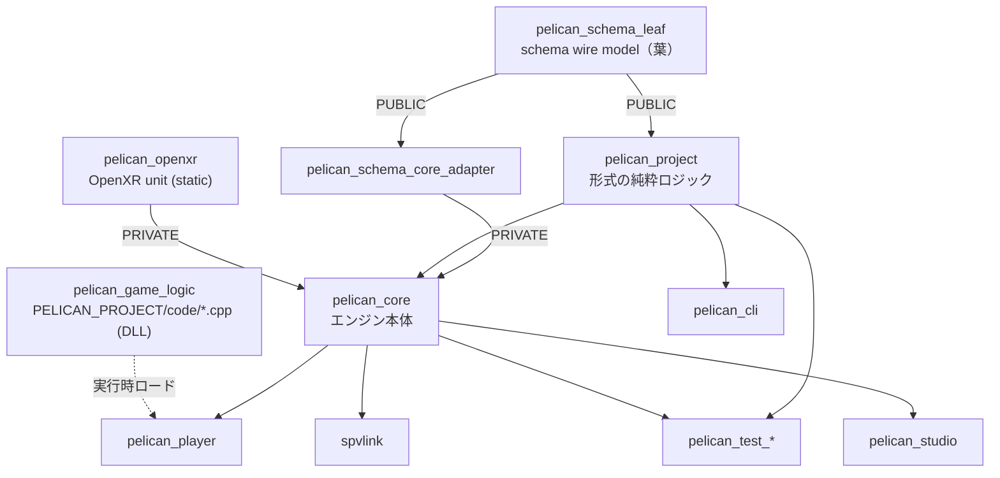

# 第1章 全体構造とビルド

[索引へ戻る](README.md)

## 1.1 リポジトリを先に四つへ分ける

Pelican2のコードは、最初から個々のクラスを読むより、次の四領域として捉えると理解しやすくなります。

| 領域 | 役割 | 主な入口 |
|---|---|---|
| 実行ファイル | 引数を読み、ライブラリを起動する | [`src/player/main.cpp`](../../src/player/main.cpp#L593)、[`src/devcli/main.cpp`](../../src/devcli/main.cpp#L13)、[`src/devstudio/main.cpp`](../../src/devstudio/main.cpp#L5)、[`src/spvlink/main.cpp`](../../src/spvlink/main.cpp#L1)（オフラインSPIR-VリンカCLI、[`spvlink.hpp`](../../src/core/shader/spvlink.hpp)を使用） |
| 純粋ロジック | JSONやテキスト形式のパース・検証・合成。Vulkan不要 | [`src/project/CMakeLists.txt`](../../src/project/CMakeLists.txt#L1) |
| エンジン本体 | ECS、入力、scene、描画、音声、物理、保存、RPC | [`src/core/CMakeLists.txt`](../../src/core/CMakeLists.txt) |
| ゲーム/検証 | プロジェクト固有コード、fixture、単体・結合・golden test | [`projects/example/code/playercontrol.cpp`](../../projects/example/code/playercontrol.cpp#L1)、[`test/CMakeLists.txt`](../../test/CMakeLists.txt#L70) |

この分離で最も重要なのは `pelican_project` です。[`src/project/CMakeLists.txt`](../../src/project/CMakeLists.txt#L1) を見ると、依存は主に `nlohmann_json` とハッシュ用の `picosha2` だけです。project.json封筒とパス参照、scene形式、render feature合成、material/surface形式、JSON-RPCエンベロープ、import/assets manifestをGPUなしで扱えます。

一方の `pelican_core` は [`src/core/CMakeLists.txt`](../../src/core/CMakeLists.txt) で全サブシステムを一つのライブラリへ集約します。現在は細かいCMakeターゲットへ分割する構成ではなく、各サブディレクトリの `target_sources(pelican_core ...)` が同じターゲットへ実装を追加します。

## 1.2 CMakeターゲットの関係



### `pelican_project`

宣言は [`src/project/CMakeLists.txt`](../../src/project/CMakeLists.txt#L1) です。交換形式を扱うコードをまとめ、playerだけでなくCLIやテストからも再利用します。

### `pelican_schema_leaf` と `pelican_schema_core_adapter`

宣言は [`src/schema/CMakeLists.txt`](../../src/schema/CMakeLists.txt#L1) です。依存は `nlohmann_json` だけの STATIC ライブラリで、[`src/schema/schema.hpp`](../../src/schema/schema.hpp#L16) の `Pelican::Schema` 名前空間だけを持ちます。`FieldType` / [`FieldPresence`](../../src/schema/schema.hpp#L110) / [`Node`](../../src/schema/schema.hpp#L127) が、descriptor が core から project / Studio 側へ渡るときの**プロジェクト所有の再帰 wire モデル**です（`Node` 直前のコメントが規範）。ここでいう wire モデルとは、**層やプロセスの境界を越えて受け渡すためだけに定義した表現**のことです（配線の上を流れる形、という含み）。core 側の `SchemaNode` をそのまま渡さず、境界の手前で必ずこの型へ変換するので、core の内部型が project / Studio 側の型に染み出しません。`pelican_project` は PUBLIC にリンクします（[`target_link_libraries(pelican_project PUBLIC nlohmann_json pelican_schema_leaf PRIVATE picosha2)`](../../src/project/CMakeLists.txt#L64)）。

core 側からこの葉を使うための橋が [`pelican_schema_core_adapter`](../../src/core/communication/CMakeLists.txt#L1) で、`schemavocabularyadapter` 1 対だけを持つ別 STATIC ターゲットです。`pelican_core` へは PRIVATE にリンクされ（[同 L20](../../src/core/communication/CMakeLists.txt#L20)）、この 1 ターゲットだけが `/we4061 /we4062`（GCC/Clang では `-Wswitch-enum -Werror=switch-enum`）で **enum の網羅を error に上げて**います。ここでいう網羅とは、`switch` が対象 enum の全列挙子を `case` で明示的に書いているか、という意味です（MSVC の C4061 は `default` があっても未記述の列挙子を、C4062 は `default` が無い場合を指摘します）。語彙の追加が黙って落ちないようにするための局所設定です。

### `pelican_core`

宣言は [`src/core/CMakeLists.txt`](../../src/core/CMakeLists.txt) です。公開includeディレクトリに [`src/core/userpublic`](../../src/core/userpublic) と [`src/core`](../../src/core) を追加します。`userpublic`、`ecs`、`handle.hpp`、`physquery.hpp` の公開ヘッダを `dist*/lib/include` へコピーするPOST_BUILD処理は、[`PELICAN_AUTO_STAGE_SDK`](../../CMakeLists.txt#L52)（既定 **OFF**）がONのときだけ登録されます（[`pelican_copy_headers()`](../../src/core/CMakeLists.txt#L138)）。既定でOFFなのは、Debugの `pelican_core` アーカイブが約1 GiBあり、通常の再リンクごとにコピーすると書き込み量が跳ね上がるためです。`dist*/lib/include` が空でも異常ではありません。

### `pelican_player`

[`src/player/CMakeLists.txt`](../../src/player/CMakeLists.txt#L1) が `pelican_core` と `argparse` をリンクします。`-DPELICAN_PROJECT=<dir>` が指定されると、プロジェクトの `code/CMakeLists.txt` をincludeし、[`pelican_game_sources()`](../../src/player/CMakeLists.txt#L106) でゲームの `.cpp` を**SHAREDライブラリ `pelican_game_logic`** へ追加します（[`add_library(pelican_game_logic SHARED ...)`](../../src/player/CMakeLists.txt#L127)、WP110系列）。

playerは `ENABLE_EXPORTS` と `/WHOLEARCHIVE:pelican_core` でSDKシンボルをexportし（[同 L2-L13](../../src/player/CMakeLists.txt#L2)）、game DLLはplayerのimport libへリンクします（[`pelican_configure_game_logic_target()`](../../src/player/CMakeLists.txt#L45)、`PELICAN_GAME_DLL=1` define）。Windowsでは `LoadLibraryW` より先に、境界と作業量を制限した **raw PE import reader**（raw = OS loader にイメージをマップさせず、DLLファイルのバイト列を自分で読んで PE の import directory を解釈する読み方。マップしないので、壊れたDLLでも DllMain が走らない。詳細は[第10章 §10.4](10_background_knowledge.md)）でSDK epoch anchor の通常・直接・名前付き import を検証します。anchor（またはSDK入口）を import するDLLは OS loader も初期化前に解決しますが、**provider-only の旧DLL**（`getApiV1` 系を export するだけで、SDK 入口も epoch anchor も import しないDLL。「提供するだけ」なので only。次段落で詳述）は未解決 import を持たないため、この常時 raw 診断が実行前 enforcement です。実行時ロードは [`gamelogicreload.cpp`](../../src/core/gamelogic/gamelogicreload.cpp#L280) の `LoadLibraryW`/`dlopen` で行い、起動時初期化は [`initializeConfiguredGameLogic()`](../../src/core/gamelogic/gamelogicreload.cpp#L873)、ABI契約は [`gamelogic.hpp`](../../src/core/userpublic/gamelogic.hpp#L21)（単一定義の `gameLogicAbiVersion` から導く epoch anchor）です。

この診断が保証するのは SDK が生成する **通常・直接・名前付き・非 weak** の top-level import です。host module への delay-load / ordinal import は unsupported としてロード前に拒否し、`GetProcAddress`、依存 DLL 経由、ELF import reader はこの診断の範囲外です。Linux は `RTLD_NOW` による OS enforcement のみを使います。

この診断と OS loader の役割分担は DLL の中身で変わります。SDK 入口(`pelican_register_behavior_v2` / `pelican_register_event_v2` / `pelican_emit_v2` / `pelican_register_system_v2`)か epoch anchor を import する DLL なら、旧版は v1 名(`__registerBehavior` / `__registerEvent` / `__emit` / `__registerSystem`。host はもう export しません)が未解決 import になるので OS loader 自身が拒否します。一方 **provider-only の旧 DLL**(`getApiV1` 系を export するだけで SDK 入口を import しないもの)は未解決 import を持たないため loader は止めず、この raw import 診断([`diagnoseGameLogicImports()`](../../src/core/gamelogic/gamelogicimports.cpp#L559) の anchor 不在 = [`game_logic_abi_stale@1`](../../src/core/gamelogic/gamelogicimports.hpp#L40))が唯一の enforcement です。診断は無効化できず(`#ifdef _WIN32` の中で常時)、[`loadCopy()`](../../src/core/gamelogic/gamelogicreload.cpp#L331) が `LoadLibraryW` を呼ぶ**前**に走るので、旧 DLL の constructor は動きません。Linux 側にこの reader は無いので、`RTLD_NOW` が解決に失敗しない provider-only の旧 `.so` を止める仕組みは今のところありません。

ゲームSystemの静的自動登録はDLLロード時に走り、[`RegistrationOwner`](../../src/core/userpublic/details/reload/registrationowner.hpp#L11) 単位で [`unregisterGameSystems()`](../../src/core/userpublic/details/system/registerer.hpp#L143) により登録解除できます。これが実行中ホットリロードの基盤です。

### `pelican_openxr`

[`src/core/openxr/CMakeLists.txt`](../../src/core/openxr/CMakeLists.txt#L1) が作る独立のstaticライブラリで、OpenXRのdiscovery/session/action/composition/mirrorを担います。`pelican_core` へPRIVATEにリンクされます（[同 L28](../../src/core/openxr/CMakeLists.txt#L28)）。

### `spvlink`

`PELICAN_WITH_SPIRV_LINK=ON`時に
[`src/spvlink/CMakeLists.txt`](../../src/spvlink/CMakeLists.txt#L2) が作るオフラインSPIR-VリンカCLI（実行ファイル名 `pelican-spv-link`）です。[`src/core/shader/spvlink.hpp`](../../src/core/shader/spvlink.hpp) の実装を使います。

### `pelican_cli`

[`src/devcli/CMakeLists.txt`](../../src/devcli/CMakeLists.txt#L1) が作る配布支援CLIです。サブコマンドは `assets`、`bake-camera`、`import`、`dist-config`、`project`、`dump-lowered-material`、`vrm`、`graph-catalog`(共通グラフの module / op / 型の一覧、AG-0) の7種です（[`src/devcli/main.cpp`](../../src/devcli/main.cpp#L13) の分岐と [usage文字列](../../src/devcli/main.cpp#L39)）。Vulkan実行時全体ではなく `pelican_project` と必要な純粋処理を中心にリンクします。

`project init` が書き出す雛形は、[`templateFiles()`](../../src/devcli/projectinit.cpp#L268) が返すファイル名と文字列定数の対で全量が決まります。「新規プロジェクトの既定形」を知りたいときはここだけ読めば足ります。

このうち `passes/main_rendering_config.json` の内容 [`rendering_config_json`](../../src/devcli/projectinit.cpp#L193) は、WP240a（`d58f841`）で111行の手書き宣言からpresetを指す2キーへ置き換わりました。

```json
{
  "pipeline": { "preset": "engine://render_pipelines/hybrid_v1.json" },
  "features": ["engine://features/shadow_directional.json"]
}
```

読む順序は次の3点です。

- preset本体は [`src/core/resources/render_pipelines/hybrid_v1.json`](../../src/core/resources/render_pipelines/hybrid_v1.json)。[`b_embed(pelican_resources render_pipelines/hybrid_v1.json)`](../../src/core/resources/CMakeLists.txt#L87) でエンジンへ埋め込まれるので、`engine://` で解決されます。
- `pipeline.preset` の展開は純粋層の [`resolveRenderPipelinePreset()`](../../src/project/renderpipeline.cpp#L666) が行います。`schema` は `pelican.render_pipeline`、`version` は1固定で、presetが更にpresetを指すことは禁止です。authored側の `features` / `shader_defines` / `graph_transforms` は追記される一方、`render_strategy` / `snapshots` / `target_planning` の上書きは明示エラーになります。この「部分上書きを許さず、構造を変えたいならpresetを丸ごと自分のプロジェクトへコピーして自前宣言に切り替える」やり方を、本ガイドでは **eject 方針**と呼びます（用意された既定の中に留まるか、そこから降りて全部を自分で持つか、の二択にする、という意味です）。
- 呼び出し側は [`composeRenderFeatureConfig()`](../../src/project/featurecompose.cpp#L2780) の先頭で、preset展開はfeature解析より前に走ります。

旧テンプレートはgbuffer_pass / ssao_pass / ssao_blur_pass / presentの4passで、`present` が `uses_light_data: true` によりライティングとpresentを兼ねる構成でした。新しい既定は deferred_geometry → ssao_pass → ssao_blur_pass → deferred_lighting → forward_opaque → `snapshot_copy` 2本 → forward_transparent → scene_present という並びで、forward・半透明・snapshotを持ちます。「新規プロジェクトが最初から何を描くか」が変わっているので、この節より先の章を読むときの前提として押さえておきます。

### `pelican_studio`

[`src/devstudio/CMakeLists.txt`](../../src/devstudio/CMakeLists.txt#L1) が作る Qt Widgets アプリです。
`QMainWindow`、dock、名前付きレイアウトプリセットをシェルに置き、QML は将来追加する場合も葉の
パネル内部だけに限定します。**D0**（「エディタ特権の禁止」という設計決定の名前。標準UIも公開契約
—— RPC・`pelican_project`・データ形式 —— の上に建つ 1 クライアントにすぎず、devstudio だけが呼べる
裏口 API を作らない、という規律。定義は [`docs/design_devstudio_direction.md`](../design_devstudio_direction.md)
の §0.5）のため `pelican_project` は直接リンクしますが `pelican_core` と
core 配下の target はリンクせず、CMake が推移リンクを含めて configure 時に拒否します
（[第7章](07_tools_rpc_tests.md)）。

### CMakeポリシーのpin（CMP0118 / CMP0169）

トップレベルの [`cmake_minimum_required(VERSION 3.13)`](../../CMakeLists.txt#L1) は多くのポリシーを未設定のまま残し、CMake 4.x は未設定をOLDとして解決します。その結果「CIの古いCMakeでは通るが、手元の新しいCMakeではconfigureが落ちる」種類の破綻が2系統あります。CMP0118はトップレベル1箇所の宣言で固定できますが、CMP0169はトップレベルに閉じず、`FetchContent_Populate()` を直接呼ぶ箇所ごとに戻す形（サブディレクトリの `src/core/imgui/CMakeLists.txt` を含む）です。原因は同じなので、片方を触るときはもう片方も見ます。

- [`cmake_policy(SET CMP0118 NEW)`](../../CMakeLists.txt#L10) — ファイル冒頭、`project()` より前に置いています。battery::embedは**ビルド時にファイルの中身を byte 配列としてC++ソースへ焼き込み、実行時には `b::embed<"id">()` で取り出す**静的埋め込みライブラリです（実行時にファイルを探しません）。エンジン標準のshader SPIR-Vやpreset JSONをこれで埋め込むから、`engine://` 参照が**プロジェクト側にコピーを置かなくても**解決できます（`engine://` として引ける資源の取り出し口は [`engineResource()`](../../src/core/loader/engineresources.cpp#L162) で、その中に並ぶ `PELICAN_ENGINE_RESOURCE` マクロが全量です。なお `b::embed` 自体はここ以外でも直接使われており、調査時点では `standardmaterialresource.cpp` / `shadowdepthpasscontainer.cpp` / `spriterenderer.cpp` / `uirenderer.cpp` が自前の shader をこの経路を通さず埋め込んでいます）。そのbattery::embedは `embed.hpp` の生成を `cmake_language(DEFER DIRECTORY ${CMAKE_SOURCE_DIR} CALL ...)` でトップレベルディレクトリへ遅延させ、そのスコープから `file(GENERATE)` で書きます。一方それを `target_sources` で消費するのは [`b_embed_proxy_target(pelican_core pelican_resources)`](../../src/core/resources/CMakeLists.txt#L1) が作る `pelican_resources` で、`b_embed()` は `src/core/resources` のディレクトリスコープで走ります。CMP0118がOLDだと `GENERATED` プロパティがディレクトリ境界を越えないため、generate段階で `battery/embed.hpp` が「存在しないsource file」として拒否されます。
- `CMP0169`（`FetchContent_Populate` の単独呼び出しの禁止）— こちらはNEWにできないので、必要な箇所ごとに `cmake_policy(PUSH)` / `SET ... OLD` / `POP` で囲んでOLDへ戻しています。`FetchContent_MakeAvailable()` を使わず、展開だけしてターゲットの作り方を自分で決めている依存が対象で、トップレベルのminiaudio・[`FetchContent_Populate(picosha2)`](../../CMakeLists.txt#L179)・SPIRV-Headers・tinyexr・JoltPhysicsの5箇所に、`PELICAN_WITH_IMGUI` がONのときだけ通る [`FetchContent_Populate(imgui_vendor)`](../../src/core/imgui/CMakeLists.txt#L14) を加えた6箇所に同じ定型が並びます。`FetchContent_Populate()` を直接呼ぶ場所を増やすたびに同じ定型が要る、という形です。

## 1.3 `src/core` の責務地図

| ディレクトリ | 責務 | 中心となる型/関数 |
|---|---|---|
| [`animation/`](../../src/core/animation) | アニメーション評価フェーズ、VRM application service | [`AnimationService`](../../src/core/animation/animationservice.hpp)、[`vrmapplication.hpp`](../../src/core/animation/vrmapplication.hpp) |
| [`appflow/`](../../src/core/appflow) | 時刻、フレームフェーズ、loop、終了処理 | [`Loop`](../../src/core/appflow/loop.hpp#L7)、[`EngineTime`](../../src/core/appflow/enginetime.hpp#L10) |
| [`gamelogic/`](../../src/core/gamelogic) | game DLLのロード・ホットリロード | [`gamelogicreload.hpp`](../../src/core/gamelogic/gamelogicreload.hpp) |
| [`geomhelper/`](../../src/core/geomhelper) | 幾何ヘルパ（header only） | [`geomhelper.hpp`](../../src/core/geomhelper/geomhelper.hpp) |
| [`imgui/`](../../src/core/imgui) | 開発者UI（ImGui runtime、frame plan viewer） | [`ImGuiSystem`](../../src/core/imgui/imguisystem.hpp#L22)、[`planviewer.hpp`](../../src/core/imgui/planviewer.hpp) |
| [`openxr/`](../../src/core/openxr) | OpenXR discovery/session/action/composition/mirror（独立static lib） | [`OpenXr::SessionRuntime`](../../src/core/openxr/openxrsession.hpp#L134) |
| [`ui/`](../../src/core/ui) | 2D UI（document/layout/atlas/bitmapfont/input routing） | [`ui::UiModule`](../../src/core/ui/module.hpp#L30) |
| [`watch/`](../../src/core/watch) | FileWatcher、ContentDigest、reload gate/queue/transaction/service | [`watch::ReloadService`](../../src/core/watch/reloadservice.hpp#L136) |
| [`loader/`](../../src/core/loader) | 設定、path/埋め込み資源のruntime adapter、scene、画像 | [`ProjectBasicConfig`](../../src/core/loader/basicconfig.hpp#L70)、[`PathResolver`](../../src/core/loader/pathresolver.hpp#L9)。純粋な解決規則は [`ProjectPathResolver`](../../src/project/projectpathresolver.hpp#L69) |
| [`ecs/`](../../src/core/ecs) | 内部ECSのファサード、Componentメタデータ、組み込みSystem | [`ECSCore`](../../src/core/ecs/core.hpp#L13)、[`ComponentInfoManager`](../../src/core/ecs/componentinfo.hpp#L60) |
| [`userpublic/`](../../src/core/userpublic) | ゲームコード向け公開APIとECS実体テンプレート | [`GameContext`](../../src/core/userpublic/gamecontext.hpp#L26)、[`GameObjects`](../../src/core/userpublic/gameobjects.hpp#L31) |
| [`os/`](../../src/core/os) | GLFW window、生入力、Action map | [`InputStateCore`](../../src/core/os/inputstate.hpp#L206)、[`InputActionMap`](../../src/core/os/actionmap.hpp#L64) |
| [`renderingpass/`](../../src/core/renderingpass) | 描画宣言のパース、検証、frame graph、compute task、RT | [`PassDefinition`](../../src/core/renderingpass/renderingpass.hpp#L458)、[`FramePlan`](../../src/core/renderingpass/frameplanner.hpp#L159) |
| [`renderer/`](../../src/core/renderer) | material/fullscreen/UI/debug/shadowの実描画。frameresources / projectionjitter / temporal / sprite* / velocitypasscontainer / shadowdepthpasscontainer / atlasassetresource が追加 | [`MaterialRenderer`](../../src/core/renderer/materialrender.hpp#L39)、[`Camera`](../../src/core/renderer/camera.hpp#L20) |
| [`render_algorithms/`](../../src/core/render_algorithms) | 差し替え可能な標準render algorithm（cube capture / planar reflection）のViewFamily provider。`PELICAN_WITH_STANDARD_RENDER_ALGORITHMS=OFF` で丸ごと外れる | [`registerStandardRenderAlgorithmProviders()`](../../src/core/render_algorithms/standardrenderalgorithms.hpp#L9) |
| [`vkcore/`](../../src/core/vkcore) | Vulkan instance/device、FrameTarget、command、layout、renderer編成 | [`VulkanManageCore`](../../src/core/vkcore/core.hpp#L36)、[`IFrameTarget`](../../src/core/vkcore/frametarget.hpp#L254) |
| [`shader/`](../../src/core/shader) | compile、SPIR-V reflection、module、pipeline cache/hot reload | [`ShaderLibrary`](../../src/core/shader/shaderlibrary.hpp#L123)、[`PipelineFactory`](../../src/core/shader/pipelinefactory.hpp#L230) |
| [`model/`](../../src/core/model) | glTF/VATロードと頂点バッファ | [`GltfLoader`](../../src/core/model/gltf.hpp#L61)、[`VertBufContainer`](../../src/core/model/vertbufcontainer.hpp#L48) |
| [`material/`](../../src/core/material) | texture/material/pipeline/descriptor | [`MaterialContainer`](../../src/core/material/materialcontainer.hpp#L77) |
| [`asset/`](../../src/core/asset) | asset JSONからmodel templateを登録 | [`ModelAssetContainer`](../../src/core/asset/model.hpp#L24) |
| [`fullscreenpass/`](../../src/core/fullscreenpass) | fullscreen pipelineと入力descriptor | [`FullscreenPassContainer`](../../src/core/fullscreenpass/fullscreenpasscontainer.hpp#L18) |
| [`light/`](../../src/core/light) | scene lightとlight UBO | [`LightContainer`](../../src/core/light/lightcontainer.hpp#L29) |
| [`phys/`](../../src/core/phys) | CPU幾何クエリとscene binding | [`PhysWorld`](../../src/core/phys/physworld.hpp#L42)、[`phys::Shape`](../../src/core/phys/physquery.hpp#L41) |
| [`audio/`](../../src/core/audio) | WAV decode、miniaudio backend、voice/bus | [`Audio`](../../src/core/audio/audio.hpp#L24) |
| [`persistence/`](../../src/core/persistence) | settings/save slot、原子的書き換え | [`Persistence`](../../src/core/persistence/persistence.hpp#L39) |
| [`playback/`](../../src/core/playback) | transform sequenceとVAT再生 | [`SeqPlayer`](../../src/core/playback/seqplayer.hpp#L51)、[`VatPlayer`](../../src/core/playback/vatplayer.hpp#L12) |
| [`communication/`](../../src/core/communication) | stdio JSON-RPCと編集RPC一式（コマンド、journal、preview、asset query、windowed host） | [`RpcServer`](../../src/core/communication/rpcserver.hpp#L55)、[`EditorCommandService`](../../src/core/communication/editorcommandservice.hpp)、[`EditorJournal`](../../src/core/communication/editorjournal.hpp) |
| [`renderdoc/`](../../src/core/renderdoc) | RenderDoc in-application captureの受動統合（RenderDoc自体のロードはしない） | [`RenderDocCapture`](../../src/core/renderdoc/renderdoccapture.hpp#L66)、[`renderDocDevicePointerFromVulkanInstance()`](../../src/core/renderdoc/renderdoccapture.hpp#L98) |

トップレベルの単ファイルにも重要なものがあります: [`xractivation.hpp`](../../src/core/xractivation.hpp)（XR起動可否の決定）、[`parallel_prepare.hpp`](../../src/core/parallel_prepare.hpp)（順序保証付き並列prepare）。

`src/core` の外には、pinしたベンダーヘッダだけを置く [`src/third_party/`](../../src/third_party) があります。現在の内容は [`src/third_party/renderdoc/renderdoc_app.h`](../../src/third_party/renderdoc/renderdoc_app.h)（RenderDoc v1.45 のin-application APIヘッダ）と、その出所・SHA-256・ライセンスを記録した [`README.md`](../../src/third_party/renderdoc/README.md) だけです。RenderDocのバイナリやimport libはリンクも配布もしません。

### 2026-07-17以降に増えた主なディレクトリ・ファイル

責務地図の粒度では見えにくいものの、読解上の入口になるものをまとめます。

| 場所 | 内容 |
|---|---|
| [`ecs/archetypemigration.hpp`](../../src/core/ecs/archetypemigration.hpp#L121) | 失敗しても原子的なarchetype移行と entity mutation のトークン（[第4章](04_ecs_deep_dive.md)） |
| [`gamelogic/behaviorarena.hpp`](../../src/core/gamelogic/behaviorarena.hpp#L168) | オブジェクトbehaviorのアタッチメントarena。ECS Componentではない別の所有者 |
| [`imgui/inspector.hpp`](../../src/core/imgui/inspector.hpp#L167) / [`imgui/assetbrowser.hpp`](../../src/core/imgui/assetbrowser.hpp#L36) | schema駆動inspectorパネルと読み取り専用asset browserパネル |
| [`loader/authoringscenedocument.hpp`](../../src/core/loader/authoringscenedocument.hpp#L90) | `AuthoringSceneDocument` / `AuthoringSceneDocumentStage`（[第3章](03_project_and_loading.md)） |
| [`loader/componentcodec.hpp`](../../src/core/loader/componentcodec.hpp#L226) | component codecの五点セット。componentのJSON受理仕様の正 |
| [`loader/editorprojectiontransaction.hpp`](../../src/core/loader/editorprojectiontransaction.hpp#L25) | 編集のprepare/publish transactionと8種のadapter kind |
| [`loader/vrmadecoder.hpp`](../../src/core/loader/vrmadecoder.hpp#L25) / [`model/vrmaanimation.hpp`](../../src/core/model/vrmaanimation.hpp#L87) / [`animation/vrmaretarget.hpp`](../../src/core/animation/vrmaretarget.hpp#L124) | `.vrma` decode → 型付きチャンネル → versioned retarget profile |
| [`renderingpass/previewgraph.hpp`](../../src/core/renderingpass/previewgraph.hpp#L15) | 第3のグラフプログラム（preview variant） |
| [`vkcore/previewexecutor.hpp`](../../src/core/vkcore/previewexecutor.hpp#L61) | previewの隔離実行とキャプチャ |
| [`vkcore/debugutils.hpp`](../../src/core/vkcore/debugutils.hpp#L41) | `VK_EXT_debug_utils` の選択、オブジェクト名、コマンドラベル |
| [`vkcore/memorydiagnostics.hpp`](../../src/core/vkcore/memorydiagnostics.hpp#L41) | driver heap / engine categoryのメモリ診断スナップショット |
| [`vkcore/deferredcallback.hpp`](../../src/core/vkcore/deferredcallback.hpp#L15) | `DeferredCallbackLifetime`（lease + `closeAndWait()`） |
| [`userpublic/behavior.hpp`](../../src/core/userpublic/behavior.hpp#L60) + [`details/behavior/`](../../src/core/userpublic/details/behavior) | Behavior公開APIと [`PELICAN_REGISTER_BEHAVIOR`](../../src/core/userpublic/details/behavior/registerer.hpp#L385) の自動登録 |
| [`userpublic/details/schema/`](../../src/core/userpublic/details/schema) | [`StructFieldSchema`](../../src/core/userpublic/details/schema/structfieldschema.hpp#L52)、[`structFields()`](../../src/core/userpublic/details/schema/structfieldschema.hpp#L845)、JSON codec |
| [`src/devcli/processrunner.hpp`](../../src/devcli/processrunner.hpp#L34) | プロセスグループkill付きの子プロセス実行 |

## 1.4 依存方向

理想化すると、依存は次の方向です。

```text
ゲームコード → userpublic → coreの各サービス → vkcore/外部ライブラリ
                     ↘
                      project（純粋パース・検証）
```

実装上は、`GET_MODULE()` を使うサービスロケータが多いため、C++のコンストラクタ引数だけを見ても依存が全部は分かりません。サービスロケータとは、**必要な相手を引数で渡してもらう（DI）のではなく、共通の取得口から自分で引いてくる**方式のことです。Pelicanの取得口は `GET_MODULE(T)` ひとつで、鍵は文字列名ではなく型 `T`、実体は型ごとの `static std::optional<T>` を初回アクセス時に構築するだけの薄い機構です（[第9章 §9.1](09_black_magic_and_gotchas.md)）。DIコンテナのような登録表・スコープ・差し替え機構は持ちません。たとえば [`Renderer::Renderer()`](../../src/core/vkcore/renderer.cpp#L2971) は一行ですが、そこから設定、Vulkan、render target、shader、pipelineなどが遅延生成されます。

新しい描画コードでは依存を明示する `XxxDependencies` 構造体が増えています。例は [`RenderPassExecutorDependencies`](../../src/core/vkcore/render_pass_executor.hpp#L16)、[`RenderPassDispatchDependencies`](../../src/core/vkcore/render_pass_dispatch.hpp#L29)、[`RenderingPassConfigRegistrationDependencies`](../../src/core/renderingpass/renderingpassconfigregistration.hpp#L65) です。これはグローバル取得を局所化し、純粋テストをしやすくする境界です。

## 1.5 Pelicanでいう「インターフェース」の種類

Pelicanは継承ベースのinterfaceを多用しません。実際には次の六形式があります。

| 形式 | 例 | 目的 |
|---|---|---|
| 仮想基底 | [`IFrameTarget`](../../src/core/vkcore/frametarget.hpp#L254)、[`ILogicalFrameTarget`](../../src/core/vkcore/renderer.hpp#L92) | windowed/headless/XRの実装差し替え |
| 依存構造体 | [`MaterialRendererDependencies`](../../src/core/renderer/materialrender.hpp#L22) | 呼び出しに必要な協力オブジェクトを明示 |
| Concept/duck typing | [`HasBatchProcess`](../../src/core/userpublic/details/ecs/coretemplate.hpp#L77)、[`HasGameSystemUpdate`](../../src/core/userpublic/details/system/registerer.hpp#L38) | メソッド形だけをcompile時に要求 |
| `std::variant` | [`PassInfo`](../../src/core/renderingpass/renderingpass.hpp#L321)、[`phys::Shape`](../../src/core/phys/physquery.hpp#L41) | 閉じた型集合を安全に分岐 |
| 関数コールバック | [`RenderFeatureComposeDependencies`](../../src/project/featurecompose.hpp#L15)、[`RpcServer::MethodHandler`](../../src/core/communication/rpcserver.hpp#L57) | I/Oやdispatchだけを注入 |
| サービスロケータ | [`DECLARE_MODULE` / `GET_MODULE`](../../src/core/container.hpp#L15) | プロセス内の共有モジュールを遅延生成 |

型の設計を読むときは「基底クラスがないからinterfaceがない」と判断せず、依存構造体・Concept・variant・コールバックも契約として読みます。

## 1.6 ビルド機能フラグ

機能フラグの定義は [`NAME PELICAN_RUNTIME_SHADER_COMPILER` 以下のregistry](../../cmake/pelican_feature_registry.cmake#L103) です。トップレベルはregistryからCMake optionを宣言します。現在の登録は15件で、下表の13件に加えて [`NAME PELICAN_WITH_SPIRV_LINK`](../../cmake/pelican_feature_registry.cmake#L110) と [`NAME SKIP_DEVSTUDIO`](../../cmake/pelican_feature_registry.cmake#L215) が入ります。

registryの各行が持つキーのうち、この節で効くのは2つです。`BASELINE` は**対照ビルドの基準になる値**（WPごとの対照matrixは、この基準から対象フラグだけを動かして作られます）で、同時に**`OPTION_DEFAULT` が明示されていなければCMake optionの既定値も兼ねます**。`OPTION_DEFAULT` はその兼務を切り離し、既定値だけを別に指定するキーです（registry冒頭のコメントが規範）。

この2件は「機能のON/OFF」ではなく開発基準との差である点が他と違います。`PELICAN_WITH_SPIRV_LINK` は `BASELINE ON` でありながら `OPTION_DEFAULT OFF` で、**開発基準ではONだが通常の利用者にはopt-in**という宣言です（registry冒頭のコメントが理由）。`SKIP_DEVSTUDIO` は `BASELINE OFF` / `CONTRAST ON`、つまり対照ビルドの方がQtを外す側です。`BASELINE` と `OPTION_DEFAULT` を混同すると「既定でONのはず」を読み違えます。

| フラグ | ON時 | OFF時の動作 |
|---|---|---|
| `PELICAN_RUNTIME_SHADER_COMPILER` | Vulkan SDK版shadercでGLSLを実行時コンパイル、feature合成可 | shadercをリンクせず、source shader/feature利用時に明示エラー |
| `PELICAN_WITH_AUDIO` | miniaudioと`Audio`実装をリンク | `GameContext`音声APIが`BuildFeatureDisabledError` |
| `PELICAN_WITH_VAT` | VAT parser/player、VAT shaderをリンク | GLBにVAT extrasがあれば明示エラー、playerはstub |
| `PELICAN_WITH_EXR` | tinyexrでEXRロード | EXR指定時に明示エラー |
| `PELICAN_WITH_RPC` | stdio RPC server | [`rpcserver_stub.cpp`](../../src/core/communication/rpcserver_stub.cpp#L1) |
| `PELICAN_WITH_SEQPLAYER` | transform sequence parser/player | [`seqplayer_stub.cpp`](../../src/core/playback/seqplayer_stub.cpp#L1) |
| `PELICAN_WITH_IMGUI` | 開発者UI（ImGui）をリンク | imguiモジュールなし |
| `PELICAN_WITH_PHYSICS` | 物理クエリサービスとcollider world | [`physicsservice_stub.cpp`](../../src/core/phys/physicsservice_stub.cpp)、sceneにcolliderがあると明示エラー（[`scene.cpp`](../../src/core/loader/scene.cpp#L150)） |
| `PELICAN_WITH_OPENXR` | private OpenXR unit（`pelican_openxr`）をリンク | `--xr` 指定時に明示エラー |
| `PELICAN_WITH_RENDERDOC` | **既に注入済みの**RenderDoc APIを受動利用（F11キャプチャ、`capture_gpu` RPC） | [`renderdoccapture_stub.cpp`](../../src/core/renderdoc/renderdoccapture_stub.cpp) をリンクし、`RenderDocCapture` は常に `unavailable`（理由 `renderdoc_build_disabled`）。キャプチャ要求は理由付きで拒否 |
| `PELICAN_WITH_STANDARD_RENDER_ALGORITHMS` | 差し替え可能な標準render algorithmパッケージ [`src/core/render_algorithms/`](../../src/core/render_algorithms) と、その専用engine resourceを含める（[`PELICAN_STANDARD_RENDER_ALGORITHM_RESOURCES`](../../src/core/resources/render_algorithms/standard_algorithms.cmake#L6)） | サブディレクトリごと [`add_subdirectory(render_algorithms)`](../../src/core/CMakeLists.txt#L51) から外れ、[`registerStandardRenderAlgorithmProviders()`](../../src/core/renderer/viewfamilyproviderregistry.cpp#L71) の呼び出しも `#if` で消える。グラフ／コンパイラ／provider機構そのものは残るので、プロジェクト側で自前のViewFamily実装を差せる |
| `PELICAN_ENABLE_ASAN` | ASan用compile/link option | 追加なし |

このほか `PELICAN_AUTO_STAGE_SDK`（既定OFF、`dist*` へのSDK staging）と `PELICAN_LEAN_TEST_ARTIFACTS`（既定ON、テスト実行ファイルのPDB削減）は機能ではなくビルド成果物の量を決めるoptionです。

物理providerの選択だけはregistryの `DEPENDENT_OPTION` で、`PELICAN_WITH_PHYSICS` がONのときにだけ現れます（[`NAME PELICAN_WITH_JOLT_PHYSICS`](../../cmake/pelican_feature_registry.cmake#L195)）。

| フラグ | 既定 | ON時 |
|---|---|---|
| `PELICAN_WITH_JOLT_PHYSICS` | OFF | optionalのJolt query providerを使う |
| `PELICAN_WITH_BUILTIN_PHYSICS` | ON | Pelican内蔵のsphere/box/capsule query providerを使う |

両方ONならJoltを優先し、内蔵providerはregistryの連動宣言に従って強制的にOFFへ戻されます（[`FORCES_ON_CONTRAST PELICAN_WITH_BUILTIN_PHYSICS=OFF`](../../cmake/pelican_feature_registry.cmake#L201)）。この2つだけはPUBLICではなく [`target_compile_definitions(pelican_core PRIVATE ...)`](../../src/core/CMakeLists.txt#L21) のPRIVATE compile definitionです。

機能OFF時にヘッダのAPI形状を消すのではなく、できる限り同じ入口を保ち、明示的な「このバイナリでは無効」エラーへ寄せています。共通例外は [`BuildFeatureDisabledError`](../../src/core/build_features.hpp#L20) です。

実装の差し替え方は、サブディレクトリのCMakeが `.cpp` を選ぶ形です。たとえば [`src/core/renderdoc/CMakeLists.txt`](../../src/core/renderdoc/CMakeLists.txt) は `PELICAN_WITH_RENDERDOC` により `renderdoccapture.cpp` か `renderdoccapture_stub.cpp` のどちらかだけを `pelican_core` へ追加します。フラグ自体は [`src/core/CMakeLists.txt`](../../src/core/CMakeLists.txt) でPUBLICなcompile definitionとしても公開されるため、他のサブシステムからも `#if PELICAN_WITH_RENDERDOC` で参照できます。

## 1.7 主な外部ライブラリ

| ライブラリ | 使用箇所 |
|---|---|
| Vulkan-Hpp / VMA-Hpp | GPU APIとメモリ管理（[`VulkanManageCore`](../../src/core/vkcore/core.cpp#L925)） |
| GLFW | window、入力、surface（[`Window`](../../src/core/os/window.hpp#L17)） |
| GLM | 行列・quaternion・vectorの内部演算 |
| nlohmann/json | project/scene/rendering/RPC/保存など全JSON |
| shaderc | GLSLからSPIR-V（[`ShaderCompiler`](../../src/core/shader/shadercompiler.hpp#L39)）。runtime compiler ON時だけVulkan SDK版をリンクし、暗黙のFetchContent fallbackは行わない |
| SPIRV-Reflect | descriptor/push constant/vertex input抽出（[`reflect()`](../../src/core/shader/shaderreflection.hpp#L66)） |
| tinygltf | glTF/GLB/VRMロード（[`GltfLoader`](../../src/core/model/gltf.cpp#L2647)） |
| stb / tinyexr | PNG等とEXRの画像ロード |
| miniaudio | 音声backend |
| OpenXR SDK | loader + headers（[OpenXR-SDK-Sourceの取得](../../CMakeLists.txt#L270)、`PELICAN_WITH_OPENXR` 時） |
| JoltPhysics | optionalの物理provider（[JoltPhysicsの取得](../../CMakeLists.txt#L420)、`PELICAN_WITH_JOLT_PHYSICS` 時） |
| SPIRV-Tools | experimental SPIR-V linking（`PELICAN_WITH_SPIRV_LINK=ON`時だけ取得、[`if(PELICAN_WITH_SPIRV_LINK)`](../../CMakeLists.txt#L167)） |
| Dear ImGui | 開発者UI（`PELICAN_WITH_IMGUI` 時） |
| battery::embed | shaderのSPIR-VとengineリソースJSON（`render_pipelines/`、`features/`、`surfaces/` など）をバイナリへ埋め込む。入口は [`b_embed_proxy_target(pelican_core pelican_resources)`](../../src/core/resources/CMakeLists.txt#L1) で、以降に並ぶ `b_embed()` の一覧が `engine://` で引ける資源の全量。ビルドフラグで消えうる資源の扱いは2通りに分かれます。`PELICAN_WITH_STANDARD_RENDER_ALGORITHMS` 側は [`PELICAN_OPTIONAL_ENGINE_RESOURCE_IDS`](../../src/core/resources/CMakeLists.txt#L139) に積まれて `pelican_optional_engine_resources.inc` として生成されますが、[`embed_shader(vat.vert)`](../../src/core/resources/CMakeLists.txt#L7) だけはこの一覧に載らず、[`engineResource()`](../../src/core/loader/engineresources.cpp#L162) 側の `#if PELICAN_WITH_VAT` と対で書かれています。書き込み量削減のため [`cmake/patch_battery_embed_low_write.cmake`](../../cmake/patch_battery_embed_low_write.cmake) を `PATCH_COMMAND` で当てており、CMP0118のpinもこの依存のため |
| picosha2 | SHA-256。`pelican_project` の形式ハッシュに加え、`pelican_core` でもscene snapshot digestやVRMA content hashに使います（[`target_link_libraries(pelican_core PRIVATE picosha2)`](../../src/core/CMakeLists.txt#L105)） |
| RenderDoc in-application API | ヘッダのみvendor同梱（[`src/third_party/renderdoc/renderdoc_app.h`](../../src/third_party/renderdoc/renderdoc_app.h)）。外部取得もバイナリリンクもしません |
| quill | ログ |
| Catch2 | 単体テスト |
| Qt6/QML | Pelican Studio |

外部依存のバージョンはトップレベルの `GIT_TAG` 群（先頭は [`GIT_TAG v10.2.0`](../../CMakeLists.txt#L74)）に固定されています。picosha2はもともと「純粋層だけの依存」でしたが、現在は `pelican_core` からも使われる点に注意してください。

## 1.8 読解用のビルド

通常ビルド:

```powershell
cmake . -B build -DCMAKE_PREFIX_PATH=C:/Qt/6.x/msvc2022_64
cmake --build build
ctest --test-dir build
```

エンジン本体だけを読みたい場合はStudioを外せます。

```powershell
cmake . -B build -DSKIP_DEVSTUDIO=ON
cmake --build build
```

テストとテスト専用toolingも外す場合は、標準CMakeオプションを使います。

```powershell
cmake . -B build -DSKIP_DEVSTUDIO=ON -DBUILD_TESTING=OFF
cmake --build build
```

この構成はPythonを探索しません。`BUILD_TESTING=ON`でも
`PELICAN_PYTHON_TESTS=OFF`が既定で、C++/CMakeテストだけを登録します。
手元でPython 3がある場合だけ追加するには`AUTO`、完全なgateを要求するCIは
`PELICAN_PYTHON_TESTS=ON`を使います。OpenXR SDKのchecked-in生成済みsourceを
使う通常構成も、上流CMakeの任意Python探索を局所的に無効化します。

experimental SPIR-V linkerも通常build graphから分離されており、
`PELICAN_WITH_SPIRV_LINK=OFF`が既定です。ON時だけpinned SPIRV-Toolsと
`pelican-spv-link` CLIを構成し、実行時の`PELICAN_SPV_LINK=experimental`を有効にできます。

ゲームコードをplayerへ組み込む場合:

```powershell
cmake . -B build -DSKIP_DEVSTUDIO=ON -DPELICAN_PROJECT=projects/example
cmake --build build --target pelican_player
```

`projects/example/code/CMakeLists.txt` から [`pelican_game_sources(playercontrol.cpp)`](../../projects/example/code/CMakeLists.txt#L1) が呼ばれます。登録マクロの挙動を追うには、この「ソースが `pelican_game_logic` DLLへ入り、playerが実行時にロードする」という点が重要です。ビルド済みDLLを別パスから読ませたい場合は起動オプション `--game-logic` を指定します。

### 複数 worktree を並行させるときの `tools/worktree.sh`

同じリポジトリの worktree を並べて `cmake` を回すと、依存ソース（`build/_deps`）の重複取得と MSBuild の node 再利用が事故になります。[`tools/worktree.sh`](../../tools/worktree.sh#L2) がその環境を**呼び出しごとに明示する**ラッパです（冒頭コメントが「shell profile の副作用へ置き換えるな」と規範を書いています）。

```bash
tools/worktree.sh configure <worktree> [追加のcmake引数...]
tools/worktree.sh build     <worktree> [--target ...]
tools/worktree.sh test      <worktree> [-R ...]
```

`configure` は primary worktree（`git worktree list` の先頭）の `build/_deps/<dep>-src` を `FETCHCONTENT_SOURCE_DIR_<DEP>` で指し直し、`MSBUILDDISABLENODEREUSE=1` を立てます。そのうえで **manifest** `build/pelican_worktree_manifest.json` を書きます（[`write_manifest`](../../tools/worktree.sh#L41)）。中身は generator、config、依存ソース root、node reuse の有無、ラッパが決めた引数の fingerprint、追加引数の fingerprint です。

`build` / `test` は先に [`check_manifest`](../../tools/worktree.sh#L54) を通し、ラッパ側の半分を再計算して**一致しなければ名指しで止まります**（`WP385: worktree manifest mismatch; reconfigure through tools/worktree.sh configure`）。manifest が無ければ `configure` を促して exit 2 です。狙いは「別の generator・別の依存 root・node reuse 有効のまま作ったビルドツリーへ、あとから build/test だけ掛ける」という取り違えを、緑のまま通さないことです。

`PELICAN_WORKTREE_GENERATOR=Ninja` のときだけ、Git Bash が `vcvars64.bat` の環境を保持できないため `cmd.exe` に `call vcvars && cmake` を1プロセスで実行させます。

`PELICAN_PROJECT` に指定できるプロジェクトは [`projects/`](../../projects) 直下にあります。

| プロジェクト | 用途 |
|---|---|
| [`projects/example`](../../projects/example) | 標準の検証プロジェクト。rendering configは `render_targets` / `rendering_passes` を自分で並べる従来形（[`main_rendering_config.json`](../../projects/example/passes/main_rendering_config.json)） |
| [`projects/animgraph_demo`](../../projects/animgraph_demo) | アニメーショングラフのデモ。WP240aでrendering configがpreset形へ移行済みで、`project init` の既定と同じ2キーだけになっています（[`passes/main.json`](../../projects/animgraph_demo/passes/main.json)）。preset形と従来形を見比べるならこの2プロジェクトです |
| [`projects/sprite_demo`](../../projects/sprite_demo) | 2Dスプライトのデモ |
| [`projects/vrm_xr_demo`](../../projects/vrm_xr_demo) | VRM + XRのデモ |

## 1.9 CIとビルド構成の検証 ✅実装済み

ビルド構成が壊れていないかは、2本のGitHub Actionsワークフローで見ています。役割が違うので、変更の種類で読み分けます。

| ワークフロー | 起動条件 | 見ているもの |
|---|---|---|
| [`.github/workflows/cpu-gate.yml`](../../.github/workflows/cpu-gate.yml) | 毎PR + ブランチpush | 既定構成でconfigure/build、GPU不要のCTestを厳密なSKIPポリシー付きで実行 |
| [`.github/workflows/configuration-smoke.yml`](../../.github/workflows/configuration-smoke.yml) | 週次（`cron: "17 16 * * 6"`）と `workflow_dispatch` のみ | 機能フラグ対照ビルドと、クリーンcloneからの通し確認 |

CPU gateは、ビルドの前にCIポリシー自体を検証する2ステップを持ちます。

- `python -B -m unittest discover -s test/ci -p "test_*.py"` — [`test/ci/`](../../test/ci) のポリシーチェッカ（[`test_golden_inventory.py`](../../test/ci/test_golden_inventory.py)、[`test_contract_boundary_gate.py`](../../test/ci/test_contract_boundary_gate.py)、[`test_skip_policy.py`](../../test/ci/test_skip_policy.py)）
- `python -B test/golden_inventory.py --repo-root .` — golden testの台帳と実体の突き合わせ

本体のCTestは [`test/ci/run_cpu_gate.py`](../../test/ci/run_cpu_gate.py) が実行しますが、これはラベル選択とallowlistのパスを渡すだけの薄いドライバです。`ctest` 起動とSKIP判定の実体は [`run_gate()`](../../test/ci/skip_policy.py#L142) と [`validate_skip_policy()`](../../test/ci/skip_policy.py#L74) にあります。判定は [`test/ci/cpu_skip_allowlist.txt`](../../test/ci/cpu_skip_allowlist.txt) との厳密な照合で、許可外のSKIPだけでなく「allowlistに名前があるのに一度も現れなかったテスト」でも落ちるため、リストが腐りません。

同じ `run_gate()` の上に [`test/ci/run_gpu_gate.py`](../../test/ci/run_gpu_gate.py) が乗っており、違いはラベル選択（`-L gpu` か `-LE gpu` か）とallowlistだけです。ただしこちらはGitHub Actionsのワークフローからは呼ばれておらず、Vulkan deviceのある機械で手で実行する位置づけです。[`test/ci/gpu_skip_allowlist.txt`](../../test/ci/gpu_skip_allowlist.txt) は意図的に空で、その理由と運用は [`docs/ci.md`](../ci.md) にあります。

configuration smokeはregistry matrix生成、対照build、clean-cloneの3 jobからなります。

- **機能フラグの対照matrix**: [`cmake/pelican_feature_registry.cmake`](../../cmake/pelican_feature_registry.cmake) の全行を、共通基準から対象だけ（宣言済み連動を除く）動かしてビルドします。CI matrix自体もregistryから生成されます。ドライバは [`test/run_build_units_smoke.cmake`](../../test/run_build_units_smoke.cmake) と [`test/run_project_code_smoke.cmake`](../../test/run_project_code_smoke.cmake) です。build-unit側はQtとSPIR-V linker用Pythonを用意してC++ probeを残しつつ`PELICAN_PYTHON_TESTS=OFF`、project-code側は`BUILD_TESTING=OFF`かつPython探索禁止です。`fail-fast: false` で、自動リトライはありません。
- **clean-clone job**: 新規checkoutに重いexample assetが混ざっていないことを確認したうえで、ポリシーチェッカ → golden inventory → configure → build → `run_cpu_gate.py` を順に流します。

### GPU テストの直列化: label と `RESOURCE_LOCK` と launcher の三点一致

`gpu` ラベルの付いた CTest は、1つの `ctest` 実行の中では [`RESOURCE_LOCK pelican_gpu`](../../test/CMakeLists.txt#L42) で直列化され、**プロセスを跨ぐ側**は [`pelican_gpu_lease_run`](../../test/CMakeLists.txt#L28) という launcher が machine-wide の lease で担います。この launcher は意図的に `pelican_core` へ依存しません（本番ビルドが壊れても lease が消えないため）。

ビルド構成として押さえるのは次の3点です。lease 自体の状態機械は[第7章](07_tools_rpc_tests.md)にあります。

- `gpu` label / `RESOURCE_LOCK=pelican_gpu` / launcher 起動の3つは**必ず同時に成立**していなければならず、[`verify_gpu_lease_inventory.py`](../../test/ci/verify_gpu_lease_inventory.py#L6) が CTest の inventory を読んで食い違いを落とします。
- 手書きの `add_test()` は [`pelican_gpu_test_properties(<test> <intrinsic>)`](../../test/CMakeLists.txt#L37) を呼び、Catch2 が discover した分は build 後に `add_test()` 行を書き換えて launcher を差し込みます。
- CTest の `TIMEOUT` は `lease_timeout_max + intrinsic + grace` で生成し、3つの数値の出所は [`test/gpu_lease_config.cmake`](../../test/gpu_lease_config.cmake#L3) の1ファイルだけです。

### test-only TU: `PELICAN_TESTING` は使わない

fault injection の setter のように「テストからだけ触れて、製品バイナリには存在してはいけない」入口があります。この repo は **`PELICAN_TESTING` のような define を使いません**（リポジトリ全体に不在です）。代わりに、setter の定義を `test/` 側の TU（`sceneloadfault_testing.cpp` / `modelreleasefault_testing.cpp`）にだけ置き、production 側は `friend` 宣言で受けます。core を二重にビルドすることもしません。

強制は CMake script test [`wp380c_production_has_no_fault_setter_symbol`](../../test/CMakeLists.txt) の3条件です（[`run_wp380c_no_production_fault_setter.cmake`](../../test/run_wp380c_no_production_fault_setter.cmake#L1)）。

| 条件 | 見るもの |
|---|---|
| test-only source が製品ターゲットに混ざっていない | `pelican_core` の `SOURCES` プロパティと test 側 TU のパス照合（[SOURCES の照合](../../test/run_wp380c_no_production_fault_setter.cmake#L37)） |
| production header に setter の**定義**が無い | `scene.hpp` / `vertbufcontainer.hpp` を正規表現 `set[A-Za-z0-9_]*ForTesting[A-Za-z0-9_]*` + 実引数 + `{` で検査（[同 L36](../../test/run_wp380c_no_production_fault_setter.cmake#L69)） |
| archive に symbol が無い | `dumpbin /symbols` の出力から4つの setter 名を探す（[同 L43](../../test/run_wp380c_no_production_fault_setter.cmake#L76)） |

3条件が要るのは、1条件ずつでは抜け道が残るからです。symbol 検査だけでは header inline（symbol が出ない）を通し、source 検査だけでは別名の setter を通します。この gate 自体は Windows（`dumpbin` のある構成）でのみ登録されます。

> **設計決定:** 機能フラグ対照ビルドはPRゲートに入れず週次にしています。ビルド構成の組み合わせ爆発をPRの待ち時間へ持ち込まず、それでも「対照ビルドが静かに壊れたまま放置される」状態は防ぐ、という配分です。CIの運用ルールは [`docs/ci.md`](../ci.md) が正です。

## 1.10 命名とファイルの読み方

- 型は `CamelCase`、関数は `lowerCamelCase` が中心です。
- module型は `DECLARE_MODULE(Name)` で宣言されます。
- `*Container` はGPU/実行時resourceの所有・ID変換を担うことが多いです。
- `*Definition` はパース後の宣言データ、`Compiled*` はGPU/実行IDが付いた実行可能データです。
- `*Resolver` は名前や参照文字列をruntime ID/metadataへ変換します。
- `*Dependencies` は明示的な協力オブジェクト束です。
- `*_stub.cpp` は機能OFFビルドの代替実装です。
- `src/project` の関数は、可能な限り入力値を受け取って値を返す純粋な形です。

次章では、これらが実際にどの順で生成・呼び出し・破棄されるかを追います。
