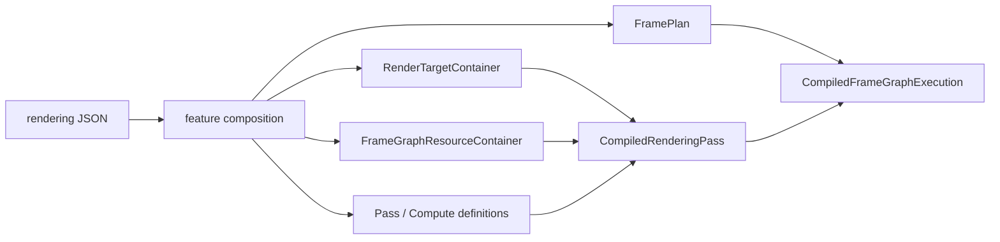
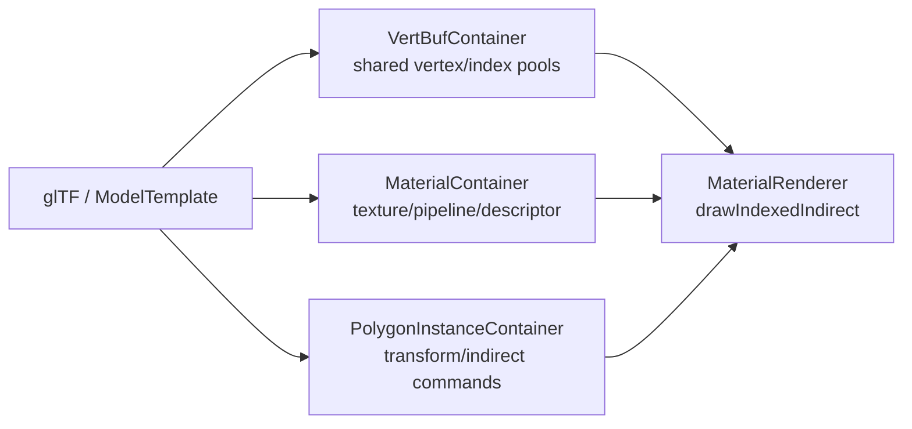
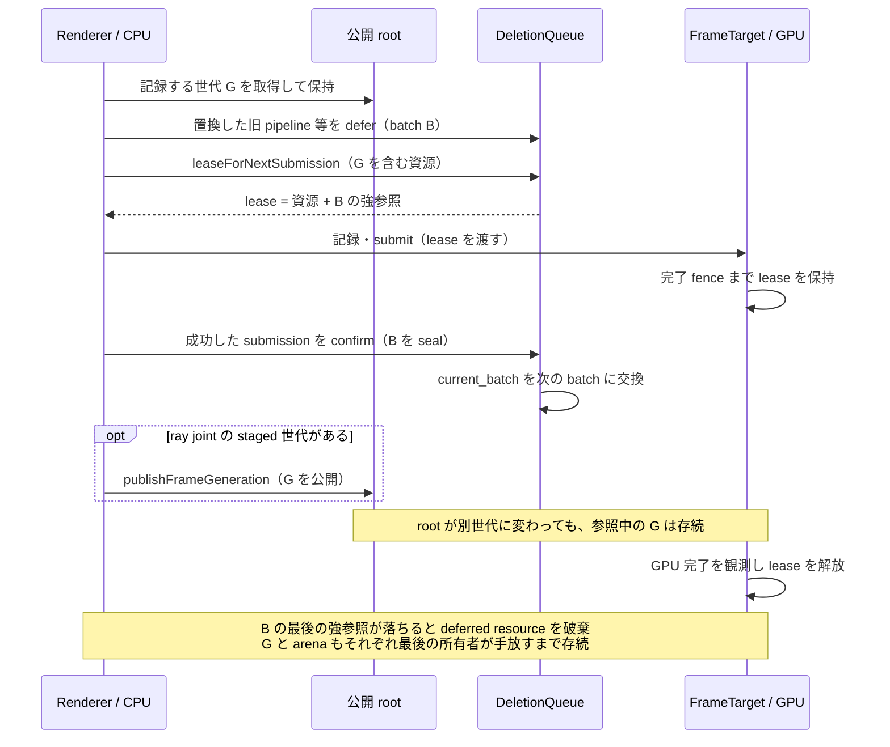

# 第6章 描画・Vulkan・Shader

最終確認: 2026-10-07(develop d975ee9c0)

[索引へ戻る](README.md) / [前章](05_gameplay_and_services.md) / [次章](07_tools_rpc_tests.md)

この章は、設定ファイルに書かれた「この順で、この画像へ描く」が、最終的に Vulkan のコマンドへ変換されるまでを追います。Pelican の描画層は、単純な `Renderer` 1 クラスではありません。まず地図として、次の 5 層を頭に置いてください。

```text
(1) コンパイラ program … rendering JSON を GPU に触らずに型付き定義へ落とす
(2) 計画             … その定義から論理グラフ / 物理ターゲットプラン / FramePlan を作る
(3) GPU 登録と世代   … 画像・shader・pipeline・descriptor を作り、1 回の publish で差し替える
(4) pass dispatch    … pass 種別ごとの renderer(Material / Fullscreen / UI …)へ振り分ける
(5) Vulkan backend   … device、frame target、image layout、コマンド記録を扱う
```

**先に 1 文だけ定義しておく語。** 以下は第6章の本文が説明なしに使い始める語です。深い扱いは各節にあります。

- **面** — 「編集面」「公開面」は操作の入口・対象範囲で、「cube の面」「表面」は幾何の face / surface です。
- **feature** — rendering config に pass・render target・shader define・宣言をまとめて足し引きできる合成単位。`engine://features/*.json` か project 側の JSON として書かれ、外すとその feature が持ち込んだ pass と target が丸ごと消えます([用語集](../manual/14_glossary.md#feature))。
- **frame graph** — 1 フレームで実行する pass / compute task を node、`reads` / `writes` / `after` / `before` を辺とする有向グラフ。実行順と barrier はここから決まります(§6.3、[用語集](../manual/14_glossary.md#frame-graphフレームグラフ))。
- **view family** — 同じ graph を複数の視点で実行するときの「視点の束」の論理名(`$main`、`$shadow/directional` など)。視点数(cardinality)を決めるのは runtime 側の provider です(§6.4、[用語集](../manual/14_glossary.md#view-familyビューファミリ))。
- **論理プラン / 物理プラン** — 論理プラン(`CompiledLogicalRenderGraph`)は resource を SSA 値と read footprint だけで表した device 非依存の表現、物理プラン(`VulkanTargetPlan`)はそこへ実フォーマット・sample 数・scope・view 実行を載せた device 依存の表現です(§6.1)。
- **SSA** — static single assignment。「1 つの値は 1 回しか書かれない」形のこと。ここでは render target 名に版を付けた `{resource, version}` を 1 個の値として扱い、辺を名前ではなく値で張ります(§6.1 の難所)。
- **format_class** — render target 宣言に書く色の役割(`scene` / `display` / `data` / `explicit(...)`)。実フォーマットは authored `format` ではなくこれと HDR の有無から決まります(§6.1 の難所)。
- **scope-execution-major** — コマンド記録のループ順が「scope → 実行(view) → その scope の node 全部」であること。「view ごとに全 node」ではありません(§6.1 の難所)。
- **置換可能な完全パッケージ** — コンパイラが自動生成した物理プランの代わりに、外部が丸ごと差し込める物理プラン一式。検証を通した証拠は別の marker 型が持ちます(§6.1 の難所)。

層ごとの責務と入口は次のとおりです。

| 層 | 主な責務 | 入口 |
|---|---|---|
| コンパイラ program | rendering JSON を variant family ごとまとめて受け、feature 合成・変換 registry・型付き定義への parse・計画までを **GPU に触らずに** 済ませる | [`registerRenderingPassConfigVariantsData()`](../../src/core/renderingpass/renderingpassconfigregistration.cpp#L1606) → [`runRenderCompilerProgram()`](../../src/core/renderingpass/rendercompilerprogram.cpp#L236) |
| 計画(3系統が並行) | 論理グラフ+物理ターゲットプラン / FramePlan / FrameExecutionPlan | [`compileDefaultVulkanVariant()`](../../src/core/renderingpass/vulkanrendercompilerprogram.cpp#L796) |
| GPU 登録と世代 publish | 画像実体・buffer・shader・pipeline・descriptor を作り、不変な publication root を差し替える | [`registerPreparedRenderingPassConfigVariant()`](../../src/core/renderingpass/renderingpassconfigregistration.cpp#L489) / [`prepareGeneration()`](../../src/core/renderingpass/framegraphruntime.cpp#L326) |
| pass dispatch | pass 種別を Material、Fullscreen、UI などの renderer へ振り分ける | [`renderDynamicPassDrawCalls()`](../../src/core/vkcore/render_pass_dispatch.cpp#L193) |
| Vulkan backend | device、frame target、image layout、pipeline、GPU resource を扱う | [`VulkanManageCore::VulkanManageCore()`](../../src/core/vkcore/core.cpp#L925) |

**ただし、この 5 層は一本道ではありません。**「JSON → 論理グラフ → 変換 → 物理プラン → Vulkan」という直線で読むと必ず外します。実際は [`FrameGraphDefinition`](../../src/core/renderingpass/frameplanner.hpp#L128) が **ハブ** で、そこから 3 本が **並行に** 枝分かれします。

```text
 rendering JSON (ProjectBasicConfig)
   │  registerRenderingPassConfigVariantsData()   renderingpassconfigregistration.cpp:648
   │    flat / #xr / preview を 1 つの program へまとめて渡す
   v
 ┌ RenderCompilerProgram ── GPU に一切触らない CPU 相 ─────────────────────────┐
 │ (1) authoring 解決  resolveRenderPipeline() → compileRenderPipeline()      │
 │       ⇒ CompiledRenderPipeline(feature / route / sample / target policy)   │
 │ (2) 変換 registry   render strategy / graph transform / subgraph replace   │
 │       いずれも config JSON → config JSON(論理グラフは書き換えない)        │
 │ (3) 型付き定義へ parse  ⇒ ★ FrameGraphDefinition ★  frameplanner.hpp:116  │
 │              ┌───────────────────┼───────────────────┐                     │
 │          (4a)│               (4b)│               (4c)│                     │
 │   compileRenderingTargetPlans-  framePlansByName()  frameExecutionPlans-   │
 │     ForVulkanDevice()             = planFrameGraph()  ByName()             │
 │              v                     v                   v                   │
 │   CompiledLogicalRenderGraph     FramePlan           FrameExecutionPlan    │
 │     (SSA 値・型・read footprint)   nodes/levels/       endpoints/nodes/    │
 │              │                     barriers            dependencies 🚧     │
 │              v                  ★実行順の権威★                            │
 │   VulkanTargetPlan(scope / format / sample 数 / view execution / alias)    │
 └────────────────────────────────────────────────────────────────────────────┘
   │  physical_package->validate(frame_graph_names) を GPU 変更前に必ず通す
   v
 GPU 登録トランザクション(gpuRegistrationMutex で直列化)
   │  prepareGeneration → validate → before_publish → publish(単一 CAS)
   v
 RendererRuntimeGeneration(不変な publication root)  framegraphruntime.hpp:89
   │
   v
 Renderer::renderLogicalFrame()   view family 解決 → scope schedule 構築 → node 記録
```

3 本の関係で、先に知っておくべきことが 4 つあります。

- **実行順・level・barrier の権威は今も [`planFrameGraph()`](../../src/core/renderingpass/frameplanner.cpp#L1858) です**。論理グラフ経路は planner を置き換えていません。論理/物理プランが決めるのは「その順序に載る**形・フォーマット・scope・view 実行**」の側です(§6.3 と併読)。
- **論理グラフは runtime に保存されません**。`compileLogicalFrameGraphShadow()` の呼び出し元は [`compileRenderingLogicalGraphs()`](../../src/core/renderingpass/renderingsamplecount.cpp#L1720)(変換 registry の契約検証用)と [物理ターゲット計画の入力](../../src/core/renderingpass/renderingsamplecount.cpp#L1915) の 2 か所だけで、`CompiledFrameGraphExecution`([`CompiledFrameGraphExecution`](../../src/core/renderingpass/framegraphruntime.hpp#L91))が持つのは `plan`(FramePlan)/ `execution_plan` / `target_plan` / `native_scopes` といった物理側のほうで、論理グラフは入っていません。ただし WP238e 以降、論理グラフは**コンパイル成果物の中では**生き残ります — `RenderingTargetPlanVerificationContext::logical_graph` が `shared_ptr` で保持し、完全物理プランの検証入力になります(§6.1 の難所「物理プランは『置換可能な完全パッケージ』」)。runtime 世代へ publish されない、という意味は変わりません。
- **`FrameExecutionPlan` は 🚧 部分実装**です。生成・fingerprint・`FramePlan` との一致検証([`rendercompilerprogram.cpp` 内](../../src/core/renderingpass/rendercompilerprogram.cpp#L190))・診断 JSON への出力までは完成していますが、**コマンド記録を駆動していません**。現状は「FramePlan の別表現 + 将来の異種エンドポイント用の場所取り」です。
- **backend は enum ではなく文字列**です。`RenderCompilerBackendPhysicalPackage::backend()` は `std::string_view` を返し、[`rendercompilerprogram.hpp` 内](../../src/core/renderingpass/rendercompilerprogram.hpp#L38) のコメントが理由を明示しています。

> Physical packages are an open backend boundary. A future Metal package can
> derive from this class without adding a fake Metal alternative to a central
> RHI variant.

## 6.1 設定から1フレームの実行計画ができるまで

**この節の語**: **lowering** は宣言を backend が扱う形へ落とす処理、**IR** はその途中の中間表現で、[共通グラフの流れ](03_project_and_loading.md#graph-dataflow)を参照してください。

起点は [`loadDefaultRenderingPassFromConfig()`](../../src/core/vkcore/renderer_config.cpp#L586) です。`ProjectBasicConfig` が保持する rendering JSON と現在の出力サイズを使い、[`registerRenderingPassConfigVariantsData()`](../../src/core/renderingpass/renderingpassconfigregistration.cpp#L1606) へ入ります。ここから先の合成・変換・計画は、この関数が自分で行うのではなく **1 つの compiler program へ委譲されます**(冒頭の層表)。

### graph variant: flat、`#xr`、preview

現在の実体は [`loadRenderGraphVariantsFromConfig()`](../../src/core/vkcore/renderer_config.cpp) です。flat 用の rendering pass に加え、XR active 時は同じ設定から suffix `#xr` 付きの rendering pass をもう一つ合成します。WP192 以降、XR/preview の feature 除外と検証は callback ではなく、project compiler の [`CompiledGraphVariantPolicy`](../../src/project/graphvariantpolicy.hpp) が所有します。

`compileGraphVariantPolicy()` は history/jitter、view family/execution、resource layout、terminal、mirror、suffix を一つの値へ解決し、除外には typed reason を残します。除外名は引き続き `xr_excluded_features` として記録されます。`Renderer` は [`flat_rendering_pass_id` / `xr_rendering_pass_id`](../../src/core/vkcore/renderer.hpp) を持ち、[`selectGraphVariant()`](../../src/core/vkcore/renderer.hpp) で切り替えます。

WP172 で **第3の variant「preview」** が加わりました。同じ `loadRenderGraphVariantsFromConfig()` が起動時に [`precompilePreviewGraph()`](../../src/core/renderingpass/previewgraph.hpp#L66) も呼びます([`renderer_config.cpp` 内](../../src/core/vkcore/renderer_config.cpp#L76))。ただし preview は他の 2 つとは**種類が違います**。ヘッダのコメントが規範です([`previewgraph.hpp` 内](../../src/core/renderingpass/previewgraph.hpp#L18))。

> A third, startup-compiled graph program.  Unlike flat/xr RenderingPassId it
> is data-only: render_preview executes it against request-local resources and
> therefore never enters Renderer::renderLogicalFrame.

つまり preview には `RenderingPassId` も `CompiledRenderingPass` もありません。flat / `#xr` が「GPU object まで compile し終えた実行物」なのに対し、preview は**合成と検証だけを終えた設定データ**で止まります(shader も pipeline も descriptor も作りません)。[`PreviewGraphProgram`](../../src/core/renderingpass/previewgraph.hpp) は `name` / `generation` / `pass_names` / `excluded_feature_names` / `graph_variant_policy` / `composed_config` を持つ値です。

feature decision、swapchain→request-local capture の変換、設定検証は [`graphvariantpolicy.cpp`](../../src/project/graphvariantpolicy.cpp) の同じ builtin policy 経路を通ります。`Renderer` は [`preview_graph_program`](../../src/core/vkcore/renderer.hpp) を保持し、[`previewGraphProgram()`](../../src/core/vkcore/renderer.hpp) と [`previewIsolationStateJson()`](../../src/core/vkcore/renderer.cpp) で公開します。実行側は §6.19 を参照してください。

**preview を組めないとき(✅PV-1、`a173e70c`)。**`PreviewGraphProgram` に `available`(既定 `true`)と `unavailable_reason` が加わりました。`validatePreviewConfig()` の拒否は [`PreviewUnsupportedAuthoringError`](../../src/project/graphvariantpolicy.hpp#L235)(`feature` / `target` / `graph` / `pass` を持つ `runtime_error`。文は前と同じ)になり、[Vulkan の compiler program の PV-1 の分岐](../../src/core/renderingpass/vulkanrendercompilerprogram.cpp#L1095) は preview の `data_only` の要求が投げた例外を `RenderCompilerProgramVariantOutput::unavailable` に入れて返します(`validateVariantOutput()` は unavailable の出力が `data_only` で、ほかが空であることを検査します)。

✅RG-3(`7a12fc2a`)から、この分岐が受け止めるのは `PreviewUnsupportedAuthoringError` と、同じ呼び出しで preview でない変種が組めた後(局所の `runtime_variant_composed` が立った後)の失敗だけで、それ以外は flat と同じように投げ直します([RG-3 で投げ直す所](../../src/core/renderingpass/vulkanrendercompilerprogram.cpp#L1120))。PV-1 が全部を受け止めていたため、`does not own field 'gpu_draw_source'` のような authoring の拒否が外に出なくなっていた件の直しです(commit の記録)。

登録の段は、それか `makePreviewGraphProgram()` の失敗を [`previewUnsupportedAuthoringReason()`](../../src/core/renderingpass/previewgraph.cpp#L82) で reason にし、[`unavailablePreviewGraphProgram()`](../../src/core/renderingpass/previewgraph.cpp#L116) を保持します。reason の `feature` は例外の型で決まり、`PreviewUnsupportedAuthoringError` 以外は `composition` で、`GraphRegistryError` か `<code>: <fields>` の形なら `cause` が付きます。

状態の JSON は `previewGraphStatusJson()` の 1 か所で作り、`get_status`・`get_frame_plan`・render の編集の committed(`RenderConfigRuntimeSnapshot::preview` 経由)が同じ値を出します。編集の preflight の [`preflightRenderGraphVariants()`](../../src/core/renderingpass/previewgraph.cpp#L209) は preview を組まなくなりました(flat と、起動時に XR を始めた engine の xr だけ)。利用者から見た形は manual 第6章 §6.13 の PV-1 の段落です。

> 🧩 **難所 — preview 除外は 1 語差**([`unsafePreviewDirectPassSurface()`](../../src/project/graphvariantpolicy.cpp) / [`validatePreviewConfig()`](../../src/project/graphvariantpolicy.cpp))
>
> **何をする所か**: preview graph から時間依存(TAA / velocity / jitter)・UI・mirror・present を含むものを部分文字列一致で締め出し、base graph の正規終端 pass だけを残します。
>
> **素朴に読むと**: マーカー配列が 2 つあり、**違いは `"present"` の有無だけ**です(8 個 vs 7 個)。[`unsafePreviewName()`](../../src/project/graphvariantpolicy.cpp)(8 個)が掛かるのは feature 名・feature の render target 名に加えて **feature が宣言した pass の `name` / `type` / `insert`** で、`unsafePreviewDirectPassSurface()`(7 個)が掛かるのは**合成後 config の pass 名/型だけ**です。つまり feature 由来の pass 名は `present` を含む厳しい側(8 個)で落とされ、緩い側(7 個)は合成後 config の pass にしか掛かりません。正規パイプラインの終端は慣習的に `present` を含む名前なので、合成後の pass 側だけ緩めてあります。片方に揃えて「重複を整理」すると、preview が終端 pass ごと落ちて何も描かないか、present 系 feature を通してしまうかのどちらかに倒れます。除外が **feature 単位で原子的**なのも意図で、合成後に pass を削ると insert anchor が宙に浮いて composer の依存/anchor 検証が無意味になるからです。副作用として、除外された feature は `hdr_enabled` の判定にも `projection_jitter` provider の登録にも参加しません(`composeRenderFeatureConfig()` の feature ループが判定前に `continue` する)。**feature を 1 つ外すと canonical パイプラインの形そのものが変わります**。
>
> **骨子**:
> ```text
> unsafePreviewName              = {taa, velocity, motion_vector, projection_jitter, ui, imgui, mirror, present}
> unsafePreviewDirectPassSurface = {taa, velocity, motion_vector, projection_jitter, ui, imgui, mirror}
>                                                                                  └ present が無い
> retained_terminal = 出力が preview_capture|display && 名前が "present" で終わる
>                     && "mirror" も "ui" も含まない
> ```
>
> **手がかり**: [`resolveRenderPipeline()`](../../src/project/renderpipeline.cpp) の compose → `transformGraphVariantConfig()` → `validateGraphVariantConfig()` は順序が仕様です。先に `swapchain` を `preview_capture` へ書き換えるからこそ `retained_terminal` が成立しえます。`precompilePreviewGraph()` の `generationOf()` が **FNV-1a**(Fowler–Noll–Vo ハッシュの 1a 版 — 1 バイトごとに「XOR してから固定の素数を掛ける」を繰り返すだけの非暗号学的ハッシュ。依存ライブラリなしで数行で書けるので、設定が変わったかどうかの判定に使われます)を **53 bit にマスクし、0 なら 1 に繰り上げる**のは、JSON の number(double)で正確に表せる上限と「program 無し」の予約値のためで、飾りではありません。テストは [`editorpreview_test.cpp`](../../test/editorpreview_test.cpp)。
>
> **不変条件**: 2 つのマーカー配列の差分は意図的です。片方を編集したら、もう片方の意味を明文化すること。除外は typed policy decision を composer の feature-envelope 境界へ適用し(composer の検証を残す)、合成後の削除に置き換えないこと。

<a id="preset-envelope-既定の-rendering-config-は-pipelinepreset--features-の-2-キーwp240a"></a>

### preset の展開経路

preset の schema・合成・fork の公開契約は[第6章](../manual/06_rendering.md#render-preset)を参照してください。

[`resolveRenderPipelinePreset()`](../../src/project/renderpipeline.cpp#L888) は [`composeRenderFeatureConfig()`](../../src/project/featurecompose.cpp#L3465) の冒頭で呼ばれ、feature 解析より前に展開します。`defaultGraphPassFamily()` も既定 family を取得するため展開しますが、その結果は family 名だけに使い、文書を書き換えません。

hybrid の描画経路では deferred と forward が同じ target へ重ねて描き、半透明は snapshot_copy が退避した画像を screen input として読みます。

<a id="render-generation-flow"></a>

登録処理の順序には意味があります。

1. feature を基本設定へ合成する(preset を選んでいれば、その展開はこの直前で済んでいます)。
2. render target 定義を parse して、画像と view を作る。
3. frame graph buffer 定義を parse して、必要な buffer を作る。
4. target 名を ID、format、image view へ解決する resolver を作る。
5. render pass と compute task の純粋な定義を parse する。
6. shader、pipeline、descriptor を作り、runtime 用の `CompiledPass` / `CompiledComputeTask` にする。
7. frame graph を計画し、名前を実際の pass/task index に bind する。

実コードではこの順序が [`renderingpassconfigregistration.cpp` の一続きの処理](../../src/core/renderingpass/renderingpassconfigregistration.cpp#L231) になっています。先に target と buffer を作るのは、pass の format、descriptor image view、compute resource の存在確認に必要だからです。

> 🧩 **難所 — canonical bucket の番兵**([`canonicalBucket()`](../../src/project/featurecompose.cpp#L297) / [`canonicalizePasses()`](../../src/project/featurecompose.cpp#L486))
>
> **何をする所か**: 手順 1 の中身です。base 設定の pass を 8 つの canonical anchor(`sprite` / `post_main` / `tonemap` / `post_ldr` / `pelican_ui` / `debug_draw` / `debug_text` / `imgui`)の区画へ振り分け、`__anchor_*` node と終端 `output_transform` を実体化した 1 本の配列に組み直します。
>
> **素朴に読むと**: 読みにくさは次の 4 点に分かれます。
>
> 1. **番兵**: 戻り値が `size_t` で、**`canonical_anchors.size()`(= 8)が「どの anchor にも属さない = scene pass」の番兵**になっています。配列外の値をわざと返す関数だと気づかないと読めません(index として危険なわけではありません。呼び出し側の `canonicalizePasses()` が `bucket == canonical_anchors.size()` を先に判定して `scene_passes` へ回すので、この値が `buckets[bucket]` の添字に使われる経路はありません)。
> 2. **振り分け規則**: 「型」「明示 `canonical_anchor` フィールド」「マジックネーム(残るのは `lighting_pass` だけ。Bloom の名前判定は P-2a-1a で撤去し、Bloom は P-2a-1b で `engine://features/bloom.json` になった)」「出力先」の 4 系統混在です。
> 3. **swapchain へ書く pass は HDR で行き先が変わる**: `canonical_anchor` を持たない pass のうち swapchain を書くものだけが **HDR の有無で別区画に落ちます**(`hdr_enabled ? 1 : 3`)。Bloom の名前判定は P-2a-1a(`60e95f53`)で撤去され、Bloom の 13 pass は `canonical_anchor: post_ldr` を自分で書きます(hdr on で組むなら `post_main` を書く。`example` は hdr off)。
> 4. **scene 終端はもう一段ややこしい**: HDR では [`prepareHdrSceneOutput()`](../../src/project/featurecompose.cpp#L346) が `canonicalizePasses()` より**前に**その出力を `swapchain` → `scene_ldr_in` へ書き換えるため、`passWritesSwapchain()` がもう当たらず、bucket 3 ではなく **scene 区画にそのまま残ります**(swapchain へ書く役目は、後から `after:tonemap` で挿し込まれる feature 側の `hdr_tonemap` が引き継ぎます)。「HDR にすると終端 pass が bucket 3 から bucket 1 へ移る」ではない、というのがここの読みどころです。
>
> **骨子**:
> ```text
> 最終配列 = [scene passes...]
>            __anchor_sprite [b0]  __anchor_post_main  [b1]   ← HDR 時の swapchain writer(anchor 無し)
>            __anchor_tonemap [b2] __anchor_post_ldr   [b3]   ← 非 HDR 時の終端
>            __anchor_pelican_ui [b4] __anchor_debug_draw [b5]
>            __anchor_debug_text [b6] __anchor_imgui [b7]
>            output_transform      ← display を読み swapchain へ書く
> ```
>
> **手がかり**: bucket に掛かるのは **base 設定の pass だけ**です。feature の pass はこの後で `insertPassByAnchor()` が置くので bucket を通りません(「なぜ `hdr_tonemap` が bucket に出てこないのか」で詰まる所)。[`retargetSwapchainAliases()`](../../src/project/featurecompose.cpp#L525) は `output_transform` **以外**の pass の `swapchain` を `display` に置換するので、合成後に `swapchain` を書くのは終端だけになります。テストは [`featurecompose_test.cpp`](../../test/featurecompose_test.cpp) の "canonical color pipeline is composed even without features"。
>
> **不変条件**: pass 名 `output_transform` と `__anchor_` 接頭辞、render target 名 `display` は予約語です(衝突は例外)。

> 🧩 **難所 — anchor 挿入と暗黙 after**([`insertPassByAnchor()`](../../src/project/featurecompose.cpp#L2355) / [`enforceCanonicalOrder()`](../../src/project/featurecompose.cpp#L411))
>
> **何をする所か**: feature が書いた `insert: "before:X" / "after:X" / "end"` を配列上の実位置へ解決し、合成の最後に配列順から `after` edge を機械的に生やして、planner が読む明示依存へ落とします。
>
> **素朴に読むと**: `after:<canonical anchor>` は **anchor node の直後には入りません**。**最初に出会った**次の `canonical_anchor` か `output_transform` の手前まで index を進める(そこで止まるので、区画を跨いで走り続けることはありません)ので、意味は「その区画の**末尾**」です。素朴に `index + 1` で挿入すると、同じ anchor へ複数の feature が刺さったとき後勝ちで順序が反転します(`before:` 側は前進しない非対称)。しかも付く依存は物理的な前後ではなく **anchor node 名**(`__anchor_tonemap`)なので、位置と依存を別々に追わないと最終順序が読めません。`enforceCanonicalOrder()` の暗黙連鎖には逃げ道があり、直前 pass への `after` を足す前に [`hasExplicitRelation()`](../../src/project/featurecompose.cpp#L399) を**両方向**で確認します。これが無いと `before: X` を書いた feature pass に `after: X` が機械的に足されて閉路になり、planner が "Cycle detected" で落ちます。
>
> **骨子**:
> ```text
> insertPassByAnchor("after:tonemap", pass):
>   index = __anchor_tonemap の位置 + 1
>   canonical_anchor なら: 最初に出会う次の anchor / output_transform の手前まで ++index  # = 区画の末尾
>   pass["after"] += "__anchor_tonemap";  passes.insert(index, pass)
> enforceCanonicalOrder(passes):     # 合成の最後に、配列順で 1 パス
>   通常 pass: after += 直前 anchor;  明示関係が無ければ after += 直前 pass
> ```
>
> **具体例**: 同梱 feature の [`velocity.json`](../../src/core/resources/features/velocity.json)(`"insert": "before:post_main"`)と [`taa.json`](../../src/core/resources/features/taa.json)(`taa_resolve` が `"after:post_main"`、`taa_composite` が `"after:taa_resolve"`)を、この順で合成すると配列はこう動きます。
>
> ```text
> canonical 化直後   … __anchor_sprite, __anchor_post_main, __anchor_tonemap, …
>
> velocity_pass  "before:post_main"   前進しない → anchor の直前へ
>   … __anchor_sprite, velocity_pass, __anchor_post_main, __anchor_tonemap, …
>   velocity_pass["before"] += "__anchor_post_main"
>
> taa_resolve    "after:post_main"    canonical anchor なので次の anchor の手前まで前進
>   … __anchor_post_main, taa_resolve, __anchor_tonemap, …
>   taa_resolve["after"] += "__anchor_post_main"
>
> taa_composite  "after:taa_resolve"  canonical anchor に無い名前 → 第 2 段(pass 名)で一致
>   … __anchor_post_main, taa_resolve, taa_composite, __anchor_tonemap, …
>   taa_composite["after"] += "taa_resolve"
> ```
>
> 依存名に入るのは**一致した node の `name` フィールド**です(canonical anchor なら `__anchor_post_main`、pass 名一致なら `taa_resolve`)。もし `after:` を素朴に「anchor の位置 + 1」で挿していたら、`after:post_main` を持つ feature が 2 つある構成で後から合成した側が前に入り、宣言順と逆になります。
>
> **手がかり**: [`findRenderPassAnchorMatches()`](../../src/project/featurecompose.cpp#L2273) は 2 段構えで、第 1 段が `type == "canonical_anchor"` かつ `anchor` フィールド一致、ヒット 0 のときだけ第 2 段で**任意の pass 名**を見ます(`shadow_directional.json` の `before:lighting_pass`、`taa.json` の `after:taa_resolve` が第 2 段)。複数一致は例外です。`last_active_pass` は配列要素への生ポインタで、`appendAfter()` が要素の中身しか変えないから有効です。ここに `passes.insert` を足すと即ダングリングします。
>
> **不変条件**: anchor 解決は「canonical 優先、無ければ pass 名」の順を保つこと(逆にすると feature pass 名が canonical anchor を隠します)。`hasExplicitRelation()` の両方向チェックを削らないこと。

**`frame_node_order` が名指した pass の鎖(✅FO-1 `a4d7760a`)。**[`enforceCanonicalOrder(passes, listed)`](../../src/project/featurecompose.cpp#L411) は 2 つ目の引数に、その graph の `frame_node_order` の並び(無ければ `nullptr`)を受けます。呼ぶ所は合成の最後で、`rendering_passes[]` の組の `name` で並びを引きます([並びを渡す所(FO-1)](../../src/project/featurecompose.cpp#L4179))。

- 区切り(anchor から次の anchor まで)の pass を `bucket` に溜め、区切りの終わりで `chainBucket()` がつなぎます。並びが名指した pass は、それらが占めていた `bucket` の場所を並びの順(`std::stable_sort`)に埋め直し、そのあと隣どうしを `after` でつなぎます。名指さない pass の場所は動きません。
- 入れ替えるのは `bucket` の中のポインタだけで、`passes` の配列は並べ替えません。planner の自動の data edge は宣言順の `last_writer` から張られる(§6.3)ので、配列を動かすと読む・書くの依存が変わってしまうためです。依存と矛盾する並びは、配列が元のままなので必ず循環として残り、それを下の照合が名前付きで断ります。
- `listed == nullptr` のときの鎖は FO-1 の前と同じ順・同じ辺・同じ `after` の並びです。output transform で区切りが切れない所も前のままです(コードのコメント)。
- FO-1 の前は、並びが名指した pass も宣言順でつなぎ、その上に `applyFrameNodeOrder()` が隣どうしの `after` を足していたので、依存の無い 2 つの入れ替えでも 2 本の `after` が輪になりました。

**合成の出口で見る image の鍵(✅FO-1)。**`synchronizeRenderPipelineProvenance()` の `render_targets[]` の走査が、EB-1 の buffer の鍵の検査の隣で [`requireKnownFrameGraphImageKeys()`](../../src/project/renderpipeline.cpp#L104) を呼びます([image の鍵の検査を呼ぶ所(FO-1)](../../src/project/renderpipeline.cpp#L2271))。知らない鍵は `graph.image_key_unknown@1 {image, key, allowed}` の `GraphRegistryError` です。許す 17 個は `frame_graph_image_keys` の配列で、render target の parser と format の解決器が読む鍵に、IA-1 の `initial` と、feature の binding の制約(`validateTargetBinding`)が読む `sample_count` を足したものです(コードのコメント)。

> 🧩 **難所 — format_class が format を上書き**([`resolveRenderTargetFormatClassesV2()`](../../src/core/renderingpass/rendertargetjsonparser.cpp#L191))
>
> **何をする所か**: 手順 1 と 2 のちょうど間で走ります。render target 宣言の `format_class`(`scene` / `display` / `data` / `explicit(...)`)を HDR の有無と frame target の実サイズから実フォーマットへ解決する、カノニカルなカラーパイプラインの唯一の決定点です。
>
> **素朴に読むと**: 引っ掛かる所は 3 つです。
>
> 1. **authored format が捨てられる**: JSON に `"format": "B8G8R8A8_UNORM"` と書いてあるのに **採用されない**ことがあります。`scene` と `display` では `target["format"]` が**無条件に上書き**され、authored 値は捨てられます(残るのは `data` と `explicit(...)` だけ。[`display` は `B8G8R8A8_SRGB` 固定](../../src/core/renderingpass/rendertargetjsonparser.cpp#L216)、[`scene` は HDR の有無で `R16G16B16A16_SFLOAT` / `B8G8R8A8_SRGB`](../../src/core/renderingpass/rendertargetjsonparser.cpp#L220))。
> 2. **名前と中身が食い違って見える実例**: HDR 有効時に `prepareHdrSceneOutput()` が足す `scene_ldr_in` は `B8G8R8A8_UNORM` と書かれていますが `format_class: "scene"` なので `R16G16B16A16_SFLOAT` に化けます — **`ldr` を含む名前なのに float16** です。名前のほうは嘘ではなく「LDR 化(= tonemap)の**入力**」の意で、中身は HDR の scene です(`hdr_tonemap` がこれを読んで `display` へ書きます)。嘘になるのは authored format だけです。
> 3. **使われない引数**: この関数は `frame_target_format` を引数に取りながら**本体で一度も参照していません**。呼び出し側は `getSwapchainFormat()` を渡していますが `display` は常に `B8G8R8A8_SRGB` 固定で、swapchain 側が UNORM に落ちた差は終端の shader fallback が吸収します。「引数が使われていないのはバグでは?」で止まらないでください。
>
> **骨子**:
> ```text
> scene pass ──linear──> [display: B8G8R8A8_SRGB]  ← HW が OETF + 8bit 量子化
>                             │ sample = HW が EOTF(→ linear)
>                             v  output_transform.frag
>                     swapchain が SRGB → そのまま / UNORM → shader が linearToSrgb()
> ```
>
> **手がかり**: つまり **linear → 8bit sRGB → linear → 8bit sRGB** の往復が 1 回入ります(骨子の **OETF / EOTF** は opto-electronic / electro-optical transfer function の略で、前者は linear 値を sRGB のガンマ曲線へ載せる符号化、後者は符号化された値を linear へ戻す復号です。sRGB フォーマットの image へ書く / から読むと、どちらもハードウェアが自動で掛けます)。[`color_pipeline_test.cpp`](../../test/color_pipeline_test.cpp) が hardware 経路と shader fallback 経路の差を **±1 LSB**(least significant bit — 最下位ビット 1 つぶん、つまり 8 bit なら 256 階調で 1 段の差)で許容しているのはこのためで、「無駄だから `display` を UNORM に」と最適化すると中間段の量子化が linear 空間になり暗部が壊れます。`format_class` 省略時の推論 [`inferFormatClass()`](../../src/project/featurecompose.cpp#L248) は **名前の部分一致**(`normal` / `depth` / `shadow` / `ssao` / `worldpos` / `material` を含めば `data`)という素朴な規則なので、target 名を変えると色空間が変わりえます。
>
> **不変条件**: `scene` / `display` の実フォーマットを決めるのはこの関数だけです。authored `format` に意味を持たせないこと。中間の `display` は sRGB エンコード済み 8 bit のまま(linear 8 bit にしない)。



### rendering config の root は `pelican.graph` だけ(P-2a-4a / P-2a-4b / MG-2b)

rendering config は、共通グラフ文書(`schema` / `version` / `definitions` / `nodes` / `outputs` の 5 キー)の `rendering` メンバの下に入ります。出荷 project 7 本と雛形はすべてこの形です。

P-2a-4b までは、`features` / `render_targets` / `rendering_passes` … を最上位に直接並べた **legacy root** も受けていました。MG-2b でその読み手を撤去し、legacy root は読み込み・overlay・ray tracing の設定・編集文書のどこでも `render_config.legacy_root@1`([`RenderConfigLegacyRoot`](../../src/project/renderconfigdocument.hpp#L39))で拒否されます。

読むときの要点は「authored key の住所を決める `if` を各所が持たない」ことです。住所を決めるのは [`renderconfigsection.hpp`](../../src/project/renderconfigsection.hpp#L12) の **3 つの名前(4 定義)**だけで(`isRenderGraphRoot()` は `ordered_json` 用の [overload](../../src/project/renderconfigsection.hpp#L27) を持ちます)、他の reader / writer はここを呼びます。

| 関数 | 役割 |
|---|---|
| [`isRenderGraphRoot()`](../../src/project/renderconfigsection.hpp#L22) | `schema == "pelican.graph"` かどうか |
| [`renderingSectionOf()`](../../src/project/renderconfigsection.hpp#L36) | 節そのものを返す。graph root でなければ `RenderConfigLegacyRoot`、object の `rendering` が無ければ `RenderConfigSectionUnlocated` を投げる |
| [`renderingSectionOrEmpty()`](../../src/project/renderconfigsection.hpp#L49) | **読み取り専用の寛容版**。節が無ければ空 object を返す(legacy root は断る) |

P-2a-4b にあった 4 本目の `wrapLegacyRenderingConfig()`(legacy config を graph root で包む関数)は MG-2b で撤去されました。

つまり **読みは節が無くても失敗せず、編集だけが名前付きで拒否される**という非対称が意図です。編集側の入口は [`AuthoredRenderConfigDocument::withSectionValue()`](../../src/project/renderconfigdocument.cpp#L754) で、byte を保ったまま `rendering.<key>` を差し替えます(graph root 自身のキーは root に書きます)。その byte 正確な locator の読みどころは [第9章 §9.24](09_black_magic_and_gotchas.md) の難所「byte 正確な節 locator と絶対 offset」にあります。

### feature のスカラーパラメータ: `binding: define` と `binding: buffer`(P-2a-2)

feature は `parameters.scalars[]` で数値パラメータを宣言できます。v0 で足されたのは、その値が**どの経路でシェーダへ届くか**の宣言で、[`ScalarParameterBinding`](../../src/project/featurecompose.cpp#L819) の 2 値です。

- `define`(既定) — 合成時に shader define へ焼き込みます。変更は再コンパイルを伴います。
- `buffer` — feature 自身が宣言した frame graph buffer を初期化します。値は毎フレーム、共通グラフの `render.scalar` sink が上書きできます。

同梱の [`engine://features/bloom.json`](../../src/core/resources/features/bloom.json) が両方の実例です。scalar は 3 つ(`threshold` / `knee` が `define`、`intensity` が `binding: "buffer"`)、buffer は `bloom.intensity`(`host_source: "runtime_f32"`、`size: 4`)1 本、render target 9 枚、pass は 13 本で**全 pass が自分で `canonical_anchor: "post_ldr"` を宣言**しています(bucket 判定に名前の魔法を使わない側の例。§6.1 の難所「canonical bucket の番兵」)。

✅RS-8 / RS-11(`5d065436`)から、bloom の shader は feature の外でも compile できます。`bloom_highpass.frag` は `PELICAN_FEATURE_BLOOM_THRESHOLD` / `PELICAN_FEATURE_BLOOM_KNEE` が無ければ `bloom.json` と同じ既定値 0.4 / 0.7 を自分で定義し([既定値](../../src/core/resources/bloom_highpass.frag#L12))、組み込みの SPIR-V も define を渡さずに作ります(`src/core/resources/CMakeLists.txt` の `embed_shader(bloom_highpass.frag)`)。

`bloom_composite.frag` は `bloomIntensity` の port が無ければ既定 2.0 を使います([分岐](../../src/core/resources/bloom_composite.frag#L24))。shader の既定値と `bloom.json` の既定値は 2 か所に書かれているので、一致は test が source から読んで比べます([test](../../test/vi1_variadic_inputs_test.cpp#L1468))。

> 🧩 **難所 — `binding: buffer` は 5 つの宣言が噛み合って初めて成立する**([binding の parse](../../src/project/featurecompose.cpp#L1128) / [buffer の seed](../../src/project/featurecompose.cpp#L1775))
>
> **何をする所か**: `binding: "buffer"` と書かれた scalar の解決値を、feature が宣言した frame graph buffer の初期値として書き込みます。
>
> **素朴に読むと**: 「`buffer` にすれば実行時に変えられる」で終わりに見えますが、合成器は 5 条件を課し、1 つでも欠けると**無言で効かないのではなく合成時の named error** になります。(1) `shader_define: true` との併用は拒否 — define が、buffer が存在する理由そのものを凍結してしまうからです([コメント](../../src/project/featurecompose.cpp#L1141))。(2) scalar の型が `float` であること(`binding 'buffer' requires scalar type float`、[型の門](../../src/project/featurecompose.cpp#L1153))。(3) feature が `<feature 名>.<scalar 名>` という名前の buffer を宣言していること。この名前は [`featureScalarBufferName()`](../../src/project/featurecompose.cpp#L835) が導出し、`render.scalar{target}` が名指しする文字列と同一です — **二度書かない**のが規約です。(4) その buffer が `host_source: "runtime_f32"` かつ `size` がちょうど 4 であること。(5) 文書が `initial_f32` を**書いていない**こと。初期値は scalar から導出するものなので、authored な二重宣言は [「`initial_f32` is derived from the scalar, not authored」](../../src/project/featurecompose.cpp#L1799) で拒否されます。
>
> **手がかり**: 解決した値が buffer へ渡る経路は 2 段です。まず [scalar 解決のループ](../../src/project/featurecompose.cpp#L1653)が `(buffer 名, float 値)` を貯め、合成の最後に[その列を feature の `buffers` エントリへ書き戻し](../../src/project/featurecompose.cpp#L1804)ます。したがって「feature 文書を目で読んでも `initial_f32` が無い」のは正常で、**合成後の config にだけ現れます**。
>
> **不変条件**: `initial_f32` を feature 文書へ手で書かないこと。buffer 名の導出規則を変えるときは `render.scalar{target}` の綴りと同時に変えること(片側だけ変えると、上書きが届かない buffer が黙って残ります)。`shader_define` との排他を緩めないこと。

### 定義と実行物を分ける理由

中心型は [`renderingpass.hpp`](../../src/core/renderingpass/renderingpass.hpp#L16) にまとまっています。

- `PassDefinition` は target、load/store、clear、pass 種別を持つ、Vulkan object を含まない定義です。
- `CompiledPass` は定義と、登録済み renderer object を指す `PassId` の組です。
- `ComputeTaskDefinition` は shader、reads/writes、dispatch、順序制約を持ちます。
- `CompiledComputeTask` は定義と `ComputeTaskId` の組です。
- `CompiledRenderingPass` は render pass 群と compute task 群の実行可能なまとまりです。

これにより JSON parse と Vulkan object 生成が分離され、planner は GPU object を知らずにテストできます。

### ID の3種類を混同しない

[`PELICAN_DEFINE_HANDLE`](../../src/core/handle.hpp#L21) により、整数を別々の型に包んでいます。

| 型 | 指すもの |
|---|---|
| `RenderingPassId` | 複数 node を含む描画設定全体 |
| `PassId` | Material や Fullscreen など、個別 renderer 内の登録物 |
| `GlobalRenderTargetId` | offscreen target。`-1` はなし、`-2` は swapchain |
| `ComputeTaskId` | `ComputeTaskContainer` 内の task |

特殊値の意味は [`renderingpass.hpp`](../../src/core/renderingpass/renderingpass.hpp#L23) に集約されています。整数値が同じでも型が違えば誤って渡せない、軽量な nominal typing です。

### コンパイラ program の内側

冒頭の層表の 1〜2 段目、つまり「GPU に触らない CPU 相」で何が決まるかを、読みにくい順に 4 つ挙げます。ここは設計意図が [`docs/design_render_graph_compiler.md`](../design_render_graph_compiler.md) に、拡張点の契約が [`docs/design_render_pipeline_extensibility.md`](../design_render_pipeline_extensibility.md) にあるので、以下は **なぜコードが読みにくいか** に絞ります。

> 🧩 **難所 — 型付きプランと config JSON は最後まで並走する**([`compileDefaultLogicalVariant()`](../../src/core/renderingpass/vulkanrendercompilerprogram.cpp#L651) / [`compileRenderPipeline()`](../../src/project/renderpipeline.hpp#L658))
>
> **何をする所か**: authoring JSON を 1 回だけ解決して、**2 つの成果物**を同時に持ち回ります。型付きの [`CompiledRenderPipeline`](../../src/project/renderpipeline.hpp#L600)(runtime が読む)と、normalized な config JSON(このあと定義 parse へ流れる)です。
>
> **素朴に読むと**: `compileRenderPipeline()` を「JSON を型へ変換して終わり」と読むと外します。罠が 3 つあります。第一に、その入力である [`ResolvedRenderPipeline`](../../src/project/renderpipeline.hpp#L405) は **半分が JSON のまま**で(`projection_jitter` / `feature_instances` / `material_routing` / `draw_sort` が `nlohmann::json`)、型になるのは `compileRenderPipeline()` を通った後だけです。第二に、その `compileRenderPipeline()` は **変換 registry より前に呼ばれます**([呼び出し位置](../../src/core/renderingpass/vulkanrendercompilerprogram.cpp#L730))。graph transform / subgraph replacement はそのあとで **config JSON だけを書き換え**、選ばれた provider の provenance は `compiled_pipeline_value.graph_transforms` / `.render_strategy` として型側へ **後から差し戻されます**([provenance を刻む所](../../src/core/renderingpass/vulkanrendercompilerprogram.cpp#L776))。つまり「型を見れば config が分かる」も「config を見れば型が分かる」も成立しません。片側にだけフィールドを足すと、runtime の挙動と dump JSON が静かに食い違います。第三に、型から JSON へ戻す口は [`serializeCompiledRenderPipelineMetadata()`](../../src/project/renderpipeline.hpp#L663) **1 本だけ**で、そのコメントが規範です。
>
> > Dump-only compatibility serializer.  Runtime code must consume the typed
> > fields above rather than reading keys from this representation.
>
> **骨子**:
> ```text
> resolveRenderPipeline(authored)  → ResolvedRenderPipeline{ normalized_config(JSON)
>                                                          + 一部は型、一部は JSON }
> compileRenderPipeline(resolved)  → CompiledRenderPipeline(全部型)   ← 初期 config の provenance もここで同期
> preview(data_only) はここで早期 return                              (#L400-L414)
> compose_runtime_config → graph transform → subgraph replacement      ← JSON だけ変わる
> 選択結果を CompiledRenderPipeline へ後追いで刻む
> runtime は namespaceComputeTasks で最終 config 順へ再同期し、XR なら改名後の compute 名を使う
> ```
>
> **手がかり**: preview variant が「合成と検証だけを終えた設定データ」で止まるのは、この関数の `data_only` 早期 return がその位置にあるからです(コメントが規範: 「resolve feature and strategy policy here, but do not apply runtime host additions or enter transform/subgraph/device planning that assumes concrete target storage」)。`normalize_config` フックが差さるのも `runtime_package` のときだけで([フックを差す分岐](../../src/core/renderingpass/vulkanrendercompilerprogram.cpp#L699))、`format_class` の解決(§6.1)が preview に掛からない理由がここにあります。
>
> **不変条件**: runtime は型付きフィールドだけを読むこと(dump JSON をパースし直さない)。型と JSON の両方に意味を持つ値を足すときは、変換 registry の**後**に provenance を刻む側へ寄せること。

> 🧩 **難所 — 論理グラフは値に版を打つ(SSA)**([`compileLogicalFrameGraphShadow()`](../../src/core/renderingpass/logicalframegraphadapter.cpp#L39) / [`LogicalValueId`](../../src/project/logicalrendergraph.hpp#L67))
>
> **何をする所か**: `FrameGraphDefinition` の `reads` / `writes`(**リソース名**)を、`{resource, version}` という **値 ID** へ変換します。同じ `scene_color` でも書かれるたびに別の値になり、edge は名前ではなく値で張られます。
>
> **素朴に読むと**: planner(名前ベース)と物理計画(値ベース)の間に **二重の名前空間**が挟まっていることに気づかないと、「同じ RT なのになぜ別ライフタイムと判定できるのか」が読めません。version は write のたびに `current_versions` を ++ して進み([write ポートの版付け](../../src/core/renderingpass/logicalframegraphadapter.cpp#L464))、`load` 付き attachment の read+write は **`input_output` ポート 1 本に融合**されて 1 回のインクリメントになります([read+write の融合判定](../../src/core/renderingpass/logicalframegraphadapter.cpp#L351))。import は 4 分類([`LogicalValueImportKind`](../../src/project/logicalrendergraph.hpp#L80))で、`previous_epoch` が `@history`(§6.3 の難所「`@history` は edge を作らない」と同じ事実を論理層から見たもの)、`external` が swapchain、`legacy_implicit` は「旧 JSON が版を書いていない」ことの記録です。そして **read footprint は最適化ヒントではなく物理表現の決定入力**です。宣言があればそれを、`load` 付き attachment なら `same_pixel`、無ければ保守的に `arbitrary` を採り([footprint の既定選択](../../src/core/renderingpass/logicalframegraphadapter.cpp#L379))、`arbitrary` が 1 つでも出ると `legacy_read_footprint_conservative` decision が付きます。`same_pixel` でなければ tile-local にも scope 融合にも落ちません([第10章](10_background_knowledge.md) §10.1「LAZILY_ALLOCATED メモリと TRANSIENT_ATTACHMENT」)。
>
> **骨子**:
> ```text
> FrameGraphDefinition(名前)          CompiledLogicalRenderGraph(値)
>   writes: scene_color            →  出力値 {scene_color, v1}
>   reads:  scene_color            →  入力値 {scene_color, v1}   ← 版が一致した組だけ edge
>   reads:  scene_color@history    →  import{{scene_color, v0}, previous_epoch}
>   load 付き attachment の read+write → inout ポート 1 本(v1 → v2)
> ```
>
> **手がかり**: グラフ末尾に必ず積まれる decision `"shadow_graph_only"` / `"logical graph is diagnostic-only and does not own runtime execution"`([その decision の生成](../../src/core/renderingpass/logicalframegraphadapter.cpp#L483))を **そのまま信じないでください**。この論理グラフは現在 [`compileVulkanTargetPlan()`](../../src/project/targetrenderplanning.hpp#L522) の唯一の入力で([`renderingsamplecount.cpp` 内](../../src/core/renderingpass/renderingsamplecount.cpp#L1915))、そこで決まった format / representation / sample 数 / scope が実際の画像割り当てに反映されます。文字列のほうが実態に追いついていない箇所です。
>
> **不変条件**: `reads_history` は必ず import になり、フレーム内 edge を作らないこと。footprint を「分からないから `same_pixel`」で埋めないこと — 保守的な既定は `arbitrary` の側です。

> 🧩 **難所 — 物理プランは「置換可能な完全パッケージ」**([`verifyVulkanCompletePhysicalPlanPackage()`](../../src/project/vulkancompletephysicalplan.hpp#L128) / [`applyVerifiedVulkanCompletePhysicalPlanPackage()`](../../src/project/vulkancompletephysicalplan.hpp#L140))
>
> **何をする所か**: 「コンパイラが自動で計画した `VulkanTargetPlan`」と「外から差し込まれた完全パッケージ」を、**同じ型に着地させます**。
>
> **素朴に読むと**: `VulkanTargetPlan` が唯一の真実に見えますが、実際には `automatic_plan`(コンパイラ由来の provenance と環境判断を保持)+ `verified`(検証済みの物理フィールドだけ差し替え)の**合成物になりえます**。しかも検証に通った証拠は**別の型** [`VerifiedVulkanCompletePhysicalPlanPackage`](../../src/project/vulkancompletephysicalplan.hpp#L101) が持ち、**型そのものが marker** になっています。これに気づかないと、なぜ検証関数の戻り値をわざわざ持ち回るのかが読めません。コメントが規範です。
>
> > Produces a marker type only after graph coverage, dependency order,
> > lifetime/alias legality, attachment contracts, device capabilities,
> > environment freshness, and NativeScope boundaries have all closed.
>
> **骨子**:
> ```text
> 論理グラフ + topology snapshot + 自動 VulkanTargetPlan + 候補 package
>   → verify(..., format_capabilities, enabled_device_extensions)
>                 ─┬→ 例外(境界が閉じない)
>                  └→ VerifiedPackage(marker + fingerprint + diagnostics)
>   → apply(automatic, verified) → 実行される VulkanTargetPlan
>   → GPU 登録の直前に validateVulkanTargetPlanMatchesCompletePhysicalPackage() で drift 再検査
>   → verified がある graph だけ prepareVulkanNativeScopeExecutors() が走る
> ```
>
> **手がかり**: `verify()` は論理グラフ・topology・自動プラン・format capability・**その device で実際に有効化された extension 名**という「private な device facts」を全部要求します。外部 compiler にそれを再構成させないため、WP238e で [`RenderingTargetPlanVerificationContext`](../../src/core/renderingpass/renderingsamplecount.hpp#L117) が導入されました。[`compileRenderingTargetPlans()`](../../src/core/renderingpass/renderingsamplecount.cpp#L1748) が plan を作るのと同じループで、その plan を作った**正確な入力**を `RenderingTargetPlanCompilation::verification_contexts` に並べて残します([`renderingsamplecount.cpp` 内](../../src/core/renderingpass/renderingsamplecount.cpp#L2152))。`enabled_device_extensions` だけは target planner ではなく Vulkan compiler 層が後から埋め([`compileDefaultVulkanVariant()`](../../src/core/renderingpass/vulkanrendercompilerprogram.cpp#L796) の [verification context を埋めるループ](../../src/core/renderingpass/vulkanrendercompilerprogram.cpp#L997))、その値は [`getEnabledDeviceExtensions()`](../../src/core/vkcore/core.hpp#L120) が返す実際の enable 済み配列です。差し替える側は [`requireVulkanTargetPlanVerificationContext()`](../../src/core/renderingpass/vulkanrendercompilerpackage.hpp#L107) で graph 名から引き、[`installVerifiedVulkanCompletePhysicalPlanPackage()`](../../src/core/renderingpass/vulkanrendercompilerpackage.hpp#L114) に候補 package を渡すだけで、verify → apply → index 更新が 1 回の package 変更として行われます。
>
> 判定は 🚧 のままです。**既定の Vulkan compiler program はこの経路を使いません**。`verified_complete_physical_plans` を埋める `installVerifiedVulkanCompletePhysicalPlanPackage()` を呼ぶのは現状テストだけで([`headless_native_scope_test.cpp` 内](../../test/headless_native_scope_test.cpp#L409))、engine 同梱の provider は [`builtinVulkanNoopMarkerNativeScope`](../../src/core/renderingpass/vulkannativescopeexecutor.hpp#L32)(`builtin.vulkan.noop_marker@1`)という空 marker だけです。本番で NativeScope 実行が発火するのは **独自の `RenderCompilerProgram` を差した時だけ**で、「Vulkan コマンドが provider に差し替え可能になった」と無条件に読むと過大評価になります。ただし WP238e で「差せば実 Vulkan コマンドが出る」ことまでは実測で閉じました。唯一の TEST_CASE が [`headless_native_scope_test.cpp`](../../test/headless_native_scope_test.cpp) の `"WP238e NativeScope records Vulkan commands and rebuilds through renderer generations"` で、テスト所有 provider `pelican.test.vulkan.clear_attachment@1` が `beginRendering` の `loadOp = eClear` で実際に塗り、16x16 headless の中心画素を readback して色を確認し、compiler を差し替えた 2 世代目で色が変わること・in-flight lease が退役してから旧 executor が破棄されることまで同じ TEST_CASE で見ています。NativeScope の `implementation_config` は宣言境界の外から不透明で、engine 側はそれを解釈しません([`vulkancompletephysicalplan.hpp` 内](../../src/project/vulkancompletephysicalplan.hpp#L16))。
>
> **不変条件**: `verify` を通していない package を `apply` しないこと。`automatic_plan` 側の provenance(compiler program 名・環境事実)を verified 側で上書きしないこと。verification context は plan を作った当のループで積むこと — 後から作り直すと、次の難所の fingerprint 検査が通らなくなります。

同じ物理プランを **JSON のまま**外部から受け取る側(Studio と in-engine の ImGui viewer)は、型ではなく [`validatePhysicalTargetPlanWire()`](../../src/project/physicaltargetplanwire.cpp#L803) が検査します。この関数は決して throw せず、壊れた文書は名前付きの理由コード付きで `unavailable` になります([契約のコメント](../../src/project/physicaltargetplanwire.hpp#L53))。読むときに引っかかるのは**名前集合の比較**で、素朴には「lowering graph の resource 名 == caller の論理 resource 名 == 計画された物理 resource 名」の 3 つが一致するはずに見えます。

実際にはそうならない正当な差が 1 種類だけあり、それが **elided** です。planner は Vulkan resource を作らない論理 resource(image でも buffer でもない semantic value / object set / stream)に対して `pelican.plan.semantic_resource_elided@1` という決定を記録して `continue` し([`targetrenderplanning.cpp` の決定](../../src/project/targetrenderplanning.cpp#L2669))、wire 検査側はその `subject` を集めて[比較の前に引き算](../../src/project/physicaltargetplanwire.cpp#L445)します。

引き算が掛かるのは 2 箇所だけで、caller の論理 resource 集合との照合([`requireSameSet` の呼び出し](../../src/project/physicaltargetplanwire.cpp#L530))と lowering graph の resource 名との照合([比較](../../src/project/physicaltargetplanwire.cpp#L579))です。どちらも引き算するのは**論理側の 1 オペランドだけ**で、物理側の集合には elided な名前がそもそも入りません。**elided は「無視した」ではなく「この段では Vulkan 資源にならないと記録した」**なので、決定の列から消すと物理プランの受理が落ちます。

> 🧩 **難所 — automatic plan と compiled plan は別物**([`compileRenderingTargetPlans()`](../../src/core/renderingpass/renderingsamplecount.cpp#L1748) / [`linkVulkanPhysicalFragment()`](../../src/project/vulkanphysicalfragment.cpp#L2834))
>
> **何をする所か**: 上の verification context が持つ 2 本のプラン、`automatic_plan` と `compiled_plan` の役割分担です。WP239a は、この区別が無かったために rendering pipeline の reload が全面的に拒否された回帰の修正です。
>
> **素朴に読むと**: 「compile されたプランは 1 本」と読むと外します。rendering config が `vulkan_physical_fragments` を持つと、まず**自動プランを丸ごと 1 本作ってから**、[`linkVulkanPhysicalFragment()`](../../src/project/vulkanphysicalfragment.cpp#L2834) が fragment を載せた別のプランを作ります。ここで効くのが `VulkanTargetPlan::automatic_plan_fingerprint` の意味で、これは**「自分自身の指紋」ではなく「土台になった自動プランの指紋」**です。`linkVulkanPhysicalFragment()` は package 側の `automatic_plan_fingerprint` が土台の指紋と一致することを要求し、リンク後もその値をそのまま持ち越します。したがって **fragment-linked plan に対して `vulkanAutomaticTargetPlanFingerprint()` を再計算すると必ず食い違います**(resources / attachments が書き換わっているため)。WP238e が足した検証は当初この 1 本しか持たず、linked plan を `automatic_plan` として保存していたので、fragment を持つ config は必ず落ちました。
>
> **なぜ初回ロードは通り reload だけ落ちたのか**は、この 1 本問題の系です。`vulkan_physical_fragments` は rendering config 由来です。落ちた 2 件の GPU テストは、初回を fragment 無しの config で登録し、`pipeline.json` を **fragment 入りに書き換えてから** `ReloadKind::modified` を適用します。fragment が無い間は `automatic_plan` と `compiled_plan` が同一オブジェクトなので指紋検査が自明に成立し、fragment が入った瞬間だけ壊れる、という形でした。「reload 固有のバグ」ではなく「fragment を持つ config 固有のバグが、reload 経路でしか踏まれていなかった」が正確な読みです。CPU 側の verifier テスト群が緑のままだったのも同じ理由です。
>
> **骨子**:
> ```text
> plan_value = compileVulkanTargetPlan(...)      # fragment_package は渡さない(nullopt)
> if fragment あり:
>   automatic_plan = copy(plan_value)            # ← 指紋の土台。verify() の入力はこちら
>   plan_value     = linkVulkanPhysicalFragment(logical, topology, plan_value, fragment)
> compiled_plan = shared_ptr(plan_value)         # ← target_plans に載る実行プラン
> automatic_plan が未設定なら automatic_plan = compiled_plan
> ```
>
> **手がかり**: 修正の前段として、9 個の述語を 1 つの `if` に OR で並べて同じ 1 文を投げていた検証が、**条件ごとの別メッセージへ分割**されました([`validateVulkanPhysicalPackage()`](../../src/core/renderingpass/vulkanrendercompilerprogram.cpp#L1162))。「どの不変条件が破れたか名指しする」ためのもので、短くまとめ直さないでください。分割後は、`logical_graph_fingerprint` と `automatic_plan_fingerprint` を `automatic_plan` 側で、「indexed な target plan と一致するか」を `compiled_plan` 側で検査します。CPU 回帰は [`renderingsamplecount_test.cpp`](../../test/renderingsamplecount_test.cpp) の "rendering target bridge links attachment operations into the physical plan" が担当し、`automatic_plan != compiled_plan`・`automatic_plan` が `applied_fragment_package` を持たないこと・両者の `automatic_plan_fingerprint` が一致することを固定しています。
>
> **不変条件**: `verify()` へ渡すのは `automatic_plan` のみで、`compiled_plan` を土台にしないこと。`automatic_plan` は `applied_fragment_package` を持たないこと。両者が同一オブジェクトになるのは fragment が無い場合だけであること。

> 🧩 **難所 — スケジュールは scope-execution-major**([`buildLogicalFrameViewFamilySchedule()`](../../src/core/renderingpass/viewexecutionscheduler.hpp#L120) / [`selectLogicalFrameSequentialViewSchedule()`](../../src/core/renderingpass/viewexecutionscheduler.hpp#L494))
>
> **何をする所か**: 物理プランの scope 列と、実行時に確定する view family の view 数から、コマンド記録の単位([`LogicalFrameNodeInvocation`](../../src/core/renderingpass/viewexecutionscheduler.hpp#L23))の列を作ります。plan と実行の境目にあたる header-only の関数です。
>
> **素朴に読むと**: ループの入れ子順が **直感と逆**です。「view ごとに全 node」ではなく **「scope ごとに、execution(= view)ごとに、その scope の node 全部」**。ヘッダ冒頭のコメントが規範です。
>
> > Scheduling is scope-execution-major: every node in a fused scope records for
> > one view before the next sequential view begins. This is required to keep a
> > native dynamic-rendering scope open across all of its nodes.
>
> ここでいう scope を「開く / 閉じる」は、この scheduler ではなくコマンド記録側で起きます。scheduler が作る各 [`LogicalFrameNodeInvocation`](../../src/core/renderingpass/viewexecutionscheduler.hpp#L23) は `scope_node_index` / `scope_node_count` を持ち、[`beginsScopeExecution()`](../../src/core/renderingpass/viewexecutionscheduler.hpp#L47)(= `scope_node_index == 0`)の invocation で `Renderer` が [`beginRenderingScope()`](../../src/core/vkcore/renderer.cpp#L2228)、[`endsScopeExecution()`](../../src/core/renderingpass/viewexecutionscheduler.hpp#L50)(= `scope_node_index + 1 == scope_node_count`)の invocation で [`endRenderingScope()`](../../src/core/vkcore/renderer.cpp#L2351) を呼びます。つまり fused scope は **(scope, execution=view) の組ごとに 1 回開いて 1 回閉じ**、その間にその scope の node が全部記録されます。
>
> もう 1 つが **main と secondary の検査の非対称**です。`$main` の scope は plan 側の `view_execution` / `view_count` / `execution_count` / `view_mask` が**すべて整合していないと例外**([`$main` 側の検査](../../src/core/renderingpass/viewexecutionscheduler.hpp#L258))。対して secondary family の scope は **必ず single-view のテンプレート 1 個**でなければならず、実 view 数は runtime の family cardinality が `sequential` へ展開します([secondary 側の検査](../../src/core/renderingpass/viewexecutionscheduler.hpp#L281))。したがって「shadow cascade 4 枚が物理プランに焼かれている」は誤りで、物理プランは shadow が何カスケードかを**知りません**。この非対称(main は plan が決める / secondary は runtime が決める)を知らないと「同じ scope なのに検査が違う」が読めません。
>
> **骨子**:
> ```text
> for scope in target_plan.scopes:              # ← 最外は scope
>   family = scope の全 node が属する唯一の view family(混在は例外)
>   main か?      → execution_count = (sequential ? view_count : 1) / plan 値と一致検査
>   secondary か? → plan は single_view テンプレート必須
>                   runtime cardinality > 1 なら sequential へ展開
>   for execution_index in 0..execution_count:
>     for node in scope.nodes:                  # ← scope 内 node は schedule 上で連続
>       emit LogicalFrameNodeInvocation{node, scope, scope_node_index, execution, view, family}
> どの scope にも属さない node が残っていれば例外
> ```
>
> **手がかり**: per-view target(flat / 従来の swapchain)は `selectLogicalFrameSequentialViewSchedule()` が 1 view 分を抜き出しますが、**multiview scope が混ざっていたら即例外**です(`"per-view target cannot execute a multiview scope"`、[その throw](../../src/core/renderingpass/viewexecutionscheduler.hpp#L533))。view family 自体は「論理関係であって Vulkan の実行モードではない」と型側が明言しており([`logicalrendergraph.hpp` 内](../../src/project/logicalrendergraph.hpp#L173))、sequential / multiview / shared のどれになるかは物理 lowering が決めます。実行側の消費は §6.4 です。
>
> **不変条件**: 1 node は 1 scope にしか属さないこと(二重登録も未登録も例外)。1 つの scope に複数の view family を混ぜないこと。scope 内 invocation は schedule 上で連続していること — 実行側はこの連続性と physical scope の node 並びの一致を毎フレーム再検査します。

### provider registry の一覧(EL-6)

冒頭の図の (2) 変換 registry(render strategy / graph transform / subgraph replace)に pass implementation と draw sort を加えた 5 つは、どれも名前で provider を引く registry で、中身は共通の `provider_registry_common::ProviderRegistry` です。✅EL-6(`5582bb93`)から、5 つの registry の facade が同じ形の一覧を返します。

| registry | 一覧を返す所 | 文書の欄 |
|---|---|---|
| `RenderPolicyRegistry`(draw sort) | [`RenderPolicyRegistry::drawSortProviderListing()`](../../src/core/renderer/renderpolicyregistry.cpp#L347) | `draw_sort.{opaque,transparent}.provider` |
| `PassImplementationRegistry` | [`PassImplementationRegistry::providerListing()`](../../src/core/renderingpass/passimplementationregistry.cpp#L584) | pass の `implementation.provider` |
| `SubgraphReplacementRegistry` | [`SubgraphReplacementRegistry::providerListing()`](../../src/core/renderingpass/subgraphreplacementregistry.cpp#L1194) | `region_replacements[].provider` |
| `GraphTransformRegistry` | [`GraphTransformRegistry::providerListing()`](../../src/core/renderingpass/graphtransformregistry.cpp#L1185) | `graph_transforms[].provider` |
| `RenderStrategyRegistry` | [`RenderStrategyRegistry::providerListing()`](../../src/core/renderingpass/renderstrategyregistry.cpp#L738) | `render_strategy.provider` |

- どれも [`ProviderRegistry::listing()`](../../src/core/renderingpass/providerregistrycommon.hpp#L406) に委ねます。shared lock の下で `visibleProviders()`(active で、名前で引いたときに自分が当たる slot だけ。名前順)を回るので、game の provider が engine のものを同じ名前で覆っていれば game の方だけが出ます。要素は [`RenderProviderListing`](../../src/core/renderingpass/providerlisting.hpp#L14) `{name, engine_owned, provider_version}` で、`engine_owned` は slot の owner が `engineRegistrationOwner` かどうかです。
- EL-1 で `SubgraphReplacementRegistry` だけが持っていた一覧(`SubgraphReplacementProviderListing`)は、この共通の型の別名になりました(`using SubgraphReplacementProviderListing = RenderProviderListing`)。
- registry は ABI に説明や parameter の宣言の欄を持たないので、一覧にもありません(`providerlisting.hpp` の注記)。
- RPC は `get_registered_providers`(第7章 §7.7 の編集系の表)で、[`registeredProvidersJson()`](../../src/core/communication/engineauthoringlists.cpp#L678) が 5 つを `{name, source: engine|game, provider_version}` に直します。呼ぶたびに読むので、game logic の reload(owner の activate / release)は次の呼び出しに出ます。`VulkanNativeScopeExecutorRegistry`・`RenderViewFamilyProviderRegistry`・`CompilerProviderRegistry` はこの一覧の対象外です。

## 6.2 PassInfo: 継承ではなく `std::variant` で pass を表す

pass の種類は virtual class 階層ではなく、[`PassInfo`](../../src/core/renderingpass/renderingpass.hpp) という `std::variant` です(通常 10 種、ImGui build は 11 種)。

| variant | 実際の仕事 |
|---|---|
| `MaterialPassInfo` | glTF 由来の material/mesh instance を indirect draw |
| `FullscreenPassInfo` | 全画面三角形で post-process、入力 target/buffer を読む |
| `GenericRasterPassInfo` | project authoring の draw / fixed state / shader を portable raster contract として実行 |
| `DebugDrawPassInfo` | line geometry。physics collider の可視化もここへ投入 |
| `DebugTextPassInfo` | debug glyph の描画 |
| `ShadowDepthPassInfo` | depth-only の material draw |
| [`VelocityPassInfo`](../../src/core/renderingpass/renderingpass.hpp#L308) | TAA 用の screen-space velocity 描画。対応 renderer は [`velocitypasscontainer.hpp`](../../src/core/renderer/velocitypasscontainer.hpp) |
| [`PickingPassInfo`](../../src/core/renderingpass/renderingpass.hpp) | `R32_UINT` へ model instance slot + 1 を書く視覚ピッキング描画。通常は [`picking.json`](../../src/core/resources/features/picking.json) が挿入 |
| [`GizmoPassInfo`](../../src/core/renderingpass/renderingpass.hpp) | WP258 の選択 transform へ world-axis の移動・回転・拡縮 line geometry を重ねる。通常は [`gizmo.json`](../../src/core/resources/features/gizmo.json) が挿入 |
| `UiPassInfo` | UI container の内容を描画 |
| [`ImGuiPassInfo`](../../src/core/renderingpass/renderingpass.hpp#L323) | 開発者 UI(ImGui)。executor 内の分岐で処理(`PELICAN_WITH_IMGUI` 時のみ variant に含まれる) |

振り分けは [`renderDynamicPassDrawCalls()`](../../src/core/vkcore/render_pass_dispatch.cpp#L193) にあります。型を追加するときは、JSON parser、runtime compiler、dispatch の3か所を同時に増やす必要があります。variant なので「未知の派生型」が紛れず、compile 時に分岐漏れを見つけやすい一方、機能追加は open class hierarchy より明示的です。

**番号付きの入力の設定 `input_settings`(✅RS-14)。**fullscreen 系(`output_transform` を含む)と generic raster の pass の、`input` の画像ごとのサンプリングと subresource は、variant ではなく [`PassDefinition::input_target_settings`](../../src/core/renderingpass/renderingpass.hpp#L492)(`input_targets` と同じ位置。短くてよい)に入ります。

parser の [`parsePassInputSettings()`](../../src/core/renderingpass/passdefinitionjsonparser.cpp#L79) は `input_settings` の要素を、`null` なら既定(空の `ShaderResourceInputSetting`)、それ以外は名前付きの resource port と同じ [`parseShaderResourceInputSetting()`](../../src/project/shaderresourceport.cpp#L582)(中は port の `parseSampling()` と `parseOptionalImageSubresource()`)で読みます。

ほかの type の pass、配列でない値、画像の入力より長い配列は断ります。runtime compiler では、fullscreen と raster のどちらの compile も [`compileFullscreenResourceInterface()`](../../src/core/renderingpass/renderingpassruntimecompiler.cpp#L1773) を通り、その中で [`applyPassInputSettings()`](../../src/core/renderingpass/renderingpassruntimecompiler.cpp#L1673) が最後に設定のある入力のサンプリングと subresource を上書きします。

resource port の無い pass では `input_sampling`(fullscreen だけ)か既定を置いた後([port の無い pass で呼ぶ所](../../src/core/renderingpass/renderingpassruntimecompiler.cpp#L1801))、port のある pass では port ごとの値を置いた後([port のある pass で呼ぶ所](../../src/core/renderingpass/renderingpassruntimecompiler.cpp#L2114))で、port が束ねる入力に設定があれば断ります。書き手は通常 graph の lowering です(第3章「graph の番号付きの入力の読み方」)。

## 6.3 Frame graph planner のアルゴリズム

frame graph node は `render` または `compute` で、名前、宣言順、`reads`、`writes`、`after`、`before` を持ちます。planner は [`planFrameGraph()`](../../src/core/renderingpass/frameplanner.cpp#L1858) で次を行います。

1. node 名の一意性を検証する。
2. reads/writes が宣言済み target/buffer かを検証する。
3. 自動 data edge と明示 edge を作る。
4. 推移閉包を作り、複数 writer が順序付け済みか検証する。
5. 安定トポロジカルソート(**トポロジカルソート** — 有向グラフのすべての辺 a→b について a が b より前に来るように頂点を一列に並べる操作。ここでは「依存先が必ず先に実行される」node 順を作ります。「安定」は、依存関係で順序が決まらない組を宣言順で一意に決めるという意味です)を行う。
6. node の level と、read-after-write barrier 情報を保存する。

### 自動で作られるのは「直前の writer → 後続 reader」

[`buildEdges()`](../../src/core/renderingpass/frameplanner.cpp#L1454) は宣言順に node を走査し、resource ごとの `last_writer` を覚えます。reader が現れたら、その時点の直前 writer から reader へ RAW edge を張ります。

```text
A writes color
B reads  color   => A -> B が自動追加
C writes color   => 自動では B -> C や A -> C を追加しない
```

`after` と `before` は別途、明示 edge として追加されます。その後 [`addBarriersForOrderedResourceEdges()`](../../src/core/renderingpass/frameplanner.cpp#L1441) が「順序 edge があり、from が書き、to が同じ resource を読む」組を barrier 情報へ変換します。

ここは重要です。現実装は一般的な hazard graph(hazard = 同じ resource に対する読み書きの組のうち、順序が入れ替わると結果が変わってしまうもの。下の 3 種です)をすべて自動生成するわけではありません。

- RAW（write → read）: 直前 writer から自動 edge。
- WAW（write → write）: 自動 edgeなし。どちら向きか `after` / `before` などで明示しないと [`validateWritesAreOrdered()`](../../src/core/renderingpass/frameplanner.cpp#L1512) が例外にします。
- WAR（read → write）: 自動 edgeなし。保存したい古い値がある場合は明示順序が必要です。

> 🧩 **難所 — writes-writes の曖昧検出**([`transitiveClosure()`](../../src/core/renderingpass/frameplanner.cpp#L1497) / [`validateWritesAreOrdered()`](../../src/core/renderingpass/frameplanner.cpp#L1512))
>
> **何をする所か**: 同じ resource に 2 つ以上の node が書くとき、どちらが先か決まっているかを plan 生成時に検査します。
>
> **素朴に読むと**: `transitiveClosure()` は 3 重ループだけの関数で、変数名もコメントもアルゴリズム名を明かしません。実体は **Floyd–Warshall 法**(フロイド・ウォーシャル法 — グラフの全頂点対について「経由してもよい中継点」を 1 つずつ増やしながら到達可否を更新していく古典的な動的計画法。ここでは距離ではなく到達できるか否かだけを求める「推移閉包」版です)で、正しさの根拠は「**中継点 `k` のループが最外であること**」ただ 1 点です。理由は不変条件で、`k` の反復を 1 つ終えるたびに「中継点として 0..k だけを使う到達関係」が完成している状態を保てるからです。`k` を内側へ動かすとこの不変条件が作れず、まだ更新されていない `reach[i][k]` を読むため閉包が不完全になりますが、**多くのグラフでは正しい答えが出てしまう**ため、テストをすり抜けた瞬間に「WAW を検出しないまま plan が通る」という静かな壊れ方をします。実害は、同じ RT に書く 2 パスの順序が tie-break(= JSON の記述順)任せになること — 設定を並べ替えただけで絵が変わります。planner は WAW/WAR の edge を自動生成しないので、**この検査だけが最後の砦**です。
>
> **骨子**:
> ```text
> for k in nodes:           # ← 最外が k。ここが命
>   for i, j: reach[i][j] |= reach[i][k] && reach[k][j]
> for 各 resource の writer ペア (a,b):
>   if !reach(a,b) && !reach(b,a): throw "Ambiguous writes-writes dependency"
> ```
>
> **手がかり**: 閉路があると両方向とも到達可能になり、この検査は**通ってしまいます**。閉路は後段の `topologicalOrder()` が "Cycle detected in frame graph" で捕まえるので、エラー文言の優先順位はこの呼び出し順で決まります。テストは [`frameplanner_test.cpp`](../../test/frameplanner_test.cpp) の invalid fixture 一覧。
>
> **不変条件**: `transitiveClosure()` に渡すのは**直接 edge の行列だけ**(barrier 由来のものを混ぜない)。検査は topological sort より前に置く。

> 🧩 **難所 — barrier は後追いで作る**([`buildEdges()`](../../src/core/renderingpass/frameplanner.cpp#L1454) / [`addBarriersForOrderedResourceEdges()`](../../src/core/renderingpass/frameplanner.cpp#L1441))
>
> **何をする所か**: resource ごとの「直前の writer → 後続 reader」から自動 edge と RAW barrier を作り、そのあとで **すべての順序 edge**(`after` / `before` 由来を含む)を走査して、from が書き to が読む resource に barrier を足します。
>
> **素朴に読むと**: 罠が 3 つ重なっています。第一に `addBarriersForOrderedResourceEdges()` は `for (const auto &edge : planner_edges.edges)` と、**要素を追加しうる関数を呼びながら同じ vector を range-for しています**。安全なのは偶然ではなく、走査対象がすでに `exists[from][to] == true` の edge だけなので `addEdge()` の `push_back` に到達しないからです。ここに「新しい edge を張る」処理を足すと、その場で iterator 無効化 → UB になります。第二に、だからこそ [`addDataEdge()`](../../src/core/renderingpass/frameplanner.cpp#L1434) の barrier 重複チェックが要ります(自動 RAW edge は `buildEdges` で 1 度積まれ、同じ組がここでもう 1 度来る)。第三に barrier は plan 上の順序を前提にした index へ落ちるので、登録時([`framegraphruntime.cpp` 内](../../src/core/renderingpass/framegraphruntime.cpp#L218))と毎フレーム実行時([`renderer.cpp` 内](../../src/core/vkcore/renderer.cpp#L915))で **同じ不変条件を二重チェック**します。
>
> **骨子**:
> ```text
> buildEdges:
>   for node in 宣言順:
>     reads:  last_writer[r] があれば addDataEdge(last_writer[r] → node, r)
>     writes: last_writer[w] = node
>   after / before を addEdge で明示 edge に
>   addBarriersForOrderedResourceEdges:   # after/before 由来の edge もここで barrier 化
> ```
>
> **手がかり**: `last_writer` は **宣言順**の直前 writer であって、topological sort 後の直前 writer ではありません。JSON を並べ替えると自動 edge の張られ方が変わります。テストは [`frameplanner_test.cpp`](../../test/frameplanner_test.cpp) の "frame planner emits barriers for explicit compute to render resource edges"。
>
> **不変条件**: `edges` を走査しながら `addEdge` を呼ぶ経路を増やさないこと(増やすなら index ループへ書き換える)。barrier の `kind` は `"read_after_write"` のみで、他は登録時に例外になります。

### 安定トポロジカルソート

依存がない node の順序はランダムではありません。[`topologicalOrder()`](../../src/core/renderingpass/frameplanner.cpp#L1561) は ready set を `(declaration_index, node_index)` で並べ、設定に書いた順を tie-breaker にします。cycle なら全 node を取り出せないため例外になります。

> 🧩 **難所 — 決定性は set のキー**([`topologicalOrder()`](../../src/core/renderingpass/frameplanner.cpp#L1561))
>
> **何をする所か**: 入次数 0 の node 集合から実行順を確定させます。
>
> **素朴に読むと**: ready 集合が `std::queue` ではなく **`std::set<std::pair<size_t, size_t>>`** で、first が `declaration_index`、second が node index です。set の順序がそのまま「設定に書いた順」の tie-break になっており、**決定性はこのキー設計そのもの**です。queue や stack に替えると、依存のない node の順序が edge 挿入順に依存し、frame plan JSON・GPU timing の node ordinal・debug label 文字列といった golden が環境ごとにぶれます。動くけれど再現しない、という壊れ方をします。
>
> **骨子**:
> ```text
> ready = {(declaration_index, i) | indegree[i] == 0}   # 決定的な優先度付きキュー
> while ready: 最小を取り出し order へ → 後続の indegree を減らし 0 なら ready へ
> order.size() != count → "Cycle detected in frame graph"
> ```
>
> **手がかり**: `const auto [unused_index, node_index] = *ready.begin(); (void)unused_index;` は、構造化束縛の**個々の名前**には属性を付けられない(宣言全体への `[[maybe_unused]]` は C++17 から可能ですが、名前ごとの属性は C++26 の P0609R3 から)ため、片方だけを未使用と印付けできないことへの回避で、それ以上の意味はありません。
>
> **不変条件**: `declaration_index` は passes と compute_tasks を通した**通し番号**です。pass 単位でリセットすると tie-break が壊れます。

### `frame_node_order` と依存の照合(✅FO-1 `a4d7760a`)

`frame_node_order` は compile の [`detail::applyFrameNodeOrder()`](../../src/core/renderingpass/vulkanrendercompilerprogram.cpp#L442) が、並びの隣どうしに `after` を足して当てます。FO-1 から、足す前に [`requireFrameNodeOrderAgreesWithDependencies()`](../../src/core/renderingpass/vulkanrendercompilerprogram.cpp#L384) が並びと依存を照らします。

- 依存は [`frameNodeDependencies()`](../../src/core/renderingpass/vulkanrendercompilerprogram.cpp#L352) が planner の `buildEdges()` と同じ規則で作ります: 読む(宣言順の `last_writer`)・`after`・`before`。辺ごとに理由(`reads` / `after` / `before`)と、`reads` なら資源の名前を持ちます。`after` には composer が足した辺(canonical の鎖と anchor、compute task 待ち)も入るので、書いた `after` と区別しません。
- 並びの 2 番目以降の node から幅優先で辿り、並びでそれより前の node に届けば、`frame_node_order.conflicts_dependency@1 {graph, first, second, reason, resource?, via?, anchor?}` の `GraphRegistryError` を投げます。`reason` は道の最初の辺の理由で、道の途中に anchor か output transform の node があれば `canonical_order` に替え、`anchor` にその node の名前を入れます。
- 照合は frame graph の段の辺だけを見ます。後の段で足される辺(graph transform など)と矛盾する並びは、今までどおり planner の `Cycle detected in frame graph` です(実装者の報告)。
- 照合を compile の `applyFrameNodeOrder()` に置いたので、編集の候補でも起動・reload でも同じ code になる、と実装者は報告しています。test があるのは編集の道だけです。
- 名前付きの AS の操作の順も同じ照合を通ります。`rendercompilerprogram_test.cpp` の 7 か所は「`applyFrameNodeOrder()` は通り、後の `planFrameGraph()` が `Cycle` で落ちる」を見ていたので、FO-1 で「`applyFrameNodeOrder()` がこの code で投げる」に期待を変えました([第7章](07_tools_rpc_tests.md) の test の表)。

### level は現在「診断情報」

[`computeLevels()`](../../src/core/renderingpass/frameplanner.cpp#L1598) は依存段数を計算し、同 level の node を `FramePlan::levels` へ入れます。ただし実行側の [`executePlannedFrameGraph()`](../../src/core/vkcore/renderer.cpp#L1646) は `frame_graph.nodes` を一本の loop で順番に実行します。したがって level は現在、plan の説明・検査、および将来の並列化余地を示す値であり、同 level が実際に並列実行されるわけではありません。

> 🧩 **難所 — level は order で回す**([`computeLevels()`](../../src/core/renderingpass/frameplanner.cpp#L1598))
>
> **何をする所か**: 各 node の依存段数(= 最長経路長)を求めます。
>
> **素朴に読むと**: 一見「全 edge を走査して max を取るだけ」ですが、**外側を `order`(topological order)で回していることが正しさの条件**です。node index 順に回すと、まだ確定していない前段の level を読んで過小評価します。しかも DAG(directed acyclic graph — 閉路のない有向グラフ。frame graph は必ずこの形です)の形によっては正しい値が出るため、壊しても気づきにくい種類のバグになります。level は BFS の段数ではなく最長経路長で、`levels[to] = max(levels[to], levels[from] + 1)` を全 edge について取ります。計算量は O(V·E)(node ごとに edge 配列を全走査)なので、「なぜ隣接リストを使わないのか」を疑う前に node 数(数十)を確認してください。
>
> **骨子**:
> ```text
> for node in order:                    # ← index 順ではなく order でなければならない
>   for edge where edge.to == node: levels[node] = max(levels[node], levels[edge.from] + 1)
> ```
>
> **手がかり**: `plan.levels` は `plan.nodes` の順、すなわち実行順で詰められるので、同 level 内の並びも決定的です。実行側は level を見ずに一本の loop で回します。
>
> **不変条件**: `computeLevels()` に渡すのは `topologicalOrder()` の戻り値であること。

### 計画と実行 ID の結合

planner は名前しか知りません。[`FrameGraphRuntimeContainer::registerExecutionPlan()`](../../src/core/renderingpass/framegraphruntime.cpp#L824) が各 plan node の名前を `CompiledRenderingPass::passes` / `compute_tasks` から探し、実配列 index と incoming barrier を持つ `CompiledFrameGraphExecution` を作ります。実行時には plan と実行 node の name/kind がまだ一致しているかも [`executePlannedFrameGraph()` 冒頭](../../src/core/vkcore/renderer.cpp#L1851) で再確認します。

なお現在の frame graph 定義には、history 付き render target の前フレーム面を読む入力(`history_read`、fixture は [`fixtures/frameplanner/plans/history_read.json`](../../test/fixtures/frameplanner/plans/history_read.json))と、`snapshot_copy` node(frameplanner.cpp#L160-L164)も入ります。

> 🧩 **難所 — `@history` は edge を作らない**([`splitHistoryReads()`](../../src/core/renderingpass/frameplanner.cpp#L452) / [`RenderTargetContainer::surfaceIndex()`](../../src/core/renderingpass/rendertargetcontainer.cpp#L1193))
>
> **何をする所か**: 入力名の `@history` サフィックスを剥がし、`reads` ではなく `reads_history` に入れます。`buildEdges()` は `reads_history` を一切見ないので、history 読みは edge も barrier も生みません。
>
> **素朴に読むと**: 「読んでいるのに依存が無い」は planner だけを見ていると不整合にしか見えません。理由は物理層にあります。history 付き target は画像を 2 枚持ち、`surfaceIndex()` が `history_frame_index`(毎フレーム `^= 1`)で現在面と旧面を切り替えます。つまり `X@history` が読むのは、このフレームに書かれる `X` とは **別の VkImage** であり、フレーム内 hazard が存在しません。素朴に「`reads` へ混ぜる」修正をすると、宣言順で**先行する writer がいる**構成で偽の RAW edge が生え、実際には触っていない側の image を指す resource 名ベースの barrier まで付きます(fixture の TAA 構成には `temporal_accum` の先行 writer がいないので edge は 0 本 — 症状が出ないぶん見落としやすい所です)。なお **self dependency にはなりません**: `buildEdges()` は 1 node 分の `reads` を先に処理してから、その node の `writes` を `last_writer` へ記録します([`frameplanner.cpp` 内](../../src/core/renderingpass/frameplanner.cpp#L1462))。同じ resource を read かつ write しても `last_writer[X] == i` にならないからで、現にパス既定または添付上書きから解決した `load_op: "Load"` の添付は、自分の output を `reads` と `writes` の両方に持ったまま plan が通ります(実効 load_op を解決するのは [`colorAttachmentOperations()`](../../src/core/renderingpass/renderingpass.hpp#L579) / `depthAttachmentOperations()` で、「Load なら同一ピクセルの read でもある」という宣言は 4 か所の呼び出し元から [`appendAttachment()`](../../src/core/renderingpass/frameplanner.cpp#L504) 1 か所へ集約されました)。
>
> **骨子**:
> ```text
> frame N:                 images[0]      images[1]
>   write X          →  surfaceIndex(false) = h
>   read  X@history  →  surfaceIndex(true)  = h^1    ← 別イメージ。edge 不要
> advanceHistoryFrame(): history_frame_index ^= 1    (logical frame の最後)
> ```
>
> **手がかり**: layout tracker のキーが `(rt_id.value << 1) | surface` で、**論理 target ではなく物理面ごとに layout を持つ**(§6.7)ため、現在面と旧面が別 layout でも矛盾しません。history 付き target の `initialLayout()` が `eShaderReadOnlyOptimal` なのは、初回フレームでも読めるよう作成時にクリア済みという前提です。テストは [`frameplanner_test.cpp`](../../test/frameplanner_test.cpp) の "history reads are serialized without an intra-frame dependency"(barrier に `temporal_accum` が出ないことを明示的に要求)。
>
> **不変条件**: `reads` と `reads_history` は別配列のまま保ち、edge 生成は `reads` のみ。extent 再生成や history reset のあとは `layout_tracker.reset()` が必須です — image を作り直すと実 layout は Undefined に戻るので、古い追跡値を残すと同一 layout の早期 return で barrier が丸ごと省略されます。

### graph 順序と Vulkan memory visibility の境界 {#frame-graph-memory-boundaries}

- ordered edge の同 resource write→read を barrier record にする。
- 実行側 [`bufferReadAfterWriteBarrier()`](../../src/core/renderingpass/computetaskcontainer.cpp#L1951) は storage buffer に `vk::BufferMemoryBarrier` を出す。compute consumerの`command_layout: "compute_dispatch"`とrender consumerの`indexed_draw` / `draw_count`では、通常のshader readに加えて`DrawIndirect` / `IndirectCommandRead`をdestinationへ含める。
- image は layout tracker に依存。tracker のキーは `(rt_id, surface_index)` になり、history 付き target の現/旧 surface を別々に追跡します([`render_target_layout_tracker.cpp` 内](../../src/core/vkcore/render_target_layout_tracker.cpp#L51))。
- layout が変われば layout transition が memory dependency を含む。
- storage image が `GENERAL`→`GENERAL` のままなら tracker は早期 return するため、compute→compute の image RAW 専用 barrier は現在も出ない([同](../../src/core/vkcore/render_target_layout_tracker.cpp#L72))。

graph の node 順が正しいことと、Vulkan memory visibility が正しいことは別問題です。新 resource type を足すときは planner edge、runtime resource binding、stage/access mask、queue ownership の4点を一緒に設計します。

### Floyd–Warshall 法と推移閉包(到達可能性の全点対計算)の使用箇所 {#background-usage-13}

**このリポジトリでは**: `src/core/renderingpass/frameplanner.cpp` の `transitiveClosure()` が到達可否版で、`validateWritesAreOrdered()` が「同じ resource に書く 2 node のどちらが先か決まっているか」を `reach(a,b) || reach(b,a)` で検査します。frame graph は node 数が数十なので O(V³) が問題にならず、密行列のほうが読みやすい、という選択です。設計上の意味と壊し方は [第6章](06_rendering_vulkan_shader.md) §6.3 の難所「writes-writes の曖昧検出」にあります。

## 6.4 logical frame: `renderLogicalFrame()` と `render()` の1フレーム

WP128 で描画の中心は **logical frame** になりました。フレームグラフを GPU コマンドへ変換するのは [`Renderer::renderLogicalFrame()`](../../src/core/vkcore/renderer.cpp#L5444) で、flat 画面用の [`Renderer::render()`](../../src/core/vkcore/renderer.cpp#L7093) はその 1-view アダプタです。`renderLogicalFrame()` 本体は 26 行しかなく、private な[入れ子クラス `Renderer::LogicalFrameRecorder`](../../src/core/vkcore/renderer.cpp#L5458) の step を順に呼ぶだけの driver です（[呼び出しの列](../../src/core/vkcore/renderer.cpp#L7047)）。

以前 1 つの関数スコープを共有していたラムダ群はこの recorder のメンバ関数（`collectPassPlan()` / `resolveViewFamilies()` / `recordAccelerationStructures()` / `recordExecutions()` / `submitFrame()` / `publishFrame()` ほか）になり、ラムダが捕まえていた値は「どの step 以降が有効か」をコメントで名指ししたフィールドになりました。

```text
Renderer::render()                    … flat 用アダプタ(#L6154)
  -> selectGraphVariant(flat)
  -> FlatLogicalFrameTarget(RenderTarget を包む)
  -> Cameraから RenderViewFamily($main/$mono) を生成
  -> renderLogicalFrame(target, view_family)

Renderer::renderLogicalFrame(target, view_families)   (#L6127 の driver)
  once: DeletionQueue::beginFrame
  once: compiled nodeが要求するnamed familyを解決
        (標準 $shadow/directional はLightContainer providerを補完)
  once: family/view identity・実行順変化 / timeSetRevision /
        camera discontinuityRevision の検知で temporal reset
  once: FrameResources.beginLogicalFrame(main_view_count, all_family_view_count)
  once: shader reload publication consume → fullscreen input rebind
  once: updateFrameLights(light_container, resolved families)
        … shadow drawとLightUBOへ同じfamily-selected行列を渡す
  target.beginLogicalFrame(view_count)
  once: family-level projection modifierを適用して全familyのsnapshot/UBO slotを構築
  for each $main view:
    target.beginView(view_index)     … FrameRenderContext(in_flight_frame_index 付き)
    view 0 のみ: resize 処理 + instance_container.triggerUpdate()
                 (object/skin/morph/material override の GPU 状態を凍結)
    executeRenderingPasses(…)
      … invocationの view_family + view_index でFrameUBO/matrixを選択
      … secondary single-view scopeはmain view 0で一回だけ実行
    XR variant の view 0 では mirror 中間コピーを記録
    target.endView(view_index)
  target.endLogicalFrame()
  once: RT history flip、instance temporal history advance、family別snapshot commit
```

providerはtarget acquisitionより前にnon-jitteredな
[`RenderViewFamilies`](../../src/core/renderer/viewfamily.hpp)を完成させます。最低限
`$main`が必要で、従来の単一`RenderViewFamily` overloadはこれを自動で包みます。
CameraとOpenXRは別providerですが、Rendererへ入った後のcardinality検証、
projection modifier、temporal snapshot処理は共通です。compiled graphが
`$shadow/directional`を要求し、callerが同名familyを渡さなかった場合だけ標準
LightContainer providerを補完します。callerが同名familyを渡せば行列を置換できます。
`view_id`はframe間のidentityで、配列位置は当該frameの実行順にすぎません。

logical frame には不変条件があり、破ると例外になります。**検査は `renderer.cpp` に集まっているわけではありません** — view family の形は `src/core/renderer/` 側、scope の形は物理プラン側で見ています。

| 文言 | 条件 | 投げる場所 |
|---|---|---|
| `Renderer logical frame requires a compiled render pipeline` | 現在の `RenderingPassId` に compile 済み pipeline が無い | [`Renderer::renderLogicalFrame()`](../../src/core/vkcore/renderer.cpp#L5444) |
| `render view family ... requires at least one view` | family の `views` が空 | [`viewfamily.cpp` 内](../../src/core/renderer/viewfamily.cpp#L43) |
| `render view family ... contains a view without a stable view_id` | provider が view identity を供給しない | [`viewfamily.cpp` 内](../../src/core/renderer/viewfamily.cpp#L57) |
| `render view family ... contains duplicate view_id` | 同じ family 内の identity が重複 | [`viewfamily.cpp` 内](../../src/core/renderer/viewfamily.cpp#L62) |
| `compiled frame graph node ... requires unavailable view family` | pass/task の `view_family` に対応する provider が無い | [`viewfamilyproviderregistry.cpp` 内](../../src/core/renderer/viewfamilyproviderregistry.cpp#L132) |
| `secondary view-family physical scope must be a single-view template` | secondary family の scope が single-view テンプレートでない | [`buildLogicalFrameViewFamilySchedule()`](../../src/core/renderingpass/viewexecutionscheduler.hpp#L120) |
| `Renderer logical-frame views must share one in-flight frame index` | 全 view で in-flight index が同一 | [in-flight index の検査](../../src/core/vkcore/renderer.cpp#L6612) |
| `Renderer logical-frame v1 requires equal per-view extents` | 全 view で extent が同一 | [per-view extent の検査](../../src/core/vkcore/renderer.cpp#L6616) |
| `Renderer logical-frame target format does not match the compiled flat graph` | target color format が compile 済み graph と一致 | [flat graph との format 一致検査](../../src/core/vkcore/renderer.cpp#L6641) |

描画先の抽象は [`ILogicalFrameTarget`](../../src/core/vkcore/renderer.hpp)(`beginLogicalFrame` / `beginView` / `endView` / `endLogicalFrame`)です。view入力は
[`RenderViewParameters` / `RenderViewFamily` / `RenderViewFamilies`](../../src/core/renderer/viewfamily.hpp)が運びます。
`first_person_view`フラグはXR eyeでVRM firstPersonジオメトリを切り替えるためのものです。
実装はflatが`FlatLogicalFrameTarget`(renderer.cpp内部、`RenderTarget`を包む)、XRが
[`OpenXr::XrCompositionTarget`](../../src/core/openxr/openxrcompositiontarget.hpp)です。

各 node の実行は [`executePlannedFrameGraph()`](../../src/core/vkcore/renderer.cpp#L1646) です。実行に要る入力(frame graph、module 群、view index、authored schedule、target format ほか)は個別引数ではなく 1 個の [`FrameGraphExecutionRequest`](../../src/core/vkcore/renderer.cpp#L1619) にまとめて渡されます。node ごとに以下をします。

1. incoming buffer barrier を発行する。
2. GPU timing が有効なら `barriers` subrange の timestamp を記録する([barriers subrange の記録](../../src/core/vkcore/renderer.cpp#L2996))。
3. render node なら `RenderPassExecutor::execute()`、compute node なら resource transition と `dispatch()` を呼ぶ。
4. `body` subrange の終了 timestamp を記録する([body subrange の終了記録](../../src/core/vkcore/renderer.cpp#L3016))。

`--gpu-labels` 有効時は 1〜4 全体が debug-utils のコマンドラベルで囲まれます(§6.16)。

> 🧩 **難所 — sprite anchor の逆順スキャン**([`executePlannedFrameGraph()` の anchor 分岐](../../src/core/vkcore/renderer.cpp#L2407))
>
> **何をする所か**: `__anchor_sprite` に到達したとき、**それより前に実行済みの render node を後ろから辿って** color / depth の attachment を借り、その場で sprite を描きます。
>
> **素朴に読むと**: ループが `for (std::size_t previous = node_index; previous-- > 0;)` です。後置デクリメントを条件式に置く unsigned 用の降順イディオムで、本体に入る最初の値は `node_index - 1`、最後は `0` です(`previous >= 0` と書くと無限ループになるため、こう書くしかありません)。探索は **color と depth で独立**していて、「まだ見つかっていない」を `!isConcreteRenderTarget(...)` で表すので、2 つは別々の pass から来えます。だから直後の extent 一致検査が必要で、素朴に「同じ pass から両方取れる」と仮定すると extent 違いの組で beginRendering して validation error になります。anchor は compiled pass を持たず `RenderPassExecutor` を通らないので、`PassDefinition` を合成して `transitionPassOutputsToAttachmentLayouts()` を**自分で呼ぶ**責任もこの分岐にあります。
>
> **骨子**:
> ```text
> for previous = node_index-1 downto 0:
>   render node でなければ skip
>   color 未確定 && output_color 非空       → color_id = output_color.front()  # swapchain 可
>   depth 未確定 && output_depth が concrete → depth_id = output_depth          # concrete 必須
>   両方確定で break
> どちらか欠ける → throw / extent 一致検査 → layout 遷移 → SpriteRenderer::render
> ```
>
> **手がかり**: rendering scope は `SpriteRenderer::render()` 側が `beginRendering` / `endRendering` を持つので、ここでは開きません。sprite feature 自体は [`sprite.json`](../../src/core/resources/features/sprite.json) のとおり pass を 1 つも持たない名前だけの feature で、描画の実体はこの分岐にあります。[`plannedTimingNodes()`](../../src/core/vkcore/renderer.cpp#L1403) の `anchor_has_work` も `__anchor_sprite` だけ特別扱いで、「anchor は仕事をしない node」という前提の例外が 2 か所に散っています。
>
> **不変条件**: anchor は plan が定めた位置で実行されること(plan と実行配列の一致は毎フレーム検査されます)。借りた attachment の layout 遷移を自前で行う責任がこの分岐にあります。

`currentFramePlanJson()` と testing trace は [`Renderer` の診断用メソッド](../../src/core/vkcore/renderer.hpp#L320) です。RPC の `get_frame_plan` やテストから、設定がどの順に解釈されたかを GPU debugger なしで確認できます。multi-view 時の execution trace は view ごとの配列形状になります。

**世代で決まる部分の持ち回し(✅FP-1、`eab549b6`)。**`currentFramePlanJson()` は、返り値を 2 つに分けて組みます。

- **世代で決まる部分**: [`framePlanGenerationPartJson()`](../../src/core/vkcore/renderer.cpp#L4326)(無名 namespace の関数)が、公開した世代 `RendererRuntimeGeneration` と program だけから組みます。`framePlanToJson()` の plan(ループ・`diagnostics`・fold の決定)、`execution_plan`、`runtime_generation`、`gpu_owner_scope`、`retained_resource_lease_count`、`window_output`、`gpu_resource_arena`、`physical_target_plan` と `appendFramePlanPhysicalNodeReferences()` の `from_nodes`、`native_scope_executors`、`sample_count_plan` です。frame・scene・file・runtime の設定は読みません(コードの注記)。
- **持つ所**: [`Renderer::FramePlanGenerationPart`](../../src/core/vkcore/renderer.hpp#L275)(`mutable` の member `frame_plan_generation_part`)が、世代の `weak_ptr`・世代の番号・`RenderingPassId`・root の参照(`ProjectBasicConfig::renderingConfigReference()`)と、組んだ `nlohmann::json` を持ちます。4 つのどれかが違うか、まだ組んでいなければ組み直します([FP-1 で持っている plan を比べる所](../../src/core/vkcore/renderer.cpp#L4525))。`builds` は組んだ回数で、test が読みます。`currentFramePlanJson()` は frame の thread(frame の境界の RPC と plan viewer)だけで走るので lock は取りません(ヘッダの注記)。
- **呼ぶたびに足す部分**: 持っている plan の写しに、`shader_resolution`(source の file が在るか)、`preview`、`no_selected_view`(LP-Va2)、PS-1 の `last_run_generation` / `last_run_frame`、`runtime_callable_records`、VI-1 の `pass_inputs` と `unused_binding`、LC-1 の `reads_loop_index`、material filter の解決、MP-1 の `drawn_materials`、LP-3a の draw_loop の要素、`ray_query_acceleration_structures`、`runtime_resolution`、`lighting_data_runtime`、`sprite`、IA-1 の `initial_asset` を足します。返り値の bytes は FP-1 の前と同じです(commit の記録では前後 6 組の返り値を比べ、test は持っている plan を捨てて組み直した呼び出しの応答の 1 行と比べます)。
- 迷うものは呼ぶたびの側に入れる、が仕様書の方針です(古い値を返さないため)。
- test: `engine_primitives_test` の「FP-1 get_frame_plan builds its generation's part once and reads a frame's part on every call」(GPU。同じ世代の 2 回で組むのは 1 回・bytes 一致、`rerun_once` の後は組まずに `last_run_frame` が変わる、`reload_render_documents` の後は 1 回組み直す。test 用の口は `test/renderer_testaccess.hpp` の `dropFramePlanGenerationPart()` / `framePlanGenerationPartBuilds()`)。

### once の node を記録しない frame(PS-1)

✅PS-1(`9b3c9566`)の `schedule: "once"` の pass / task は、frame plan の node に `once` の印を持ち(`FrameGraphNodeDefinition::once` → `FramePlanNode::once` → `FrameGraphExecutionNode::once`)、**走る frame かどうかを renderer が frame ごとに決めます**。書き方と規則は [manual 第6章](../manual/06_rendering.md) §6.18「一度だけ走る pass と、frame をまたぐ image」です。

```text
renderLogicalFrame()
  … publishFrameValueGraph / stagePoseAttributesAndLights   (host が buffer に書く。digest もここで)
  planOnceNodes()            … once の node を planOnceRuns() に渡し、走らない node の index に印
  planLogicalFrameSchedule() … 以下は今までどおり
  recordExecutions()         … executePlannedFrameGraph() が印の付いた node を飛ばす
  publishFrame()
  retainOnceRuns()           … 走った node の記録を Renderer::once_runs に残す
```

- **決める所**: [`Renderer::LogicalFrameRecorder::planOnceNodes()`](../../src/core/vkcore/renderer.cpp#L6856) が、once の node のうち owner が活性なものを `OnceScheduleNode {name, reads, writes}`(plan の node の読み書き)にして、[`planOnceRuns()`](../../src/core/renderingpass/oncescheduler.cpp#L5) に渡します。`planOnceRuns()` は device を持たない純粋な関数で、理由(`generation` / `requested` / `upstream` / `output_recreated` / `input_changed`)を node ごとに返します([理由の表](../../src/core/renderingpass/oncescheduler.hpp#L15))。`upstream` は、同じ frame で plan の先に走ると決まった once の node の書くものを読む node です(plan の順に 1 回なめるので、連鎖は前から後ろへ伝わります)。
- **比べる値**(`OnceResourceFacts`): `identity` は resource の名前から今の `VkImage`(concrete な render target)か `VkBuffer` の handle の値、`host_digest` は [`FrameGraphResourceContainer::hostWriteDigest()`](../../src/core/renderingpass/framegraphbuffercontainer.hpp#L101) です。digest は [`writeHostBuffer()`](../../src/core/renderingpass/framegraphbuffercontainer.cpp#L272) が書くたびに bytes と長さの FNV-1a 64 を取り([取る所](../../src/core/renderingpass/framegraphbuffercontainer.cpp#L303))、`copyBufferState()` が作り直しをまたいで写します。host が一度も書いていない buffer は値を持たず、比べません。
- **飛ばす所**: [`executePlannedFrameGraph()`](../../src/core/vkcore/renderer.cpp#L1646) は `FrameGraphExecutionRequest::once_skipped`(node の index ごとの 0 / 1)を見て、印の付いた node を記録せずに `completedWithoutRecording` にします([その分岐](../../src/core/vkcore/renderer.cpp#L1798))。GPU timing の query には barriers と body の始めと終わりを続けて書き、testing trace には `{"recorded": false, "once_skipped": true}` を積みます。node の index で見るので、view が何個でも同じ node は全部の view で飛びます。
- **記録**: [`retainOnceRuns()`](../../src/core/vkcore/renderer.cpp#L6906) が publish の後に [`onceRunRecord()`](../../src/core/renderingpass/oncescheduler.cpp#L62)(世代、`engine_time.evaluationIndex()`、書いた resource の handle、読んだ host buffer の digest)を `Renderer::once_runs[<program>][<node>]` に入れ、`once_rerun_requests` からその名前を消します。`rerun_once` はこの集合に名前を入れるだけです([第7章](07_tools_rpc_tests.md) の `rerun_once` の行)。
- **scope**: 飛ばした node は scope を始めないので、target planning は once の node を必ず自分だけの物理 scope に isolate します([`onceIsolatedNodeConstraints()`](../../src/core/renderingpass/renderingsamplecount.cpp#L160)。書いた `target_planning` の node の制約に `isolate: true` を足すか、足りなければ新しく足す)。
- **compute**: once の compute task は、走るときは per_frame と同じ扱いで view の独立な候補に入ります([その所](../../src/core/renderingpass/vulkanrendercompilerprogram.cpp#L123))。
- **穴**: `view_select` に合う view が無かった once の node も `once_ran` に入ったまま記録されます(仕様書の記述。コードの読みでも `retainOnceRuns()` は `no_selected_view` を見ていません)。

### persistent の image の初期内容と KTX2 の float(IA-1)

✅IA-1(`c6690eba`)の `render.image` の `initial: {asset}` は、lowering → 世代を組む段 → frame の頭の copy の 3 か所を通ります。書き方と拒否は [manual 第6章](../manual/06_rendering.md) §6.18「persistent の image を画像資産から始める」です。

```text
lowerRenderGraphDocumentForComposition()   … checkRenderImageInitial()、usage に TRANSFER_DST、extent_scale の既定 1.0
RegistrationStages::prepare()
  resolveGraphImageInitialAssets()         … 文書を分割して initial のある render.image ごとに reader を呼ぶ
    reader(node, asset)                    … resolveExistingFile → assetFileSha256(IA-2)→ loadImageFile → level 0 の texel と manifest の sha256
    照合                                   … graph.image_initial_mismatch@1、width / height を省いた image に asset の大きさを書く
  attachProgramGraphState()                … 活性な node の分を program.image_initial_assets へ
renderLogicalFrame()
  … buildDrawSortViews()
  uploadImageInitialAssets()               … (VkImage, 世代, asset) が覚えたものと違う target にだけ copy
  planOnceNodes()                          … once はこの後(copy の上に書ける)
```

- **lowering**: [IA-1 の lowering の分岐](../../src/project/rendergraphcomposition.cpp#L801)が [`checkRenderImageInitial()`](../../src/project/graphpartition.cpp#L502) を呼び、`usage` に `TRANSFER_DST` を足し、`extent_scale` が無ければ 1.0 を入れます。`initial` は target の宣言に残り、compile は `initial` のある target を、buffer と同じく frame の頭から中身があるものとして pass の入力の検査に渡します([IA-1 の produced_before_passes](../../src/core/renderingpass/vulkanrendercompilerprogram.cpp#L1012))。
- **読む・照らし合わせる**: [`resolveGraphImageInitialAssets()`](../../src/project/graphpartition.cpp#L532) は、root と definition のどこにも `initial` が無ければ文書をそのまま返します。あれば `partitionGraphDocument()` の rendering の node を回り、ループの body の node(`origin.loop` が空でない)を断り、reader の答え([`GraphImageInitialAsset`](../../src/project/graphpartition.hpp#L50) の width / height / format / `color_space_declared`)と比べます。format は `SRGB` を `UNORM` に置き換えた形で比べ、形が同じで sRGB の別が違うのは `color_space_declared` のとき(KTX2)だけ `color_space` です。width / height を省いた image には、`graph.origins` で authored の node を引いて asset の大きさを書きます(同じ definition の node は 1 回)。reader は [`RegistrationStages::prepare()` の IA-1 の段](../../src/core/renderingpass/renderingpassconfigregistration.cpp#L1100)のラムダで、`loadImageFile()` の結果が 2D・1 層・depth 1・非圧縮でなければ `std::invalid_argument` を投げ、level 0 の bytes を [`RenderImageInitialAsset`](../../src/core/renderingpass/framegraphruntime.hpp#L45) に写します。`sha256` は file を持つ asset store の manifest を読んで引き([`assetManifestSha256()`](../../src/core/renderingpass/renderingpassconfigregistration.cpp#L74))、読めなければ `nullopt` です(検証の報告はこの関数の仕事ではない、とコードの注記)。
- **copy**: [`Renderer::LogicalFrameRecorder::uploadImageInitialAssets()`](../../src/core/vkcore/renderer.cpp#L6804) は、`Renderer::image_initial_uploads[<program>][<target>]` の `{image, generation, asset}` と今のものが 1 つでも違う target にだけ copy します。target の大きさ・sample 数・層・format の形(SRGB を UNORM と見る)・bytes の数が asset と合わなければ warning を出して飛ばします。copy の前に `waitIdle()` し(前の世代の frame が読んでいる image を保った場合のため)、`VulkanUtils::safeTransferMemoryToImage()` で UNDEFINED → TRANSFER_DST に写して、layout tracker に `assumeLayout(TRANSFER_DST)` を伝えます。persistent の target は PS-1 の tracker の規則で layout を覚えます。
- **監視**: [`renderPipelineWatchSources()` の IA-1 の分](../../src/core/vkcore/renderer.cpp#L356)が asset の file を render pipeline の監視の鍵に入れます。
- **reload の比較(✅IA-2、`cdcdebc1`)**: reader は decode の前に file の中身を `assetFileSha256()` で hash し([decode の前の hash IA-2](../../src/core/renderingpass/renderingpassconfigregistration.cpp#L1110))、`RenderImageInitialAsset::content_sha256` に入れます。`--rpc` の engine では watcher が render pipeline に届かないので、`reload_render_documents` がこの値と今の file を比べて、asset だけが変わった世代も組み直します。editor 側の流れは [第7章](07_tools_rpc_tests.md) §7.7 の「`reload_render_documents` の ticket」です。
- **値の graph が読む表(✅IA-3、`26473e75`)**: `value.sample_table` の表は image ではなく値の graph が構築の時に読むので、上の reader を通りません。代わりに `program.frame_graph.value_graph` の [`Graph::sampleTables()`](../../src/core/userpublic/valuegraph.cpp#L813) が表(`SampleTable` の `file` / `manifest` と 2 つの sha256)を返し、2 か所がそれを読みます。比較の依存 `published_assets`(IA-2 の `published_initial_assets` を改名。型は `RenderConfigPublishedAsset`)の本番の実装は、image の initial asset に続けて表と manifest を表の参照の名前で 2 行ずつ足します([IA-3 の published_assets の行](../../src/core/communication/editorruntimefactory.cpp#L2388))。監視は [`renderPipelineWatchSources()` の IA-3 の分](../../src/core/vkcore/renderer.cpp#L362)が flat の program の表と manifest の file を鍵に入れます。
- **frame plan**: [`Renderer::currentFramePlanJson()` の IA-1 の分](../../src/core/vkcore/renderer.cpp#L4966)が `physical_target_plan.resources[]` の `logical_resource` で引き、`initial_asset: {asset, sha256}` を足します。

**KTX2 の読み書き。**[`ktx2.cpp` の format の表](../../src/core/loader/ktx2.cpp#L71)が、format ごとに VkFormat の番号・名前・sRGB・圧縮・texel の bytes・`typeSize`・成分の数と bit 数・float かを持ち、[`parseKtx2()`](../../src/core/loader/ktx2.cpp#L220) の検査(`typeSize`、DFD の `bytesPlane0`、level の bytes の数と alignment)はこの表から引きます。level の alignment は非圧縮なら texel の bytes と 4 の最小公倍数、BC は 16 です。mip は 1 段か全段で、途中までは断ります。

書く方は [`writeKtx2()`](../../src/core/loader/ktx2.cpp#L393) で、非圧縮の format だけを、1 段・2D・supercompression なし・key/value なしで、Khronos の basic DFD(float は signed float の sample、sRGB は transfer function 2 で alpha は linear)を付けて書きます。名前と format の変換は `ktx2FormatName()` / `ktx2FormatFromName()`、texel の bytes は `ktx2TexelBytes()`(BC は 0)です([宣言](../../src/core/loader/ktx2.hpp#L73))。

`imageloader` は 1 / 2 成分の float の `ImagePixelFormat` を足し、KTX2 の読み込みで `LoadedImage::color_space_declared = true` にします([IA-1 で立てる所](../../src/core/loader/imageloader.cpp#L92))。CLI の `pelican_cli image ktx2` は `writeKtx2()` を呼ぶだけです(第7章)。test: `ia1_ktx2_cli_test` の [「IA-1 the KTX2 writer's single-level files load with their format, extent and texels」](../../test/ia1_ktx2_cli_test.cpp#L54)(8 つの format で 5×3 を書いて読み戻す)。

### ID バッファの同一フレーム token と同期 readback(WP262)

[`picking.vert`](../../src/core/resources/picking.vert) と
[`picking_skinned.vert`](../../src/core/resources/picking_skinned.vert) は、既存の indirect draw 契約で
`firstInstance` に入る model instance slot を `gl_BaseInstance + 1` として出力します。
`0` は clear 済み背景です。slot は再利用されるため、その整数を後の ECS 状態へ直接当てません。

[`Renderer::renderLogicalFrame()`](../../src/core/vkcore/renderer.cpp) は `picking_pass` を実行する
フレームの `PolygonInstanceContainer` 更新直後に、全 live slot の
`{index, generation, scene_epoch}` を snapshot します。フレーム送信が成功した場合だけ
`picking_id`、extent、frame index と一緒に publish します。次の feature-off フレームでは
snapshot vector も解放するため、feature を外した実行に継続コストを残しません。

[`Renderer::readPickingPixel()`](../../src/core/vkcore/renderer.cpp) は current graph に実在する
`picking_pass` / `picking_id` と publish 済みフレームが一致することを検査し、target を一時的に
`TRANSFER_SRC_OPTIMAL` へ遷移して 4 byte だけ host-visible staging buffer へコピーし、元の layout
へ戻します。同じ graphics queue の one-time command を同期 wait するので、呼び出し終了時には
指定ピクセルと同じ完了フレームの token が確定しています。低頻度のクリック／デバッグ API で
決定性を優先する v1 契約であり、連続 hover 向けの非同期 ring はまだありません。

RPC adapter の [`pickingReadbackJson()`](../../src/core/communication/rpcserver.cpp) は exact token を
`SceneRuntimeObjectBinding` の `SimpleModelViewComponent::model_instance_id` と照合し、authoring
document から WP258 の `(scene_id, declaration_index)` と `authoring_object_id` を返します。
照合できない transient model は runtime token を保持したまま authoring field を `null` にします。
GPU integer を declaration index として直接書かないのは、slot ごとの draw batching を保ちつつ、
generation と scene epoch で再利用の誤対応を防ぐためです。

### ギズモ幾何、表示要求、状態なし hit query(WP274)

ギズモの中心は [`gizmo.hpp`](../../src/core/renderer/gizmo.hpp) と
[`gizmo.cpp`](../../src/core/renderer/gizmo.cpp) です。`buildGizmoGeometry()` は mode、world pivot、
non-jittered view-projection、output extent、content scale だけを受ける pure geometry 関数で、
描画と `query_gizmo_handle` が同じ `GizmoSegment` 列を共有します。各操作可能 segment の
`GizmoDragProjection` は、値が増える画面単位ベクトルと論理 px 当たり変化量を保持します。
`hitTestGizmoDrag()` は最短線分の handle とこの drag 契約を返します。

handle は world X/Y/Z の `translate_*` / `rotate_*` / `scale_*` です。線の pipeline は
[`PipelineFactory`](../../src/core/shader/pipelinefactory.cpp) の `lineWidth = 1.0f` を変えず、hit 半径を
`10 logical px * content scale` として独立させています。content scale は framebuffer/logical
window extent の X/Y 比の平均を `0.5..4.0` に clamp し、window を持たない headless では 1 です。
これにより `wideLines` feature を要求せず、2x DPI では 20 物理 px の掴み代になります。
視線とほぼ平行で投影長が 8 論理 px 未満になる移動・拡縮軸は、pivot 上の菱形・矩形へ
フォールバックします。

描画可能な線分を全 9 handle が持つことを CPU テストで固定していますが、
投影方向を持たないフォールバック segment には drag 契約を付けず、RPC hit は `null` にします。
移動の変化量は pivot における軸別 pixel 微分から求めるため、同じ pointer 差分でも遠い target ほど
world 移動が大きくなります。回転は正回転方向へ生成した輪の各 segment 接線、拡縮は投影軸を使います。

[`resolveGizmoTargetTransform()`](../../src/core/renderer/gizmo.cpp) は外部から受けた
タグ付き `GizmoSelection` を分岐します。`kind:declaration` は `(scene_id, declaration_index)` を
authoring document の既存 `AuthoringObjectId`、`SceneRuntimeObjectBinding`、`TransformComponent` の順に
辿る従来経路です。`kind:runtime` は世代付き `GameObjectId` から authoring document と
`SceneLoader` を経由せず ECS の `TransformComponent` へ直接向かいます。どちらも parent を含む
runtime world transform の pivot を使います。

`Gizmo` module が mutex 下に保持するのは `set_gizmo` が設定した**表示要求**
`{selection, mode}` だけです。hover/pressed/active handle/drag delta は型にもありません。この要求に
serialize 経路はなく、実行をまたいで不安定な runtime ID を永続化しません。
`query_gizmo_handle` はリクエスト自身の selection/mode/coordinate から毎回 pure geometry を作り、
module の表示要求を参照も変更もしません。contract 2 は幾何計算に使った `content_scale` を明示し、
handle は `id` / `axis` / `drag_direction` / `value_per_logical_pixel` を公開するため、任意の client が
掴み半径から scale を逆算せず engine と同じ射影結果を使えます。

GPU 登録は picking/debug overlay と同じ feature lifetime に従います。
[`gizmopassinfojsonparser.cpp`](../../src/core/renderingpass/gizmopassinfojsonparser.cpp) が `type:gizmo` を
variant 化し、[`RenderingPassRuntimeCompiler`](../../src/core/renderingpass/renderingpassruntimecompiler.cpp)
が line-list pipeline を登録し、[`renderDynamicPassDrawCalls()`](../../src/core/vkcore/render_pass_dispatch.cpp)
が描画します。

[`RenderPipelineGpuArena`](../../src/core/renderingpass/renderpipelinegpuarena.cpp) の
checkpoint/rollback/retire に pass handle を参加させているため、graph 差し替え失敗でも leak せず、
feature を外した世代では pass/pipeline 登録が残りません。最初から feature-off なら `Gizmo`
module 自体を解決しないため、descriptor pool と upload buffer も作りません。

[`gizmo.json`](../../src/core/resources/features/gizmo.json) は中間 RT を必要とせず canonical `display` へ
直接 load+overlay する `gizmo_pass` だけを `before:debug_text` に挿入します。参照しなければ parser、
module 解決、GPU 登録、pass のすべてが起動せず、feature-private target も存在しません。

### logical frame の不変条件 {#logical-frame-invariants}

`renderLogicalFrame()` は次を破ると例外にします([`renderer.cpp` 内](../../src/core/vkcore/renderer.cpp#L1646)): 全 view が同じ in-flight frame index を共有すること、全 view の extent が等しいこと、target の color format がコンパイル済み graph と一致すること。FrameUBO slot は `in_flight × view_count + view` の式で選ばれます(WP128 レポート: [`docs/design_reviews/2026-07-17_wp128_report.md`](../design_reviews/2026-07-17_wp128_report.md))。

### [`plan` と `target_plan` の照合](../../src/core/vkcore/renderer.cpp#L1851) — 2 つのプランが並ぶ理由 {#reading-note-011}

`plan` はバックエンド非依存の論理 FramePlan で**常に存在し**、実行ノードの name/kind 一致検証に使います。`target_plan` は物理スコープ / 解像度計画を持つ**任意項目**で、null で**かつ** authored schedule も渡されていないときだけ [fallback schedule](../../src/core/vkcore/renderer.cpp#L1657) をその場で組み立てます(どちらか一方でもあれば渡された schedule で走ります)。[`fused_rendering_scope`](../../src/core/vkcore/renderer.cpp#L1905) は「native scope executor が無い」かつ「render パスで compiled pass が fused 指定」のときのみ true = プロバイダ所有スコープとエンジン所有の dynamic-rendering 融合スコープを**排他**にする条件です。プランの層構造そのものは[第6章「物理プランは『置換可能な完全パッケージ』」](06_rendering_vulkan_shader.md)が本体です。

### ["The provider owns all ordering"](../../src/core/vkcore/renderer.cpp#L2119) — 責任分界 {#reading-note-012}

native scope は 1 つのコールバックが物理スコープ全体を記録するので、source ノードが同一 native scope 内なら executor は barrier を出しません。エンジンが張るのは**スコープ境界をまたぐ依存だけ**です。前提として[スコープ区間の連続性検証](../../src/core/vkcore/renderer.cpp#L1922)が scope_node_index / scope_node_count / execution_index を全部照合し、プロバイダに渡す区間が「スケジュール上で連続した、ちょうどそのノード集合」であることを保証しています。

### [fused scope の内部依存](../../src/core/vkcore/renderer.cpp#L2185) — なぜ dynamic rendering で実行できないか {#reading-note-013}

fused scope は 1 つの dynamic rendering インスタンス内で全ノードを記録するため、内部依存を解く image layout 遷移バリアを**レンダリング中に発行できません**。例外は `passReadsBarrierAsLocalAttachment` / `isPhysicalScopeAttachment` が真のケース(同一スコープの attachment を local read で読む)で、これは dynamic rendering local read が保証するので barrier 不要です。判定は [fused scope 側の検証](../../src/core/vkcore/renderer.cpp#L1991)にあります。

### [`executePlannedFrameGraph()`](../../src/core/vkcore/renderer.cpp#L1646) — main family と他 family で schedule 構築が違う {#reading-note-014}

main family だけが view ごとに記録されます(sequential 実行・`logical_view_count` を受け取る)。他 family は view 非依存で single_view / view 数 1 として組まれるので、`view_index != 0` を入れると**同じノードを view 数だけ二重記録**します。スケジュールの並び自体は[第6章「スケジュールは scope-execution-major」](06_rendering_vulkan_shader.md)が本体です。

### [`transaction->generation == 0`](../../src/core/vkcore/renderer.cpp#L3870) — 番兵としての 0 {#reading-note-015}

[`after_publish` フック](../../src/core/vkcore/renderer.cpp#L3846)が未実行、つまりランタイム世代がまだ publish されていない状態を表す**番兵**です。その場合は [`stagedGeneration()`](../../src/core/vkcore/renderer.cpp#L3869) を代用世代として採用し、staged と一致するときだけ staged 扱い(commit ではなく保留)にします。同じ番兵は [`StagedRuntimeRollbackGuard`](../../src/core/vkcore/renderer.cpp#L3201) 側でも「staged 無し = ロールバック不要」として使われます。

### [`beginLogicalFrameTarget()`](../../src/core/vkcore/renderer.cpp#L6503) — 出力待ちで飛ばした frame は staged な世代を巻き戻さない {#reading-note-016}

記録 object は staged な世代を巻き戻す guard を持ち、frame が途中で失敗すれば巻き戻します。ただし窓の出力にまだ image が無くて frame を飛ばす場合(`OutputTemporarilyUnavailable`)は、GPU の作業も確定もしていないので **guard を外して残します**。ray tracing の起動世代は最初に提出した frame で初めて公開されるので、ここで巻き戻すと公開済みの世代が 1 つも無くなり、次の frame が `Renderer logical frame requires a compiled render pipeline` で落ちます。Studio に埋め込んだ player は shader cache が効くと窓の出力より先に最初の frame が来るので、この経路を実際に通ります(`7cb39996`)。出力の条件が変わった場合(`OutputRelowerRequired`)は今まで通り巻き戻して作り直します。公開前の世代は非公開のままで、`get_frame_plan` はその間「plan が登録されていない」と答えます(WP384 の契約)。

3 つの行き先(公開 / 次の frame へ持ち越し / 巻き戻し)は [`StagedRuntimeRollbackGuard`](../../src/core/vkcore/renderer.cpp#L3201) の上のコメントにまとめてあり、呼び手は `published()` と `keepForNextFrame()` で行き先を名指しします。どちらでもない終わり方は destructor が巻き戻します。この経路はふつう実窓でしか通らないので、GPU テスト「a frame skipped for want of an output image keeps the staged ray-tracing startup generation」は [`RenderTargetTestAccess`](../../test/rendertarget_testaccess.hpp#L14) で次の N frame を「出力に image が無い」にして、2 frame 飛ばしても staged の世代が残り、次の frame が同じ世代を公開することを確かめます。`keepForNextFrame()` を外すと赤になります。

### [`buildLogicalFrameViewFamilySchedule()`](../../src/core/renderingpass/viewexecutionscheduler.hpp#L120) — multiview と sequential の差 {#reading-note-017}

multiview は 1 回の記録で全 view を出すので schedule は view 非依存、sequential は view ごとに [`selectLogicalFrameSequentialViewSchedule()`](../../src/core/renderingpass/viewexecutionscheduler.hpp#L494) が別 schedule を選び、同じノードを view 数だけ実行します。cardinality が要るのは、**main family の view 数が物理 target plan の view 数と一致することを検証**し、二次 family(shadow / reflection)の物理スコープは単一 view のテンプレートなので**それを何回 sequential に展開するか**をスケジュール側で決める必要があるからです([コメント](../../src/core/renderingpass/viewexecutionscheduler.hpp#L283)「Runtime family cardinality expands that template sequentially」)。

### [`uploadMaterialAbsoluteOverrides()`](../../src/core/renderer/polygoninstancecontainer.cpp#L2153) — instance_identity が 1-indexed {#reading-note-022}

header は `maxModelInstances` 個の密配列で `headers[instance_identity - 1]` として索引します。**0 は「オーバーライド無し / 未設定」の sentinel** なので、`instance_identity == 0` は範囲外として例外になります。morph frame identity([`instance_identity = index + 1`](../../src/core/renderer/polygoninstancecontainer.cpp#L635))も同じ 1-indexed 規約です。

### [phase × sort_view_index の直積](../../src/core/renderer/polygoninstancecontainer.cpp#L1265) — variants を事前展開する目的 {#reading-note-023}

コメント "Compile phase/view variants without changing the live inventory" のとおりです。opaque と transparent は別 sort provider でソートされ、透過ソートは view の origin / forward に依存するので **sort view ごとに順序が変わります**。全組み合わせを事前コンパイルし、`CompiledDrawQueueSet::combine` が 1 本の indirect buffer に range リベースして平坦化します。ソート鍵の作り方は[第6章「draw queue は provider に鍵だけ作らせる」](06_rendering_vulkan_shader.md)が本体です。

### vk::DrawIndexedIndirectCommand の各フィールドの使用箇所 {#background-usage-01}

**このリポジトリでは**: `makeDrawItemSnapshot()`(polygoninstancecontainer.cpp:256)が 5 項目を名前付きの `DrawIndexedArguments`(`index_count` / `instance_count = 1` / `first_index = index_offset` / `vertex_offset = vert_offset` / `first_instance = instance.index`)に保存し(274〜281 行)、`drawqueuebuilder.cpp` の `materialize()`(215 行)が同じ順で集約初期化して `vk::DrawIndexedIndirectCommand{...}` に変換します(217〜223 行)。

model 登録(391 行)も hot-reload の rebuild(873 行)も同じ helper を通ります。名前付きの中間表を挟むことで 5 つの数値の並びを GPU 構造体の直書きまで持ち込まず、取り違えを防いでいます。とくに `first_instance = instance.index`(スロット番号がシェーダの `gl_BaseInstance` になる約束)を 1 か所に固定しているので、staging とリロードで別々に書いてずれることがありません。

## 6.5 Dynamic Rendering と pass 実行

[`RenderPassExecutor::execute()`](../../src/core/vkcore/render_pass_executor.cpp#L314) は次の順で動きます。

1. pass の入力 target を shader-read layout へ遷移する。
2. 出力 target を color/depth attachment layout へ遷移する。
3. attachment 情報を組み立てる。
4. `vkCmdBeginRendering` 相当の `beginRendering()` を呼ぶ。
5. viewport/scissor を動的設定する。
6. variant に応じた draw call を記録する。
7. `endRendering()` を呼ぶ。

つまり旧来の `VkRenderPass` / `VkFramebuffer` object を組み立てる方式ではなく、Vulkan Dynamic Rendering を使います。logical device 生成時にも [`vk::PhysicalDeviceDynamicRenderingFeatures` を有効化](../../src/core/vkcore/core.cpp#L713) しています。

UI pass だけは [`RenderPassExecutor` の特別分岐](../../src/core/vkcore/render_pass_executor.cpp#L329) で早期 return します。UI renderer 自身が rendering scope を管理するため、通常 pass と同じ `beginRendering()` を二重に呼ばないためです。同様に ImGui pass も [専用分岐](../../src/core/vkcore/render_pass_executor.cpp#L25) で処理されます。

> 🧩 **難所 — uint16 の天井が 16384**([`buildDrawBatch()`](../../src/core/ui/drawcommands.cpp#L10))
>
> **何をする所か**: UI pass が投げる quad コマンド列を塗り順に並べ、隣接する同一 `DrawKey` を 1 本の [`DrawRun`](../../src/core/ui/drawcommands.hpp#L54) にまとめ、頂点と 16 bit 索引を展開します。
>
> **素朴に読むと**: 並べ替えの基準は `(layer, decl_seq)` = **塗り順**であって key ではありません([`std::stable_sort()`](../../src/core/ui/drawcommands.cpp#L11))。run を切る条件は [この 1 行](../../src/core/ui/drawcommands.cpp#L32) の `runs.back().key != quad.key` **だけ**なので、ソート後でも同じ key の run が複数できます。「無駄だからまとめよう」と非隣接の同一 key を束ねると重なり順が入れ替わり、バッチ最適化のつもりで Z 順を壊します(`DrawKey::operator==` は pipeline / texture_page / sampler / clip_id しか見ないので、`texture` 文字列や scissor が違っても同一 key になりえます — [`drawcommands.hpp` 内](../../src/core/ui/drawcommands.hpp#L38))。もう 1 つが [`static_assert(maxQuads * 4 == 65536)`](../../src/core/ui/drawcommands.hpp#L29) です。索引は `std::uint16_t`、quad は 4 頂点なので、16384 quad が**ちょうど**表現限界(最後の `base` は 65532)。上限検査([`maxQuads` 超過の throw](../../src/core/ui/drawcommands.cpp#L14))が頂点構築より**前**に置いてあるのはこのためで、順序を入れ替えると [`base` を作る行](../../src/core/ui/drawcommands.cpp#L36) の `static_cast<std::uint16_t>` が黙って巻き、画面外の三角形やゴミが出ます。
>
> **骨子**:
> ```text
> stable_sort(layer, decl_seq)                  # 塗り順。key は見ない
> if (commands.size() > maxQuads) throw         # ← 必ず頂点構築より前
> for quad in quads:
>   runs.back().key != quad.key なら run を追加  # 隣接のみ併合
>   base = uint16(vertices.size())              # 最大 16383*4 = 65532
> ```
>
> **手がかり**: 上限超過の例外が報告する widget 名は `commands.back().widget_id`、つまり**ソート後の末尾** = 最前面の widget であって、quad を増やした原因の widget とは限りません。スプライト側の [`maxQuadsPerChunk = 16384`](../../src/core/userpublic/sprite/spriteworld.hpp#L18) が同じ値で切り、超過を例外ではなく chunk 分割で処理するのも同じ 16 bit 索引の制約です([`buildQuadIndices()`](../../src/core/userpublic/sprite/spriteworld.cpp#L107)、[chunk 分割ループ](../../src/core/userpublic/sprite/spriteworld.cpp#L140))。テストは [`ui_foundation_test.cpp`](../../test/ui_foundation_test.cpp) の "Draw commands are stably sorted and only adjacent equal keys merge" と、A/B/A が 3 run に割れることを固定する U1 の正規テストです。
>
> **不変条件**: `maxQuads * 4` が uint16 の表現域を超えないこと(`maxQuads` を増やすなら索引を 32 bit にする)。run の併合は隣接のみ。上限検査は頂点構築より前。

### Material 描画のデータ経路

モデル描画は概ね次の所有分担です。



[`MaterialRenderer`](../../src/core/renderer/materialrender.cpp#L536) は material ごとに pipeline と descriptor を bind し、[`drawIndexedIndirect`](../../src/core/renderer/materialrender.cpp#L407) を発行します。GPU へ渡す geometry、material、instance transform を別 container に分けているため、「モデル1個 = Vulkan buffer 一式」にはなっていません。共通 vertex/index pool と material 単位の draw range を使う構成です。

**面の表は view ごとに決まります(✅CC-1、`c8367b87`)。** material・velocity・shadow depth の pipeline は `GraphicsPipelineDesc::dynamic_front_face = true` で作られ(既定の値は反時計回り)、front face を dynamic state(`VK_DYNAMIC_STATE_FRONT_FACE`。Vulkan 1.3 の core)で持ちます([material の desc](../../src/core/material/materialcontainer.cpp#L444))。

renderer は view ごとに [`viewIsMirrored()`](../../src/core/renderer/clipspace.hpp#L110) で鏡像かを判定して `MaterialRendererDependencies::mirrored_view` に入れ([main の view](../../src/core/vkcore/renderer.cpp#L2686) と secondary family の各 view)、`setViewFrontFace()` が pipeline を bind した直後に `setFrontFace` を記録します(鏡像なら時計回り、でなければ反時計回り。[記録する所](../../src/core/renderer/materialrender.cpp#L34))。bind の直後なのは、間に dynamic state を持たない pipeline(fullscreen や UI)が bind されるとその値が未定義になるからです(コードの注記)。

鏡像になるのは cube の面への描画(cube capture と点光源の影)だけで、[cube の view](../../src/core/render_algorithms/cube_capture/cubecaptureview.cpp#L83) は共通の射影を通さず、Vulkan の cube の面の規約の行列のまま描きます。pipeline を 2 種類持つ案ではなく dynamic state を採ったので、pipeline の数は増えていません。CC-1 より前はこの 3 つの pipeline が `vk::FrontFace::eClockwise` 固定でした(画面が world の鏡像だったことの辻褄合わせ。[第9章 §9.8](09_black_magic_and_gotchas.md))。`raster` pass は作者の `front_face` を pipeline に固定で入れ、切り替えません。

✅CC-2(`1501685a`)の `clip_y: "up"` も pipeline には触らず、`renderFullscreenPass()` が描く直前に [`setClipYViewport()`](../../src/core/vkcore/render_pass_dispatch.cpp#L44) で負の height の viewport(`{0, height, width, -height}`)を設定し、描いた後に正の viewport へ戻すだけです(fused の rendering scope は viewport を scope に 1 回しか設定しないため、戻さないと後の pass に漏れる。コードの注記)。Vulkan は viewport を通した後の framebuffer の座標で面を判定するので、`front_face` / `cull` は `clip_y` がどちらでも出来上がった画像の上で見た巻き方を指します。`clip_y` は `RasterPassContract` の pass 直下の field で(`raster_state` は fullscreen と共有するので入れない)、fingerprint にも入ります([`RasterClipY`](../../src/project/rasterpass.hpp#L53))。

skinning palette(スキニング行列パレット — ボーンごとの変換行列を 1 本の配列に並べたもの。頂点側は行列そのものではなく配列の添字と重みだけを持ち、シェーダで合成します)、morph weight、per-instance material override の GPU バッファも [`PolygonInstanceContainer`](../../src/core/renderer/polygoninstancecontainer.hpp#L382) が所有します。skin palette / morph weight には前フレーム分(previous バッファ)があり TAA velocity の入力になります。material override は per-frame history を持ちます(WP122/122b。golden: material_instance_override / material_absolute_override)。

**morph の頂点の記録が差し替わったら descriptor を書き直します(✅MV-1、`f84a7d14`)。** morph の頂点ごとの記録(metadata)と delta の buffer は `VertBufContainer` が持ち、`PolygonInstanceContainer` の 4 つの descriptor set(static / skinned × 変形用 / material 用。set 3 の `PELICAN_SET_FREE`)がそれを bind します。

MV-1 から metadata は頂点 buffer と一緒に伸びて buffer ごと差し替わる([第3章](03_project_and_loading.md) の「morph の頂点の記録は共有の頂点 buffer と同じ件数です」)ので、[`triggerUpdate(frame_plan)` の頭で呼ぶ所](../../src/core/renderer/polygoninstancecontainer.cpp#L1147)から [`refreshDeformationDescriptors()`](../../src/core/renderer/polygoninstancecontainer.cpp#L281) が `VertBufContainer::morphMetadataGeneration()` を見て、set を書いた時の世代から動いていれば新しい pool に 4 つの set を作り直します(constructor も同じ関数で最初の set を作る)。

古い pool と set は、それを読みうる frame のために [`DeletionQueue` へ渡します](../../src/core/renderer/polygoninstancecontainer.cpp#L357)(古い metadata buffer も `deferOldBuffer()` で同じように退役)。ray の変形(`raydeformation.cpp`)は変形のたびに descriptor を作るので変わっていません。shader の側は `PELICAN_MAX_MORPH_VERTICES` を撤去し、範囲の検査を [bind された buffer の長さ](../../src/core/resources/shaders/include/pelican_morph.glsl#L66)(`pelicanMorphMetadata.vertices.length()`)で行います。

残る穴(実装者の報告): 書き直すのは `triggerUpdate(frame_plan)` だけで、set を bind する `materialrender.cpp` の 3 か所(`bindMaterialInstanceResources()` 1 つと `bindDeformation()` 2 つ)はその時に持っている set を使います。`triggerUpdate(frame_plan)` の後、同じ frame の描画の前に頂点 buffer が伸びる経路があるかは未確認です。

**object ごとの material は draw item に入ります(✅MT-2、`44b7b50a`)。**上の material override(WP122 の GPU バッファ)とは別に、MT-2 では scene の object が「どの material で描くか」そのものを替えます。持ち方と解き方は次のとおりです。

- **持ち物**: instance を stage する関数(`stageModelInstance()` / `stagePreparedSceneModel()` / `placeModelInstance()`)は、省略できる引数 `std::shared_ptr<const InstanceMaterialOverrides>`(material の名前の列。null は上書き無し)を受けます。slot の seed を経て slot table の [`ModelInstanceSlotTable::material_override_specs` の MT-2 の列](../../src/core/renderer/polygoninstancecontainer.hpp#L337) に、instance ごとに名前のまま残します(`arrayCount` は 17 から 18)。
- **解き方**: [`resolveInstanceMaterials()`](../../src/core/renderer/polygoninstancecontainer.cpp#L464) が、名前を model の `named_materials`、次に `ProjectMaterialAssetContainer::namedMaterials()` で `GlobalMaterialId` に解きます(`findNamedMaterial()`)。解けない名前は警告を出して飛ばします。[`ResolvedInstanceMaterials::effective()` の効く順 MT-2](../../src/core/renderer/polygoninstancecontainer.cpp#L443) は「その primitive の行 > 全 primitive の行 > model の material(binding、無ければ glTF)」です。
- **draw item**: [`appendModelDrawItems()`](../../src/core/renderer/polygoninstancecontainer.cpp#L488) が primitive ごとに実効の material を決め、`makeDrawItemSnapshot()` に渡します。`pipeline_material_key.material`、`material_document_reference`、`material_name`、`route` / `phase`(`MaterialContainer::routeForMaterial()`)、ray の material の世代と lease が、全部この実効の material から作られます。draw queue の range は material の変化で閉じる(下の難所)ので、同じ model で material の違う instance は別の range で描かれ、MP-1 の `drawn_materials` も実効の material で数えます。
- **material だけを替える**: [`PolygonInstanceContainer::setPreparedSceneModelMaterials()`](../../src/core/renderer/polygoninstancecontainer.cpp#L1007) は、生きている instance の draw item を候補の inventory の中で作り直し、各 item の `declaration_ordinal` を元のまま保ちます(同点の鍵の並びが動かないように。コードの注記)。slot と animation の状態は残ります。editor の投影だけがこれを使います(第3章 §3.11)。
- **model の reload**: [`prepareModelInstanceRebuild()` の MT-2 の解き直し](../../src/core/renderer/polygoninstancecontainer.cpp#L1467) は、残しておいた名前の列を新しい template に対して解き直します。この経路の test はありません(未確認)。
- **読み戻し**: [`PolygonInstanceContainer::instancePrimitiveMaterials()`](../../src/core/renderer/polygoninstancecontainer.cpp#L1040) は、生きている instance の draw item から (mesh, primitive) ごとに material と名前を 1 つずつ返します(複数の node が描く mesh も 1 件)。`get_object_materials` の `drawn` です。

> 🧩 **難所 — 量子化するのはアンカーだけ**([`classifyStrictSprite()`](../../src/core/userpublic/sprite/pixelpolicy.cpp#L98) / [`quantizePixelBoundary()`](../../src/core/userpublic/sprite/pixelpolicy.cpp#L153))
>
> **何をする所か**: material 経路の隣にある 2D スプライト経路の要です。pixel-perfect(strict)の成立条件を CPU で判定し、成立したものだけ頂点シェーダで「アンカー 1 点を framebuffer のピクセル境界へスナップ」します。
>
> **素朴に読むと**: 見た目が単純なのに理由が深い所が 3 つ重なっています。(1) `quantizePixelBoundary()` は 1 行 `std::floor(x + 0.5)` です。`std::round()` は half away from zero(`-0.5 → -1`、`0.5 → 1`)なので、原点をまたぐスプライトで丸め方向が反転します。`floor(x+0.5)` なら画面のどこでも同じ規則になり、カメラを動かしてもスプライトが 1 px 揺れません。(2) スナップするのは**アンカー 1 点だけ**で、得られた差分を `clip.xy += deltaNdc * clip.w` として 4 頂点に同じ量だけ足します(§6.14 のジッタと同じ「w 倍で足すと深度非依存の定数 NDC シフトになる」。**NDC** は normalized device coordinates の略で、透視除算のあとの画面座標系のことです。Vulkan では x/y が -1〜+1、z が 0〜1 に収まります)。頂点ごとに独立してスナップするとクアッドが変形してテクセル比が整数でなくなり、にじみます。(3) `classifyStrictSprite()` の basis 判定は**同じ 1 つの `if` の中で `nearlyZero` の極性が混在**します — 前 2 項は「軸が潰れていないこと」、後 4 項は「軸が漏れていないこと」で、どちらも `rotated_or_tilted` にまとめられます。
>
> **骨子**:
> ```text
> GPU(sprite.vert):
>   anchorFB  = (anchorNDC*0.5 + 0.5) * resolution.xy
>   snappedFB = floor(anchorFB + 0.5)
>   deltaNDC  = (snappedFB - anchorFB) * 2 * resolution.zw   # zw = 1/w, 1/h
>   clip.xy  += deltaNDC * clip.w                            # 4 頂点に同じ量
> ```
>
> **手がかり**: `resolution` は `(w, h, 1/w, 1/h)` で、`.zw` が逆数だと知らないと `deltaNdc` の式が読めません。アンカーは `gpu.snap_anchor = {-pivot.x, pivot.y}`、つまり画像の左上の角(画像の空間の (0,0))を、pivot を原点・+y を上にした sprite のローカルで表した点であって、中心でも pivot でもありません(✅CC-1 `c8367b87` で quad の y を反転し、画像の上の行が local +y 側に出るようになったので、y の符号が `-pivot.y` から `pivot.y` に変わった。[quad を作る所](../../src/core/renderer/spriterenderer.cpp#L79))。GPU に渡るのは `pixel_snap` の 0/1 だけで、判定ロジックは全部 CPU 側です。FrameUBO の `projection` はジッタ済みなので、TAA 有効時のスナップはジッタ込みの NDC で行われます。テストは [`sprite_foundation_test.cpp`](../../test/sprite_foundation_test.cpp)(`quantizePixelBoundary(3.49)==3` / `(3.50)==4` が丸め境界を固定)。
>
> **不変条件**: 丸めは `floor(x+0.5)`(`std::round` に替えない)。スナップ量はスプライト内で一定に保つ。条件を緩めるときは対応する `PixelSnapReason` を残したまま緩めること — 黙って eligible にしないのがこの API の設計です。

> 🧩 **難所 — firstInstance は索引**([`stageModelInstance()` の `DrawIndexedIndirectCommand`](../../src/core/renderer/polygoninstancecontainer.cpp#L399))
>
> **何をする所か**: モデル 1 個を staging するとき、primitive ごとに indirect 描画コマンド(GPU が読むバッファへ描画引数を並べておき、CPU からは「このバッファのここから N 個」とだけ指示する方式)を 1 つずつ積む所です。
>
> **素朴に読むと**: `instanceCount` は常に `1` で、`firstInstance` には `staged->id.index` が入ります([snapshot の組み立て](../../src/core/renderer/polygoninstancecontainer.cpp#L1697))。Vulkan の意味での firstInstance は「インスタンス番号の開始値」ですが、ここは 1 個しか描かないので開始値としては何の意味もありません。実際にはこのフィールドは、**GPU 側 SSBO**(shader storage buffer object — シェーダから添字で自由に読める大きなバッファ)**の行番号**を渡す唯一の無料チャネルとして使われています。頂点シェーダは `gl_BaseInstance` から model 行列([`default.vert` 内](../../src/core/resources/default.vert#L29))、material instance の行([`pelican_material_instance.glsl` 内](../../src/core/resources/shaders/include/pelican_material_instance.glsl#L63))、skin palette の基底(`gl_BaseInstance * PELICAN_MAX_SKIN_JOINTS`、[`pelican_skinning.glsl` 内](../../src/core/resources/shaders/include/pelican_skinning.glsl#L17))、morph weight の instance([`pelican_morph.glsl` 内](../../src/core/resources/shaders/include/pelican_morph.glsl#L64))を一斉に引きます。つまり `ModelInstanceId.index` は CPU 側のスロット番号であると同時に、これら複数バッファの行番号でもあります。この一致が不変条件で、instance を詰め直す(compaction する)なら全バッファを同じ順で並べ替えなければならず、片方だけ動かすとメッシュは正しいのに別インスタンスの姿勢で描かれます。
>
> **骨子**:
> ```text
> CPU: cmd.instanceCount = 1;  cmd.firstInstance = id.index
> GPU: gl_BaseInstance = i → objects[i].model
>                        → material instance[i]
>                        → skinPalette[i * 128 + joint]
>                        → morphInstances[i]
> ```
>
> **手がかり**: push constant は engine 用の先頭 64 byte と material index で埋まっており(§6.9)、instance ごとの値を載せる余地がありません。material グループごとに 1 回の [`drawIndexedIndirect`](../../src/core/renderer/materialrender.cpp) で回す以上、「今どのインスタンスか」を伝える経路が firstInstance しか残っていない、というのがこの使い方の理由です。CPU 側の live inventory は [`DrawItemSnapshot`](../../src/core/renderer/drawqueuebuilder.hpp) の stable `ModelInstanceId` で instance を同定し、同じ index を `DrawIndexedArguments::first_instance` に保存します。バッファ書き込みの行番号も同じ index です。
>
> **不変条件**: `ModelInstanceId.index` = model / previous-model / skin palette / morph weight / material override 各バッファの行番号。スロットは retire して再利用しますが、生きている instance を詰め直しません([`modelinstance_slotmap_test.cpp`](../../test/modelinstance_slotmap_test.cpp))。indirect command の `firstInstance` を 0 以外にするため `drawIndirectFirstInstance`、shader で `gl_BaseInstance` を読むため `shaderDrawParameters` がそれぞれ必要で、device 選択時に両方を検査し logical device 生成時に明示的に有効化します。

> 🧩 **難所 — draw queue は provider に鍵だけ作らせる**([`DrawQueueBuilder::build()`](../../src/core/renderer/drawqueuebuilder.cpp#L461) / [`stateBatchedSort()`](../../src/core/renderer/renderpolicyregistry.cpp#L93) / [`CompiledDrawQueueSet::combine()`](../../src/core/renderer/drawqueuebuilder.cpp#L743))
>
> **何をする所か**: `PolygonInstanceContainer` は全 primitive の declaration-order inventory を `DrawItemSnapshot` として保持します。`triggerUpdate()` は pure CPU の `DrawQueueBuilder` を呼び、並べ替えた indirect record と view/フィルタごとの描画区間を immutable な `CompiledDrawQueue` として一度だけ発行します。ビルダは「モジュール・device・material container・render graph state を触らない」と明記されています([`drawqueuebuilder.hpp` 内](../../src/core/renderer/drawqueuebuilder.hpp#L245))。
>
> **素朴に読むと**: 並べ替えの主体が **ビルダの外**へ出ました。`state_batched_v1` はビルダ内の固定 policy ではなく **provider レジストリの名前**です([`renderpolicyregistry.hpp` 内](../../src/core/renderer/renderpolicyregistry.hpp#L16))。しかも provider(C ABI、[`draw_sort_abi_v1.hpp`](../../src/core/userpublic/render/draw_sort_abi_v1.hpp))が返すのは **`(primary, secondary)` の 64bit×2 の鍵だけ**で、実際の `std::sort` と tie-break はビルダが持ちます([`std::sort()`](../../src/core/renderer/drawqueuebuilder.cpp#L566))。したがって「provider が順序を決める」は半分間違いで、**同点時の最終順序を決めるのはビルダの [`stableOrderKey()`](../../src/core/renderer/drawqueuebuilder.cpp#L215)**(scene epoch / instance index / generation / mesh / primitive / node / declaration ordinal)です。ここを provider 側へ寄せると決定性が失われます。組み込み provider が持っている互換順は鍵の中に畳み込まれていて、`primary = (material << 32) | source_material_index`、`secondary = (skinned << 32) | visibility`、`visibility` は third(0) / both(1) / first(2) です([`renderpolicyregistry.cpp` 内](../../src/core/renderer/renderpolicyregistry.cpp#L121))。この順なら三人称ビューは末尾の first だけを、一人称ビューは先頭の third だけを外すので、material group ごとの可視 item が連続します。さらに旧「三人称 / 一人称」の 2 レンジは、いまや **phase(opaque / transparent)× sort view × visibility × material filter** の 4 軸に増え、`CompiledDrawQueueSet::combine()` が複数の queue を **1 本の indirect バッファへ平坦化してから offset を rebase** します(コメントが規範: 「The GPU still sees one indirect buffer; CPU consumers select a phase/view range whose offsets have already been rebased into that flattened storage.」)。
>
> **骨子**:
> ```text
> build(request, provider):
>   selected = items のうち target_phase に合うもの
>   provider.sort(input, keys)                          # 鍵だけ。順序ではない
>   sort(order, [primary, secondary, stableOrderKey])   # ← 決定性はこの 3 段目
>   materialize → indirect_records_
>   build_ranges(view, filter):
>     不可視 / フィルタ不一致 / material・source_material_index・skinned の変化で range を閉じる
>     → splitIndirectDrawRange(maxDrawIndirectCount) で device 上限へ分割
> combine(variants): view-major → opaque/transparent の順に平坦化して offset を rebase
>                    + SceneDrawSegmentV1 を発行(GPU 書き込み draw 用)
> ```
>
> **手がかり**: 区間を切る state 条件は material / source_material_index / skinned の変化と、可視性・material filter です([range を閉じる走査](../../src/core/renderer/drawqueuebuilder.cpp#L613))。穴のある順序を許す policy を足すなら、不可視位置で range を閉じるぶん同じ material の draw call 数が増えることを受け入れることになります。secondary view family は `locally_sorted_families` に名前があれば per-view の queue を別に compile し、それ以外の family は main の canonical 順を保ったまま culling 落ちを **zero-instance draw** に変えます([`polygoninstancecontainer.hpp` 内](../../src/core/renderer/polygoninstancecontainer.hpp#L662))。CPU-only fixture は [`drawqueuebuilder_test.cpp`](../../test/drawqueuebuilder_test.cpp)、VRM 一人称の実例は [`morph_gltf_test.cpp`](../../test/morph_gltf_test.cpp) にあります。
>
> **不変条件**: 鍵が同点なら `stableOrderKey()` 順(provider を替えても再現性が変わらない)。組み込み `state_batched_v1` の visibility 順 third(0) → both(1) → first(2) を変えないこと — 変えると「三人称は末尾を落とすだけ / 一人称は先頭を落とすだけ」で範囲が連続する、という性質が壊れます。新しい view / sort 規則は別の versioned policy として追加します。

### material ごとの描き方の列(LP-2 / LP-3a)と view の選択(LP-Va)

**描き方の列。**LP-2 から、material pass は range(1 つの material の連続した draw)ごとに**描き方の列**を回せます。表は世代の持ち物で、[`RendererRuntimeGeneration`](../../src/core/renderingpass/framegraphruntime.hpp#L146) の `material_draw_loops`([`MaterialDrawLoopTable`](../../src/core/material/materialdrawlooptable.hpp#L42))が (pass, base material) → 列を持ちます。

候補の世代を準備するときに、合成結果の `material_draw_loops`(graph の draw_loop から作った規則)を全 material について評価して作り、候補が拒否されたら表ごと捨てます。世代が生きている間に登録された material(glTF、spawn、variant)は、登録の hook が生きている全部の表で評価します。[`renderMaterialDraws()`](../../src/core/renderer/materialrender.cpp#L82) は列を順に回し、「最後に bind した実効の pipeline と descriptor set」を覚えて bind を省きます(base の material id ではない。同じ range を 2 回描くため)。

override の pipeline は base の pipeline の記述を複写して render state と define だけを替えたもので、表が所有し、material の pipeline cache とは共有しません。descriptor set と GPU の material index は base のものを使うので、値の編集が 2 回目の描画にも効きます。define の差し替えは shader の compile が要り、1 世代 16 組までです。

**pass ごとに描いた material の数え方(✅MP-1)。**`get_frame_plan` の material pass の node の `drawn_materials` は、描くときに数えたものです。

1. **数える所**: `renderMaterialDraws()` の中で、draw ごとに material を bind した直後に、実効の material(variant と draw_loop の step を解決した後の id)と `draw_call.draw_count` を足します([MP-1 で draw ごとに足す所](../../src/core/renderer/materialrender.cpp#L310))。足す先は [`MaterialPassDrawnMaterials`](../../src/core/renderer/materialrender.hpp#L39) で、最初に描いた順の vector と、id から位置を引く map を持ちます。pass の名前ごとの map が `MaterialPassDrawTally` で、[`MaterialRendererDependencies::drawn_materials`](../../src/core/renderer/materialrender.hpp#L74) が null なら何も数えません。
2. **数の意味**: `draw_count` は CPU の draw queue の range の indirect command の数です。GPU が数を書く draw(`gpu_draw_source`)でも、`drawIndexedIndirectCount` が実際に描いた数ではなく、この数を足します。同じ pass が 1 frame に何度呼ばれても(同じ tally に入るので)和になり、draw_loop の step で同じ range を 2 回描けば 2 回足します。
3. **frame の tally**: `LogicalFrameRecorder` が frame ごとに 1 つの tally を持ち、`recordOneExecution()` が `FrameGraphExecutionRequest::drawn_materials` に渡し、`executeRenderingPasses()` が material renderer の依存に写します。
4. **公開した frame に残す**: `renderLogicalFrame()` が `publishFrame()` の後に [`retainDrawnMaterials()`](../../src/core/vkcore/renderer.cpp#L6941) を呼びます。ここで `Renderer::last_drawn_materials`([宣言 MP-1](../../src/core/vkcore/renderer.hpp#L240))を作り直します。pass ごとに先頭の [`drawnMaterialsListLimit`](../../src/core/vkcore/renderer.hpp#L64)(256)件まで、`MaterialContainer::materialName()` で名前を引いて残し、それを超えたら `truncated` にします。program(`RenderingPassId`)・runtime の世代・frame(`EngineTime::evaluationIndex()`)も一緒に残します。
5. **plan に出す**: [`currentFramePlanJson()` の MP-1 の分](../../src/core/vkcore/renderer.cpp#L4711)は、残した記録の program と世代が今のものと同じときだけ、今の program の material pass ごとに、同じ名前の node に `drawn_materials`・`drawn_materials_frame`(と `drawn_materials_truncated`)を書きます。記録に無い pass は `[]` です。名前の無い material では `material` の鍵を出しません。

test は `headless_material_draw_loop_test` の「MP-1 get_frame_plan lists the materials each material pass drew in the last frame」(GPU)で、pass ごとの数を、同じ frame の draw の記録(`MaterialDrawRecord` の `effective_material` と `draw_count`)の和と比べます。

> 🧩 **難所 — 静的な登録簿の寿命**(`cf40ec93`): 生きている表の一覧(と mutex)は関数ローカルの static でしたが、プロセスの終了時に module の container が世代を壊すより先に破棄され、`~MaterialDrawLoopTable` が壊れた vector から erase して、Debug の CRT のダイアログで止まっていました(WP375b の GPU test が ctest の 1860 秒で timeout)。今は `renderpolicyregistry.cpp` と同じく、一度だけ確保して破棄しない形です([一覧](../../src/core/material/materialdrawlooptable.cpp#L25))。

**view の選択。**provider は view ごとに軸の座標(`light` / `cascade` / `face`)を返し、組み直し時の長さは [`renderViewAxisLength()`](../../src/core/renderer/viewfamilyproviderregistry.hpp#L125) が答えます。`view_select` は pass / task の定義から frame planner の node、execution plan、physical scope の JSON と fingerprint まで運ばれ、scheduler は一致する view の分だけ invocation を出します(`sequential` のまま、`logical_view_count` は family の view 数のまま)。組み直し時の検査は [`validateRenderViewSelects()`](../../src/core/renderer/viewfamilyproviderregistry.hpp#L165) です。

## 6.6 Frame target: window と headless の共通インターフェース

**この節の語**: **epoch** は target / swapchain のある状態の世代識別子、**lease** はその世代の資源を使用中に保持する所有参照で、GPU の **submission**（投入した仕事）が完了するまでの寿命は[§6.11 の図](#generation-lifetime)を参照してください。

[`IFrameTarget`](../../src/core/vkcore/frametarget.hpp#L254) が描画先の抽象インターフェースです。

```cpp
// frametarget.hpp:290-302
virtual FrameBeginResult beginFrame(
    std::shared_ptr<const RendererRuntimeGeneration> runtime_generation,
    GpuSubmissionLease submission_lease, FrameBeginMode mode) = 0;
virtual void recordOutputTransformCopy(vk::CommandBuffer cmd_buf, vk::Image source,
                                       vk::Format source_format, vk::Extent2D source_extent) = 0;
virtual FrameSubmitResult submit(FrameTargetFrame frame) = 0;
virtual void abandon(FrameTargetFrame frame) noexcept = 0;
virtual FrameTargetCaps caps() const = 0;
virtual FrameTargetStatus status() const;
virtual std::vector<uint8_t> readbackLastFrameRGBA8() = 0;
```

かつての `render_begin()` / `try_render_begin()` / `render_end()` / `consumeExtentChanged()` は **もうありません**(`993b45e3` で置き換え。`render_end()` の後継は `submit()`、描かずに手放す側は `abandon()`)。取得は `beginFrame()` 1 本に畳まれ、blocking と zero-wait は引数 [`FrameBeginMode`](../../src/core/vkcore/frametarget.hpp#L138) で選びます。

戻り値は bool ではなく [`FrameBeginResult`](../../src/core/vkcore/frametarget.hpp#L203) で、`disposition`(`ready` / `unavailable` / `device_rebuild_required` / `fatal`)と `reason`([`FrameUnavailableReason`](../../src/core/vkcore/frametarget.hpp#L150))を分けて返します。「今フレームは描かない」は `unavailable` であって描画失敗ではありません。取得したフレームは `submit()` か `abandon()` のどちらかで必ず手放し、`beginFrame()` に渡す `GpuSubmissionLease` が GPU resource の寿命を握ります(§6.11)。`FrameTargetCaps` も [`OutputCompileFacts compile_facts` 1 個だけ](../../src/core/vkcore/frametarget.hpp#L46)になりました。

このうち `consumeExtentChanged()` だけは **1 対 1 の後継がありません**。「前回から extent が変わったか」を frame target に尋ねてフラグを消費する口そのものが消え、extent は毎フレーム `FrameRenderContext` の値として無条件に返るだけになりました([extent を返すフィールド](../../src/core/vkcore/frametarget.hpp#L40))。変化したかどうかを決めるのは Renderer 側で、[自分が覚えている前フレームの extent](../../src/core/vkcore/renderer.hpp#L200) と取得したフレームの extent を毎回比べます([view 0 での比較](../../src/core/vkcore/renderer.cpp#L6571))。frame target 側に「変わった」という状態は残らないので、判定は毎フレーム作り直されます。変わっていた場合の処置は §6.7 です。

[`RenderTarget`](../../src/core/vkcore/rendertarget.hpp#L22) がこの interface を所有し、[`createFrameTarget()`](../../src/core/vkcore/rendertarget.cpp#L15) で実装を選びます。

| 実装 | 用途 | 特徴 |
|---|---|---|
| [`SwapchainFrameTarget`](../../src/core/vkcore/swapchainframetarget.hpp#L9) | 通常 window | acquire、submit、present、resize/recreate。surface が TRANSFER_SRC を持てば CPU readback 可 |
| [`OffscreenFrameTarget`](../../src/core/vkcore/offscreenframetarget.hpp#L14) | `--headless` | offscreen color/depth、最後の RGBA8 を readback 可能 |

`FrameRenderContext` は command buffer、color/depth view、extent、待機 semaphore、最後に必要な image layout に加え、[`in_flight_frame_index`](../../src/core/vkcore/frametarget.hpp#L43) を返します(logical frame の view 間整合チェックと FrameUBO slot 選択に使用)。frames-in-flight は [`in_flight_frames_num = 2`](../../src/core/vkcore/rendertarget.hpp#L16) です。

headless capture は [`RenderTarget::captureLastFrameToPng()`](../../src/core/vkcore/rendertarget.cpp#L102) が BGRA/RGBA を補正して PNG を書きます。swapchain 実装の [`readbackLastFrameRGBA8()`](../../src/core/vkcore/swapchainframetarget.cpp#L3054) も、surface が TRANSFER_SRC を持てば windowed で readback を実装済みです。持たない場合のみ `capture unavailable_windowed` 例外になります。

> 🧩 **難所 — WSI の回復は「どこで返ったか」で意味が変わる**([`decideWindowWsiRecovery()`](../../src/core/vkcore/swapchainrecovery.hpp#L86) / [`classifyWsiResult()`](../../src/core/vkcore/swapchainrecovery.hpp#L51) / [`BasePresentRetirementTracker`](../../src/core/vkcore/swapchainrecovery.hpp#L18))
>
> **何をする所か**: `VkResult` を「今フレームを落とす / swapchain を作り直す / surface を作り直す / device ごと作り直す / 後で再試行する」のどれかへ翻訳します。かつて `SwapchainFrameTarget::beginFrame(bool nonblocking)` の中に `nonblocking` の分岐として散っていた判断が、**純粋な決定表**として [`swapchainrecovery.hpp`](../../src/core/vkcore/swapchainrecovery.hpp) へ外出しされました(`SwapchainFrameTarget` 自体は pimpl 化しています)。
>
> **素朴に読むと**: 同じ `VkResult` が **観測地点によって別の処置**になる、という一点を掴まないと読めません。コメントが規範です。
>
> > The same VkResult has different recovery meaning depending on where it was
> > observed. For example, NOT_READY is a routine frame drop at acquire, while a
> > failed preparation call must enter bounded retry. Keep this policy pure so
> > the real WSI path and protocol-fake tests share one decision table.
>
> だから引数が `(WindowWsiCallSite, vk::Result)` の 2 つあり、`acquire` での `eNotReady` は日常的なフレームドロップ、`swapchain_create` での同じ結果は bounded retry になります。もう 1 つの非自明が退役(retirement)側で、**base Vulkan には「提示が完了した」を知るプリミティブが無い**ため、「後継 epoch が提示したイメージを再取得できた」ことを代用の完了信号にしています。
>
> > Base Vulkan has no presentation-complete primitive. After an image that was
> > presented by a successor epoch is reacquired, every earlier swapchain can be
> > retired without guessing about presentation-engine progress.
>
> そのうえ [`surfaceLossRequiresDeviceRebuild(exact_present_retirement, has_unproven_present)`](../../src/core/vkcore/swapchainrecovery.hpp#L36) が示すとおり、surface 喪失時に device ごと作り直すかどうかまで「厳密な完了が取れるか」に依存します。「同じエラーなのに扱いが違う」の理由がここに全部あります。
>
> **骨子**:
> ```text
> classifyWsiResult(result) → {ready, refresh_advisory, not_ready, swapchain_unavailable,
>                              surface_unavailable, device_lost, retryable_failure, fatal}
> decideWindowWsiRecovery(site, result) → action
>   site   ∈ {acquire, present, surface_create, surface_support_query,
>             swapchain_create, dependent_resources}
>   action ∈ {proceed, proceed_and_refresh, drop_frame, replace_swapchain,
>             replace_surface, rebuild_device, retry_later, fatal}
> retire: 後継 epoch の image を再取得できた ⇒ それ以前の epoch を退役してよい
> ```
>
> **具体例**: 同じ `VkResult` が site でどう分かれるかを、実際の決定表([`decideWindowWsiRecovery()`](../../src/core/vkcore/swapchainrecovery.cpp#L87))から 4 行だけ抜くとこうなります。
>
> ```text
> VkResult                 分類                    site=acquire        site=swapchain_create
> eNotReady / eTimeout     not_ready               drop_frame          retry_later
> eSuboptimalKHR           refresh_advisory        proceed_and_refresh retry_later
> eErrorOutOfDateKHR       swapchain_unavailable   replace_swapchain   replace_swapchain
> (表にない未知のエラー)   fatal                   fatal               retry_later
> ```
>
> つまり window をドラッグでリサイズしている最中の典型列は「present が `eSuboptimalKHR` → **そのフレームは表示したうえで**次の作り直しを予約」→「次の acquire が `eErrorOutOfDateKHR` → `replace_swapchain`」です。同じ `eErrorOutOfDateKHR` でも `surface_create` / `surface_support_query` で観測すれば `replace_surface` になり、swapchain ではなく surface から作り直します。最後の行が site で割れるのは「準備呼び出しは途中まで公開された object を持たないので retry に落とせる、acquire / present は隠せない」という理由で、[`swapchainrecovery.cpp` 内](../../src/core/vkcore/swapchainrecovery.cpp#L139) のコメントが規範です。
>
> **手がかり**: zero-wait 経路(XR ミラー)は今も「落としてよい optional sink」で、`beginFrame(..., FrameBeginMode::nonblocking)` として渡されます([`openxrmirrorsink.cpp` 内](../../src/core/openxr/openxrmirrorsink.cpp#L303))。「今回は描かない」は例外ではなく `FrameBeginDisposition::unavailable` + `FrameUnavailableReason` です。[`FrameTargetStatus`](../../src/core/vkcore/frametarget.hpp#L176) の `surface_epoch` / `swapchain_epoch` / `recovery_attempt` / `exact_present_retirement` は**診断ではなく契約**で、テストはこの値を読みます([`swapchainrecovery_test.cpp`](../../test/swapchainrecovery_test.cpp)、プロトコル fake の窓は [`run_wsi_fault_window.cmake`](../../test/run_wsi_fault_window.cmake))。エポック回復プロトコルの全体像は [`docs/design_wsi_epoch_recovery.md`](../design_wsi_epoch_recovery.md) にあります。
>
> **不変条件**: 決定表は純粋関数のまま保つこと(実 WSI 経路とプロトコル fake テストが同じ表を共有するのが目的です)。call site を増やしたら決定表側も同時に増やし、呼び出し元で `vk::Result` を直接分岐しないこと。

### [`makeFrameDescriptorPoolPlan()`](../../src/core/renderer/frameresources.cpp#L28) — multiplier 3 / 6 の根拠 {#reading-note-018}

1 スロットあたり **uniform 3 個**(frame UBO / resolution UBO / light UBO)と **storage 3 個**(object / previous object / directional shadow)を消費するので係数 3 です。ray_query 時はスロットごとに通常セットと ray_query セットの 2 セットを確保する(`max_sets = slot_count * 2`)ので 3×2 = 6 になり、加えて acceleration structure を `slot_count` 分積みます。内訳は [frame/resolution UBO の 2 write](../../src/core/renderer/frameresources.cpp#L205) と [`updateSceneDescriptors()` の 4 write](../../src/core/renderer/frameresources.cpp#L312)(storage 3 + light UBO 1)を足すと一致します。

### [`replacement_anchor` の保存](../../src/core/vkcore/swapchainframetarget.cpp#L1146) — 成功時に退避する理由 {#reading-note-060}

[コメント](../../src/core/vkcore/swapchainframetarget.cpp#L1146)どおり **`vkCreateSwapchainKHR` が成功した時点で oldSwapchain は即退役する**ので、その後の依存オブジェクト生成が失敗すると「まだ退役していない有効な swapchain」が 1 つも残らなくなります。だから新ハンドルを依存リソース作成前に退避し、リトライ時の oldSwapchain アンカーとして使います。

### [`releaseAbandonedImage()`](../../src/core/vkcore/swapchainframetarget.cpp#L1293) — `vkReleaseSwapchainImagesEXT` をいつ呼ぶか {#reading-note-061}

maintenance1 が有効で、旧 epoch に「acquire 済みだが present せず放棄した image」(`request.release_image_index`、pending_abandonment 由来)がある場合**のみ**、その 1 枚に対して cutover 直前に呼びます。失敗は警告ログのみです。

### [present 完了追跡の 2 系統](../../src/core/vkcore/swapchainframetarget.cpp#L556) — 証明と推論 {#reading-note-062}

maintenance1 があるときは image ごとの present fence(+ 再利用時に退避した `superseded_present_fences`)で**厳密に証明**します。無い場合は `BasePresentRetirementTracker` が「後続 epoch が同 image を reacquire した」ことを watermark として記録し([`noteAcquired()`](../../src/core/vkcore/swapchainframetarget.cpp#L608) → `noteSuccessorImageReacquired`)、それ以前の epoch は present 完了と**推論**します。WSI の戻り値の読み方は[第6章「WSI の回復は『どこで返ったか』で意味が変わる」](06_rendering_vulkan_shader.md)。

### [`surfaceLossRequiresDeviceRebuild()`](../../src/core/vkcore/swapchainframetarget.cpp#L1540) — "unproven presentation" {#reading-note-063}

[実装](../../src/core/vkcore/swapchainrecovery.cpp#L36)は `!exact_present_retirement && has_unproven_present` の 1 行なので、true になるのは **maintenance1 が無く、かつ present 完了を証明できていない epoch が残っているとき**だけです。base Vulkan には surface lost 後の present 完了プリミティブが無く、退役できない swapchain がネイティブウィンドウを掴み続けて `NATIVE_WINDOW_IN_USE` の無限リトライになるため、device 再構築を要求します。"unproven presentation" とは `mayRetire()` が false のまま(= 後続 reacquire による証明が得られていない)present 済み epoch のことです。

## 6.7 Offscreen render target と layout tracker

frame target の color/depth と、frame graph 設定で宣言する offscreen target は別物です。後者は [`RenderTargetContainer`](../../src/core/renderingpass/rendertargetcontainer.hpp#L26) が、名前、format、固定/相対 extent、image、view を所有します。

### view accessor は 2 本ある — scalar と layered

同じ target から image view を取る口が 2 つあり、**どちらを使うかは消費側 shader の ABI が決めます**。WP239b で両者の契約が公開ヘッダのコメントとして明記されました。

- [`getImageView()`](../../src/core/renderingpass/rendertargetcontainer.hpp#L159) は **scalar 互換アクセサ**です。array target であっても **layer 0 の `e2D` view** を返します(実体は `getImageLayerView(id, 0, ...)`)。
- [`getLayeredImageView()`](../../src/core/renderingpass/rendertargetcontainer.hpp#L180) は **全 layer を張る `e2DArray` view を 1 本**返します。**layer 数が 1 でも同じ**です。

後者の「1 layer でも layered」が WP239b の変更点です。それまでは layer 数 1 の family array に対してだけ `layer_count = 1` の `e2DArray` subresource view を別途生成していました。descriptor の shape(`e2DArray`)は変わらないので、これは束縛の意味を変える修正ではなく、同じ範囲の view を二重に作るのをやめる整理です。実際に落ちていたのは期待値の側でした — `hybrid_v1` の GPU テストが producer view-family array 導入前の scalar 契約のまま `getImageView()`(array target でも layer 0 の `e2D`)と比較しており、shader ABI が要求する layered view と一致しませんでした。WP239b はこの期待値を `getLayeredImageView()` へ直しています。現在は 1 layer でも canonical layered view へ統一され、同じ範囲の subresource view を重複生成しません。

> 🧩 **難所 — `family_array` は物理 layout をまたいで 1 つの descriptor に正規化する**([`ensureScreenInputDescriptor()`](../../src/core/material/materialcontainer.cpp#L1916) / [`MaterialDescriptorBuilder::build()`](../../src/core/material/materialdescriptorbuilder.cpp#L442))
>
> **何をする所か**: `materialcontainer.cpp` はテクスチャ台帳・descriptor 組み立て・世代リロード計画の 3 つに分かれ、descriptor set を実際に作るのは [`MaterialDescriptorBuilder`](../../src/core/material/materialdescriptorbuilder.hpp#L116)、束縛する image view を選ぶ規則は material 側と fullscreen 側が共有する [`resolvePassInputImageView()`](../../src/core/renderingpass/passinputdescriptorvariant.cpp#L21) です。material が読む pass input(screen input)について、`.surface` の resource port が宣言した view 種別([`ShaderResourcePortView`](../../src/project/shaderresourceport.hpp#L24))と、pass 側の物理 view 種別([`PassInputViewDimension`](../../src/core/renderingpass/renderingpass.hpp#L353))を突き合わせ、実際に束縛する `vk::ImageView` と descriptor の次元を決めます。
>
> **素朴に読むと**: 名前の似た enum が 2 つあり、**同じ綴り(`shared_2d`)が両方にあって意味が違います**。宣言側 `ShaderResourcePortView`(`shared_2d` / `per_view` / `family_array` / `cube`)は **shader ABI**、つまり `sampler2D` か `sampler2DArray` かを決めます。pass 側 `PassInputViewDimension`(`shared_2d` / `sequential_2d` / `layered_2d_array` / `family_2d_array`)は **producer が view family をどう物理化したか**です。ここで効くのは、**1 本の material pipeline が複数の compatible pass variant で共有される**ことです。同じ transparent material が main view family でも planar reflection の secondary family でも使われるので、shader ABI を物理 layout ごとに変えるわけにいきません。そこで `family_array` を宣言した sampled resource に限り、`shared_2d`(1 view の scalar 表現)と `sequential_2d`(view を順次実行するが保存先は array-backed)を descriptor 境界で `family_2d_array` へ**正規化**します。`sequential_2d` が抜けていたのが WP239c の回帰で、planar reflection の capture target が `sampler2D` と判定され ABI mismatch を報告していました。物理 scheduler 側の `sequential_2d` lowering は変えていません。
>
> **骨子**:
> ```text
> descriptor_view_dimension = view_dimension
> if 非 input_attachment && port.view == family_array &&
>    view_dimension ∈ {shared_2d, sequential_2d}:
>      descriptor_view_dimension = family_2d_array          # ABI を variant 間で固定
> descriptor_dimension = descriptor_view_dimension ∈ {layered_2d_array, family_2d_array}
>                        ? e2DArray : e2D
> 束縛時: array_view なら getLayeredImageView()      # 全 layer の canonical view
> ```
>
> **具体例**: port が `view: "family_array"` を宣言した sampled resource は、producer 側の物理化がどれであっても shader からは 1 種類に見えます。
>
> ```text
> 宣言(.surface の port)   producer の物理化    descriptor に載る次元    shader が書く型
> family_array             shared_2d        →  family_2d_array       →  sampler2DArray
> family_array             sequential_2d    →  family_2d_array       →  sampler2DArray
> family_array             layered_2d_array →  そのまま              →  sampler2DArray
> ```
>
> 2 行目が WP239c で足りていなかった行です。planar reflection の capture target は view を順次実行する `sequential_2d` として物理化されるので、正規化を通さないと descriptor が `e2D` になり、`sampler2DArray` を要求する shader と ABI mismatch で落ちていました。同じ transparent material が main family と planar reflection の secondary family の両方で使われる以上、shader ABI を物理化ごとに変えるわけにいかない、というのがこの正規化の理由です。
>
> **手がかり**: 正規化は `descriptor_dimension` だけでなく、descriptor に**保存する `view_dimension` そのもの**も `family_2d_array` へ書き換えます。これが束縛する view を選ぶ [`resolvePassInputImageView()`](../../src/core/renderingpass/passinputdescriptorvariant.cpp#L21) の分岐(`input.view == family_2d_array`)を array 経路へ振り向け、`getLayeredImageView()` が選ばれる理由です(片方だけ直すと descriptor 型と束縛 view が食い違います)。この分岐は以前 material 側の `buildScreenInputDescriptor()` にありましたが、`923ce648`(2026-09-19 の MaterialContainer の分割)で material と fullscreen の 2 本の view 選択がこの 1 関数にまとめられ、material 側は [`MaterialDescriptorBuilder::build()`](../../src/core/material/materialdescriptorbuilder.cpp#L442) から呼びます。緩めたのは sampled resource だけで、input attachment・通常の `shared_2d` / `per_view`・`cube`・layered multiview の検証規則はそのままです。ABI mismatch の例外文には shader 側・解決後 descriptor・宣言 port の 3 つの dimension が並ぶようになったので、次の不一致はメッセージだけで切り分けられます。directional shadow の入力契約が `family_array` であることは [`makeBuiltinMaterialPassInputContract()`](../../src/project/materialscreeninput.cpp#L64) にあり、対応する shader 側は `sampler2DArray` です([`pelican_lighting_v1.glsl` 内](../../src/core/resources/shaders/include/pelican_lighting_v1.glsl#L17))。テストは [`headless_render_test.cpp`](../../test/headless_render_test.cpp) の "hybrid_v1 preset registers and renders a headless frame"(shadow の束縛を `getLayeredImageView()` と比較)、[`golden_cases_test.cpp`](../../test/golden_cases_test.cpp) の "planar reflection executes a clipped secondary view family on the GPU"、CPU 側は [`targetplanning_test.cpp`](../../test/targetplanning_test.cpp)(`directional_shadow` の view policy が `family_array` であることを固定)です。
>
> **不変条件**: 1 layer の family array も canonical layered view を使うこと(同じ範囲の subresource view を重複生成しない)。`family_array` を宣言していない port view を array 化しないこと。descriptor の `view_dimension` と `descriptor_dimension` を同時に決めること。

extent が変わったフレームでは [`handleFrameTargetResize()`](../../src/core/vkcore/renderer.cpp#L2916) が呼ばれます。**ただし window 出力はここで resize されません。** この関数が最初にするのは [`windowOutputFactsChanged()`](../../src/core/vkcore/renderer.cpp#L2892) の判定で、window target の `OutputCompileFacts` が publish 済み世代のものとずれていれば `OutputRelowerRequired` を投げます([その throw](../../src/core/vkcore/renderer.cpp#L2930))。[`OutputCompileFacts`](../../src/core/vkcore/outputcompilefacts.hpp#L20) は `extent` を含むので、**window では「extent だけ変わった」も必ずこちらへ倒れます**。コメントが規範です。

> Window output resources, descriptors, pipelines, and compile facts are
> one renderer generation. Even an extent-only change is re-lowered
> through the normal all-or-nothing configuration transaction instead of
> mutating live targets beneath the frame's immutable generation.

例外を受けるのは [`Renderer::render()`](../../src/core/vkcore/renderer.cpp#L7093) のリトライループです([再 lower して retry する所](../../src/core/vkcore/renderer.cpp#L7120))。[`relowerRenderPipelineForCurrentOutput()`](../../src/core/vkcore/renderer.cpp#L3648) が rendering config から graph variant を lower し直して新しい世代を publish し、`internal_render_extent` を現在の出力サイズへ入れ直してからフレームを再試行します。試行は **2 回まで**(`attempt < 2`)で、2 周目でも facts がずれていれば `"window output compile facts changed during re-lowering"` で止まります — 黙って古い世代のまま描き続けません。

したがって `handleFrameTargetResize()` の本体が走るのは **window でない logical target(現状は OpenXR とテスト用 target)だけ**で、内容は次の 4 つです。

- [`prepareForExtent()`](../../src/core/renderingpass/rendertargetcontainer.cpp#L873) が新しい base extent 一式の**候補を丸ごと 1 個**作る(現物の image / view はまだ差し替えない)。
- [`publishPreparedExtent()`](../../src/core/renderingpass/rendertargetcontainer.cpp#L1103) がその候補を **1 回の publish** で反映する。候補を作った時点から registry が動いていれば `"render target extent candidate is stale"` で弾かれます。
- [`rebindFullscreenInputs()`](../../src/core/vkcore/renderer.cpp#L2834) が fullscreen pass の input descriptor を新しい image view へ rebind する。
- layout tracker を reset する。

戻り値 `true` は「in-place の resize を実際に行った」の意味で、受けた呼び出し元が temporal history を落として `internal_render_extent` を更新します。この 2 段構え(候補作成と publish を分ける / stale なら例外)は [`headless_render_test.cpp`](../../test/headless_render_test.cpp) の "typed image subresources execute a two-stage depth pyramid and rebind after resize" が固定しています。

画像 layout の現在値は [`RenderTargetLayoutTracker`](../../src/core/vkcore/render_target_layout_tracker.cpp#L126) が追います。キーは target ID 単体ではなく `(rt_id, surface_index)` の組で(#L72-L74)、**history 付き(double-buffered)target** の現/旧 surface を別々に追跡します。初見の surface は target の initial layout、同じ layout への遷移は何もしません。`-2` の swapchain target は特殊 ID なので tracker が無視し、`SwapchainFrameTarget` 側に管理を任せます。

layout transition は単なる状態ラベルではありません。[`makeTransitionInfo()`](../../src/core/vkcore/render_target_layout_tracker.cpp#L9) が old/new layout から pipeline stage と access mask を作ります。

| layout | 主な stage / access |
|---|---|
| shader-read | fragment shader / shader read |
| color attachment | color output / attachment read+write |
| depth attachment | early/late fragment tests / depth read+write |
| general | compute shader / shader read+write |
| transfer src/dst | transfer / transfer read・write(history copy、mirror copy 用。#L30-L37, #L52-L59) |

### persistent の target は tracker の reset をまたいで layout を保つ(PS-1)

✅PS-1 の `lifetime: "persistent"` は [`RenderTargetDefinition::persistent`](../../src/core/renderingpass/rendertargetdefinition.hpp#L46) になり([読む所](../../src/core/renderingpass/rendertargetjsonparser.cpp#L270))、container の record にも写ります。同じ名前の登録が繰り返されたときは、どれか 1 つが persistent なら以後ずっと persistent です(lifetime は image の契約に入れず、印は立つだけ。候補の取り消しをまたいでも害が無いため。[その所](../../src/core/renderingpass/rendertargetcontainer.cpp#L693))。

- **alias**: [`isRuntimeAliasCandidate()`](../../src/core/renderingpass/renderingsamplecount.cpp#L94)、transient attachment と tile-local の候補の判定が persistent を外し、[`runtimeAliasExclusion()`](../../src/core/renderingpass/renderingsamplecount.cpp#L116) が原因に `persistent lifetime` を足します。
- **layout**: `RenderTargetLayoutTracker` は persistent の target の key ごとに、追っていた `VkImage` を `persistent_images` に覚えます(`transition()` / `memoryDependency()` / `assumeLayout()` が [`notePersistentImage()`](../../src/core/vkcore/render_target_layout_tracker.cpp#L381) を呼ぶ)。[`reset()`](../../src/core/vkcore/render_target_layout_tracker.cpp#L337) は、ほかの key の layout と shader の stage を捨てても、persistent の key の分は残します。PS-1 の前は reset で全部を捨てていたので、次の使用は [`initialLayout()`](../../src/core/renderingpass/rendertargetcontainer.cpp#L1487) からの遷移になっていました(UNDEFINED からの遷移は中身を保証しません)。
- **作り直し**: 使うたびに [`forgetRecreatedPersistentImage()`](../../src/core/vkcore/render_target_layout_tracker.cpp#L363) が今の `VkImage` と覚えた handle を比べ、違えば(extent・format の変更や組み直しで作り直された)その key の layout を捨てて initial layout から始めます。`currentLayout()` も同じ比較をします。ping-pong の 2 面は作りません。

### 現在の image barrier の注意点

compute の image resource は [`transitionResourcesForDispatch()`](../../src/core/renderingpass/computetaskcontainer.cpp#L1782) で、sampled のみなら `eShaderReadOnlyOptimal`、storage を含むなら `eGeneral` を選びます。現在の layout が同じなら [`RenderTargetLayoutTracker::memoryDependency()`](../../src/core/vkcore/render_target_layout_tracker.cpp#L206)、異なれば `transition()` を呼びます。同じ `GENERAL` のまま使う image にも、layout を保ったまま stage / access の memory dependency を発行します。

`transition()` 自体が同じ layout で早期 return することと、compute dispatch 前の同期が省略されることは同義ではありません。buffer の RAW barrier は別経路の [`bufferReadAfterWriteBarrier()`](../../src/core/renderingpass/computetaskcontainer.cpp#L1951) が担当します。

> 🧩 **難所 — 色の経路は型で申告し、文字列は RPC の端だけ**([`OffscreenFrameTarget::OffscreenFrameTarget()`](../../src/core/vkcore/offscreenframetarget.cpp#L98) / [`caps()`](../../src/core/vkcore/offscreenframetarget.cpp#L376))
>
> **何をする所か**: frame target 側(headless)の color attachment のフォーマットを決め、選んだ結果を [`OutputCompileFacts::encoding_path`](../../src/core/vkcore/outputcompilefacts.hpp#L26)(`srgb_hardware` / `srgb_shader_unorm`)として外へ申告します。
>
> **素朴に読むと**: 第一候補は `R8G8B8A8Srgb` ですが、`COLOR_ATTACHMENT` と `TRANSFER_SRC` を optimalTiling で両方満たさない実装があるため `R8G8B8A8Unorm` へ落ちます(UNORM でも満たさなければ throw して黙って進みません、[format 選択の分岐](../../src/core/vkcore/offscreenframetarget.cpp#L113))。読みにくいのは、その判定式に**テスト専用フラグが `||` で混ざっている**ことです([`force_unorm_color_path_for_testing`](../../src/core/launchconfig.hpp#L107) / [その判定式](../../src/core/vkcore/offscreenframetarget.cpp#L113))。この分岐は大抵の開発機では絶対に通らないので、放っておくとテストが一度も踏まない到達不能経路になります。フラグはそれを CI で踏むための唯一の入口で、[`rpc_color_contract_test.cpp` 内](../../test/rpc_color_contract_test.cpp#L161) が `GENERATE(false, true)` で両方を回します。そして肝心なのは、**フォールバックしても出力バイトの意味は変わらない**ことです。選んだ format は終端 pass のフォーマットになり、UNORM なら [`renderingpassruntimecompiler.cpp` 内](../../src/core/renderingpass/renderingpassruntimecompiler.cpp#L2320) が `PELICAN_OUTPUT_UNORM_FALLBACK` を define して [`output_transform.frag`](../../src/core/resources/output_transform.frag) が `linearToSrgb()` を自分で掛けるからです(§6.1 の「HW が OETF」の代替)。違うのは**手段と丸め誤差**だけで、同じテストが許容差を `fallback ? 1 : 0` に切り替えているのがその現れです。
>
> **骨子**:
> ```text
> Srgb が COLOR_ATTACHMENT|TRANSFER_SRC を満たす → Srgb 、 encoding_path = srgb_hardware
> 満たさない or force_unorm_..._for_testing      → Unorm、encoding_path = srgb_shader_unorm
>                                                  → 終端 frag に PELICAN_OUTPUT_UNORM_FALLBACK
> Unorm でも満たさない                            → throw
> RPC 表示アダプタだけが srgb_hardware → "srgb" / srgb_shader_unorm → "unorm_fallback"
> ```
>
> **手がかり**: つまり `encoding_path` は「絵が違う」の申告ではなく、**どちらの経路で sRGB になったか**の申告です。かつて `FrameTargetCaps::color_path` という文字列だったものは型になり、`"srgb"` / `"unorm_fallback"` という簡潔な綴りは [`outputEncodingPathRpcName()`](../../src/core/vkcore/outputcompilefacts.hpp#L65) という**表示アダプタ 1 箇所だけ**に閉じました。コメントが規範です(「The RPC color contract predates the typed compiler vocabulary. Keep its concise wire spelling in this display adapter only.」)。RPC の `get_status` は `color.path` として返し([`rpcserver.cpp` 内](../../src/core/communication/rpcserver.cpp#L1807))、`readback_encoding` は経路によらず常に `"srgb"` です。golden 比較はこの値を見て許容差(0 か ±1 LSB か)を選ぶ必要があります。同じ判定は windowed 側にもあり、[`outputFacts()`](../../src/core/vkcore/swapchainframetarget.cpp#L433) が surface format `R8G8B8A8_SRGB` / `B8G8R8A8_SRGB` のときだけ `srgb_hardware` を返します。
>
> **不変条件**: フォールバックしても readback の意味(sRGB エンコード済み 8 bit)を変えないこと。経路を増やしたら `OutputEncodingPath` の値を増やし、テスト用フラグで到達できるようにすること。文字列表現を RPC アダプタの外へ持ち出さないこと。候補が尽きたら例外にして黙って進まないこと。

## 6.8 Compute task

compute の JSON は [`parseComputeTaskDefinitionsFromConfigJson()`](../../src/core/renderingpass/computetaskdefinitionjson.cpp#L1380) で次へ変換されます。

- `shader`: extensionless stem
- `reads`, `writes`: buffer または concrete render target の名前
- `after`, `before`: 明示順序
- `dispatch.groups`: x/y/z group 数
- `schedule`: `per_frame`(既定)/ `per_view` / ✅PS-1 の `once`([読む所](../../src/core/renderingpass/computetaskdefinitionjson.cpp#L1513))。`once` は走る frame では per_frame と同じに dispatch され、走るかどうかは §6.4「once の node を記録しない frame」

descriptor は shader reflection の set 1、すなわち `PELICAN_SET_PASS_INPUT` だけを読み、binding 順に構築します。[`resourceForBinding()`](../../src/core/renderingpass/computetaskcontainer.cpp#L486) の対応規則は次の優先順です。

1. reflection された binding 名と宣言 resource 名が一致すれば、その resource。
2. resource が1個だけなら、それを使用。
3. それ以外は binding の順番と resource 配列の順番を対応。

`resource_ports` を持つ task では、[`createDescriptorSet()`](../../src/core/renderingpass/computetaskcontainer.cpp#L1023) は reflection の binding ごとに先に [`interfaceForBinding()`](../../src/core/renderingpass/computetaskcontainer.cpp#L511) で同じ binding 番号の port を探し、見つかればその port の resource を書きます。上の 3 規則は port の無い binding だけに使われます。

port の binding は [`makeComputeResourceInterface()`](../../src/core/renderingpass/computetaskcontainer.cpp#L143) が resource の並びの位置(同じ resource の 2 本目以降の port は resource の数より後ろ)で仮に振り、RS-5 からは shader を読み込んだ後に [`bindShaderResourceInterfaceByReflectedName()`](../../src/core/shader/shaderresourceinterface.cpp#L941) が、反映の set 1 で `pelican_resource_<port>` の名前を持つ binding に付け替えます(RT task は全 stage の反映を `merge()` してから。[呼ぶ所](../../src/core/renderingpass/computetaskcontainer.cpp#L1389))。pipeline の layout はその反映から作られるので、layout と書き込みが同じ「名前 → binding」で一致し、port を書く順は効きません。

生成 include で compile した shader では include が振った番号がそのまま反映に出るので、付け替えは何も変えません。名前が反映に無い port は番号を変えず、pipeline の作成の [`validateShaderResourceInterfaceReflection()`](../../src/core/shader/shaderresourceinterface.cpp#L849) が absent として断ります(RT では `validateRayTracingPipelineInterfaces()` の後)。1 つの名前が 2 つの binding にあれば付け替えの関数自身が断ります。付け替えるのは登録のときだけで、hot reload の組み直し([`rebuildDirty()`](../../src/core/shader/pipelinefactory.cpp#L2103) など)は保存した desc の binding のまま組みます。fullscreen / raster pass はこの関数を通りません(binding は pass の入力の位置)。

生成 include は ✅RS-11 から、port ごとに `#define PELICAN_RESOURCE_PORT_<port> 1` を書きます([`generateShaderResourcePortInclude()`](../../src/core/shader/shaderresourceinterface.cpp#L647) の [その所](../../src/core/shader/shaderresourceinterface.cpp#L667))。

port の無い pass の `#include "pelican_resource_ports.glsl"` は、engine resource として登録した空の同名の file([中身](../../src/core/resources/shaders/include/pelican_resource_ports.glsl#L4)。登録は `src/core/loader/engineresources.cpp` と `src/core/resources/CMakeLists.txt` の `b_embed`)で compile されます。port を任意にする shader は `#ifdef PELICAN_RESOURCE_PORT_<port>` で既定値に分けます(`bloom_composite.frag`)。条件無しにアクセサを呼ぶ shader は、port の無い pass では今までどおりアクセサの名前で compile に失敗します。

buffer は storage buffer、render target は storage image でなければ [`createDescriptorSet()`](../../src/core/renderingpass/computetaskcontainer.cpp#L1023) が例外にします。task 実行は graphics frame の command buffer 上で pipeline と set 1 を bind し、[`dispatch()`](../../src/core/renderingpass/computetaskcontainer.cpp#L1860) を記録します。

### buffer 宣言の実装済み範囲

[`FrameGraphResourceContainer::registerBuffers()`](../../src/core/renderingpass/framegraphbuffercontainer.cpp#L33) は `size > 0` の buffer を一度だけ device local memory に確保します。

- 文字列だけ、または size 0 の宣言は graph の既知名にはなりますが、実 buffer を確保しません。
- `lifetime: persistent|transient` は [`parseFrameGraphBufferDefinitionsFromJson()`](../../src/core/renderingpass/computetaskdefinitionjson.cpp#L1156) で読みますが、登録側は `persistent` を参照していません。transient の frame 単位 recycle は未実装です。✅PS-1 の graph の lowering は、once の node が書く・読む buffer の `lifetime` を見ます(書かなければ persistent。`transient` を書いた buffer に once が書くと `graph.once_writes_transient@1`)。
- `host_source: "runtime_f32"` の buffer だけが `initial_f32` を持てます([`FrameGraphBufferDefinition::initial_f32`](../../src/core/renderingpass/framegraphbufferdefinition.hpp#L84))。parse は **float 配列であること**と、**宣言 `size` の 4 byte ごとにちょうど 1 要素**であることを検査し、どちらか外れると名前付きで落とします([`initial_f32` の parse](../../src/core/renderingpass/computetaskdefinitionjson.cpp#L1223))。登録時には確保した CPU 側の値列へ [`std::copy` で先頭から書き込み](../../src/core/renderingpass/framegraphbuffercontainer.cpp#L96)、dirty を立てて GPU へ運びます。空なら 0 — この機能が入る前の全 buffer の挙動です。要点は**最初のフレームが未初期化値で描かれない**ことで、`render.scalar` の書き込みが届くのはそれを publish したフレームからです。文書に直接書くこともできますが、feature の scalar から導出される場合は authored な `initial_f32` は拒否されます(§6.1 の難所「`binding: buffer` は 5 つの宣言が噛み合って初めて成立する」)。
- `dispatch.groups_from: {"port": "..."}` は typed image resource port の選択 mip extent と shader reflection の `local_size` から `ceil(extent / local_size)` を導出します。render target resize と compute shader reload の rebind 時にも再計算されます。
- `dispatch.local_size` は受理しません。workgroup size の authority は compute shader の `layout(local_size_*=...)` と SPIR-V reflection です。
- 実行後に group 数を変える API は [`setDispatchGroups()`](../../src/core/renderingpass/computetaskcontainer.cpp#L1746) です。

設定 schema に項目があることと、runtime behavior が完成していることを区別して読む必要があります。

### Compute の parse と runtime の対応 {#compute-runtime-support}

調査時点の実装範囲です。

| 設定 | parse | runtime behavior |
|---|---:|---|
| `dispatch.groups` | 済 | `vkCmdDispatch(x,y,z)` に使用 |
| `dispatch.indirect` | 済 | typed command bufferから`vkCmdDispatchIndirect`。command resourceのread edgeも自動導出 |
| `dispatch.groups_from: {"port":"..."}` | 済 | typed image port の選択 mip extent と shader reflection の local size から direct group 数を導出。resize/rebindでも再計算 |
| `dispatch.local_size` | 検出 | 二重 authority を避けるため明示 error。shader の `layout(local_size_*=...)` が authority |
| `schedule: per_frame` | 済 | 対応 |
| `schedule: per_view` / `once` | 済 | view ごとの実行 / once の実行として登録 |
| それ以外の schedule | 検出 | 明示 error |
| buffer `size > 0` | 済 | device-local storage buffer を一度確保 |
| buffer `size == 0` | 済 | graph 名だけ。実 buffer はなし |
| buffer `command_layout: compute_dispatch` | 済 | 12 byte以上を検証し`INDIRECT_BUFFER` usageを付与 |
| buffer `command_layout: indexed_draw` | 済 | packed 20 byte以上を検証し`INDIRECT_BUFFER` usageを付与 |
| buffer `command_layout: draw_count` | 済 | u32 1個以上を検証し`INDIRECT_BUFFER` usageを付与 |
| buffer `host_source: scene_draw_commands_v1` | 済 | CPU DrawQueue commandを20 byte strideへcompactし、容量超過はゼロ埋め+診断 |
| buffer `host_source: scene_draw_bounds_v1` | 済 | commandと同じflatten順でworld AABBを32 byte strideへpack。`minimum.w`がvalid flag |
| buffer `host_source: scene_draw_segments_v1` | 済 | CPU-bound state rangeをsource/output command範囲とcount slotへ対応付ける32 byte record |
| material pass `gpu_draw_source` | 済（fixed/segmented state） | fixed rangeまたは複数segmentを`drawIndexedIndirectCount`で置換。state bindはCPU、容量不足/未対応device/CPU強制はpass全体を既存DrawQueueへfallback |
| `lifetime: persistent` | 済 | 実質全 buffer が container lifetime |
| `lifetime: transient` | 済 | frame ごとの確保/recycle は未実装 |

根拠は [`parseDispatch()`](../../src/core/renderingpass/computetaskdefinitionjson.cpp#L884)、[`registerBuffers()`](../../src/core/renderingpass/framegraphbuffercontainer.cpp#L33)、[`registerComputeTask()`](../../src/core/renderingpass/computetaskcontainer.cpp#L1298) です
(旧 `computetask.cpp` はこの 3 ファイルに分割されました)。

画像全体または特定 mip を処理する task は、`{"groups_from":{"port":"reduced_depth"}}` のように typed image port を指定できます。port の `subresource.mip`、render target の現在 extent、shader reflection の [`local_size`](../../src/core/shader/shaderreflection.hpp) を runtime が結合し、X/Y group 数を切り上げ除算で求めます。`local_size_z` は 2D image contract のため 1 が必須です。固定 `groups`、image-derived `groups_from`、GPU-produced `indirect` は相互排他的です。粒子数のような任意の scalar parameter 由来 dispatch はこの契約へ混ぜず、typed indirect command buffer または将来の別契約で扱います。

compute task は dedicated compute queue へ submit せず、graphics frame command buffer に記録します。一方 [`pickQueues()`](../../src/core/vkcore/core.cpp#L228) の fallback は graphics と compute を別 family として受理できます。現 frame graph compute は graphics queue に compute capability があることを実質仮定していますが、fallback path はそれを必須検証していません。async compute を実装する場合は command pool/submit だけでなく queue family ownership transfer も必要です。

### [`slot_index = group_index * ray_count + ray_index`](../../src/core/renderingpass/computetaskdefinitionjson.cpp#L656) — 線形化の向き {#reading-note-036}

(hit group, ray type) の 2 次元表を **group major** で線形化したもので、各ヒットグループの ray type 分が連続ブロックになります。これは SBT のヒットレコード索引(`q × ray_type_count + ray type` — [§9.23.5](09_black_magic_and_gotchas.md#9235-rtacceleration-structuresbtoracle) の `rayTracingInstanceRecordOffset()`)と同じ major の取り方なので、そのまま SBT のスロット配置へ写せます(→ [§9.23.5](09_black_magic_and_gotchas.md#9235-rtacceleration-structuresbtoracle) の q・record offset)。入力表は [`hit_shaders[ray][group][...]` という 3 層ネストの入力](../../src/core/renderingpass/computetaskdefinitionjson.cpp#L591)です。

### [layer_count の自動展開](../../src/core/renderingpass/computetaskcontainer.cpp#L355) — 条件と目的 {#reading-note-037}

対象が 2D array 次元で port の view が `per_view` または `family_array` のときに限り、`layer_count == 1`(かつ `base_array_layer == 0`)を `physical_view_count` に展開します。目的は「1 レイヤだけ書けば family 全体を指す」省略記法を許しつつ、**明示指定は論理 view 数と完全一致することを強制する**ことです。descriptor 側の正規化は[第6章「`family_array` は物理 layout をまたいで 1 つの descriptor に正規化する」](06_rendering_vulkan_shader.md)が本体です。

### [`sequential_layer`](../../src/core/renderingpass/computetaskcontainer.cpp#L1119) と [`shares_storage_layout`](../../src/core/renderingpass/computetaskcontainer.cpp#L1156) {#reading-note-038}

`sequential_layer` は非 cube・非 layered で `sequential_2d` レイアウトの多 view リソース、つまり **view ごとに別 array layer を使う**構成なので、その view の層を選ぶ必要があります。`shares_storage_layout` は同一 render target が同じディスパッチ内で storage image としても束縛されている場合で、**1 つの image を 2 つのレイアウトに同時に置けない**ため sampled 側も `eGeneral` に揃えます。

## 6.9 Shader reference、compile、reflection

### extensionless stem

project rendering config では shader を `foo/bar` のような stem で指定します。[`makeShaderReference()`](../../src/core/shader/shaderreference.cpp#L100) は `.vert`、`.frag`、`.comp`、`.spv` などが明記されていると例外にします。

stage に応じた候補は次です。

- vertex: `stem.vert` / `stem.vert.spv`
- fragment: `stem.frag` / `stem.frag.spv`
- compute: `stem.comp` / `stem.comp.spv`
- raygen: `stem.rgen` / `stem.rgen.spv`
- miss: `stem.rmiss` / `stem.rmiss.spv`
- closest-hit: `stem.rchit` / `stem.rchit.spv`

後ろ 3 stage は `compute_tasks[].ray_tracing` 専用です。`any_hit` / `intersection` / `callable` は現在未対応で、宣言すると名前付きエラーになります。実行と SBT の契約は[第11章](11_ray_query_acceleration_structures.md#rt_shadow_mask_pipeline-feature)を参照してください。

runtime shader compiler が有効なら source を先に、次に SPIR-V を試します。無効なら SPIR-V だけです。候補選択は [`ShaderLibrary::loadFromStemReference()`](../../src/core/shader/shaderlibrary.cpp#L588) で確認できます。

このほか `.surface` ファイルは [`surfacecompiler`](../../src/core/shader/surfacecompiler.hpp) で GLSL/SPIR-V 化されて pipeline へつながり(WP116/117)、`PELICAN_WITH_SPIRV_LINK=ON`時のオフライン SPIR-V linking は [`spvlink.hpp`](../../src/core/shader/spvlink.hpp) と `spvlink` CLI が担います。feature の scalar params は shader define へ変換され(WP114)、compile 結果は shader cache に保存されます(`shader_cache_test`)。

> 🧩 **難所 — 消さないための空呼び出し**([`makeTemplateHookStubs()`](../../src/core/shader/surfacecompiler.cpp#L991) / [`makeUserLibrarySource()`](../../src/core/shader/surfacecompiler.cpp#L1151))
>
> **何をする所か**: spvlink 経路で、**同じ仮想 include 名 `__pelican_user_surface.glsl` に中身の違う 2 つのソースを差し込んで 2 回コンパイル**する所です。template 側にはフックの空実装(stub)、user 側には本物の `.surface` コードを入れます。
>
> **素朴に読むと**: 両方の生成コードに現れる `keep_alive` — `pelican_param_foo(); pelican_sample_bar(vec2(0.0)); pelican_light_count(); …` という**戻り値を捨てるだけの呼び出しの羅列**の意図が分からないと読めません。正体は DCE(dead code elimination)よけです。template 側はフック本体が空だと `pelican_param_*` / `pelican_sample_*` の定義ごと消され、**それにぶら下がる descriptor 宣言(material UBO・texture binding)まで消えます**。user 側は、**Export 対象(= 実際に書かれたフック)と全アクセサ**を `main()` から呼んでおかないとその関数が消えます。呼ぶのが「全フック」でないのが要点で、生成される `main()` は `if (surface.hooks.surface_v1)` のようにフックごとガードされています([`surfacecompiler.cpp` 内](../../src/core/shader/surfacecompiler.cpp#L293))— 書かれていないフックは定義自体が無く、呼べば compile error になるからです(アクセサ側の呼び出しは無条件、#L249-L259)。その `main()` は link 前に捨てられるので、**生成された `main` は最初から捨てるために書かれています**。
>
> **骨子**:
> ```text
> compileExperimentalStage(stage):
>   hooks 空(depth pass 等) → template を 1 本コンパイルして終わり(link しない)
>   A) template compile: user include の中身だけ stub へ差し替え
>                        (param/texture は常に、resource port は **その stage の分だけ** 空呼び出し)
>   B) user compile:     アクセサは 0 を返すダミー定義 + 本物のユーザーコードを #include
>                        main() から authored フック(hooks でガード)と全アクセサを呼ぶ(後で削除)
>   C) linkSpirvModules(A, B)
> ```
>
> **手がかり**: `template_options.virtual_includes` を走査して**同じ名前の中身だけを差し替える** 3 行が「逆 include」の実体です。[`makeUserInclude()`](../../src/core/shader/surfacecompiler.cpp#L220) は生成ソースの先頭に `#line <code_line> "<元ファイル名>"` を置き、glslang のエラー行番号を `.surface` の実際の行へ翻訳します([`diagnosticSourceName()`](../../src/core/shader/surfacecompiler.cpp#L213) が `\` → `/`、`"` → `'` に置換するのは `#line` のファイル名がダブルクォート文字列だから)。この経路はbuild時の`PELICAN_WITH_SPIRV_LINK=ON`と実行時の`PELICAN_SPV_LINK=experimental`が揃ったときだけで、既定は従来の source composition です。**読み始める前にどちらの経路かを確定させてください**。テストは [`surfacecompiler_test.cpp`](../../test/surfacecompiler_test.cpp)。
>
> **不変条件**: stub 側と user 側でフックの**シグネチャが完全一致**していること。`keep_alive` の呼び出しは 1 つでも削ると対応する descriptor が消えます(「使っていないから消す」は成立しません)。

> 🧩 **難所 — リンクの向きは二方向**([`prepareTemplate()`](../../src/core/shader/spvlink.cpp#L481) / [`prepareUser()`](../../src/core/shader/spvlink.cpp#L497))
>
> **何をする所か**: 上で割った 2 本の SPIR-V を SPIRV-Tools の linker で 1 本に繋ぐための下ごしらえです。`OpDecorate … LinkageAttributes` を貼り、import 側の関数本体を剥がします。
>
> **素朴に読むと**: 「ユーザー関数を template に注入する」片方向だと思って読むと、2 つの関数がほぼ鏡像になっている理由が分かりません。実際は **2 方向**で、`user_exports`(`pelican_surface_v1` などのフック)は user 側で Export・template 側で Import、`template_exports`(`pelican_light` / `pelican_shadow` / `pelican_param_*` などエンジンが提供するアクセサ)は template 側で Export・user 側で Import です。片方向だけにすると、ユーザーコードが `pelican_light()` を呼んだ瞬間に「未定義シンボル」ではなく **user 側の 0 を返す stub がそのまま残る**ので、compile も link も validation も通り、**絵だけが黒くなります**。
>
> **骨子**:
> ```text
> prepareTemplate: user_exports     → Import + 本体を宣言だけに剥がす
>                  template_exports → Export
> prepareUser:     user_exports     → Export
>                  template_exports → Import + 本体剥がし
>                  entry point "main" とその関数本体を削除(残すと entry point が 2 つ)
> ```
>
> **export 集合は stage ごとに違う**: `template_exports` を組む [`engineExports()`](../../src/core/shader/surfacecompiler.cpp#L1266) は、resource port 由来のアクセサ(`pelican_sample_*` / `pelican_size_*` / `pelican_load_*` / `pelican_count_*`)を **port が宣言した stage で絞ります**([`generatedAccessorNames()`](../../src/core/shader/surfacecompiler.cpp#L1119) の `resourceStages(resource.stage) & stage`)。絞りが無いと、たとえば vertex 専用 port のアクセサ名が fragment の export 集合に残ります。テンプレート側の stub が同じ stage 条件で `keep_alive` の呼び出しを省く以上、その関数は生き残らないので、[`findNamedId()`](../../src/core/shader/spvlink.cpp#L156) が `"SPIR-V symbol '…' was not found"` を投げてリンクが落ちます。**resource port については、[`makeTemplateHookStubs()`](../../src/core/shader/surfacecompiler.cpp#L991) が `keep_alive` を出す条件と `engineExports()` が名前を出す条件が同じ式でなければなりません**(片方だけ触ると壊れます)。なお `params` / `textures` / `screen_inputs` は `generatedAccessorNames()` 側では絞られず、user 側の [`makeUserLibrarySource()`](../../src/core/shader/surfacecompiler.cpp#L1151) も resource port のダミー定義と `main()` からの呼び出しを stage で絞りません — 絞っているのは template 側の 2 か所だけです。
>
> **手がかり**: [`symbolMatches()`](../../src/core/shader/spvlink.cpp#L149) は、glslang が `pelican_surface_v1(struct-PelicanSurfaceInputV1…;` のようにマングルして吐く `OpName` を、前方一致 + 直後の 1 文字が `( @ $ .` のいずれか、で判定します(複数一致は "is ambiguous" で例外)。[`addLinkageDecoration()`](../../src/core/shader/spvlink.cpp#L196) の挿入位置が `opcode >= SpvOpTypeVoid && opcode <= SpvOpTypeForwardPointer` という **opcode の数値レンジ**なのは、SPIR-V の logical layout が「全 decoration → 型セクション」の順を要求し、型 op が連番だからです。[`normalizeAbiDecorations()`](../../src/core/shader/spvlink.cpp#L368) を外すと、同じ GLSL struct から出た型なのに「型が違う」と言われて link が落ちます。テストは [`spvlink_test.cpp`](../../test/spvlink_test.cpp)。
>
> **不変条件**: Import 側の関数は本体を持たず、Export 側は定義を 1 つだけ持つこと。ABI に出せる型は scalar / vec2-4 / 単純 struct / Function ポインタのみで、array・matrix・Block 装飾された struct・リソースハンドルは意図的に禁止です(2 モジュール間で layout の一致が保証できないため)。`cache_key` は toolchain revision まで含むので、SPIRV-Tools を上げると全再リンクになるのが正しい挙動です。

### `ShaderBundle`

[`ShaderBundle`](../../src/core/shader/shaderlibrary.hpp#L30) は次をひとまとめにします。

- `vk::UniqueShaderModule`
- `ShaderReflection`
- source path
- compile define 群
- version
- 最後の compile log

source compile は [`ShaderCompiler`](../../src/core/shader/shadercompiler.hpp#L75)、SPIR-V 解析は SPIRV-Reflect を使う [`reflect()`](../../src/core/shader/shaderreflection.cpp#L203) が担当します。reflection で取得するものは descriptor set/binding/type/count/name、push constant range、vertex input、compute local size です。

✅EL-4c から、storage image の binding は [`ReflectedBinding::storage_image_format`](../../src/core/shader/shaderreflection.hpp#L44) に GLSL の layout qualifier の format を持ちます。SPIR-V の image format を Vulkan の format へ写すのは [`storageImageFormat()`](../../src/core/shader/shaderreflection.cpp#L84) で(`r8` は `R8_UNORM`)、qualifier が無い image と storage image 以外の descriptor は `eUndefined` です。今これを読むのは `get_engine_shaders` の `resource_ports[].format` だけで、vocabulary の名前に直せた format だけを出します([付ける所](../../src/core/communication/engineauthoringlists.cpp#L296))。

✅EL-4c から、module に登録された `ShaderCompiler` とは別に、[`ShaderCompiler::detached()`](../../src/core/shader/shadercompiler.hpp#L91) が module を読まない compiler を作ります。通常の constructor は `PathResolver` から project の `.pelican/shader_cache` を disk cache に取りますが、[detached の constructor](../../src/core/shader/shadercompiler.cpp#L711) は何も取らず(disk cache 無し、memory cache はその instance のもの)、`records_startup_metrics` を false にして `StartupMetrics` に compile の時間と cache の数を足しません。

`get_engine_shaders` の反映の worker thread がこれを 1 つ持ち、frame の側の compiler と状態を共有しません([使う所](../../src/core/communication/engineauthoringlists.cpp#L371)。RPC の側は [第7章](07_tools_rpc_tests.md) の `get_engine_shaders` の行)。

**disk cache の置き場と鍵(✅TS-1、`88571042`)。**GPU の test は毎回新しい temp project を作るので、project ごとの cache が毎回空でした。TS-1 は置き場を移せるようにし、鍵から project の場所を外しました。

- **置き場**: [`ShaderCompiler::ShaderCompiler()`](../../src/core/shader/shadercompiler.cpp#L711) は PathResolver が setup 済みなら `<project>/.pelican/shader_cache` を取り、環境変数 [`PELICAN_SHADER_CACHE_DIR`](../../src/core/shader/shadercompiler.hpp#L44) が空でなければそれに置き換えます(Windows は `_wdupenv_s` で読む。[`sharedShaderCacheDirectory()`](../../src/core/shader/shadercompiler.cpp#L677))。変数は置き場を移すだけで、project を持たない compiler(detached と、PathResolver の無い compiler)には cache を与えません —— それを前提にした test がある、というのが仕様書から外れた理由です。`setCacheDirectory()` で明示した directory は変数に左右されません。変数を設定するのは GPU test の launcher `pelican_gpu_lease_run`([第7章 §7.8](07_tools_rpc_tests.md))で、子を起こす前に、未設定なら `%LOCALAPPDATA%/pelican/test_shader_cache` を作って設定します([`prepare_shader_cache_directory()`](../../test/gpu_lease_run.cpp#L136)、[呼ぶ所](../../test/gpu_lease_run.cpp#L387)。`PELICAN_GPU_LEASE=off` の判定より前。使い方は [manual 第10章 §10.9](../manual/10_tools.md))。project の cache directory を列挙して miss を数える GPU test「WP366 renderer A B recovers q r group miss and WP384 preserves frame publication」は、test の中で変数を外します([該当箇所](../../test/headless_render_test.cpp#L11457))。
- **鍵**: [`shaderCacheKey()`](../../src/core/shader/shadercompiler.cpp#L446) は source graph の SHA-256、define、shaderc の版と実行時の SPIR-V の版 / revision、target env、`compile-options`([`shaderCompileOptions`](../../src/core/shader/shadercompiler.cpp#L65)。target env の版・最適化なし・debug info なし。TS-1 で足した)、stage、entry point、contract salt を並べた SHA-256 です。[`sourceGraphSha256()`](../../src/core/shader/shadercompiler.cpp#L299) は include を辿ったファイルを、絶対 path ではなく [`keyFileName()`](../../src/core/shader/shadercompiler.cpp#L268) の「それを含む最初の include root の番号 + `/` + root からの相対 path」で名付け(どの root の下にも無いファイルは絶対 path のまま。`engine://` と virtual source は自分の名前)、include root の下の全ファイルも「番号/相対名」と中身で並べ、最後に engine に埋め込まれた全 shader source の SHA を足します。中身と相対位置が同じなら別の場所の project とも同じ鍵になります。名付け方が変わったので、TS-1 の前に書かれた project の cache は一度だけ全部外れます。
- **鍵を作る費用**: 鍵のためのファイルの読み込みは compiler ごとの `ShaderKeyMemory` に (path, size, 更新時刻) で覚え、変わっていなければ読み直しません([`readKeyFile()`](../../src/core/shader/shadercompiler.cpp#L241))。更新時刻が今から 2 秒以内のファイルは覚えません(同じ大きさの 2 回の書き込みが 1 刻みに入ると変化を見落とし、古い SPIR-V に当たるため)。観測点は [`ShaderCompiler::keyFileReadCount()`](../../src/core/shader/shadercompiler.hpp#L99)。include root の無い graph の SHA は root・virtual source・埋め込みの engine source だけの関数なので、process 全体の表([`processSourceGraphs()`](../../src/core/shader/shadercompiler.cpp#L233))で使い回します(以前は compiler ごと)。✅TS-2(`4be89f7e`)から、鍵・cache の中身の照合・bundle の `spirv_sha256` の SHA-256 は picosha2 ではなく [`sha256Hex()`](../../src/project/sha256stream.hpp#L35)(Windows は BCrypt)で計算します。include の走査は [`mayHoldIncludeDirective()`](../../src/core/shader/shadercompiler.cpp#L287) が、行頭の空白の後が `#` でない行と `include` の語を含まない行で regex を呼ばず(最初の文字が印字可能な ASCII 以外なら regex に回す)、include root 以下の列挙は root を 1 回だけ解決して普通のファイルを「解決した root + 相対名」にします([該当箇所](../../src/core/shader/shadercompiler.cpp#L408)。symlink などは 1 件ずつ解決)。計算の仕方が変わっただけで**鍵の値は変わりません**。これを見る [「TS-2 a project shader's cache key is the documented digest of its sources」](../../test/shader_cache_test.cpp#L353) は、期待値を固定の hex で書かず、鍵の構成を test の中で書き下して比べます(engine の shader を 1 byte 変えると鍵が変わるため。build に依る値は [`shaderCacheKeyBuildInputs()`](../../src/core/shader/shadercompiler.hpp#L60) から読む)。報告の数字は RT6 named TLAS で 176 s → 98.5 s(前後 1 回ずつ)です。ただし TS-1 が測った鍵の計算は 32 s で、減った分はそれより大きく、他の負荷の差が混ざっている可能性がある、と報告に書かれています。
- **読み書き**: entry は 1 行目の形式名、鍵(16 進)、SPIR-V の SHA-256、word 数の後に SPIR-V が続き、[`readCache()`](../../src/core/shader/shadercompiler.cpp#L485) は鍵と SPIR-V の SHA が両方合わなければ捨てて compile し直します。書き込みは同じ directory の一時ファイルから rename で、別の process が同じ鍵を先に書いていれば消して置き直します(これは TS-1 の前から)。engine は cache の directory を掃除しません。GPU test の launcher が自分で決めた共有 directory だけは、✅TS-2 から launcher が 1 日 1 回、14 日書かれていないファイルを消します([第7章 §7.8](07_tools_rpc_tests.md))。
- **`entry_digest`**: RT の entry ごとの module の SHA は、使うのが procedural の oracle の状態(intersection の entry)だけなので、intersection の entry だけで計算します([該当箇所](../../src/core/shader/rtspirvinspection.cpp#L845))。`rtspirvinspection.hpp` の `entry_digest` の説明はこれに合わせて直していません。
- test: `shader_cache_test` の [「TS-1 a shared shader cache directory serves an engine shader to a second project」](../../test/shader_cache_test.cpp#L196)・[「TS-1 without the shared cache variable a project keeps its own shader cache」](../../test/shader_cache_test.cpp#L230)・[「TS-1 a project shader shares its key across project locations and misses on an include byte」](../../test/shader_cache_test.cpp#L247)(当たった SPIR-V が cache 無しの compile と byte で一致すること、同じ bytes でも相対位置が違えば外れることも見る)・[「TS-1 a cache key reads an unchanged include file once per compiler」](../../test/shader_cache_test.cpp#L293)。

✅EL-5(`59e5d792`)の `get_shader_interface` は、project の shader の stem を同じ形で反映します。engine の shader と project の shader で違うのは「形がどこにあるか」だけなので、要素を作る関数は 1 つです。

- **形の場所**: `ShaderFormLocation {name, engine_id, file?}` が 1 つの形(GLSL の source か SPIR-V)の在りかで、`ShaderStageForms {reference, stage, source?, spirv?}` が stem の 1 stage です。`readForm()` は file があれば disk から、無ければ engine の資源から bytes を読みます。[`shaderStageJson()`](../../src/core/communication/engineauthoringlists.cpp#L242) が `get_engine_shaders` と `get_shader_interface` の両方の要素を作り、source の compile は [`compileForm()`](../../src/core/communication/engineauthoringlists.cpp#L181) が file なら `ShaderCompiler::compileFile()`(include は file の directory、`<directory>/shaders/include`、engine の資源の順。[`compileFile()`](../../src/core/shader/shadercompiler.cpp#L761))、engine の資源なら `compileSource()` で行います。file の compile の log は、`weakly_canonical` した絶対パスを形の名前(`project://shaders/<file>`)に置き換えます。
- **stage の集め方**: [`shaderInterfaceStatusJson()`](../../src/core/communication/engineauthoringlists.cpp#L615) が stage ごとに [`shaderStemCandidateReference()`](../../src/core/shader/shaderlibrary.cpp#L556) の候補(source と `.spv`)を `resolve`(`PathResolver::resolveProjectRef()`)で解き、[`existingShaderStemCandidate()`](../../src/core/shader/shaderlibrary.cpp#L560) で在るかを見ます。`existingShaderStemCandidate()` は `ShaderLibrary::loadFromStemReference()` の候補の検査を切り出したもので、library も同じものを呼びます。`shaderStemCandidateReference()` は library と同じ `shaderSourceCandidateReference()` を包むだけです。在った形の bytes の SHA-256 を `<候補>\n<sha256>\n` の列にして、その列の SHA-256 を答えの key にします。ここまでは RPC の thread で、compile はしません。
- **worker**: [`ShaderInterfaceReflection`](../../src/core/communication/engineauthoringlists.cpp#L467) が reference ごとの `Record {wanted, wanted_key, done, answer}` と待ち行列(`std::deque<ShaderInterfaceJob>`)を持ちます。[`status()`](../../src/core/communication/engineauthoringlists.cpp#L526) は、key が同じで `refresh` でなければ持っている答えか `building` を返し、そうでなければ世代を進めて、待っている同じ reference の job を消してから最後に積みます(worker が動いていなければここで始めます)。worker は自分の `ShaderCompiler::detached()` を 1 つ持ち、job を 1 つずつ取り出して stage ごとに `shaderStageJson()` を呼び、終わったときに record の `wanted` がその job の世代のままなら答えを置きます(その間に新しい依頼が来ていれば捨てる)。
- **止める**: `EngineRpcEndpoint::Impl` の destructor が `stopEngineShadersReflection()` の後に [`stopShaderInterfaceReflection()`](../../src/core/communication/rpcserver.cpp#L2839) を呼びます。worker は stage の区切りか待ちの中で抜け、join の後、待ち行列を捨て、出来ていない record の `wanted` を `done` に戻します(出来上がった答えは残り、次の依頼は作り直します)。
- **`engine://`**: `get_engine_shaders` の答え(`engineShadersStatusJson()`)からその reference の要素を抜くだけで、別の反映はしません。
- **穴**: compile に rendering 節の `shader_defines` を渡していません(`compileFile()` を define 無しで呼びます)。include の中身は key に入らないので、include の変更は `refresh` まで答えに出ません。

vertex と fragment の reflection は [`merge()`](../../src/core/shader/shaderreflection.cpp#L335) で統合します。同じ set/binding の型または配列数が違う、push constant の offset/size が違う場合は pipeline 作成前に例外になります。✅RS-15 から、2 つの stage が同じ set 1(`PELICAN_SET_PASS_INPUT`)の binding を宣言し、片方だけがその binding を可変の組(名前の接頭辞 `pelican_variadic_input_`)として宣言しているときは、組の側の名前を残します([該当箇所](../../src/core/shader/shaderreflection.cpp#L367))。

raster の vertex が入力 0 を固定の宣言で読み、fragment の `engine://passthrough` が同じ binding を組で宣言する pass で、先に合わせた vertex の名前が残って `readPassInputLayout()` が組に穴を見つけ、`variadic pass inputs are malformed` で断っていたためです(manual 第6章 §6.4「可変の入力」)。

### descriptor set と push constant の契約

エンジンと shader の予約規約は [`pelican_sets.hpp`](../../src/core/shader/pelican_sets.hpp#L15) です。

| set | 定数 | 用途 |
|---:|---|---|
| 0 | `PELICAN_SET_FRAME` | camera/light など frame 共通データ |
| 1 | `PELICAN_SET_PASS_INPUT` | fullscreen 入力、compute resource |
| 2 | `PELICAN_SET_MATERIAL` | material texture/data |
| 3 | `PELICAN_SET_FREE` | 自由枠 |

binding 定数は各 set の用途に応じて定義されています([`pelican_sets.hpp` 内](../../src/core/shader/pelican_sets.hpp#L26)): `FRAME_UBO=0` / `OBJECT_BUFFER=1` / `LIGHT_UBO=2` / `PREVIOUS_OBJECT_BUFFER=3`(TAA velocity 用)/ `MATERIAL_BUFFER=6` のほか、skin palette、morph 系、material instance override 系の binding があります。

push constant は engine 64 bytes + shader 64 bytes、合計128 bytesを契約値としています。実際の pipeline layout は reflection された range から [`createPipelineLayout()`](../../src/core/shader/pipelinefactory.cpp#L557) が作ります。

✅LC-1 から、shader 側の半分の `[112, 120)` を graph のループの回の番号に使います([`PELICAN_PUSH_LOOP_OFFSET = 112` / `PELICAN_PUSH_LOOP_BYTES = 8`](../../src/core/shader/pelican_sets.hpp#L78)、GLSL 側は `pelican_sets.glsl` と include の `pelican_loop.glsl`。書き方は manual 第6章 §6.18「回の番号を shader に渡す」)。流れは次のとおりです。

- **値を決める**: 合成の後、[`loopIndicesOf()`](../../src/core/renderingpass/renderingpassconfigregistration.cpp#L471) が compiled pipeline の `pass_provenance` の `loop_origin.element` と `graph_loops` の回数から、展開された pass と compute task の名前ごとに [`PassLoopIndex`](../../src/core/renderingpass/renderingpass.hpp#L467) `{element, count}` を作り、`PassDefinition::loop_index` / `ComputeTaskDefinition::loop_index` に入れます(JSON からは読まない runtime だけの field。ループの外は `{0, 1}`)。compute task は名前で既に登録されていれば再利用されるので、組み直しで回数が変わったときのために `registerComputeTask()` が `loop_index` だけを書き直します。
- **送る**: fullscreen / raster は `FullscreenPassRenderer::render()` が descriptor を bind した後に、compute task は `ComputeTaskContainer::dispatch()` が(ray tracing の task かどうかを分ける前に)、[`PipelineFactory::pushLoopIndex()`](../../src/core/shader/pipelinefactory.cpp#L1886) を呼びます。これは pipeline の merge 済み reflection から、range が `[112, 120)` を丸ごと含む stage を [`loopIndexPushStages()`](../../src/core/shader/shaderreflection.cpp#L549) で集め、その OR の stage flags で `pushConstants` を 1 回呼びます(どの stage も含まなければ何もしない)。layout の range は今までどおり `makePushConstantRanges()` が stage ごとに 1 本へ潰したものなので、include の block と自前の block(`PELICAN_LOOP_CUSTOM_PUSH`)のどちらでもこの判定に乗ります。
- **断る**: [`validateLoopIndexPushRange()`](../../src/core/shader/shaderreflection.cpp#L560) が、range が `[112, 120)` に一部だけ重なる stage を `shader.loop_push_overlap@1: {shader, stage, range}` の `std::runtime_error` で断ります。呼ぶのは `buildGraphicsPipeline()`(vertex と fragment を別々に)と `buildComputePipeline()` で([graphics](../../src/core/shader/pipelinefactory.cpp#L997)、[compute](../../src/core/shader/pipelinefactory.cpp#L1041))、ray tracing の pipeline は検査しません。render config editor は code を carried refusal として扱います([`isCarriedRefusalCode()`](../../src/core/communication/renderconfigeditor.cpp#L81))。
- **見せる**: [`readsLoopIndex()`](../../src/core/shader/shaderreflection.cpp#L556) が `get_frame_plan` の node([fullscreen / raster](../../src/core/vkcore/renderer.cpp#L4624)、[compute](../../src/core/vkcore/renderer.cpp#L4640))と `get_engine_shaders` の項目([付ける所](../../src/core/communication/engineauthoringlists.cpp#L272))の `reads_loop_index: true` になります。
- material の renderer は自分の push(0〜72 byte)を送るだけで `pushLoopIndex()` を呼ばないので、material pass と draw_loop は対象外です。fullscreen pass の `push_constants`(`camera_position` / `projection_view`)は pass の契約の flag になるだけで([`PassImplementationRegistry` の分岐](../../src/core/renderingpass/passimplementationregistry.cpp#L246))、fullscreen の描画が `pushConstants` を呼ぶのは LC-1 の回の番号だけです。

> 🧩 **難所 — push の先頭 64 byte**([`makePushConstantRanges()`](../../src/core/shader/shaderreflection.cpp#L471))
>
> **何をする所か**: merge 済み reflection の push constant range 群を検証し、`VkPipelineLayoutCreateInfo::pPushConstantRanges` へ渡せる形 —「stage ごとにちょうど 1 本の区間」— へ畳み込みます。
>
> **素朴に読むと**: 非自明が 2 つ同居しています。第一に、[`merge()`](../../src/core/shader/shaderreflection.cpp#L335) は push constant を**検証も重複排除もせず単に連結するだけ**です(`merge()` 自身が投げるのは binding の type/count 不一致と compute local size 不一致のみで、push constant の契約検査はここではなく `makePushConstantRanges()` が行います)。したがって vert と frag が 1 本ずつ持ったまま到着し、そのまま Vulkan へ渡すと「同じ stage を 2 つの range に含めてはならない」に触れます。だから stage 単位で min(offset) と max(offset+size) を取り、**区間を 1 本に潰す**必要があります。第二に engine 領域の条件で、`offset < 64` なら `offset == 0 && end >= 64` でなければ弾く、という書き方です。意味は「先頭 64 byte の MVP に少しでも掛かるなら `[0,64)` を丸ごと覆え」。部分的な上書きを静かに通すと `engineMvp` の一部だけが shader の値で潰れます。
>
> **骨子**:
> ```text
> 1. 各 range を単体検証: size>0 / 4 byte 倍数 / offset+size <= 128 /
>    engine 領域に掛かるなら [0,64) を完全被覆
> 2. stage_bit = 1,2,4,… と 32 ビットすべてを走査する(stage_bit != 0 が終了条件)
> 3. その stage を含む range 全部から begin=min(offset), end=max(offset+size)
> 4. grouped_ranges[{begin,end}] |= stage → map を走査して 1 本ずつ吐く
> ```
>
> **手がかり**: `begin` の初期値 `numeric_limits<uint32_t>::max()` は「この stage を使う range が 1 本も無かった」の番兵で、`begin != max` が存在判定です。キーが `pair<begin,end>` なので、たまたま同じ区間になった vertex と fragment は 1 本の range に stage フラグ 2 つで出ます。定数は [`pelican_sets.hpp`](../../src/core/shader/pelican_sets.hpp#L72)(engine 64 + shader 64 = 128)。検証だけしたいとき用の薄いラッパが [`validatePushConstantContract()`](../../src/core/shader/shaderreflection.cpp#L516) です。
>
> **不変条件**: 出力の range 群は、**どの stage bit も高々 1 本にしか現れない**こと(崩すと pipeline layout 作成が validation error になります)。合計 128 byte・engine 先頭 64 byte は shader 側 GLSL と対の仕様で、片側だけ動かせません。

### define と SPIR-V

compile define は source compile 時にしか適用できません。engine resource が SPIR-V なのに define があれば [`loadResolvedReference()`](../../src/core/shader/shaderlibrary.cpp#L515) が拒否します。feature composition が shader define を足す構成では runtime compiler を有効にするか、define ごとの SPIR-V variant を別 resource として用意する必要があります。

## 6.10 PipelineFactory と hot reload

[`PipelineFactory`](../../src/core/shader/pipelinefactory.hpp#L254) は graphics/compute pipeline を作り、handle で保持します。

graphics pipeline 作成は次の順です。

1. shader bundle の reflection を merge。
2. set ごとの descriptor layout key を作る。
3. 同じ binding signature の descriptor set layout を cache から再利用。
4. reflection から pipeline layout を作る。
5. target format を `vk::PipelineRenderingCreateInfo` に入れ、Dynamic Rendering pipeline を作る。

実装は [`buildGraphicsPipeline()`](../../src/core/shader/pipelinefactory.cpp#L951) と [`createGraphicsPipeline()`](../../src/core/shader/pipelinefactory.cpp#L564) です。dynamic state は viewport と scissor が常にあり、`GraphicsPipelineDesc::dynamic_front_face` が立っている pipeline だけ front face が加わります(✅CC-1。立てるのは material・velocity・shadow depth。[足す所](../../src/core/shader/pipelinefactory.cpp#L620)。§6.5 の「面の表は view ごとに決まります」)。また driver pipeline cache を executable 隣の `pipeline_cache.bin` から読み書きします。保存は [`PipelineFactory::~PipelineFactory()`](../../src/core/shader/pipelinefactory.cpp#L493) から呼ばれます。

hot reload の流れは次です。

```text
FileWatcher / ContentDigest (frame start)
  -> ReloadService::applyRequests()          // 同フレームの変更をbatch化
  -> ShaderLibrary::prepareReload()
      -> root/include/.surface reverse dependencyを解決
      -> 影響する全variantをcompile/reflectするがlive bundleは未変更
  -> PipelineFactory::rebuildPrepared()
      -> 依存pipelineを全てcandidate構築
      -> 必要なら.surface + .material.jsonのlayout/valuesもprepare
      -> 全成功時だけbundle/pipeline/materialを一括publish
      -> 失敗時はcandidateだけ破棄し旧世代を維持
Renderer::render() (render start)
  -> publish通知をconsumeしfullscreen input descriptorをrebind
```

shader candidate は [`ShaderLibrary::prepareReload()`](../../src/core/shader/shaderlibrary.cpp#L1158)、group-wide な pipeline publish は [`PipelineFactory::rebuildPrepared()`](../../src/core/shader/pipelinefactory.cpp#L1911) が担当します。material peer の準備は [`MaterialContainer::prepareSurfaceMaterialReload()`](../../src/core/material/materialcontainer.hpp#L380) が担います。compile error、pipeline 作成失敗、material peer の検証失敗のいずれでも、最後に成功した世代を残します。cache hit/miss と追跡中の unit/bundle/dependency 数は `get_status.reload.runtime.pelican.shaders.details` から確認できます。

> 🧩 **難所 — reload の swap は 3 回**([`rebuildPrepared()`](../../src/core/shader/pipelinefactory.cpp#L1911) / [`ShaderLibrary::activatePrepared()`](../../src/core/shader/shaderlibrary.cpp#L1259))
>
> **何をする所か**: 上の疑似コードの「全成功時だけ一括 publish」を、shader bundle・pipeline・cross-domain な material candidate をまたいだ 1 トランザクションとして実現します。
>
> **素朴に読むと**: `activatePrepared()` が **idempotent な「有効化」ではなく `std::swap` の反復適用(= 対合)**(idempotent は「何回呼んでも 1 回呼んだのと同じ」、対合(involution)は「2 回呼ぶと元に戻る」で、ここでは対照的な性質です)だと気づかないと、この関数は読めません。実装は `swap(bundles.get(candidate.id), candidate.replacement)` の 1 行だけで、呼ぶたびに live 側と candidate 側が入れ替わります。したがって意味は「呼んだ回数の偶奇」で決まり、成功経路では **3 回**呼ばれます([1 回目は候補構築の直前](../../src/core/shader/pipelinefactory.cpp#L1960) / [2 回目はその復帰コメントの直後](../../src/core/shader/pipelinefactory.cpp#L2070) / [3 回目は finalize の直前](../../src/core/shader/pipelinefactory.cpp#L2093))。1 回足したり消したりすると、旧 SPIR-V を指したまま publish する / 新世代を捨てたつもりが live に残る、という**例外も log も出ない静かな**破壊になります。
>
> **骨子**:
> ```text
>        swap#1        swap#2            swap#3
> live:  old --> new --> old ---------> new
>              ^候補構築  ^before_publish  ^publish(以降 throw しない)
> 失敗経路が 2 系統ある:
>   (a) 候補構築が throw     → catch 内で swap して旧世代へ戻す + discard_new_layouts()
>   (b) before_publish が失敗 → swap#2 済みなので live はすでに旧世代。
>                              swap を呼ばずに discard_new_layouts() だけして return
> ```
>
> **手がかり**: 「Restore the live shader table while the cross-domain material candidate commits.」というコメント([該当行](../../src/core/shader/pipelinefactory.cpp#L2070))が swap#2 の理由そのものです。読み飛ばさないでください。上の (a) と (b) の**非対称**も同じくらい重要で、(b) の経路([`before_publish` の失敗処理](../../src/core/shader/pipelinefactory.cpp#L2075))は `activatePrepared()` を**呼びません** — 呼ぶと偶奇が狂って新世代が live に残ります。対になる非トランザクション版が `rebuildDirty()` で、こちらは pipeline ごとに try/catch していて「一部だけ更新される」— 両者の差を意識して読みます。現在は `graphics_overrides`([`GraphicsPipelineReloadOverride`](../../src/core/shader/pipelinefactory.hpp#L213))と `before_publish` コールバックが引数に加わり、graph 再コンパイルと shader reload が同じトランザクションに束ねられています。公開後の旧 pipeline/layout は即破棄せず [`replacePipeline()`](../../src/core/shader/pipelinefactory.cpp#L1384) が DeletionQueue へ回します(§6.11)。境界の全体像は [第9章](09_black_magic_and_gotchas.md)。
>
> **不変条件**: 成功経路の `activatePrepared()` 呼び出しは奇数回で終わること。publish フェーズは **絶対に throw しない**(throw しうる処理はすべて `before_publish` までに済ませる)。失敗経路は必ず `discard_new_layouts()` を通すこと — 通らないと live でない descriptor set layout が cache に居座ります。

`engine://` の埋め込み source/SPIR-V は物理 `AssetKey` を持たないため自動 reload 対象外です。project/mounted-store 上の GLSL、SPIR-V、`.surface` は FileWatcher の対象です(project.json が `hot_reload` を宣言していれば、宣言に入る path のものだけ。✅HW-1、[第3章](03_project_and_loading.md) §3.10 の後の「走査を安くした所と、宣言で絞る所」)。

✅PB-1(`a55d1eaf`)から、shader の読み直しの失敗は log と `get_status.reload` だけでなく、engine の今の問題の一覧(`get_problems`)にも残ります。
`ReloadService` は、file 監視の shader の batch、render pipeline の companion の読み直し、`reload_shaders`(`forceShaderReload()`)の後に、`ShaderLibrary` が「失敗して、まだ公開し直していない」と持つ unit の
primary source の集合(`failedReloadSources()`。`units_failed_since_publish` から引く)を一覧に渡し、一覧の shader の問題をその集合に合わせます。

1 件は `shader_reload_failed@1` で、
compiler の log の最初の error の行の file が文書自身なら `line` が付きます。include が壊れると、それを読む各 shader が 1 件ずつです。形と消え方は manual 第6章 §6.16 の「engine が持つ今の問題の一覧」、
部品の位置は [第7章](07_tools_rpc_tests.md) の「今の問題の一覧(✅PB-1 `a55d1eaf`)」です。

### reflection と reload の resource contract {#shader-reload-boundaries}

reflection は descriptor layout と pipeline layout を source/SPIR-V から自動生成します。便利ですが、C++ 側の resource contract がなくなるわけではありません。

- set 0/1/2/3 の意味は [`pelican_sets.hpp`](../../src/core/shader/pelican_sets.hpp#L15) の convention。
- fullscreen/compute binder は特定 descriptor type を要求。
- material renderer は engine vertex layout/push constant の構造を前提にする。
- reflection は field の semantic を理解せず、set/binding/type/count/name だけを見る。

hot reload は shader compile と pipeline rebuild を transactional にします。しかし descriptor layout を変更する edit は、shader body だけの edit より危険です。

- shader reload の runtime 公開は **`RuntimeReloadBoundary::render_start`** の 1 点に集約されています。[`consumeShaderReloadPublication()`](../../src/core/vkcore/renderer.cpp#L2869) が `ReloadService::applyRuntimeBoundary(render_start)` を呼び、**その summary の `committed` が 0 でないときだけ** [`rebindFullscreenInputs()`](../../src/core/vkcore/renderer.cpp#L2834) が走ります。呼び出しは view の記録へ入る前([`renderer.cpp` の frame 前段](../../src/core/vkcore/renderer.cpp#L6285))で、shader 側の participant がこの boundary を宣言している箇所は [`reloadservice.cpp` の shader participant 登録](../../src/core/watch/reloadservice.cpp#L715) です。
- `rebindFullscreenInputs()` が貼り直すのは 3 系統です — 公開済み generation 内の fullscreen / generic raster pass の input resource、material の screen input、compute task の render target。したがって **reload 専用の処理ではありません**。logical target の extent が変わった直後にも同じ関数が呼ばれます([`renderer.cpp` の extent 変更後](../../src/core/vkcore/renderer.cpp#L2945))。逆に言うと、この 3 系統の外側で descriptor を自前 cache している pass は、reload でも resize でも取り残されます。
- compute descriptor set は [`registerComputeTask()`](../../src/core/renderingpass/computetaskcontainer.cpp#L1298) 時に一度作り、hot reload path では作り直していません。resource port の binding も同じで、RS-5 から登録のときに shader の反映の名前で決まりますが、hot reload の pipeline の組み直しは保存した desc の binding のまま行い、名前で引き直しません。
- material は [`MaterialContainer::prepareSurfaceMaterialReload()`](../../src/core/material/materialcontainer.hpp#L380) により surface/material 連動 reload に対応しました。UI/debug の descriptor ownership は各 container に分散したままです。

したがって hot reload の安全な基本範囲は、既存 set/binding/type と push constant layout を保った shader body の変更です。layout-changing reload を正式対応するなら、pipeline 使用者ごとの descriptor rebuild notification が必要です。

### [`descriptor_abi_changed`](../../src/core/material/materialgenerationplanner.cpp#L1550) — 全 descriptor 破棄と revision {#reading-note-039}

`pass_inputs` / `resource_interface` が変わると既存の descriptor set はレイアウト・束縛内容と ABI 不一致になります。[commit 側](../../src/core/material/materialgenerationplanner.cpp#L1550)ではまず **`waitIdle()` して in-flight フレームが古い set を参照し終えるのを待ち**、その後 clear して `++descriptor_revision` します。revision は消費側キャッシュの世代無効化用です。同じ理由の待機が [live な `MaterialBuffer` への in-place 書き込み](../../src/core/material/materialcontainer.cpp#L1501)にもあります(こちらはバッファの差し替えではなく、コメントどおり「in-flight フレームが共有する live SSBO の読み手を守る」ための `waitIdle()`)。

### [variant 次元と parity 次元](../../src/core/material/materialdescriptorbuilder.cpp#L441) — 2 軸が直交する {#reading-note-040}

**variant は sequential なスクリーン入力の array layer**(view ごとの層。[全リソースの layer 数一致を要求](../../src/core/material/materialdescriptorbuilder.cpp#L599))、**parity はダブルバッファされた render target のどちらの実体を読むか**です。2 軸は直交するので (variant, parity) の全組み合わせ分の descriptor set を事前確保し、フレーム中は選ぶだけにします。

### [`rayMaterialTableSource()` の canonical key 検証](../../src/core/material/materialcontainer.cpp#L1705) — `document:` / `asset:` プレフィックス {#reading-note-041}

[§9.23.5](09_black_magic_and_gotchas.md#9235-rtacceleration-structuresbtoracle) の `source_by_handle` / `source_by_key` の照合先で、プレフィックスは [`MaterialRowIdentity`](../../src/core/shader/raygrouplayout.hpp#L335) の 3 択(`MaterialRowDocumentIdentity` / `MaterialRowAssetIdentity` / `MaterialRowIdentityUnavailable`)に対応します(`MaterialRowDocumentIdentity` 自体は document 側の 1 状態にすぎません)。ゲートと lookup が同じ値を見る理由は[第11章](11_ray_query_acceleration_structures.md)が本体です。**プレフィックス文字列そのものの版管理規約は未執筆。**

### [`ReloadService::registerParticipant()`](../../src/core/watch/reloadservice.cpp#L151) — 型が言えないことだけを検査する {#reading-note-058}

適用ルートの排他は検査ではなく型になりました。[`FileReloadRole::apply`](../../src/core/watch/reloadservice.hpp#L171) は [`PerRequestReloadApply`](../../src/core/watch/reloadservice.hpp#L135)(1 件ずつ)/ [`BatchReloadApply`](../../src/core/watch/reloadservice.hpp#L143)(まとめて)/ [`CompanionBatchReloadApply`](../../src/core/watch/reloadservice.hpp#L154)(他 participant の request を吸い上げて 1 世代で publish)の `std::variant` で、二つ持つこと自体が書けません。

ここに残っているのは**型が言えないことだけ**です — 名前が空でないこと、選ばれたルートの callback が null でないこと、companion apply なら companion 名が 1 つ以上あり空・自己参照・重複でないこと、そして名前が一意であること。batch owner 同士の順序も宣言から導かれます: ある owner が別の owner の companion に名指されていれば、名指した側の**後**に適用されるので、どちらが先に登録されたかで外側のトランザクションが companion を失うことがありません([宣言のコメント](../../src/core/watch/reloadservice.hpp#L151))。

### [`applyRenderPipelineCompanionReload()`](../../src/core/watch/reloadservice.cpp#L448) — 流れと早期 return {#reading-note-059}

companion リクエストを shader キーと material ドキュメントに仕分け → `materials->prepareRuntimeGenerationReload()` で material_plan を作り、その `shader_overrides` 込みで `library->prepareReload()` → material commit と generation commit を 1 つの `coordinated_commit` に合成 → `pipelines->rebuildPrepared()` で一括コミット、という流れです。早期 return は「prepared 空 かつ pipeline_overrides 空 かつ coordinated_commit なし」= **実質変更なし**のときです。swap の三重構造は[第6章「reload の swap は 3 回」](06_rendering_vulkan_shader.md)が本体です。

### 単調増加する generation / epoch を「変わったか」の検出に使うの使用箇所 {#background-usage-05}

**このリポジトリでは**: `src/core/renderer/polygoninstancecontainer.cpp` の `frame_revision` による `duplicate_revision` 判定(985〜997 行)が代表例です。アニメフレームは単調増加する `frame.frame_revision` を持ち、`animation_revisions[index]` 以下なら本体(スキンパレット等)を突き合わせずに `duplicate_revision` を返して捨て、世代不一致なら `stale_generation` を返します。`resetSlot()`(503 行)はスロット再利用のたびに `animation_generations` を +1 し、`0`(無効値)へ折り返したらもう一度 +1 して飛ばします。シーン全体の破棄は `modelinstanceslots.cpp` の `clearPrepared()`(99 行)が `scene_epoch_` を +1 します。この 3 粒度(revision / slot generation / scene epoch)のおかげで、同じフレームの二重適用や古い更新の取りこぼし受理を等値・大小比較だけで拒否でき、同じ入力列なら同じ状態になる決定性を保てます。

### Kahn 法のトポロジカルソートと、未知の依存先を無視する実装の使用箇所 {#background-usage-12}

**このリポジトリでは**: `src/core/watch/reloadtransaction.cpp` の `topologicalOrder()`(105 行〜)。`ReloadCoordinator::execute()` は 1 トランザクション分のアクタを全部 `stage()` した後にこれを呼び、返ったインデックス順で staged 済みリソースを並べ替えてから `registry_.publish(ordered)`(337 行)へ渡します。各アクタの `after` に並ぶ依存先を `actor_for` から引いて「依存先 → 依存元」の辺を張って入次数を数え、`if (found == actor_for.end()) continue;`(118 行)で同一トランザクション外の依存(外側で既に満たされている前提)を読み飛ばします。この順序が要るのは `publish()` が渡された順に `content_revision` を進めて逆依存辺を張り直すためで、依存先を先に確定させないと依存元が古い版を掴みます。末尾の `result.size() != actors.size()`(137 行)が循環依存のトランザクションを例外にし、ホットリロードの差し替えを「全部通すか、全部やめるか」の原子的な単位に保ちます。

## 6.11 GPU resource の遅延破棄

Vulkan object は C++ の所有権上不要になっても、前の frame の command buffer が GPU 上で参照中かもしれません。即時 destructor は use-after-free になります。

<a id="generation-lifetime"></a>


根拠: [`framegraphruntime.hpp:143`](../../src/core/renderingpass/framegraphruntime.hpp#L143)、[`renderer.cpp:5703`](../../src/core/vkcore/renderer.cpp#L5703) / [`renderer.cpp:6059`](../../src/core/vkcore/renderer.cpp#L6059) / [`renderer.cpp:6762`](../../src/core/vkcore/renderer.cpp#L6762)、[`deletionqueue.cpp:63`](../../src/core/vkcore/deletionqueue.cpp#L63)。

**この節の語**: **submission** は GPU に投入した仕事の単位、**lease** はその仕事が使う資源を完了まで保持する所有参照です（target の取得 token と GPU 完了待ちの lease は寿命が異なります）。

**注**: `DeferredResource<T>` は任意の movable resource を「解放できる」という共通の口へ型消去し、batch に保持します。`PipelineFactory::replacePipeline()` が旧 pipeline/layout を積む入口です。frame 数による猶予はなく、複数 submission が同じ batch を保持すれば最後の lease まで残ります。通常の世代公開はフレーム記録前にも起き、図の submit 後の公開は ray joint 経路です。view 終端で submit する target はそこで batch を seal し、後の seal は重複しません。

出力 image が得られず未送信なら staged 世代を次フレームへ持ち越す経路があり、その他の未公開終了は guard が巻き戻します。送信後は出力公開が失敗しても世代を戻しません（[`StagedRuntimeRollbackGuard`](../../src/core/vkcore/renderer.cpp#L3201)、[`publishFrameGeneration()`](../../src/core/vkcore/renderer.cpp#L6065)）。`flushAll()` は GPU を待たないため呼び手の wait-idle が必要で、終了時に pending が残った destructor は wait-idle 後に safety flush します。teardown の受け入れ停止と再入禁止は以下の注を参照してください。

### submission lease と teardown の変更時の注意 {#gpu-retirement-gotchas}

変更時の原則は次です。

- GPU が参照し得る旧 object を local temporary の destructor に任せない。
- new object を公開した後、old object を deletion queue へ移す。
- **新しい submit 経路を足したら、lease を取って submission 完了まで手放さない。** lease を持たずに `confirmSubmission()` を呼ぶと、その batch は下の難所ブロックの理由で**その場で**破棄されます。
- queue に入れる object が dependent object より先に破棄されても Vulkan 規約上安全か確認する。
- shutdown は wait-idle → pending flush → module destruction の順を維持する。[`flushAll()`](../../src/core/vkcore/deletionqueue.cpp#L88) は fence も wait-idle も見ずに全 batch を落とすので、呼ぶ側が先に idle にする責任を持ちます(実際 [`loop.cpp` 内](../../src/core/appflow/loop.cpp#L309) は `waitIdle()` の直後、teardown は [`runtime_teardown_order`](../../src/core/appflow/teardown.hpp#L23) の `wait_idle` を先頭・`deletion_queue` を末尾に置いています)。

#### teardown 開始後の `defer()` はエラー

`DeletionQueueCore` は [`accepting` / `draining`](../../src/core/vkcore/deletionqueue.hpp#L78) フラグと [`requireAccepting()`](../../src/core/vkcore/deletionqueue.hpp#L81) を持ちます。**`defer()` だけでなく `leaseForNextSubmission()` と `confirmSubmission()` も先頭でこれを呼ぶ**ので、受け入れ停止後はこの 3 本すべてが `std::logic_error` になります([`deletionqueue_test.cpp` 内](../../test/deletionqueue_test.cpp#L156) が 3 本とも検査しています)。

teardown の最終段は phase で分岐します。

| phase | 動作 |
|---|---|
| `ModuleRuntimePhase::shutting_down` | [`drainForTeardown()`](../../src/core/vkcore/deletionqueue.hpp#L103)。以後 `defer()` 不可 |
| それ以外(`runtime_reset`) | `flushAll()`。queue は再利用可能なまま |

したがって「module の destructor から GPU object を defer する」コードは、terminal shutdown では失敗します。destructor は既に所有している資源で完結させるか、明示 teardown 段階へ移してください。受け入れ状態の確認は `acceptingResources()`(core)/ `acceptingResourcesForTesting()`(module ラッパ)です。

> 🧩 **難所 — 破棄の時刻を決めているのは refcount 1 本**([`confirmSubmission()`](../../src/core/vkcore/deletionqueue.cpp#L78) / [`flushAll()`](../../src/core/vkcore/deletionqueue.cpp#L88))
>
> **何をする所か**: defer された資源を、それを参照している実 GPU submission が完了するまで生かし、完了したものだけ本物のデストラクタへ落とします。
>
> **素朴に読むと**: 鍵は [`std::vector<std::weak_ptr<RetirementBatch>> batches`](../../src/core/vkcore/deletionqueue.hpp#L77) が **`weak_ptr` である**ことで、この vector は寿命を一切持ちません。batch を生かしている強参照は 2 本だけ — 次に積む先である [`current_batch`](../../src/core/vkcore/deletionqueue.hpp#L75) と、`leaseForNextSubmission()` が配った `GpuSubmissionLease` です。`confirmSubmission()` は `current_batch` を新しい batch で**上書き**するので、**lease を誰も持っていなければその瞬間に旧 batch の refcount が 0 になり、GPU がまだ読んでいる資源がその場で破棄されます**。「queue に積んだのだから遅延している」と読むと、この 1 本の依存が見えません。`batches` が `weak_ptr` なのは `flushAll()` のためで、生きている batch だけ `releaseAll()` し、失効したものは [`batches.erase(it)`](../../src/core/vkcore/deletionqueue.cpp#L103) で落とします — つまり `batches` は所有者ではなく「まだ破棄されていない batch の台帳」です。
>
> もう 1 つが `draining` で、`draining` を立てて 4 行の `DrainScope` で必ず倒す形は「念のための再入禁止」に見えますが、塞いでいるのは具体的な事故です。`release()` の実体は [`resource.reset()`](../../src/core/vkcore/deletionqueue.hpp#L45)、つまり**走るのは寝かせた型のデストラクタで、その中身は各 container のコード**です([`VertBufContainer::releaseModelGeometry()`](../../src/core/model/vertbufcontainer.cpp#L600) が defer する `DeferredRelease` のデストラクタは、lease を取り直したうえで owner のメソッドを呼び戻します)。そこから `defer()` が来ると [`resources.push_back`](../../src/core/vkcore/deletionqueue.hpp#L58) が走査中の vector を再確保し、`confirmSubmission()` が来ると `batches.push_back` が `flushAll()` のイテレータを無効にします。だから 3 本とも先頭で [`DeletionQueueCore::requireAccepting()`](../../src/core/vkcore/deletionqueue.cpp#L54) を呼び、drain 中は `std::logic_error` にします。これは「壊れる」を「その場で分かる」へ変える置き換えで、`DrainScope` が try-catch でなく RAII なのは、`releaseAll()` が throw しても、後から早期 return を足しても、1 か所でフラグを倒せるからです。`flushAll()` 自身の再入も同じく `std::logic_error` です。
>
> **流れ**: [世代と lease のタイムライン](#generation-lifetime)を参照してください。`leaseForNextSubmission()` が次の batch を準備し、`confirmSubmission()` はその準備済み batch へ交換します。
>
> **手がかり**: `flushAll()` は fence も wait-idle も見ません(待つのはデストラクタの [`wait_idle_hook()`](../../src/core/vkcore/deletionqueue.cpp#L34) と、`wait_idle` step を先に通す [`runtime_teardown_order`](../../src/core/appflow/teardown.hpp#L23) と、それを走査する [`teardownRuntimeNoThrow()`](../../src/core/appflow/teardown.cpp#L122))。`pendingCount()` は [`PendingCounter`](../../src/core/vkcore/deletionqueue.hpp#L18) を `DeferredResource` の生成/解放で増減させた live 数で、デストラクタはこれが 0 でなければ WARNING を出して wait-idle → flush する安全網に入ります([`DeletionQueueCore::~DeletionQueueCore()`](../../src/core/vkcore/deletionqueue.cpp#L22))。テストは [`"DeletionQueueCore releases resources only after the bound GPU submission completes"`](../../test/deletionqueue_test.cpp#L37)(lease を手放すまで破棄されない)/ [`"WP384 DeletionQueue keeps the old generation until its submission fence"`](../../test/deletionqueue_test.cpp#L60)(batch ごとに独立して retire する)/ [`"DeletionQueueCore teardown drain closes the queue and rejects late resources"`](../../test/deletionqueue_test.cpp#L145)(drain 後は 3 本とも throw)です。
>
> **不変条件**: submission に紐付けたい資源は `leaseForNextSubmission()` の lease を submission 完了まで保持する(保持しないなら `confirmSubmission()` の時点で破棄されてよい資源だけを defer する)。`draining` を立てる区間には必ず RAII で対になる復帰を置く。`releaseAll()` の実行中に `resources` / `batches` を触らない。`batches` を `shared_ptr` に変えない — 所有しないことが「lease だけが寿命を決める」という契約そのものです。

### submission の集約点と in-flight 定数 {#gpu-submission-lifetime}

**破棄が走るのは lease の最後の参照が消えた瞬間**です。frame target は [`GpuSubmissionLeaseSlots`](../../src/core/vkcore/frametarget.hpp#L223) に in-flight slot ごとに lease を持ち、その slot の completion fence を待ってから [`complete(slot)`](../../src/core/vkcore/offscreenframetarget.cpp#L178) で手放します。

`Renderer` 側の 3 点は [`deletion_queue.leaseForNextSubmission()`](../../src/core/vkcore/renderer.cpp#L6099) → [`target.submitLogicalFrame(submission_lease)`](../../src/core/vkcore/renderer.cpp#L6770) → [submission 確定の呼び出し](../../src/core/vkcore/renderer.cpp#L6061) です(それぞれ `LogicalFrameRecorder` の `collectPassPlan()` / `submitFrame()` / `sealRetirementBatch()` に属し、出力の公開は別 step の [`publishFrame()`](../../src/core/vkcore/renderer.cpp#L6774) です)。

つまり「何 frame 後に消えるか」を数えるコードは deletion queue からは消えました([`DeletionQueueCore`](../../src/core/vkcore/deletionqueue.hpp#L17) は `in_flight_frames_num` を一度も参照しません)。

ただし定数そのものは健在で、[`in_flight_frames_num`](../../src/core/vkcore/rendertarget.hpp#L16) は frame target の command buffer 配列や [`GpuSubmissionLeaseSlots`](../../src/core/vkcore/offscreenframetarget.hpp#L17)、[`FrameResources::configureViewCount()`](../../src/core/renderer/frameresources.cpp#L110) の descriptor slot 数、swapchain / OpenXR / ImGui の image count など `src/` 全体で 27 か所に残っています — lease slot 専用の定数ではありません。hot reload の [`replacePipeline()`](../../src/core/shader/pipelinefactory.cpp#L1384) が代表的な defer 元です。

### [`GpuSubmissionLease`](../../src/core/vkcore/frametarget.hpp#L53) — 型消去リースが 2 種類ある {#reading-note-019}

型は「1 回のキュー submit が参照する全 GPU オブジェクトの型消去された所有ルート」で、任意型の資源束を型を知らずに保持するため `shared_ptr<const void>` です。`submission_lease_` は**その 1 回の submit が参照する資源をフェンス完了まで生かす**もの、[`target_epoch_lease_`](../../src/core/vkcore/frametarget.hpp#L97) は**出力ターゲット側の epoch(swapchain 世代など)を記録中に生かす**別軸で、submit 時に [`consumed.target_epoch_lease.get() != active.epoch.get()`](../../src/core/vkcore/swapchainframetarget.cpp#L2474) として「このフレームは今の epoch のものか」の照合にも使われます。破棄の時刻そのものは [§9.12](06_rendering_vulkan_shader.md#gpu-retirement-gotchas) の難所「破棄の時刻を決めているのは refcount 1 本」が本体です。

### [`RetirementBatch`](../../src/core/vkcore/deletionqueue.hpp#L50) — なぜ weak_ptr で持つのか {#reading-note-020}

実所有者は `current_batch` と [`SubmissionLeaseBundle`](../../src/core/vkcore/deletionqueue.hpp#L67) で、キュー自身は weak 参照しか持ちません。submit 失敗でリースが捨てられた場合や、フレームターゲットがフェンス完了後にリースを解放した場合、batch は自動で消えます。`flushAll` の `lock()` はその**既に解放済みバッチ**で失敗し、エントリを erase します。

### in-flight フレームと GPU 資源の寿命の使用箇所 {#background-usage-07}

**使用場所**: [Renderer::renderLogicalFrame()](../../src/core/vkcore/renderer.cpp#L5444) / [GpuSubmissionLease](../../src/core/vkcore/frametarget.hpp#L53) / [DeletionQueueCore::flushAll()](../../src/core/vkcore/deletionqueue.cpp#L88)

### DeletionQueue のカウンタと submission の紐付け {#deletion-queue-completion-counter}

**溜めた資源の寿命を決めるのは「defer した frame 番号」ではなく「実 submission への紐付け」です。** `DeletionQueueCore` には frame を数える口も、「もう解放してよいものを掃き出す」口もありません。frame を名乗る唯一の残骸は [`currentFrame()`](../../src/core/vkcore/deletionqueue.hpp#L105) ですが、返すのは完了 submission 数です。現在は次の 3 手です。

## 6.12 Vulkan 初期化と resource wrapper

[`VulkanManageCore`](../../src/core/vkcore/core.hpp#L36) が instance、physical device、logical device、queues、command pools、VMA allocator(VMA = Vulkan Memory Allocator — GPU メモリを大きくまとめて確保し、buffer/image へ小分けに配る定番ライブラリ。`vk::DeviceMemory` を自前で管理せずに済みます)を所有します。constructor は [`core.cpp` 内](../../src/core/vkcore/core.cpp#L925) です。

- Vulkan API version は [`1.3.283`](../../cmake/pelican_target_environment.cmake)。
- [`selectVulkanValidation()`](../../src/core/vkcore/vulkanvalidation.hpp) が validation layer と synchronization validation を一体で選択します。未指定は従来どおり `_DEBUG` だけ ON、`--vulkan-validation=on|off` は構成を問わず上書きします。生成に成功した instance の結果は [`getVulkanValidationStatus()`](../../src/core/vkcore/core.hpp) から `get_status.vulkan_validation` へ公開されます。要求時に `VK_LAYER_KHRONOS_validation` が無ければ `pelican.vulkan.validation_layer_unavailable@1` で停止します。
- window mode のみ surface と swapchain extension を要求します。
- 起動時に [`selectDebugUtilsExtension(launch_config.gpu_labels, supportedInstanceExtensions())`](../../src/core/vkcore/core.cpp#L617) を評価し、有効なときだけ `VK_EXT_debug_utils` を instance extension へ足します(flat: [`core.cpp` 内](../../src/core/vkcore/core.cpp#L61)、XR: [もう 1 箇所](../../src/core/vkcore/core.cpp#L110))。詳細は §6.16。
- physical device は window mode の swapchain extension と、`multiDrawIndirect`、`drawIndirectFirstInstance`、`shaderDrawParameters`、`dynamicRendering` の全 feature を満たす候補だけを選びます。OpenXR runtime が device を選ぶ経路でも同じ検査を行います。
- logical device では上記 4 feature を明示的に有効化します。
- graphics、presentation、compute queue family を [`pickQueues()`](../../src/core/vkcore/core.cpp#L228) で選び、それぞれの queue を取得します。
- graphics と compute command pool を別に作ります。
- device 生成後に [`debug_utils = DebugUtilsDispatch::resolve(instance, device, selection)`](../../src/core/vkcore/core.cpp#L645)。取得は [`getDebugUtils()`](../../src/core/vkcore/core.hpp#L104) です。
- XR active 時は [`bootstrap.hpp`](../../src/core/vkcore/bootstrap.hpp) 経由で、OpenXR runtime の graphics requirements に従って instance/device を生成する経路が加わりました(core.cpp には flat/XR 用の 2 つの app_info があります)。

[`VulkanManageCore::setCurrentFrameIndex(logical_frame)`](../../src/core/vkcore/core.hpp#L135) は毎フレーム `engine_time.advance()` の直後に呼ばれ(第2章 §2.4)、**debug-utils ラベルと GPU timing に共通の論理フレーム軸**を与えます。

buffer/image memory は VMA を使います。[`BufferWrapper`](../../src/core/vkcore/buf.hpp#L7) と [`ImageWrapper`](../../src/core/vkcore/image.hpp#L8) が Vulkan resource と VMA allocation を同じ struct に持ち、RAII で一緒に解放します。

compute task は独立 compute submission ではなく、[`FrameRenderContext::cmd_buf`](../../src/core/vkcore/frametarget.hpp#L23) へ dispatch を記録します。この command buffer は [`allocCmdBufs()`](../../src/core/vkcore/core.cpp#L1299) が graphics pool/queue 用に作るものです。したがって frame graph compute は async compute pipeline ではなく、graphics queue 上の直列 compute と理解するのが正確です。

### multiDrawIndirect、drawIndirectFirstInstance、shaderDrawParameters(gl_BaseInstance)の使用箇所 {#background-usage-02}

**このリポジトリでは**: `core.cpp` の `queryDeviceFeatureSupport()`(219 行)が 3 feature を `getFeatures2` の chain で照会し、1 つでも欠ける device は `firstMissingRequiredVulkanFeature()` で選外にします(279〜280 行)。選ばれた device では `multiDrawIndirect` / `drawIndirectFirstInstance` / `vk11.shaderDrawParameters` をすべて true にして `createLogicalDevice()` の `vk::StructureChain` に載せます(350〜370 行)。

`PolygonInstanceContainer::triggerUpdate()` は `limits.maxDrawIndirectCount` を build request に渡し、builder が同じ material の連続範囲を上限以下へ分割します(657〜660 行)。`first_instance = instance.index` がシェーダで `gl_BaseInstance` になり、`default.vert` の `pelicanObjects.objects[gl_BaseInstance].model`(29 行)で per-instance のモデル行列を引きます。この 3 点が揃わないと「1 回の間接描画で drawCount>1」「各 draw が別々の firstInstance を持つ」「シェーダがそれを読む」が成立せずバッチが崩れるため、照会だけでは有効にならない feature を明示 enable し、非対応 GPU は起動時に弾いています。

## 6.13 描画を変更するときの実践的な追い方

### 新しい render pass 種別を増やす

1. [`PassInfo`](../../src/core/renderingpass/renderingpass.hpp#L326) に info struct を追加。
2. [`passinfojsonparser.cpp`](../../src/core/renderingpass/passinfojsonparser.cpp) 周辺で JSON を parse。
3. [`renderingpassruntimecompiler.cpp`](../../src/core/renderingpass/renderingpassruntimecompiler.cpp#L411) で shader/pipeline/renderer resource を登録。
4. [`render_pass_dispatch.cpp`](../../src/core/vkcore/render_pass_dispatch.cpp#L154) で draw call を dispatch。
5. pure parser test、runtime registration test、headless render test を追加。

### 新しい compute resource を増やす

1. planner の resource declaration/known-resource 検証を拡張。
2. descriptor reflection type と resource object の対応を [`createDescriptorSet()`](../../src/core/renderingpass/computetaskcontainer.cpp#L1023) へ追加。
3. resource ごとの正しい access/stage barrier を実装。
4. resize、hot reload、teardown 時の寿命を定義。

### 画面が真っ黒なときの読む順

1. [`currentFramePlanJson()`](../../src/core/vkcore/renderer.cpp#L4498) で node 順と reads/writes を確認。
2. [`RenderPassExecutor::execute()`](../../src/core/vkcore/render_pass_executor.cpp#L314) で target layout と attachment を確認。
3. [`renderDynamicPassDrawCalls()`](../../src/core/vkcore/render_pass_dispatch.cpp#L193) で意図した variant に入ったか確認。
4. shader bundle の `log` と reflection を確認。
5. `--vulkan-validation` で synchronization validation を有効にして barrier/layout error を確認(未指定でも `_DEBUG` は ON)。
6. `--gpu-labels` を付けて RenderDoc の event ツリーを見る、または `get_status.gpu_timing` の node 行を見る(§6.16、§6.17)。
7. headless capture と golden test で出力を固定して比較。

## 6.14 Projection jitter と TAA(WP112〜115)

temporal 系の中心型は [`projectionjitter.hpp`](../../src/core/renderer/projectionjitter.hpp) にあります。

- [`ProjectionJitterSettings`](../../src/core/renderer/projectionjitter.hpp#L12): projection 行列へ加えるサブピクセルジッタの設定。ユーザー定義のジッタ系列も宣言できます(WP115。fixture: [`fixtures/projection_jitter_consumers.json`](../../test/fixtures/projection_jitter_consumers.json))。
- [`RenderFrameSnapshot`](../../src/core/renderer/projectionjitter.hpp#L31) / [`TemporalFrameHistory`](../../src/core/renderer/projectionjitter.hpp#L54): 現フレームの view/projection/jitter と前フレーム値の組。view ごとに 1 history を持ち、`buildRenderFrameSnapshot()` → 描画 → `commitRenderFrameSnapshot()` の順で回します。
- velocity pass(`VelocityPassInfo` + [`velocitypasscontainer.hpp`](../../src/core/renderer/velocitypasscontainer.hpp))が screen-space velocity を書き、previous object buffer(`PELICAN_PREVIOUS_OBJECT_BUFFER_BINDING`)と合わせて TAA resolve の入力になります。

> 🧩 **難所 — ジッタは w 倍で足す**([`applyProjectionJitter()`](../../src/core/renderer/projectionjitter.cpp#L76)、打ち消しは [`velocity.frag`](../../src/core/resources/velocity.frag))
>
> **何をする所か**: サブピクセルのジッタを projection 行列へ埋め込み、velocity 側で同じ量を引き戻します。
>
> **素朴に読むと**: `applyProjectionJitter()` は 4 行しかありませんが、なぜ w 行 `P[c][3]` を `P[c][0]` / `P[c][1]` に足すのかが分からないと読めません。これは `clip.x += dx * clip.w` と等価で、**透視除算のあとで定数 NDC シフトになる**唯一の書き方です(NDC は `clip.x / clip.w` なので、`(clip.x + dx*clip.w) / clip.w = ndc.x + dx`。奥行きに比例する `clip.w` が約分で消えるため、ずれ量が深度に依存しません)。素朴に「平行移動列 `P[3][0]` に足す」とやると view 空間での平行移動になり、**深度によってずれ量が変わって**遠景ほどジッタが効かなくなります(= TAA が遠景で解像しない)。glm が column-major(`P[column][row]`)なので全列に対するループになる点も読み間違えやすい所です。打ち消し側も同じくらい非自明で、`velocity.frag` は現在・前フレームの clip をそれぞれ NDC に落としてから **各フレームのジッタを引き**、差分に `0.5`(NDC 幅 2 → UV 幅 1 の換算)を掛けます。引かないと velocity にフレームごとのジッタ振動がそのまま乗り、TAA の再投影が毎フレーム半ピクセル暴れます。
>
> **骨子**:
> ```text
> CPU: offset_px  = halton23(sample_index) - 0.5        # [-0.5, 0.5)
>      jitter_ndc = (2*ox/width, 2*oy/height)
>      for c in 0..3: P[c][0] += dx*P[c][3];  P[c][1] += dy*P[c][3]
> GPU: cur = clip.xy/clip.w - jitter_ndc
>      prv = pclip.xy/pclip.w - previous_jitter_ndc
>      velocity_uv = (cur - prv) * 0.5
> ```
>
> **手がかり**: y の符号反転が**無い**のは意図的で、Pelican は正 height の Vulkan viewport を使うため NDC +y と framebuffer +y が同方向です(該当コメントが規範)。✅CC-1(`c8367b87`)で world から画面への y の反転を camera の射影([`clipspace.hpp`](../../src/core/renderer/clipspace.hpp#L35))に入れましたが、反転は jitter を足す前の射影の中なので、jitter・velocity・再投影の符号はそのままです。骨子の `halton23` は **Halton 列**(ハルトン列 — 添字を基数 2 や 3 で表記し、その桁を小数点以下へ折り返して作る準乱数列。ふつうの乱数と違って点どうしが固まらず一様に散るので、少ないサンプル数でもサブピクセル位置が偏りません)の基底 2 / 3 版で、`pattern` の既定値です(もう一方は `table`)。系列側は `sample_index = ((frame_index - 1) % phases) + 1` と **1 始まり**に正規化し、`frame_index == 0` は明示 error にします(unsigned のアンダーフローに任せない、という判断)。FrameUBO の `projection` に入るのは**ジッタ済み**行列で、`jitter_ndc` / `previous_jitter_ndc` のオフセットは [`frameresources.hpp`](../../src/core/renderer/frameresources.hpp#L70) の `static_assert` で固定されています。テストは [`projectionjitter_test.cpp`](../../test/projectionjitter_test.cpp)。
>
> **不変条件**: ジッタは projection にのみ入れ、view / world には入れないこと。CPU の `offset_px`・`jitter_ndc`・shader サンプリングの y 符号は同一。系列は `frame_index` の純関数(状態を持たない)で、ここを崩すと replay 不能になります。

temporal history のリセットは `renderLogicalFrame()` 内で次のトリガから起きます:
family/view membershipまたは実行順の変化、`set_time`等による`timeSetRevision`の不連続と
cameraの`discontinuityRevision`、extent変化、graph variant切替。matrix履歴自体は
`family_id + view_id`で引きますが、history imageは現状実行添字所有なので順序変更でも
resource historyをresetします。明示リセット用の公開APIは
[`Renderer::resetTemporalHistory()`](../../src/core/vkcore/renderer.cpp)です。

> 🧩 **難所 — epoch ペアが reset 信号**([`buildRenderFrameSnapshot()`](../../src/core/renderer/projectionjitter.cpp#L85) / [`RenderFrameSnapshot::historyValid()`](../../src/core/renderer/projectionjitter.hpp#L49))
>
> **何をする所か**: 上のトリガを GPU へどう伝えるかの答えです。history が使えるかどうかを bool ではなく **2 つの uint32 の一致**で表し、shader は `==` で判定します。
>
> **素朴に読むと**: `historyValid()` の実装が `temporal_reset_epoch == previous_temporal_reset_epoch` だけなので、「epoch は何かのカウンタで、値そのものに意味がある」と誤読しがちです。実際は**値に意味は無く、一致/不一致だけが意味を持ちます**。reset フレームでは `previous = 旧 epoch`、`current = 旧 epoch + 1` を書き込んで**わざと食い違わせ**、翌フレームは `commitRenderFrameSnapshot()` が新 epoch を history に載せるので両方が一致し、自然に valid へ戻ります。つまり**不一致はちょうど 1 フレームだけ続く**のが設計です。素朴に `bool history_valid` を FrameUBO へ置くと、reset の原因が複数箇所から立つためフラグを誰が下ろすか曖昧になり、「2 フレーム無効」や「下ろし忘れで永久無効」が起きます。epoch ペアなら下ろす処理が存在しません。
>
> **骨子**:
> ```text
> reset = reset_requested || !history.valid
> if reset: previous_* ← current_*         # 差分ゼロ = velocity 0
>           previous_epoch ← history.epoch;  epoch ← history.epoch + 1
> else:     previous_* ← history.*;         epoch = previous_epoch = history.epoch
> commit:   history.* ← snapshot.*         → 次フレームは自動的に一致(valid)へ
> ```
>
> **手がかり**: reset フレームでも `previous_*` 行列に**現在値を入れる**ので velocity は 0 になり、履歴を読まなければ絵は正しくなります(フラグ方式で `previous_*` を前フレームのゴミのまま渡すと、reset フレームだけ巨大な velocity が出て TAA が飛びます)。shader 側は [`taa_resolve.frag`](../../src/core/resources/taa_resolve.frag) の `main()` 冒頭でこの一致から `valid` を始め、再投影 UV の範囲外判定・深度不連続判定と `&&` で畳んでいきます。真理値表テストが [`projectionjitter_test.cpp`](../../test/projectionjitter_test.cpp) の "temporal reset epoch truth table is invalid for one frame for every reset cause" で、名前が仕様そのものです。
>
> **不変条件**: 不一致は 1 フレームだけ(2 フレーム以上続く実装にすると TAA が収束しません)。reset フレームの `previous_*` は現在値と等しいこと。epoch は単調増加し、ラップは error です(`nextEpoch()` が `UINT32_MAX` で throw するのは、ラップして偶然一致し「reset したのに valid」になるのを静かに起こさないため)。

テスト: [`temporal_test.cpp`](../../test/temporal_test.cpp)、[`taa_resolve_test.cpp`](../../test/taa_resolve_test.cpp)。

## 6.15 XR composition と mirror(WP125〜133)

OpenXR 統合(`src/core/openxr/`、独立 static lib `pelican_openxr`)は描画層へ次の形で接続します。

| 部品 | 役割 |
|---|---|
| [`OpenXr::DiscoveryRuntime`](../../src/core/openxr/openxrdiscovery.hpp#L43) | instance/system の discovery。Vulkan bootstrap(graphics requirements)と連携 |
| [`OpenXr::SessionRuntime`](../../src/core/openxr/openxrsession.hpp#L135) | session 状態機械。`waitFrame`/`beginFrame` と [`XrDisplayTiming`](../../src/core/openxr/openxrsession.hpp#L25)、[`XrLocatedViews`](../../src/core/openxr/openxrsession.hpp#L40) |
| [`OpenXr::XrCompositionTarget`](../../src/core/openxr/openxrcompositiontarget.hpp#L101) | XR swapchain を `ILogicalFrameTarget` として公開(`IXrCompositionTarget` 同 #L59) |
| [`OpenXr::XrMirrorSink`](../../src/core/openxr/openxrmirrorsink.hpp#L39) | window への mirror 表示。`beginFrame(..., FrameBeginMode::nonblocking)` の zero-wait で desktop swapchain を取り、[`classifyMirrorBeginResult()`](../../src/core/openxr/openxrmirrorsink.hpp#L26) が `FrameBeginResult` を present / drop / disable の 3 択へ翻訳する(§6.6)。`unavailable` は drop、`device_rebuild_required` / `fatal` は以後 mirror を無効化 |
| [`buildMainRenderViewFamily()`](../../src/core/openxr/openxrviewspace.hpp) | 両eyeのpose/fovをactive cameraへanchorし、stable eye ID付き`$main` familyへ変換(WP131/WP223) |
| [`CompiledGraphVariantPolicy`](../../src/project/graphvariantpolicy.hpp) | `#xr` graph variant の typed feature decision、exact 2-view sequential、history/jitter、mirror、suffix 契約。OpenXR session lifecycle は所有しない |

フレームの流れは第2章の「windowed + XR session running」経路のとおりで、
`renderLogicalFrame(target, $main stereo family)`に`XrCompositionTarget`を渡し、view 0の
描画後にmirror用の中間コピーを記録して、logical frameの外でmirror sinkが`tryPresent`します。

テスト: `xractivation_test` / `xrdiscovery_test` / `xrsession_test` / `xraction_test` / `xrviewspace_test` / `xrcompositiontarget_test` / `xrfeaturepolicy_test`(GPU なしで検証するための [`synthetic_stereo_target.hpp`](../../test/synthetic_stereo_target.hpp))、process integration は [`run_vrm_xr_demo_rpc.cmake`](../../test/run_vrm_xr_demo_rpc.cmake)。

### XR mirror の drop と disable の境界 {#xr-mirror-dispositions}

frame の開始は成否 bool ではなく [`FrameBeginResult`](../../src/core/vkcore/frametarget.hpp#L203) を返します([`IFrameTarget::beginFrame()`](../../src/core/vkcore/frametarget.hpp#L291))。判断の軸は [`FrameBeginDisposition`](../../src/core/vkcore/frametarget.hpp#L143) の 4 値で、frame が取れなかった内訳は [`FrameUnavailableReason`](../../src/core/vkcore/frametarget.hpp#L150) の `reason` に別途入ります。mirror はこれを [`classifyMirrorBeginResult()`](../../src/core/openxr/openxrmirrorsink.cpp#L58) で 3 つの行動へ落とします。

| disposition | 行動 | mirror の挙動 |
|---|---|---|
| `ready` | `present` | 描いて `submit()`。`presented` を数える |
| `unavailable` | `drop` | 何もせず return。`dropped` と `last_drop_reason` だけ進む。**エラーではありません** |
| `device_rebuild_required` / `fatal` | `disable` | WARNING を出して以後は永久に諦める。`failures` を数える |

**mirror 経路にエラー処理を足すときに、`unavailable` を error へ昇格させないでください。** 分類が見るのは `disposition` だけで `reason` は見ないので、`reason` が `surface_lost` であっても `unavailable` なら drop です([テストが 4 分類を明示的に固定しています](../../test/xrfeaturepolicy_test.cpp#L166))。surface の回復は frame target 側の仕事で、mirror から同期的に回復を呼ばないことが設計上の要求です([`docs/design_wsi_epoch_recovery.md`](../design_wsi_epoch_recovery.md) の「9.4 XR mirror」)。

mirror が best-effort でいられるのは、入力が engine 所有の中間 target `__xr_mirror_left` だけで、OpenXR swapchain image を受け取らず、`FrameBeginMode::nonblocking` で開始するため desktop swapchain を待ちもしないからです([`XrMirrorSink`](../../src/core/openxr/openxrmirrorsink.hpp#L39) 直前のコメント)。

[`XrMirrorSink::tryPresent()`](../../src/core/openxr/openxrmirrorsink.cpp#L274) は全体が `noexcept` で、例外が出れば frame を [`abandon()`](../../src/core/vkcore/frametarget.hpp#L313) して自分を disable するだけです — HMD 側の logical frame は止めません。集計は [`XrMirrorSinkStats`](../../src/core/openxr/openxrmirrorsink.hpp#L29) に載り、`OpenXR mirror diagnostic: milestone=...` の INFO ログに出ます(WP133 が入れた「mirror は drop してよい」規約を、現在はこの 3 分類が担っています)。

drop は `beginFrame()` が `ready` を返した後にも起こります。letterbox 矩形が空(destination が 0 サイズ = 最小化)なら、取得済みの frame をそのまま `submit()` してから drop として数えます。**`beginFrame()` で得た frame は必ず `submit()` か `abandon()` へ渡してください** — 渡さなければ `FrameTargetFrame` のデストラクタが abandon 扱いで回収するので壊れはしませんが、どの経路で落ちたのかが追えなくなります。

### [2 種類の image view](../../src/core/openxr/openxrcompositiongraphics.cpp#L115) — 2D Array と層ごとの 2D {#reading-note-064}

**multiview 一括描画([`array_layers == xr_stereo_view_count`](../../src/core/openxr/openxrcompositiongraphics.cpp#L247))では layered view を attachment に使い、片目ずつ順次描画するときは `layer_views[base_array_layer]` を使う**ためです。両経路を同じ swapchain image 上で切り替えられるようにしてあります。

### [depth だけ `eTransferDstOptimal` へ遷移させる barrier](../../src/core/openxr/openxrcompositiongraphics.cpp#L209) — color と違う遷移先 {#reading-note-066}

depth は色と違い**レンダーパスの出力ではなく、エンジン側の depth を外部からコピーして XR に渡す**運用だからです。`eUndefined` → `eTransferDstOptimal` へ遷移させ、dstAccess を `eTransferWrite` にしています。

### [depth extension の 4 値を書く行](../../src/core/openxr/openxrcompositiontarget.cpp#L915) — minDepth/maxDepth と nearZ/farZ {#reading-note-067}

`minDepth` / `maxDepth` は depth image に書かれている**深度値そのものの値域**(ここでは 0.0〜1.0 の Vulkan 標準)、`nearZ` / `farZ` はその正規化深度が対応する**実際のビュー空間距離**(`new_near_z > 0 && new_far_z > new_near_z` で検証済み)です。ランタイムはこの 4 値で深度を線形化して reprojection に使います。

## 6.16 Vulkan debug utils ラベル ✅実装済み(WP139 / D-P0a)

`VK_EXT_debug_utils` を使い、Vulkan object へ名前を、command buffer へスコープラベルを付けます。**既定では無効**で、起動オプション `--gpu-labels`([`EngineLaunchConfig::gpu_labels`](../../src/core/launchconfig.hpp#L100))で有効化します。

選択は [`selectDebugUtilsExtension(requested, supported)`](../../src/core/vkcore/debugutils.hpp#L21) が [`DebugUtilsExtensionSelection{requested, available, enabled, reason}`](../../src/core/vkcore/debugutils.hpp#L14) を返す形です。既定の reason は `"disabled_by_launch_option"` なので、`get_status` を見れば「拡張が無いのか、オプションを付け忘れたのか」が区別できます。

[`DebugUtilsDispatch`](../../src/core/vkcore/debugutils.hpp#L41) が実際の関数ポインタを持ちます。すべて `noexcept` で、無効時は何もしません。

| 種別 | メソッド |
|---|---|
| コマンドラベル | `beginCommandLabel` / `endCommandLabel` |
| queue ラベル | `beginQueueLabel` / `endQueueLabel` |
| object 名 | `nameImage` / `nameImageView` / `nameSwapchain` / `nameBuffer` / `nameDescriptorSet` |

RAII ラッパは [`ScopedCommandDebugLabel`](../../src/core/vkcore/debugutils.hpp#L73) です。

### ラベル文字列は仕様

[`makeFrameGraphDebugLabel()`](../../src/core/vkcore/debugutils.hpp#L95)(実装は [`makeFrameGraphDebugLabel()`](../../src/core/vkcore/debugutils.cpp#L162))が次の形を作ります。

```text
frame/<logical_frame>/graph/<variant>/view/<view_index>/node/<ordinal>:<kind>:<name>
```

各 node はさらに `barriers` と `body` の 2 つの子ラベルへ分割されます。これを行うのは [`executePlannedFrameGraph()`](../../src/core/vkcore/renderer.cpp#L1646) が node ごとに直接作る 3 つの [`ScopedCommandDebugLabel`](../../src/core/vkcore/debugutils.hpp#L73)(node / `barriers` / `body`。[barriers subrange の記録](../../src/core/vkcore/renderer.cpp#L2996))で、render node と compute node は同じ loop 内のこの 1 か所を共有します。

テンプレート [`recordDebugLabeledNode()`](../../src/core/vkcore/debugutils.hpp#L98) は同じ規約をテストから検証するためのもので、`renderer.cpp` からは呼ばれません([test/debugutils_test.cpp](../../test/debugutils_test.cpp#L94))。XR mirror の中間コピーだけは別地点でラベル付けされます([`recordXrMirrorIntermediate()`](../../src/core/vkcore/renderer.cpp#L2951))。

> **設計決定:** このラベル文字列は「見やすさのためのおまけ」ではなく **診断識別子の正規形** です。GPU timing のサンプル名も同じ関数から派生するため(§6.17)、RenderDoc の event ツリーと `get_status.gpu_timing` の行を文字列一致で突き合わせられます。ラベル形式を変えるときは両方の契約を同時に変えることになります。

状態は RPC の `get_status.debug_utils` に `{available, enabled, reason, capabilities{object_name, command_label, queue_label}}` として載ります([第7章](07_tools_rpc_tests.md))。テストは [`test/debugutils_test.cpp`](../../test/debugutils_test.cpp) です。

## 6.17 Stereo-safe GPU timing と VRAM 診断 ✅実装済み(WP143 / D-P2a、WP145 / D-P2b)

### GPU timing

[`rendertiming.hpp`](../../src/core/vkcore/rendertiming.hpp) の識別子が **view ごとに分離** されたのが WP143 の要点です。stereo(XR)では同じ node が 2 回記録されますが、`view_index` が識別子に入っているため左右の時間が混ざりません。

| 型 | 内容 |
|---|---|
| [`GpuTimingSubrange`](../../src/core/vkcore/rendertiming.hpp#L27) | `barriers` / `body` |
| [`GpuTimingRangeIdentity`](../../src/core/vkcore/rendertiming.hpp#L34) | `logical_frame` + `graph_variant` + `view_index` |
| [`GpuTimingSampleIdentity`](../../src/core/vkcore/rendertiming.hpp#L49) | 上記 + `node_ordinal` / `node_kind` / `node_name` / `subrange` |
| [`GpuTimingViewRow`](../../src/core/vkcore/rendertiming.hpp#L75) / [`GpuTimingNodeRow`](../../src/core/vkcore/rendertiming.hpp#L85) | 集計出力の行 |

履歴容量は [`gpu_timing_history_capacity = 120`](../../src/core/vkcore/rendertiming.hpp#L18) です。

✅PO-1 から、履歴は 1 つの runtime の世代の frame だけを持ちます。renderer は論理フレームの range を始める前に [`RenderTiming::beginRuntimeGeneration()`](../../src/core/vkcore/rendertiming.cpp#L516) を呼び([呼ぶ所](../../src/core/vkcore/renderer.cpp#L6242))、世代が [`window_generation`](../../src/core/vkcore/rendertiming.hpp#L200) と違えば `gpu_history`・系列の合計・最後に記録した range を空にして snapshot を出し直します。

range は記録した時の世代を持ち、回収した時に窓の世代と違えば履歴に足さずに捨てます([捨てる所](../../src/core/vkcore/rendertiming.cpp#L659))。`statusJson()` は `generation`(窓の世代。最初の frame の前は `null`)と `samples`(`gpu_history` の数)を出します([出す所](../../src/core/vkcore/rendertiming.cpp#L743))。`get_gpu_timing` の node の平均(`nodeAverageJson()`)も同じ `gpu_history` から作ります。

✅ST-1 から、`get_status` の投影 [`projectGpuTimingStatus()`](../../src/core/vkcore/rendertiming.cpp#L297) は `nodes` に**最後の 1 論理フレーム**(`history.back()`)の sample だけを並べ([該当箇所](../../src/core/vkcore/rendertiming.cpp#L308))、`node_averages` に node ごとの窓の平均を足します([足す所](../../src/core/vkcore/rendertiming.cpp#L378))。

平均は [`averageGpuTimingHistoryNodes()`](../../src/core/vkcore/rendertiming.cpp#L138)(履歴の最後の [`gpu_timing_node_average_window = 30`](../../src/core/vkcore/rendertiming.hpp#L19) frame)と行の組み立て [`gpuTimingNodeAverageRowsJson()`](../../src/core/vkcore/rendertiming.cpp#L152) で作り、`get_gpu_timing` の [`RenderTiming::nodeAverageJson()`](../../src/core/vkcore/rendertiming.cpp#L717) も同じ 2 つを通るので、2 つの RPC の行は同じ値です。履歴の各 frame から node の sample を作るのは [`makeGpuTimingNodeFrame()`](../../src/core/vkcore/rendertiming.cpp#L105) です。

[`makeGpuTimingSampleLabel()`](../../src/core/vkcore/rendertiming.hpp#L152) は `makeFrameGraphDebugLabel()` の結果へ `/barriers` または `/body` を足すだけです([`makeGpuTimingSampleLabel()`](../../src/core/vkcore/rendertiming.cpp#L182))。つまり **RenderDoc のラベルと GPU timing のサンプル名は同一命名規約** です。

帰属の規範は [`gpuTimingAttributionContractJson()`](../../src/core/vkcore/rendertiming.hpp#L153)(無効時は [`disabledGpuTimingStatusJson()`](../../src/core/vkcore/rendertiming.hpp#L154))が JSON として出します。`barriers` は「compile 済み incoming barrier」、`body` は「node 自身の image/resource transition と描画・dispatch」です。

fixture は [`test/fixtures/gpu_timing_attribution.json`](../../test/fixtures/gpu_timing_attribution.json)、テストは [`test/rendertiming_test.cpp`](../../test/rendertiming_test.cpp) と [`test/golden_timing_test.cpp`](../../test/golden_timing_test.cpp) です。

### メモリ診断

[`collectMemoryStatus(vulkan, geometry, materials)`](../../src/core/vkcore/memorydiagnostics.hpp#L46) と [`memoryStatusJson(status)`](../../src/core/vkcore/memorydiagnostics.hpp#L49) が2系統を返します。

- [`DriverMemoryStatus`](../../src/core/vkcore/memorydiagnostics.hpp#L24): driver heap ごとの `size` / `usage` / `budget`。取得できない環境では `available=false` と `reason` を返します。
- [`EngineMemoryCategoryStatus`](../../src/core/vkcore/memorydiagnostics.hpp#L30): engine 側カテゴリごとの `allocated` / `logical_used` / `free` / `high_water` / `object_count`。値が無い項目は `std::optional` が空のままで、代わりに `reason` が入ります。

> **設計決定:** 「取れなかった値を 0 で埋めない」のがこの API の要点です。0 と「測定不能」を JSON 上で区別できるので、`get_status.memory` を見る側が誤った回帰判定をしません。

テストは [`test/memorydiagnostics_test.cpp`](../../test/memorydiagnostics_test.cpp) です。

## 6.18 RenderDoc in-app capture 🚧受動統合のみ(WP140 / D-P1a)

[`DECLARE_MODULE(RenderDocCapture)`](../../src/core/renderdoc/renderdoccapture.hpp#L66) が F11 キーと RPC `capture_gpu` の両方から使われるキャプチャ状態機械です。

> **設計決定:** エンジンは **RenderDoc をロードしません**。すでにプロセスへ注入されている API テーブルを [`RenderDocApiTable`](../../src/core/renderdoc/renderdoccapture.hpp#L32) として観測するだけです。したがって「RenderDoc から起動したときにだけ使える」機能で、エンジン単体で capture を始めることはできません。

| 要素 | 内容 |
|---|---|
| 状態 | [`RenderDocCaptureState`](../../src/core/renderdoc/renderdoccapture.hpp#L15): `unavailable` / `idle` / `armed` / `capturing` / `completing` / `failed` |
| 発生源 | [`RenderDocCaptureSource`](../../src/core/renderdoc/renderdoccapture.hpp#L24): `f11` / `rpc` |
| API | `request(source, xr_active)` / `captureArmedFrame(frame_index, device, window, render_once)` / `status()` / `beginShutdown()` |
| エラー | [`RenderDocCaptureError`](../../src/core/renderdoc/renderdoccapture.hpp#L58)(`reason()` 付き) |

ビルドフラグ `PELICAN_WITH_RENDERDOC` が OFF のときは [`renderdoccapture_stub.cpp`](../../src/core/renderdoc/renderdoccapture_stub.cpp) が使われ、状態は常に `unavailable` です。

`renderDocDevicePointerFromVulkanInstance()`([`renderDocDevicePointerFromVulkanInstance()`](../../src/core/renderdoc/renderdoccapture.hpp#L98))のコメントが規範です。

> RenderDoc's Vulkan API expects the dispatch-table pointer stored in a
> VkInstance, not the VkInstance handle itself.

### フレームループ側の接続

- モジュール解決は `Renderer` が Vulkan instance を作る**前**です([`loop.cpp` 内](../../src/core/appflow/loop.cpp#L160))。
- F11 の arm は [`requestF11CaptureIfNeeded()`](../../src/core/appflow/loop.cpp#L319)、呼び出しは interactive state 更新の末尾([F11 arm の呼び出し](../../src/core/appflow/loop.cpp#L718))です。
- 実キャプチャは **flat 描画のみ** [`renderFlatFrameWithOptionalCapture()`](../../src/core/appflow/loop.cpp#L329)(呼び出しは [flat capture 呼び出し](../../src/core/appflow/loop.cpp#L759))で、`armed` のときだけ `StartFrameCapture` / `EndFrameCapture` を明示発行します。失敗しても **論理フレームは必ず1回だけ描画されます**(二重描画しないガード付き)。
- 終了時は `finishLoopResources()` の先頭で `beginShutdown()`([RenderDoc shutdown 呼び出し](../../src/core/appflow/loop.cpp#L307))。

テストは [`test/renderdoccapture_test.cpp`](../../test/renderdoccapture_test.cpp)(`PELICAN_WITH_RENDERDOC` 時のみ)です。

## 6.19 preview 実行系(`PreviewExecutor`) 🚧模式ラスタ(WP172)

§6.1 で触れた第3 variant の実行側が [`PreviewExecutor::execute(program, projection, request, engine_time)`](../../src/core/vkcore/previewexecutor.hpp#L63) です。編集 RPC の `render_preview` から呼ばれます([第7章](07_tools_rpc_tests.md))。

> **設計決定:** 現在の `PreviewExecutor` は **Vulkan を一切使わない CPU 模式ラスタライザ** です([`previewexecutor.cpp`](../../src/core/vkcore/previewexecutor.cpp))。背景のグラデーション+グリッドを描き、投影後の各オブジェクト位置へ小さな円と十字マーカーを置くだけで、色は `light` / `camera` / `collider` component の有無で選びます。material も mesh も shader も評価しません。WP172 が確立したのは「preview がライブ描画状態を汚さない」という**隔離契約**であって、見た目の忠実度ではありません。`render_preview` の出力を最終描画の代用と見なさないでください。

| 要素 | 内容 |
|---|---|
| リクエスト | [`PreviewCaptureRequest`](../../src/core/vkcore/previewexecutor.hpp#L25): `width` / `height` / `pixel_encoding` / `view` / `projection` / `graph_generation` / `max_bytes` / `preview_request_id` |
| 出力形式 | [`PreviewPixelEncoding`](../../src/core/vkcore/previewexecutor.hpp#L14): `rgba8_srgb` または `png`(PNG エンコーダも自前実装、zlib stored ブロック — deflate の「無圧縮」ブロック形式で、65535 byte 以下ずつ長さヘッダを付けて生データを並べるだけ。圧縮ライブラリなしで PNG が要求する zlib 形式を満たせます) |
| 結果 | [`PreviewCaptureResult`](../../src/core/vkcore/previewexecutor.hpp#L36): bytes と `timing` 診断 JSON |
| 上限 | [`preview_capture_max_dimension = 2048`](../../src/core/vkcore/previewexecutor.hpp#L54) / [`preview_capture_hard_max_bytes = 16 MiB`](../../src/core/vkcore/previewexecutor.hpp#L55)。超過は [`PreviewCaptureTooLarge`](../../src/core/vkcore/previewexecutor.hpp#L44) |
| 世代検証 | `request.graph_generation != program.generation` なら `std::invalid_argument("preview graph generation mismatch")` |
| 利用できない preview(✅PV-1) | `PreviewGraphProgram::available` が false なら、`EditorPreviewService::renderPreview()` が gate と XR の検査の後、params を読む前に `EditorPreviewErrorCode::preview_unavailable`(名前 `preview.unavailable@1`、payload `{method, reason}`)を投げ、executor を呼びません([PV-1 の `checkPreviewAvailable()`](../../src/core/communication/editorpreviewservice.cpp#L134)) |

隔離の証明が [`previewStateInventory()`](../../src/core/vkcore/previewexecutor.hpp#L59) です。コメントが規範です。

> Literal WP172 ownership inventory.  The order is part of the diagnostic
> contract and is deliberately shared by RPC, tests, and the design report.

12 行の各エントリが `request-local` / `explicitly suppressed` / `read-only` のいずれかに分類され、DeletionQueue、RenderTargetContainer history、`PolygonInstanceContainer` の前フレーム状態、`Renderer` の temporal history、swapchain / XR mirror などが **明示的に抑止されている** ことを列挙します。`Renderer` 側の対応は [`previewIsolationStateJson()`](../../src/core/vkcore/renderer.cpp#L4085) です。

> 🧩 **難所 — 圧縮しない zlib を書く**([`zlibStored()`](../../src/core/vkcore/previewexecutor.cpp#L42) / [`crc32()`](../../src/core/vkcore/previewexecutor.cpp#L22) / [`appendChunk()`](../../src/core/vkcore/previewexecutor.cpp#L33))
>
> **何をする所か**: preview の RGBA8 バッファを、zlib も libpng も使わずに PNG バイト列へ変換します([`encodePng()`](../../src/core/vkcore/previewexecutor.cpp#L69))。
>
> **素朴に読むと**: `0x78 0x01` の 2 バイト、`LEN` とその 1 の補数 `NLEN`、テーブル無しのビット単位 CRC32、手書きの adler32 が並んでいて、「圧縮ライブラリを避けた」だけではなぜこれが PNG として正当なのかが分かりません。理屈はこうです。PNG の `IDAT` は生の deflate ではなく **zlib ストリーム**でなければなりませんが、deflate には**無圧縮ブロック(type 00)**があり、「最終ブロックフラグ 1 bit + LEN + NLEN + 生バイト」という並びだけで完全に合法です。だから「圧縮しないが正しい zlib」が数十行で書けます。`0x78 0x01` は CM=8 / CINFO=7 で、FCHECK 条件(2 バイトを big-endian で見て 31 の倍数、`0x7801 = 31 × 991`)を満たす既定ヘッダです。65535 で切りながらループするのは `LEN` が uint16 だからで、`IHDR` の `{8, 6, 0, 0, 0}` は 8 bit / truecolor+alpha / 非インタレースを意味します。
>
> **骨子**:
> ```text
> [78 01] { [BFINAL][LEN][~LEN][raw ≤65535] }*  [adler32(圧縮前バイト列)]
> chunk = [len][type][data][crc32(type + data)]     ← len は CRC の対象外
> ```
>
> **手がかり**: 2 つのチェックサムは**対象が違います**。adler32 は zlib ストリームの中身、つまり**圧縮前**のスキャンライン列に対して取り([adler32 の計算](../../src/core/vkcore/previewexecutor.cpp#L59))、CRC32 は各チャンクの `type + data` に対して取ります(長さフィールドは含めません、[CRC の対象範囲](../../src/core/vkcore/previewexecutor.cpp#L39))。取り違えると「多くのビューアは開けるのに一部が壊れていると言う」という追いにくい形で出ます。各スキャンラインの先頭に付く `0` は PNG の filter type(None)で、これも省けません([filter byte を積む行](../../src/core/vkcore/previewexecutor.cpp#L74))。`crc32()` の `0xedb88320u & (0u - (crc & 1u))` は分岐無しの条件付き XOR です。
>
> **不変条件**: adler32 は圧縮前、CRC32 は `type + data`、無圧縮ブロックは 65535 byte 以下。エンコーダが入力だけで決まる純粋関数であること — 外部の圧縮器に置き換えると同じ入力から同じバイト列が出る保証が消えます(テストは [`editorpreview_test.cpp`](../../test/editorpreview_test.cpp)、base64 が `iVBORw0KGgo` で始まる = PNG シグネチャ一致を固定)。

### preview / `render_preview` の隔離 {#gotcha-9-19}

- `render_preview` は **`Renderer::renderLogicalFrame()` を通りません**([`PreviewGraphProgram`](../../src/core/renderingpass/previewgraph.hpp#L21) 直前のコメント)。したがって temporal history、FrameResources slot、layout tracker などのライブ状態を汚しません。
- 汚していないことの証明が [`previewStateInventory()`](../../src/core/vkcore/previewexecutor.hpp#L59)(「並び順も診断契約の一部」)と [`Renderer::previewIsolationStateJson()`](../../src/core/vkcore/renderer.cpp#L4085) です。
- 上限は 2048px / 16 MiB([`previewexecutor.hpp` 内](../../src/core/vkcore/previewexecutor.hpp#L54))。超過は `PreviewCaptureTooLarge` です。
- `PreviewCaptureRequest::graph_generation` が `PreviewGraphProgram::generation` と食い違えば `std::invalid_argument("preview graph generation mismatch")` で拒否されます(stale preview の防止)。
- **現在の出力は CPU 模式ラスタです**([第6章 §6.19](06_rendering_vulkan_shader.md))。material も shader も評価しないので、`render_preview` の画像を最終描画の代用と見なさないでください。

## 6.20 RT3-1: 加速構造の宣言面(`ray_group_layout` version 2 で導入、現在は version 3)

WP374 系(RT3-1)より前は、BLAS/TLAS に載る値をプロジェクトが宣言できませんでした。mask は `0xff` 固定、`instanceCustomIndex` には canonical 行番号 `q` がそのまま入っていました。version 2 の layout がこの2つを利用者の宣言へ移しました。MG-2a からは読める layout が version 3 だけになり、version 1 / 2 は [`pelican.ray_group_layout.version_unsupported@1`](../../src/core/shader/raygrouplayout.cpp#L866) で拒否されます(旧版の意味で読む分岐は残っていません)。加速構造そのものの作り方は[第11章](11_ray_query_acceleration_structures.md)、ここでは**宣言がどう解決されるか**だけを扱います。

### 担体は粒度で分かれる

| 値 | 粒度 | 担体 |
|---|---|---|
| `mask`(U8) / `instance_flags` / `custom_index`(24 bit) | instance | scene の `pelican_ray_instance` component([`RayInstanceComponent`](../../src/core/userpublic/components/rayinstance.hpp#L67)) |
| `geometry_flags` | geometry | layout の `acceleration_structure.rules`(material 鍵規則) |

省略時の値は1箇所にまとまっています。[`rayAccelerationStructureCanonicalDefaults`](../../src/core/userpublic/components/rayinstance.hpp#L33) が `mask = 0xff` / `instance_flags = 0` / `custom_index = 0` / `geometry_flags = 0` で、layout parse・component 解決・TLAS lowering・テストがすべて**この値を参照し、リテラルを書き直しません**(コメントが規範)。

flag の語彙は Vulkan の operand bit そのものです([`rayInstanceTriangleFacingCullDisable` 以下](../../src/core/userpublic/components/rayinstance.hpp#L12))。authoring 層と scene 層が Vulkan ヘッダに依存せず解決済み宣言を運べて、AS builder はそのまま渡せる、という選択です。

### layout 側の `acceleration_structure`

```json
{ "schema": "pelican.ray_group_layout", "version": 3,
  "acceleration_structure": {
    "defaults": { "mask": 255, "instance_flags": [], "geometry_flags": [] },
    "rules": [
      { "material": {"document": "materials/multi.json", "material_name": "Oak"},
        "geometry_flags": ["opaque"] },
      { "material": {"asset": "models/tree.glb", "source_material_index": 7},
        "geometry_flags": [] } ] } }
```

型は [`RayAccelerationStructureDeclaration`](../../src/core/shader/raygrouplayout.hpp#L119) で、`defaults` と [`RayAsGeometryRule`](../../src/core/shader/raygrouplayout.hpp#L112) の列だけです。selector は [`RayAsMaterialSelector`](../../src/core/shader/raygrouplayout.hpp#L97) の typed union(`document_material` か `asset_material`)で、**同一 exact key の重複規則は first-match にせず拒否**します([`ray_as_duplicate_rule`](../../src/core/shader/raygrouplayout.cpp#L713))。照合の実体は [`rayAsSelectorMatches()`](../../src/core/shader/raygrouplayout.cpp#L724) で、document selector は `material_name` が空なら名前を問わず一致し、名前付きなら一致を要求します。

### 優先順位は `defaults < material rule < instance override`

解決は [`resolveRaySceneRows()`](../../src/core/shader/raygrouplayout.cpp#L1536) の1関数に閉じています。行ごとに defaults を置き、rule があれば `geometry_flags` だけを上書きし、`pelican_ray_instance` があれば **field 単位で** mask / instance_flags / custom_index を上書きします。`RayInstanceComponent` の3つが `std::optional` なのはこのためで、「authored の空配列 `instance_flags: []` は本物の override、component 全体が空なら codec が拒否」という規則がヘッダのコメントに書いてあります([`RayInstanceComponent` 直前](../../src/core/userpublic/components/rayinstance.hpp#L65))。

### 状態の表

layout の有無と宣言の有無で、解決値と名前付き拒否は次のように決まります。RT3-1 の時点では v1 layout の行(`custom_index = q`、`pelican.ray_as_declaration_requires_layout_v2@1`)を含む 10 状態でしたが、MG-2a で v1 / v2 の読み手が消えたので、それらは #2 の拒否 1 つにまとまりました。

| # | 入力 | 結果 |
|---:|---|---|
| 1 | layout 自体が無い(`LegacyNoLayout`) | row snapshot を作らず、TLAS は legacy: custom index は **登録順の連番**、mask/flags は canonical defaults([`lowerRayTracingTlasInstancePlan()` の legacy 分岐](../../src/core/renderer/accelerationstructure.cpp#L718)) |
| 2 | layout の `version` が 3 以外(1 / 2 を含む) | parse で [`pelican.ray_group_layout.version_unsupported@1`](../../src/core/shader/raygrouplayout.cpp#L866)。`acceleration_structure` の有無を見る前に落ちます。`ray_as_declaration_requires_layout_v2@1` はもう作られません |
| 3 | layout が無い project の scene に builtin の `pelican_ray_instance` がある | scene load で [`pelican.ray_instance_requires_layout_v2@1`](../../src/core/loader/scene.cpp#L114)。code 名は公開時のまま据え置きで、今の意味は「layout が無い」です。resolver 側にあった同じ code の検査は、layout が無ければ resolver が呼ばれないので消えました |
| 4 | layout、`acceleration_structure` 無し | 全 row が canonical defaults。**`custom_index` は 0 であって `q` ではありません**(出所は `engine_default`) |
| 5 | layout + `defaults` だけ | `defaults` の4値がそのまま全 row へ |
| 6 | layout + material rule が1つ当たる | その row の `geometry_flags` だけが rule 値へ([rule 値の代入](../../src/core/shader/raygrouplayout.cpp#L1602)) |
| 7 | layout + rules 有り、row の material identity が `Unavailable` | [`pelican.ray_as_row_material_identity_unavailable@1`](../../src/core/shader/raygrouplayout.cpp#L1590)。黙って defaults へ落としません |
| 8 | layout + 2つ以上の rule が一致 | [`pelican.ray_as_rule_ambiguous@1`](../../src/core/shader/raygrouplayout.cpp#L1597) |
| 9 | layout + `pelican_ray_instance` の override | field 単位で defaults / rule の上に載る([instance override の枝](../../src/core/shader/raygrouplayout.cpp#L1607)) |

override 側には3つの範囲・整合検査が続きます。`custom_index` が [`rayCustomIndexMaximum`](../../src/core/userpublic/components/rayinstance.hpp#L18)(`0x00ffffff`)を超えると [`pelican.ray_instance_field_range@1`](../../src/core/shader/raygrouplayout.cpp#L1619)、`force_opaque` と `force_no_opaque` を同時に立てると [`pelican.ray_as_conflicting_instance_flags@1`](../../src/core/shader/raygrouplayout.cpp#L1629)、portable alpha profile が有効な layout で `force_opaque` を使うと [`pelican.ray_profile_opaque_as@1`](../../src/core/shader/raygrouplayout.cpp#L1634) です。

> **設計決定:** 自動移行はしません。RT3-1 の時点では既存の v1 layout をそのまま読み、`custom_index == q` を固定した test を v1 の test として残していました。MG-2a(v0 は形式ごとに 1 版)で v1 / v2 の読み手を消したので、旧版の layout は version 3 の形へ書き直すしかありません。その test は「version 1 / 2 は名前付きで拒否され、version 3 の row は `q` ではなく既定値を取る」ことを確かめる test に変わっています。[`RayLayoutSemanticMode`](../../src/core/shader/raygrouplayout.hpp#L75) は `LegacyNoLayout` / `LayoutV3` の2値になり、row と snapshot が運んでいた `semantic_mode` のフィールドは消えました。

### `custom_index` の供給源は `q` ではない

layout がある project では `gl_InstanceCustomIndexEXT` に出るのは**宣言値**(宣言が無ければ既定の 0)です。`q`(canonical 行番号)は SBT の record base を決める値であって、shader へ公開する識別子ではありません。実装上この2つは同じ `RaySceneRow` に並んでいるので混ざりやすく、テスト側に専用の seam が置かれています。

- [`rayTracingInstanceRecordOffset(q, ray_type_count)`](../../src/core/shader/raygrouplayout.hpp#L586) が SBT 側の `q * R`。
- [`ScopedRayTracingTlasRecordOffsetOverrideForTesting`](../../src/core/shader/raygrouplayout.hpp#L652) が、TLAS lowering が消費するその値だけを差し替える test-only seam です。コメントが目的を書いています — **TLAS の base が誤って `q` になっていないこと**を、GPU の end-to-end sentinel で証明するためのものです。

したがって「row を追加して `q` がずれても宣言した `custom_index` は不変」と「SBT の sentinel は独立に正しい」を、同じ GPU テストで同時に見る形になっています。

### BLAS variant: 鍵はgeometry列

`geometry_flags` は BLAS の build 入力なので、同じ geometry でも flags が違えば別の BLAS が要ります。cache の鍵は [`State::BlasVariantKey`](../../src/core/renderer/accelerationstructure.cpp#L927) の `(geometry_kind, geometry_allocation_id, geometry_flags)` をgeometry順に並べた列です。1 geometryも同じ列形式で扱います。flagsだけの変更でも古いBLASを再利用しません。

purge は「geometry が消えたら落とす」ではなく、**そのフレームで実際に参照された variant 集合との差分**です。手順は次の形です。

```text
planned_instances = lowerRayTracingTlasInstancePlan(...)          ← 解決済み flags を含む
groups = 互換な連続行をまとめ、geometry keyを列にする
for group in groups:
    同じkeyをcandidateへ登録済みなら共有する
    再利用可 かつ active_state_ に有れば candidate へ持ち越す
    無ければ build して candidate へ入れる
candidate->blas は参照されたgeometry列の集合と一致する             ← ここが purge
```

持ち越しは [`active_state_->blas.find(key)`](../../src/core/renderer/accelerationstructure.cpp#L1430) の一致で決まり、参照されないkeyはcandidateに入りません。commitでcandidateがactiveを置き換えるため、規則のreloadで不要になったvariantはactive集合から除かれます。送信済みの資源はsubmission leaseが保持します。

### 診断: `resident_blas_keys`

frame planの`ray_query_acceleration_structures`へ、BLASごとの先頭geometry情報と`geometry_count`が出ます([`rayQueryAccelerationStructureDiagnosticsToJson()`](../../src/core/renderer/accelerationstructure.cpp#L830))。現在、結合した全geometryの一覧はこの診断には出しません。

| キー | 意味 |
|---|---|
| `blas_variant_count` | candidate が持つ BLAS 数(= required variant 数) |
| [`resident_blas_keys`](../../src/core/renderer/accelerationstructure.cpp#L866) | 各 variant の `{geometry_allocation_id, geometry_flags, index_device_address, vertex_device_address}` |
| `active_blas_inputs` | 同じ配列(旧キー名。互換のため両方出ます) |
| `blas_build_count` / `tlas_build_count` | 実際に build した回数 |

配列は `(allocation_id, geometry_flags)` で [sort](../../src/core/renderer/accelerationstructure.cpp#L1555) されるので、診断の並びはフレーム間で決定的です。「同一 allocation を opaque と mask で共有したら BLAS build が 2 になる」「規則を戻したら variant が消える」を、この2キーで外から確認できます。

### WP377: SBT と TLAS の frame transaction、および既知の穴

RT の1フレームは、compile → pipeline → SBT → AS record → submit の5点をまたぐ1つの transaction です。各境界にはテスト用の注入点が置かれています([`RayTracingJointTransactionPoint`](../../src/core/shader/raygrouplayout.hpp#L669))。コメントが規範を書いています — **この5点でだけ呼ばれ、throw すれば実際の失敗と同じ rollback ガードを通る**。

| 点 | 呼び出し位置 |
|---|---|
| `after_compile` / `after_pipeline` | [registration 側](../../src/core/renderingpass/renderingpassconfigregistration.cpp#L1180) / [同](../../src/core/renderingpass/renderingpassconfigregistration.cpp#L1494) |
| `after_sbt` | [`createRayTracingSceneShaderBindingTables()` の直後](../../src/core/vkcore/renderer.cpp#L5848) |
| `after_as_record` | [`recordFrame()` の直後](../../src/core/vkcore/renderer.cpp#L5915) |
| `submit` | [logical frame の締め](../../src/core/vkcore/renderer.cpp#L6768) |

AS の公開は submission が成功した後です。[`FrameBuild`](../../src/core/vkcore/accelerationstructure.hpp#L260) は publication token で、コマンドと資源は即座に lease されるものの、新しい BLAS/TLAS の集合が active になるのは [`acceleration_structure_build->commit()`](../../src/core/vkcore/renderer.cpp#L6070) を通った後だけです。

> ✅ **WP384 で閉じた穴(`rev377a` #1)**: 以前は `recordFrame()` の前後で SBT と TLAS descriptor を `FrameResources` に先に書いていたため、`after_as_record` / `submit` の失敗で却下世代の SBT が active に残りました。いまは frame 中の候補を [`FrameResources::FramePublication`](../../src/core/renderer/frameresources.cpp#L403)(immutable な `RtDescriptorBundle` の候補)に束ね、target の三相 `submitLogicalFrame()` → publication callback(noexcept、[renderer.cpp の publication](../../src/core/vkcore/renderer.cpp#L6065) で RT state・staged runtime・bundle を 1 回で flip)→ `publishLogicalFrame()` の中央でだけ active を切り替えます。失敗時は候補の destructor が捨てるだけで、active は旧世代のまま(戻す処理が要らない設計)。却下 candidate は最初の実 submit 成功で seal された `DeletionQueue` の batch の fence で退役します。受け入れは各 fault 点直後の active SBT / TLAS 同一性と、再利用 frame で GPU が新世代を読むこと(`headless_render_test.cpp` の WP384 節)。

---

描画層は object 数が多いですが、境界は一貫しています。JSON は「定義」、planner は「順序」、runtime compiler は「GPU object」、executor は「コマンド記録」、frame target は「提出先と同期」を担当します。


### [3 つの identity の組み立て](../../src/core/renderer/accelerationstructure.cpp#L674) — scene / geometry / geometry_match {#reading-note-024}

[第11章「`RaySceneRowInput` の identity 3 種」](11_ray_query_acceleration_structures.md)が本体です。1 点だけ補うと、[コードコメント](../../src/core/renderer/accelerationstructure.cpp#L676)が「instance slot / generation / draw publication ordinal を使うと q が publish 順に依存してしまう」と明記していて、**scene_identity が authored/content 由来だけで作られているのはこの一文が理由**です。

### [`row.q != canonical_index` の拒否](../../src/core/renderer/accelerationstructure.cpp#L805) — q と record offset {#reading-note-025}

`q` は**正準ソート済み scene row 列の 0 起点連番**そのものです。この検査は TLAS 行が「静的シーンの正準置換」であることを保証し、q を配列添字として SBT / マテリアル表へ読み替えられるようにします。[`rayTracingInstanceRecordOffset(q, ray_type_count)`](../../src/core/shader/raygrouplayout.cpp#L2294) = `q * ray_type_count` は、1 インスタンスあたり ray_type_count 本の hit record を連続確保する前提での先頭 record 番号です。

### [`index >= (1u << 24u)` の上限](../../src/core/shader/raygrouplayout.cpp#L1756) — 24 ビットの出所 {#reading-note-026}

**Vulkan の `VkAccelerationStructureInstanceKHR::instanceShaderBindingTableRecordOffset` が 24 ビットのビットフィールド**だからです。GPU に載る値は `q * ray_type_count` なのでその積を 2^24−1 で制限し、行数側でも先に弾きます(`pelican.ray_row_count_limit@1`)。**別のフィールドですが**同じ 24 ビット幅の上限が [v2 の custom_index override の 24 ビット検査](../../src/core/shader/raygrouplayout.cpp#L1617) にも掛かります(こちらは `instanceCustomIndex` 側の 24 ビットで、超過は `pelican.ray_instance_field_range@1`)。

### [`resolveRaySceneRows()`](../../src/core/shader/raygrouplayout.cpp#L1536) — 同じ geometry_match_identity に別 binding を許さない {#reading-note-027}

geometry_match_identity は「同じ GPU ジオメトリ範囲が同じ transform で置かれている」ことしか意味しません。**物理的に区別できない同一ヒットに異なる group_index / record_data が割り当てられると、どちらのマテリアル束縛が当たるか決められない**ので、`pelican.ray_row_binding_ambiguous@1` で拒否します。

### [profile モードの material_index](../../src/core/shader/raygrouplayout.cpp#L2200) — なぜ `material_index == q` になるか {#reading-note-028}

profile では alpha override が **scene row ごとに異なり得る**(base_factor_a / uv_offset_scale / uv_rotation を行単位で上書きし、`uses_vertex_color` も行のジオメトリ属性依存)ため、1 行 1 エントリの per-row 表になります。キーが `"row:<q>:<material_reference>"` なので material_index は必然的に q と一致します。通常モードは行固有の上書きが無いので canonical key で参照し、同一マテリアルを 1 エントリに共有化してテーブルを縮めます([表の構築](../../src/core/shader/raygrouplayout.cpp#L1785))。

### [硬コードされた頂点オフセット](../../src/core/shader/raygrouplayout.cpp#L1208) — `10u` / `3u` / `12u` の出所 {#reading-note-029}

[`CommonVertStruct`](../../src/core/model/vertbufcontainer.hpp#L23)(`vec3 pos; vec3 normal; vec4 tangent; vec2 texcoord; vec4 color`、[サイズ 64・offset 0/12/24/40/48 を static_assert で固定](../../src/core/model/vertbufcontainer.hpp#L36))です。バイトオフセットを word 単位に割ると normal = 3、texcoord = 10、color0 = 12 になります。生成側は [`makeRayGroupLayoutVirtualInclude()`](../../src/core/shader/raygrouplayout.cpp#L1066)。

### [`BlasVariantKey`](../../src/core/renderer/accelerationstructure.cpp#L927) — 一意性と再利用判定 {#reading-note-030}

BLAS の build 入力は geometry_allocation_id が決める頂点 / インデックス範囲と `VkGeometryFlagsKHR` の 2 つだけで完全に決まるからです(transform は TLAS 側)。[`can_reuse`](../../src/core/renderer/accelerationstructure.cpp#L1305) は `active_state_ != nullptr && !pool_invalidated && !model_invalidated` で、この 2 つの世代は[別カウンタ](../../src/core/renderer/accelerationstructure.cpp#L1263)として診断に出ます。

### [`descriptorSetLayoutKeysFor()` の set 数決定](../../src/core/shader/pipelinefactory.cpp#L504) — reflection と ray_layout の階層 {#reading-note-031}

set 0 は frame として常に固定、それ以外は reflection の最大 set 番号から決まり、ray_layout が ray table を使う場合**のみ** set 3 をエンジン定義の bindless material / texture / geometry レイアウトで上書きします。つまり **reflection が基底、ray layout が特定 set の権威**という階層です。set 0 の契約は[第11章](11_ray_query_acceleration_structures.md)にも書かれています。

### [shader group の stage index と SBT](../../src/core/shader/pipelinefactory.cpp#L724) — regions への対応 {#reading-note-032}

stage は raygen = 0、miss = 1..M、closest_hit = 1+M..、any_hit はその後ろ。group はその順で general(raygen)→ general(miss)×M → triangles hit group×N と並びます(**any_hit は独立した group にならず、対応する hit group の `anyHitShader` に畳み込まれる**ので、group 数は stage 数より any_hit の分だけ少ない)。[SBT 構築](../../src/core/shader/pipelinefactory.cpp#L833)はこの group 順に handle を取り、handle_alignment で stride を、base_alignment で各領域 offset とバッファ先頭を揃えるので、raygen / miss / hit の `VkStridedDeviceAddressRegionKHR{address+offset, stride, size}` がそのまま regions になります。

### [`RayTracingOracleContract`](../../src/core/shader/raytracingoracle.hpp#L14) — 定数群の根拠 {#reading-note-033}

**`docs/design_raytracing.md` の fixture subset 契約が出所**です。最小角 5°(`minimum_triangle_angle_degrees`)は退化三角形の排除、掠め入射の排除はそれとは別の `minimum_incidence_dot = 0.0871`(約 85°)、`ε_t = relative_t_epsilon · max(1,|t|)` は最近接 hit と次候補の分離(一意性)、barycentric マージンは辺・頂点近傍の回避、`endpoint_f32_ulp_padding = 4` は [GPU の f32 端点誤差の吸収](../../src/core/shader/raytracingoracle.cpp#L695)です。

### [`intersect()`](../../src/core/shader/raytracingoracle.cpp#L226) — double と区間演算を並走させる {#reading-note-034}

double 側は GPU と同じ ["Normative Moller-Trumbore sequence"](../../src/core/shader/raytracingoracle.cpp#L229) を**式順序込みで再現**して u/v/t の代表値と inside 判定を出し、有向丸めの区間側は同じ式で t の**保証付き区間**を作ります。前者だけでは真値包含の保証が無く、後者だけでは一意な代表値が得られません。

<a id="shader-catalog-internals"></a>

### shader catalog の構築

返却フィールドは[第13章の shader catalog](../manual/13_editor.md#engine-shader-catalog-fields)を参照してください。

反映は process に 1 つの worker thread が行います([worker](../../src/core/communication/engineauthoringlists.cpp#L352))。engine は RPC の endpoint を作った直後に worker を裏で始め(Studio が聞く前に一覧が出来ているように。[始める所](../../src/core/communication/rpcserver.cpp#L2832))、endpoint が閉じるときに止めて join します([止める所](../../src/core/communication/rpcserver.cpp#L2837))。止めるのは shader 1 本ごとの区切りで、作りかけの一覧は捨て、次に始めるときは最初から作ります([1 本ごとに見る所](../../src/core/communication/engineauthoringlists.cpp#L340))。

worker が動いておらず答えも無いときに `get_engine_shaders` が来れば、その呼び出しが worker を始めて `building` を返します。worker は自分専用の compiler([`ShaderCompiler::detached()`](../../src/core/shader/shadercompiler.hpp#L91))を使います。この compiler は module を読まず、project の disk の shader cache を持たず、`StartupMetrics` に記録しないので、反映は `get_status` の `startup`(shader の時間と cache の数)に入らず、frame の側の compiler の cache とも共有しません。読むのは engine に組み込まれた shader だけです。

`get_graph_catalog` は反映も compile もしません。Studio の Graph は、`building` を受けると 500 ms 後に poll から聞き直し、`failed` は `error` の文を notice に出して一覧を空として扱います(palette の「Reading...」はそこで止まります)。`status` の無い古い答えは今までどおり読みます(`src/devstudio/model/graphcanvasmodel.cpp`)。palette の render.compute で選んだ ray tracing の pipeline の task が書く image は、`resource_ports` の `format` があればその format で作ります(shadow mask なら `R8_UNORM`。無ければ `R16G16B16A16_SFLOAT`)。

`reflectShaderForms()` は source を compile して反映し、失敗時は同梱 SPIR-V を試します。resource port の include は pass ごとに生成するため、単体の一覧では空 include を使います。任意の port だけを読む shader は反映でき、無条件にアクセサを呼ぶ shader は compile に失敗する場合があります([反映入口](../../src/core/communication/engineauthoringlists.cpp#L242))。

storage image の format は reflection の layout qualifier から vocabulary 名へ変換します。`render.image` の lowering は宣言した usage を渡し、使用先の pass / task が必要な usage を検証します([lowering](../../src/project/rendergraphcomposition.cpp#L798)、[pass 出力](../../src/core/renderingpass/renderingpassvalidation.cpp#L59)、[compute port](../../src/core/renderingpass/computetaskcontainer.cpp#L310))。

Studio の Graph は material pass contracts、format aspects、engine shader 一覧を取得し、選択肢と接続検査に使います。実装確認の入口は `renderconfigeditor_test` と `engine_primitives_test` の EL-4 / MP-1 ケースです。
