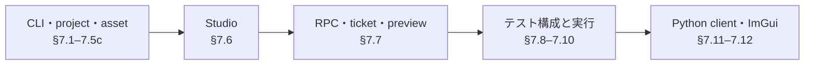
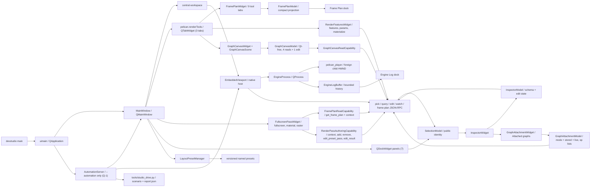
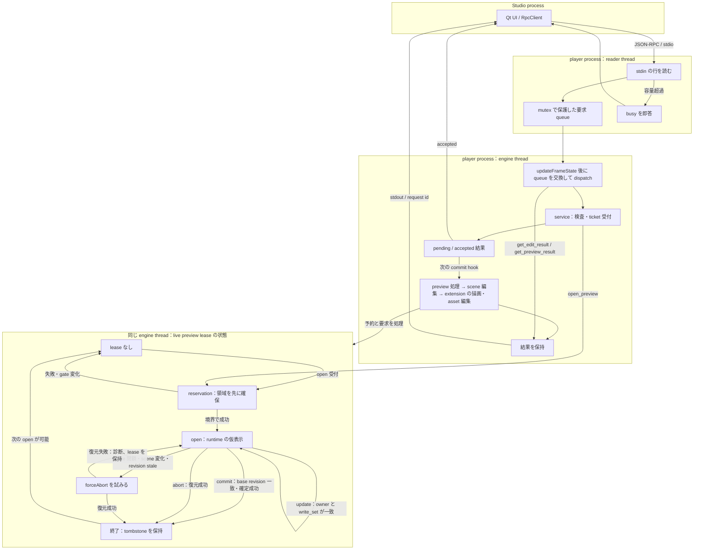

# 第7章 ツール・RPC・テスト

最終確認: 2026-10-07(develop d975ee9c0)

[索引へ戻る](README.md) / [前章](06_rendering_vulkan_shader.md) / [次章](08_class_interface_index.md)

この章では、engine 本体の周辺にある3つの入口を扱います。

- `pelican_cli`: project 作成、asset manifest、外部納品物 import、配布 feature 導出。
- `pelican_studio`: **Qt Widgets** 製の開発 UI。静的ライブラリ 8 本 + exe(ほかに resource の embed proxy target が 1 つ)で、`src/devstudio` は **31,588 行**(`.cpp` / `.hpp` 73 ファイルの合計)。8 本目は Q-1 が足した [`pelican_studio_automation`](../../src/devstudio/automation/CMakeLists.txt#L8) です。QML は 1 行も使っていません —— 足すとしても葉パネルの内部に限る、というのが §7.6 の規律です。
- RPC と test: headless engine を外から決定論的に操作し、仕様を固定する仕組み。

**この章の地図**


根拠（章構成）: `07_tools_rpc_tests.md:31` 以降の節見出し（矢印は読む順で、実行順ではありません）。

**この章の語。**

- **digest / CAS** — 文書の照合値 / その一致を条件にした更新方式で、[第13章](../manual/13_editor.md#digest-cas)が受付時と確定時の規則を所有します。
- **revision** — scene 文書の版番号で、公開契約は[第13章](../manual/13_editor.md#134-同時編集--actor-と-revision)、内部の再照合は[RPC の図](#rpc-threads-preview)を参照してください。
- **lease** — live preview が特定 actor と書き込み範囲に対して持つ一時的な排他権です（[予約から終了まで](#rpc-threads-preview)）。
- **sink** — 操作の値・副作用を受け取る出口で、公開 API の transaction sink は[第5章](05_gameplay_and_services.md#515-scene-transaction中の公開apieffect-transaction-sink-実装済み)を参照してください。
- **capability（機能）** — codec や adapter がその操作に対応できるという情報で、live preview では対応する値の編集だけを受理します（[RPC の図の注](#rpc-threads-preview)）。
- **capability（権限）** — 特定対象へ操作する権限を持つ token / handle を指す用法で、backend の対応機能という意味とは区別します（[横断パターン](00_cross_cutting_patterns.md)）。

## 7.1 `pelican_cli` の全体像

[`src/devcli/main.cpp`](../../src/devcli/main.cpp#L17) は第1引数を見て11系統へそのまま dispatch します。dispatch の順が
[usage 行](../../src/devcli/main.cpp#L51)の順です。

```text
pelican_cli
├─ assets <manifest|verify|status>
├─ audio analyze --asset <file> --out <file.ktx2> [...]   # AB-1: 音の解析の表を焼く
├─ bake-camera ...                       # replayからcameraパスをbake
├─ image ktx2 --out <file> --format <VK名> (--raw <file> --width W --height H | --hdr <file>)   # IA-1: 非圧縮のKTX2を書く
├─ import <delivery_dir> --project <dir|project.json>   # --rulesサブモード付き
├─ dist-config <project> [--with rpc,seqplayer] [--out file]
├─ package <install|list|inspect>        # X-1: packageのvendoringと検査(§7.5b)
├─ project init <directory>
├─ dump-lowered-material ...             # material lowering結果のダンプ
├─ vrm ...                               # VRM semanticのダンプ/検査
└─ graph-catalog                         # 登録済みgraph moduleのcatalogをJSONで(§7.5c)
```

執筆時点から7系統増えました。

- `bake-camera`([`bakecameracommand.cpp`](../../src/devcli/bakecameracommand.cpp))は入力 replay から camera パスを bake します(player の `--bake-camera-output` と対。テスト: [`run_devcli_bake_camera.cmake`](../../test/run_devcli_bake_camera.cmake))。
- `image`(✅IA-1。[`imagecommand.cpp` の `runImageCommand()`](../../src/devcli/imagecommand.cpp#L118))は今は `ktx2` だけで、raw の texel か Radiance の `.hdr`(stb_image の `stbi_loadf_from_memory` で RGBA32F)から、engine の [`writeKtx2()`](../../src/core/loader/ktx2.cpp#L393) で非圧縮・mip 1 段の KTX2 を書きます(第6章「persistent の image の初期内容と KTX2 の float」。使い方は manual 第10章 §10.4)。このために `pelican_cli` は `src/core/loader/ktx2.cpp` を自分の source に加え、`stb` を link します。テスト: `ia1_ktx2_cli_test` の [「IA-1 pelican_cli image ktx2 writes --raw and --hdr files the loader reads」](../../test/ia1_ktx2_cli_test.cpp#L97)。
- `audio`(✅AB-1。[`runAudioCommand()`](../../src/devcli/audiocommand.cpp#L84))は今は `analyze` だけで、音の rms・peak・帯域を `R32_SFLOAT` の KTX2 と `<out>.import.json` に焼きます(RPC `bake_audio_analysis` と同じ `bakeAudioAnalysis()`。使い方は manual 第10章 §10.4、仕組みは第5章 §5.9「音の解析を焼く」)。CLI は engine を link しないので、`PELICAN_WITH_AUDIO` の build では `src/core/audio/sounddecode.cpp` と `audioanalysis.cpp` を自分の source に入れ、miniaudio の実装を [`miniaudioimpl.cpp`](../../src/devcli/miniaudioimpl.cpp#L1) に持ち、`miniaudio` を link します。OFF では `audio.analysis_unavailable@1` で断ります。テスト: `ab1_audio_analysis_test`(`audiocommand.cpp` を test の source に入れて `runAudioCommand()` を直接呼ぶ)。
- `dump-lowered-material`([`materialcommand.cpp`](../../src/devcli/materialcommand.cpp))は material lowering 結果をダンプします(テスト: [`run_dump_lowered_material.cmake`](../../test/run_dump_lowered_material.cmake))。
- `vrm`([`vrmcommand.cpp`](../../src/devcli/vrmcommand.cpp))は VRM semantic のダンプ/検査です(テスト: [`run_devcli_vrm_dump.cmake`](../../test/run_devcli_vrm_dump.cmake))。
- `package`([`packagecommand.cpp`](../../src/devcli/packagecommand.cpp#L193))は package ディレクトリを project へ vendoring し、install 済みの digest を照合し、install せずに manifest を読みます(§7.5b。テスト: `package_install_smoke` —— [`package_install_smoke` の登録は `if(PELICAN_WITH_RPC)` の中](../../test/CMakeLists.txt#L3638)で登録され、GPU lease と 300 秒の intrinsic timeout が付きます —— と ctest 未登録の [`run_package_template_smoke.cmake`](../../test/run_package_template_smoke.cmake))。
- `graph-catalog`([`graphcatalogcommand.cpp`](../../src/devcli/graphcatalogcommand.cpp#L10))は `builtinGraphModuleRegistry().catalog()` をそのまま印字します(§7.5c。テスト: [`run_devcli_graph_catalog.cmake`](../../test/run_devcli_graph_catalog.cmake))。
- 既存の `import` には `--rules` サブモード(ルールベース import、[`rulesimport.cpp`](../../src/devcli/rulesimport.cpp) + [`importrules.hpp`](../../src/project/importrules.hpp)、テスト: [`run_devcli_rules_import.cmake`](../../test/run_devcli_rules_import.cmake))と glTF scene 抽出([`gltfsceneextract.cpp`](../../src/devcli/gltfsceneextract.cpp)、テスト: [`run_devcli_gltf_extract.cmake`](../../test/run_devcli_gltf_extract.cmake))が加わりました。

`--rules` から外部ツールを起動する経路のために [`DevCli::runProcess(ProcessOptions)`](../../src/devcli/processrunner.hpp#L34) が追加されました。ヘッダのコメントが規範です。

> Runs one child in its own process group, captures stdout/stderr, and kills the
> complete group on timeout or cancellation. Arguments are filesystem::path so
> Windows callers retain their native UTF-16 representation through CreateProcessW.

`ProcessOptions{executable, arguments, timeout, cancelled, log_path, name}` と `ProcessResult{exit_code, timed_out, cancelled, process_id, stdout_text, stderr_text}` の組で、テストは [`processrunner_test.cpp`](../../test/processrunner_test.cpp) + [`process_fixture_child.cpp`](../../test/process_fixture_child.cpp)、結合は [`run_devcli_import_process.cmake`](../../test/run_devcli_import_process.cmake) です。

command ごとに独立した `run...Command(argc, argv)` を持つ構成で、巨大な application class はありません。argument parse には `argparse`、JSON には `nlohmann::json` を使います。[`src/devcli/CMakeLists.txt`](../../src/devcli/CMakeLists.txt#L1) を見ると、CLI は `pelican_project` へ依存しますが、Vulkan renderer 全体へは依存していません。

## 7.2 `project init`: 実行可能な最小 project の生成器

[`runProjectInitCommand()`](../../src/devcli/projectinit.cpp#L30) は `--template standard|blank`(既定 `standard`)を読んで [`initializeProjectTemplate()`](../../src/project/projecttemplate.cpp#L400) を呼ぶだけで、空であることを確認した directory に template file 群を書くのはこちらです。F-2 で雛形は `pelican_cli` から `pelican_project` の [`projecttemplate.{hpp,cpp}`](../../src/project/projecttemplate.hpp) へ移り、Studio の File > New Project... も同じ関数を呼びます。template の一覧は [`templateFiles()`](../../src/project/projecttemplate.cpp#L350) にあります。

主な生成物は次です。

| 生成物 | 役割 |
|---|---|
| `project.json` | project schema、basic config、default scene、input actions |
| `scenes/main.scene.json` | 最初の scene |
| `assets/asset_data.json` | model/audio などの asset catalog |
| `input/actions.json` | action map |
| `input/profiles/keyboard.json` | input profile |
| `passes/main_rendering_config.json` | 描画 pipeline preset と feature の選択(次項) |
| `ui/ui_overlay.json` | 2D UI overlay |
| `code/CMakeLists.txt`, `code/game.cpp` | game system を組み込む project code。生成される CMakeLists.txt は `pelican_game_sources()` を呼ぶため、game code は **DLL**(`pelican_game_logic`)としてビルドされます。X-1 以降は `pelican_packages()` の 1 行が**その後ろに**続きます([template](../../src/project/projecttemplate.cpp#L274)) —— package の object は、先に作られた game logic DLL へ合流するので順序が効きます |
| `.gitattributes`, `.gitignore`, `README.md` | asset/LFS と利用案内 |

template は外部 resource file ではなく、[`projecttemplate.cpp` 内の raw string](../../src/project/projecttemplate.cpp#L89) です。schema を変更した場合、example project だけでなくここも更新しないと、新規 project が古い形式で生成されます。

この command の end-to-end 仕様は [`run_devcli_project_init.cmake`](../../test/run_devcli_project_init.cmake) です。file が揃っているかの確認だけでなく、生成した project directory を **prebuilt の `pelican_player`** に `--headless --frames 2 --render-out` で食わせ、exit 0・出力に `Validation Error` / `VUID-` が出ないこと・PNG が空でないことまで見ます(生成された `code/game.cpp` を build する経路ではありません)。空でない directory を拒否し、そのエラーが directory 名を含むことも同じ script が固定しています。実 device を要するので CTest では `gpu` label 付きです([`test/CMakeLists.txt`](../../test/CMakeLists.txt) の `devcli_project_init_command`)。

**`blank` 雛形(F-2)。**`--template blank` は上の 16 エントリと同じファイルの組を書き、`passes/main_rendering_config.json` の `rendering` 節だけを差し替えます(VI-2 までは `shaders/present.frag` も足していました)。中身は `pipeline` キーの無い direct config で、preset・`features`・`render_targets` を持たず、fullscreen pass `present` 1 本が `display` へ UV の gradient を書きます([`blank_rendering_config_json`](../../src/project/projecttemplate.cpp#L228))。`present` の fragment は engine 同梱の `engine://passthrough` で、入力がすべて可変です —— 入力が 0 本なら gradient、入力があれば入力 0 をそのまま出します([shader](../../src/core/resources/passthrough.frag))。同じ `run_devcli_project_init.cmake` がこの project を headless で 2 frame 描かせ、PNG が 100 色以上で、最も多い 1 色以外の画素が 9 割以上(最多色が 1 割以下)であることを `pelican_test_png_nonuniform_check` で見ます([検査](../../test/run_devcli_project_init.cmake#L232))。描く前に、`present` の fragment が `engine://passthrough` で `shaders/` が無いことも確かめます(描かれた frame が雛形の書いた shader のものでないこと)。ファイルの形は GPU 無しの `devcli_project_templates`([`run_devcli_project_templates.cmake`](../../test/run_devcli_project_templates.cmake))が見ます —— 既定と `--template standard` の 16 ファイルが F-2 前の出力と SHA-256 で一致すること(MG-2b が `"version": 2` に変えた `scenes/main.scene.json` と `assets/asset_data.json` の 2 行だけは取り直し。`passes/main_rendering_config.json` の digest は変わっていません)、blank の形(`passes/main_rendering_config.json` 以外の 15 ファイルが standard と同じ digest で、`shaders/` が無く、`present` の fragment が `engine://passthrough` で `shader.defines` を持たないこと)、知らない template 名の拒否です。

### 生成される rendering config は preset 参照の `pelican.graph` root(WP240a → P-2a-4b)

`passes/main_rendering_config.json` の template は 111 行の手書き設定から数行になり、さらに
**`pelican.graph` root** になりました。MG-2b からはソースのリテラルがファイルの全文です
([`rendering_config_json`](../../src/project/projecttemplate.cpp#L199))。

```json
{
  "schema": "pelican.graph",
  "version": 1,
  "definitions": {},
  "nodes": [],
  "outputs": {},
  "rendering": {
    "pipeline": {
      "preset": "engine://render_pipelines/hybrid_v1.json"
    },
    "features": [
      "engine://features/shadow_directional.json",
      "engine://features/sky_ambient.json"
    ]
  }
}
```

P-2a-4b から MG-2b までは、ソースに `rendering` 節の中身だけを置き、`wrapLegacyRenderingConfig()` で包んでいました。
MG-2b でエンジンが graph root しか読まなくなったので包み関数は撤去され、リテラルは包んだ結果のバイト列をそのまま書いたものに
なりました([選ぶ関数](../../src/project/projecttemplate.cpp#L261))。
どのキーがどちらの層に属するかは [`isGraphRootKey()`](../../src/project/renderconfigdocument.hpp#L19) が決めます。

旧 template は `render_targets` 8 本(gbuffer 5 枚 + depth + ssao 2 枚)と `rendering_passes` を自分で書き下し、pass は gbuffer_pass / ssao_pass / ssao_blur_pass / present の 4 つでした。末尾の `present` が `uses_light_data: true` を持ち、ライティングと present を兼ねていました。新 template はこの 2 つの member を **持ちません**。

読む位置が一段動いたのがこの変更の要点です。

- `project init` が **何を書くか** → [`rendering_config_json`](../../src/project/projecttemplate.cpp#L199) の `pelican.graph` root(上の block がファイルの全文です)
- 生成された project が **実際にどの pass を回すか** → [`src/core/resources/render_pipelines/hybrid_v1.json`](../../src/core/resources/render_pipelines/hybrid_v1.json) と [`src/core/resources/features/shadow_directional.json`](../../src/core/resources/features/shadow_directional.json)

preset 側の `main_render` グラフは deferred_geometry / ssao_pass / ssao_blur_pass / deferred_lighting / forward_opaque / `__snapshot_opaque_color` / `__snapshot_opaque_depth` / forward_transparent / scene_present で、`shadow_depth` は preset ではなく feature 側が足します。つまり新規 project は最初から forward・半透明・opaque snapshot・directional shadow を持ちます。preset と feature をどう解決して 1 本のグラフにするかは[第6章](06_rendering_vulkan_shader.md)の担当です。

テスト側は既存 1 本の拡張と新規 1 本です。どちらも `gpu` label です。

| テスト | 見ているもの |
|---|---|
| `devcli_project_init_command`(既存を拡張。[`run_devcli_project_init.cmake`](../../test/run_devcli_project_init.cmake#L48)) | 生成された config が **`pelican.graph` root で `rendering` が object** であること、`rendering.pipeline.preset` が hybrid_v1、`rendering.features` が shadow_directional と sky_ambient のちょうど 2 本、`rendering` の中に `render_targets` / `rendering_passes` が **無い**こと、`code/CMakeLists.txt` が `pelican_game_sources` の後に `pelican_packages()` を呼ぶこと。**root の形を先に確かめる順序が効きます** —— 節ごと消えたときに禁止メンバの検査が真空で通るのを防ぎます |
| `animgraph_demo_preset_headless_player`(新規。[`run_preset_project_headless.cmake`](../../test/run_preset_project_headless.cmake)) | 同じ preset へ移行した `projects/animgraph_demo` を `--dump-frame-plan` 付きで 3 frame 回し、frame plan に `"graph": "main_render"` と 8 個の node 名が現れること |

後者が数える 8 node は shadow_depth / deferred_geometry / deferred_lighting / forward_opaque / `__snapshot_opaque_color` / `__snapshot_opaque_depth` / forward_transparent / scene_present です(ssao の 2 本は検査に入れていません)。「preset を参照するだけの config が本当に完全なグラフへ展開されるか」を、生成物ではなく実在の project で押さえる位置にいます。禁止 member の検査(`render_targets` / `rendering_passes` が **無い**こと)が両方に入っているのは、preset へ移したはずの記述が config 側へ再び生えてくるのを防ぐためです。

## 7.3 `assets`: store と manifest の保守

入口は [`runAssetsCommand()`](../../src/devcli/assetscommand.cpp#L397) です。project の `asset_stores` と `.pelican/local.json` を読み、store ごとの実 directory と manifest を解決します。

| subcommand | 実装 | 動作 |
|---|---|---|
| `manifest` | [`runManifestCommand()`](../../src/devcli/assetscommand.cpp#L277) | store を走査して manifest と hash cache を更新 |
| `verify` | [`runVerifyCommand()`](../../src/devcli/assetscommand.cpp#L297) | manifest と filesystem を比較。`--full` なら内容も再 hash |
| `status` | [`runStatusCommand()`](../../src/devcli/assetscommand.cpp#L326) | store/manifest/asset の missing と大小文字不一致を軽量確認 |

hash と path の純粋ロジックは [`src/project/assetsmanifest.cpp`](../../src/project/assetsmanifest.cpp#L1)、起動時の runtime 検証は [`src/core/loader/assetsverification.cpp`](../../src/core/loader/assetsverification.cpp#L1) に分かれます。CLI は manifest を「作る・事前確認する」側、core は project 起動時に「利用可能か確認する」側です。

`--full` でない manifest/verify は `.pelican/assets-hash-cache.json` を利用します。file metadata で cache hit できる場合は内容全体を読み直さず、大規模 store の反復確認を軽くします。厳密な配布前確認では `--full` を使う前提です。cache が外れた file の hash は、CLI も起動時の検証も同じ [`assetFileSha256()`](../../src/project/assetsmanifest.cpp#L162) です(✅AH-1。1 MiB ずつ読み、Windows では BCrypt。[第3章](03_project_and_loading.md) §3.4)。

仕様テストは [`assetsmanifest_test.cpp`](../../test/assetsmanifest_test.cpp#L1)、[`assetsverification_test.cpp`](../../test/assetsverification_test.cpp#L2)、CLI 結合テストは [`run_devcli_assets.cmake`](../../test/run_devcli_assets.cmake#L1) です。

## 7.4 `import`: 外部 delivery を安全に project catalog へ登録

[`importDelivery()`](../../src/devcli/importcommand.cpp#L337) は、project 内に置かれた delivery directory の `manifest.json` を読みます。大まかな transaction は次です。

```text
project / delivery pathをcanonicalize
  -> deliveryがproject root内か確認
  -> manifest schemaをparse
  -> output pathがdelivery外へescapeしないか確認
  -> 全outputのSHA-256を確認
  -> gltf schemaかつ.glbだけを抽出
  -> asset_data.modelsへ未登録分を追加
  -> asset_data JSONを書き戻す
```

安全性の要点は3つあります。

1. [`resolveProjectFile()`](../../src/devcli/importcommand.cpp#L165) は absolute path、backslash、未知 scheme、`..` による project root escape を拒否します。
2. [`verifyManifestOutputs()`](../../src/devcli/importcommand.cpp#L273) は登録前に全 output の SHA-256 を検証します。途中まで catalog を変更しません。
3. [`registerImportedModels()`](../../src/devcli/importcommand.cpp#L288) は既存の model 名または path と重複すれば skip するため、同じ delivery を再実行しても重複登録しません。

なお「transaction」は catalog 書き換え前の検証順という意味です。file write 自体は [`writeTextFile()`](../../src/devcli/importcommand.cpp#L148) の truncate write であり、temp file + rename の atomic replace ではありません。

manifest の純粋 parser は [`src/project/importmanifest.cpp`](../../src/project/importmanifest.cpp#L1)、fixture 仕様は [`importmanifest_test.cpp`](../../test/importmanifest_test.cpp#L1)、CLI の実 filesystem 動作は [`run_devcli_import.cmake`](../../test/run_devcli_import.cmake#L1) が固定しています。

## 7.5 `dist-config`: project 内容から配布用 feature を導出

[`deriveDistConfig()`](../../src/devcli/distconfig.cpp#L875) は project を静的走査し、配布 build に必要な optional feature を決めます。

| feature | 導出方法 |
|---|---|
| `PELICAN_WITH_VAT` | asset data と import manifest にある GLB の JSON chunk を読み、VAT(Vertex Animation Texture — 頂点ごとの動きをテクスチャへ焼き込んで再生する方式)metadata を検査 |
| `PELICAN_WITH_EXR` | asset/UI JSON 内の `path` / `file` に `.exr` reference があるか走査 |
| `PELICAN_WITH_RPC` | 自動推測せず `--with rpc` で明示 |
| `PELICAN_WITH_SEQPLAYER` | 自動推測せず `--with seqplayer` で明示 |

このほか `PELICAN_WITH_IMGUI` / `PELICAN_WITH_RENDERDOC` / `PELICAN_WITH_HOT_RELOAD`(✅AV-1)/ `PELICAN_WITH_SPIRV_LINK` / `BUILD_TESTING` は導出せず、project に関係なく常に OFF を出します([固定の OFF の行](../../src/devcli/distconfig.cpp#L924))。

GLB 候補は asset catalog と project 以下の import manifest の両方から集めます。入口は [`collectAssetDataGlbs()`](../../src/devcli/distconfig.cpp#L371) と [`collectImportManifestGlbs()`](../../src/devcli/distconfig.cpp#L404) です。単に拡張子を見るだけでなく、GLB JSON chunk と VAT primitive metadata を読み、壊れた VAT declaration を「feature なし」として黙殺しない設計です。

結果は [`renderDistConfigPreset()`](../../src/devcli/distconfig.cpp#L909) が `set(PELICAN_WITH_... CACHE BOOL ... FORCE)` 形式の CMake include file にします。各判定の理由も comment へ出るため、「なぜこの依存が配布物に入ったか」を追跡できます。

command line は [`runDistConfigCommand()`](../../src/devcli/distconfig.cpp#L945)、結合仕様は [`run_devcli_dist_config.cmake`](../../test/run_devcli_dist_config.cmake#L1) です。

**asset の照合(✅EB-1、`aaa7b2da`)。**`runDistConfigCommand()` は導出の後、preset を書く前に [`verifyAssetsForDistribution()`](../../src/devcli/distconfig.cpp#L835) を呼びます(`--skip-assets-verify` なら呼ばずに `assets verify: skipped (--skip-assets-verify)` の 1 行)。中身は `assetscommand.cpp` から公開した [`verifyDeclaredAssetStores()`](../../src/devcli/assetscommand.cpp#L366) で、manifest を宣言した store ごとに `pelican_cli assets verify --full` と同じ照合(`include_content` と `force_rehash`、`.pelican/local.json` の root の上書きも同じ)をします。issue があれば store ごとに `assets_manifest_mismatch@1` の行と、`assetManifestIssueKindLabel()` の名前でファイルを 1 行ずつ stderr に出して 1 を返し、preset は書きません。照合が例外で失敗すれば `assets_verify_failed@1` で 1 です。manifest を宣言した store が無ければ 1 行の注記で通します。出力の全形は manual 第10章 §10.4 の `dist-config`。結合仕様の `run_devcli_dist_config.cmake` に、一致・差分・skip・store 無しの 4 場面が足されました。

> 🧩 **難所 — 前方一致では判定しない**([`isWithinRoot()`](../../src/devcli/distconfig.cpp#L122) / [`pathComponents()`](../../src/devcli/distconfig.cpp#L114))
>
> **何をする所か**: 走査中に見つけた参照先が本当に project root の下にあるかを判定します。外れていれば `escapes project root` を投げて `dist-config` ごと失敗させます。
>
> **前提**: [`pathString()`](../../src/devcli/distconfig.cpp#L60) は `std::filesystem::path` を区切り文字ごと 1 本の文字列へ戻すだけの補助関数(実体は `path.string()`)で、このファイルでは主に例外メッセージの組み立てに使われます。以下の「前方一致」は、この 1 本の文字列同士を `starts_with` で比べる書き方のことです。
>
> **素朴に読むと**: 見た目は「Windows の大小無視のためにパスをコンポーネント分解している」だけに見えます。しかし本体はサンドボックス判定(外部由来の参照が指定ディレクトリの外を指していないかの検査)で、`pathString()` の文字列比較にしなかった理由は大小無視ではありません。前方一致だと root `C:/Foo` の下に `C:/Foobar/model.glb` が入っていると判定してしまいます — 一致の境界がたまたま区切り文字と一致しないからです。コンポーネント単位なら `"foo" != "foobar"` で確実に落ちます。Windows で各コンポーネントを小文字化する [`comparableComponent()`](../../src/devcli/distconfig.cpp#L99) は、この比較に付随する処理にすぎません。もう一つの前提は呼び出し側にあります。この関数は `..` を畳まないので、正規化前のパスを渡すと `root/../secret` の先頭コンポーネント列が root と一致し、「root の下」と判定されます。
>
> **骨子**:
> ```text
> isWithinRoot(root, candidate):
>   candidate のコンポーネント数 < root のコンポーネント数 -> false
>   先頭から root のコンポーネント数ぶんだけ 1 対 1 で比較(Windows は小文字化して比較)
>   1つでも不一致 -> false / 全一致 -> true
> ```
>
> **手がかり**: 呼び出しは2箇所だけで、どちらも直前に [`weaklyCanonicalOrThrow()`](../../src/devcli/distconfig.cpp#L71) を通した絶対パスを渡しています — [`resolveProjectRef()`](../../src/devcli/distconfig.cpp#L206) と [`addMaybeExistingGlbCandidate()`](../../src/devcli/distconfig.cpp#L355)。root 側も [`loadProjectFiles()`](../../src/devcli/distconfig.cpp#L271) が `canonicalDirectoryOrThrow()` で正規化済みにしています。つまり `..` を実際に潰しているのは `weakly_canonical` であって `isWithinRoot()` ではありません。
>
> **不変条件**: 両引数は正規化済みの絶対パスであること。これはコード上どこにも明文化されていない暗黙の前提で、新しい呼び出し箇所を足すときの最大の落とし穴です。パスの包含判定に `pathString()` の前方一致を使わない。

## 7.5b `package`: project へ vendoring する(X-1)

[`runPackageCommand()`](../../src/devcli/packagecommand.cpp#L193) は `install` / `list` / `inspect` の 3 つを
分けるだけの薄い入口で、規則は全部 [`src/project/packagemanifest.hpp`](../../src/project/packagemanifest.hpp#L13) にあります。
header の冒頭コメントが規範です。

> X-1: a package is a directory with a `pelican.package` manifest.  It is the
> one carrier that can leave the engine tree: the author writes it anywhere,
> and installing it copies the whole directory into
> `<project>/packages/<namespace>/`.  Nothing in the engine resolves a package
> outside a project, so "where it came from" stops mattering the moment it is
> vendored.

| subcommand | 実装 | 動作 |
|---|---|---|
| `install <dir> --project <p>` | [`runInstall()`](../../src/devcli/packagecommand.cpp#L88) | `installPackage()` を呼び、`{status: "installed", namespace, package_version, sha256, destination, feature_references, feature_names}` の 7 鍵を印字 |
| `list --project <p>` | [`runList()`](../../src/devcli/packagecommand.cpp#L117) | `project.json` の記録を読み、**実バイトの sha256 を計算し直して**照合 |
| `inspect <dir>` | [`runInspect()`](../../src/devcli/packagecommand.cpp#L170) | install せずに manifest を検証して dump。`sdk_abi_expected` も添える |

設計上の要点は 3 つです。

1. **検査は 1 byte も書く前に終わります。**install の拒否(manifest 不在・不正、engine が古い、依存不足、
   feature 文書が不正、同名が install 済み、SDK ABI 不一致)は全部名前付きで、複製は staging ディレクトリを
   rename して行われます。
2. **digest は書かれるだけでなく読まれます。**`list` が [`packageTreeDigest()`](../../src/project/packagemanifest.hpp#L100)
   を計算し直し([再計算](../../src/devcli/packagecommand.cpp#L142))、ずれていれば `status: "modified"` + stderr の
   `package_digest_mismatch` で非 0 終了です([記録した digest との比較](../../src/devcli/packagecommand.cpp#L144))。
   vendoring された package を手で編集したことが見えます。**この失敗旗は digest 違いだけのものではありません** ——
   vendoring 先のディレクトリごと消えていれば `status: "missing"` が同じ旗を立て、同じ
   `package_digest_mismatch` の行で終わります([不在の側](../../src/devcli/packagecommand.cpp#L137))。
3. **拒否理由は例外が運びます。**[`PackageError`](../../src/project/packagemanifest.hpp#L27) は `code()` と、
   数え上げるべき名前(欠けた依存、まだ package を指している参照)を `names()` で持ちます。CLI も RPC も
   メッセージから理由を再構成しません。

## 7.5c `graph-catalog`: module 登録の可視化

[`runGraphCatalogCommand()`](../../src/devcli/graphcatalogcommand.cpp#L10) は引数を取らず、
`builtinGraphModuleRegistry().catalog()` を印字するだけの 9 行です。出力は
[`GraphModuleRegistry::catalog()`](../../src/project/graphmodule.cpp#L713) が組み立てる `pelican.graph_catalog` v1 で、
module → types / operations / sinks の順に並びます。**並びは名前順**です(module と operation は名前を鍵にした
`std::map`、types と sinks は明示的に sort)。登録順に依存しないので、module を足しても既存の行は動きません。RPC の `get_graph_catalog` は ✅EL-4 からこの値に 2 つの鍵(material pass の format の表から作る一覧。§7 の RPC 表)を足して返すので、CLI の出力とは同じではありません。engine の shader の反映から作る一覧は、✅EL-4b から別の RPC `get_engine_shaders` です。

[`run_devcli_graph_catalog.cmake`](../../test/run_devcli_graph_catalog.cmake#L24)(ctest 名 `devcli_graph_catalog`)は
module 数(既定 5。常に登録される `pelican.value` / `pelican.render` / `pelican.ui` の 3 に、`pelican.audio` と `pelican.pose` を足す。`pelican.ui` は GP-3 で加わった。`PELICAN_WITH_ANIMATION=OFF` と `PELICAN_WITH_AUDIO=OFF` でそれぞれ 1 減る)、各 operation が `domain` / `evaluation` /
**`change.default`**(`change` は入れ子の object で、script が読むのはその `default`。[読む位置](../../test/run_devcli_graph_catalog.cmake#L60))/ `sink` を
持つこと、`value.trigger_clock` の評価分類が `replay`、`render.buffer` の parameter change が `rebuild` であることを
見ます。**さらに `docs/v0_freeze.md` の操作表と突き合わせます** —— 表は `<!-- graph-op-table:begin -->` /
`<!-- graph-op-table:end -->` のコメントで区切られており、script の中のコメントがその理由です。

> A copy nobody compares is a second source of truth, so the same run that reads the catalog
> reads the table: the documented set is exactly what the ON build registers, and a superset
> of what the OFF build does -- the difference being the pose operations the disabled module
> owns.

区切りを heading ではなくコメントにしてあるのは、**前後の散文を書き直しても比較が黙って空にならない**ようにするためです。

## 7.6 Pelican Studio の現在位置

Studio の起点は [`src/devstudio/main.cpp`](../../src/devstudio/main.cpp#L5) です。Qt application を作る [`uimain()`](../../src/devstudio/view/uimain.cpp#L26) から [`MainWindow`](../../src/devstudio/view/mainwindow.hpp#L75) を表示します。

**「full editor ではない」という言い方はもう正確ではありません。**scene(object / component / gizmo)、
render config(`features[]` と feature パラメータ)、preset・pass・compute task、そして共通グラフの
authoring が Studio から通ります。engine 内部への裏口はどれも通らず、公開 RPC だけを呼びます。



図の右下の 3 つが **capability struct** です。`EmbeddedViewport` の「任意のメソッドを送れる」面を、
widget ごとに**名前の付いた少数の関数だけを持つ struct** へ絞ってから渡します
([`GraphCanvasReadCapability`](../../src/devstudio/view/graphcanvasreadcapability.hpp#L37) /
[`RenderPassAuthoringCapability`](../../src/devstudio/view/renderpassauthoringcapability.hpp#L19) /
`FramePlanReadCapability`)。**汎用の RPC メソッドを表現できない型**なので、その widget から別の面が
漏れ出すことが構造上ありません。`FramePlanWidget` と `RenderFeaturesWidget` は歴史的な理由で
`EmbeddedViewport *` を直接受け取ります(絞り込みはこの 2 つには入っていません)。

[`MainWindow::MainWindow()`](../../src/devstudio/view/mainwindow.cpp#L220) は Project / Outliner /
Inspector / Output / Engine Log / Frame Plan / Pass Editor / Assets / Materials / Problems の 10 パネルを stable object name を持つ dock として作ります(Assets は ✅HW-2s / AV-1s で増えた素材のフォルダのドックで、既定では Project の隣のタブ。[第13章](../manual/13_editor.md) §13.1 の「Studio の Assets のドック」。Materials は ✅MT-1s で増えた material のドックで、既定では Assets の隣のタブ。同じ節の「Studio の Materials のドック」。Problems は ✅PB-1s で増えた今の問題の一覧のドックで、既定では Engine Log の次のタブ。同じ節の「Studio の Problems のドック」)。パネルは
移動、float、タブ化でき、`View > Panels` から再表示できます。シェル責務は Widgets に固定し、QML を
追加する場合も `QQuickWidget` に載せた葉パネルの内部だけに限定します。

**外の model の持ち込み(✅MI-1s、`70298f88`)は新しいドックを作りません。**Add Object > Model from file…・Inspector の model 欄の Import…・
Assets のドックの Remove from project… の 3 つの入口が、`MainWindow` の持つ 1 つの [`ModelRegistrationSession`](../../src/devstudio/model/modelimport.hpp#L57)
(`src/devstudio/model/modelimport.{hpp,cpp}`。Qt を使わず、`pelican_studio_inspector_model` の lib に入ります)を通ります。session は
`register_model` / `get_material_bindings` / `unregister_model` を `Transport::request` で送り(MainWindow が viewport の `requestRpc()` につなぐ。
[つなぐ所](../../src/devstudio/view/mainwindow.cpp#L545))、答えの id で振り分けます。ファイルの置き方は [`placeProjectModelFile()`](../../src/devstudio/model/modelimport.cpp#L65)
(project の中ならそのまま、外の `.gltf` は断る、外の `.glb` / `.vrm` はコピー)、送り直しの名前は `numberedModelName()`(`<stem>_001`…)、
`list_assets` の絶対 path を project 相対に直すのは [`projectRelativeAssetPath()`](../../src/devstudio/model/modelimport.cpp#L96) です。
コピーは [`copyIntoProjectAssets()`](../../src/devstudio/model/graphcanvasvalues.cpp#L1044)(宣言は `graphcanvasmodel.hpp`。`assets/<folder>/` に元の名前か
`<stem>_2`… で、上書きしない)で、Graph の parameter の Import… もこれでコピーするようになりました([Import… の共用の所](../../src/devstudio/view/graphcanvasparameterfields.cpp#L1530)。
前は `graphcanvasparameterfields.cpp` の中の `freeName` を使っていて、MI-1s で消しました。画像の `importProjectImage()` は今も `graphcanvasvalues.cpp` の別の `freeName()` を使います)。登録の拒否の 1 文と object の宣言は
`inspectormodel.cpp` の `modelRefusalDescription()` / `modelUnknownEditDescription()` / `modelObjectDeclaration()` / `modelObjectBaseName()` です。
見え方は [第13章](../manual/13_editor.md) §13.1 の「Studio で外の model を持ち込む(✅MI-1s)」です。

**RT の Studio 側(✅RTL-2s、a `16129867` / b + c `c8fd51cb`)は 3 つの組と、既存の widget への差し込みです。**新しいドックはありません。

- [`raylayoutmodel.hpp`](../../src/devstudio/model/raylayoutmodel.hpp#L17)(`src/devstudio/model/raylayoutmodel.{hpp,cpp}`。Qt を使わない): `get_ray_layout` の読み([`parseRayLayoutRead()`](../../src/devstudio/model/raylayoutmodel.hpp#L94) → `RayLayoutRead`)、名前の規則(`rayNameProblem()`)、既定の layout(`defaultRayLayout()`)、`get_render_documents` からの RT の task の列挙([`rayTracingTasks()`](../../src/devstudio/model/raylayoutmodel.hpp#L179)。node は `set_node_parameters`、feature の task は `edit_compute_task` を `RayTracingTask::edit()` が作る)、1 つの変更が書く文書の組 `RayLayoutPlan` を作る `plan*()` の関数群(Enable / Disable / 足す / 消す / 改名 / 並べ替え / record / 割り当て / 戻し)、plan を `edit_batch`(task が変わるとき)か `edit_ray_layout` にする [`rayLayoutRequest()`](../../src/devstudio/model/raylayoutmodel.hpp#L319)。task の形を layout の形に変える規則は [`rayTracingInLayoutForm()`](../../src/devstudio/model/raylayoutmodel.hpp#L215) の 1 つで、Graph の palette(`graphcanvasmodel.cpp` の `rayTracingOfStem()`)もこれを呼びます。
- [`raylayouttemplate.hpp`](../../src/devstudio/model/raylayouttemplate.hpp#L13)(Qt を使わない): layout の形の shader の雛形の 1 組(`rayLayoutShaderTemplate()`)、raygen の切り替え(`setRayLayoutRaygenSwitch()`)、hit shader の record の区画(`rayRecordBlock()` / `rewriteRayRecordBlock()`)。Graph の New…(ファイルを書くのは `fullscreenshadertemplate.cpp` の `writeRayLayoutTemplate()`)、Ray layout の節の Enable と「雛形から」が同じ関数を呼びます。RTL-2s-c が a の model の雛形と b の `fullscreenshadertemplate.cpp` の雛形をここへ寄せました。
- [`RayLayoutWidget`](../../src/devstudio/view/raylayoutwidget.hpp#L35)(`src/devstudio/view/raylayoutwidget.{hpp,cpp}`): Rendering settings タブの節(`RenderingSettingsWidget::addSection()` で form の下に差す)。plan の shader を先に書き、送った edit が断られたら書き戻し、書き換えた shader は render の編集の履歴の項目に載せます(`setShaderHistoryAction()` → `RenderEditHistory::attachFiles()`)。拒否は `setRefusalAction()` で Graph の `GraphCanvasModel::markRayTracingRefusal()` に渡ります。
- Graph の側は `graphcanvascomputefields.{hpp,cpp}` の `GraphCanvasRayTracingFields`(layout のある project の RT の task の節)で、layout は `GraphCanvasModel::rayLayoutRead()`(同じ `parseRayLayoutRead()`)から読みます。Frame Plan の Hit groups (SBT) は `frameplanwidget.cpp` が object ごとに `get_ray_occurrences` を問うて作ります。
- 配線は `MainWindow` の 3 か所のまとまり(Ray layout の節を作る所、Inspector の `setAssignHitGroupAction` / `setEnableHitGroupsAction`、Graph の `setOpenRayLayout` / `setOpenCallableRecords`)です。見え方は [第13章](../manual/13_editor.md) §13.5 の「Studio で RT を組む(✅RTL-2s)」です。

**Graph が Frame Plan の関数を呼ぶ口(✅GL-5d〜GL-5f)。**Graph タブは Frame Plan の編集の入口を自分で作り直さず、`FramePlanWidget` の公開の関数を `MainWindow` 経由で呼びます。GL-5d の `orderNodes()` / `fixSockets()` / `makeSocketsVariadic()` に、✅GL-5e が `removePass()` / `runShaderContract()` / `runReloadRefusal()` / `pinBackendCandidate()` / `unpinBackend()` / `freezePhysicalPlan()` / `removeFrozenPhysicalPlan()`(どれも Impl の既存の関数を呼ぶだけ)を足し、Graph の側は [`GraphCanvasWidget::setFramePlanEdits()`](../../src/devstudio/view/graphcanvaswidget.cpp#L10248) の struct `FramePlanEdits` で受けます。Frame Plan が隠れていても、[`FramePlanWidget::whenRead()`](../../src/devstudio/view/frameplanwidget.hpp#L222) が plan と authoring context(✅GL-5f から、引数 `tasks` が真なら compute task の catalog も)を読み直してから走らせます。

**Frame Plan dock の中身は 3 枚の tab を持つ `QTabWidget`** です(object name `pelican.renderTools`)。
`FramePlanWidget` / `RenderFeaturesWidget` / `GraphCanvasWidget` がこの順で入ります
([構築](../../src/devstudio/view/mainwindow.cpp#L634))。**Graph は新しい dock ではありません** ——
ソースのコメントが理由です: dock を 1 つ増やすことは「見失う場所」を 1 つ増やすことで、3 つの tab は
同じレンダー設定を別の角度から見ているだけだからです。

tab は CLI から選べます。`pelican_studio --project <dir> --tab frame_plan|render_features|graph` で、
[名前の一覧](../../src/devstudio/view/mainwindow.cpp#L2305)は `MainWindow` の static 関数にあり、
**window を作る前**に [`main.cpp`](../../src/devstudio/main.cpp#L36) が綴りを検査して、未知なら console に
理由を出して **exit 2** します。適用は `openProject()` の**後**です([順序](../../src/devstudio/view/uimain.cpp#L89))
—— project を開くとその project の tool layout が復元され、前面の tab が変わるためです。

中央の [`EmbeddedViewport`](../../src/devstudio/viewport/embeddedviewport.hpp#L36) は
`pelican_player` を [`EngineProcess`](../../src/devstudio/viewport/engineprocess.hpp#L24) で別 process
として起動・監視し、実 render window を Qt の native host HWND へ再親付けします。
[`NativeWindowHost`](../../src/devstudio/viewport/nativewindowhost.hpp#L38) が Windows style、parent、
focus、physical-pixel resize だけを扱い、renderer や swapchain を直接再生成しません。したがって
resize は player の通常の GLFW framebuffer callback から既存の Surface/Swapchain epoch 経路へ
入ります。通常の resize は最後の寸法イベントから 50 ms 静止するまで native child を凍結し、
最終 physical extent だけを 1 回適用します。DPR 変更だけは物理画素寸法を壊さないよう即時適用です。
凍結中に child が覆わない部分は native host が黒で自動消去するため、過去の画素は残りません。

player が終了しても Studio は残り、viewport から再起動できます。逆方向は Windows の
kill-on-close Job Object で固定し、player を process 作成時点から所属させます。そのため Studio の
通常終了だけでなく強制終了でも player は残りません。

child の stdout は行単位で JSON-RPC 応答と通常出力に分け、stderr は別 channel のまま読みます。
対応する request id の応答だけを RPC signal へ送り、通常 stdout と stderr は一つの未切り詰め
output signal として viewport 経由で Engine Log dock へ送ります。RPC は 5 秒で明示 timeout し、
process 終了時も pending request を失敗にするため、入力 pipe や feature の問題を黙殺しません。
[`EngineLogBuffer`](../../src/devstudio/viewport/enginelogbuffer.hpp#L7)
は UTF-8 換算 1 MiB の末尾だけを保持し、通常は最古の途中行も捨てます。この大きさは診断用の長い
履歴を残しながら、model と `QPlainTextEdit` に複製される text の常駐量を長時間起動でも制限するため
です。単一の巨大行だけでも末尾を残し、UTF-8 の途中 byte から復号しません。上限規則と両 stream の
到達は [`devstudio_viewport_test.cpp`](../../test/devstudio_viewport_test.cpp#L112) が view 表示なしで検査します。

読む前に、応答の階層だけ掴んでおきます。`get_frame_plan` の 1 応答の中に、名前の層と物理の層が入れ子で
入っています([組み立ては `Renderer::currentFramePlanJson()`](../../src/core/vkcore/renderer.cpp#L4498))。

```text
get_frame_plan 応答 = pelican.frame_plan v1
  ├ nodes / levels / barriers / resources : FramePlan — planner が決めた名前と実行順(第6章 §6.3)
  └ physical_target_plan                  : その名前を実画像へ落とした物理側(attachments / resources / alias / native scope)
```

plan の公開フィールドと2層を辿る規則は[第13章の frame plan](../manual/13_editor.md#get_frame_plan-に足されたもの)を参照してください。

##### 取得・変換・表示の経路

`framePlanToJson()` は compiled pipeline の pass / resource provenance、once flag、fold planning を JSON へ変換します。root の文書参照は planner が持たないため renderer が渡します([変換](../../src/core/renderingpass/frameplanner.cpp#L1995))。

`currentFramePlanJson()` は現在の世代を参照し、once 実行記録、画像の初期資産、直近 frame の material 描画記録を加えます。描画記録の program と generation が一致しない場合は加えません([renderer の付加処理](../../src/core/vkcore/renderer.cpp#L4566))。

`appendFramePlanPhysicalNodeReferences()` は物理層と論理 node の関係を結び、fold の参照も付けます。diagnostics は planner の未読出力判定と renderer の未使用 binding 判定から作ります。後者は reflection の `accessed` を使い、stage 間は OR です([参照の付加](../../src/core/renderingpass/frameplanner.cpp#L2307))。

Studio は同じ応答を Frame Plan と Graph で取得し、名前から文書の編集箇所へ誘導します。

Graph タブが読む応答も同じ読み方をします。1 応答に「今の版」と「文書の 2 つの層」が入っています
([組み立ては `getGraphInstances()`](../../src/core/communication/renderconfigeditor.cpp#L3764))。

```text
get_graph_instances 応答
  ├ source_reference / source_digest : 編集の CAS に添える版(文書全体の sha256)
  ├ instances                        : root の nodes のうち op == "graph.instance" のものだけ
  ├ nodes                            : root の nodes 配列そのもの(producer を探し、id の重複を避けるため)
  └ definitions                      : definition 本体(scope を降りて描くのに要る)
```

`instances` が `nodes` の部分集合として**別に**返るのは、Inspector の装着一覧が root の全ノードを
知らなくても済むようにするためで、キャンバスの側は `nodes` と `definitions` を使います。

[`FramePlanModel`](../../src/devstudio/model/frameplanmodel.hpp) は `get_frame_plan` の
`pelican.frame_plan` v1 応答を、順序付き pass / compute task、入出力と履歴入力、resource、barrier、
attachment load/store、material route、backend 非依存 execution facts へ縮約する Qt 非依存 model です。
6,000 行級になる raw 応答や `physical_target_plan` 全体は保持せず(✅UX-15b から、eject / applied の 4 つの package だけは送り返すために JSON の文字列のまま持ちます)、ImGui Plan Viewer と同じ調査の
入口になる項目だけを値型へ写します。attachment ops と resource format は公開応答内の
`physical_target_plan.attachments/resources` から昇格しますが、native scope、alias、physical decision
など Compiled Plan Viewer 相当の低レベル情報は UI へ出しません。

[`FullscreenPassWidget`](../../src/devstudio/view/fullscreenpasswidget.hpp#L24) は **下書き専用ではありません**。
2 つの capability を取り([capability 2 つを受ける ctor](../../src/devstudio/view/fullscreenpasswidget.hpp#L31))、読みは
`FramePlanReadCapability`、書きは [`RenderPassAuthoringCapability`](../../src/devstudio/view/renderpassauthoringcapability.hpp#L19)
(`get_render_authoring_context` / `add_authored_pass` / `remove_authored_pass` / `edit_preset_pass` /
`get_edit_result` の 5 つだけ。context は `requestContext` という別名で持ちます。[結線](../../src/devstudio/view/renderpassauthoringcapability.cpp#L30))です。
✅UX-4a で 6 つ目の `get_scene_acceleration_structures`(`requestSceneAccelerationStructures`。Ray scene の combo の一覧。任意で、答えは同じ `result` / `failure` に来ます)が足されました([scene AS の読みの結線](../../src/devstudio/view/renderpassauthoringcapability.cpp#L77))。
フォームは `fullscreen` 固定でもありません —— material の契約・設定・routing、raster の draw と raster state の欄を持ちます。
✅UX-4a(`ad1e0771`)から、これらは JSON の欄ではなく `src/devstudio/view/passforms/` の部品(`RasterStateForm` / `ShaderDefinesForm` /
`MaterialSettingsForm` / `MaterialRoutingForm`、出力の行は `AttachmentOpsForm`)で、Graph の詳細欄にも埋め込める形です([部品を並べる所](../../src/devstudio/view/fullscreenpasswidget.cpp#L539))。
部品の共通の形は [`PassForm`](../../src/devstudio/view/passforms/passform.hpp#L28) です: 宣言の今の値(JSON)を受け、変えた後の値(JSON)を返し、`changed` を出し、知らない鍵は受けたまま返します。子の objectName は `<prefix>.<field>` で、prefix は使う側が渡します(Pass Editor は `pelican.fullscreenPass`、✅RSX の Rendering settings タブは `ShaderDefinesForm` を `pelican.renderingSettings` で使います)。`src/devstudio/view/passforms/` の部品は `pelican_studio_view` の lib に入ります(`src/devstudio/view/CMakeLists.txt`。Graph タブへの埋め込みは UX-4b で、まだありません)。

render の編集の完了の読みは ✅RSX から 1 か所です: [`readRenderEditCompletion()` / `completeRenderEdit()`](../../src/devstudio/model/rendereditcompletion.hpp#L61)(`src/devstudio/model/rendereditcompletion.*`。Qt に依存しない model で、`pelican_studio_inspector_model` の lib に入ります)。Graph タブ・Frame Plan・Pass Editor・Render Features と dialog・Inspector のグラフ装着・Rendering settings・render の編集の履歴が、ticket の最後の答えをこれで読み、`restart_required` なら MainWindow の `requestEngineRestart()` に渡します。見え方は [第13章](../manual/13_editor.md) の「どのパネルの render の編集も、再起動が要れば同じ形で起動し直します(✅RSX)」です。
ボタンは **Save authored pass** / **Remove authored pass** / **New pass**
([構築](../../src/devstudio/view/fullscreenpasswidget.cpp#L728))で、preset 由来の pass を開いているときは
save の文言が **Save preset**(feature 由来なら **Save feature**)に変わります(N-7 で短くなった)
([切り替え](../../src/devstudio/view/fullscreenpasswidget.cpp#L2649))。
変わっていないのは所有の向きです: 対象候補は `get_frame_plan` の `resources[]` から作り、フィールド所有・
同一 graph の名前衝突・target 名／`frame_target` を Studio 単独で検査し、target usage や shader stem 解決は
軸名付きの `Not checked` として残します。**ファイルは engine が書きます。**

[`FramePlanWidget`](../../src/devstudio/view/frameplanwidget.hpp#L28) はその model を **9 枚の tool tab** に投影します ——
Logical graph / Passes / Resources / Physical plan / Decisions / Backends / Barriers / Materials / Raw JSON
([登録](../../src/devstudio/view/frameplanwidget.cpp#L1356))。tab は掴んで並べ替えられ、その順序は保存されます。
**読み取り専用でもありません**: toolbar に **Order nodes...** / **Edit task...** / **Edit pass...** があり、
`Shift-drag: connect resources` のラベルどおり **Shift + 左ドラッグ**で出力元から task / preset pass へ線を引くと、
その編集画面が開きます([toolbar](../../src/devstudio/view/frameplanwidget.cpp#L756))。保存自体は
`RenderFeaturesWidget` と `FullscreenPassWidget` が持つ編集 RPC を通ります。
初期状態は順序、名前、種別、入力、出力の pass 行だけで、
attachment ops、resource use、material filter、前後 barrier は折りたたみ配下です。filter も全 tree の
要約と子項目に掛かるため、raw JSON を全部展開しなくても流れを追えます。取得契機は **player の RPC が
利用可能になった直後の1回と Refresh ボタンだけ**です。毎 frame の取得は大きな JSON の pipe 転送、
二度の parse、tree 再構築を描画周期ごとに行うため採りません。hot reload 後など変化を確認したい時は
明示 refresh します。player 未起動・停止・RPC 失敗は空表示にせず、理由と再開方法を status 行へ出し、
停止時には古い snapshot も消します。応答からの構造化と current-version-only 検証は
[`devstudio_frameplan_test.cpp`](../../test/devstudio_frameplan_test.cpp) が GUI なしで固定します。

### 共通グラフの 3 層(N-1 / N-1b / N-2)

[`GraphCanvasModel`](../../src/devstudio/model/graphcanvasmodel.hpp#L988) は **Qt に依存しません**。
`GraphAttachmentModel` と同じ「request / read の 2 slot」形で、呼び手が `takeRpcRequests()` を drain し、
好きな transport で送り、`receiveRpcResult()` / `receiveRpcFailure()` で答えを戻します。slot が 2 つあるのは、
**値の問い合わせが次の文書再取得を待たせないため**で、遅れて届いた古い答えは捨てられます。
提供するのは scope 一覧(`root` + definition 名)、scope ごとの node と edge、root scope の `graph.instance` へ
重ねる値の overlay、そして `contentRevision()` / `reportRevision()` の 2 つの世代です
([宣言](../../src/devstudio/model/graphcanvasmodel.hpp#L1735))。編集側は 6 つの操作
(`connectInput` / `disconnectInput` / `setNodeParameter` / `removeNode` / `setNodeLabel` / `addNode`)で、
**どれも 1 回で 1 つの `edit_graph_document`** になります([submitOps](../../src/devstudio/model/graphcanvasmodel.cpp#L2340))。
`addNodeOps()` だけは複数 op を返します —— 必須の scalar 入力を持つ操作は、未接続のままでは engine が受け取らないので、
**同じ ops 列で `value.constant` を先に足して**そこへ繋ぎます([生成](../../src/devstudio/model/graphcanvasmodel.cpp#L3084))。
種の定数は後で本物の producer を繋いでも自動では消えません(記録された穴)。

Graph タブの履歴の 1 項目(`GraphCanvasModel::HistoryEntry`)は、前向きの ops と逆の ops に加えて、それぞれと一緒に送る root の値 `params` / `inverse_params` を持ちます。
Edit と Redo は `params`、Undo は `inverse_params` を ops の横に載せ、どちらも 1 つの `edit_graph_document` になります([選ぶ所](../../src/devstudio/model/graphcanvasmodel.cpp#L2766))。
今これを使うのは palette の forward_opaque の material pass だけです。`params` は `material_route_default: "forward"` で、`inverse_params` には、最後の `get_graph_instances` で読んだ root の書かれた値(不在なら `null`)を入れます([入れる所](../../src/devstudio/model/graphcanvasmodel.cpp#L3671))。
engine 側は `requestedRouteDefault()` が `edit_graph_document` の `null` だけを「member を消す」と読みます(利用者向けは manual 第13章の「material の route の既定と、受け皿の無い material の拒否」)。
⚠ Qt の transport では「送らない」と「`null` を送る」を分ける必要があります。`requestEditGraphDocument` の route の引数は `QJsonValue` で、undefined なら param を付けず、`null` ならそのまま `null` を送ります([付けるか決める所](../../src/devstudio/view/graphcanvasreadcapability.cpp#L108))。
文字列で受けると `null` が空文字になり、Undo の route の復元が黙って落ちます(UD-3 より前はこの形でした)。

**履歴の基準を動かしてよいのは確認済みの commit だけです。**model は履歴を 1 つの digest(`history_digest_`)に結び、読んだ文書の digest がそれと違えば履歴を捨てます([判定](../../src/devstudio/model/graphcanvasmodel.cpp#L1487))。
例外は、Studio のパネルが commit を確認した digest です。[`RenderConfigDigest`](../../src/devstudio/view/renderconfigdigest.hpp#L25) には観測の `publish` と別に [`publishCommitted`](../../src/devstudio/view/renderconfigdigest.hpp#L49) があり、RenderEditTicket の committed の道・Frame Plan・Pass Editor・Render Features・Graph タブの pass と fold の編集がこちらを呼びます。
`publishCommitted` は購読者が文書を読み直す前に commit の購読者へ知らせ、Graph タブはそれを [`renderDocumentCommitted`](../../src/devstudio/model/graphcanvasmodel.hpp#L1543) で覚えます(render の履歴の戻しの `renderHistoryRestored` も同じ所に入ります)。次の読みの digest がそれと同じときだけ `history_digest_` を進め、違えば今までどおり捨てます。
⚠ 観測だけの `publish`(読んだ digest、reload で保った版の digest)をこの道に乗せないこと。外の書き手の版を「確認済み」と見なすと、その上で古い逆の ops が通ってしまいます。

HistoryEntry は前後の graph の hash も持ちます。`before_graph` は送る時の graph([入れる所](../../src/devstudio/model/graphcanvasmodel.cpp#L2771))、`after_graph` は自分の commit を初めて読んだ時の graph、`after_source_digest` は commit の digest です。graph の hash は nodes と配置を除く definitions から作ります([作る所](../../src/devstudio/model/graphcanvasmodel.cpp#L1473))。
`canUndo()` は `undo_.back().after_graph`、`canRedo()` は `redo_.back().before_graph` が今の graph と同じことも求めます([判定](../../src/devstudio/model/graphcanvasmodel.hpp#L1772))。graph を変える render の項目(Ray layout の batch、Decompose)が確認済みで入っても、stack も TabEditOrder の serial も捨てず、その項目が戻って graph が一致すれば再び使えます。

[`TabEditOrder`](../../src/devstudio/model/tabeditorder.hpp#L15) は、Graph の送信ごとに `RenderEditHistory::lastSubmission()` を `render_submission` に、その時点で render の Redo の側にある項目の serial を `render_already_undone` に記録します([記録する所](../../src/devstudio/model/tabeditorder.cpp#L37))。
[`TabEditOrder::move`](../../src/devstudio/model/tabeditorder.cpp#L115) は、Graph の Undo なら render の Undo の側に `submitted > render_submission` の項目が、Redo なら Redo の側に `submitted <= render_submission` で `render_already_undone` に無い項目がある間は送らずに notice を出します。
境界は送信番号で引きます。commit の届いた順や digest の一致は、編集の前後で同じ値が繰り返し現れうるので使いません。利用者向けの振る舞いは manual 第15章 §15.14 の「Graph タブの履歴と他パネルの編集」です。

[`view/nodegraphics.{hpp,cpp}`](../../src/devstudio/view/nodegraphics.hpp#L152) は
`frameplangraphics.cpp` から**共有部分を抜き出した**ものです。`MovableNodeItem`、`CurveGeometry` と
`curveGeometry(Between)`、`routeLogicalBundle` / `rerouteConnectedBundles`、`findNodeItem` /
`findEndpointArtifact`、`nodePath` / `roundedEntityPath`、配置定数、そして
[`longestPathColumns()`](../../src/devstudio/view/nodegraphics.hpp#L312)(model に依存しない最長経路の段組み)です。
item data の role 番号は **Frame Plan が既に公開していた値のまま**で、挙動を変えないための選択です。
N-1b でソケットの語彙が加わりました: [`SocketShape` / `SocketStyle` / `socketStyleFor()` /
`socketPath()`](../../src/devstudio/view/nodegraphics.hpp#L239)。型を形でも表すのは、**利用者が型を足せるキャンバスでは
色相が足りない**からで、形は色覚と暗いテーマの両方を越えます。解決順は 1 箇所に集約されていて、
(i) catalog の型 schema が宣言した `display{}` → (ii) Studio の既定表 → (iii) traits → (iv) `unknown` です。
既定表は [`resources/graph_socket_styles.json`](../../src/devstudio/resources/graph_socket_styles.json#L1)
(`pelican.studio.socket_styles` v1)で、**型に形を与えるのに C++ を触りません**。
`resources/CMakeLists.txt` は `b_embed_proxy_target(pelican_studio_view pelican_studio_resources)` で
proxy target を作ります —— view の `.cpp` を直接 compile する scene test も、同じ埋め込みテーブルを link できるようにするためです。
✅VI-3b から、同じ target に engine の `src/core/resources/passthrough.frag` の byte も入ります。`b_embed` はこの directory の下の
file しか取らないので、[custom command](../../src/devstudio/resources/CMakeLists.txt#L23) が自前の script
[`embed_engine_shader.cmake`](../../src/devstudio/resources/embed_engine_shader.cmake) で C++ の配列を生成し(engine の file が変われば作り直す)、
Studio は [`engineFragmentSource()`](../../src/devstudio/view/fullscreenshadertemplate.cpp#L776) で引きます。Fix sockets と Open the shader が
`engine://passthrough` を project に複製するときの中身で、repo に写しは置きません(利用者向けは [manual 第13章](../manual/13_editor.md) の「engine://passthrough は project に複製してから直します」)。
抽出が Frame Plan の挙動を変えていないことは、`devstudio_frameplan_graph_test`(2,133 assertion)と
`devstudio_fullscreen_pass_test`(803 assertion)が**全数不変**であることで押さえました
(assertion 数と「不変」の判定は N-1 の完了記録 `edafc41d` による。本章で実測し直したものではありません)。

N-5 で色が 1 枚の表に集まりました。[`StudioTheme`](../../src/devstudio/view/studiotheme.hpp#L64) は
`{name, label, style, palette, canvas{background, grid, edge, edge_selected, node_body, node_border,
heading_text, dim_text, pill_bg}, domain_tint, source_tint}` で、描画側はどこも
[`currentStudioTheme()`](../../src/devstudio/view/studiotheme.hpp#L86) 越しに引きます。値の出所は
埋め込みの [`resources/studio_themes.json`](../../src/devstudio/resources/studio_themes.json#L1)
(`pelican.studio.themes` v1、`light` / `dark` の 2 preset で既定は `dark`)なので、3 つ目のテーマを足すのに
C++ は要りません。切り替えの通知は Qt signal ではなく**素の関数リスト**
([理由はヘッダのコメント](../../src/devstudio/view/studiotheme.hpp#L110)) —— scene test が view の `.cpp` を
moc 無しで compile するためで、`GraphCanvasWidget` は [repopulate](../../src/devstudio/view/graphcanvaswidget.cpp#L1609)、
Frame Plan は [グラフの再描画](../../src/devstudio/view/frameplangraphics.cpp#L2301) で追随します
(item は作られた時の色を抱えるので、描き直す以外に追随する道がありません)。**ソケットの型別の fill だけは
テーマから引きません** —— 型の識別色は `graph_socket_styles.json` のままで、テーマが決めるのは縁と
「どの型とも言えない」場合の fill です([分岐](../../src/devstudio/view/nodegraphics.cpp#L125))。

[`GraphCanvasWidget`](../../src/devstudio/view/graphcanvaswidget.hpp) と `GraphCanvasScene` が view です。
上段は `Scope:` の combo とパンくず、`Values from:` の combo、`Refresh`
([構築](../../src/devstudio/view/graphcanvaswidget.cpp#L5474))、本体は左がキャンバス、右が
`Field` / `Value` の詳細表です。node は見出し帯 + 出力欄 + 入力欄の 3 段で、見出しの三角はソケット欄を
折り畳みます(折り畳むと辺は見出し帯の左右中央 1 点へ集まります)。編集はすべて**即時**で Apply ボタンがなく、
ソケット間ドラッグ = `set_input`、辺の `Delete` = `set_input{null}`、値の帯のその場編集 =
`set_node_parameters`、見出しの double-click = `set_node_label`、右クリックの palette = `add_node`、
node の `Delete` = `remove_node` です。位置と折り畳みは `(scope, node id)` を鍵にした**セッション内の状態**で、
文書には書かず、revision で消えた node の分は捨てられます。
engine へ出せるのは [`GraphCanvasReadCapability`](../../src/devstudio/view/graphcanvasreadcapability.hpp#L37) が
名前で持つ 5 つ(`get_graph_instances` / `get_graph_catalog` / `get_graph_values` / `edit_graph_document` /
`get_edit_result`)だけで、それ以外は `The graph canvas cannot issue %1.` になります
([分配](../../src/devstudio/view/graphcanvaswidget.cpp#L7754))。規範は struct の宣言そのもの
([メンバ 5 本](../../src/devstudio/view/graphcanvasreadcapability.hpp#L46))で、その上の宣言コメントは
**読みを 3 つと数えたまま**です —— メンバは `requestGraphInstances` / `requestGraphCatalog` /
`requestGraphValues` / `requestEditResult` の 4 読み + `requestEditGraphDocument` の 1 編集なので、
数えるならコメントではなくメンバを数えてください。コメントのうち今も正しいのは後半です。

> ... deliberately cannot express a generic RPC method, so nothing else can leave through
> this seam. The edit is edit_graph_document alone: the canvas cannot attach an instance,
> fork a preset or touch a pass from here.

[`RenderFeaturesWidget`](../../src/devstudio/view/renderfeatureswidget.hpp#L24) は render-tools の 2 枚目で、
`EmbeddedViewport *` を直接受け取る(capability struct を通さない)側です。扱うのは feature の追加・削除、
feature パラメータ(**Parameters...**)、materialize(**Make editable...**)、preset の fork、region replacement、
compute / RT task、callable record、scene acceleration structure、frame node order、procedural asset で、
ボタンの構築は [1 箇所](../../src/devstudio/view/renderfeatureswidget.cpp#L2375)に並んでいます。
dialog は `pelican.featureMaterialize`(+ `.destination`)と `pelican.featureParameters`(+ `.<name>`)です。
**export / import と package の UI はここにありません** —— 対応する RPC(§7.7)は engine 側にだけあります。

[`LayoutPresetManager`](../../src/devstudio/layoutpreset.hpp#L26) は view から独立した Qt Core の
ライブラリです。ファイル版と `QMainWindow` state 版をともに現行値へ固定し、版違い、破損、Qt に
よる state 拒否のどれでも saved state を適用せず既定配置 callback へ落とします。全体 preset は
`QStandardPaths::AppConfigLocation/layouts` に置き、project 単位の `user://` resolver には触れません。
保存・復元・fallback と、6 dock の頃に保存した state を **10 dock 構成**(Pass Editor と、✅HW-2s の Assets と ✅MT-1s の Materials と ✅PB-1s の Problems が増えた後。その 3 つのドックが置き場を持つことも見る)で読めることは
`test/devstudio_layoutpreset_test.cpp` の TEST_CASE
[`Saved devstudio layouts remain restorable as later docks are added`](../../test/devstudio_layoutpreset_test.cpp#L118)
が画面表示なしで検査します。新 dock 追加のたびに state 版を上げないため、保存時に存在しなかった
stable object name は Qt が既存 dock の復元とは独立に扱い、既定配置に残ります。

リンク面では [`pelican_assert_link_boundary()`](../../cmake/devstudio_link_boundary.cmake#L72) が
`pelican_project` の直接リンクを必須にし、`src/core` 配下 target への推移 link path を configure
時に拒否します。`test/run_devstudio_boundary_negative.cmake` が実装する ctest
[`devstudio_d0_boundary_negative`](../../test/run_devstudio_boundary_negative.cmake#L1)
は wrapper target 経由の `pelican_core` も拒否されることを固定します。これは「Studio だけが使える
engine 内部面」を偶然持ち込めないようにする D0 の build-level gate です。

[`ProjectOutlinerModel`](../../src/devstudio/model/project.hpp#L79) は view と Qt から独立した読み取り専用
model です。`pelican_project` の project envelope、純粋 path resolver、sceneformat 検証を使って
project と scene 文書を開き、scene と object の木を作ります。object の同一性は名前ではなく
`(scene_id, declaration_index)` で、無名 object の表示名だけを engine と共有する
`pelican://scene/<id>/authoring-object/<n>` 規則から作ります。

[`MainWindow::populateOutliner()`](../../src/devstudio/view/mainwindow.cpp#L2673) は model の索引を Qt item の
data role に保持して Outliner dock へ写すだけです。project 読み込みと 2 scene・46/2 object、無名
object の非圧縮、親子投影は [`devstudio_outliner_test.cpp`](../../test/devstudio_outliner_test.cpp#L123) が
GUI なしで検査します。RPC の `scene_tree` / `get_components` も 0 始まりの
`declaration_index` を返すため、直リンク木と RPC 木は `(scene_id, declaration_index)` で
対応付けられます。

✅UX-13c(`4405641a`)から、engine に繋いだ Outliner の木は `scene_tree` ではなく `scene_outline` の答えから作ります
([`ProjectOutlinerModel::updateSceneOutline()`](../../src/devstudio/model/project.cpp#L219)。`scene_tree` の答えは
`updateSceneTree()` が同じ [`updateScene()`](../../src/devstudio/model/project.cpp#L229) で読む)。違いは親の引き方で、
`scene_outline` は `parent_authoring_object_id`、`scene_tree` は親の名前です。`not_modified: true` の答えは持っている revision の
ときだけ受け、何も作り直さず false を返します(持っていない revision なら例外)。問いを出すのは
[`MainWindow::requestOutlinerRefresh()`](../../src/devstudio/view/mainwindow.cpp#L3162) で、scene を 1 つ持った後は
`{scene_id, if_scene_revision}` の条件付きの poll、失敗や読めない答えの次は条件無し、`-32601` で断る engine にはその engine の間
`scene_tree` を使います([失敗の扱い](../../src/devstudio/view/mainwindow.cpp#L3236))。使い方は
[第13章](../manual/13_editor.md)の「Studio の Outliner と Inspector が読む一覧(✅UX-13c)」。

[`SelectionModel`](../../src/devstudio/model/selection.hpp) は view/Qt から独立し、選択をこの公開
identity 1 個だけで保持します。viewport pick と Outliner のどちらも同じ instance を更新し、
`EmbeddedViewport` もコピーせず非所有参照します。遅い pick が新しい Outliner 選択を巻き戻さない
revision、背景での解除、feature/RPC 失敗時の選択維持を純粋 model で決めています。選択は engine の
共有 game state ではなく client-session の focus なので、Studio 専用 API は作りません。別ツールも
`pick_object` と同じ identity だけで同じ意味論を実装できます。

[`InspectorModel`](../../src/devstudio/model/inspectormodel.hpp) も view/Qt から独立した公開 RPC client
です。選択の object を一覧の `authoring_object_id` で確かめてから(選択が id を持てば id で、持たなければ
`declaration_index` で引く。一覧は ✅UX-13c から `scene_outline {scene_id}`、`-32601` で断る engine にはその session の間
`scene_tree`。[問いを積む所](../../src/devstudio/model/inspectormodel.cpp#L2833)、[`-32601` を覚える所](../../src/devstudio/model/inspectormodel.cpp#L3832)。
`-32601` は `InspectorWidget` が `EmbeddedViewport::engineRpcRefused` から拾って `receiveRpcFailure(..., unknown_method)` で渡す)
`get_components` を読み、component 応答の `schema.fields` だけから整数、浮動小数、真偽、列挙、文字列、
vector、quaternion の [`InspectorWidgetDescriptor`](../../src/devstudio/model/inspectormodel.hpp) を作ります。
component 名や transform の field 名を view 側で型判定しません。

数値操作は `open_preview` / `update_preview` / `commit_preview`、通常の確定操作は `edit` を使い、
`get_preview_result` / `get_edit_result` が terminal success を返すまで accepted を成功表示しません。
`undo` / `redo` も同じ actor と scene revision で送ります。watch token は idle 時だけ 500 ms ごとに
問い合わせ、preview 保持中、widget 編集中、または直接編集の terminal result 待ちでは refresh を保留します。既に飛んでいた
`get_components` 応答が編集中に戻った場合も捨て、解除後に取り直します。一方、idle 時の token 変更は
通常どおり再取得するため、巻き戻り防止と外部変更反映を分けています。これらの状態遷移は
[`devstudio_inspector_test.cpp`](../../test/devstudio_inspector_test.cpp) が GUI なしで検査します。

[`InspectorWidget`](../../src/devstudio/view/inspectorwidget.hpp) は descriptor の `kind` を Qt control へ
投影するだけで、engine 内部 symbol を使いません。同じ child process の RPC transport を
`EmbeddedViewport` から借りるため、別 editor runtime は作られません。windowed player は通常 loop で
毎 frame `updateFrameState()` を通るので、RPC queue に accepted された編集は次の player frame で適用され、
viewport の描画へ到達します。

Inspector の properties の下には [`GraphAttachmentWidget`](../../src/devstudio/view/graphattachmentwidget.hpp) が
載ります([置き場](../../src/devstudio/view/inspectorwidget.cpp#L308))。`Attached graphs` グループ
(list + **Attach...** / **Detach** / **Refresh**)と `Instance inputs` グループ(port ごとに mode / 著作値 /
実測値と 4 つのボタン)で、object name は `pelican.graphAttachments` /
`pelican.graphPort.<kind>.<port>` の規則です([構築](../../src/devstudio/view/graphattachmentwidget.cpp#L55))。
[`GraphAttachmentModel`](../../src/devstudio/model/graphattachmentmodel.hpp) が Qt 非依存の相方で、
mode は**文書から**決めます(edge があれば `connected`、なければ `parameter` か `default`)
([判定](../../src/devstudio/model/graphattachmentmodel.cpp#L351)) —— 展開結果から読まないのは、
接続された port には読み取れる node が残らないからです。
GUI の 1 操作は必ず 1 つの op 列 + 1 ticket + 1 CAS です([submitOps](../../src/devstudio/model/graphattachmentmodel.cpp#L488))。
拒否の文は ✅UX-13b から、graph の名前付きの code なら Graph タブと同じ `graphLoopRefusalDescription()`、ほかの既知の code なら
`knownRefusalDescription()`、どちらでもなければ message に code を添えたものです([`diagnostic()`](../../src/devstudio/model/graphattachmentmodel.cpp#L16))。
「曲線で制御」が作る node の集合は [`curveControlOps()`](../../src/devstudio/model/graphattachmentmodel.cpp#L416) に
固定されていて、id は呼び手側で決まります —— **同じ ops を script が送れば同じ文書バイト列になる**ようにするためです。
ticket と generation の規律は [`design_graph_composition.md`](../design_graph_composition.md) が正です。

project を開くと viewport は同じ root を `--rpc --project` で再起動します。native child 上の
左クリックを物理 client 座標へ変換し、`EngineProcess` の stdio JSON-RPC から `pick_object` を
呼びます。成功は Outliner と Inspector に反映し、背景なら解除します。picking feature が無い場合は
選択を維持し、viewport/status/log に有効化方法を明示します。property 編集は Inspector から同じ
child の編集 RPC へ接続済みです。

[`GizmoModel`](../../src/devstudio/model/gizmomodel.hpp) は選択と toolbar の mode を `set_gizmo` へ送り、
Outliner の `(scene_id, declaration_index)` を `kind:declaration` の厳密なタグ付き selection に包みます。
左押下時の `query_gizmo_handle` 1 回だけで handle と engine 射影済み drag 契約を確定します。以後は
応答の `content_scale` で物理差分を論理差分へ直し、
`dot(logical_pointer_delta, drag_direction) * value_per_logical_pixel` の一式で pointer 移動を軸へ
拘束して Inspector と同じ preview lease へ値を渡します。release は commit、選択・mode
変更や player 停止は abort になり、Inspector の数値表示もドラッグ中に追従します。handle の外側は
従来の object pick へ戻ります。この Qt 非依存状態遷移は
[`devstudio_gizmo_test.cpp`](../../test/devstudio_gizmo_test.cpp) が headless に検査します。
同期、無名 object、stale 応答、背景、feature 無効の意味論は
[`devstudio_outliner_test.cpp`](../../test/devstudio_outliner_test.cpp) が headless に固定し、stdio の
応答/通常 log 分離は [`devstudio_viewport_test.cpp`](../../test/devstudio_viewport_test.cpp) が検査します。

### 自動化面: `--automation`(Q-1)

Studio に**外から命令を入れる口**がここで 1 つだけ増えました。`--automation <名前>`
([引数](../../src/devstudio/main.cpp#L16))が付いたときだけ、[`uimain()`](../../src/devstudio/view/uimain.cpp#L26) が
[`AutomationServer`](../../src/devstudio/automation/automationserver.hpp#L40) を作り、`QLocalServer` を listen して
`automation listening: <endpoint>` を stdout に出します(listen 失敗は **exit 3**)。**flag が無ければ server object が
存在しない**ので socket も無く、出荷の起動経路は 1 命令も通りません。window より**先に**開くのは、driver が
繋いでから engine の起動を待てるようにするためです。

library は [`src/devstudio/automation/`](../../src/devstudio/automation/CMakeLists.txt#L8) の 2 対
(`automationserver` / `automationcommands`)で、`Qt6::Network` と **`Qt6::Test`**(イベント合成のためだけ。
Catch2 / QTest の test binary ではありません)を link します。window への手は
[`AutomationHost`](../../src/devstudio/automation/automationserver.hpp#L20) —— `QWidget *window`、
`EmbeddedViewport *viewport`、`open_project` の 3 つを**渡される**形なので、この library は view library を
link せず、link の輪ができません。

protocol は**改行区切り JSON 1 行 = 1 命令**で、`{id, cmd, ...}` に `{id, ok, result}` か
`{id, ok:false, error:{code, message}}` を返します([組み立て](../../src/devstudio/automation/automationserver.cpp#L19))。
命令は 23 個(✅PX-2 の `viewport_size` を含む。長く 20 個と書いていましたが、`select` と `layout_stats` も一覧にあります。[一覧](../../src/devstudio/automation/automationcommands.cpp#L2687))、拒否は 10 種の名前付きコード
([定数](../../src/devstudio/automation/automationcommands.cpp#L243))。`quit` は**答えてから**イベントループを畳み
([順序](../../src/devstudio/automation/automationserver.cpp#L112))、`rpc` と `wait` 系は入れ子のイベントループを
回すので、実行中に届いた次の行は `automation.busy@1` で断ります
([逐次](../../src/devstudio/automation/automationserver.cpp#L104)) —— 割り込ませて状態を混ぜるより、正直に断る側です。
指す名前は widget の `objectName` か、キャンバスの中に描かれたものの合成名
`<view>::<kind>#<node>[/<port>]`([生成](../../src/devstudio/automation/automationcommands.cpp#L285))で、`list` が
両方を publish します。`type` / `key` / `text` は `QGraphicsProxyWidget` が抱える埋め込み widget へ直接届くので、
**どの窓が activate されているかに依存しません**([理由](../../src/devstudio/automation/automationcommands.cpp#L542))。
`text` は描かれた字ではなく item が data role に入れた値を優先します
([優先](../../src/devstudio/automation/automationcommands.cpp#L558))。

driver は [`tools/studio_drive.py`](../../tools/studio_drive.py#L1536)(stdlib のみ)。シナリオ JSON の step を順に送り、
`rpc_equals` / `text_equals` / `visible` / `list_count` / `screenshot` の期待を検査し、`verdict` / `summary` /
`failures` / `steps` / `studio_log` を持つ `report.json` を書きます([組み立て](../../tools/studio_drive.py#L1737))。
最後の `shutdown` step で終了コード 0 と強制終了されていないことを検査します。異常終了や終了待ちのタイムアウトは
失敗になり、`studio_exit_code` / `studio_shutdown_forced` と `failures` に結果を記録します。
✅PX-2(`28bc5ef9`)から、driver はつないだ直後・最初の step の前に [`fix_viewport()`](../../tools/studio_drive.py#L1427) で `viewport_size` を送り、
engine の viewport を [`DEFAULT_VIEWPORT`](../../tools/studio_drive.py#L59)(720x450、画の画素)に固定します。命令の実体は
[`commandViewportSize()`](../../src/devstudio/automation/automationcommands.cpp#L2173) で、`pelican.viewportHost` に `setFixedSize` をかけて窓を差の分だけ伸縮し、
ドックはそのままにします(後でドックを開閉しても viewport は変わらない)。シナリオの最上位の `"viewport": [w, h] | null` で大きさを変えるか固定を外し、
答えが 1 画素を超えてずれたら run は step を送らずに赤です。画素を読む 33 本の点はこの大きさで選んであるので、既定を変えると全部の点を測り直すことになります
(manual 第13章 §13.5 の「viewport の大きさを決める(✅PX-2)」)。
書式の正本は [`test/studio_scenarios/README.md`](../../test/studio_scenarios/README.md#L1) です。

**Q-1b が足したのは 7 命令**(gesture 系の `wheel` / `move` / `press` / `release` と、
`action` / `menu_list` / `view_state`)で、`drag` は `button` を取るようになりました。
`press` / `move` / `release` は「押している button」を面の状態として共有し、ポインタ系はすべて scroll area の
**viewport** へ配送されます(frame 宛ては `QAbstractScrollArea` が捨てるため、Q-1b 以前は view の objectName を
指した gesture が無音で消えていました)。`key` の `route`(`widget` 既定 / `window`)は届け先を分け、
shortcut map を通る `window` だけが `QAction` を shortcut で発火できます。`list` の各項目は `shortcut` を持ち、
`QAction` 自体は widget ではないので `menu_list`(一覧)と `action`(発火)が別命令です —— どちらも popup の
modal ループに入りません。メニュー・dock・gizmo の action は `pelican.file.*` / `pelican.view.panels.*` /
`pelican.gizmo.*` の objectName で指します。✅SK-1 から、[`commandList()`](../../src/devstudio/automation/automationcommands.cpp#L941) は
check できる `QAbstractButton`(`QCheckBox` など)の項目にだけ `checked` を足します(check box の `text` は caption なので、
印はこちらで読む)。`QAction` の項目は前から `checked` を持っています。

### Studio のテストは何を見ているか

登録の条件は「Studio の static lib が target として存在するか」で、**囲いは 1 つではありません** ——
下の表のテストは lib ごとの 7 つの `if()` に分かれて登録されます
([layout](../../test/CMakeLists.txt#L329) / [outliner](../../test/CMakeLists.txt#L352) /
[inspector model](../../test/CMakeLists.txt#L388) / [gizmo model](../../test/CMakeLists.txt#L426) /
[frame plan](../../test/CMakeLists.txt#L474) / [viewport + frame plan](../../test/CMakeLists.txt#L484) /
[viewport](../../test/CMakeLists.txt#L2975))。`SKIP_DEVSTUDIO=ON` の build ではこれらの lib が作られないので、
**そのどれも登録されません** —— 緑でも走っていない、という形になるので、Studio を触った変更は
Studio 入りの build で全数を見ます。**例外が 1 つ**あります: `devstudio_d0_boundary_negative` は
どの囲いの中にもいない素の [`add_test()`](../../test/CMakeLists.txt#L263) なので、`SKIP_DEVSTUDIO=ON` でも
存在します(そもそも「Studio が `src/core` へリンクできないこと」を configure 時に確かめる gate で、
Studio の target を必要としません)。

| テスト | 何を固定するか |
|---|---|
| `devstudio_viewport_test` | stdio の応答 / 通常 log の分離、`EngineLogBuffer` の上限。✅BS-1s で「Studio player arguments force public editor feature and input overlays」の引数の完全一致の list に `--render-fallback` が入った(重複しない、`--headless` でも付く) |
| `devstudio_outliner_test` / `devstudio_inspector_test` / `devstudio_gizmo_test` | 選択の identity、schema からの widget、preview lease の状態遷移(いずれも Qt 非依存 model) |
| `devstudio_layoutpreset_test` | 版・破損・Qt の拒否からの fallback、古い dock state の読み |
| `devstudio_frameplan_test` / `devstudio_frameplan_graph_test`(2,133 assertion)/ `devstudio_fullscreen_pass_test`(803 assertion) | Frame Plan の投影とノードキャンバス、pass 著作フォーム。✅UX-15b で `devstudio_frameplan_graph_test` に 3 本(Backends の Pin / Unpin が送る params と帯、Physical plan の Freeze / Remove と `physical_fragment_stale` の 1 文と Eject again、常駐 BLAS の節と置き換えの来歴)、✅GL-5a で `devstudio_fullscreen_pass_test` に 1 本(Pass Editor と Graph の詳細欄が同じ変更に同じ `edit_preset_pass` を送る)。✅GL-5b で `devstudio_frameplan_graph_test` の F-1 の case に、form が提案した名前 `render_target` で開くことの確認を 1 行。✅GL-5c で `devstudio_frameplan_graph_test` に `[gl5c]` の 3 本(direct の context で Add material / fullscreen / compute が Graph に palette の op を渡して form・Pass Editor・Task Editor を開かず、Graph が置けない root と preset root では今までどおりで、tooltip が `Opens in the Graph` で始まる。Edit pass とダブルクリックが Graph の編集する pass では Open in Graph、読むだけの pass では Pass Editor。`materialPassColorTargetValues()` が forward の color を Explicit format の `R16G16B16A16_SFLOAT` で返し、form がその種類で開く)。✅GL-5d で `devstudio_frameplan_graph_test` に `[gl5d]` の 1 本(隠れた Frame Plan で `whenRead()` が plan と authoring context を読み直すまで待ち、来たら `orderNodes()` が plan の node の名前と generation で順序のダイアログの口を呼ぶ。graph の node の pass の Fix sockets は `engine://passthrough` の複製を書いて `graph_fragment` の口に渡し、`edit_preset_pass` は 0 回、Frame Plan の文が Graph の側にも届く。Order... と Fix sockets の tooltip が Graph の同じ操作を言う)。assertion の数は着地時の記録のまま(数え直していない)。✅GL-5f で `devstudio_fullscreen_pass_test` に `[gl5f]` の 1 本(graph root の New pass は Graph の `render.fullscreen`、preset root と Graph が置けないときは form、context の前は待つ。[GL-5f New pass](../../test/devstudio_fullscreen_pass_test.cpp#L5345)) |
| `devstudio_pass_forms_test`(`QT_OFFSCREEN`。✅UX-4a) | `passforms/` の 5 つの部品。部品ごとに 1 case で、受けた値をそのまま返すこと(知らない鍵も)、選んだ値がその鍵になること、`ShaderDefinesForm` が engine と同じ文で断ること(case の名前から)。✅UX-15a で `MaterialSettingsForm` の `gpu_draw_source` の欄の case が 1 本増えた(渡した buffer から選ぶ、layout・数・offset、JSON を打たない) |
| `devstudio_rendering_settings_test`(`QT_OFFSCREEN`。✅RSX) | `rendereditcompletion` の読み(`restart_required` で再起動の action が呼ばれ、Render Features が live に載ったと言わない)と、Rendering settings タブ(root のキーを読む、変更ごとに `edit_rendering_keys` 1 回、preset の root が断るキーを押せなくする)。✅UX-15a で決定ごとの 5 本(render_strategy の name、draw_sort の XR の並べ方、graph_transforms の行、XR の Measured gate と JSON、preset の灰色の行) |
| `devstudio_render_fallback_test`(`QT_OFFSCREEN`。✅BS-1s) | viewport の上の帯 `RenderFallbackNotice` の実物の widget に、test が hook で engine の代わりに答えて見る。決定ごとの 5 本([decision 2](../../test/devstudio_render_fallback_test.cpp#L118)): fallback の 1 文と tooltip・同じ読みは知らせ直さない・node / document が無いときのボタン・知らない code は engine の文のまま、Reload from disk の hook と committed の後だけの `get_status`・`ready` で消える・engine の消失、module が frozen の拒否で Restart the engine、`render_document_syntax@1` の 1 文(行・列の有無、message の後ろの fields)、Show the document(窓の名前・取得・CRLF を保つ・行と列のカーソル・JSON でない間は Save が押せない・`restore_render_documents` の params・ticket の poll・拒否の 1 文・commit で閉じ、commit は窓が飲み込まない)(case の名前と実装者の報告から)。✅PB-1s で decision 4 は [BS-1s decision 4 / PB-1s decision 6](../../test/devstudio_render_fallback_test.cpp#L218) に書き換わった: 再起動の案内は code `render_feature_requires_restart@1` と `feature`(code の横・`error_fields`・message の code の後ろ)で出し、code の無い container の文面では出ない。同じ問題の Problems の行は Fix in が `Restart the engine` で、クリックは飛ばず一覧の下の Restart engine が起こし直す。✅RR-1s で 2 本: [RR-1s decision 1](../../test/devstudio_render_fallback_test.cpp#L525)(reload の拒否で `get_graph_instances` を読み、読みは同時に 1 本で続きは 1 回、`live: false` で `Showing the saved version; the picture is still the previous one — <Problems の 1 文> See Problems.` と Reload / Open in Graph、fallback と重なれば fallback の文、`ready` で読み直して `live: true` で消える、`held_unparsed` で `<file> is not valid JSON; the Graph shows the last version that was. See Problems.` と Show the document(Problems の行の行・列)、committed の編集の後の読み直し、RR-1 の前の engine(`live` が無い)では何も言わない)、[RR-1s decision 4](../../test/devstudio_render_fallback_test.cpp#L606)(`live: false` の読みの digest を hook `held_digest` で渡し、live の読み・`held_unparsed` の読み・読みの失敗では渡さない)。Rig に `held_digest` の hook が増えた(case の名前と実装者の報告から) |
| `devstudio_problems_test`(`QT_OFFSCREEN`。✅PB-1s) | Problems のドック `ProblemsDock` の実物の widget に、test が hook で engine の代わりに答えて見る。決定ごとの 5 本([decision 1](../../test/devstudio_problems_test.cpp#L190)): 5 列の文字・重さ→文書の順・文書の列での並べ替え・Errors / Warnings と文字の絞り込み、`get_problems` は `get_status.problems.revision` が動いた時だけで同時に 1 本(PB-1 の前の engine は読まない、途中の依頼は後に 1 回)・照合の `info` は入れない・1 秒の `get_status`・engine が消えると engine の行だけ消える、クリックの飛び先(起動時の node は Graph、reload の node は文字の node の位置、構文は行・列、shader の file、route_unserved は Rendering settings、material は Materials、`to_file` の Save はファイルを書き restore を送らない。→ ✅RR-1s でこの case は「PB-1s decision 3 / RR-1s decisions 2 and 3 …」([所](../../test/devstudio_problems_test.cpp#L297))に書き換わり、reload の node も Graph(Fix in `Graph: sim`)、reload で断られた文書の Save も `restore_render_documents {reference, base_digest: d1, content}` を送ってファイルを書かない)、件数の文と帯の ` See Problems.`(Frame Plan の文には付けない)、別の revision で残る行は選択を保ち消えた行は選択も消える・0 件で `No problems`(case の名前と実装者の報告から)。✅RTL-3s の 2 本: shader record と payload の拒否の 1 文を fields から作り、行を task の node へセルの stage 付きで([RTL-3s decision 6](../../test/devstudio_problems_test.cpp#L464))、`material.pass_contract_unmet@1` を root の graph の node か名前の pass へ、Materials の一覧が `unusable` を読む([RTL-3s decision 8](../../test/devstudio_problems_test.cpp#L521)) |
| `devstudio_render_reload_test`(Qt を使わない。✅RL-1s) | `RenderDocumentReload`: 見張る file(`engine://` を除く)、Studio の commit と同じ digest なら頼まないこと、`reload_busy` の後にもう一度頼むこと、committed / `no_change` / 拒否 / `restart_required` の notice と hook、読み直しで render の編集の履歴が切れること、拒否の間の `external_modification` の 1 文(case の名前から)。✅RR-1s で decision 5 の case は [「RL-1s decision 5 / RR-1s decision 4 …」](../../test/devstudio_render_reload_test.cpp#L386) に書き換わり、JSON の拒否(`graph.port_field_missing@1`)では印が立たず `external_modification` は engine の文のまま、`render_document_syntax@1` の拒否で印が立つことを見る(case の名前と実装者の報告から) |
| `devstudio_assets_dock_test`(`QT_OFFSCREEN`。✅HW-2s / AV-1s) | Assets のドックの実物の widget を、test が engine の代わりに答えて見る。決定ごとに 1 case の 7 本: 木(`.gitkeep` を出さない、disk を追う、`assets/` の外の mount が根)、行の切り替えが `hot_reload` の 1 回の編集で親のフォルダの行は中間の印・Undo が `previous` を送る、監視の 1 行と最後に読み直した素材・render 文書の行の tooltip、Track asset contents の宣言と Undo の拒否、照合の 1 行と行の印(`not_run` は何も出さない)、Verify again / Update manifest が照合の間は待つこと、監視が開いているときの `reload_shaders` の `committed: false` を `ShaderReloadFollower` が commit として扱うこと(case の名前から)。✅MI-1s で 1 本: [MI-1s decision 4](../../test/devstudio_assets_dock_test.cpp#L617)(登録の無いファイルの行では Remove from project… が押せない、`get_material_bindings` が答えるまで確認が出ない、bindings の有無で確認の文が変わる、Cancel は何も送らない、Remove で `unregister_model` が 1 回、答えの 1 文が notice に、`projectRelativeAssetPath()` の読み替え(絶対 / `project://` / 相対 / `engine://` / project の外)。実装者の報告から)。✅GL-5e で 1 本(EB-1 の `list_assets` の相対の path で登録済みの model を拾い、material の行は model に入らない。[GL-5e decision 9](../../test/devstudio_assets_dock_test.cpp#L774))、✅FO-1s で `[fo1s]` の 1 本(照合の最中の Update manifest と、image / buffer の未知の鍵の 1 文。[FO-1s decision 4](../../test/devstudio_assets_dock_test.cpp#L701)) |
| `devstudio_model_import_test`(`QT_OFFSCREEN`。✅MI-1s) | `ModelRegistrationSession` に、test が transport で engine の代わりに答えて見る。2 本: [MI-1s decision 1](../../test/devstudio_model_import_test.cpp#L78)(外のファイルのコピー先が `box_2.glb`、params が `{path}` だけ、`name_conflict` で `_001` → `_002`、`restart_required` の読み、`load_failed` でコピーが消えて engine の message が文に入る、中のファイルはコピーせず断られても消さない、`path_conflict` は既にある名前、外の `.gltf` は何も送らずコピーもしない・中の `.gltf` はそのまま登録、`modelObjectDeclaration()` と `modelObjectBaseName()`)、[MI-1s decision 5](../../test/devstudio_model_import_test.cpp#L185)(`model.*@1` の文の全体、`in_use` の 2 件・1 件・9 件、`knownRefusalDescription()` からも引ける、`model_unknown` の edit の文)。Inspector の Import… は `devstudio_inspector_widget_test` の [MI-1s decision 2](../../test/devstudio_inspector_widget_test.cpp#L585)(押すと window の action に渡り、登録の答えまで edit は 0 件、答えの後に `set_component_value simplemodelview /model "checker_box"` が 1 件、combo がその名前) |
| `devstudio_materials_test`(`QT_OFFSCREEN`。✅MT-1s / MT-2s / MT-2s-b) | Materials のドックと Inspector の Material の行の実物の widget を、test が engine の代わりに答えて見る。決定ごとに 1 case の 7 本: 一覧(missing の文書の灰色と理由、同じ digest の poll は行を作り直さず `get_material` も送らない、外で書かれたら読み直す)、schema から作る欄(slider と spin・spin・int の spin・swatch、太字、確定で `edit_material` 1 回、drag の間は送らず離して 1 回、Reset to default は `null`、色のダイアログの hex と OK、テクスチャの combo を dimension で絞ることと None)、tags / routing / surface が 1 回ずつで `restart_required` が再起動の hook と notice に、New material…(`list_surfaces` の順、読めない surface は灰色、空いている名前と path、重なる名前で Create を押せない、`create_material` の `routing`、作ったものを選ぶ、Undo に入らない、`list_surfaces` の無い engine)、割り当て(Model default、model 単位の 1 行、`bind_material {model, material}`、primitive ごとの行、ドックの Assign to selected object)、Undo(edit の `previous` を新しい digest で、bind の `previous.bindings`、Inspector の側の Undo)、拒否(`value_invalid` は行の下、`external_modification` は notice と読み直し)(case の名前と実装者の報告から)。✅MT-2s で fake に `edit_object`(Inspector の session に渡す口)を足し、MT-1s の decision 5 / 6 を範囲 Every Cube で選ぶ形に直し、`[mt2s]` の 7 本を足した: This object が既定で `set_object_material` を session に渡す(送る params と説明、答えを待つ間は combo が止まる、session が受けないときは理由、同じ material は送らない、Every Cube は `bind_material`)、`(this object)` / `(model default: …)` と Use model default、primitive が 2 つの model で行が範囲に従う、N / M を `get_material_bindings` から revision が動けば読み直し同じなら送らない、bind の Undo は送った model へ、simplemodelview の materials の list を汎用の行にしない、`material.object_unknown@1` の 1 文と `resolved: false` の印([MT-2s decision 1](../../test/devstudio_materials_test.cpp#L809))。Inspector の側は `devstudio_inspector_test` の「MT-2s decision 5」1 本(`actor_id` と `base_scene_revision`、`changed: false`、拒否は未保存にしない、commit 後の Undo は同じ actor)。✅MT-2s-b で `[mt2s]` の 3 本を足した: `material.object_unknown@1` は `name` があれば名前で、無い・空なら `Object <id>`、Every Cube の Model default の答え(MT-2b の `material_bindings: null`)で Undo の項目が 1 つでき、読み直すと combo が `Model default`、その Undo が `previous.bindings` を同じ model へ送る、`changed: false` では Undo を積まず行が止まらない([MT-2s-b decision 1](../../test/devstudio_materials_test.cpp#L1111))。✅MT-3s で `[mt3s]` の 1 本を足した: `applied: "rebuilt"` で再起動せず `Applied; rebuilt N models.`、routing の答えの `rewritten_bindings` の model を読み直す(Undo の答えも)、答えを待つ間 combo が選んだ値のまま、`restart_required` は今までどおり再起動、`material.routing_conflict@1` の 1 文([MT-3s decision 5](../../test/devstudio_materials_test.cpp#L1239))。✅FO-1s で `[fo1s]` の 2 本を足した: 起動時に断られた文書の行が行・列の 1 文を言い、Show the document が文字を書き戻し、Register again の答え(FO-1s の時点では `path_conflict` で再起動の案内)([FO-1s decision 2](../../test/devstudio_materials_test.cpp#L1342))、Delete… / Rename… の `in_use` の 1 文と場所ごとのボタン、Delete の Undo が `register_material`、Rename の Undo が逆の rename([FO-1s decision 3](../../test/devstudio_materials_test.cpp#L1486))。decision 2 の後半は ✅MR-1s が書き換えた(Save で `register_material` が出る → path_conflict → 一覧がまだ invalid → 再起動の 1 文 → 窓は開いたまま)。✅MR-1s の 3 本: Show the document の Save が `register_material` で取り込み、拒否は行・列で窓に残り、recovered で閉じる([MR-1s decision 1](../../test/devstudio_materials_test.cpp#L1720))、Register again と watch が先に取り込んだ場合と問題の一覧の変化での読み直し([MR-1s decision 2](../../test/devstudio_materials_test.cpp#L1793))、起動後に壊れた文書の印と watch の取り込みの待ち([MR-1s decision 3](../../test/devstudio_materials_test.cpp#L1854)) |
| `devstudio_plan_perf_test`(Qt を使わない。✅UX-6b) | `PlanPerfModel`: 合計の 1 行と node ごとの時間、世代が 60 frame になってからの前後の 1 行、ST-1 の `node_averages` を sample の和の代わりに読むこと(case の名前から) |
| `devstudio_graphattachment_test` | 装着・instance 入力の mode・4 導線が作る op 列 |
| `devstudio_graphcanvas_test`(139 assertion) | `GraphCanvasModel`。**対照**は「reply から `definitions` を落とす」「catalog を返さない」「値の overlay を撤去する」の 3 変異。✅MC-1s で `[mc1s]` の 1 本([所](../../test/devstudio_graphcanvas_test.cpp#L1971)。hdr なしと `["bloom","hdr"]` の authoring context で palette の `render.material_pass` を 3 つの contract で置き、各ソケットの image の format と usage が form と同じ `materialPassSlots(contract, hdr)` と値そのものに一致、context が何も言わなければ HDR)。✅GL-5d で GL-1 の model の test(畳んだ node の case)に `foldedNodeExpand()` の確認を足した(root から見て、feature が作っていない material pass は decompose、雛形のある feature は replace、graph の node と畳んだ形の中では空)。assertion の数は着地時の記録のまま(数え直していない)。✅GL-5f で `[gl5f]` の 1 本(loop の body の image に copy ごとの Layers の行と loop origin。[GL-5f a loop body's image](../../test/devstudio_graphcanvas_test.cpp#L4924)) |
| `devstudio_graphcanvas_scene_test`(62 assertion、`QT_OFFSCREEN`) | `GraphCanvasScene`。**対照**は「column を固定にする」「位置保持を撤去」「消えた node の位置を prune しない」「double-click を撤去」。N-2 で 8 case が加わり、その対照は「`canConnect` を常に true」「折り畳みを無効化」「parameters の全 key を送る」。✅CT-6s で `[ct6s]` の 4 本(`ray_tracing` を汎用の欄で stage ごとの shader の候補・Max recursion の spin・List にした miss が元の shader を残す・shader で走る task には出ない、`dispatch` の union と `rays_from` の port の combo と `indirect.buffer`、New… が RT の雛形を空いている名前で書いて task が trace し既にあるファイルを上書きしない、RT の拒否の 1 文)。✅GL-5b で `[gl5b]` の 2 本(palette の New render target… が Frame Plan の form を提案した名前で開き、`edit_render_targets` 1 回の後に target が context に載ってから reference を置く。詳細欄の color 出力を宣言済みの target から選び直す・New target… で宣言してから付け替える、どちらも `edit_preset_pass` 1 回)。✅GL-5c で `[gl5c]` の 1 本(`placeFromPalette("render.material_pass")` で palette の絞り込みが op になり、OK で root の `nodes` への `add_node` が 1 回で `edit_preset_pass` / `edit_render_targets` は 0 回、文書が node を持った時点で選ばれて詳細欄の Contract が出る。`editsPlanPass()` の真偽。選んだ forward の pass の横の palette の New render target… が Explicit format で開く)。palette の補助を `whilePaletteOpenAfter()` に一般化した。✅GL-5d で `[gl5d]` の 1 本(rendering 節の `present` の詳細欄と右クリックに Order… / Fix sockets、graph の node には Order… が無く Fix sockets が `graph_fragment` 付きで Frame Plan の関数を呼び口が `set_node_parameters` 1 回を送る、固定した shader の Make sockets variadic、`present` への線の右クリックに Fix sockets と Delete、`render.target_ref` の Edit target… の OK が Frame Plan の replace と同じ params、Delete target の 2 つの道 —— 読まれている target はそのまま remove を送って拒否が 1 文、誰も使わない target は `remove_node` の commit の後に remove)。右クリックの menu の action 名を読む補助 `canvasMenuOver()` を足し、`Gl5bTab` に `present` の input・shader の宣言・追加の node を渡す口を足した。変異の対照は取っていない(仕様書の指示)。assertion の数は着地時の記録のまま(数え直していない)。✅RTL-2s b で `[rtl2s]` の 3 本: layout のある project の RT の task の節(raygen・ray type ごとの check・miss の行・hit shader の格子、変更ごとに layout の形の edit 1 回、layout の無い project の汎用の欄の map の鍵が layout の名前の combo)([RTL-2s b decision 1](../../test/devstudio_graphcanvas_scene_test.cpp#L13605))、New… が layout の形の雛形を書く([RTL-2s b decision 2](../../test/devstudio_graphcanvas_scene_test.cpp#L13865))、RT の拒否の 1 文と節の該当する場所の赤、Problems の行が task の node へ([RTL-2s b decision 3](../../test/devstudio_graphcanvas_scene_test.cpp#L13768))。✅GL-5e で `[gl5e]` の 1 本(View の欄、passthrough の ○ のクリック、managed fragment の Delete pass、契約と reload の拒否のボタン、畳んだ node への線、Layers の右クリックが Frame Plan の関数に届く。[GL-5e](../../test/devstudio_graphcanvas_scene_test.cpp#L13934))。✅GL-5f で `[gl5f]` の 2 本(authored な compute task の Delete task と Edit task…、engine の feature の task と feature の fold には出ない。[GL-5f Delete task](../../test/devstudio_graphcanvas_scene_test.cpp#L14203)。行の無い Layers の見出しの右クリックに Unpin / Freeze / Eject again / Remove。[GL-5f Layers の見出し](../../test/devstudio_graphcanvas_scene_test.cpp#L14307))。✅GL-5g の 2 本: rendering 節の raster pass の詳細欄で shader・defines・raster_state・draw の変更がそれぞれ変わった鍵だけの `edit_preset_pass`([GL-5g raster pass](../../test/devstudio_graphcanvas_scene_test.cpp#L14451))、graph の node の pass の詳細欄の Serial / Isolate / No alias が Frame Plan と同じ `edit_target_planning`([GL-5g Serial / Isolate / No alias](../../test/devstudio_graphcanvas_scene_test.cpp#L14527))。✅RTL-3s で既存の `RTL-2s b decision 1` の traced の check の期待を新しい挙動に合わせた |
| `devstudio_raylayout_test`(`QT_OFFSCREEN`。✅RTL-2s) | `raylayoutmodel` / `raylayouttemplate` の Qt 非依存の関数を、一時 project の shader のファイルと作った答えで見る。a の 5 本(`get_ray_layout` の読み、Enable hit groups が layout と全部の task を 1 つの `edit_batch` で書き前のファイルを残す、hit group・ray type・miss・record の欄が全部の task と割り当てと shader に届く、割り当ての行、`procedural_records` の編集の戻し。[decision 1](../../test/devstudio_raylayout_test.cpp#L124))と c の 1 本(task の layout の形の規則 1 つ、雛形の ray type と record の区画、raygen の切り替え、traced の check の notice の 1 文。[RTL-2s-c one rule](../../test/devstudio_raylayout_test.cpp#L383))。改名の shader が render の編集の履歴に載ることは `devstudio_render_history_test` の [「RTL-2s-c a rename's shaders ride on its history entry …」](../../test/devstudio_render_history_test.cpp#L933)、Order… の拒否の 1 文と赤い 2 行は `devstudio_task_editor_digest_test` の [「FO-1s decision 1」](../../test/devstudio_task_editor_digest_test.cpp#L672)(✅FO-1s)です。✅RTL-3s の 4 本: traced の check が自分の payload の行を雛形で埋め、外すと行も消える([RTL-3s decision 5](../../test/devstudio_raylayout_test.cpp#L460))、同じ名前の割り当ての行を `used_by` / `model` で見分ける([RTL-3s decision 2](../../test/devstudio_raylayout_test.cpp#L531))、`devstudio_render_history_test` の procedural の record の Undo が digest の restore([RTL-3s decision 3](../../test/devstudio_render_history_test.cpp#L982))と raygen の check のファイルだけの項目([RTL-3s decision 4](../../test/devstudio_render_history_test.cpp#L1062))。既存の `RTL-2s-c one rule …` の期待を EB-3 の後に合わせた |
| `devstudio_automation_input_test`(`QT_OFFSCREEN`。Q-1b) | 自動化面の命令を、socket も engine も無しに pipe と同じ呼び方で呼び、受け取った widget に何が届いたかを聞く([automation の入力の test の登録](../../test/CMakeLists.txt#L715))。`TEST_CASE` は 19 本(Q-1b 11 本・SK-1・N-4・AG-3b 3 本・Q-16・Q-17・PX-2。case の名前から数えた。PX-2 の前は 18 本)。✅SK-1 で 1 本: [「SK-1: list says whether a check box is ticked」](../../test/devstudio_automation_input_test.cpp#L635)(`QCheckBox` の false → true が `list` の `checked` に出て、`QPushButton` の項目には `checked` が無い)。✅PX-2 で 1 本: [「PX-2: viewport_size holds the viewport while panels come and go」](../../test/devstudio_automation_input_test.cpp#L1134)(左にドックのある `QMainWindow` で 300x200 に固定し、横のドックの幅が変わらない、下にドックを足しても窓を変えても閉じても 300x200 のまま、width / height の無い要求は `automation.bad_request@1`・無い名前は `automation.widget_missing@1`、対照として `free` の後は窓に従って大きさが変わり最小が戻る) |
| `studio_drive_shutdown_unit`(Python。[`test/ci/test_studio_drive.py`](../../test/ci/test_studio_drive.py)。`pelican_define_python_test()` で登録、Python の test が有効なときだけ) | シナリオの driver `tools/studio_drive.py` を、Studio も engine も起こさずに mock の channel で見る。16 本: 時計(1)、✅PX-2 の [`StudioDriveViewportTest`](../../test/ci/test_studio_drive.py#L44) の 3 本(既定の `DEFAULT_VIEWPORT` を `viewport_size` で送る / シナリオが `"viewport": [w, h]` で自分の大きさを、`null` で送らないことを書ける / 答えが 1 画素を超えて足りない・`[720]` のような形の違い・`automation.wait_timeout@1` の拒否で `fix_viewport()` が偽を返し `viewport` の失敗を残す)、shutdown(4。PX-2 で mock の答えを `viewport_size` に大きさで答える形にした)、無音の backend(3)、`result` の `retry_ms`(3)、`file` step の範囲(1)、`excludes`(1)(class と method の名前から数えた) |
| `devstudio_engine_failure_test`(`GPU` + `GOLDEN` フラグ。ctest の label は `gpu` **だけ**で、`GOLDEN` が足すのは [`RESOURCE_LOCK pelican_gpu`](../../test/CMakeLists.txt#L177) です) | **失敗経路で実 `pelican_player` を起動する Studio テスト**。sandbox に複製した `projects/example` を壊して起動し、fatal 行が Studio に届くこと・RPC の stdout が枠を保つことを見ます。**実 player を起こす唯一のテストではありません** —— Q-1 のシナリオ群のほか、`if(NOT SKIP_DEVSTUDIO)` の中で Studio の引数 probe と実 player を回す [`vulkan_validation_runtime_player`](../../test/CMakeLists.txt#L3679) が Q-1 以前からいます。✅BS-1s から Studio は engine を `--render-fallback` で起こすので、UX-9 の「構成の拒否で止まる」case は「止まらずに fallback になり、Frame Plan の status 行が 1 文を言う」case に書き換わった([BS-1s decision 4 (UX-9 decision 5)](../../test/devstudio_engine_failure_test.cpp#L700))。WP298 の fatal の行の case(`material_route_unserved@1` はフラグを付けても致命)はそのまま。→ engine の ✅PB-1 で起動の間の `material_route_unserved@1` も fallback になったので、✅PB-1s で WP298 の case は「engine が止まらず、帯の文が route の hint と `(material_route_unserved@1)` と ` See Problems.` を含み、Problems の 1 行が source `startup`・`root_rendering`・Rendering settings」の期待に書き換わった。engine が先へ進んで `glTF morph vertex metadata exceeds renderer capacity of 262144 static vertices` で止まるので、**赤のまま**(engine に回した。PB-1s の実装者の報告)。→ ✅MV-1(`f84a7d14`)で engine の morph の頂点の上限が無くなり、この case は 2 本に分かれた。[「Studio receives the running engine's fatal text while RPC stdout stays framed」](../../test/devstudio_engine_failure_test.cpp#L387) は example ではなく `test/fixtures/studio_automation_graph` の写しで、`basic_config.camera` の `type` を `"fisheye"` にして起動する。project を読む段の `Pelican fatal error : basic_config.camera type must be 'perspective' or 'orthographic'` は rendering の文書より前なので `--render-fallback` でも致命で、Studio の `fatal_error_line` と stderr の最後の致命の行がそれを含むこと、Studio が forward した出力が stderr と同じ(stdout の RPC の答えは 0 byte)こと、`player.log` にその行があること、Frame Plan の status 行が起動前の文から変わることを見る。対照は camera を戻した同じ project の 600 frame の run。上の PB-1s の期待は [「The example with Alicia starts on its placeholder for a route no pass serves, and the band and the Problems row say why」](../../test/devstudio_engine_failure_test.cpp#L534)(`[mv1]`)に移り、example に Alicia を足した起動が止まらないことも見る |
| `devstudio_d0_boundary_negative` | link boundary(下記) |
| `studio_scenario_*`(`gpu`、Q-1 / Q-1b / N-5。**10 本**: `graph_read` / `graph_edit_roundtrip` / `canvas_zoom_pan` / `menu_actions` / `graph_canvas_zoom_pan` / `theme_switch` / `graph_auto_layout` / `graph_reroute_tie` / `graph_observe_roundtrip` / `frameplan_edit_roundtrip`) | **実物の窓 + 実物の engine の e2e**。`--automation` 無しで socket が無いこと、`list` が objectName を返すこと、無い名前が `automation.widget_missing@1` になること、キャンバスが描いたものと `get_graph_instances` の一致、値の帯の click → type → Enter が engine に届き、**ディスク経由で再読込しても残る**こと。**対照**は「期待するノード数を 1 ずらす」と「`setNodeParameter` を止める」(後者は `wait_timeout`)。Q-1b の 3 本は gesture(wheel / 押したままの move / 中ボタン drag)を `view_state` の数値の**向き**で、メニューを `menu_list` / `action` で確かめます。N-5 の `theme_switch` は View ▸ Theme で light / dark を切り替えて両方を撮ります |

表の assertion 数(2,133 / 803 / 139 / 62)と各行の**対照**は、いずれも当該 WP の完了記録による報告値です
(N-1 = `edafc41d`、N-2 = `f2eccbfd`)。本章で走らせ直して数えたものではありません。

ここから、閉じた穴と残っている穴が読めます。

- **Studio は `get_status` を呼びます**(この節を書いた当時は呼び出しが 1 つもありませんでした)。今の呼び手は、Graph タブの値の読み
  (AG-3b の Timeline。`get_status.animation` もここで読みます)、Frame Plan、Play の帯(PM-3a)、自動化面の `wait_engine`、
  viewport 自身(Q-4 の「engine が答えた」の確認)、
  ✅UX-6b の `PlanPerfHub` です(`src/devstudio` を `get_status` で grep したもの)。✅UX-7 から viewport が返事を 1 回だけ parse して
  `engineStatusParsed` で配ります(manual 第13章 §13.5 の「`get_status` の返事は 1 回だけ parse します」)。
- **authoring の e2e は Q-1 で 1 本通りました。**`studio_scenario_graph_edit_roundtrip` が、実物の窓の値の帯を
  click → type → Enter して engine に届かせ、別 project へ切り替えて戻る(= engine がディスクから読み直す)ところまで
  1 本で通します。**それ以外の authoring 側 Studio テストは今も canned reply のハーネスと mock の往復**で、
  装着(Inspector)側の e2e はまだありません。
- **シナリオは GPU lane に登録します。**[scenario の登録条件](../../test/CMakeLists.txt#L3753)は
  Studio target と `PELICAN_PYTHON_TESTS=ON`、またはPython 3.11以上が見つかった `AUTO` です。
  `uv` は不要です。`test/studio_scenarios/*.json` から CTest を作り、完全な `run_gpu_gate.py` は
  全scenarioの正確な名前を必須にします。未登録・未実行・skipを成功とは扱いません。
  今の `test/studio_scenarios/*.json` は **84 本**です(一覧と各シナリオの中身は manual 第13章 §13.5「Studio の自動化面」)。
  ✅GL-5d で、Blank から Frame Plan のタブを開かずに Graph だけで Fix sockets・Edit target…・Delete target を通す
  `gui_graph_only_edits` と、fixture `test/fixtures/studio_gui_graph_order/` で Graph の Order… を通す `gui_graph_order` の 2 本が増えました(71 → 73)。
  ✅RTL-2s a の `gui_rt_hit_groups_from_blank`、✅GL-5e の `gui_graph_only_edits_2` と `gui_graph_folded_edits`、✅FO-1s の `gui_material_repair`、✅GL-5f の `gui_graph_task_delete`、✅RTL-2s b + c の `gui_rt_two_rays_two_misses`・`gui_rt_procedural_callable`・`gui_rt_full_from_blank`・`gui_rt_layout_edits` で 9 本増えました(73 → 82)。GL-5f は Pass Editor の New pass を Graph に寄せたので、既存の 4 本(`fullscreen_pass_from_template`・`lighting_pass_template`・`render_pipeline_from_scratch`・`render_undo_roundtrip`)を書き直しました。
  ✅RTL-3s の `gui_rt_checks` と `gui_material_ray_query_from_blank` で 2 本増えました(82 → 84)。✅MR-1s と ✅GL-5g は新しいシナリオを足さず、MR-1s は `gui_material_repair` を再起動しない流れに、GL-5g は「常に通る」確認の 6 本と開き直した後の絵の 2 本などを直しました(manual 第13章 §13.5 の「シナリオの確認が常に通る形(✅GL-5g)」)。
  Studio無しの限定確認には `--engine-only` があり、release判定とは区別します。
  ✅IA-1s から、シナリオの隣に `<名前>.prepare.py` があれば `run_studio_scenario.cmake` が driver の前にそれを走らせ(`pelican_cli` は登録が `-DCLI=` で渡す)、`file` step に byte のまま写す `copy` が増えました([第10章](../manual/10_tools.md) §10.7)。今 prepare を持つのは `gui_build_ltc`、✅AB-1s の `gui_build_audio_reactive`(音量が時間で変わる 2 つの小さな WAV を project の外に書く。`--cli` は受けるが使わない)、✅HW-2s / AV-1s の `gui_assets_watch_verify`、✅BS-1s の `gui_render_fallback`、✅MI-1s の `gui_model_from_file`(repo の `checker_box.glb` を写す)の 5 本です(長く 2 本と書いていました)。
- **絵は比較していません。**スクリーンショットは保存と目視(AI と人)のためで、hash 比較はありません。
  `widget` モードの絵に埋め込み engine の窓は写らず、`mode: screen` は記録上**未検証**です。

### 検証の穴(記録)

- **P-2a-3 / P-2a-4a(`7e983ed9`)は `SKIP_DEVSTUDIO=ON` の worktree で実装されたため、Features dock は
  未検証のまま着地しました**(完了記録 `7e983ed9` による。本章で再現したわけではありません)。engine 側の
  RPC は非 GPU / GPU 両方で見ていますが、dock の側は別 session の Studio 入り build を待ちました。
- **`test/fixtures/devstudio/example_frame_plan.json` は再凍結されていません**(P-2b `e1c326c1` の記録)。
  production 経路で取り直した plan は resource 22 → 23(`bloom.intensity`)、arena 89 → 90、decision 131 → 133 です。
  追随が要る数値は、現物を数えると `devstudio_frameplan_test.cpp` の **9 箇所**
  ([L476](../../test/devstudio_frameplan_test.cpp#L476) / [L588](../../test/devstudio_frameplan_test.cpp#L588) /
  [L686](../../test/devstudio_frameplan_test.cpp#L686) / L689 / L722–L724 / L793 / L841)と
  `devstudio_frameplan_graph_test.cpp` の **2 箇所**
  ([Target combo の項目数の検査(F-7 から Whole frame の 1 件を足して 23)](../../test/devstudio_frameplan_graph_test.cpp#L5179) /
  [L5896](../../test/devstudio_frameplan_graph_test.cpp#L5866))で、
  多い方は graph test ではなく frameplan test です。同じ commit で `devstudio_*` の 4 テストが
  **読みだけで編集され、実行されていない**ことも同じ完了記録 `e1c326c1` の申告で(Studio 無しの
  worktree では走らないため、primary の全数で見る、という運用です)、本章で実行を確かめてはいません。

> **設計決定:** **エンジン側の編集面 — 編集系 RPC 60 メソッド(§7.7)と ImGui inspector / asset browser(§7.12) — が正準です**。Qt Inspector も別の編集実装を持たず、その RPC を呼ぶ公開 client です。ImGui は同じ [`EditorCommandService`](../../src/core/communication/editorcommandservice.hpp#L304) を process 内 adapter から呼びますが、Studio は `pelican_project` と JSON-RPC だけへリンクする D0 境界を保ちます。

## 7.7 JSON-RPC を2層に分けて読む

RPC は build option `PELICAN_WITH_RPC` で切り替わります。無効時は stub が「未対応」を明示します。

有効時の起動形態は **2 つ**になりました(WP156 / E-HOST0)。`--rpc` はもう `--headless` を要求しません。

| 形態 | 起動 | 動作 |
|---|---|---|
| headless RPC | `--rpc --headless` | `Loop` が通常 loop の代わりに [`runEngineRpcServer(std::cin, std::cout)`](../../src/core/communication/rpcserver.hpp#L189) を実行し、EOF までブロックする |
| windowed RPC | `--rpc`(headless なし) | 通常の描画 loop を回しつつ、[`WindowedRpcHost`](../../src/core/communication/rpcserver.hpp#L166) が **フレーム境界でのみ** リクエストを処理する |

詳細な frame 境界の位置は [第2章](02_runtime_lifecycle.md)を参照してください。windowed RPC では ImGui UI が無効になる点は §7.12 と [第9章](09_black_magic_and_gotchas.md)で扱います。

<a id="rpc-threads-preview"></a>


根拠: [`windowedrpchost.cpp:53`](../../src/core/communication/windowedrpchost.cpp#L53) / [`windowedrpchost.cpp:119`](../../src/core/communication/windowedrpchost.cpp#L119)、[`editorcommandservice.cpp:604`](../../src/core/communication/editorcommandservice.cpp#L604)、[`editorjournal.cpp:3781`](../../src/core/communication/editorjournal.cpp#L3781) / [`editorjournal.cpp:3826`](../../src/core/communication/editorjournal.cpp#L3826) / [`editorjournal.cpp:4091`](../../src/core/communication/editorjournal.cpp#L4091) / [`editorjournal.cpp:4774`](../../src/core/communication/editorjournal.cpp#L4774)、[`loop.cpp:712`](../../src/core/appflow/loop.cpp#L712)。

**図の注**: 図は windowed RPC です。reader は通常要求を dispatch せず、容量 64 の queue が溢れた場合だけ `-32000` / `reason: busy` を返します。出力は mutex で 1 行ずつ保護しますが、busy と通常応答の順は request `id` で照合します。headless は `runEngineRpcServer()` の読み取り loop で、同じ reader/queue 構成ではありません。ブロック中の reader は destructor で detach するため、入力 stream は process 寿命が前提です。

live preview の reservation は受理から境界までの衝突を防ぎ、lease と両方を照合します。open / update は runtime だけを変更し、commit は revision を再照合して journal に確定します。update で write_set は広げられず、対象は live preview 対応の transform / light の値です。終了済み ticket への abort は tombstone の `final_status` を返すので冪等です。`eval_preview` / `render_preview` の隔離評価はこの lease と別経路です。

`gate_epoch` は gate の観測状態が変わると進み、閉じて開き直した場合も受付時との不一致を検出します。通常 edit の確定後も残った lease を強制終了します。復元失敗は `EditorPreviewAbortError` になり、呼び手が結果や診断へ変換し、`commitPending()` の `noexcept` 境界からは漏らしません。描画編集の CAS / source commit は[第13章のシーケンス](../manual/13_editor.md#render-edit-sequence)を参照してください。

### protocol 層: `pelican_project`

[`jsonrpc.hpp`](../../src/project/jsonrpc.hpp#L13) と [`jsonrpc.cpp`](../../src/project/jsonrpc.cpp#L148) は engine module を知りません。

- JSON-RPC 2.0 request の parse。
- `-32700` parse error、`-32600` invalid request、`-32601` method not found、`-32602` invalid params、`-32000` application error、`-32010` RenderDoc capture error。
- success/error response の serialize。
- injected input/event parameter の純粋 parse。

この層は Vulkan なしで [`jsonrpc_test.cpp`](../../test/jsonrpc_test.cpp#L38) から直接テストできます。

**応答の直列化は文字列をつなぐ(✅FP-2、`0efa856c`)。**[`serializeJsonRpcResult()`](../../src/project/jsonrpc.cpp#L221) は `{"jsonrpc":"2.0","id":` に `id.dump()`、`,"result":` に `result.dump()` をつないで `}` で閉じます。[`serializeJsonRpcError()`](../../src/project/jsonrpc.cpp#L231) も同じ envelope で、error の object は `code`・`message`・(あれば)`data` の順です。FP-2 の前は、result を `nlohmann::ordered_json` の envelope に写してから dump していて、応答のたびに result の深い写しが 1 回ありました。

- bytes は前と同じです。`nlohmann::json` の object は鍵を整列して dump し、`ordered_json` への写しも同じ整列した鍵の順で作られていたためです(コードの注記)。test は FP-2 の前の 2 つの関数を test の中に残して、plan に似た入れ子の payload(`ordered_json` の handler の結果を変換したものを含む)・空の object と配列・`null`・unicode を含む文字列・数と、`id` の数・負数・`uint64` の最大・文字列・`null` の組で bytes を比べ、error も `data` の有無・配列・`null`・大きな payload で比べます。UTF-8 でない文字列は、前と同じく `nlohmann::json::type_error` で投げます。commit の記録では、動いている engine の 16 の応答も生の bytes で比べています。
- commit の記録の計測: Debug の `get_frame_plan` の往復 55 → 37 ms。
- test: `jsonrpc_test` の [「JSON-RPC FP-2 responses are the same bytes as the ordered_json envelope they replace」](../../test/jsonrpc_test.cpp#L231)。

### engine binding 層: `pelican_core`

[`RpcServer`](../../src/core/communication/rpcserver.hpp#L56) は `istream` / `ostream` と method handler map を持ちます。1行を1 request とし、[`handleLine()`](../../src/core/communication/rpcserver.cpp#L1165) で parse → handler → response serialize を行います。[`run()`](../../src/core/communication/rpcserver.cpp#L1230) は EOF まで1行ずつ読み、必ず1行の response を flush します。1行だけを処理する [`processLine()`](../../src/core/communication/rpcserver.cpp#L1161) が公開されているのが windowed 経路の土台です。

transport が socket ではなく stream interface なのがポイントです。production 起動では stdin/stdout、unit test では stringstream を差し替えられます。

その上に 2 つの class が乗ります。

| class | 役割 |
|---|---|
| [`EngineRpcEndpoint`](../../src/core/communication/rpcserver.hpp#L148) | 「1 個の状態付きエンジン RPC ディスパッチャを所有」。headless は `run()`、windowed host は frame 境界でだけ `processLine()` を呼ぶ |
| [`WindowedRpcHost`](../../src/core/communication/rpcserver.hpp#L166) | `processFrameBoundary()` / `queuedRequestCount()` / `readerFinished()`。reader スレッドは行を **queue へ積むだけ**で、dispatch は engine スレッドが行う |

キュー容量は [`defaultWindowedRpcQueueCapacity = 64`](../../src/core/communication/rpcserver.hpp#L187) です。溢れたリクエストには reader スレッドが即座に `-32000` を返します(`data.reason == "busy"`)。

[`JsonRpcHandlerError`](../../src/core/communication/rpcserver.hpp#L38) には構造化 `data` が付きました([3 引数コンストラクタ](../../src/core/communication/rpcserver.hpp#L45)、取得は [`data()`](../../src/core/communication/rpcserver.hpp#L50))。`capture_gpu` 失敗時の実例です([`EngineRpcEndpoint::EngineRpcEndpoint()`](../../src/core/communication/rpcserver.cpp#L2843))。

```cpp
throw JsonRpcHandlerError{
    JsonRpcErrorCodes::renderDocCaptureError,
    "capture_gpu failed: " + std::string{error.what()},
    {{"reason", error.reason()},
     {"state", renderDocCaptureStateName(state.state)},
     {"source", "rpc"}}};
```

engine method の登録は [`configureEngineRpcHandlers()`](../../src/core/communication/rpcserver.cpp#L1552) と、そこから呼ぶ登録の関数に集まっています。登録の関数は、`rpcserver.cpp` の [`configurePhysicsRpcHandlers()`](../../src/core/communication/rpcserver.cpp#L1243)・[`configureGameLogicReloadRpcHandler()`](../../src/core/communication/rpcserver.cpp#L1312)・`configureShaderReloadRpcHandler()`・`configureAssetsVerificationRpcHandlers()` と、別のファイルの `configureProjectSettingsRpcHandlers()`(`projectsettingsrpc.cpp`。method の名前は定数で渡す)・`configureMaterialDocumentRpcHandlers()`(`materialdocumentrpc.cpp`)・`configureProjectMigrationRpcHandlers()`(`projectmigrationrpc.cpp`)・[`configureEditorRpcHandlers()`](../../src/core/communication/editorrpchandlers.cpp#L66) です。数えるときは、これらの中で `server.setHandler()` **または `server.setOrderedHandler()`** に渡す公開 method 文字列を 1 つと数えます。ファイルをまたいだ名前の重複と、登録の中の条件コンパイルはありません。

`setOrderedHandler()` は `nlohmann::ordered_json` を返す版です([宣言](../../src/core/communication/rpcserver.hpp#L98))。登録で渡す述語が応答に真を返したときだけ、`RpcServer` は鍵の順を保って直列化します。使うのは `get_components` / `get_ray_occurrences` / `get_ray_table` / `resolve_ray_occurrence`(述語は `embedsResolutionError`)、`get_material`、`plan_project_migration` / `apply_project_migration`(述語は常に真)です —— `setHandler` だけを探すと、これらが漏れます。

下の 3 つの表は登録の全部を、登録のある所ごとに並べます。列は method・登録の行・実装の要点で、**params・戻り値・拒否コードは書きません**。それらの正本は利用マニュアルで、基盤・読取の method は [第10章 §10.3](../manual/10_tools.md#103-json-rpcstdio-外部制御プロトコル実装済み)、編集系の method は [第13章 §13.5 編集 RPC リファレンス](../manual/13_editor.md#135-編集-rpc-リファレンス) です。各行の「契約」の列がその節を指します。

#### 実行制御・診断系(`rpcserver.cpp` と `projectmigrationrpc.cpp`)

| method | 登録 | 実装の要点 | 契約 |
|---|---|---|---|
| `raycast` | [登録 `raycast`](../../src/core/communication/rpcserver.cpp#L1244) | `configurePhysicsRpcHandlers()` の中。`PhysWorld` に最近傍 1 件を問う。physics を外した build では params を見る前に `projectRequirementUnavailableCode()` の名前で断る(stub の「外れ」と読ませないため) | [第10章 基盤メソッド一覧](../manual/10_tools.md#基盤メソッド一覧) |
| `reload_game_logic` | [登録 `reload_game_logic`](../../src/core/communication/rpcserver.cpp#L1316) | `configureGameLogicReloadRpcHandler()` の中。`ReloadService::applyRuntimeNow()` で game DLL の participant をその場で当てる | 同上 |
| `reload_shaders` | [登録 `reload_shaders`](../../src/core/communication/rpcserver.cpp#L1385) | `configureShaderReloadRpcHandler()` の中。`ReloadService::applyRuntimeNow()` で shader の participant を 1 回だけ当てる(閉じた file watch の gate は開けない) | [第13章 shader を読み直させる](../manual/13_editor.md#shader-を読み直させるf-5) |
| `get_assets_verification` / `verify_assets` / `update_assets_manifest` | [登録 `get_assets_verification`](../../src/core/communication/rpcserver.cpp#L1500) / [登録 `verify_assets`](../../src/core/communication/rpcserver.cpp#L1510) / [登録 `update_assets_manifest`](../../src/core/communication/rpcserver.cpp#L1520) | `configureAssetsVerificationRpcHandlers()` の中。`AssetsVerification::detailJson()` を返す / `AssetsVerification::verify()` が module 専用の worker で照合し直す / `generateAssetsManifest()` で書いて再検証を始める | [第10章 起動時の asset 検証の結果](../manual/10_tools.md#起動時の-asset-検証の結果av-1) |
| `get_problems` | [登録 `get_problems`](../../src/core/communication/rpcserver.cpp#L1596) | [`problemListJson()`](../../src/core/watch/problemlist.cpp#L356) が `ProblemList` の全部を返す。module の無い host は空の一覧。作りは下の「今の問題の一覧」 | [第10章 基盤メソッド一覧](../manual/10_tools.md#基盤メソッド一覧) |
| `get_status` | [登録 `get_status`](../../src/core/communication/rpcserver.cpp#L1603) | 診断のハブ。鍵ごとの組み立ては下の「`get_status` の応答」 | 同上 |
| `get_runtime_objects` | [登録 `get_runtime_objects`](../../src/core/communication/rpcserver.cpp#L1823) | 今の scene で game が spawn した生きている object を spawn の順に並べる。authoring の文書には無いので `scene_tree` / `get_components` は届かない | [第13章 spawn された object を読む](../manual/13_editor.md#spawn-された-object-を読むro-1) |
| `get_gpu_timing` | [登録 `get_gpu_timing`](../../src/core/communication/rpcserver.cpp#L1880) | `RenderTiming::nodeAverageJson()`。module が無ければ無効の形 | [第6章 GPU タイミング](../manual/06_rendering.md#gpu-タイミングwp143) |
| `set_seed` | [登録 `set_seed`](../../src/core/communication/rpcserver.cpp#L1912) | `GameContext::setSeed()` で `DeterministicRng` を撒き直す | [第10章 基盤メソッド一覧](../manual/10_tools.md#基盤メソッド一覧) |
| `set_input_profile` | [登録 `set_input_profile`](../../src/core/communication/rpcserver.cpp#L1920) | `internal::selectInputProfile()` | 同上 |
| `inject_input` | [登録 `inject_input`](../../src/core/communication/rpcserver.cpp#L1931) | `parseInjectInputParams()` → `bindInjectedInputEvents()` → input state の queue に積む。replay 中は断る | 同上 |
| `start_input_record` / `stop_input_record` | [登録 `start_input_record`](../../src/core/communication/rpcserver.cpp#L1944) / [登録 `stop_input_record`](../../src/core/communication/rpcserver.cpp#L1957) | 入力の記録の開始・終了。`--start-state edit` の起動では開始を断る | 同上 |
| `start_input_replay` / `stop_input_replay` | [登録 `start_input_replay`](../../src/core/communication/rpcserver.cpp#L1969) / [登録 `stop_input_replay`](../../src/core/communication/rpcserver.cpp#L1994) | 開始は再生だけでなく、`EngineTime` を記録時 fps の fixed step へ切り替え、reload gate を閉じ、preview lease を強制 abort する。終了は gate の理由を外す | 同上 |
| `inject_event` | [登録 `inject_event`](../../src/core/communication/rpcserver.cpp#L2007) | `parseInjectEventParams()` → `internal::emitEventByName()`。名前で登録された event layer へ積む | 同上 |
| `set_time` | [登録 `set_time`](../../src/core/communication/rpcserver.cpp#L2021) | `EngineTime::setTime()` と `Renderer::resetTemporalHistory()`。frame index は進めない | 同上 |
| `update_transforms` | [登録 `update_transforms`](../../src/core/communication/rpcserver.cpp#L2028) | `parseTransformUpdates()` で pending queue に積む(当てるのは次の境界の `flushPendingTransforms()`) | 同上 |
| `load_gltf` | [登録 `load_gltf`](../../src/core/communication/rpcserver.cpp#L2037) | `SceneLoader::loadTransientGltf()` で一時の glTF を scene に足す | 同上 |
| `load_scene` | [登録 `load_scene`](../../src/core/communication/rpcserver.cpp#L2048) | 再生のセッション中は断り、preview を強制 abort してから `SceneLoader::load()`。pending transforms を捨てる | 同上 |
| `set_camera` | [登録 `set_camera`](../../src/core/communication/rpcserver.cpp#L2081) | `GameContext::render().setCamera()` | 同上 |
| `step_frame` | [登録 `step_frame`](../../src/core/communication/rpcserver.cpp#L2093) | headless だけ。pending flush → time advance → 5 phase update → render(下の「`step_frame` と `render_frame` の違い」) | 同上、[第13章 一時停止と 1 歩ずつ進める](../manual/13_editor.md#一時停止と-1-歩ずつ進めるpm-1a) |
| `set_play_state` | [登録 `set_play_state`](../../src/core/communication/rpcserver.cpp#L2129) | `edit` / `playing` / `paused` の移り変わりと、再生のセッションの始めと終わり(`keep` の当て直し) | [第13章 一時停止と 1 歩ずつ進める](../manual/13_editor.md#一時停止と-1-歩ずつ進めるpm-1a)・[再生のセッション](../manual/13_editor.md#再生のセッションpm-2) |
| `set_view_camera` | [登録 `set_view_camera`](../../src/core/communication/rpcserver.cpp#L2324) | editor camera と game camera の view を切り替える | [第13章 edit 状態](../manual/13_editor.md#edit-状態pm-1b) |
| `advance_frames` | [登録 `advance_frames`](../../src/core/communication/rpcserver.cpp#L2373) | 一時停止中の game を count 歩進める(窓ありは予約して 1 frame に 1 歩) | [第13章 一時停止と 1 歩ずつ進める](../manual/13_editor.md#一時停止と-1-歩ずつ進めるpm-1a) |
| `render_frame` | [登録 `render_frame`](../../src/core/communication/rpcserver.cpp#L2420) | time / frame を進めず、pending flush → seq update → render | [第10章 基盤メソッド一覧](../manual/10_tools.md#基盤メソッド一覧) |
| `capture_gpu` | [登録 `capture_gpu`](../../src/core/communication/rpcserver.cpp#L2428) | `render_frame` と同じ 1 回の描画を、RenderDoc の明示の Start/End で捕る | 同上 |
| `get_frame_plan` | [登録 `get_frame_plan`](../../src/core/communication/rpcserver.cpp#L2459) | `Renderer::currentFramePlanJson()`。fallback の世代なら `render_pipeline` を足し、draw_loop の要素を `pageDrawLoopElements()` で切り出す | 同上 |
| `rerun_once` | [登録 `rerun_once`](../../src/core/communication/rpcserver.cpp#L2489) | [`Renderer::requestOnceRerun()`](../../src/core/vkcore/renderer.cpp#L4273) が今の frame plan から once の plan node を集めて `Renderer::once_rerun_requests` に入れ、次の frame の [`planOnceRuns()`](../../src/core/renderingpass/oncescheduler.cpp#L5) が走らせる。無い名前の `std::invalid_argument` は handler が invalid params にする | 同上 |
| `pick_object` | [登録 `pick_object`](../../src/core/communication/rpcserver.cpp#L2520) | feature が作った `picking_id` を同期で読み、同じ frame の token を宣言の identity へ解く | 同上 |
| `set_gizmo` / `query_gizmo_drag_basis` / `query_gizmo_handle` | [登録 `set_gizmo`](../../src/core/communication/rpcserver.cpp#L2550) / [登録 `query_gizmo_drag_basis`](../../src/core/communication/rpcserver.cpp#L2586) / [登録 `query_gizmo_handle`](../../src/core/communication/rpcserver.cpp#L2731) | 表示の要求 / 軸か view-plane の論理 pixel 当たりのドラッグ基底を状態を変えずに返す / 状態なしの hit query。下の段落 | `set_gizmo` と `query_gizmo_handle` は [第10章 基盤メソッド一覧](../manual/10_tools.md#基盤メソッド一覧)。`query_gizmo_drag_basis` は [第10章 ギズモのドラッグ基底と modal transform](../manual/10_tools.md#ギズモのドラッグ基底と-modal-transform) |
| `get_modal_transform` / `cancel_modal_transform` / `ack_modal_transform` | [登録 `get_modal_transform`](../../src/core/communication/rpcserver.cpp#L2672) / [登録 `cancel_modal_transform`](../../src/core/communication/rpcserver.cpp#L2684) / [登録 `ack_modal_transform`](../../src/core/communication/rpcserver.cpp#L2708) | player 側の modal transform の snapshot を読む / cancel を求める / operation と revision が合う snapshot を acknowledge する | [第10章 ギズモのドラッグ基底と modal transform](../manual/10_tools.md#ギズモのドラッグ基底と-modal-transform) |
| `capture` | [登録 `capture`](../../src/core/communication/rpcserver.cpp#L2799) | 出力先の `captureLastFrameToPng()` で最後の frame を PNG にする | [第10章 基盤メソッド一覧](../manual/10_tools.md#基盤メソッド一覧) |
| `plan_project_migration` / `apply_project_migration` | [登録 `plan_project_migration`](../../src/core/communication/projectmigrationrpc.cpp#L54) / [登録 `apply_project_migration`](../../src/core/communication/projectmigrationrpc.cpp#L69) | `planProjectMigration()` / `applyProjectMigration()`。開く前の入口で止まった `--rpc` の player では、この 2 本だけの endpoint になる | [第10章 移行の 2 method と移行専用 endpoint](../manual/10_tools.md#移行の-2-method-と移行専用-endpointmg-1) |

`set_gizmo` / `query_gizmo_drag_basis` / `query_gizmo_handle` は、どれも先に `requireGizmoFeature()` で [`engine://features/gizmo.json`](../../src/core/resources/features/gizmo.json) が active graph にあることを確かめます。`parseGizmoSelection()` はタグ付きの 2 つの形のどちらか一つだけを受け、混在を一方へ寄せる経路はありません(形と `error.data.code` の名前は manual 第10章)。`query_gizmo_handle` は `Gizmo::displayRequest()` を読まず、指定の selection / mode から [`buildGizmoGeometry()`](../../src/core/renderer/gizmo.cpp) を直接呼ぶため、問い合わせの前後で active / drag の状態は生まれません。応答の `content_scale` は同じ計算で使った値で、client は掴み代から逆算しません。

`set_seed` と replay は役割が別です。`set_seed` は `DeterministicRng` の種を撒き直すだけで、時間の刻みも入力も固定しません。再現可能な実行は「seed」「fixed step の時間」「記録済み入力」の3つが揃って初めて成立し、後ろ2つを与えるのが `start_input_replay` です。

#### project の文書を読み書きする系(`projectsettingsrpc.cpp` と `materialdocumentrpc.cpp`)

editor service を通らず、handler が project の文書の transaction(読んだ digest の CAS)で書き、返る前に engine に当てます。当てられない部分は、書いたうえで `restart_required` にします。中の作りは [第3章](03_project_and_loading.md) §3.9 の「RPC で material 文書を読み書きする」です。

| method | 登録 | 実装の要点 | 契約 |
|---|---|---|---|
| `get_project_settings` / `edit_project_settings` | [登録 `get_project_settings`](../../src/core/communication/projectsettingsrpc.cpp#L256) / [登録 `edit_project_settings`](../../src/core/communication/projectsettingsrpc.cpp#L262) | `readSettings()` / `editSettings()`。書いた後に `PathResolver::replaceDeclarations()`・`ReloadService::setup()`・`AssetsVerification::redeclareStores()` でその場で反映する(PathResolver の側は [第3章](03_project_and_loading.md) §3.3) | [第13章 project.json の宣言を書き換える](../manual/13_editor.md#projectjson-の宣言を書き換えるpj-1) |
| `list_materials` | [MT-1 の list_materials の登録](../../src/core/communication/materialdocumentrpc.cpp#L2668) | `listMaterials()`。asset_data の `materials[]` の文書を毎回ファイルから読み、起動時に engine が断った文書の行だけ `ProjectMaterialAssetContainer::refusedDocument()` の値で上書きする | [第13章 material 文書を読み書きする](../manual/13_editor.md#material-文書を読み書きするmt-1) |
| `get_material` | [MT-1 の get_material の登録](../../src/core/communication/materialdocumentrpc.cpp#L2673) | `getMaterial()`。ordered の handler で、material は文書の鍵の順のまま | 同上 |
| `get_surface_schema` | [MT-1 の get_surface_schema の登録](../../src/core/communication/materialdocumentrpc.cpp#L2676) | `getSurfaceSchema()`。`parseSurfaceFormat()` の結果をそのまま | 同上 |
| `list_surfaces` | [MT-1b の list_surfaces の登録の行](../../src/core/communication/materialdocumentrpc.cpp#L2679) | `listSurfaces()`。engine の登録済みの surface が先、project の再帰走査が後で、数は `parseSurfaceFormat()` で数える | 同上 |
| `edit_material` | [MT-3 の edit_material の登録](../../src/core/communication/materialdocumentrpc.cpp#L2682) | `editMaterial()`。values だけなら `MaterialContainer::prepareSurfaceMaterialReload()`、ほかの鍵なら `rebuildMaterial()`(`ProjectMaterialAssetContainer::reregisterDocument()` で登録し直し、`ReloadService::reloadModelsNow()` で描いている model を組み直す)。handler は `reload_service` も受け取る | 同上 |
| `create_material` | [MT-1 の create_material の登録](../../src/core/communication/materialdocumentrpc.cpp#L2685) | `createMaterial()`。文書の作成と asset_data の `materials[]` への追加を 1 つの transaction で書き、`ProjectMaterialAssetContainer::registerDocument()` で登録する | 同上 |
| `get_material_bindings` | [MT-1 の get_material_bindings の登録](../../src/core/communication/materialdocumentrpc.cpp#L2688) | `getMaterialBindings()`。`slot` は `ModelAssetContainer::materialSlots()`、object の数は `countModelObjects()` が全 scene の `simplemodelview` を数える | 同上 |
| `bind_material` | [MT-1 の bind_material の登録](../../src/core/communication/materialdocumentrpc.cpp#L2691) | `bindMaterial()`。bindings の文書を書き、`ModelAssetContainer::exchangeMaterialBindings()` と `ReloadService::reloadModelsNow()` で model を読み直す | 同上 |
| `register_model` / `unregister_model` | [MI-1 の register_model の登録](../../src/core/communication/materialdocumentrpc.cpp#L2696) / [MI-1 の unregister_model の登録](../../src/core/communication/materialdocumentrpc.cpp#L2699) | `registerModelDocument()` は `ModelAssetContainer::preflightModel()` で起動時と同じ検査 → transaction → `publishAssetData()` → `waitIdle()` → `ModelAssetContainer::registerModel()`。`unregisterModelDocument()` は `ModelAssetContainer::unregisterModel()` で外す。中の作りは [第3章](03_project_and_loading.md) §3.8・§3.9 | [第13章 project の中の model ファイルを登録する・外す](../manual/13_editor.md#project-の中の-model-ファイルを登録する外すmi-1) |
| `delete_material` | [EB-1 の delete_material の登録](../../src/core/communication/materialdocumentrpc.cpp#L2703) | `deleteMaterial()`。`findHeldMaterial()` で文書を引き、`bindingsNaming()`・`objectsOverridingWith()`・`renderDocumentsNaming()` で名指す所を探してから、`ProjectMaterialAssetContainer::unregisterDocument()` と `MaterialContainer::releaseModelResources()` で外す | [第13章 material を消す・戻す・改名する](../manual/13_editor.md#material-を消す戻す改名するeb-1) |
| `register_material` | [登録 `register_material`](../../src/core/communication/materialdocumentrpc.cpp#L2706) | `registerMaterial()`。載っていない文書は `checkCandidateDocument()` の後に末尾へ足して登録する。載っていて起動時に断った文書は `recoverMaterial()`、載っていて登録済みの文書は `reloadMaterial()`(ファイルから読み直して `rebuildMaterial()`) | 同上 |
| `rename_material` | [EB-1 の rename_material の登録](../../src/core/communication/materialdocumentrpc.cpp#L2709) | `renameMaterial()`。文書の `name` と `bindingsNaming()` が返す bindings の行を 1 つの transaction で書き、`rebuildMaterial()` で登録し直す。中の契約は [`materialdocumentrpc.hpp` の EB-1 の注記](../../src/core/communication/materialdocumentrpc.hpp#L190) | 同上 |

#### 編集系(`editorrpchandlers.cpp`)

登録の lambda はどれも [`EditorCommandRpcAdapter`](../../src/core/communication/editorcommandservice.hpp#L467) の同じ名前(camelCase)の関数を呼び、実体は [`EditorCommandService`](../../src/core/communication/editorcommandservice.hpp#L304) です。scene の編集・preview の lease・journal は `EditorEditCoordinator`(`editorjournal.cpp`)、隔離 preview は `EditorPreviewService`、render の文書の読み書きは `RenderConfigEditorService` の同じ名前の関数へ渡ります。下の表の要点は、その渡った先で書きます。

| method | 登録 | 実装の要点 | 契約 |
|---|---|---|---|
| `scene_tree` / `scene_outline` | [登録 `scene_tree`](../../src/core/communication/editorrpchandlers.cpp#L74) / [登録 `scene_outline`](../../src/core/communication/editorrpchandlers.cpp#L77) | `EditorCommandService::sceneTree()` / `EditorCommandService::sceneOutline()`。後者は component を読まない軽い一覧で、revision が同じなら一覧を省ける | [第13章 読み取り](../manual/13_editor.md#読み取り)・[一覧だけを読む `scene_outline`](../manual/13_editor.md#一覧だけを読む-scene_outline) |
| `get_scene_revision` | [登録 `get_scene_revision`](../../src/core/communication/editorrpchandlers.cpp#L80) | `EditorWatchToken{scene_revision, preview_epoch}` と最後の transaction と preview lease | [第13章 読み取り](../manual/13_editor.md#読み取り) |
| `get_component_add_candidates` | [追加候補](../../src/core/communication/editorrpchandlers.cpp#L83) | `get_components` と同じ object の指定で、足せる component の候補を返す | [第13章 Studioでcomponentを追加する](../manual/13_editor.md#studioでcomponentを追加する) |
| `get_components` | [登録 `get_components`](../../src/core/communication/editorrpchandlers.cpp#L86) | ordered の handler。`resolution_error` を含む応答だけ鍵の順を保つ | [第13章 読み取り](../manual/13_editor.md#読み取り) |
| `get_ray_occurrences` / `get_ray_table` / `resolve_ray_occurrence` | [occurrence 一覧](../../src/core/communication/editorrpchandlers.cpp#L89) / [登録 `get_ray_table`](../../src/core/communication/editorrpchandlers.cpp#L92) / [1 件の解決](../../src/core/communication/editorrpchandlers.cpp#L95) | RT の occurrence(行)の読み。どれも ordered の handler。[`EditorCommandRpcAdapter::getRayTable()`](../../src/core/communication/editorcommandservice.cpp#L2252) は triangle の行を `get_ray_occurrences` と同じ関数で作り、procedural の行を後ろに並べる | `get_ray_table` は [第13章 レンダー設定を編集する](../manual/13_editor.md#レンダー設定を編集する)。ほかの 2 本は [第13章 読み取り](../manual/13_editor.md#読み取り) |
| `list_assets` | [登録 `list_assets`](../../src/core/communication/editorrpchandlers.cpp#L98) | runtime は `collectProjectEditorAssets()` を使い、`collectEditorAssets()` が project の asset_data(authored)も受けて、書かれた綴りの `path` と解決した `resolved_path` を並べる | [第13章 読み取り](../manual/13_editor.md#読み取り) |
| `export_scene_snapshot` / `import_scene_snapshot` / `save_scene` | [登録 `export_scene_snapshot`](../../src/core/communication/editorrpchandlers.cpp#L101) / [登録 `import_scene_snapshot`](../../src/core/communication/editorrpchandlers.cpp#L109) / [登録 `save_scene`](../../src/core/communication/editorrpchandlers.cpp#L122) | semantic scene の bytes と digest と prefab closure / digest を検証して置き換え、`snapshot_imported` の hook を呼ぶ / 原子的な全文書の保存。import と save は再生のセッション中は断り、save は pending の transform 更新があれば断る | [第13章 スナップショットと保存](../manual/13_editor.md#スナップショットと保存) |
| `open_editor_session` / `resume_editor_session` | [登録 `open_editor_session`](../../src/core/communication/editorrpchandlers.cpp#L139) / [登録 `resume_editor_session`](../../src/core/communication/editorrpchandlers.cpp#L142) | actor の登録と再接続(`EditorEditCoordinator::openSession()` ほか) | [第13章 セッションと編集](../manual/13_editor.md#セッションと編集) |
| `can_edit` / `can_preview` | [登録 `can_edit`](../../src/core/communication/editorrpchandlers.cpp#L145) / [preview 可否](../../src/core/communication/editorrpchandlers.cpp#L148) | 編集の gate の判定 | [第13章 読み取り](../manual/13_editor.md#読み取り) |
| `eval_preview` / `render_preview` | [登録 `eval_preview`](../../src/core/communication/editorrpchandlers.cpp#L151) / [preview 描画](../../src/core/communication/editorrpchandlers.cpp#L154) | `EditorPreviewService` が公開せずに request の中だけで評価する / preview の graph で捕る(下の「previewの状態不変性検証」) | [第13章 プレビュー](../manual/13_editor.md#プレビュー) |
| `edit` / `undo` / `redo` | [登録 `edit`](../../src/core/communication/editorrpchandlers.cpp#L157) / [登録 `undo`](../../src/core/communication/editorrpchandlers.cpp#L175) / [登録 `redo`](../../src/core/communication/editorrpchandlers.cpp#L178) | `EditorEditCoordinator::enqueue()` / `EditorEditCoordinator::enqueueUndo()` などが ticket を積み、frame 境界で commit する(下の「`edit` の逐次プリフライト」「undo前提の三段検証」) | [第13章 セッションと編集](../manual/13_editor.md#セッションと編集) |
| `set_prefab_parameter` / `unset_prefab_parameter` / `unpack_prefab` | [上書き](../../src/core/communication/editorrpchandlers.cpp#L160) / [上書き解除](../../src/core/communication/editorrpchandlers.cpp#L165) / [展開](../../src/core/communication/editorrpchandlers.cpp#L170) | prefab の instance のパラメータの上書き・解除と、素のオブジェクトへの展開 | [第13章 編集操作(operations)の 13 種](../manual/13_editor.md#編集操作operationsの-13-種) |
| `set_object_material` / `get_object_materials` | [登録 `set_object_material`](../../src/core/communication/editorrpchandlers.cpp#L182) / [登録 `get_object_materials`](../../src/core/communication/editorrpchandlers.cpp#L185) | object の `simplemodelview.materials` の行を component の operation にして `edit` を 1 回呼ぶ / 実効の material と、生きている instance が描く material(`PolygonInstanceContainer::instancePrimitiveMaterials()`)。中の作りは [第3章](03_project_and_loading.md) §3.9 の「object ごとの material」 | [第13章 material 文書を読み書きする](../manual/13_editor.md#material-文書を読み書きするmt-1) |
| `open_preview` / `update_preview` / `commit_preview` / `abort_preview` / `get_preview_result` | [lease 発行](../../src/core/communication/editorrpchandlers.cpp#L188) 〜 [lease 破棄](../../src/core/communication/editorrpchandlers.cpp#L197) / [登録 `get_preview_result`](../../src/core/communication/editorrpchandlers.cpp#L379) | preview の ticket(lease)の発行・更新・確定・破棄と、結果の読み(下の「preview leaseの状態機械」) | [第13章 プレビュー](../manual/13_editor.md#プレビュー) |
| `get_edit_result` / `query_journal` | [edit 結果](../../src/core/communication/editorrpchandlers.cpp#L376) / [登録 `query_journal`](../../src/core/communication/editorrpchandlers.cpp#L382) | 非同期の結果の取得(ticket の接頭辞で procedural asset と render の editor の結果も引く)と、journal の照会 | [第13章 セッションと編集](../manual/13_editor.md#セッションと編集)・[読み取り](../manual/13_editor.md#読み取り) |
| `get_render_features` / `list_render_features` / `edit_render_features` | [feature 構成取得](../../src/core/communication/editorrpchandlers.cpp#L200) / [feature catalog](../../src/core/communication/editorrpchandlers.cpp#L203) / [feature 編集](../../src/core/communication/editorrpchandlers.cpp#L218) | 構成と編集 token の読み / engine が可用性を判定した catalog(要る target と挿入先は `renderFeatureRequiredTargets()` / `renderFeatureInsertions()`。下の「catalog の enumerator は throw してはならない」)/ feature 構成の編集の ticket | [第13章 レンダー設定を編集する](../manual/13_editor.md#レンダー設定を編集する) |
| `export_render_feature` / `import_render_feature` | [部品の書き出し](../../src/core/communication/editorrpchandlers.cpp#L206) / [部品の取り込み](../../src/core/communication/editorrpchandlers.cpp#L209) | feature 1 つを `user://components/<name>/` へ / project の外の component ディレクトリを未作成の `project://` feature として取り込む | 同上 |
| `install_package` / `uninstall_package` | [package の vendoring](../../src/core/communication/editorrpchandlers.cpp#L212) / [package の削除](../../src/core/communication/editorrpchandlers.cpp#L215) | `<project>/packages/<ns>/` へ複製して catalog を作り直す / 参照が残っていれば何も消さない | 同上 |
| `get_render_authoring_context` | [authoring context](../../src/core/communication/editorrpchandlers.cpp#L221) | authored pass の編集に要る target / resource の context と、各欄の名前の候補(`renderSnapshotAfterCandidates()` など) | 同上 |
| `fork_render_pipeline` | [preset の fork](../../src/core/communication/editorrpchandlers.cpp#L224) | 選んだ preset を project のファイルへ写し、root の参照も切り替える | 同上 |
| `edit_preset_pass` | [preset pass 編集](../../src/core/communication/editorrpchandlers.cpp#L227) | `RenderConfigEditorService::editPresetPass()`。project の preset・project の feature・direct root の pass を、同じ置き換えの規則で部分編集する(batch の中の読みは下の「`edit_batch` の中の `heldDocument()`」) | 同上 |
| `edit_region_replacement` | [領域の差し替え](../../src/core/communication/editorrpchandlers.cpp#L230) | project の preset のタグ付き領域に provider を指定 / 解除する | 同上 |
| `get_compute_task_authoring` / `edit_compute_task` / `add_compute_task` / `remove_compute_task` | [取得](../../src/core/communication/editorrpchandlers.cpp#L233) / [置換](../../src/core/communication/editorrpchandlers.cpp#L315) / [追加](../../src/core/communication/editorrpchandlers.cpp#L324) / [削除](../../src/core/communication/editorrpchandlers.cpp#L327) | compute / RT の task の宣言の著作面。置換と削除は `RenderConfigEditorService::changeComputeTask()` を通る | 同上 |
| `get_frame_node_order` / `edit_frame_node_order` | [順序の取得](../../src/core/communication/editorrpchandlers.cpp#L236) / [順序の保存](../../src/core/communication/editorrpchandlers.cpp#L239) | root の `frame_node_order` の読みと、root 編集の ticket での保存。依存との照合は compile の `applyFrameNodeOrder()` | [第6章 pass の順を指定する](../manual/06_rendering.md#pass-の順を指定する--frame_node_orderfo-1-a4d7760a) |
| `set_material_route_default` / `edit_rendering_keys` | [登録 `set_material_route_default`](../../src/core/communication/editorrpchandlers.cpp#L242) / [登録 `edit_rendering_keys`](../../src/core/communication/editorrpchandlers.cpp#L245) | root の rendering 節の `material_route_default` / ほかの RPC が書かないキーを、root 編集の ticket で書く。書けるキーと持ち主の RPC の表は `RenderConfigEditorService::renderingKeyRefusal()` の上 | [第13章 レンダー設定を編集する](../manual/13_editor.md#レンダー設定を編集する) |
| `edit_target_planning` / `edit_vulkan_plan_pins` / `put_vulkan_physical_fragment` | [計画の決定](../../src/core/communication/editorrpchandlers.cpp#L249) / [pin](../../src/core/communication/editorrpchandlers.cpp#L252) / [physical fragment](../../src/core/communication/editorrpchandlers.cpp#L255) | 3 本とも [`RenderConfigEditorService::queuePlanningKeyEdit()`](../../src/core/communication/renderconfigeditor.cpp#L5094)(gate と CAS、preset が同じキーを持つときの拒否、値の変換、`enqueueAuthoredPassTicket`)を通る。名前の判定は `planningNamesOf()`、古い fragment は linker の `VulkanPhysicalFragmentStale` を [`physicalFragmentStaleRefusal()`](../../src/core/communication/renderconfigeditor.cpp#L5170) が拒否に直す | 同上 |
| `get_fold_groups` / `fold_nodes` / `verify_fold` | [読み](../../src/core/communication/editorrpchandlers.cpp#L259) / [宣言](../../src/core/communication/editorrpchandlers.cpp#L262) / [検査](../../src/core/communication/editorrpchandlers.cpp#L266) | root の graph の `fold_groups` の読み、group 1 つの宣言([`RenderConfigEditorService::queueFoldGroupEdit()`](../../src/core/communication/renderconfigeditor.cpp#L3902) を通る root 編集の ticket)、子 process で描き比べて印を書く非同期の ticket(下の「`verify_fold` の子 process」) | 同上 |
| `bake_audio_analysis` / `list_derived_assets` | [音の解析を焼く](../../src/core/communication/editorrpchandlers.cpp#L271) / [派生 asset の一覧](../../src/core/communication/editorrpchandlers.cpp#L274) | 実体は [`renderconfigaudioanalysis.cpp`](../../src/core/communication/renderconfigaudioanalysis.cpp#L36)。焼くのは worker の非同期の ticket(render 文書は書かない)、一覧は asset store の `*.import.json` の読み。`list_derived_assets` は `service_` 側、`bake_audio_analysis` は `mutable_service_` が要る | 同上 |
| `get_graph_instances` / `edit_graph_instances` / `edit_graph_document` | [instance 一覧](../../src/core/communication/editorrpchandlers.cpp#L277) / [装着編集](../../src/core/communication/editorrpchandlers.cpp#L280) / [文書編集](../../src/core/communication/editorrpchandlers.cpp#L283) | 共通グラフ文書の読み / owner 付き root instance の attach / detach を `editGraphDocument()` の ops へ翻訳 / `ops[]` を順に当てて最後に 1 回展開(下の「共通グラフの編集面」) | [第13章 グラフの装着を編集する](../manual/13_editor.md#グラフの装着を編集する) |
| `decompose_material_pass` | [一体版の分解](../../src/core/communication/editorrpchandlers.cpp#L286) | rendering 節か fork 済みの preset の material pass を、graph の `render.material_pass` と draw_loop に 1 つの ticket で書き換える | [第13章 `decompose_material_pass`](../manual/13_editor.md#decompose_material_passlp-3b) |
| `get_graph_templates` / `apply_graph_template` | [登録 `get_graph_templates`](../../src/core/communication/editorrpchandlers.cpp#L289) / [登録 `apply_graph_template`](../../src/core/communication/editorrpchandlers.cpp#L292) | engine が同梱する雛形の一覧 / 雛形を root の graph へ写す ticket | [第13章 同梱の分解版を入れる](../manual/13_editor.md#同梱の分解版を入れる--get_graph_templates--apply_graph_templategt-1) |
| `get_graph_values` / `get_graph_node_values` | [instance 入力の値](../../src/core/communication/editorrpchandlers.cpp#L295) / [node 出力の値](../../src/core/communication/editorrpchandlers.cpp#L298) | どちらも publish 済みの snapshot を読むだけで、再評価しない | [第13章 読み取り](../manual/13_editor.md#読み取り) |
| `get_graph_catalog` | [module catalog](../../src/core/communication/editorrpchandlers.cpp#L301) | [`RenderConfigEditorService::getGraphCatalog()`](../../src/core/communication/renderconfigeditor.cpp#L4643) が `builtinGraphModuleRegistry().catalog()` に、material pass の契約と出力の format の一覧([`materialPassContractsJson()`](../../src/core/communication/engineauthoringlists.cpp#L49) など)を足す。op ごとの parameter の表は catalog 本体(`operationJson()`)が出すので CLI にも出る | 同上 |
| `get_engine_shaders` | [engine の shader の一覧](../../src/core/communication/editorrpchandlers.cpp#L304) | [`RenderConfigEditorService::getEngineShaders()`](../../src/core/communication/renderconfigeditor.cpp#L4655) はすぐ返る。反映は [`EngineShadersReflection`](../../src/core/communication/engineauthoringlists.cpp#L352) の worker が process に 1 回行い、`EngineRpcEndpoint::Impl` が [`startEngineShadersReflection()`](../../src/core/communication/rpcserver.cpp#L2832) で始め、[`stopEngineShadersReflection()`](../../src/core/communication/rpcserver.cpp#L2838) で止めて join する。worker の compiler は [`ShaderCompiler::detached()`](../../src/core/shader/shadercompiler.hpp#L91) | 同上 |
| `get_shader_interface` | [project の shader の入出力](../../src/core/communication/editorrpchandlers.cpp#L307) | `RenderConfigEditorService::getShaderInterface()` が `shaderInterfaceStatusJson()` に参照の解決を渡す。`engine://` は `get_engine_shaders` の答えから抜くだけ、project の stem は file の SHA-256 を key に [`ShaderInterfaceReflection`](../../src/core/communication/engineauthoringlists.cpp#L467) の worker の待ち行列で反映し、destructor が [`stopShaderInterfaceReflection()`](../../src/core/communication/rpcserver.cpp#L2839) で止める | 同上 |
| `get_registered_providers` | [登録済みの provider の一覧](../../src/core/communication/editorrpchandlers.cpp#L312) | [`registeredProvidersJson()`](../../src/core/communication/engineauthoringlists.cpp#L678) が 5 つの registry の listing を、呼ぶたびに読む(cache しない) | 同上 |
| `get_procedural_assets` / `edit_procedural_asset` | [一覧](../../src/core/communication/editorrpchandlers.cpp#L318) / [編集](../../src/core/communication/editorrpchandlers.cpp#L321) | procedural asset の宣言の読みと編集。`edit` の op ではない独立の RPC で、editor は publish 済みの asset_data を `adoptPublishedSource()` で新しい元として採る | [第13章 編集操作(operations)の 13 種](../manual/13_editor.md#編集操作operationsの-13-種) |
| `get_ray_callable_records` / `edit_ray_callable_records` | [callable の読み](../../src/core/communication/editorrpchandlers.cpp#L330) / [初期値の置換](../../src/core/communication/editorrpchandlers.cpp#L333) | task ごとの callable record の schema と、初期値の上書き | [第13章 レンダー設定を編集する](../manual/13_editor.md#レンダー設定を編集する) |
| `get_scene_acceleration_structures` / `edit_scene_acceleration_structures` | [登録 `get_scene_acceleration_structures`](../../src/core/communication/editorrpchandlers.cpp#L336) / [登録 `edit_scene_acceleration_structures`](../../src/core/communication/editorrpchandlers.cpp#L339) | 名前付きの AS の定義と digest の読みと、render config の ticket での置き換え | 同上 |
| `get_ray_layout` / `edit_ray_layout` | [RTL-1a の登録 `get_ray_layout`](../../src/core/communication/editorrpchandlers.cpp#L343) / [RTL-1a の登録 `edit_ray_layout`](../../src/core/communication/editorrpchandlers.cpp#L346) | [`RenderConfigEditorService::getRayLayout()`](../../src/core/communication/renderconfigeditor.cpp#L2778) は root の読みを `rootRayGroupLayout()` 1 本で行う。[`RenderConfigEditorService::editRayLayout()`](../../src/core/communication/renderconfigeditor.cpp#L2945) は `heldOptionalDocument()` で読み、parser で同期に検査し、`queueRootEdit()` の追加文書に載せる(下の「ray の layout と bindings の編集」) | 同上 |
| `add_authored_pass` / `remove_authored_pass` | [pass 追加](../../src/core/communication/editorrpchandlers.cpp#L349) / [pass 削除](../../src/core/communication/editorrpchandlers.cpp#L352) | pass 1 つを managed fragment に書いて root の `features[]` に足す / その fragment を外す。どちらも `enqueueAuthoredPassTicket` の ticket | [第13章 レンダー設定を編集する](../manual/13_editor.md#レンダー設定を編集する) |
| `edit_render_targets` | [登録 `edit_render_targets`](../../src/core/communication/editorrpchandlers.cpp#L355) | 自分の fragment に宣言した target の追加・置き換え・削除 | [第13章 レンダー設定を編集する](../manual/13_editor.md#レンダー設定を編集する) |
| `edit_batch` | [登録 `edit_batch`](../../src/core/communication/editorrpchandlers.cpp#L360) | [`RenderConfigEditorService::editBatch()`](../../src/core/communication/renderconfigeditor.cpp#L2315) が、[受ける method の表 `batchEdits()`](../../src/core/communication/renderconfigeditor.cpp#L2272) の method を、editor の文書を候補に置き換えながら順に呼ぶ。呼ばれた側は `batch_`([`BatchOverlay`](../../src/core/communication/renderconfigeditor.hpp#L558))が立つ間、ディスクとの比べ直しと各自の preflight を飛ばし、最後の候補を 1 回組み立てて 1 つの ticket にする。途中の状態はスコープの終わりの `Restore` が戻す | 同上 |
| `get_render_documents` / `restore_render_documents` | [丸ごとの読み](../../src/core/communication/editorrpchandlers.cpp#L365) / [CAS の書き戻し](../../src/core/communication/editorrpchandlers.cpp#L368) | render の編集の undo の土台。作る・置き換える・消すを 1 つの transaction で | [第13章 render 文書を丸ごと読む・戻す](../manual/13_editor.md#render-文書を丸ごと読む戻す--get_render_documents--restore_render_documentsrd-1--rd-1b) |
| `reload_render_documents` | [読み直し](../../src/core/communication/editorrpchandlers.cpp#L373) | ディスクの render 文書を読み直して 1 つの ticket で組み直し・公開する。ディスクは書かない(下の「`reload_render_documents` の ticket」) | [第13章 レンダー設定を編集する](../manual/13_editor.md#レンダー設定を編集する) |

**ray の layout と bindings の編集(✅RTL-1a / RTL-1b / RTL-1c)。**作りの要点だけを書きます(契約は manual 第13章 §13.5 の「ray の layout と bindings を読み書きする」、規則は第6章 §6.15)。

- **render 文書の kind**: [`renderDocumentSchema()`](../../src/core/communication/renderconfigeditor.cpp#L6438) が `ray_group_layout` / `ray_bindings` の schema を返し、`isListedRenderDocument()` がこの 2 つを JSON でなくても一覧に入れます。restore はこの 2 つを parser で検査し、bindings は restore の後の root が名指す layout で照らします。AS の編集の `geometrySpaceDocument()` も、ファイルを直に読む形から batch が持つ文書を読む形になりました(batch の中の 2 回目の AS の編集が前の編集を上書きしていた件。レビューの記録)。
- **mode の判定の位置(RTL-1b)**: `loadRayTracingProjectConfig()` は純粋な parse に戻り、判定は render pipeline の登録の `publish()` の、`validate_prepared_generation` の後・staging の前です([登録の判定](../../src/core/renderingpass/renderingpassconfigregistration.cpp#L1525)。`Options::judge_ray_layout_mode`、既定 true)。fallback の世代は `renderer_config.cpp` が `judge_ray_layout_mode = false` にします。第2章の「`configureRayLayoutModeBeforeComponentRegistration()`」の項も見てください。
- **型付きの拒否(RTL-1b)**: [`RayTracingRefusal`](../../src/core/shader/raytracingrefusal.hpp#L22)(`std::runtime_error` の派生、`code()` / `fields()`)。`computetaskdefinitionjson.cpp` の `pelican.*` の code の throw と layout の名前引きが投げ、editor の `completeCommitTransaction()`(`rayTracingTaskRefusal()`)と `renderPipelineRefusalJson()`(起動時と hot reload)が受けます。`what()` は前の文のままです。
- **段 D(RTL-1a)**: `procedural_records` を渡すと asset_data を同じ候補の追加文書として書き、runtime の `apply_candidate`(`editorruntimefactory.cpp`)が layout の世代を staged にする直前に procedural の record を scene へ publish し、世代が committed にならなければ前の bytes を publish し直します(`publishCandidateAssetData()`)。
- **段 E(RTL-1a)**: 行に当たらない binding は `RaySceneRowSnapshot::unresolved_binding_indices` と `bindings_digest_sha256` に残し、`get_ray_layout` がその digest が今の bindings と同じときだけ出します。staged の世代の巻き戻りの `failure` には、`renderer.cpp` の thread_local の 1 変数が持つ frame の例外の文を足します。
- **catalog(RTL-1b)**: `GraphParameterSchema::key_choices_from`(builder の `keyChoicesFrom()`、出力は `choices_from` と同じ `choicesJson()`)。
- **frame plan(RTL-1b)**: `RayQueryAccelerationStructureDiagnostics::named_tlas_blas`。診断は [`Renderer::rayQueryAccelerationStructureDiagnostics()`](../../src/core/vkcore/renderer.cpp#L5325) が返し、本番の [`get_frame_plan` の投影](../../src/core/vkcore/renderer.cpp#L4765) でも使います。
- test は manual 第13章の同じ節の一覧です。新しい test のファイルは `test/rtl1b_ray_layout_restart_test.cpp`(GPU。headless の `pelican_player --rpc --render-fallback` を子 process で起こし、起こし直しまで通す)です。

**`edit_batch` の中の `heldDocument()`(✅FR-4、`2eb08d21`)。**FR-3 の batch は、各 edit が書き換える文書を editor の持つもの(`document_`、managed fragment、`currentDocumentSet()` の authoring context)から読むことを前提にしていました。`edit_preset_pass` の feature の分岐と preset の分岐、`edit_compute_task` / `remove_compute_task`(`changeComputeTask()`)は project の preset / feature をディスクから読んでいたので、外していました。FR-4 はこの読みを [`RenderConfigEditorService::heldDocument()`](../../src/core/communication/renderconfigeditor.cpp#L1303) に替えて、3 つを `batchEdits()` に足しました。

- `heldDocument(reference)` は [`HeldDocument {bytes, base_digest}`](../../src/core/communication/renderconfigeditor.hpp#L452) を返します。`batch_` が立っていて、`batch_->documents` に同じ正規化した参照の文書(消すものでない)があれば、その `bytes` と、その文書の `expected.digest`(batch の前の digest)を返します。無ければディスクの bytes とその digest です。
- 呼び手の digest(`base_preset_digest` / `base_feature_digest` / `base_task_source_digest`)は `base_digest` と比べます([`edit_preset_pass` の FR-4 の読み](../../src/core/communication/renderconfigeditor.cpp#L5474)、[`changeComputeTask()` の FR-4 の読み](../../src/core/communication/renderconfigeditor.cpp#L5474))。なので batch の中でも、呼び手は batch の前に読んだ digest を送ります。違えば今までどおり `external_modification` です。`changeComputeTask()` は FR-4 の前、catalog の `source_digest` との比べとディスクの bytes の digest との比べの 2 回を持っていましたが、`base_digest` との 1 回になりました。
- `edit_preset_pass` の preset の分岐は、前は authoring context の `pipeline_preset_bytes` を読んでいました。今は preset の参照で `heldDocument()` を引きます。
- 残る穴: `edit_region_replacement` / `decompose_material_pass` / `apply_graph_template` は、今も `currentDocumentSet()` の authoring context の `pipeline_preset_bytes` の digest を呼び手の `base_preset_digest` と比べます。`currentDocumentSet()` は batch の中では `batch_->documents` を含むので、同じ batch の前の edit が preset を書いた後にこの 3 つを送ると `external_modification` です(コードの読み。この組み合わせの test はありません)。
- test: `renderconfigeditor_test` の「FR-4 edit_batch takes edit_graph_document and edit_preset_pass as one ticket, and RD-1 undoes both」と「FR-4 edit_batch takes edit_preset_pass with a compute task edit on one project preset or feature, each on what the edit before it made」、`engine_primitives_test` の「FR-4 edit_batch puts the sky on present with edit_graph_document and edit_preset_pass in one ticket, through the running renderer」(GPU)。FR-3 の test の外した method の一覧から 3 つを除き、入っていることを確かめる形にしました。

**`verify_fold` の子 process(✅FG-2)。**[`verifyFold()`](../../src/core/communication/renderconfigeditor.cpp#L3988) は、受けた時に engine の thread で [`FoldVerifyJob`](../../src/core/communication/graphfoldverify.hpp#L53)(開いた形と決定ありの形の root の bytes、managed fragment、数)を作り切り、worker は editor の状態を読みません。子を起こす口は依存として差し込まれる [`FoldVerifyRunner`](../../src/core/communication/renderconfigeditor.hpp#L262) で、本番は [`runFoldVerifyProcesses()`](../../src/core/communication/graphfoldverify.cpp#L438)(factory が親の起動引数から [`foldVerifyProcessOptions()`](../../src/core/communication/editorruntimefactory.cpp#L2020) を 1 度だけ読んで包む)、test は偽の runner です。worker は `std::async` の thread で走り([始める所](../../src/core/communication/renderconfigeditor.cpp#L4069))、frame と RPC は待ちません。`commitPending()` は frame の境界ごとに最初に [`harvestFoldVerifies()`](../../src/core/communication/renderconfigeditor.cpp#L4077) を呼び、終わった run を [`judgeFoldVerifyRuns()`](../../src/core/communication/graphfoldverify.cpp#L388)(純関数)で判定し、通れば `queueFoldGroupEdit()` で印を書く ticket を同じ ticket の番号で作って待ち行列の先頭に置きます。CAS は受けた時の `base_source_digest` なので、間に root が変われば `external_modification` です。子は [`runChild()`](../../src/core/communication/graphfoldverify.cpp#L157) が `JOB_OBJECT_LIMIT_KILL_ON_JOB_CLOSE` の job object に入れ、時間切れと終了は job の handle を閉じて終わらせます(名前や pid で探しません)。editor の destructor は止めの flag を立てて全部の worker を待ちます。

**`reload_render_documents` の ticket(✅RL-1)。**[`reloadRenderDocuments()`](../../src/core/communication/renderconfigeditor.cpp#L7625) は、ディスクの root と managed fragment を読み、`renderDocumentsOf()`(`get_render_documents` と同じ範囲)で残りの render 文書を足し、各文書の今の bytes を `expected` の digest にした候補を作ります。`changed` は editor が書いた digest(`known_document_digests_`)・managed fragment の基準・live の世代の文書(依存の `published_documents`。[作る所](../../src/core/communication/editorruntimefactory.cpp#L2362))の順に引いた前の digest と比べます。ticket(`render-config-reload-<N>`)は `reload` の印を持ち、commit の時の source commit は書く代わりに [`verifyReloadedDocuments()`](../../src/core/communication/renderconfigeditor.cpp#L7510) で読んだ bytes がまだディスクに在るかを照らします。何も違わなければ runtime に渡さず `no_change` で終えます。✅IA-2(`cdcdebc1`)から、文書の比較の後に、依存の `published_assets`(IA-2 の時の名前は `published_initial_assets`、要素の型は `RenderConfigPublishedAsset`。[作る所 IA-2](../../src/core/communication/editorruntimefactory.cpp#L2384)。live の世代の各 program の `frame_graph.image_initial_assets` を `{asset, file, sha256}` にしたもの。✅IA-3 からその後に値の graph の表と manifest も)の各 file を `assetFileSha256()` で読み直して比べ、違うか読めない asset を `changed_assets` にします([比べる所 IA-2](../../src/core/communication/renderconfigeditor.cpp#L7821))。`std::map` で asset ごとにまとめるので辞書順・重複なしです。`no_change` は `changed` と `changed_assets` の両方が空のときだけで、`changed_assets` は ticket の `reload_changed_assets` に載って committed の結果に入ります(`no_change` の道では空の配列)。比べる相手の sha256 は、世代を組む段で decode の前に取った [`RenderImageInitialAsset::content_sha256`](../../src/core/renderingpass/framegraphruntime.hpp#L53) です(manifest の値の `sha256` とは別)。待っている・処理中の ticket が在るか scene の preview が開いていれば `reload_busy` です([断る所](../../src/core/communication/renderconfigeditor.cpp#L7640)。preview の判定は `EditorCommandService::reloadRenderDocuments()`)。✅IA-3(`26473e75`)から、`published_assets` には live の世代の各 program の `frame_graph.value_graph->sampleTables()` の表が、表の KTX2 と隣の `.import.json` の 2 行ずつ、どちらも表の参照(`asset`)の名前で入ります。`asset` ごとにまとめる比較はそのままなので、manifest だけが違っても `changed_assets` には表の名前が出ます。✅PV-1(`a173e70c`)から、reload を含む render の編集の committed の結果に、公開した世代の `preview`(`RenderConfigRuntimeSnapshot::preview`)が付きます(`commitPending()` の 3 つの committed の道と `completeCommitTransaction()`)。

**起動時の拒否と fallback の世代(✅BS-1 `d9811bfc` / BS-1b `40318ffe`)。**利用者から見た形は manual 第6章 §6.16 の「起動時に組めない構成と `--render-fallback`」と第13章 §13.5 の「起動時に断られた構成を直す」です。

- **起動引数と renderer**: [`render_fallback` の宣言(BS-1)](../../src/core/launchconfig.hpp#L60) が真のときだけ、`PelicanCore::run()` の ray layout の先読みの例外は [`RenderPipelineStartupRefusal`](../../src/core/vkcore/renderer.hpp#L165) に書かれ、[`Renderer::Renderer()`](../../src/core/vkcore/renderer.cpp#L3236) は自分の構成の読み込みの例外も拒否にして、fallback の世代で起動します(第2章 §2.1 の 7 番と 10 番)。拒否を持つ `render_pipeline_fallback_refusal` は、`RenderPipelinePublicationTransaction::publish()` が project の構成を publish するたびに `reset()` します([publish で fallback を終える所(guide)](../../src/core/vkcore/renderer.cpp#L176))。
- **拒否の JSON**: [`renderPipelineRefusalJson()`](../../src/core/vkcore/renderer_config.cpp#L469) は、BS-1b から先に root の bytes を `renderDocumentSyntax()` に通し、JSON でなければ例外の種類に関わらず `render_document_syntax@1` にします。そうでなければ、`GraphRegistryError` は `graphRefusalInDocument()`(CT-2)、`splitCodedRefusalMessage()` が分けられる文は code と fields に `addGraphRefusalSource()` を足したもの(code が `render_document_syntax@1` なら message を読める文に組み直す)、それ以外は `render_pipeline_preflight_failed` と `what()` です。
- **RPC**: `get_status` は常に [`Renderer::renderPipelineStatusJson()`](../../src/core/vkcore/renderer.cpp#L3351) を `render_pipeline` に入れ、`get_frame_plan` は `renderPipelineFallback()` が真のときだけ入れます([get_frame_plan に入れる所(guide)](../../src/core/communication/rpcserver.cpp#L2473))。
- **editor の依存**: [`runtime_fallback` の依存(BS-1)](../../src/core/communication/renderconfigeditor.hpp#L249)(本番は `Renderer::renderPipelineFallback()`。[factory の配線(BS-1)](../../src/core/communication/editorruntimefactory.cpp#L2415))が真の間、`reloadRenderDocuments()` は `no_change` にしません([fallback の間は no_change にしない所(guide)](../../src/core/communication/renderconfigeditor.cpp#L7846))。`renderDocumentsOf()` は authoring context の解決が投げたら、`namedRenderDocuments()` で root の rendering 節が名指す文書を拾い、ディスクにあって種類が合うもの(BS-1b からは JSON でないものも)を返します([組めない root の一覧(guide)](../../src/core/communication/renderconfigeditor.cpp#L6517))。
- **JSON でない文書(BS-1b)**: 判定と文は `pelican_project` の [`renderDocumentSyntax()`](../../src/project/renderconfigdocument.cpp#L434) / [`renderDocumentSyntaxMessage()`](../../src/project/renderconfigdocument.cpp#L463) です。composer の feature の読みと preset の読みは [`parseRenderDocument()`](../../src/project/renderconfigdocument.cpp#L478) を通り、`RenderDocumentSyntaxError`(`what()` が `render_document_syntax@1: <fields の JSON>`)を投げます。editor はこの code を [`isCarriedRefusalCode()`](../../src/core/communication/renderconfigeditor.cpp#L81) の運ぶ code に加え、`carriedRefusalMessage()` が読める文に戻します。
  - editor の constructor は、root が `Json::accept()` を通らなければ [`AuthoredRenderConfigDocument::unparsed()`](../../src/project/renderconfigdocument.cpp#L709) で bytes と digest だけを持ちます(`loadManagedDocumentBaselines()` は何も拾いません)。
  - `checkAuthoringPreconditions()` の最後、`reloadRenderDocuments()` の root の読みの直後、`restoreRenderDocuments()` の `content` の検査が [`RenderConfigEditorService::syntaxRejection()`](../../src/core/communication/renderconfigeditor.cpp#L2164) を呼びます。
  - `material_route_default` の比べ(G-4)は [`heldRouteDefault()`](../../src/core/communication/renderconfigeditor.cpp#L606) を通り、読めない root は鍵の無い節(`auto`)として比べます。
- test: `bs1_render_fallback_test.cpp`(GPU、Windows だけ。CMake は `PELICAN_BS1_PLAYER` に `pelican_player` の path を渡し、`add_dependencies` で先に build します)。BS-1b は RL-1 の `engine_primitives_test` と RD-1 の `renderconfigeditor_test` の期待を 1 か所ずつ `render_document_syntax@1` に書き換えました。

**今の問題の一覧(✅PB-1 `a55d1eaf`)。**利用者から見た形は manual 第6章 §6.16 の「engine が持つ今の問題の一覧」と第13章 §13.5 の「今の問題の一覧を読む」です。

- **持ち物**: [`ProblemList`](../../src/core/watch/problemlist.hpp#L134) は `src/core/watch/` の module で、問題を持ち主(domain)ごとの配列で持ちます。domain は `render_pipeline`(高々 1 件)と `shaders` の 2 つで(✅FO-1 から `materials` が 3 つ目。起動時に読めない material 文書と、そのせいで元の material に落とした model。書くのは `ProjectMaterialAssetContainer` で、[第3章](03_project_and_loading.md) の「起動時に読めない material 文書」)、
  `replace(domain, problems)` が丸ごと置き換え、空なら消します。中身が変わったときだけ `revision_` を進めます([`ProblemList::replace()`(guide)](../../src/core/watch/problemlist.cpp#L291))。
  `problemsJson()` は domain の名前の順に並べ、同じ `id` を 1 件にします。中身は mutex で守ります。
- **1 件を作る**: [`renderPipelineProblem()`(guide)](../../src/core/watch/problemlist.cpp#L191) は拒否の JSON(`get_status.render_pipeline.refusal` と ticket の `error` の形)から、帳簿の鍵を除いた `fields`、
  `document`(`document` → `reference` → `rendering_config` の順、無ければ message の `Shader compile failed: <path>`)、写せる場所の鍵、`document_kind` を作ります。`document_kind` は
  [`renderDocumentRoles()`(guide)](../../src/core/watch/problemlist.cpp#L161) が disk の root と preset から集めた root・preset・features と照らします。
  `id` は [`problemId()`(guide)](../../src/core/watch/problemlist.cpp#L271) で、`renderConfigSourceDigest()` の先頭 16 桁です。
- **記録する所**(free function [`recordRenderPipelineProblem()`(guide)](../../src/core/watch/problemlist.cpp#L361) / [`clearRenderPipelineProblems()`](../../src/core/watch/problemlist.cpp#L384)。module が無い host では何もしません):
  - 起動: `Renderer::Renderer()` の fallback の分岐と `enterStartupFallbackForUnservedMaterials()`(`source: "startup"`)。
  - engine の disk からの読み直し: `Renderer::reloadRenderPipelineFromDisk()` の catch と、`RenderPipelinePublicationTransaction::rollback()` の authored でない側(`source: "hot_reload"`)。
    消すのは `publish()` の authored でない側です。authored な候補(editor の ticket)は editor が消します。
  - editor: [`RenderConfigEditorService::noteProblems()`(guide)](../../src/core/communication/renderconfigeditor.cpp#L7529) を、ticket を終える 2 か所(`completeCommitTransaction()` と `commitPending()` の `finish`)と、
    すぐ返った `reloadRenderDocuments()` の rejected で呼びます(本体は `reloadRenderDocumentsUnnoted()` に移しました)。committed なら、reload か、`source_only` でも `no_change` でもない編集のときに消します。
    rejected は reload のときだけ、その時の都合の 4 つの code を除いて `source: "reload_rpc"` で記録します。
  - shader: `ReloadService` の [`noteShaderProblems()`](../../src/core/watch/reloadservice.cpp#L30)(`noexcept`。失敗しても reload を邪魔しない)が、file 監視の shader の batch の後(通っても断られても)と render pipeline の companion の読み直しの後(`hot_reload`)、
    `forceShaderReload()` の成功と失敗の後(`reload_rpc`)に、[`ShaderLibrary::failedReloadSources()`(guide)](../../src/core/shader/shaderlibrary.cpp#L1342) の file を [`syncShaderProblems()`(guide)](../../src/core/watch/problemlist.cpp#L389) に渡します。
    error の文は shader library の `Shader compile failed: <path>\n<log>` を `; ` で繋いだもので、[`shaderCompileFailures()`](../../src/core/watch/problemlist.cpp#L109) が file ごとに分け、
    file と文書の対応は `watch::assetKeyForFile()` で取ります。
- **RPC**: `get_problems` は `configureEngineRpcHandlers()` で登録し([`get_problems` の登録(guide)](../../src/core/communication/rpcserver.cpp#L1596))、`get_status` の `problems` は [`problemListStatusJson()`](../../src/core/watch/problemlist.cpp#L351) です。
- **名前の付いた拒否(engine_backlog 22)**: `renderer_config.{hpp,cpp}` の `renderFeatureRequiresRestartCode`・`renderFeatureRequiresRestartMessage()`(`<code>: <fields の JSON>` の運ぶ形)・
  `renderFeatureRequiresRestartText()`(読める文)・`frozenModuleRefusalFields()`。`requireRuntimeFeatureModules()` が運ぶ形を投げ、`loadRenderGraphVariantsFromConfigData()` の catch が
  container の frozen の文を同じ形に投げ直します。`renderPipelineRefusalJson()` はどちらも code と fields に、editor は `isCarriedRefusalCode()` と `carriedRefusalMessage()` に加え、
  feature の catalog の `unavailable_reason` は `readableRefusal()` で読める文に戻します。
- **起動の間の material(engine_backlog 23)**: [`MaterialStartupUnserved`](../../src/core/material/materialstartupunserved.hpp#L20) の `collecting` が立っている間、
  `resolveMaterialPipelineRenderingContract()` は受け皿の無い material を致命にせず書き留め、pass 無しの登録として進みます([書き留める所(PB-1)](../../src/core/material/materialgenerationplanner.cpp#L259))。
  `relowerRenderPipelineForCurrentOutput()` は引数 `validate_live_materials` を持ち、fallback への切り替えだけが `false` で呼びます。
- test: `pb1_problems_test.cpp`(GPU、Windows だけ。CMake は `PELICAN_PB1_PLAYER` に `pelican_player` の path を渡し、`add_dependencies` で先に build します)の 6 本。一覧は manual 第6章 §6.16 です。

**reload に断られた版を持つ(✅RR-1 `4549cae8`)。**利用者から見た形は manual 第6章 §6.16 の「reload に断られた版を editor が持つ」と第13章 §13.5 の「reload に断られた版を持つ」です。変えたのは `renderconfigeditor.{hpp,cpp}` だけです。

- **状態**: [断られた版を持つ印と読める版(RR-1)](../../src/core/communication/renderconfigeditor.hpp#L418) —— `holds_refused_documents_`(断られた版を持っている)と、`readable_document_` / `readable_document_live_`(持っている root が JSON でない間、構造の読みが答える一番新しい読める版と、それが live だったか)。
- **持つ**: [`RenderConfigEditorService::refusesDocuments()`](../../src/core/communication/renderconfigeditor.cpp#L7547) は `noteProblems()` から切り出した判定(rejected で、その時の都合の 4 つの code でない)で、`noteProblems()` と共有します。
  [`RenderConfigEditorService::holdRefusedDocuments()`(guide)](../../src/core/communication/renderconfigeditor.cpp#L7558) は `document_` を読んだ root に置き換え、root 以外の読んだ文書の digest を `known_document_digests_` に入れ、`holds_refused_documents_` を立て、
  JSON の root なら `loadManagedDocumentBaselines()` で managed fragment を読み直します。JSON の root では `readable_document_` を捨て、JSON でない root(`unparsed`)では、`readable_document_` が空でそれまでの `document_` が JSON なら、
  置き換える前に `document_` を `readable_document_` に写します(live だったかは `documentsLive()`)。
  - `reloadRenderDocumentsUnnoted()` の中: BS-1b の文法の検査で断る直前に `unparsed` で持ちます。`inspect()` を通った後の拒否(`renderDocumentsOf()`、文書の読み、`material_route_default` の読み、変種の preflight)は、
    局所の `held_refusal` が読んだ文書の digest を集めて持ちます([読んだ文書を持つ所(RR-1)](../../src/core/communication/renderconfigeditor.cpp#L7724))。root のファイルの読みと `inspect()`(legacy root など)の拒否は持ちません。
  - ticket の結果: [`RenderConfigEditorService::noteHeldDocuments()`(guide)](../../src/core/communication/renderconfigeditor.cpp#L7593) を、ticket を終える 2 か所(`completeCommitTransaction()` と `commitPending()` の `finish`)で `noteProblems()` の直後に呼びます。
    committed なら `readable_document_` を捨て、`noteProblems()` が問題を消すのと同じ条件(reload か、`source_only` でも `no_change` でもない編集)で `holds_refused_documents_` を下ろします。
    reload の文書の都合の拒否なら、ticket の `candidate` の root と `reload_digests` を持ちます(投げたら前の持ち物のまま)。
- **読み**: 8 つの構造の読みは `document_` の代わりに [`RenderConfigEditorService::readDocument()`(guide)](../../src/core/communication/renderconfigeditor.cpp#L7580)(`readable_document_` があればそれ)と `readDocumentSet()`(`documentSetOf(readDocument())`。
  `currentDocumentSet()` も `documentSetOf(document_)` になりました)を読み、`source_digest` の隣に `readLive()` を `live` で入れ、`markRead()` が `readable_document_` のある間 `held_unparsed: true` を足します。
  `getRenderDocuments()` は最後に `documentsLive()` を `live` で入れます。
- **live**: [`RenderConfigEditorService::documentsLive()`(guide)](../../src/core/communication/renderconfigeditor.cpp#L7615) は、`holds_refused_documents_` が立っていれば false、そうでなければ BS-1 の依存 `runtime_fallback` の否定です(依存が投げたら true)。
  `reloadRenderDocumentsUnnoted()` の `no_change` は `documentsLive() && changed.empty() && changed_assets.empty()` になり(BS-1 の `runtime_fallback` の直接の参照を置き換え。[`no_change` を決める所(RR-1、guide)](../../src/core/communication/renderconfigeditor.cpp#L7850))、
  持っている間と fallback の間は毎回組み直します。変種の preflight の候補は `documents` の写しで作り、`candidate_set` はその後で作るように並べ替えました(拒否のとき `held_refusal` が `documents` を読むため)。
- **編集と restore**: `checkAuthoringPreconditions()` は注記だけで、処理は変えていません。`document_` が持った版になるので、base の digest の比べ・ディスクとの比べ・BS-1b の文法の検査が、そのまま
  「ディスクの版の digest なら通る、前の live の digest なら `external_modification`、JSON でなければ `render_document_syntax@1`」になります。restore の CAS(root を `document_` とディスクの両方と比べる)も同じです。
- test: `bs1_render_fallback_test.cpp` の `[rr1]` の 3 本(helper の `withFillNodes()` / `rr1FillParameters()` が Blank の root に `render.image` の `rr1_canvas` と `render.fullscreen` の `rr1_fill` を足す)と、
  `engine_primitives_test` の RL-1 の §3 の書き換え(断られるたびに `get_render_documents` が `live: false` で断られた bytes を返す。元に戻した後に reload を 1 回足し、committed・`live: true` を見てから元の digest の編集)。

#### 共通グラフの編集面(P-1 / N-2)

graph 文書編集の digest・CAS・ticket の公開契約は[第13章の digest / CAS](../manual/13_editor.md#digest-cas)を参照してください。

`ops[]` の解釈の正は [`editGraphDocument()`](../../src/project/graphcomposition.cpp#L2496) です。op の種類と形、`scope` の書き方、名前付きの拒否の一覧は manual 第13章の [「`ops[]` と `scope`」](../manual/13_editor.md#ops-と-scope) と [「名前付きの拒否」](../manual/13_editor.md#名前付きの拒否) が正本です。

`scope` は [解決](../../src/project/graphcomposition.cpp#L1524) で root か definition の本体に向けられます。
`edit_graph_document` の書き戻しは 2 段で、root の `nodes` は常に、`definitions` は
**変化したときだけ**書き戻します([判定](../../src/core/communication/renderconfigeditor.cpp#L3865)) ——
root だけの編集が definition のバイト列を動かさないようにするためです。

名前付きの拒否は `GraphRegistryError` が運びます。「instance は root に立ち、境界 port は definition の中にある」という片側ずつの所属を名前で言う拒否
(`graph.input_referenced@1` / `graph.nested_instance@1` / `graph.input_scope@1`)の判定は [分岐](../../src/project/graphcomposition.cpp#L2303) です。
形が壊れているだけのものは名前を持たず `invalid_graph_document` に落ちます。

✅RS-9 から、render の node の `parameters` の欠落も `graph.render_node_parameters_missing@1` `{node, op, missing}` で名前付きになりました。op ごとの必須は [`renderNodeRequiredParameters()`](../../src/project/graphmodule.cpp#L262) の表で、[`checkRenderNodeRequiredParameters()`](../../src/project/graphmodule.cpp#L269) が検査します。RS-9 では render の op の契約を作る `renderPorts()` の頭で呼んでいましたが、✅RS-15 から [`GraphModuleRegistry::resolveOperation()`](../../src/project/graphmodule.cpp#L676) が factory を呼ぶ前の 1 か所で呼び([呼ぶ所](../../src/project/graphmodule.cpp#L685))、宣言だけの契約の op(`render.scalar`、`value.*`、`audio.*`、`ui.*`)にも同じに効きます。`parameters` が無い・`null` の node は空の object として通し、op が要るものが無ければここで断ります。✅RS-15 から、表の名前は node の `inputs` に同名の edge があっても満たされます。

✅CT-1 から、同じ表を [`operationJson()`](../../src/project/graphmodule.cpp#L550) が catalog の `required_parameters` に写し(表は 1 つ)、`value.input` の `input_names` は [`graphFrameInputNames()`](../../src/project/graphmodule.cpp#L927) の表を、catalog と frame の検査 [`validateGraphInputs()`](../../src/core/renderingpass/graphinputs.cpp#L13) の両方が読みます。render の pass の port の欠けは [`checkRenderPortDeclaration()`](../../src/project/graphmodule.cpp#L313) が `graph.port_field_missing@1` `{node, port, field}` で、resource の型の中の欠け(`element`、`type.semantic` など)は呼び手が渡す `MissingField` で port なら同じ code、node の parameters なら `graph.render_node_parameters_missing@1` で断ります。graph の展開器の欠けた鍵は [`member()`](../../src/project/graphcomposition.cpp#L32) が場所を名指す `std::invalid_argument` にします。

✅CT-3 から、`renderNodeRequiredParameters()` の表は [`graphparameterschema.cpp` の CT-3 の parameter の表](../../src/project/graphparameterschema.cpp#L397) に置き換わり、RS-9 の必須はその `required` の entry から作ります(新しく必須になったのは `pose.clip_sample` の `rig` / `clip`、`pose.state_machine` の `rig` / `graph`、`pose.retarget` の `profile`、`draw.variant` の `variant`)。同じ表が値の kind・enum・範囲も持ち、`resolveOperation()` が RS-9 の検査の直後に [`checkGraphNodeParameterTypes()`](../../src/project/graphparameterschema.cpp#L877) を呼んで、合わない値を `graph.render_node_parameter_invalid@1` `{node, op, parameter, expected, reason: type | enum | range, allowed? | min? / max?}` で断ります。`GraphRegistryError` なので、編集の ticket では CT-2 の `rejection()` が `document` を足して rejected にします(test: `renderconfigeditor_test` の「CT-3 an edit with a parameter of the wrong kind, enum or range is refused by name」)。表の形と検査の規則は第3章 §3.15「op の parameter の表」です。

利用者向けの手順と GUI の対応は [manual 第13章](../manual/13_editor.md) §13.5 が正です。

#### catalog の enumerator は throw してはならない(X-1)

`list_render_features` が返す各 entry には `source` が付きます。値は **`"engine"` と `"package"` の 2 つだけ**で、
`project://features/*.json` に手で置いた文書は catalog に載りません
([entry の定義](../../src/core/communication/renderconfigeditor.hpp#L60))。package 側の列挙は
[`enumeratePackageRenderFeatureDocuments()`](../../src/core/communication/renderconfigeditor.cpp#L1067) で、
**`noexcept` で、`std::exception` の失敗を entry として報告します** —— `project.json` が読めなければ package は 0 個、
package の文書が壊れていれば `available: false` + `unavailable_reason` の行として並びます。ただし
**「全部の失敗が行になる」わけではありません**: `std::exception` を継承しない例外を捕まえる
[package の文書を読む `readPackageFeatureDocuments` の呼び出しを包む `catch (...)`](../../src/core/communication/renderconfigeditor.cpp#L1084) は `continue` するだけなので、
その package は entry を 1 つも残さずに catalog から落ちます(記録した穴)。

これは行儀の問題ではありません。catalog は **editor service の構築時**に作られるので、ここで例外が抜けると
**player が起動しきらず、Studio がその project を開けなくなります**。X-1 の対照実験(enumerator を fatal に
戻す変異)では player が戻らず、**ctest が 1,560 秒で timeout しました**(完了記録 `64eae566`)。
「壊れたデータは名前付きの行になる。列挙そのものは失敗しない」が不変条件です。

> 🧩 **難所 — 曖昧な重なり判定**([`stablePathsOverlap()`](../../src/core/communication/editorjournal.cpp#L2686) / [`structuralDomainsOverlap()`](../../src/core/communication/editorjournal.cpp#L2757) / [`recordOverlaps()`](../../src/core/communication/editorjournal.cpp#L2851))
>
> **何をする所か**: 上の表のうち `edit` / `undo` / `redo` / `*_preview` が共通で踏む土台です。2つの編集(あるいは編集とpreview lease)が同じ対象を触っているかを、安定パス集合(`write_set`)と構造ドメイン(`structural_domain`)の2系統で判定します。
>
> **素朴に読むと**: 「同じ `object_id` なら衝突」で済みそうに見えます。しかし編集の影響範囲は3種類あって表現が違います — 値編集はパス(`/authoring_objects/7/components/transform/pos`)、構造編集は集合(部分木のobject群・宣言index群・名前予約)、親子付け替えは辺(child / old_parent / new_parent / descendants)。`stablePathsOverlap` が**接頭辞一致**を取り、しかも境界が `/` であることを明示的に確かめているのはこのためです。単なる `starts_with` にすると `/a/b` と `/a/bc` が衝突扱いになってundoが通らなくなり、逆に完全一致だけにすると `.../transform` の付け替えと `.../transform/pos` の値編集がすり抜けて静かにロストアップデート(lost update — 2つの更新が重なったとき、片方の変更が気づかれないまま上書きされて消えること)します。`structuralDomainsOverlap` が名前と宣言indexを**同一scene内でのみ**比較するのも同様で、sceneが違えば同名でも別物です。判定は意図的に保守側(疑わしきは衝突)に倒してあります。
>
> **骨子**:
> ```text
> recordOverlaps(record, writes, domains):
>   record.write_set × writes         で stablePathsOverlap が真 -> 衝突
>   record.structural_domain × domains で structuralDomainsOverlap が真 -> 衝突
> structuralDomainsOverlap(l, r):
>   object集合(object/root/child/old_parent/new_parent/objects/descendants)が交差 -> 真
>   同一 scene_id なら name_reservation と declaration_index の交差も見る
>   両方が component_slot|value_field で object と slot が同じ -> 真
> ```
>
> **手がかり**: [`domainObjects()`](../../src/core/communication/editorjournal.cpp#L2695) が拾うキー名の一覧は、**op の `kind` ごとに違うフィールド名の総和**です — `value_field` / `component_slot` は `object`、`object_existence`(spawn)はプリフライト後に埋め戻される `object`、`object_subtree`(destroy)は `root` と配列 `objects`、`parent_edge`(reparent)は `child` / `old_parent` / `new_parent` と配列 `descendants`。単数フィールドと配列フィールドを別扱いで読むので、新しいopを足すときにここへ追記するのは、**そのopが既存にない名前でobject IDを持つ場合だけ**です。粒度が意図的に不揃いな例として、spawnの `write_set` は `/scenes/<id>/objects` という**粗い**パス、`read_set` は `/scenes/<id>/name_reservations/<name>` という細かいパスです。behaviorは [`stableBehaviorTarget()`](../../src/core/communication/editorjournal.cpp#L526) がhandleがあれば `handles/<h>`、無ければ `indices/<i>` を使い分けます(indexは他の編集でずれるのでhandle優先)。テストは `test/editorjournal_test.cpp` の [`WP161 writer history supports multi-level undo and redo on one path`](../../test/editorjournal_test.cpp#L1059) と、TEST_CASE `WP161 two-actor structural overlap makes the whole undo a no-op` の中の [二アクター重なりの事例](../../test/editorjournal_test.cpp#L1163)。
>
> **不変条件**: 判定は保守側へ倒す(検出漏れは静かなロストアップデート、過検出は明示的な `undo_conflict` / `preview_lease_conflict` で済む)。パス比較は必ず `/` 境界を見る。

> **設計決定:** 編集セッションを production で組み立てるのは [`makeEditorRuntimeService()`](../../src/core/communication/editorruntimefactory.hpp#L144) の 1 箇所だけです。RPC endpoint と interactive ImGui runtime の **どちらか一方** が使い、決定的ドライバ(golden / replay)は interactive runtime を作らないため編集面自体が存在しません。ticket・CAS・ゲートの落とし穴は [第9章](09_black_magic_and_gotchas.md)を参照してください。

> 🧩 **難所 — `edit` の逐次プリフライト**([`prepareBatch()`](../../src/core/communication/editorjournal.cpp#L2038))
>
> **何をする所か**: `edit` の生 operation 配列を、正準forward / inverse・安定ターゲット・read/write set を持つ `PreparedOperation` 列へ変換します。その過程で各 operation を**使い捨ての文書**へ本物の `EditorProjectionTransaction` で実際に適用してみます。
>
> **素朴に読むと**: 「なぜ同じコマンドを二度実行するのか」が最大の壁です。理由は3つあります。(1) N番目のoperationは 0..N-1 適用後の文書を見なければ正しく準備できません(spawnした直後に同じobjectへsetする、など)。(2) [`makeReplaceComponentCommand()`](../../src/core/communication/editorjournal.cpp#L317) のようなコマンドのラムダは準備時の `object_index` / `component_index` を**値でキャプチャ**していて、実行時にその位置が別物なら `"stable component location disappeared"` を投げます — プリフライトはこの整合を受理前に確かめる場です。(3) spawnの `AuthoringObjectId` は文書側の割り当て器が決めるので、**プリフライトを通すまで確定しません**。だから `structural_changes` から `Insert` を探して `forward["object_id"]` と inverse の `object_ids` を後から埋め戻します。live文書を汚さないのは [`LocalDocumentTarget`](../../src/core/communication/editorjournal.cpp#L469) が `source.stage(source.rawJson(), revision+1)` でコピーを作るからで、adapter配列が空のままcommitしているのが「文書だけの試行」の印です。
>
> **骨子**:
> ```text
> local = LocalDocumentTarget(source)          # revision+1 の使い捨てコピー
> for raw in operations:
>     prepared = prepareRpcOperation(raw, local.projectionDocument(), scene)
>     result   = EditorProjectionTransaction(local, ...).commit(prepared.commands, {})
>     未commit -> projectionFailure(受理前に型付き失敗へ変換)
>     spawn   -> Insert から object_id を確定して埋め戻す
>     destroy -> removed_objects を declaration_index 昇順に並べて inverse.closures へ
> batch.inverse = reverse(各 prepared.inverse)
> ```
>
> **手がかり**: 並び順が2つ出てきますが、向きが違うのは**対象が forward と inverse で別だから**です。[`subtreeObjects()`](../../src/core/communication/editorjournalops.cpp#L1112) が並べるのは forward の削除命令列で、`object_index`(scene内の宣言index)の**降順** — 後ろから消さないと残りのindexがずれます。closuresが並ぶのは inverse(`restore_objects`)の再生順で、`declaration_index` の**昇順** — 前から挿し戻さないと同じ理由でずれます。「indexで位置を指すリストは末尾から消し、先頭から挿す」という一つの規則の表と裏で、逆向きに見えるのはそのためです。`normalizeBehaviorAttachmentIdentities()` は `prepareBatch` の**前**に走り、`base_revision+1` とcommand index / attachment index の三つ組からhandleとseqを採番します(同じ入力なら同じidentity)。テストは [`editorjournal_test.cpp` 内](../../test/editorjournal_test.cpp#L952)「JOURNAL0 is complete and mechanical replay is three-way equivalent」。
>
> **不変条件**: プリフライトはlive文書とliveランタイムに副作用を持たない。inverseは必ずforwardの逆順。spawnの `object_id` は必ずプリフライト結果から取る(自前で採番しない)。

**受付のプリフライトを実行時に使い回す道(`8bde3c2f`。利用者の codex の変更、handoff 01)。**`prepareBatch()` は受付([`enqueue()`](../../src/core/communication/editorjournal.cpp#L4417) の中)と、フレーム境界の実行(`commitPending()` の中)の 2 回走っていました。今は、受付で作った `PreparedBatch` を ticket の `accepted_batch` に、その時の `SceneProjectionState::snapshotIdentity()` を `accepted_snapshot` に残し、実行時に今の projection state の識別子が同じで authoring の文書もその state のものなら、`prepareBatch()` を呼ばずにそれを使います([実行時に使い回す分岐](../../src/core/communication/editorjournal.cpp#L4188))。残すのは、操作が 1 つで `set_component_value`・`component_slot: "transform"`・`object_id` で指し(`address` 無し)、文書が prefab を使わず、受付の前後で識別子が変わらなかった編集だけです(構造・behavior・prefab・生成物・list の編集は、プリフライトが変わりうる registry や runtime の identity も見るので残さない、とコードの注記)。識別子は [`SceneProjectionState::snapshot_identity_`](../../src/core/loader/resolvedscene.hpp#L331)(組を作るたびに新しい `shared_ptr`)で、revision や resolver の世代の番号が同じ別の組とは一致しません。`swap()` は識別子も入れ替え、fault injection の `publishDocumentOnlyForFaultInjection()` は両方の識別子を捨てます。gate・scene・revision・CAS の検査、preview lease の重なりの検査、実際の projection の commit は使い回しても走ります。使い回した回数は `reusedPreflightCountForTesting()` で test が読みます。test: `editorjournal_test` の `Transform preflight` で始まる 5 本([「Transform preflight reuse preserves commit journal undo and redo」](../../test/editorjournal_test.cpp#L2454) から)。codex の報告と commit の説明では、10,000 object の transform の編集 1 回が 1,102 → 751 ms(Release、前後 3 組の中央値)です。

> 🧩 **難所 — undo前提の三段検証**([`requireRevertPreconditions()`](../../src/core/communication/editorjournal.cpp#L3549))
>
> **何をする所か**: `undo` / `redo` を「逆命令の普通のトランザクション」として実行してよいかを、実行前に3つの独立した条件で検査します。
>
> **素朴に読むと**: undoは「巻き戻し」ではなく**前向きの新規トランザクション**です。対象のjournal recordを書いた後に誰かが同じ領域を触っていたら、逆命令を流すと他人の編集を消します。ところが検査が3つあり、それぞれ別のすり抜けを塞いでいるのが読みにくい箇所です。(1) journal走査 — `source` より後のrevisionで、かつ**別actor**のrecordが重なっていたら衝突(同一actorをスキップするのは、自分の連続編集を自分でundoできなくしないため)。(2) `last_writers` — write pathごとの最終書き手が、いま巻き戻そうとしている record の**トランザクションそのもの**(actorではなく `transaction_id` 一致)でなければ衝突。(1)がrecord単位なのに対しこちらは**パス単位の最終書き手**なので、同一actorが別ticketで上書きした場合も拾えます。(3) `postconditionsHold` — 実行時に採取した `forward_postcondition` と、いまの文書から再計算した `targetState` の厳密比較。ここだけが「journalに現れない経路(reload・import・save後)で文書が変わった」を検出できます。どれか一つでも落とすと、undoが他人の編集を静かに巻き戻します。
>
> **骨子**:
> ```text
> for candidate in journal:
>     candidate.revision <= source.revision または actor が同じ -> skip
>     recordOverlaps(candidate, source.write_set, source.structural_domain) -> undo_conflict
> for write in 各 command.write_set:
>     last_writers[write].transaction_id != source.transaction_id -> undo_conflict
> postconditionsHold(source, document()) が偽 -> undo_conflict
> ```
>
> **手がかり**: `throwUndoConflict()` のpayloadは `{domain, owner_txn, revision}` で、`domain` は「衝突した領域」を人が読める形で示すための欄です。渡す値は呼び出し側ごとに違い、(1)(3)は record 全体を代表させて `structural_domain` の**先頭要素**(空なら `write_set` 全体)、(2)は落ちた command 自身の `structural_domain` です。どれも「誰が何を触ったせいでundoできないか」をクライアントが出すための材料です。undo / redo スタックの先頭が対象トランザクションと一致するかの検査は別にあり、受理時([`enqueueRevert`](../../src/core/communication/editorjournal.cpp#L4565))と実行時([`commitPending`](../../src/core/communication/editorjournal.cpp#L4984))の**二重**になっています。テストはいずれも `test/editorjournal_test.cpp` で、[`WP161 actor undo and redo are ordinary atomic transactions`](../../test/editorjournal_test.cpp#L1020) / [`WP161 writer history supports multi-level undo and redo on one path`](../../test/editorjournal_test.cpp#L1059) / TEST_CASE `WP161 two-actor structural overlap makes the whole undo a no-op` の中の [二アクター重なりの事例](../../test/editorjournal_test.cpp#L1163)。
>
> **不変条件**: 3検査はAND。順番は変えてよいが、どれも消してはいけない。undoが成功したら `undo_stack.pop_back()` と `redo_stack.push_back()` は必ず対で動かす(片方だけだとredoが別トランザクションを指します)。

live preview の予約・開通・終了と例外処理は[スレッドと lease の図および注](#rpc-threads-preview)を参照してください。

> 🧩 **難所 — previewの状態不変性検証**([`isolated()`](../../src/core/communication/editorpreviewservice.cpp#L158) / [`requireStateUnchanged()`](../../src/core/communication/editorpreviewservice.cpp#L145))
>
> **何をする所か**: `eval_preview` / `render_preview` の前後で共有エンジン状態のスナップショットを取り、**厳密一致**しなければ `state_changed` を投げます。成功時も例外時も検査します。
>
> **素朴に読むと**: `before != after` の一行に見えますが、二点が効いています。第一に、catch側でも検査してから元の例外を再送出します。検査が落ちれば元の例外は**捨てられ** `state_changed` に置き換わります。これは意図的で、「リクエストが失敗した」より「エンジン状態を汚した」の方が重い障害だからです。ここを「元の例外を優先」に直すと、状態漏れが失敗の陰に隠れます。第二に、比較が寛容な近似ではなく `OrderedJson` の完全一致であることです。previewは [`prepareEditorPreviewProjection()`](../../src/core/loader/editorpreviewprojection.cpp#L756) が `stage()` した文書を**公開しない**ことで成立していて、浮動小数1ビットの差でも「どこかで公開してしまった」の証拠になります。
>
> **骨子**:
> ```text
> isolated(method, snapshot, invoke):
>     before = snapshot()
>     try:   result = invoke(); requireStateUnchanged(before, snapshot()); return result
>     catch: failure = current_exception()
>            requireStateUnchanged(before, snapshot())   # ここで throw したら元例外は失われる
>            rethrow(failure)
> ```
>
> **手がかり**: 両メソッドはゲートを**2回**消費します(受理時のepochを実行直前に照合するので、prepare中に閉じて開き直したゲートも捕まります)。`prepareEditorPreviewProjection()` のコメント「候補revisionを使うが決してpublishしない」が、この検査が守っている性質そのものです。`projection_fault_hook` / `execution_fault_hook` はprepareやqueryの途中で任意にthrowさせる注入点で、テストはこれで「途中で失敗しても状態が動かない」を叩きます([`editorpreview_test.cpp` 内](../../test/editorpreview_test.cpp#L182) / [`editorpreviewprojection_test.cpp` 内](../../test/editorpreviewprojection_test.cpp#L134))。
>
> **不変条件**: preview経路は `SceneRevision` を進めない。例外経路でも状態検査を通す(状態漏れの報告が元エラーより優先)。

### `get_status` の応答

[`get_status`](../../src/core/communication/rpcserver.cpp#L1603) は診断のハブです。鍵の一覧と形の正本は manual [第10章 §10.3 の `get_status` の行](../manual/10_tools.md#基盤メソッド一覧) です。ここには、鍵をどこで組み立てるかだけを書きます。下に無い鍵(`scene_source`・`play`・`window_output`・`startup`・`modules`・`color` など)も、同じ handler の 1 つの initializer の中で組みます。

| 鍵 | 組み立てる所 |
|---|---|
| `gpu_timing` | `nodes` は最後の 1 論理フレームの sample([`projectGpuTimingStatus()`](../../src/core/vkcore/rendertiming.cpp#L297))、`node_averages` は `get_gpu_timing` の `nodes` と同じ [`averageGpuTimingHistoryNodes()`](../../src/core/vkcore/rendertiming.cpp#L138) から作る |
| `audio` | [`internal::audioStatusJson()`](../../src/core/communication/audiostatus.cpp#L37)。`voices` は [`SceneLoader::graphVoiceStatus()`](../../src/core/loader/scenegraphruntime.cpp#L321) が、frame が最後に各 voice に求めたこと(`GraphRuntime::voice_status`)から作り、mixer は読まない。play の状態での読み替えは [読み替える所](../../src/core/communication/audiostatus.cpp#L16) |
| `reload` | [status を組む所](../../src/core/watch/reloadservice.cpp#L1526)。`PELICAN_WITH_HOT_RELOAD=OFF` の build では watcher が無い |
| `assets_verification` | [`internal::assetsVerificationStatusJson()`](../../src/core/communication/rpcserver.cpp#L1775) → [`AssetsVerification::statusJson()`](../../src/core/loader/assetsverification.cpp#L204)。全件は `get_assets_verification` |
| `problems` | [`ProblemList::statusJson()`](../../src/core/watch/problemlist.cpp#L336)。`revision` は一覧が変わったときだけ進む |

### `step_frame` と `render_frame` の違い

これは RPC 利用時に最も間違えやすい点です。

- `step_frame` は headless 専用の 1 フレームです。`EngineTime::advance()` と通常の5 phase executor を通るため、input、ECS と editor の system は毎回更新されます。game system、physics、game の event は `playing` のときだけ進みます(paused では PM-1a の `editor_only`)。窓ありでは `step_frame_windowed` で断ります。
- `render_frame` は現在時刻の再描画です。通常 game/ECS update は行わず、sequence player を現在時刻へ sample して描画します。
- `set_time` → `render_frame` は、任意時刻を sampling/capture する用途です。
- `inject_input` → `step_frame` は、入力がその frame の game system へ届く標準経路です。

transform update も即適用ではなく pending です。複数 update をまとめてから `step_frame` / `render_frame` の境界で [`flushPendingTransforms()`](../../src/core/communication/rpcserver.cpp#L779) します。

### protocol 上の注意

- stdout は JSON-RPC 専用です。通常 log を stdout へ混ぜると client の1行 protocol を壊します。
- `capture` は headless の `OffscreenFrameTarget` に加え、windowed でも surface が TRANSFER_SRC を持てば readback 可能です([`swapchainframetarget.cpp` 内](../../src/core/vkcore/swapchainframetarget.cpp#L449))。不可の場合は `capture unavailable_windowed` エラーになります。
- `inject_event` は名前で登録された event type にだけ届きます。payload は登録型の binder が解釈します。
- method handler の通常例外は application error `-32000` に正規化されます。[`RpcServer::handleLine()` の `std::exception` catch](../../src/core/communication/rpcserver.cpp#L1220) を参照してください。`JsonRpcHandlerError` を投げれば code と構造化 `data` を指定できます。
- windowed RPC ではリクエストが **フレーム境界でしか処理されません**。queue 容量 64 を超えた分は reader スレッドが `-32000` / `data.reason == "busy"` で即答します。落とし穴は [第9章](09_black_magic_and_gotchas.md)にまとめてあります。

### [OriginTransitionMap の journal 側](../../src/core/communication/editorjournal.cpp#L1560) — forward / inverse の向き {#reading-note-045}

表の意味論は [§9.23.2](09_black_magic_and_gotchas.md#9232-resolver--componentcodec--prefab) が本体です。反転は [`invertOriginTransitionMap()`](../../src/core/loader/resolvedscene.cpp#L685) が **entries はそのままに direction フラグだけ入れ替える**実装で、`unpack_prefab` = GeneratedToAuthored / `restore_prefab` = AuthoredToGenerated が [journal の整合検査](../../src/core/communication/editorjournalintegrity.cpp#L160)で強制されます。エントリは [`OriginTransitionEntry`](../../src/core/loader/resolvedscene.hpp#L125) の 5 フィールドです。

### [`attachment_handle` / `attachment_seq` / witness](../../src/core/communication/editorjournalops.cpp#L351) — 3 識別子の主キー {#reading-note-046}

**`attachment_handle` が主キー相当**(runtime arena が採番する不透明な実体ハンドル。0 は無効)、`attachment_seq` は `(object_index<<32)|component_index` の**宣言位置由来の順序キー**、`attachment_identity`(witness)は object / component_index / behavior type / origin から作る**内容照合用の指紋**で、[resolver が返した runtime identity と食い違えば](../../src/core/communication/editorjournal.cpp#L1835) `journal_integrity_error` です。→ [§9.22](00_cross_cutting_patterns.md#922-横断パターン初読で-5-つ以上の領域に同じ形で現れるもの)「identity / canonical key / lease の三層」。

### [`sceneBehaviorAttachmentSeq()`](../../src/core/gamelogic/behaviorarena.cpp#L72) — 存在する関数 {#reading-note-047}

**behavior arena 側に実在します**(宣言は [`behaviorarena.hpp`](../../src/core/gamelogic/behaviorarena.hpp#L204))。`sceneBehaviorAttachmentSeq(object_index, component_index)` は両者が u32 に収まるか検査して上位 / 下位 32bit に詰めた 64bit を返すだけの関数で、journal は [1950 行付近](../../src/core/communication/editorjournal.cpp#L1826)でこれを呼びます。

### [`structuralDomainsOverlap()`](../../src/core/communication/editorjournal.cpp#L2757) — kind が競合検出でどう使われるか {#reading-note-048}

まず **object 集合・同一 scene 内の name_reservation・declaration_index の交差**で判定し、その後の追加規則として **`component_slot` と `value_field` の組み合わせに限り「同一 object かつ同一 slot」を衝突**とみなします(スロット追加 / 削除と同スロットの値編集を競合扱いにする)。他の kind(prefab_parameter / behavior_params / behavior_attachment / parent_edge / object_existence / object_subtree)は自分が載せた object / index / name フィールド経由で交差判定されます。

### [パス重複と domain 重複](../../src/core/communication/editorjournal.cpp#L2686) — 両方が要る理由 {#reading-note-049}

[第7章「曖昧な重なり判定」](07_tools_rpc_tests.md)が本体です。1 点だけ補うと、`stablePathsOverlap` は `/authoring_objects/7` と `/authoring_objects/7/...` のような**祖先・子孫関係しか見ない**ので、パス表現が異なるまま同一意味領域に触れる編集(名前予約・declaration_index・同一 slot への異種 op)を取りこぼします。だから [`recordOverlaps()`](../../src/core/communication/editorjournal.cpp#L2851) が両者を OR で結びます。

### [`last_writers`](../../src/core/communication/editorjournal.cpp#L3320) — 「active writer history」の意味 {#reading-note-050}

[コメント](../../src/core/communication/editorjournal.cpp#L3320)どおり**その write_set を現在保持している有効な書き手のスタック**であって、積まれた操作の履歴ではありません。よって undo は「取り消された書き手を除去する」操作なので [top を pop](../../src/core/communication/editorjournal.cpp#L3723) し、redo は[新しい transaction を top として push](../../src/core/communication/editorjournal.cpp#L3733) します。

### [`final_authored_index` の連続性](../../src/core/communication/editorjournalintegrity.cpp#L211) — `max()` はスキップではない {#reading-note-051}

**スキップは許されていません**。index は重複なしかつ直前 +1 の連続でなければ整合エラーです。`max()` のチェックは、連続性判定の `prev + 1U` が**ラップアラウンドして偽の一致を作る**のを防ぐガードで、**直前の要素が `max()` なら、その次の要素は無条件に整合エラー**になります(検査は `entries[index-1]` を見るので、`max()` が末尾に来た場合だけはこのガードに掛かりません)。

### [5 つの PrefabError を dependency_failure に分類](../../src/core/communication/editorcommandservice.cpp#L1081) — 分類の基準 {#reading-note-052}

コメントどおり**「欠けている入力が受け側プロジェクトに属するか」**です。PrefabNotFound / PrefabBindingNotBindable / PrefabBindingInactive / PrefabProviderStale / PrefabDependencyMismatch は受信側の registry・provider・closure が揃っていないことを示すので `PrefabDependencyMismatch`、それ以外の prefab 意味検証失敗は payload 側の違反なので `SnapshotInvalid` に留めます。detail が [`/prefab_closure`](../../src/core/communication/editorcommandservice.cpp#L1092) になるのも「欠けている入力が closure だから」です。

### [`trackPreviewTransition()`](../../src/core/communication/editorcommandservice.cpp#L1743) — PreviewWatch の erase 条件 {#reading-note-053}

`trackPreviewTransition` は応答が `status=="accepted"` のときだけ pending に積み、`synchronizePreviewWatch` が `getPreviewResult` を polling して open → lease 生成、updated → state 更新、commit/abort → lease 破棄と遷移させます。**erase は「status が accepted 以外になった」時点で一律**(kind 不一致も含む)で、加えて `hasOpenPreviewLease()` が false なら lease をリセットします。journal 側の状態機械は[第7章「preview leaseの状態機械」](07_tools_rpc_tests.md)。

### [generated component の出力](../../src/core/communication/editorcommandservice.cpp#L728) — editable 判定 {#reading-note-054}

generated component は prefab 解決の産物で**authoring 側に対応する編集可能ソースが無い**ため、`resolved_json` + `editable=false` + schema missing を返します。behavior が editable になる条件は[直後の分岐](../../src/core/communication/editorcommandservice.cpp#L736)で、非 generated かつ behavior 登録が存在し、pending でなく、`behavior_canonical_params` が取れていること(このとき codec は `behavior_params`、schema は registration の params_schema)。出力の組み立ては [`editorComponentQueryJson()`](../../src/core/communication/editorcommandservice.cpp#L1802)。

### [`SceneLoadResult` の受け取り](../../src/core/communication/rpcserver.cpp#L2053) — 状態機械 {#reading-note-056}

型は [`variant<SceneLoadCommitted, PreCommitFailure, CommittedWithEffectFailure>`](../../src/core/loader/sceneload.hpp#L188) です。`load()` 自体は 3 状態を**戻り値で**返し、RPC の入口が通す [`requireSceneLoadCommitted()`](../../src/core/loader/scene.cpp#L500) が `PreCommitFailure` だけを**例外に変換して再送出**します(従来の throwing 契約)。この経路ではシーンは差し替わりません。`CommittedWithEffectFailure` は「公開自体は成功したが個別 effect が失敗した」状態で、`load_scene` は `committed:true` のまま `effect_errors` を添えて返します(→ [§9.23.1](09_black_magic_and_gotchas.md#9231-loader--scene-transaction) の destroy フェーズ)。

### [`parseGizmoSelection()`](../../src/core/communication/rpcserver.cpp#L518) — 2 つの identity を受ける理由 {#reading-note-057}

declaration identity(`scene_id` + `declaration_index`)は**永続する authoring 上の宣言位置**、runtime identity(`object_id{index, generation}`)は**生存中のエンティティの世代付きハンドル**で、ギズモはシーン再ロード前後どちらの文脈からも指定されうるため両方を受けます。混在は `gizmo_selection_mixed_identity` で拒否し、解決系を一意にします。

### JSON-RPC 2.0 の予約エラーコード(出典は RFC ではない)の使用箇所 {#background-usage-15}

**このリポジトリでは**: `src/project/jsonrpc.hpp` の `namespace JsonRpcErrorCodes`(12〜19 行)が `parseError = -32700` / `invalidRequest = -32600` / `methodNotFound = -32601` / `invalidParams = -32602` と、実装定義枠の `applicationError = -32000` / `renderDocCaptureError = -32010` を持ちます。事前定義の 4 つは仕様どおりで、後ろ 2 つは `-32000..-32099` の枠内に収めた pelican 固有コードです([第7章](07_tools_rpc_tests.md) の protocol 層)。`-32603` internal error は現在この enum に無く、内部失敗も `applicationError` に寄せています。

## 7.8 テスト構成: test を実装の仕様書として読む

[`test/CMakeLists.txt`](../../test/CMakeLists.txt#L1) は Catch2 executable と subprocess test を一か所で登録します。`pelican_define_test(name [GROUP group] [GOLDEN] [GPU] [QT] [RUNTIME_SHADER] libs...)` は、`GROUP` 無しなら `test/<name>.cpp` ごとの executable、`GROUP` 有りならソース単位の object target とリンク閉包単位の named executable を作り、compiler option にかかわらず `catch_discover_tests()` で各 `TEST_CASE` を CTest へ公開します。

signature にフラグとグループ名が入ります([`GROUP` を解析する `cmake_parse_arguments`](../../test/CMakeLists.txt#L82))。

```cmake
cmake_parse_arguments(PELICAN_TEST
  "GOLDEN;GPU;QT;RUNTIME_SHADER" "GROUP" "" ${ARGN})
```

`RUNTIME_SHADER` は runtime shader 依存のテストを同じ discovery properties の executable にまとめるための [`discovery_signature`](../../test/CMakeLists.txt#L111) に含まれますが、CTest 登録を抑止するフラグではありません。`PELICAN_RUNTIME_SHADER_COMPILER=OFF` でも discovery 前に return せず、[`catch_discover_tests()`](../../test/CMakeLists.txt#L207) まで到達します。

したがって OFF 構成でも、コンパイラ不在時の logical source 投影、precompiled candidate の診断、renderer/Studio consumer の経路を CTest で検査します。shaderc を実行する分岐だけは build macro で分け、OFF の緑でテスト数自体が減っていないことも discovery 検査で保証します。

`GOLDEN` を付けたテスト(および `debugtext_ui_compat_test`)は、`GPU` フラグ付きのテストと**同じ** `RESOURCE_LOCK pelican_gpu` を持ちます([付与箇所](../../test/CMakeLists.txt#L177))。WP385 で lock 名が `pelican_golden_gpu` から統合されました。コメントが理由です。

> Golden GPU fixtures are part of the one GPU serialization domain.

`RESOURCE_LOCK` が直列化するのは 1 つの `ctest` 実行の中だけなので、process を跨ぐ側は launcher が持ちます。`gpu` label の付いた CTest は [`pelican_gpu_lease_run`](../../test/CMakeLists.txt#L27) 経由で起動され(Catch2 が discover した分は build 後に [`add_test()` 行を書き換える](../../test/patch_catch_gpu_lease_tests.cmake#L89)、手書き `add_test()` は `COMMAND` に直接書く — [launcher を渡す箇所](../../test/CMakeLists.txt#L241))、この launcher が Windows では `Global\` 名前空間の machine-wide mutex を取ります([lease 本体](../../test/gpu_lease_run.cpp#L229))。待ち時間が締め切りを越えたら skip ではなく `gpu_lease_timeout@1{holder_pid=...}` / exit 124 の失敗で、CTest の `TIMEOUT` は `lease_timeout_max + intrinsic + grace` で生成されます(数値の出所は [`gpu_lease_config.cmake`](../../test/gpu_lease_config.cmake#L3) の 1 箇所)。この lease があるので、別 worktree の `ctest` を同時に走らせても GPU は 1 プロセスずつ使われます([`tools/worktree.sh`](../../tools/worktree.sh#L2) が worktree ごとの build と manifest 検査を担当します)。

✅TS-1 から、この launcher は子を起こす前に shader の disk cache の置き場も決めます。[`prepare_shader_cache_directory()`](../../test/gpu_lease_run.cpp#L136) は、`PELICAN_SHADER_CACHE_DIR` が未設定なら `%LOCALAPPDATA%/pelican/test_shader_cache` を作って設定します(既に設定されていれば触らず、作れなければ設定しません)。GPU テストは毎回新しい temp project を作るので、それまでは `.pelican/shader_cache` が毎回空から始まっていました。環境変数は子へ継承されるので、`test/CMakeLists.txt` を変えずに、全 GPU テストと Studio のシナリオが起こす player が 1 つの cache を共有します。cache そのものを数えるテスト(`WP366 renderer A B recovers q r group miss…`)は、テストの中でこの変数を外します。✅TS-2 から、自分で directory を決めて設定したときだけ、続けて [`sweep_shader_cache_directory()`](../../test/gpu_lease_run.cpp#L101) が 1 日 1 回(印のファイル `last_sweep.stamp` の更新時刻で判定)、直下の regular file のうち 14 日書かれていないものを消します(失敗は例外も含めて全部無視。cache の hit は更新時刻を変えないので、使っている entry も 14 日ごとに compile し直されます。test は `gpu_lease_runtime` の case `shader_cache_sweep`)。鍵の作りは第6章の disk cache の節、置き場の説明は manual 第10章にあります。

登録経路は 3 本あり、label が違います。

| 経路 | 登録するもの | label |
|---|---|---|
| `pelican_define_test()` | Catch2 executable。`GPU` フラグで `gpu` | 任意で `gpu` |
| `add_test()` 直書き | cmake / ps1 script による process integration | 個別に `set_tests_properties` |
| [`pelican_define_python_test()`](../../test/CMakeLists.txt#L4105) | Python gate(contract / golden inventory / skip policy / rpc smoke) | 常に `python`(+ 必要なら `gpu`) |

3 本目は `PELICAN_PYTHON_TESTS`(既定 **OFF**、他に `AUTO` / `ON`)が有効なときだけ登録されます。CPU gate の workflow が configure に `-DPELICAN_PYTHON_TESTS=ON` を渡しているのはこのためで、手元の既定 configure では **これらのテストは CTest に存在しません**。`pelican_rpc_smoke` だけは `LABELS "gpu;python"` なので、CPU gate ではなく GPU gate の側に入ります。

テストは4段階に分類すると読みやすくなります。

| 段階 | 例 | 何を保証するか |
|---|---|---|
| pure parser/value | [`sceneformat_test.cpp`](../../test/sceneformat_test.cpp#L121)、[`materialformat_test.cpp`](../../test/materialformat_test.cpp#L104)、[`jsonrpc_test.cpp`](../../test/jsonrpc_test.cpp#L38) | schema、型変換、error 文言。GPU 不要 |
| subsystem unit | [`ecs_lifecycle_test.cpp`](../../test/ecs_lifecycle_test.cpp#L204)、[`inputstate_test.cpp`](../../test/inputstate_test.cpp#L9)、[`deletionqueue_test.cpp`](../../test/deletionqueue_test.cpp#L30) | lifecycle、generation、frame 境界、遅延破棄 |
| headless runtime | [`headless_render_test.cpp`](../../test/headless_render_test.cpp#L100)、[`vulkan_headless_test.cpp`](../../test/vulkan_headless_test.cpp#L13) | window なし Vulkan、render/readback |
| process integration | [`run_rpc_headless.cmake`](../../test/run_rpc_headless.cmake#L1)、[`run_compute_headless.cmake`](../../test/run_compute_headless.cmake#L1)、devcli scripts | 実 executable、stdin/stdout、filesystem、終了 code |

### 執筆時点以降に増えた主なテスト群

| 領域 | テスト |
|---|---|
| XR unit | `xractivation_test` / `xrdiscovery_test` / `xrsession_test` / `xraction_test` / `xrviewspace_test` / `xrcompositiontarget_test` / `xrfeaturepolicy_test`(GPU なしの検証は [`synthetic_stereo_target.hpp`](../../test/synthetic_stereo_target.hpp)) |
| VRM | `vrmsemantic_test` / `vrmapplication_test` / `vrmfirstperson_test` / `vrm_xr_demo_test` |
| animation | `animgraph_test` / `skeletalanimation_test` / `animation_abi_dll_test`(DLL ABI fixture) |
| temporal / 描画 | `temporal_test` / `taa_resolve_test` / `color_pipeline_test` / `shader_cache_test` / `texturereload_test` / `surfacecompiler_test` / `spvlink_test` |
| ファイル監視 | `filewatcher_test`(`[wp96]` の状態機械に加えて、✅FW-1 の「起動時は hash しない」「書き換えた 1 個だけ hash する」「`.pelican` は走査しない」、✅HW-1 の「宣言した folder と file だけを成分ごとに当てる」「宣言があれば RPC 駆動でも監視が開く」)/ `reloadtransaction_test`(RPC 駆動中は監視の変更が render pipeline の participant に届かない)/ `texturereload_test`(GPU。宣言の中の texture は反映され、外は反映されない)/ `shader_cache_test`(✅TS-1 の共有 cache と、project の場所に依らない鍵) |
| render target / plan | `targetplanning_test` / `renderingsamplecount_test`(いずれも GPU 不要)。WP238e の実 Vulkan command 記録は [`headless_native_scope_test.cpp`](../../test/headless_native_scope_test.cpp) だが、実行体は `headless_render_test` に混ざる(CTest 名は TEST_CASE 名 `WP238e NativeScope records Vulkan commands and rebuilds through renderer generations`。下記) |
| 2D / UI | `sprite_foundation_test` / `ui_foundation_test` |
| event | `eventpayloadschema_test` + compile-time fixture([`run_event_schema_compile.cmake`](../../test/run_event_schema_compile.cmake)) |
| process integration | [`run_game_logic_reload.ps1`](../../test/run_game_logic_reload.ps1) / [`run_input_record_replay_headless.cmake`](../../test/run_input_record_replay_headless.cmake) / [`run_vrm_xr_demo_rpc.cmake`](../../test/run_vrm_xr_demo_rpc.cmake) / [`run_spvlink_golden.cmake`](../../test/run_spvlink_golden.cmake) / run_devcli_{bake_camera, vrm_dump, rules_import, gltf_extract}.cmake |
| editor RPC | `editorcommandservice_test` / `editorjournal_test` / `editorpreview_test` / `editorpreviewprojection_test` / `editorprojectiontransaction_test` / `componentcodec_test` / `windowedrpchost_test` / `renderconfigeditor_test`(render config・graph・共有部品の RPC。N-2 の定義 scope 編集と P-2a-4a の節 locator もここ。**package は入っていません** —— このファイルに `package` の語は 1 つもなく、manifest 側は [`packagemanifest_test`](../../test/CMakeLists.txt#L3325)、install の e2e は `package_install_smoke` が持ちます)。`bs1_render_fallback_test`(✅BS-1。`--rpc --headless --render-fallback` の `pelican_player` を子 process で起こして RPC で通す。GPU、Windows だけ。✅RR-1 の `[rr1]` の 3 本もここ)、`pb1_problems_test`(✅PB-1。同じ形で `get_problems` / `get_status.problems` を見る 6 本。GPU、Windows だけ)、`rtl1b_ray_layout_restart_test`(✅RTL-1b / RTL-1c。同じく子 process の player で、layout を足す reload の `restart_required` と起こし直し、layout のある project の fallback 起動、Blank の graph の node に layout を足す batch から restore で外すまでの 3 本。GPU)。RTL-1a の unit 7 本と RTL-1b / RTL-1c の unit 5 本は `renderconfigeditor_test`、GPU 2 本は `raytracing_rt3_1_production_test`、parser の 1 本は `raytracing_rt1b_test` です。✅FO-1 の順序の 2 本は、`renderconfigeditor_test` の「FO-1 frame_node_order swaps two passes …」(CPU。5 section)と `bs1_render_fallback_test` の「FO-1 Order... swaps two passes …」(GPU。子 process の player で入れ替え・拒否・起こし直し)です。FO-1 は `rendercompilerprogram_test` の 3 本(「scene AS operation follows variant-wide ray requirements」「named AS operations depend on shared construction and precede consumers」「frame node ordering adds constraints without rewriting resource dependencies」)の 7 か所の期待を、`planFrameGraph()` の `Cycle` から `applyFrameNodeOrder()` の `frame_node_order.conflicts_dependency@1` に変えました。✅EB-3: `editorcommandservice_test` の「EB-3 get_ray_table without a ray group layout answers mode none and no rows」、`raytracing_rt1b_test` の「EB-3 a traced hit shader may leave the shader record undeclared, …」(record の宣言の表と 2 つの拒否の fields)、`raytracing_rt3_1_production_test` の GPU 2 本(ray type を traced に足す・外すが shader を書き換えずに committed / `get_ray_table` が `get_ray_occurrences` と一致) |
| material と model の RPC | `materialdocumentrpc_test`(MT-1 〜 MT-3・VR-1・✅EB-1 の delete / rename / register・✅FO-1 の起動時に読めない material 文書(4 section)の GPU の test。本番の `EngineRpcEndpoint` を headless で)/ `modelregistrationrpc_test`(MI-1。✅EB-1 で `list_assets` の `path` / `resolved_path` の検査を足した)/ `editorcommandservice_test` の「EB-1 list_assets …」(CPU)。✅FO-2: `raytracing_rt3_1_production_test` の「RT6 named TLAS tasks select independent scene subsets with shared records」の 3 section(pass の宣言漏れの material は `material.pass_contract_unmet@1` で起動を続ける / strict では失敗 / pass に `ray_query` を足すと次の frame で取り込まれる。GPU)。`list_materials` の `unusable` と `register_material` の新しい拒否には RPC の test が無い |
| asset の照合と dist-config | `assetsverification_test`(AV-1 の 4 本と ✅EB-1 の「EB-1 update_assets_manifest during a verification run is refused at once and works after it」)/ `devcli_dist_config_command`([`run_devcli_dist_config.cmake`](../../test/run_devcli_dist_config.cmake)。✅EB-1 で照合の 4 場面を足した)/ `featurecompose_test` の「EB-1 a buffer entry with a key the frame graph does not read is refused by name」(`graph.buffer_key_unknown@1`)と、同じ形の ✅FO-1 の「FO-1 an image entry with a key the frame graph does not read is refused by name」(`graph.image_key_unknown@1`)。✅EB-4: `PELICAN_WITH_HOT_RELOAD=OFF` の構成でだけ登録する 3 本(`filewatcher_test` の「AV-1 distribution build gate: …」、`reloadtransaction_test` の「AV-1 distribution build ReloadService never watches, …」、`assetsverification_test` の「AV-1 distribution build startup: not_run unless strict, verify_assets still runs」)と、OFF で名前付き skip になる 8 本([docs/ci.md](../ci.md) の「配布の構成(hot reload OFF)の test」) |
| Studio(Studio の target がある build にだけ登録。`SKIP_DEVSTUDIO=ON` では**存在しません**) | `devstudio_viewport_test` / `devstudio_outliner_test` / `devstudio_inspector_test` / `devstudio_gizmo_test` / `devstudio_layoutpreset_test` / `devstudio_frameplan_test` / `devstudio_frameplan_graph_test` / `devstudio_fullscreen_pass_test` / `devstudio_pass_forms_test`(✅UX-4a)/ `devstudio_rendering_settings_test`(✅RSX)/ `devstudio_graphattachment_test` / `devstudio_graphcanvas_test` / `devstudio_graphcanvas_scene_test` / `devstudio_nodelayout_test` / `devstudio_automation_input_test` / `devstudio_render_fallback_test`(✅BS-1s)/ `devstudio_problems_test`(✅PB-1s)/ `devstudio_raylayout_test`(✅RTL-2s)/ `devstudio_engine_failure_test`(GPU)/ `studio_scenario_*`(GPU。`test/studio_scenarios/*.json` 1 本ごとに 1 つで、2026-10-02 の develop では 49 本、✅MI-1s の `gui_model_from_file` が入った 2026-10-04 の develop(`70298f88`)では 71 本、RTL-2s b + c が入った 2026-10-04 の develop(`c8fd51cb`)では 82 本。RTL-3s が入った 2026-10-05 の develop(`c80bc6a1`)では 84 本。Studio targetとPython製テスト有効時だけ)。何を固定するかは §7.6 の表。**`devstudio_d0_boundary_negative` だけは Studio の target 無しでも登録されます**(§7.6) |
| ImGui panel | `assetbrowser_test` / `inspector_test`(`PELICAN_WITH_IMGUI` 時のみ) |
| behavior | `behaviorarena_test` / `behavior_determinism_four_processes`(4 プロセス) / [`run_behavior_dll_reload.ps1`](../../test/run_behavior_dll_reload.ps1)(9 ケース) / [`run_behavior_project.ps1`](../../test/run_behavior_project.ps1) |
| ECS | `ecs_migration_test` / `ecs_scheduler_test` / `registration_lifetime_test` |
| schema | `structfieldschema_test` + `struct_schema_compile_*`(pass 3 / fail 6 のコンパイル fixture) |
| lifetime | `lifetime_teardown_test` |
| VRMA | `vrmadecoder_test` / `vrmaretarget_test` / `vrmasource_test`(GPU) |
| 診断 | `debugutils_test` / `rendertiming_test` / `memorydiagnostics_test` / `renderdoccapture_test` |
| 描画 / instance | `modelinstance_slotmap_test`(GPU) / `atlas_descriptor_pool_test`(GPU) / `lightpolicy_test` / `debugtext_ui_compat_test` / `morph_capacity_headless`(✅MV-1。GPU lease。[`run_morph_capacity_headless.cmake`](../../test/run_morph_capacity_headless.cmake) が weight の on / off ごとに、[`morph_capacity_check.cpp`](../../test/morph_capacity_check.cpp) の `write` で「300,000 頂点の static model(全頂点が 1 点で何も描かない)の後に morph target 1 つの quad」の project を作り、`pelican_player --headless --frames 3 --size 128x128` の画像を `check` で読む。quad の色の画素が画面の 1 割を超えることに加え、on なら右端が幅の 88 % より右・上端が高さの 18 % より上(morph が上の辺を右上へ動かす)、off なら右端が 80 % より左・上端が 20 % より下。262,144 頂点を超える static の頂点の後ろに morph の頂点が来る形) |
| 物理 | [`run_physics_trigger_behavior.ps1`](../../test/run_physics_trigger_behavior.ps1)(`physics_trigger_behavior_e2e`、GPU ラベル) |
| CLI | `processrunner_test` / [`run_devcli_import_process.cmake`](../../test/run_devcli_import_process.cmake) / [`run_preset_project_headless.cmake`](../../test/run_preset_project_headless.cmake)(§7.2) / [`run_devcli_graph_catalog.cmake`](../../test/run_devcli_graph_catalog.cmake)(§7.5c。catalog と `docs/v0_freeze.md` の表の照合を含む) |
| package(X-1) | `packagemanifest_test`(manifest の純粋 parser と digest)/ `package_install_smoke`(**`PELICAN_WITH_RPC` のときだけ登録**。GPU lease + 300 秒。install → catalog → `edit_render_features` → 描画 → uninstall を実 player で)/ ctest 未登録の [`run_package_template_smoke.cmake`](../../test/run_package_template_smoke.cmake)(package の code を含む一時 project を configure から build。`-DPELICAN_PACKAGE_TEMPLATE_SMOKE_DEPS=<primary>/build/_deps` で primary の依存ソースを借ります) |
| project corpus | ctest 名 [`project_catalog_headless_smoke`](../../test/CMakeLists.txt#L3895)、実装は [`run_project_catalog_smoke.cmake`](../../test/run_project_catalog_smoke.cmake)(登録は `if(TARGET pelican_test_studio_player_arguments)` の中 = **`SKIP_DEVSTUDIO=ON` では存在しません**。`PELICAN_TEST_PROJECTS_DIR` が空なら skip。出荷 project の走査。`project.json` の `requires` を満たせない project は**名前を出して skip** し、player の中で落ちません)。✅EB-5b(`85d0b06b`)から、animation を宣言する project は 1920x1080 で 10 frame を別に撮り frame 1 と 10 で 1,200 画素以上が違うことを見る(`png_nonuniform_check --changed`)、`project_manifest_text` の `file(READ)` を戻した(09-22 から posegraph_demo の animation と MG-2b の root の検査が動いていなかった)、editor lane の答えは top-level の `id` で照らす。中身と閾値の余裕は [docs/ci.md](../ci.md) の「project catalog smoke の検査の中身」 |
| RPC | [`test/pelican_rpc_smoke.py`](../../test/pelican_rpc_smoke.py) / [`run_rpc_scene_flow_normalization_fixtures.cmake`](../../test/run_rpc_scene_flow_normalization_fixtures.cmake) + `test/fixtures/rpc_scene_flow/*.ndjson` |
| 契約 gate | [`test/contract_boundary_gate.py`](../../test/contract_boundary_gate.py) + [`test/ci/test_contract_boundary_gate.py`](../../test/ci/test_contract_boundary_gate.py)(fixture: `test/fixtures/contract0/*.json`) |
| CI gate 自体 | [`test/ci/test_skip_policy.py`](../../test/ci/test_skip_policy.py)(CTest 名 `ci_skip_policy_unit`)/ [`test/ci/test_golden_inventory.py`](../../test/ci/test_golden_inventory.py)(同 `golden_inventory_negative_fixtures`)。§7.9 の gate 自身を検査する |
| golden | `golden_cases_test` / `golden_temporal_test` / `golden_timing_test` / `golden_framegraph_test` |
| 共通グラフのループ(LP 系) | `featurecompose_test` の `LP-0a`〜`LP-1e`・`LP-Vb` の case(合成と展開)、`renderconfigeditor_test`(definition の op、`decompose_material_pass`、RD-1 / RD-1b の restore)、[`headless_material_draw_loop_test.cpp`](../../test/headless_material_draw_loop_test.cpp)(GPU。draw step と override)、`golden_cases_test` / `golden_ssao_test`(分解版と一体版の一致) |
| Debug の CRT | `crt_report_to_stderr`(✅TI-1。assert・STL の iterator 検査・abort がダイアログで止まらず、stderr に出て終わることを確かめる)。[`crt_report_to_stderr.cpp`](../../test/crt_report_to_stderr.cpp) は `test/CMakeLists.txt` の最後の `pelican_route_test_crt_reports_to_stderr()` で test の全実行ファイルにリンクされる(Windows の Debug だけで効く。player / Studio / CLI には入らない) |

なお [`gltf_scene_extract_test`](../../test/gltf_scene_extract_test.cpp) は `SceneLoader` roundtrip case が Vulkan instance を要求するため **GPU ラベル** に変わりました。`xrsession_test` は `get_status` 投影を検証するので `PELICAN_WITH_RPC` でも囲まれています。

**executable 名とファイル名は 1 対 1 ではありません。** `GROUP` を持つ source はソース別 object target を保ったまま、同じリンク閉包・discovery properties を持つ連続区間ごとの `pelican_test_group_<group>` executable に入ります。また `target_sources()` で別の `TEST_CASE` を足している箇所もあります。WP238e の [`headless_native_scope_test.cpp`](../../test/headless_native_scope_test.cpp) が後者で、`headless_render_test` の実行体へ混ぜられています(したがって `gpu` label もそちらの discovery properties から継承します)。ただし CTest 名まで消えるわけではありません。[`pelican_define_test()`](../../test/CMakeLists.txt#L81) は `catch_discover_tests()` で登録するので **CTest 名は常に TEST_CASE の文字列**で、この case は `WP238e NativeScope records Vulkan commands and rebuilds through renderer generations` という独立した名前を持ちます。逆に `headless_render_test` という CTest 名は存在しないため、`ctest -R headless_native_scope` も `ctest -R headless_render_test` も 1 件も引っかかりません。ファイル名でも実行体名でもテストを引けないのがここの落とし穴です。なお `gltf_scene_extract_test` / `processrunner_test` の `target_sources()` は `src/devcli/*.cpp`(TEST_CASE を持たない実装コード)を link するだけで、これとは別の形です。

### subsystem ごとの「最初に読むテスト」

| 調べたいもの | 推奨テスト |
|---|---|
| ECS の生成・削除・rollback・世代 | [`ecs_lifecycle_test.cpp`](../../test/ecs_lifecycle_test.cpp#L204) |
| game system 順序と GameContext | [`gamesystem_test.cpp`](../../test/gamesystem_test.cpp#L109) |
| event の frame boundary | [`eventlayer_test.cpp`](../../test/eventlayer_test.cpp#L48) |
| input queue、edge、borrow lifetime | [`inputstate_test.cpp`](../../test/inputstate_test.cpp#L14) |
| action map と layer consumption | [`inputactions_test.cpp`](../../test/inputactions_test.cpp#L107) |
| project/path/security | [`projectconfig_test.cpp`](../../test/projectconfig_test.cpp#L188)、[`pathresolver_test.cpp`](../../test/pathresolver_test.cpp#L157) |
| physics の幾何と world binding | [`physquery_test.cpp`](../../test/physquery_test.cpp#L112)、[`physworld_test.cpp`](../../test/physworld_test.cpp#L55) |
| frame graph の順序/異常系 | [`frameplanner_test.cpp`](../../test/frameplanner_test.cpp#L302) |
| rendering JSON | [`renderingpass_helpers_test.cpp`](../../test/renderingpass_helpers_test.cpp#L21) |
| shader compile/reflection/reload | [`shader_compiler_reflection_test.cpp`](../../test/shader_compiler_reflection_test.cpp#L34)、[`shader_library_test.cpp`](../../test/shader_library_test.cpp#L94) |
| feature composition | [`featurecompose_test.cpp`](../../test/featurecompose_test.cpp#L372) |
| persistence の atomic save/path | [`persistence_test.cpp`](../../test/persistence_test.cpp#L81) |

### Golden image test

WP174 / TEST0 で `golden_image_test.cpp` は **分割・廃止** されました。現在は大型の共有ハーネス [`golden_harness.cpp`](../../test/golden_harness.cpp)+ [`golden_harness.hpp`](../../test/golden_harness.hpp)と、それを呼ぶだけの薄い実行体 6 本という構成です。

| 実行体 | 主な内容 |
|---|---|
| [`golden_cases_test`](../../test/golden_cases_test.cpp) | [`runGoldenImages()`](../../test/golden_harness.hpp#L20) が画像許容差・RGBA8 hash・renderer trace / plan order を 1 回の inventory 走査で検証するほか、GPU draw / shadow / reflection 系 |
| [`golden_temporal_test`](../../test/golden_temporal_test.cpp) | jitter / TAA / stereo / velocity 系 |
| [`golden_timing_test`](../../test/golden_timing_test.cpp) | GPU timing の identity / ring / compute / sprite |
| [`golden_framegraph_test`](../../test/golden_framegraph_test.cpp) | [`runFullscreenRebind()`](../../test/golden_harness.hpp#L37) で hot reload / resize 後の descriptor 再結合 |
| [`golden_ssao_test`](../../test/golden_ssao_test.cpp) | [`runSsaoFlatGolden()`](../../test/golden_harness.hpp#L38) 以下、SSAO の flat / XR sequential / XR multiview / cube / planar |
| [`golden_ssao_blur_test`](../../test/golden_ssao_blur_test.cpp) | [`runSsaoBlurFlatOracle()`](../../test/golden_harness.hpp#L47) 以下、SSAO blur の oracle 比較 |

`test/CMakeLists.txt` の [`pelican_golden_test_sources`](../../test/CMakeLists.txt#L2212) がこの 6 本を列挙し、全て `pelican_define_test(... GROUP golden_runtime GOLDEN GPU RUNTIME_SHADER pelican_golden_harness)` で登録されます。`GOLDEN` は `RESOURCE_LOCK pelican_gpu` を付けます([付与箇所](../../test/CMakeLists.txt#L177)。WP385 の統合前は `pelican_golden_gpu` という別名でした)。なお `golden_bloom_upsample_test` だけは `GROUP golden_bloom_upsample_runtime` の別登録で、このリストには入りません([登録](../../test/CMakeLists.txt#L2227))。

inventory の各 case は labels off / on を 1 回ずつ描き、off の同じ `RenderedCase` から画像・hash・trace を検証します。labels の byte 不変条件は全 case で維持され、TAA と GPU timing の独立した決定性テストは別実行のままです。

### golden inventory は manifest が正

case の一覧は **テストコードのハードコード件数ではなく** [`test/golden/inventory.json`](../../test/golden/inventory.json)(`"schema": "pelican.golden_inventory"`, `"version": 1`)が正になりました(WP141 / GOLDEN0)。現在 **52 case** です。各 case は次の形です(先頭 case、実物引用)。

```json
{
  "name": "clear",
  "mode": "clear",
  "files": ["case.json", "expected.png", "tolerance.json"],
  "expected_png_sha256": "2d6f3715483b91e4444c11085fd13444ac343803574403008ade21672a299e78",
  "tolerance": true,
  "vat": "on_and_off",
  "traces": ["rgba8"]
}
```

trace のソースも inventory が宣言します。

| trace 名 | ファイル |
|---|---|
| `canonical_frame_plan` | [`test/fixtures/canonical_frame_plan_trace.txt`](../../test/fixtures/canonical_frame_plan_trace.txt) |
| `renderer_execution` | [`test/fixtures/renderer_execution_traces.json`](../../test/fixtures/renderer_execution_traces.json) |
| `rgba8` | [`test/fixtures/wp73_rgba8_hashes.json`](../../test/fixtures/wp73_rgba8_hashes.json) |

> **設計決定:** inventory の整合は **GPU なしで** [`python -B test/golden_inventory.py --repo-root .`](../../test/golden_inventory.py) が検査し、CPU gate に組み込まれています。さらに [`test/ci/test_golden_inventory.py`](../../test/ci/test_golden_inventory.py) がそのチェッカー自体を単体テストします。「golden ファイルを足したがテストに登録し忘れた」を GPU ランナーを待たずに検出するのが目的です。

golden 更新は見た目が変わったから機械的に受け入れるのではなく、frame plan、layout trace、pixel 差の理由を確認してから行うべきです。

### テストの `catch (const std::exception &) → SKIP` は、回帰を緑のまま隠す {#gotcha-9-20}

この章で扱ってきた不変条件のほとんどは、**破ると engine が `throw std::runtime_error` する**形で守られています。fail-fast がこのコードベースの検出手段です。一方、GPU を要するテストの多くは device の無い環境で落ちないよう、次の形を持っています。

```cpp
TEST_CASE("...") {
    try {
        // ... テスト本体 ...
    } catch (const std::exception &error) {
        SKIP(std::string{"Vulkan ... unavailable: "} + error.what());
    }
}
```

**この 2 つが噛み合うと、engine が正しく検出した回帰が、そのまま「環境が無い」という skip になります。** skip したテストは赤くなりません。落ちたテストより見つけにくい、というのがこの落とし穴の本体です。

#### 実際に起きたこと(WP241)

2026-07-31 時点で、`gpu` ラベルの 122 件のうち 4 件がこの形で skip しており、`ctest` は同じ実行を「0 失敗」と報告していました。残る 118 件は同じ実行で実 device 上を通っているので、**device 不在による skip ではありません**。

| skip していたテスト | 握り潰されていた engine の例外 |
|---|---|
| [`rpc_color_contract_test.cpp` 内](../../test/rpc_color_contract_test.cpp#L893) | [`MaterialContainer::validateRuntimeGenerationCompatibility()`](../../src/core/material/materialgenerationplanner.cpp#L1695) の `render-pipeline candidate has no compatible pass for live material 0 (route 'deferred_geometry', shader contract 'gbuffer_v1')` |
| [`materialvaluesreload_test.cpp` 内](../../test/materialvaluesreload_test.cpp#L369) | [`validateMaterialTextureReflection()`](../../src/core/material/materialcontainer.cpp#L489) の `material texture 'albedo_detail' is absent from shader reflection at binding 7` |
| [`materialvaluesreload_test.cpp` 内](../../test/materialvaluesreload_test.cpp#L491) | 同上 |
| [`HR1-M watcher gate and 1000 reloads keep resources bounded`](../../test/materialvaluesreload_test.cpp#L790) | 同上 |

`try` の位置は 2 通りありました。`materialvaluesreload_test.cpp` の 3 件は `FastModuleContainer modules;` から `waitIdle()` まで**本体まるごと**([`"HR1-M updates one same-layout material and rolls back invalid candidates"`](../../test/materialvaluesreload_test.cpp#L369) の `try` など)、`rpc_color_contract_test.cpp` は engine 起動部だけ([`runEngineRpcServer()`](../../test/rpc_color_contract_test.cpp#L404) を囲む `try`)ですが、fail-fast は起動時に出るので結果は同じです。

> 🧩 **難所 — 捕まるものと捕まらないものが逆に見える**(`catch (const std::exception &)` と Catch2)
>
> **何をする所か**: 「device が無ければ skip、あれば実行」を 1 つの `try/catch` で表現しようとしています。
>
> **素朴に読むと**: 「全部囲んでいるのだから、テストが失敗しても skip になってしまうのでは」と読み、逆に「失敗が握り潰されている」報告を見ると「`REQUIRE` が効いていないのでは」と読みます。どちらも外れです。Catch2 の `REQUIRE` 失敗が投げるのは `Catch::TestFailureException`、`SKIP()` が投げるのは `Catch::TestSkipException` で、**どちらも `std::exception` を継承していない空の struct** です(`catch2/internal/catch_test_failure_exception.hpp`)。だから `catch (const std::exception &)` は**アサーション失敗を一切拾いません**。拾うのは engine が投げる `std::runtime_error` のような `std::exception` 由来の例外だけ — この非対称が誤解の源です。
>
> さらに 1 段ややこしいのは、**engine の throw が `REQUIRE(...)` の式の中で起きた場合は捕まらない**ことです。`REQUIRE` の展開は式評価を自前の `try { ... } catch(...) { handleUnexpectedInflightException(); }` で囲んでおり、そこで失敗として記録したうえで `TestFailureException` を投げ直します。つまり **同じ例外でも、素の文として投げられれば skip、`REQUIRE` の中から投げられれば失敗**になります。上の 4 件が skip になったのは前者だったからで、テストの書き手が意図して分けた区別ではありません(この分岐は `CATCH_CONFIG_FAST_COMPILE` を定義すると消え、その場合は `REQUIRE` 内の例外も外側の `catch` へ届きます。このリポジトリでは未定義です)。
>
> **骨子**:
> ```text
> engine の throw(素の文)      → std::runtime_error → 外側の catch が拾う → SKIP  ← 隠れる
> engine の throw(REQUIRE 内)  → Catch2 が記録 → TestFailureException  → 素通り → 失敗
> REQUIRE(a == b) の不一致      → TestFailureException                 → 素通り → 失敗
> SKIP(...)                     → TestSkipException                    → 素通り → skip
> ```
>
> **手がかり**: 「capability が無い」と「実行して失敗した」を分ける方法は2つです。(1) **明示的な能力問い合わせ** — [XR segmented draw の multiview capability 検査](../../test/golden_harness.cpp#L12796) / [`.dynamic_rendering_local_read`](../../test/headless_render_test.cpp#L4966) を見て skip し、本体は囲まない。(2) **device 初期化エラーを厳密に絞って再送出** — [`requireVulkanDevice()`](../../test/vulkan_test_support.hpp) は `No suitable Vulkan physical device found` のときだけ skip し、それ以外は `throw;` します。後始末の catch も同じ判定を使い、非該当なら再送出します。**(1) が本来の形**で、(2) は既存テストを最小限の変更で救う形です。
>
> **不変条件**: skip は「実行できない理由」を**問い合わせて**決める。`std::exception` を捕まえて skip にしない。どうしても囲むなら、囲む範囲を bring-up だけに限り、bring-up を抜けたら再送出する。

#### この idiom がどこにあるか

`test/*.cpp` で `catch (const std::exception ...)` のハンドラ本体に `SKIP(` を持つブロックは調査時点で 42 か所あり、そのうち再送出・メッセージ絞り込み・`runtime_ready` ラッチのいずれかで判断を狭めているのは 7 か所だけでした。WP241 後は broad handler を除去し、直接 `SKIP` を含む残りは device 不在を絞って再送出する3か所だけです。探すときはこの形で当たれます。

```powershell
rg -n -A3 "catch \(const std::exception" test --glob "*.cpp" | rg -B1 "SKIP\("
```

#### gate 側の受け止め

skip が緑を汚さない以上、`ctest` の exit code だけでは検出できません。そのため gate 側が **許可した名前以外の skip をすべて失敗にする**方針を持っています。判定は [`validate_skip_policy()`](../../test/ci/skip_policy.py#L74)(CPU/GPU 両 gate 共通)で、GPU 側の driver が [`run_gpu_gate.py`](../../test/ci/run_gpu_gate.py)、許可リストが [`test/ci/gpu_skip_allowlist.txt`](../../test/ci/gpu_skip_allowlist.txt) です。現在の GPU allowlist は、clone / worktree 外の corpus を `PELICAN_TEST_PROJECTS_DIR` で指定する `project_catalog_headless_smoke` の未指定 skip と、Debug 専用の故障注入を持つ `wsi_fault_window_player` の非 Debug skip を載せています。上の 4 件の broad exception skip は載せません。entry を消せば未指定時の skip が非許可になり、逆にテスト名自体が現れなければ stale entry として失敗するので、リストは腐りません([`skip_policy.py` 内](../../test/ci/skip_policy.py#L98))。

なお `gpu` ラベルは Catch2 の `[gpu]` タグではなく CTest の LABELS で、付き方が 2 通りある点に注意してください。Catch2 テストは [`pelican_define_test(<name> GPU ...)`](../../test/CMakeLists.txt#L81) が target 単位で付け、CTest 名は [`catch_discover_tests()`](../../test/CMakeLists.txt#L207) が `TEST_CASE` の文字列をそのまま使います。もう一方は `add_test()` で登録した e2e / player テストに [`pelican_gpu_test_properties(seqplayer_headless_player ...)`](../../test/CMakeLists.txt#L36) の形で個別に付けるもので(呼び出しは 26 か所。うち 1 つは `foreach` の中なので、登録されるテスト数はこれより多くなります)、この場合の CTest 名は `add_test()` の名前です。この関数は label だけでなく `RESOURCE_LOCK pelican_gpu` と生成した `TIMEOUT` も同時に付けます([定義](../../test/CMakeLists.txt#L36))。allowlist は完全一致の名前を要求するので、どちらの経路で付いたラベルかで書くべき名前が変わります。gate の起動方法は [`docs/ci.md`](../ci.md) にあります。

## 7.9 テストの実行方法

repository の基本手順は [`README.md`](../../README.md#L19) にあります。

```powershell
cmake . -B build -DCMAKE_PREFIX_PATH=<Qtの場所>
cmake --build build
ctest --test-dir build --output-on-failure
```

Qt Studio が不要なら configure option は repository README の `SKIP_DEVSTUDIO` を使えます。特定テストだけなら CTest の正規表現 filter が便利です。

```powershell
ctest --test-dir build -R ecs --output-on-failure
ctest --test-dir build -R frameplanner --output-on-failure
ctest --test-dir build -R rpc_ --output-on-failure
```

Visual Studio など multi-config generator では `cmake --build build --config Debug` と `ctest --test-dir build -C Debug ...` のように config をそろえます。

headless test でも Vulkan loader と対応 device/driver は必要です。runtime shader compiler は build option によって test 内の実行分岐が変わり、VAT、EXR、RPC、SeqPlayer は test 自体が conditional になるため、「CTest が緑」だけでなく configure 時にどの option が ON だったかも確認してください。

CI は CPU回帰と構成/clean-cloneの **2 段**です。workflow は [`run_cpu_gate.py`](../../test/ci/run_cpu_gate.py) と [`run_studio_gate.py`](../../test/ci/run_studio_gate.py) を使います。CI1 の clean-clone も CPU gate を再利用します。[`run_gpu_gate.py`](../../test/ci/run_gpu_gate.py) は現時点ではworkflowを持たず、Vulkanと実窓を利用できる環境で回すコマンドです。

### CI0: CPU gate(毎 PR)

GitHub Actions の Windows CPU gate([`.github/workflows/cpu-gate.yml`](../../.github/workflows/cpu-gate.yml)、WP137)があり、GPU を要するテストを `gpu` label で除外した CTest を PR ごとに実行します。skip の判定は [`test/ci/run_cpu_gate.py`](../../test/ci/run_cpu_gate.py) 自身ではなく、両 gate 共通の [`test/ci/skip_policy.py`](../../test/ci/skip_policy.py) にあります(下記)。`run_cpu_gate.py` は 17 行しかなく、[`run_gate()`](../../test/ci/skip_policy.py#L157) に label 選択と allowlist を渡すだけです。

同じ workflow の `windows-msvc-studio` job は Qt 6.10、`SKIP_DEVSTUDIO=OFF`、runtime shader
compiler OFF を明示し、WP354 の frame-plan model と widget の2件を
`QT_QPA_PLATFORM=offscreen` で毎 PR 実行します。engine 側の全 CPU gate と CI1 clean clone は
従来どおり `SKIP_DEVSTUDIO=ON` です。

その後 2 ステップが追加されました。

- `python -B -m unittest discover -s test/ci -p "test_*.py"`(policy checker 自体のテスト。[`test_skip_policy.py`](../../test/ci/test_skip_policy.py) / [`test_golden_inventory.py`](../../test/ci/test_golden_inventory.py) / [`test_contract_boundary_gate.py`](../../test/ci/test_contract_boundary_gate.py))
- `python -B test/golden_inventory.py --repo-root .`(golden inventory の整合)

### CI1: 構成・clean-clone smoke(週次) ✅追加(WP165)

[`.github/workflows/configuration-smoke.yml`](../../.github/workflows/configuration-smoke.yml) は **PR には繋がりません**。`workflow_dispatch` と週次 cron(`17 16 * * 6`)だけで動きます。

- matrix: [`cmake/pelican_feature_registry.cmake`](../../cmake/pelican_feature_registry.cmake) から生成した全対照のbuild-unitジョブ + `PELICAN_PROJECT` のproject-code smoke。各対照は共通基準から対象と宣言済み連動だけを動かします。
- `fail-fast: false`、自動 retry なし。
- 別ジョブ `clean-clone` が「新規 clone から golden inventory → CI policy checker → configure → build → `test/ci/run_cpu_gate.py`」を順に走らせます。

> **設計決定:** 「optional feature を OFF にすると壊れる」は毎 PR で検出する必要がない代わりに、検出が遅れると原因コミットの特定が難しくなる種類の回帰です。週次かつ `fail-fast: false` で **どの構成が壊れたかを一度に全部出す** のがこの workflow の狙いです。運用の正は [`docs/ci.md`](../ci.md) です。

### exact SKIP policy: 3 つ目の結果を塞ぐ

両 gate が共有する判定は [`test/ci/skip_policy.py`](../../test/ci/skip_policy.py) にあります(`03d134d` で `run_cpu_gate.py` から切り出されました)。module docstring が規範です。

> A test has three outcomes, and the dangerous one is the third: a failing test is
> red and gets looked at, but a skipped test stays green while not existing.

テストの結果は「通る / 落ちる / 飛ばされる」の3つで、危険なのは3つ目です。落ちたテストは赤くなって人が見にきますが、**飛ばされたテストは緑のまま、存在しないのと同じ**になります。CTest の summary は skip を失敗として数えないので、`ctest` が「0 failed」と言っている実行の中でテストが丸ごと消えていることがありえます。

そこで gate は「飛ばしてよいものを名指しする」方式を取ります。allowlist は完全一致の CTest 名だけで、ワイルドカードは書けません。そして **列挙したのに一度も現れなかった名前もエラー**にします — こうしないと、テストが消えたり改名されたりしたときに allowlist だけが残り、「かつて skip を許した何か」を無期限に許し続けます。

> 🧩 **難所 — 許可リストが両方向に効く**([`validate_skip_policy()`](../../test/ci/skip_policy.py#L74))
>
> **何をする所か**: CTest が出した JUnit report と allowlist を突き合わせ、policy 違反があれば [`SkipPolicyError`](../../test/ci/skip_policy.py#L23) を投げます。各gateの駆動部は [`run_gate()`](../../test/ci/skip_policy.py#L157) へ label 選択・allowlist・必須テスト集合などを渡します。共通policyがJUnitを検査し、GPU gateはさらに出荷Studio scenario全件の実行を要求します。
>
> **素朴に読むと**: 「allowlist に無い skip を弾く」だけの関数に見えます。実際には集合の差を **2 方向** に取っており、後ろ側(`allowed - reported`)が読み飛ばされやすい所です。前者は「許していない skip が起きた」、後者は「許した名前が実行のどこにも現れなかった」で、後者もエラーにするのは allowlist の腐敗(stale — 元のテストが消えたり改名されたりして、その行が何も指さなくなった状態)を防ぐためです。名指しの許可は、名指しの対象が実在し続けることを確認できて初めて意味を持ちます。もう一つ読み落としやすいのが「report が空なら成功ではなくエラー」で、これも同じ性格 — 何も走らなかった実行を緑にしないためです。
>
> **骨子**:
> ```text
> validate_skip_policy(junit, allowlist, gate_name, bulk_skip_hint):
>   allowed           = load_allowlist(allowlist)   # 完全一致のみ。* ? [ を含む行は即エラー
>   reported, skipped = read_junit(junit)           # testcase 全数 / skip した名前
>   allowed - reported が空でない -> エラー(allowlist が腐っている)
>   skipped - allowed  が空でない -> エラー(許可していない skip)
>       その件数 * 2 >= reported の件数 なら bulk_skip_hint を先頭行に付ける
>   return skipped
> ```
>
> **手がかり**: [`read_junit()`](../../test/ci/skip_policy.py#L47) は `<skipped>` 子要素と `status` 属性(`notrun` / `skipped`)の **どちらか**で skip と見なします — CTest は "Not Run" を `status="notrun"` で書くので両方見る必要があります。testcase が 1 件も無い report は `SkipPolicyError` です。bulk hint の閾値が「過半数」なのは、1 件が skip したのと全部が一斉に skip したのは**別の診断**だからで、後者を 100 件の名前の羅列に埋もれさせないためだけの分岐です(テスト: [`test/ci/test_skip_policy.py`](../../test/ci/test_skip_policy.py))。[`run_gate()`](../../test/ci/skip_policy.py#L157) は `ctest` を回した**後**に policy を見て、違反なら ctest 自身の exit code に関係なく **2** を返します。逆に言えば policy が通った場合だけ ctest の exit code がそのまま gate の exit code です。成果物は `--artifacts-dir` 配下の `ctest-junit.xml` / `ctest.log` / `skip-policy.txt` の3つで、最後のものに PASS/FAIL と観測した skip 名が残ります。[`run_ctest()`](../../test/ci/skip_policy.py#L119) が `--no-tests=error` を渡しているので、label 選択が 1 件も選ばなかった場合もそこで落ちます。
>
> **不変条件**: allowlist は完全一致の CTest 名のみ(重複行もエラー)。列挙した名前は必ず一度は現れること。**gate は `ctest` が緑でも落としうる**。

### GPU gate(`run_gpu_gate.py`)✅追加(`03d134d`)

CI0 は `ctest -LE gpu` なので、`gpu` label の側 — golden 画像比較、validation layer、player の process integration — は **これまで常設の回帰網の外**にありました。[`test/ci/run_gpu_gate.py`](../../test/ci/run_gpu_gate.py) はその反対側を回す gate です。**workflow はまだありません**(`.github/workflows/` は CPU gate と configuration smoke の2本だけ)。Vulkan device のある機械で手で叩きます。運用の正は [`docs/ci.md`](../ci.md) です。

```powershell
python -B test/ci/run_gpu_gate.py --build-dir build --config Debug --artifacts-dir build/ci-artifacts-gpu
```

SKIP判定はCPU gateと共有し、GPU gateは出荷Studio scenario全件の未登録・未実行も拒否します。選択と診断の違いは次のとおりです。

| | CPU gate | GPU gate |
|---|---|---|
| label 選択 | `-LE gpu` | `-L gpu` |
| allowlist | [`cpu_skip_allowlist.txt`](../../test/ci/cpu_skip_allowlist.txt)(1 件。directory symlink を作れない runner のための `PathResolver` テスト) | [`gpu_skip_allowlist.txt`](../../test/ci/gpu_skip_allowlist.txt)(**意図的に空**) |
| 一斉 skip の診断 | なし | [`NO_DEVICE_HINT`](../../test/ci/run_gpu_gate.py#L16) |

GPU の無い機械で走らせると大半が skip して gate は落ちます。これは意図どおりで、`docs/ci.md` が言う「fail-on-no-GPU」の実体です。skip が過半数のときだけ「no Vulkan device」の診断行が先頭に出ます。

#### 2026-07-31 の初回実行: `ctest` は緑、gate は FAIL

この gate を最初に回した日の結果を事実として記録します。**同じ実行で `ctest` 自身は「122 件中 0 失敗、100% tests passed」と報告し、gate は 4 件の非許可 skip を検出して FAIL しました。** 同じ検証で回した CPU gate は 942/942、allowlist 済みの skip 1 件で通っています。

4 件はいずれも **テスト本体全体**を `try { ... } catch (const std::exception &error) { SKIP(...) }` で囲んでおり、engine 自身の fail-fast エラーを "unavailable" と報告していました。このエンジンは異常時に `throw` して止まる設計なので、この idiom は **検出すべき回帰をそのまま silent skip に変換します**。握り潰されていたのは 2 系統です。

| skip していた CTest 名 | 実装 | 握り潰されていたエラー |
|---|---|---|
| RPC load_gltf publishes once and preserves inventory on preflight and GPU failure | [`rpc_color_contract_test.cpp`](../../test/rpc_color_contract_test.cpp) | `render-pipeline candidate has no compatible pass for live material 0 (route 'deferred_geometry', shader contract 'gbuffer_v1')` |
| HR1-M updates one same-layout material and rolls back invalid candidates | [`materialvaluesreload_test.cpp`](../../test/materialvaluesreload_test.cpp) | `material texture 'albedo_detail' is absent from shader reflection at binding 7` |
| HR1-M watcher gate and 1000 reloads keep resources bounded | 同上 | 同上 |
| WP206b named variant owns its GPU record and reloads atomically with its base | 同上 | 同上 |

GPU 不在による skip ではありません。**同じ実行で他の 118 件は実 device 上で通っています。** 最後の 1 件は名前に WP206b を冠しますが、[`render_evidence_ledger.md`](../render_evidence_ledger.md) が WP206b を **E3 +E5** と判定した根拠に挙げているのは `headless_render_test` の "project-owned material variant renders a second opaque pass" の方で、そちらは同じ実行で通っています。skip していたのは material reload 側の別 TEST_CASE です。

`gpu_skip_allowlist.txt` が **意図的に空**なのはここに繋がります。この4件を列挙すれば gate は緑になりますが、それは **gate が捕まえるために存在するものを祝福する**ことになります。WP241([`docs/implementation_plan.md`](../implementation_plan.md))は allowlist を増やさず4件を修正し、2026-08-01 の再実行は GPU 125/125、skip 0 で通過しました。

**では capability 不足の skip はどう書くか。** WP241 は [`vulkan_test_support.hpp`](../../test/vulkan_test_support.hpp) に判定を集約しました。テスト開始時の `requireVulkanDevice()` は `No suitable Vulkan physical device found` だけを skip し、それ以外を再送出します。後始末のため本体を `try` で囲む既存テストも `skipIfVulkanDeviceUnavailable()` の厳密な判定後に必ず `throw;` します。「device を用意できなかった」と「用意できた上で落ちた」を分けるのが契約です。

## 7.10 変更時のテスト選択

最小単位だけで終わらせず、変更が越えた境界まで一段ずつ広げます。

```text
pure parser変更
  -> 対応fixture test
  -> config/runtime binding test
  -> 必要ならheadless/golden

ECS lifecycle変更
  -> ecs_lifecycle
  -> sceneformat / gamesystem
  -> headless player integration

frame graph / shader変更
  -> frameplanner / shader tests
  -> golden_image
  -> compute/RPC headless subprocess

CLI変更
  -> project libraryのpure test
  -> 対応run_devcli_*.cmake
```

Pelican の test suite は単なる関数単体確認ではありません。pure data format と runtime binding を分け、最後に headless executable を実際に動かす構造が、production code の層分けそのものを映しています。

## 7.11 Python RPC クライアント `tools/pelican_rpc.py` ✅実装済み(WP160)

エディタ側や実験スクリプトから engine を叩くための薄いクライアントです。置き場所は `src/` でも `test/` でもなく [`tools/pelican_rpc.py`](../../tools/pelican_rpc.py) です。

```python
from tools.pelican_rpc import PelicanRpc

with PelicanRpc("projects/example") as rpc:
    print(rpc.get_status()["frame"])
    rpc.step_frame()
    tree = rpc.scene_tree()
```

- [`PelicanRpc(project_dir, exe_path=None, *, headless=True, extra_arguments=())`](../../tools/pelican_rpc.py#L23) が `pelican_player` を `--rpc --headless --project <dir>` で起動します。`headless` と `extra_arguments` は keyword 専用(✅EW-1 で追加)で、`headless=False` なら `--headless` を付けず窓ありで起動し、`extra_arguments` は `--project` の前に置かれます([起動引数の組み立て](../../tools/pelican_rpc.py#L46))。例えば [`test/engine_window_embedded.py`](../../test/engine_window_embedded.py) は `headless=False, extra_arguments=["--embedded", "--log-file", <path>]` で起動します。
- 実行体の既定探索は `build/dist/Debug/pelican_player.exe` を、リポジトリルート → cwd → cwd の各祖先の順に探します([`_resolve_executable()` 全体](../../tools/pelican_rpc.py#L62))。別の build/config は明示指定し、見つからなければ探索した全 path を並べた `FileNotFoundError` になります。
- [`call(method, params)`](../../tools/pelican_rpc.py#L86) は 1 行 1 リクエストの NDJSON を書き、1 行読み、`id` 一致と `jsonrpc == "2.0"` を検証してから `result` を **そのまま** 返します。エラーは [`PelicanRpcError(code, message, data)`](../../tools/pelican_rpc.py#L13) です。
- 薄いショートカットが `get_status` / `step_frame` / `set_time` / `render_frame` / `capture` / `load_scene` / `scene_tree` / `get_components` / `pick_object` / `set_gizmo` / `query_gizmo_handle` / `list_assets` / `export_scene_snapshot` / `import_scene_snapshot` / `eval_preview` / `render_preview` に用意されています。
- `terminate()`(別名 `close`)と `with` 文をサポートします。

スモークテストは [`test/pelican_rpc_smoke.py`](../../test/pelican_rpc_smoke.py) です。

## 7.12 ImGui の inspector / asset browser ✅実装済み(WP159 / WP164 / WP167 / WP245)

engine 内蔵の開発者 UI に、読み取り専用の [`AssetBrowserPanel`](../../src/core/imgui/assetbrowser.hpp#L36) と schema 駆動の [`InspectorPanel`](../../src/core/imgui/inspector.hpp#L167) が加わりました。表示は `ImGuiSystem` のメニュー `Asset Browser` / `Inspector` から切り替えます([`imguisystem.cpp` 内](../../src/core/imgui/imguisystem.cpp#L373))。

> **設計決定:** **両パネルとも `EditorCommandService` を経由します。** RPC とまったく同じ typed サービスを呼ぶのが設計上の要点で、そのために [`EditorCommandImGuiFakeAdapter`](../../src/core/communication/editorcommandservice.hpp#L588) が用意されています。コメントが規範です。
>
> The ImGui WP consumes the same typed service. This fake is deliberately kept
> free of ImGui headers so equivalence is testable in the CPU-only suite.

inspector のウィジェットは component schema から決まります。[`makeInspectorWidgetPlan(const EditorComponentQueryResult &)`](../../src/core/imgui/inspector.hpp#L76) が [`InspectorWidgetKind`](../../src/core/imgui/inspector.hpp#L53) の 8 種(`SignedIntegerDrag` / `UnsignedIntegerDrag` / `FloatingPointDrag` / `BooleanCheckbox` / `EnumCombo` / `StringInput` / `VectorDrag` / `QuaternionDrag`)を割り当て、編集対象の位置は [`inspectorJsonPointer(schema_field_name)`](../../src/core/imgui/inspector.hpp#L74) が JSON pointer(RFC 6901 の標準記法 — `/a/b/0` のようにスラッシュ区切りで JSON 文書内の 1 箇所を指す書き方)で表します。schema 側の宣言は [第5章 §5.14](05_gameplay_and_services.md) です。

外部からの変更検知は watch token のポーリングです。[`inspectorWatchPollFrameInterval = 30`](../../src/core/imgui/inspector.hpp#L25) フレームごとに [`pollInspectorWatch(state, refresh_blocked, query, refresh)`](../../src/core/imgui/inspector.hpp#L42) が [`InspectorWatchState`](../../src/core/imgui/inspector.hpp#L32) を更新します。ただし preview lease の保持中または schema widget の編集中は [`inspectorRefreshBlocked()`](../../src/core/imgui/inspector.hpp#L27) がポーリングと snapshot refresh を止め、編集中の `authored_json` を保持します。保留した refresh は編集終了後に実行し、自分の commit / abort / save 後は同時に新しい watch token を観測します。非編集中の外部変更は従来どおり refresh されます。この2経路は [`WP245 active inspector edits suppress watch refresh and retain the dragged value`](../../test/inspector_test.cpp#L700) と [`WP245 idle inspector watch still refreshes external scene changes`](../../test/inspector_test.cpp#L754) で別々に固定しています。

### ゲート: `--rpc` を付けると ImGui は動かない

両パネルの呼び出しは `invokeAssetBrowserPanelCallback` / `invokeInspectorPanelCallback` を通り、いずれも [`isImGuiRuntimeEnabled(config)`](../../src/core/imgui/imguiruntime.cpp#L9) を見ます。

```cpp
return !config.headless && !config.rpc && !config.input_replay && !config.golden_mode &&
       !config.xr_active;
```

つまり **`--rpc` を付けた windowed セッションでは ImGui UI(したがって inspector)は動きません**。排他の実体は「リクエストを処理する間だけ UI を止める」「stdin 読み取りでブロックする」といった実行時の調停ではなく、**config を見るだけの一枚のゲート**です。同じ述語は frame graph の合成時にも通るため([`renderingpassconfigregistration.cpp` 内](../../src/core/renderingpass/renderingpassconfigregistration.cpp#L251))、`--rpc` のセッションには `imgui_pass` がそもそも合成グラフに入りません。実行時も [`resolveFrameStateModules()`](../../src/core/appflow/framephase.cpp#L80) が毎フレーム同じ述語を評価し、偽なら `ImGuiSystem` を frame state に載せないので、パネルの callback は一度も呼ばれません。ヘッダのコメント「Deterministic drivers therefore skip callbacks, instead of running an invisible ImGui frame.」がこの並び(headless / rpc / replay / golden)の意図です。ゲートが**実行中に**閉じうるのは XR activation と replay 開始で、そのとき開始済みの ImGui フレームは `endFrameIfStarted()` で閉じられます。XR を除外している理由だけは別で、実装側のコメントにあるとおり「XR グラフに ImGui pass が無いので、開始した ImGui フレームに対応する Render/EndFrame が無くなる」ためです。

テストは [`test/assetbrowser_test.cpp`](../../test/assetbrowser_test.cpp) と [`test/inspector_test.cpp`](../../test/inspector_test.cpp) です。

> 🧩 **難所 — dirty を先に吐き切る**([`drivePreview()`](../../src/core/imgui/inspector.cpp#L712) / [`pollPreview()`](../../src/core/imgui/inspector.cpp#L723))
>
> **何をする所か**: ドラッグ中のフィールド編集を preview lease(§7.7)へ流す、クライアント側の1本キューです。[`PreviewState`](../../src/core/imgui/inspector.cpp#L412) の旗を見て、次に送るのが `update` / `commit` / `abort` のどれかを決めます。
>
> **素朴に読むと**: `PreviewState` には `outstanding_request` / `dirty` / `release_requested` / `abort_requested` と旗が4つあり、`drivePreview()` の if-else 3段が優先順位を決めています。この順序に意味があるようには見えませんが、入れ替えると編集値が失われます。ImGui のドラッグは毎フレーム新しい値を作るのに対し、サービスへ投げられるリクエストは同時に1本だけです(`outstanding_request` が空でなければ何も送りません)。そこで `latest_operation` と `sent_operation` の差を `dirty` として畳み、送れるようになった時点で最新値だけを1回送ります — これがコアレッシング(coalescing — 連続して届く更新をまとめ、中間値を捨てて最新の1件だけを送る手法)です。マウスを離すと `release_requested` が立ちますが、そのとき未送信の `dirty` が残っていることは普通にあります。`abort > dirty > release` という順序は「中断は最優先」「確定の前に必ず最新値を送り切る」を意味し、`dirty` より `release` を先にすると `commit_preview` がサーバ側の**古い値**で確定し、最後のドラッグ分が黙って消えます。
>
> **骨子**:
> ```text
> draw(): pollPreview() -> ウィジェット描画(latest_operation と dirty を更新) -> drivePreview()
> drivePreview():
>   outstanding_request が空でない -> 何も送らない
>   abort_requested -> Abort / dirty -> Update / release_requested -> Commit
> pollPreview():
>   accepted のまま -> 待つ
>   open|updated   -> outstanding_request を空にして drivePreview() を呼び直す(ポンプ)
>   committed|abort成功 -> preview.reset() して refresh()
> ```
>
> **手がかり**: `dirty` は立てっぱなしの旗ではなく [`latest_operation != sent_operation`](../../src/core/imgui/inspector.cpp#L808) の再評価です(値を元へ戻せば消えます)。応答受領後に `drivePreview()` を呼び直しているのがポンプで、これで dirty→Update→dirty→…→Commit と自然に並びます。`open_preview` が `method_unavailable` で落ちたときだけ preview を諦め、`field_key` を `preview_unavailable` に記録して通常の編集キュー([`enqueueEdit()`](../../src/core/imgui/inspector.cpp#L594))へ流す退避経路があり、preview 非対応のフィールドでも編集自体は通ります。サーバ側 lease の状態機械(§7.7 の難所)とは別物で、こちらは in-flight を1本に保つクライアント側の話です。テストは `test/inspector_test.cpp` の [`WP164 UI and RPC adapters preserve query edit undo and preview results`](../../test/inspector_test.cpp#L357)。
>
> **不変条件**: in-flight は常に高々1本。`commit` の前に `dirty` を必ず吐き切る。失敗応答では `preview` を必ず `reset()` する(lease を握ったまま旗だけ残さない)。
