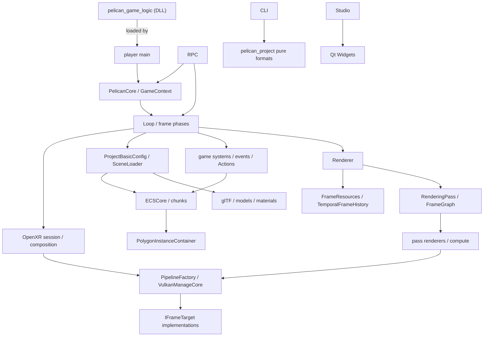

# 第8章 クラス・インターフェース索引

[索引へ戻る](README.md) / [前章](07_tools_rpc_tests.md) / [次章](09_black_magic_and_gotchas.md)

この章は「名前は分かったので宣言と本体へすぐ飛びたい」ときの索引です。全 private helper を列挙するのではなく、所有権または subsystem 境界を持つ主要型を収録しています。

## 8.1 Pelican で使われる6種類のインターフェース

Pelican の「interface」は pure virtual class だけではありません。実装は用途ごとに次の形を使い分けています。

| 形 | 代表 | 意味 | この形が要る理由 |
|---|---|---|---|
| process module | [`DECLARE_MODULE`](../../src/core/container.hpp#L15) | process 中に遅延生成される実質 singleton。`GET_MODULE(T)` で取得 | 実装が「1個しか無い」資源(device、window、ECS world)を、引数で持ち回らずに取れるようにするため |
| public façade | [`GameContext`](../../src/core/userpublic/gamecontext.hpp#L284) | game code に内部 module を直接見せない、状態を持たない/薄い value façade | ゲームコードが engine 内部の型に compile 時依存しないようにするため(DLL 境界を細く保つ) |
| abstract interface | [`IFrameTarget`](../../src/core/vkcore/frametarget.hpp#L254)、[`ILogicalFrameTarget`](../../src/core/vkcore/renderer.hpp#L108) | window swapchain と headless target、flat と XR composition を virtual dispatch で交換 | 実装の選択が**実行時に**決まる(`--headless` / `--xr`)ので、compile 時の分岐では書けないため |
| tagged union | [`PassInfo`](../../src/core/renderingpass/renderingpass.hpp#L326) | 閉じた種類集合を `std::variant` と `visit`/type test で dispatch | 種類が JSON 形式として**固定で列挙できる**ので、派生を後から足せる継承より、全種の網羅を強制できる variant が合うため |
| type-erased callback table | [`ComponentInfo`](../../src/core/ecs/componentinfo.hpp#L41) | 任意 Component の construct/destroy/relocate/JSON 操作を function pointer 化 | 受け取る側(ECS storage)が型 `T` を知らないまま構築・破棄・移動をしなければならないため |
| resolver/adaptor | [`RenderTargetNameResolver`](../../src/core/renderingpass/rendertargetnameresolver.hpp#L11) | parser に巨大 container を渡さず、必要な名前解決だけを公開 | 純粋な parser/planner を GPU container から切り離して、単体テストできる形に保つため |

この違いを無視して全部を「継承関係」として探すとコードを見失います。特に `DECLARE_MODULE` は base class ではなく、`class Foo : public ModuleBase<Foo>` へ展開されるだけの macro で、実体は `ModuleBase<T>` 側の**型ごとの `static std::optional<T>`** です。この static が生まれる場所は TU ごとの file scope ではなく、class template の static メンバ関数 [`ModuleBase<T>::__get()` の関数内 static](../../src/core/container.hpp#L41) 1 か所で、template の暗黙実体化なので `Foo` を `GET_MODULE` する TU が何本あっても、リンク後の 1 つの実行ファイル/DLL の中では同じ 1 個を共有します(game DLL は host のインポートライブラリだけをリンクし、engine の registry と module container の所有者を 1 つに保ちます — [`src/player/CMakeLists.txt` のコメント](../../src/player/CMakeLists.txt#L132))。`Foo` のインスタンスはこの optional 1 個だけで、`GET_MODULE(Foo)` の初回が `emplace()`、以降は同じ参照を返します(展開後の全量は[第9章 §9.1](09_black_magic_and_gotchas.md))。

> **設計決定:** 公開 game API で **継承ベースの interface を使うのは [`Behavior`](../../src/core/userpublic/behavior.hpp#L60) だけ** です(WP155 / BEH0)。System / Component / Event は duck typing(ダックタイピング — 「共通の基底を継承しているか」ではなく「必要なメンバや関数が実際に生えているか」だけで適合を判断する方式) + concept 検出(C++20 の `concept` / `requires` 式でその「生えているか」を compile 時に判定すること。例が [`HasBatchProcess`](../../src/core/userpublic/details/ecs/coretemplate.hpp#L77) / [`HasPerChunkProcess`](../../src/core/userpublic/details/ecs/coretemplate.hpp#L82) で、System が `process` をどの形で持つかで呼び分けます)ですが、Behavior は「1 オブジェクトにつき 1 個の多態インスタンスを arena が所有する」形なので仮想基底を選んでいます。上表の分類に当てはまらない唯一の例外として覚えてください。詳細は [第5章 §5.13](05_gameplay_and_services.md)。

## 8.2 名前の読み方

| suffix/prefix | だいたいの意味 | 例外・注意 |
|---|---|---|
| `...Definition` | parse 後、runtime object 作成前の value | Vulkan handle を持たないことが多い。JSON を読み終えて検証も済んだが、まだ GPU も module も触っていない段、という意味です |
| `Compiled...` | name/definition が runtime ID や GPU object と結合済み | ここでの compile は **名前の解決と束縛**(`"gbuffer"` のような文字列を登録済み ID や `vk::Pipeline` へ差し替えること)で、機械語への翻訳ではありません。GLSL→SPIR-V の方の compile は `ShaderCompiler` が担当します |
| `...Container` | handle registry、GPU resource owner、state collection | 同じ base interface を持つわけではない |
| `...Core` | public wrapper から分離した testable implementation | この規則の例外が 1 つあります。`VulkanManageCore` の `Core` は「wrapper から分離した中身」ではなく**低レベル device owner** の意味で、対になる public wrapper が存在しません |
| `...Resolver` | ID/name/path/view 変換の小さな read interface | ownership は持たない |
| `...Registerer` | template 型を runtime catalog へ型消去して登録 | static registration macro から呼ばれる |
| `...Loader` | file/JSON から runtime object への入口 | pure parser と runtime binding が別 file の場合あり |
| `...Renderer` | command buffer へ draw/dispatch を記録 | `Renderer` はそれらを束ねる orchestrator |
| `...Codec` | authored ↔ canonical ↔ runtime の双方向変換関数表 | [`ComponentCodec`](../../src/core/loader/componentcodec.hpp#L312) は 5 点セットが必須 |
| `...Adapter` | 既存サービスを別の呼び出し面へ橋渡し | 変換するのは**呼び方**であって中身ではありません。`EditorCommandRpcAdapter` は JSON-RPC の 1 行を typed な `EditorCommandService` の呼び出しへ、`EditorCommandImGuiFakeAdapter` は ImGui の操作を同じ呼び出しへ写します。**同じサービス**を複数面へ出し、面ごとに別実装を持たないための型です |
| `...Token` | 世代付きの取り消し可能な引換券 | `RegistrationToken` / `ECSArchetypeMigrationToken`。**保持しているだけで有効とは限りません** — 相手側が `unregisterComponent(token)` されていたり、DLL reload で owner の世代が進んでいたりすると、同じ値を持ったまま失効します。使う直前に照合するのが前提の型です |
| `Prepared...` | throw しうる準備が済んだ **未公開**の候補 | `publish()` は no-fail、`rollback()` は `noexcept`。名前が付く3段は「prepare で失敗しうる仕事を全部終える → publish は差し替えるだけ → 失敗経路は rollback」 |
| `Staged...` | 全割り当てが済み、公開が単一 no-fail 操作になった候補 | `StagedModelInstance`。`Prepared...` と同じ三点セットの一員で、こちらは **確保が 1 つ残らず済んでいる**(公開時に `new` も `push_back` も走らない)ことまで名前で言っています。この語義の出典は型のすぐ上の[ヘッダコメント](../../src/core/renderer/polygoninstancecontainer.hpp#L361)で、`A fully allocated CPU candidate for one model instance. Staging performs all capacity checks and allocations without changing the live instance/command inventories. publishModelInstance() is the single no-fail publication point.` と書いてあります。ただしこれは `StagedModelInstance` 1 型についての規範で、他の `Staged...`(例: [`StagedResource`](../../src/core/watch/reloadtransaction.hpp#L64) は [`ResourceRegistry::publish()`](../../src/core/watch/reloadtransaction.hpp#L101) へ渡す値)まで含めて 2 語の使い分けを定めた文書は見つかっていません(未確認) |

`Prepared...` / `Staged...` / `...Token` の 3 つは、[第9章](09_black_magic_and_gotchas.md)で扱う **prepare / publish(noexcept) / rollback(noexcept) の三点セット** という共通プロトコルの現れです。ECS、レンダラ、behavior、シーン保存、編集投影のすべてで同じ形が使われます。

## 8.3 起動・module・frame lifecycle

| 名前 | 形 | 宣言 | 主実装 | 責務 |
|---|---|---|---|---|
| `PelicanCore` | public façade | [`pelican_core.hpp`](../../src/core/userpublic/pelican_core.hpp#L8) | [`run()`](../../src/core/userpublic/pelican_core.cpp#L100) | settings から runtime 全体を起動し、loop と teardown を囲む |
| `EngineLaunchConfig` | module | [`launchconfig.hpp`](../../src/core/launchconfig.hpp#L27) | [`player main` で設定](../../src/player/main.cpp#L727) | headless、RPC、XR mode、game logic DLL、record/replay、audio backend の名指し([`audio_backend`](../../src/core/launchconfig.hpp#L75)、AU-3)など起動時値 |
| `StartupMetrics` | module | [`startup.hpp`](../../src/core/startup.hpp#L21) | [`startup.cpp`](../../src/core/startup.cpp) | 起動段階の計測 |
| `XrActivationDecision` / `resolveXrActivation()` | pure decision | [`xractivation.hpp`](../../src/core/xractivation.hpp#L31) | [同 header](../../src/core/xractivation.hpp#L89) | headless/RPC/replay の forced-off と discovery hook から XR 起動可否を決定 |
| `gameLogicAbiVersion` / `pelican_game_logic_epoch_v2` / `initializeConfiguredGameLogic()` | game DLL 境界 | [`gamelogic.hpp`](../../src/core/userpublic/gamelogic.hpp#L21) | [`gamelogicreload.cpp`](../../src/core/gamelogic/gamelogicreload.cpp#L917) | game DLL(`pelican_game_logic`)の epoch anchor、raw import 診断、ロード・ホットリロード |
| `GameLogicPeImport` / `GameLogicImportReadResult` / `GameLogicImportDiagnosis` | raw PE 診断の値 | [`GameLogicPeImport`](../../src/core/gamelogic/gamelogicimports.hpp#L19) / [`GameLogicImportReadResult`](../../src/core/gamelogic/gamelogicimports.hpp#L26) / [`GameLogicImportDiagnosis`](../../src/core/gamelogic/gamelogicimports.hpp#L33) | [`readGameLogicImports()`](../../src/core/gamelogic/gamelogicimports.cpp#L516) / [`diagnoseGameLogicImports()`](../../src/core/gamelogic/gamelogicimports.cpp#L559) | `LoadLibraryW` の**前**に game DLL の import / delay-import directory だけを読む。[`GameLogicPeImportKind`](../../src/core/gamelogic/gamelogicimports.hpp#L12) は `named` / `ordinal` / `delay_named` / `delay_ordinal` |
| game logic の error code 群 | 文字列定数 | [`gameLogicAbiStaleErrorCode` 以下 10 種](../../src/core/gamelogic/gamelogicimports.hpp#L40) | 同左 | `game_logic_abi_stale@1` / `..._unsupported_import@1` / `..._unreadable@1` / `..._load_failed@1` / `..._registration_rejected@1` / `..._reload_failed@1` / `..._unavailable@1` / `..._source_busy@1` / `..._shadow_copy_failed@1` / `..._not_configured@1` |
| `RegistrationOwner` | 登録所有者 ID | [`registrationowner.hpp`](../../src/core/userpublic/details/reload/registrationowner.hpp#L11) | 同左 | engine/game DLL 単位で static 登録を unregister 可能にする |
| `watch::ReloadService` | module | [`reloadservice.hpp`](../../src/core/watch/reloadservice.hpp#L199) | [`reloadservice.cpp`](../../src/core/watch/reloadservice.cpp) | FileWatcher 変更をフレーム境界で reload transaction として適用 |
| `ProblemList`(✅PB-1) | module | [`problemlist.hpp`](../../src/core/watch/problemlist.hpp#L134) | [`problemlist.cpp`](../../src/core/watch/problemlist.cpp) | engine が出会った rendering の拒否と shader の読み直しの失敗を、持ち主(`render_pipeline` / `shaders`)ごとに直るまで持つ。`get_problems` と `get_status.problems` の中身 |
| `CameraBakeRecorder` | module | [`camerabake.hpp`](../../src/core/playback/camerabake.hpp#L17) | [`camerabake.cpp`](../../src/core/playback/camerabake.cpp) | replay 実行から camera パスを記録(`--bake-camera-output`) |
| `parallelPrepareOrdered()` | free function | [`parallel_prepare.hpp`](../../src/core/parallel_prepare.hpp#L20) | header only | 順序保証付き並列 prepare(model ロード等) |
| `FastModuleContainer` | module 基盤 | [`container.hpp`](../../src/core/container.hpp#L53) | [`get()`](../../src/core/container.hpp#L149) | 型ごとの static `optional<T>` を lazy construct し、local container 終了時に登録の逆順で reset |
| `Loop` | module/orchestrator | [`loop.hpp`](../../src/core/appflow/loop.hpp#L7) | [`Loop::run()`](../../src/core/appflow/loop.cpp#L772) | 入口は 3 分岐。通常・XR・追加の RPC 層を含む一覧は 5 項目(windowed、windowed+XR、windowed+RPC、headless 固定フレーム、headless RPC) |
| `EngineTime` | module | [`enginetime.hpp`](../../src/core/appflow/enginetime.hpp#L31) | [`setup/advance`](../../src/core/appflow/enginetime.cpp#L16) | realtime/fixed-step の time、dt、frame index。PM-1a から、描画のフレームごとに増える評価の番号(`evaluationIndex()`)と game のフレーム(`frameIndex()`)を分け、`PlayState`(playing / paused)と `advance_frames` の歩(`requestSteps()`)、editor の `dt`(`editorDt()`)を持つ |
| `FramerateAdjust` | module | [`framerate.hpp`](../../src/core/appflow/framerate.hpp#L7) | [`framerate.cpp`](../../src/core/appflow/framerate.cpp#L1) | window mode の frame pacing |
| `RuntimeTeardownGuard` | RAII guard | [`teardown.hpp`](../../src/core/appflow/teardown.hpp#L68) | [`teardown.cpp`](../../src/core/appflow/teardown.cpp) | ECS、physics、GPU instance、deletion queue を依存順に明示解放 |
| `RuntimeTeardownStep` / `runtime_teardown_order` / `RuntimeTeardownActions` | 規範順序の値 | [`teardown.hpp` 内](../../src/core/appflow/teardown.hpp#L12) / [`runtime_teardown_order`](../../src/core/appflow/teardown.hpp#L23) / [規範順序のコメント](../../src/core/appflow/teardown.hpp#L49) | 同左 | 8 段階の teardown 順序を型で固定。空 action は「起動前に落ちた module」 |
| `RuntimeTeardownMode` | enum | [`teardown.hpp` 内](../../src/core/appflow/teardown.hpp#L62) | 同左 | `runtime_reset` / `terminal_shutdown` |
| `EditorCommitQueueHook` / `installEditorCommitQueueHook()` | 単一所有フック | [`EditorCommitQueueHook()`](../../src/core/appflow/framephase.hpp#L39) / [`installEditorCommitQueueHook()`](../../src/core/appflow/framephase.hpp#L40) | [`invokeEditorCommitQueueHook()`](../../src/core/appflow/framephase.cpp#L146) | reload 公開後・`freeze_events` 直前に走る編集コミット点。未設置なら zero-state no-op |
| `RuntimeSpawner::applyBoundary()` | frame 境界の 1 呼び出し(GP-2) | [`applyBoundary()`](../../src/core/loader/runtimespawn.hpp#L113) | [`updateFrameState()` の中の、game の 1 歩のときの呼び出し](../../src/core/appflow/framephase.cpp#L187) | `GameContext::spawn` / `destroy` の要求を実行する境界。editor の commit queue hook の後(scene run を置き換えうる操作の後)、`freeze_events` の前(ゲームコードの前)。通常 loop と RPC の `step_frame` / `advance_frames` が同じ関数を通る。一時停止中の歩を取らないフレームでは呼ばない(PM-1a) |
| `RenderDocCapture` | module | [`renderdoccapture.hpp`](../../src/core/renderdoc/renderdoccapture.hpp#L66) | [`renderdoccapture.cpp`](../../src/core/renderdoc/renderdoccapture.cpp) / OFF 時は [`_stub.cpp`](../../src/core/renderdoc/renderdoccapture_stub.cpp) | F11 / `capture_gpu` の受動キャプチャ状態機械。RenderDoc をロードはしない |
| `DeferredCallbackLifetime` | lease + closeAndWait | [`deferredcallback.hpp`](../../src/core/vkcore/deferredcallback.hpp#L15) | header only | 遅延コールバックが module オーナへの生ポインタを持てる期間を閉じる |
| `JobSystem` | singleton service | [`job_system.hpp`](../../src/core/job_system.hpp#L15) | [`job_system.cpp`](../../src/core/job_system.cpp#L1) | ECS system job の worker 実行と synchronization |
| `Profiler` / `ScopedLogTimer` | helper | [`profiler.hpp`](../../src/core/profiler.hpp#L9) | [`profiler.cpp`](../../src/core/profiler.cpp#L1) | scope duration を log へ記録 |

`watch::ReloadService` の下には hot reload 基盤の部品として [`FileWatcher`](../../src/core/watch/filewatcher.hpp#L69)、[`ContentDigestState`](../../src/core/watch/contentdigest.hpp#L61)、[`AssetKey`](../../src/core/watch/assetkey.hpp#L15)、[`ReloadGate`](../../src/core/watch/reloadgate.hpp)、[`ReloadQueue`](../../src/core/watch/reloadqueue.hpp#L26)、[`ReloadCoordinator`](../../src/core/watch/reloadtransaction.hpp#L196) があります。

1 frame の共有関数は class ではなく [`updateFrameState()`](../../src/core/appflow/framephase.cpp#L152) です。入力、pre-update、game、post-update、scene transition の5 phase を通常 loop と RPC が共用します。

## 8.4 Project、path、data format、loading

| 名前 | 形 | 宣言 | 主実装 | 責務 |
|---|---|---|---|---|
| `ProjectSource` | module | [`projectsrc.hpp`](../../src/core/loader/projectsrc.hpp#L7) | [`projectsrc.cpp`](../../src/core/loader/projectsrc.cpp#L1) | 起動 settings と project root/source text を保持 |
| `ProjectBasicConfig` | module/value binding | [`basicconfig.hpp`](../../src/core/loader/basicconfig.hpp#L13) | [`constructor`](../../src/core/loader/basicconfig.cpp#L625) | engine default と project JSON を merge し型付き accessor を提供 |
| `ProjectPathResolver` | pure resolver | [`projectpathresolver.hpp`](../../src/project/projectpathresolver.hpp#L114) | [`resolveRef()`](../../src/project/projectpathresolver.cpp#L723) | `project://`、`user://`、asset store、fragment、escape防止。診断は戻り値。asset store は「アセットの置き場所の間接化」で、`project.json` の `asset_stores` が論理マウントを宣言し、マシンごとの実パスは git に入れない `.pelican/local.json` が上書きします([第3章](03_project_and_loading.md) の「asset store」、[用語集](../manual/14_glossary.md#解決resolve)) |
| `PathResolver` | engine module adapter | [`pathresolver.hpp`](../../src/core/loader/pathresolver.hpp#L9) | [`pathresolver.cpp`](../../src/core/loader/pathresolver.cpp#L1) | `ProjectPathResolver`へ委譲し、quillログと`engine://`埋め込みloaderだけを接続 |
| `ResolvedRef` | variant value | [`projectpathresolver.hpp`](../../src/project/projectpathresolver.hpp#L47) | [`ProjectPathResolver::resolveRef()`](../../src/project/projectpathresolver.cpp#L723) | filesystem path、engine resource、project/engine fragment の和型 |
| `SceneFormatDocument` | pure document | [`sceneformat.hpp`](../../src/project/sceneformat.hpp#L13) | [`sceneformat.cpp`](../../src/project/sceneformat.cpp#L1) | scene（version 2 だけ）schema の validate/normalize 結果 |
| `SceneLoader` | module/runtime binder | [`scene.hpp`](../../src/core/loader/scene.hpp#L66) | [`load()`](../../src/core/loader/scene.cpp#L1650) | scene clear/load、object name↔Entity、camera/light/model/collider/behavior binding、transient glTF |
| `SceneLoadPhase` / `SceneLoadPhaseTrace` | 観測順序の値 | [`SceneLoadPhase`](../../src/core/loader/sceneload.hpp#L27) / [`SceneLoadPhaseTrace`](../../src/core/loader/sceneload.hpp#L40) | header only | executor が通った 8 phase の順序。固定長 8 スロット + `overflow` で、記録は participant 側が行う([第4章 §4.18](04_ecs_deep_dive.md)) |
| `SceneLoadResult` 系 | 3 択の結果 variant | [`SceneLoadResult`](../../src/core/loader/sceneload.hpp#L188) / [`SceneLoadCommitted`](../../src/core/loader/sceneload.hpp#L182) / [`PreCommitFailure`](../../src/core/loader/sceneload.hpp#L138) / [`CommittedWithEffectFailure`](../../src/core/loader/sceneload.hpp#L174) | [`SceneLoader::load()`](../../src/core/loader/scene.cpp#L1650) | commit 前失敗 / 成功 / 「公開は成功したが effect が失敗」を型で分ける。旧来の throw する面は [`requireSceneLoadCommitted()`](../../src/core/loader/sceneload.hpp#L295) が橋渡し |
| `CommittedWithEffectFailure::EffectError` | 報告値 | [`EffectError`](../../src/core/loader/sceneload.hpp#L176) | [`effectErrorsJson()`](../../src/core/loader/sceneload.hpp#L296) | `{api, error_code, error_fields, phase}` |
| `SceneLoadRequest` / `SceneLoadRoot` / `MetadataCommitToken` | 入口の値 | [`SceneLoadRequest`](../../src/core/loader/sceneload.hpp#L222) / [`SceneLoadRoot`](../../src/core/loader/sceneload.hpp#L82) / [`MetadataCommitToken`](../../src/core/loader/sceneload.hpp#L195) | [`basicconfig.cpp`](../../src/core/loader/basicconfig.cpp#L584) | `Borrowed`(committed 投影)と `Owned`(metadata token)の 2 形。root は `startup` / `rpc` / `pending` / `import_versioned` の 4 種(`import_unversioned` は MG-2b で SnapshotV1 と一緒に撤去)。token は document だけ / 投影だけの公開を型で禁じる |
| `SceneImportResult` | import の戻り値 | [`SceneImportResult`](../../src/core/loader/sceneload.hpp#L275) | 同左 | `SceneRevision` + `SceneLoadResult`。`operator SceneRevision()` があるので旧来の呼び出し側は revision だけを受け取れる |
| `SceneLoadFaultInjector` / `SceneLoadFaultPhase` / `scene_load_mutation` | 変異注入の面 | [`SceneLoadFaultInjector`](../../src/core/loader/sceneload.hpp#L74) / [`SceneLoadFaultPhase`](../../src/core/loader/sceneload.hpp#L65) / [mutation ID 一覧](../../src/core/loader/sceneload.hpp#L92) | setter は **test-only TU**([第1章](01_architecture_and_build.md)) | executor の各 edge を名前で指す。fault の phase は外向きの `SceneLoadPhase` とは意図的に別語彙 |
| `PreparedEffectTransaction` / `EffectTransactionScope` / `EffectDestroyScope` | 効果の遅延 | [`PreparedEffectTransaction`](../../src/core/loader/effecttransaction.hpp#L27) / [`EffectTransactionScope`](../../src/core/loader/effecttransaction.hpp#L212) / [`EffectDestroyScope`](../../src/core/loader/effecttransaction.hpp#L225) | [`effecttransaction.cpp`](../../src/core/loader/effecttransaction.cpp) | scene load 中の audio / persistence / `loadScene` を候補として溜め、commit 後に [`flush()`](../../src/core/loader/effecttransaction.cpp#L494) する。`EffectDestroyScope` は transaction が無くても thread に「破棄 callback の中」を印し、[`absorbDestroyRefusal()`](../../src/core/loader/effecttransaction.cpp#L793) が機能を外した / provider の無い facade の拒否を effect error か engine log に替える(PG-2b)。エラーは固定長 record([`sceneEffectCapacity = 256`](../../src/core/loader/effecttransaction.hpp#L25) + overflow 1)で heap を使わない |
| `ReleaseError` / `ReleaseReport` / `ReleaseErrorSink` | 解放失敗の構造化 | [`ReleaseError`](../../src/core/model/modelresourcerelease.hpp#L28) / [`ReleaseReport`](../../src/core/model/modelresourcerelease.hpp#L36) / [`ReleaseErrorSink`](../../src/core/model/modelresourcerelease.hpp#L72) | [`modelresourcerelease.cpp`](../../src/core/model/modelresourcerelease.cpp) | `(ReleaseStage, ReleaseErrorCode, index)` を **8 件まで**配列で持ち、以降は `overflow_count`。戻り値を返せない destructor / 遅延解放は process 全体の sink へ積む |
| `AuthoringSceneDocument` | 版付きドキュメント | [`authoringscenedocument.hpp`](../../src/core/loader/authoringscenedocument.hpp#L95) | [`authoringscenedocument.cpp`](../../src/core/loader/authoringscenedocument.cpp) | scene 文書(v2)の権威表現。`SceneRevision` とセッション安定な `AuthoringObjectId` を発行 |
| `AuthoringSceneDocumentStage` | 未公開の構造編集 | [`AuthoringSceneDocumentStage`](../../src/core/loader/authoringscenedocument.hpp#L153) | 同左 | insert / remove / restore / rename / reorder のみ。`finish(revision) &&` で確定 |
| `AuthoringObjectClosure` | 復元用クロージャ | [`AuthoringObjectClosure`](../../src/core/loader/authoringscenedocument.hpp#L63) | 同左 | `removeObject` の可逆情報(同じ `AuthoringObjectId` を同じ宣言区間へ戻す) |
| `ComponentCodec` | 5 点セットの関数表 | [`componentcodec.hpp`](../../src/core/loader/componentcodec.hpp#L312) | [`componentcodec.cpp`](../../src/core/loader/componentcodec.cpp) | authored ↔ canonical ↔ runtime。`ComponentCodecRuntimeKind`([`ComponentCodecRuntimeKind`](../../src/core/loader/componentcodec.hpp#L25))が runtime target 型を決める |
| `SceneSaveErrorCode` / `SceneSaveError` / `SceneSaveResult` | 保存契約 | [`SceneSaveErrorCode`](../../src/core/loader/basicconfig.hpp#L26) / [`SceneSaveError`](../../src/core/loader/basicconfig.hpp#L32) / [`SceneSaveResult`](../../src/core/loader/basicconfig.hpp#L55) | [`saveSceneDocument()`](../../src/core/loader/basicconfig.cpp#L936) | `ExternalModification` / `Unavailable` / `IoFailure` の型付き保存エラー |
| `EditorProjectionAdapterKind` / `EditorProjectionErrorCode` | 投影 transaction | [`EditorProjectionAdapterKind`](../../src/core/loader/editorprojectiontransaction.hpp#L25) / [`EditorProjectionErrorCode`](../../src/core/loader/editorprojectiontransaction.hpp#L44) | [`editorprojectiontransaction.cpp`](../../src/core/loader/editorprojectiontransaction.cpp) | 8 種の adapter と 11 種のエラー。adapter は「1 回の編集が、どの所有者へ投影されるか」の分類で、`EcsExistingValue` / `EcsArchetype` / `TransformClosure` / `RendererModel` / `Camera` / `Light` / `PhysWorld` / `BehaviorAttachment` の 8 つです([`EditorProjectionAdapterKind`](../../src/core/loader/editorprojectiontransaction.hpp#L25))。公開方式は `EditorProjectionPublicationMode`([`EditorProjectionPublicationMode`](../../src/core/loader/editorprojectiontransaction.hpp#L39)) |
| `VrmaClip` 群 | pure document | [`vrmaanimation.hpp`](../../src/core/model/vrmaanimation.hpp#L87) | header + decoder | `.vrma` decode 結果(body / expression / gaze チャンネル + provenance) |
| `decodeVrmaAnimation()` / `loadVrmaAnimation()` | free function | [`vrmadecoder.hpp` 内](../../src/core/loader/vrmadecoder.hpp#L25) / [`loadVrmaAnimation()`](../../src/core/loader/vrmadecoder.hpp#L32) | [`vrmadecoder.cpp`](../../src/core/loader/vrmadecoder.cpp) | `.vrma` GLB decode。拡張子ゲートと content hash |
| `VrmaRetargetProfile` / `retargetVrmaClip()`(retarget = ある骨格向けに作られたアニメーションを、骨構成や rest 姿勢が違う別の骨格で再生できるよう変換すること) | 版付き profile | [`VrmaRetargetProfile`](../../src/core/animation/vrmaretarget.hpp#L67) / [`retargetVrmaClip()`](../../src/core/animation/vrmaretarget.hpp#L124) | [`vrmaretarget.cpp`](../../src/core/animation/vrmaretarget.cpp) | target-rig-local な不変中間クリップ。**`AnimationSource` ではない** |
| `ModelAssetContainer` | module/catalog | [`asset/model.hpp`](../../src/core/asset/model.hpp#L52) | [`model.cpp`](../../src/core/asset/model.cpp#L1) | asset data の model name と `ModelTemplate` を管理 |
| `GltfLoader` | module/loader | [`gltf.hpp`](../../src/core/model/gltf.hpp#L16) | [`gltf.cpp`](../../src/core/model/gltf.cpp#L1) | tinygltf Model を geometry/material/model template へ変換。`.vrm` も受理 |
| `ModelTemplate` | value graph | [`ModelTemplate`](../../src/core/model/modeltemplate.hpp#L132) | [`gltf load`](../../src/core/model/gltf.cpp#L1) | primitive range、material、skin/VAT metadata を持つ再配置可能 model 定義 |
| `LoadedImage` | value | [`imageloader.hpp`](../../src/core/loader/imageloader.hpp#L18) | [`imageloader.cpp`](../../src/core/loader/imageloader.cpp#L1) | stb/TinyEXR decode 後の pixels、extent、format |
| `AssetsManifest` 群 | pure document | [`assetsmanifest.hpp`](../../src/project/assetsmanifest.hpp#L27) | [`assetsmanifest.cpp`](../../src/project/assetsmanifest.cpp#L1) | file hash manifest の生成・検証・issue classification |
| `ImportManifest` 群 | pure document | [`importmanifest.hpp`](../../src/project/importmanifest.hpp#L11) | [`importmanifest.cpp`](../../src/project/importmanifest.cpp#L1) | 外部 tool delivery の source/output/SHA schema |
| `SurfaceFormatDocument` | pure document | [`surfaceformat.hpp`](../../src/project/surfaceformat.hpp#L193) | [`surfaceformat.cpp`](../../src/project/surfaceformat.cpp#L1) | `.surface` header と shader code の解析結果 |
| `MaterialFormatDocument` | pure document | [`materialformat.hpp`](../../src/project/materialformat.hpp#L41) | [`materialformat.cpp`](../../src/project/materialformat.cpp#L1) | material base、surface、parameter、texture の型付き定義 |
| `RenderFeatureComposeResult` | pure transformation result | [`featurecompose.hpp`](../../src/project/featurecompose.hpp#L17) | [`composeRenderFeatureConfig()`](../../src/project/featurecompose.cpp#L3465) | base rendering JSON に feature fragment を順序付き合成 |
| VRM semantic 型群 | pure document | [`vrmsemantic.hpp`](../../src/core/model/vrmsemantic.hpp#L21) | [`vrmsemantic.cpp`](../../src/core/model/vrmsemantic.cpp) | VRM の humanoid bone / expression / lookAt / firstPerson デコード(WP111) |
| `VrmAutoTriangleSplit` | pure algorithm | [`vrmfirstperson.hpp`](../../src/core/model/vrmfirstperson.hpp#L22) | [`vrmfirstperson.cpp`](../../src/core/model/vrmfirstperson.cpp) | VRM firstPerson の MeshAnnotation.Auto 三角形分割(WP134) |
| `MorphTargetLayout` | value | [`morphtarget.hpp`](../../src/core/model/morphtarget.hpp#L46) | header only | morph target delta の GPU layout(WP121) |
| `SkeletalAnimationClip` | value | [`skeletalanimation.hpp`](../../src/core/model/skeletalanimation.hpp#L39) | [`skeletalanimation.cpp`](../../src/core/model/skeletalanimation.cpp) | glTF skeletal animation channel/clip |
| KTX2 loader | free functions | [`ktx2.hpp`](../../src/core/loader/ktx2.hpp) | [`ktx2.cpp`](../../src/core/loader/ktx2.cpp) | KTX2(BC5/BC7)テクスチャの decode |
| `AtlasAsset` | pure document | [`atlasasset.hpp`](../../src/core/asset/atlasasset.hpp#L45) | [`atlasasset.cpp`](../../src/core/asset/atlasasset.cpp) | sprite atlas の asset 定義(runtime 側は `AtlasAssetResource`) |
| `lowerMaterial()` / OpenPBR mapping | pure transformation | [`materiallowering.hpp`](../../src/project/materiallowering.hpp#L160) | [`openpbrmapping.hpp`](../../src/project/openpbrmapping.hpp) | material 定義を surface parameter へ lowering(高レベルな宣言を、より実行に近い低レベルの表現へ落とす変換を指すコンパイラ用語)(WP116/117) |
| `ImportRules` | pure document | [`importrules.hpp`](../../src/project/importrules.hpp) | [`importrules.cpp`](../../src/project/importrules.cpp) | match/recipe/defaults の 3 層優先を持つルールベース import(`pelican_cli import --rules`) |
| `GraphModuleRegistry` / `GraphModuleManifest` | 登録レジストリ + manifest | [`graphmodule.hpp`](../../src/project/graphmodule.hpp#L44) / [`GraphModuleManifest`](../../src/project/graphmodule.hpp#L35) | [`graphmodule.cpp`](../../src/project/graphmodule.cpp) | 共通グラフの型・op・sink の登録簿。重複は上書きせず拒否、カタログは名前順 = **登録順が文書の意味を変えない** |
| `GraphOperationRegistration` / `GraphOperationContract` | 登録単位 + 契約 | [`GraphOperationRegistration`](../../src/project/graphmodule.hpp#L25) / [`GraphOperationContract`](../../src/project/graphcomposition.hpp#L273) | [`resolveOperation()`](../../src/project/graphmodule.cpp#L676) | 固定 port か factory か。factory は port だけを供給し、評価分類は `max()` でしか動かない(第9章 §9.24) |
| `GraphExecutionDomain` / `GraphOperationEvaluation` / `GraphParameterChange` | 分類 enum | [`graphcomposition.hpp`](../../src/project/graphcomposition.hpp#L263) / [`#L113`](../../src/project/graphcomposition.hpp#L267) / [`#L117`](../../src/project/graphcomposition.hpp#L271) | 同左 | 実行区画(`values` / `rendering` / `animation`)、評価分類(`direct` / `replay` / `baked` / `recorded`)、パラメータ変更の費用(`value` / `recompile` / `rebuild`) |
| `SemanticTypeId` / `SemanticTypeSchema` / `LogicalType` | 型の 2 段 | [`logicalrendertype.hpp`](../../src/project/logicalrendertype.hpp#L24) / [`#L108`](../../src/project/logicalrendertype.hpp#L108) / [`#L128`](../../src/project/logicalrendertype.hpp#L128) | [`logicalrendertype.cpp`](../../src/project/logicalrendertype.cpp) | 「何であるか」の名前と、構成子 + 引数まで正準化した比較可能な型。`LogicalTypeRegistry` が schema を持つ |
| `ExpandedGraphDocument` / `expandGraphDocument()` | 展開結果 + 純関数 | [`graphcomposition.hpp`](../../src/project/graphcomposition.hpp#L158) / [`expandGraphDocument()`](../../src/project/graphcomposition.hpp#L174) | [`graphcomposition.cpp`](../../src/project/graphcomposition.cpp) | `definitions` / `nodes` / `outputs` の authoring 文書を展開し、由来・instance owner・scope 依存を導出する(文書には書き戻さない) |
| `editGraphDocument()` / `editGraphInstances()` | 純粋な編集 op 適用 | [`graphcomposition.hpp`](../../src/project/graphcomposition.hpp#L245) / [`editGraphInstances()`](../../src/project/graphcomposition.hpp#L251) | 同左 | 順序付き op 列を 1 つの候補文書へ適用し、最後に 1 回だけ展開する(全部通るか、文書ごと拒否か)。失敗は `graph.node_duplicate@1` などの名前付き |
| `GraphExecutionPartitions` / `partitionGraphDocument()` | 区画分割 | [`graphpartition.hpp`](../../src/project/graphpartition.hpp#L7) / [`partitionGraphDocument()`](../../src/project/graphpartition.hpp#L28) | [`graphpartition.cpp`](../../src/project/graphpartition.cpp) | 文書全体を検証してから `values` / `rendering` / `animation` へ分ける。animation が読むスカラーは values 側が [`$pose/<node>/<port>`](../../src/project/graphpartition.cpp#L461) として公開(一方向) |
| `GraphRegistryError` | 名前付き失敗 | [`graphcomposition.hpp`](../../src/project/graphcomposition.hpp#L22) | 同左 | 版付きコード + JSON 詳細。モジュールを外した状態と壊れた文書を呼び手が区別できる |
| `GraphFoldGroup` / `applyGraphFoldGroups()` | fold group(✅FG-1) | [`graphfold.hpp`](../../src/project/graphfold.hpp#L62) / [`applyGraphFoldGroups()`](../../src/project/graphfold.hpp#L140) | [`graphfold.cpp`](../../src/project/graphfold.cpp) | root の `fold_groups` の読み、開いた形の digest、検査済みの group の決定を展開名で `target_planning` に足す段 |
| `FoldVerifyJob` / `judgeFoldVerifyRuns()` / `runFoldVerifyProcesses()` | `verify_fold` の子 process(✅FG-2) | [`graphfoldverify.hpp`](../../src/core/communication/graphfoldverify.hpp#L53) / [`judgeFoldVerifyRuns()`](../../src/core/communication/graphfoldverify.hpp#L127) / [`runFoldVerifyProcesses()`](../../src/core/communication/graphfoldverify.hpp#L150) | [`graphfoldverify.cpp`](../../src/core/communication/graphfoldverify.cpp) | 2 つの形の root を持つ仕事、3 回の run の判定(純関数)、project を写して自分の exe を headless で 3 回起こす本番の runner |
| `RenderConfigSectionUnlocated` / `RenderConfigLegacyRoot` / `renderingSectionOf()` | 節 locator | [`renderconfigdocument.hpp`](../../src/project/renderconfigdocument.hpp#L24) / [`RenderConfigLegacyRoot`](../../src/project/renderconfigdocument.hpp#L39) / [`renderconfigsection.hpp`](../../src/project/renderconfigsection.hpp#L36) | header only | authored な rendering key の住所を決める唯一の場所。読みは寛容([`renderingSectionOrEmpty()`](../../src/project/renderconfigsection.hpp#L49))、編集だけが名前付きで拒否。`pelican.graph` でない根は読みも編集も `render_config.legacy_root@1`(MG-2b。包み関数 `wrapLegacyRenderingConfig()` は撤去) |
| `AuthoredRenderConfigDocument::withSectionValue()` | byte 保存の編集 | [`renderconfigdocument.hpp`](../../src/project/renderconfigdocument.hpp#L111) | [`renderconfigdocument.cpp`](../../src/project/renderconfigdocument.cpp#L754) | `rendering.<key>` に書く。graph root 自身のキー(と editor の `layout`)は root。offset は絶対のままなので digest は文書全体 |
| `RenderComponent` / `RenderComponentError` | 持ち出し部品 | [`rendercomponent.hpp`](../../src/project/rendercomponent.hpp#L33) / [`RenderComponentError`](../../src/project/rendercomponent.hpp#L25) | [`rendercomponent.cpp`](../../src/project/rendercomponent.cpp) | `pelican.render_component` v1 = materialize 済み feature 1 本 + host が満たすべき render target 契約。公開はディレクトリ rename |
| `PackageManifest` / `PackageProvides` / `PackageRequirements` | package 文書 | [`packagemanifest.hpp`](../../src/project/packagemanifest.hpp#L60) / [`#L45`](../../src/project/packagemanifest.hpp#L45) / [`#L53`](../../src/project/packagemanifest.hpp#L53) | [`packagemanifest.cpp`](../../src/project/packagemanifest.cpp) | `pelican.package` v1。提供パスは package 内の相対のみ(絶対・`..`・backslash・scheme は `package_path_invalid`) |
| `InstalledPackage` / `packageTreeDigest()` / `PackageError` | vendoring の記録 | [`packagemanifest.hpp`](../../src/project/packagemanifest.hpp#L70) / [`packageTreeDigest()`](../../src/project/packagemanifest.hpp#L100) / [`PackageError`](../../src/project/packagemanifest.hpp#L27) | 同左 | `project.json` の 1 行 = `{namespace, package_version, sha256}`。digest は install 済み byte 全体で、`package list` が再計算する。`PackageError::names()` が違反物を列挙 |
| `ProjectEnvelope::requirements` | project.json の `requires` | [`projectformat.hpp`](../../src/project/projectformat.hpp#L39) | [`parseProjectRequirements()`](../../src/project/projectformat.hpp#L103) | この build に無いと動かない機能の宣言。語彙は今 `animation` / `audio` / `physics` / `xr` / `vat` / `seqplayer` の 6 語(PG-1)で、未知語は `project.requires_unknown@1`(C++ 側の名前が `requirements` なのは `requires` が予約語だから) |

`ImageLoader` は class ではなく [`loadImageFile()` / `loadImageMemory()`](../../src/core/loader/imageloader.hpp#L68) という free function です。純粋変換に ownership object を無理に作らない方針がこの周辺に多く見られます。

## 8.5 公開 game API とサービス

project game code が最優先で参照する層です。内部の `GET_MODULE` を game 側へ漏らさない境界になっています。

| 名前 | 形 | 宣言 | 主実装 | 責務 |
|---|---|---|---|---|
| `GameContext` | public value façade | [`gamecontext.hpp`](../../src/core/userpublic/gamecontext.hpp#L27) | [`gamecontext.cpp`](../../src/core/userpublic/gamecontext.cpp#L1) | time、input、entity、camera、physics(raycast/overlap/shapeCast + `QueryFilter`)、sprite、**light**([`setDirectionalLightDirection()`](../../src/core/userpublic/gamecontext.hpp#L140))、pose action、audio、save、RNG を統一 API で公開。scene object の名前解決は [`objects()`](../../src/core/userpublic/gamecontext.hpp#L363)(GP-1)、UI の書き込みは [`ui()`](../../src/core/userpublic/gamecontext.hpp#L364)(GP-3)、ポインタとカーソルは [`input()`](../../src/core/userpublic/gamecontext.hpp#L362)(GP-4)、画面の点を通る ray は [`RenderContext::screenRay()`](../../src/core/userpublic/gamecontext.hpp#L174)(GP-4)、prefab からの実行時生成は [`spawn()`](../../src/core/userpublic/gamecontext.hpp#L326) / [`destroy()`](../../src/core/userpublic/gamecontext.hpp#L334)(GP-2) |
| `ObjectsContext` | public value façade(`objects()` が返す空の値) | [`ObjectsContext`](../../src/core/userpublic/gamecontext.hpp#L214) | [`ObjectsContext::resolve()`](../../src/core/userpublic/gamecontext.cpp#L245) | `resolve(name)`→`Resolved<ObjectRef>` / `materialize(ref)`→`Resolved<GameObjectId>` / `worldTransform(ref)`→`Resolved<WorldTransform>`。名前の解決は [`SceneLoader::resolveObject()`](../../src/core/loader/scene.cpp#L2055) の 1 か所だけで、宣言順の先勝ち。scene load の途中(`onInit` を含む)は読み込み中の scene とその authority で解決する([`objectResolutionRun()`](../../src/core/loader/scene.cpp#L2029))。`materialize` / `worldTransform` は `TransientObjectRef` の多重定義も持ち、そちらは [`RuntimeSpawner::materialize()`](../../src/core/loader/runtimespawn.cpp#L328) へ行く(GP-2) |
| `ObjectRef` | 値型(名前を持たない) | [`ObjectRef`](../../src/core/userpublic/object_ref.hpp#L36) | 作るのは [`internal::ObjectRefAccess`](../../src/core/loader/scene.cpp#L2008) だけ | `{authority, authoring object id}`。`authority()` / `objectId()` と `==`。既定構築の ref は何も指さず `stale_authority` で拒否される |
| `TransientObjectRef` | 値型(GP-2。名前も authoring id も持たない) | [`TransientObjectRef`](../../src/core/userpublic/object_ref.hpp#L67) | 作るのは [`internal::TransientObjectRefAccess`](../../src/core/loader/runtimespawn.cpp#L30) だけ | `{authority, boundary, spawn_index}`。`authority()` / `boundary()` / `spawnIndex()` と `==`。`ObjectAuthority` は `ObjectRef` と共有するが別の型なので、authored と transient の取り違えはコンパイルで弾かれる。境界の番号は scene run の始めから 1, 2, … で、既定構築(`boundary == 0`)は `stale_authority` |
| `SpawnParams` / `SpawnError` | 値型 / 例外型(GP-2) | [`SpawnParams`](../../src/core/userpublic/gamecontext.hpp#L228) / [`SpawnError`](../../src/core/userpublic/object_ref.hpp#L113) | [`RuntimeSpawner::spawn()`](../../src/core/loader/runtimespawn.cpp#L151) | `SpawnParams{transform, parameters, name?}`。`SpawnError` は `std::runtime_error` 派生で `code()` を持つ。名前は既存の `<語>.module_unavailable@1` / `prefab_*` / `behavior_type_unknown@1` と、`object.spawn_outside_scene@1` / `object.spawn_component_unsupported@1` / `object.name_reserved_by_authored@1` / `object.name_reserved_by_engine@1`(GP-2b。`spawn:` / `pelican://` で始まる名前) / `object.name_duplicate@1` / `object.spawn_sequence_exhausted@1` / `object.spawn_invalid@1` |
| `RuntimeSpawner` | module(GP-2) | [`runtimespawn.hpp`](../../src/core/loader/runtimespawn.hpp#L46) | [`runtimespawn.cpp`](../../src/core/loader/runtimespawn.cpp#L1) | 実行時生成の待ち行列と live 表を scene run(`SceneAuthority`)ごとに持つ。要求の時点で ResolvedScene seam を通して prefab を展開・検査し、[`applyBoundary()`](../../src/core/loader/runtimespawn.cpp#L353) で要求順に実体化 / 破棄する。投影は `SceneObjectProjectionAdapter::prepareTransientSpawn` / `prepareTransientDestroy`、behavior は `BehaviorAttachmentArena::attachSpawned`。旧 run の要求は境界で捨てる |
| `ObjectAuthority` | 値型 | [`ObjectAuthority`](../../src/core/userpublic/object_ref.hpp#L25) | [`materializeObject()`](../../src/core/loader/scene.cpp#L2071) が比較 | `{run_nonce, scene_epoch}`。同じ scene の再 load も含め、load のたびに変わる。同じ process の中でだけ意味を持つ |
| `ObjectError` / `objectErrorName()` | enum + constexpr 関数 | [`ObjectError`](../../src/core/userpublic/object_ref.hpp#L125) / [`objectErrorName()`](../../src/core/userpublic/object_ref.hpp#L138) | header only | `stale_authority`(`object.stale_authority@1`)/ `not_materialized`(`object.not_materialized@1`)/ `missing_capability`(`object.missing_capability@1`)。複数当てはまるときはこの順で先のものを返す。`wrong_domain` は未実装 |
| `Resolved<T, E>` | 値 or 名前付きエラー | [`object_ref.hpp` の `Resolved<T>`](../../src/core/userpublic/object_ref.hpp#L156) | header only | `ok()` / `operator bool` / `get()`(値が無ければ null)/ `value()`(値が無ければエラー名で始まる `std::logic_error`)/ `error()`(型は `E`)/ `errorName()`。`E` はファサードのエラー enum で既定は `ObjectError`(GP-4 で `Resolved<T>` から広げた。`Resolved<T>` の書き方はそのまま通る)。名前は `E` ごとの `errorCodeName()` の多重定義で引く([`ObjectError` 版](../../src/core/userpublic/object_ref.hpp#L149) / [`RenderError` 版](../../src/core/userpublic/render_error.hpp#L28)) |
| `RenderError` / `renderErrorName()` | enum + constexpr 関数 | [`RenderError`](../../src/core/userpublic/render_error.hpp#L11) / [`renderErrorName()`](../../src/core/userpublic/render_error.hpp#L20) | header only(`render_error.hpp`、GP-4) | `render()` の問い合わせが答えを持たない理由。`screen_ray_unavailable`(`render.screen_ray_unavailable@1`、XR が有効)/ `screen_position_invalid`(`render.screen_position_invalid@1`、位置が有限でない)。`Resolved<T, RenderError>` で運ばれる |
| `InputContext` | public value façade(`input()` が返す空の値、GP-4) | [`InputContext`](../../src/core/userpublic/gamecontext.hpp#L244) | [`InputContext::pointer()`](../../src/core/userpublic/gamecontext.cpp#L489) | `pointer()`→`PointerState` / `setCursorMode(CursorMode)`。pointer はアクションではない(axis2 は clamp と合成があるため)。カーソルのモードは次のフレームに窓へ適用され、埋め込みの窓では `locked` を `normal` にする。scene load 中も曲がらない(`nonparticipant.window-cursor`) |
| `PointerState` / `CursorMode` | 値型 / enum | [`PointerState`](../../src/core/userpublic/userinput.hpp#L143) / [`CursorMode`](../../src/core/userpublic/userinput.hpp#L151) | [`pointerStateFor()`](../../src/core/os/inputstate.cpp#L74) | `{position_px, inside}`。位置は framebuffer ピクセル(左上原点、+y 下)で clamp しない。`inside` は位置が既知かつ framebuffer の中。`CursorMode` は `normal` / `hidden` / `locked` |
| `WorldTransform` | 値型 | [`WorldTransform`](../../src/core/userpublic/object_ref.hpp#L190) | [`ObjectsContext::worldTransform()`](../../src/core/userpublic/gamecontext.cpp#L268) | `pos` / `rotation`(quat)/ `scale`。読むのは ECS の `TransformComponent` の今の値 |
| `UiContext` | public value façade(`ui()` / `ui(document_key)` が返す値。key を `std::string_view` で 1 本持つ) | [`UiContext`](../../src/core/userpublic/gamecontext.hpp#L271) | [`UiContext::setText()`](../../src/core/userpublic/gamecontext.cpp#L233) | `setText(path, text)` / `setVisible(path, bool)` / `setValue(path, float)`→`UiWriteResult`。path は root からの `id` を `/` でつないだもの(emit の `stable_id` と同じ)。検査は呼んだ時点、適用はフレーム境界([`UiModule::commitFrameWrites()`](../../src/core/ui/module.cpp#L340))。`ui.*` sink が書いている (path, 性質) は `ui.sink_conflict@1`。scene load 中も曲がらない(`nonparticipant.ui-document`) |
| `UiWriteError` / `uiWriteErrorName()` | enum + constexpr 関数 | [`UiWriteError`](../../src/core/userpublic/ui_write.hpp#L10) / [`uiWriteErrorName()`](../../src/core/userpublic/ui_write.hpp#L26) | header only | `feature_unreferenced`(`ui.feature_unreferenced@1`)/ `node_unknown`(`ui.node_unknown@1`)/ `property_mismatch`(`ui.property_mismatch@1`)/ `sink_conflict`(`ui.sink_conflict@1`)。複数当てはまるときはこの順で先のものを返す |
| `UiWriteResult` | 成功 or 名前付きエラー | [`UiWriteResult`](../../src/core/userpublic/ui_write.hpp#L39) | header only | `ok()` / `operator bool` / `error()`(`!ok()` のときだけ意味を持つ)/ `errorName()`(成功なら空) |
| `Behavior` | **仮想基底**(唯一の例外) | [`behavior.hpp`](../../src/core/userpublic/behavior.hpp#L60) | [`behaviorarena.cpp`](../../src/core/gamelogic/behaviorarena.cpp) | `onInit` / `onUpdate` / `onDestroy(noexcept)` |
| `BehaviorContext` | `GameContext` 派生 | [`BehaviorContext`](../../src/core/userpublic/behavior.hpp#L24) | 同左 | `self()` / `attachment()` / `attachmentSeq()` / `params<T>()` と遅延 create/remove |
| `BehaviorAttachmentHandle` | typed handle | [`BehaviorAttachmentHandle()`](../../src/core/userpublic/behavior.hpp#L13) | 同左 | attachment identity(`attachment_seq` と対) |
| `PELICAN_REGISTER_BEHAVIOR` | 自動登録 macro | [`behavior/registerer.hpp`](../../src/core/userpublic/details/behavior/registerer.hpp#L385) | 同 header | stable name + schema version + event handler 収集 |
| `BehaviorAttachmentArena` | module | [`behaviorarena.hpp`](../../src/core/gamelogic/behaviorarena.hpp#L213) | [`behaviorarena.cpp`](../../src/core/gamelogic/behaviorarena.cpp) | 生存・初期化・イベント配送・遅延構造変更・owner 解放。GP-2 から実行時生成の behavior も付ける([`attachSpawned()`](../../src/core/gamelogic/behaviorarena.hpp#L305)。`attachment_seq` は [`runtimeSpawnAttachmentSeq()`](../../src/core/gamelogic/behaviorarena.hpp#L116) の `2^52 \| boundary<<24 \| spawn_index<<8 \| behavior_index`) |
| `structFields` / `field` / `required` / `defaulted` / `enumValues` | consteval DSL | [`structfieldschema.hpp`](../../src/core/userpublic/details/schema/structfieldschema.hpp#L845) | header only | 型の各フィールドの名前・型・必須/既定を、C++ の式として構造体の中に書かせる小さな記述言語。宣言はコンパイル時に固まり、実行時の schema オブジェクト構築が要りません(consteval = 必ずコンパイル時に評価される関数につける指定で、実行時には呼べません。DSL = 用途を絞った小さな記述言語)。use-site policy を同時に強制します |
| `eventPayloadPolicy` / `behaviorParamsPolicy` / `componentPolicy()` | policy | [同](../../src/core/userpublic/details/schema/structfieldschema.hpp#L302) / [`behaviorParamsPolicy` の定義](../../src/core/userpublic/details/schema/structfieldschema.hpp#L303) / [`componentPolicy()`](../../src/core/userpublic/details/schema/structfieldschema.hpp#L305) | 同左 | 3 種の use-site 制約 |
| `OverlapEnter` / `OverlapExit` | engine event | [`OverlapEnter`](../../src/core/userpublic/events.hpp#L18) / [`OverlapExit`](../../src/core/userpublic/events.hpp#L23) | [`PhysWorld::updateTriggers()`](../../src/core/phys/physworld.cpp#L743) | 物理トリガの決定的 Enter/Exit(`self` / `other` は full `EntityId`) |
| `RegistrationToken` / `RegistrationKind` | 世代付き登録トークン | [`RegistrationToken`](../../src/core/userpublic/details/reload/registrationowner.hpp#L29) / [`RegistrationKind`](../../src/core/userpublic/details/reload/registrationowner.hpp#L14) | [`registrationowner.cpp`](../../src/core/userpublic/details/reload/registrationowner.cpp) | system / component / event / behavior の個別解除。`RegistrationOwner` は上位 32bit=generation、下位 32bit=identity |
| `GameObjects` | typestate builder façade(typestate — 「今どの段階か」を実行時フラグではなく戻り値の型そのもので表す設計。`addComponent()` のたびに別の型が返り、Component が 0 個の状態には `finish()` が存在しないなど、段階に合わない呼び出しがコンパイル時に弾かれます) | [`gameobjects.hpp`](../../src/core/userpublic/gameobjects.hpp#L31) | [`gameobjects.cpp`](../../src/core/userpublic/gameobjects.cpp#L1) | Component 集合を template chain で指定して entity を create |
| `UserInput` | legacy/raw façade | [`userinput.hpp`](../../src/core/userpublic/userinput.hpp#L96) | [`userinput.cpp`](../../src/core/userpublic/userinput.cpp#L1) | key/mouse の frame snapshot を公開 |
| `Actions` | named action façade | [`userinput.hpp`](../../src/core/userpublic/userinput.hpp#L110) | [`userinput.cpp`](../../src/core/userpublic/userinput.cpp#L1) | action set stack、button/axis2 evaluation、consumption |
| `DeterministicRng` | module/service | [`deterministicrng.hpp`](../../src/core/userpublic/deterministicrng.hpp#L12) | [`deterministicrng.cpp`](../../src/core/userpublic/deterministicrng.cpp#L11) | PCG32(permuted congruential generator の 32bit 出力版 — 線形合同法で進めた 64bit 内部状態に xorshift と回転を掛けて出力する、状態が小さく再現しやすい擬似乱数生成器) state と inclusive integer/float API |
| `Audio` | module + backend interface | [`audio.hpp`](../../src/core/audio/audio.hpp#L38) | [`audio.cpp`](../../src/core/audio/audio.cpp#L92) | sound handle、bus volume。miniaudio(device / offline)と Null(退避、または起動時の名指し。AU-3)の backend を pimpl 的(pointer to implementation — 実装クラスを header では前方宣言だけにして `unique_ptr` で持ち、定義を .cpp 側へ隠す書き方。header に miniaudio が漏れません)に選択 |
| `Persistence` | module/service | [`persistence.hpp`](../../src/core/persistence/persistence.hpp#L39) | [`saveData()`](../../src/core/persistence/persistence.cpp#L306) | settings、audio settings、slot save の検証と atomic replace |
| `PersistenceReadError` | 型付き読み取り失敗 | [`PersistenceReadError`](../../src/core/persistence/persistence.hpp#L16) | [`persistence.cpp`](../../src/core/persistence/persistence.cpp) | `path()` と `reason()` を別に持つ。文字列連結した `runtime_error` ではないので、呼び出し側が理由だけを構造化して報告できる |
| `PhysWorld` | module/runtime index | [`physworld.hpp`](../../src/core/phys/physworld.hpp#L38) | [`bindCollider()`](../../src/core/phys/physworld.cpp#L408) | object 名、transform、shape を bind し query/debug draw/trigger event へ供給。`PreparedState` による prepare/publish あり([`PreparedState`](../../src/core/phys/physworld.hpp#L61)) |
| `phys::Shape` | variant geometry | [`physquery.hpp`](../../src/core/phys/physquery.hpp#L40) | [`physquery.cpp`](../../src/core/phys/physquery.cpp#L1) | sphere/box/capsule の raycast/overlap pure algorithm |
| `phys::QueryFilter` / `ShapeCastHit` | query values | [`physquery.hpp`](../../src/core/phys/physquery.hpp#L78) | [同 header](../../src/core/phys/physquery.hpp#L171) | クエリの include/exclude filter と shapeCast 結果 |
| physics provider ABI | C ABI struct | [`abi_v2.hpp`](../../src/core/userpublic/physics/abi_v2.hpp) / [`query_types.hpp`](../../src/core/userpublic/physics/query_types.hpp) | [`builtinProviderV2()`](../../src/core/phys/builtinphysicsprovider.hpp#L7) / [`joltProviderV2()`](../../src/core/phys/joltphysicsprovider.hpp#L7) | provider の差し替え境界(v2 で shapeCast、capability bits)。選択は [`physicsruntime.hpp`](../../src/core/phys/physicsruntime.hpp) |
| `Camera` | module/state | [`camera.hpp`](../../src/core/renderer/camera.hpp#L21) | [`Camera::Camera()`](../../src/core/renderer/camera.cpp#L242) | projection/view、scene camera、orbit/follow/fly controller、[`discontinuityRevision()`](../../src/core/renderer/camera.hpp#L166)、framebuffer ピクセルを通る ray の [`rayThroughPixel()`](../../src/core/renderer/camera.cpp#L434)(GP-4。`screenRay` の実体) |
| `vulkanPerspective` / `vulkanOrtho` / `vulkanAsymmetric` / `cameraBasis` / `cameraRotation` / `viewFromBasis` / `viewFromWorld` / `viewIsMirrored` | header-only の free function | [`clipspace.hpp`](../../src/core/renderer/clipspace.hpp#L35) | 同左 | 座標の規約の 1 か所(✅CC-1 `c8367b87`。[manual 第6章 §6.1](../manual/06_rendering.md) の「座標の規約」)。射影 3 本は右手系・深度 0..1・clip の y を反転(`[1][1]` が負)。[`cameraBasis()`](../../src/core/renderer/clipspace.hpp#L74) は回転から forward = R·(0,0,−1)・up = R·(0,1,0)・right = R·(1,0,0)、[`cameraRotation()`](../../src/core/renderer/clipspace.hpp#L85) はその逆。[`viewIsMirrored()`](../../src/core/renderer/clipspace.hpp#L110) は view が world の鏡像か(mesh の pipeline の面の表の選択)。`pelican_openxr` も使うので header-only |
| `SpriteWorld` / `FlipbookClip` | public 2D API | [`spriteworld.hpp`](../../src/core/userpublic/sprite/spriteworld.hpp) / [`flipbook.hpp`](../../src/core/userpublic/sprite/flipbook.hpp#L30) | [`spriteworld.cpp`](../../src/core/userpublic/sprite/spriteworld.cpp) | sprite command ABI、flipbook 再生、pixel policy([`pixelpolicy.hpp`](../../src/core/userpublic/sprite/pixelpolicy.hpp)) |
| `CharacterContact2D` / `moveAndSlide2D` 系 | public 2D helper | [`charactercontroller2d.hpp`](../../src/core/userpublic/platformer/charactercontroller2d.hpp#L22) | [`charactercontroller2d.cpp`](../../src/core/userpublic/platformer/charactercontroller2d.cpp) | 2D platformer の move-and-slide(WP109) |
| `Vrm::ApplicationServiceV1` | versioned service struct | [`vrm_application_v1.hpp`](../../src/core/userpublic/animation/vrm_application_v1.hpp#L180) | [`vrmapplication.hpp`](../../src/core/animation/vrmapplication.hpp) | VRM expression/application sink の公開 ABI(WP123b) |
| `Animation::AnimationServiceV1` / `AnimationSourceHandle` | C ABI struct + typed handle | [animation/abi_v1.hpp](../../src/core/userpublic/animation/abi_v1.hpp#L596) / [`PELICAN_ANIM_HANDLE(InstanceHandle)`](../../src/core/userpublic/animation/abi_v1.hpp#L39) | [`animationservice.cpp`](../../src/core/animation/animationservice.cpp) | animation provider ABI v1。source 面は [`claim_source`](../../src/core/userpublic/animation/abi_v1.hpp#L622) / `release_source` / [`handoff_source`](../../src/core/userpublic/animation/abi_v1.hpp#L624) / [`sample_animation_source_at`](../../src/core/userpublic/animation/abi_v1.hpp#L628)(WP178。VRMA 由来 source の占有・委譲・サンプル)。姿勢の staging は同じ runtime が出す**別の service**(次行) |
| `AnimationGraph::DocumentV1` / `EvaluatorV1` | 公開 anim graph | [animation/animgraph.hpp](../../src/core/userpublic/animation/animgraph.hpp#L54) / [`EvaluatorV1`](../../src/core/userpublic/animation/animgraph.hpp#L94) | [`animgraph.cpp`](../../src/core/userpublic/animation/animgraph.cpp) | `pelican.anim_graph` v1 の [`parseDocumentV1()`](../../src/core/userpublic/animation/animgraph.hpp#L64) と、`bind()` / `prepareTick()` / `setParameter()` による決定的評価。**姿勢を付ける 2 つの様式のうち「animation component」側**で、もう一方は共通グラフの `graph.instance` + `pose.*`。owner 単位で排他(二重 writer は `authority_conflict` / `pose.sink_conflict@1`)。テストは `animgraph_test` / `vrmasource_test` |
| `Animation::PoseStagingServiceV1` | C ABI struct(版 1) | [`pose_staging_v1.hpp`](../../src/core/userpublic/animation/pose_staging_v1.hpp#L91) | [`getPoseStagingServiceV1()`](../../src/core/animation/animationservice.cpp#L1855) | staged pose の取得・書き換え・glTF node → layout index の解決。**entry の増設は service version ではなく [capability bit 4 本](../../src/core/userpublic/animation/pose_staging_v1.hpp#L29) で交渉する**(bit 3 = AG-2 の rig 側 node 写像 + clip の channel kind) |
| `ValueGraph::Graph` / `EvaluationState` | 公開 IR + 評価器 | [`valuegraph.hpp`](../../src/core/userpublic/valuegraph.hpp#L159) / [`EvaluationState`](../../src/core/userpublic/valuegraph.hpp#L129) | [`valuegraph.cpp`](../../src/core/userpublic/valuegraph.cpp) | lowering 済みスカラー dataflow の評価。状態を持つ op は明示的な `EvaluationState` を更新し、`evaluate()` は外部サービスへ publish しない。`publish()` だけが sink へ書く |
| `ValueGraph::PublishResult` / `PublishedInstanceInputs` | 公開スナップショット | [`PublishResult`](../../src/core/userpublic/valuegraph.hpp#L98) / [`PublishedInstanceInputs`](../../src/core/userpublic/valuegraph.hpp#L116) | [`publishGraphValues()`](../../src/core/loader/scenegraphruntime.cpp#L144) | 描かれた世代が各 instance 入力へ与えた値と、グラフの node 順に並んだ `node_values`。**順序を決めたグラフを保持**するので、世代が差し替わった後の読み手も名前を解決できる |
| `SeqPlayer` | optional module | [`seqplayer.hpp`](../../src/core/playback/seqplayer.hpp#L51) | [`seqplayer.cpp`](../../src/core/playback/seqplayer.cpp#L1) | JSONL transform sequence を時刻 sample して scene object へ適用 |
| `VatPlayer` | optional module | [`vatplayer.hpp`](../../src/core/playback/vatplayer.hpp#L12) | [`vatplayer.cpp`](../../src/core/playback/vatplayer.cpp#L1) | VAT clip の選択・再生状態を GPU instance へ反映 |

game system の interface は base class ではなく macro + function signature です。[`PELICAN_REGISTER_SYSTEM`](../../src/core/userpublic/details/system/registerer.hpp#L203) が `void(GameContext&)` callback と phase/order/name を catalog へ登録します。event も [`PELICAN_REGISTER_EVENT`](../../src/core/userpublic/details/event/registerer.hpp#L408) が型と handler を登録します。registry には `RegistrationOwner` が付き、game DLL reload 時に owner 単位で unregister されます。公開 API の関数/型には [`PELICAN_API`](../../src/core/userpublic/export.hpp)(DLL export 修飾)が必要です。

上表の `Animation::AnimationServiceV1` のような C ABI struct は、`struct_size` による版交渉で DLL とエンジンをつなぎます。呼び出し側が「自分はこの大きさの struct を渡す」と書き、エンジンは `struct_size` が**下限以上か**だけを見て受理します。その下限の決め方が 1 つではなく、**3 種類が混在している**のが落とし穴です。

| 対象 | 要求する下限 |
|---|---|
| 交渉の入口 3 本(`getApiV1` など) | `sizeof(DescriptorHeaderV1)` = 16 バイト。中身の大きさは問わない |
| 加算的テールを持つ descriptor(`getClipMetadata`) | 手書きの「凍結プレフィクス」の長さ。テールの有無は問わない |
| それ以外の全 API | 既定の `sizeof(T)` = **エンジン側の現在サイズ**。テールを 1 つ足した瞬間、古い DLL は弾かれる |

しかも [`validateDescriptor()`](../../src/core/animation/animationserviceabi.hpp#L15) は同名の別実装が [`ProbeRuntime` 側](../../src/core/animation/animationprobe.cpp#L38)にもあって既定値が違います。この落とし穴の分解は [第9章 §9.2](09_black_magic_and_gotchas.md) の難所ブロック「`struct_size` の 3 段ルール」を参照してください。

## 8.6 ECS

| 名前 | 形 | 宣言 | 主実装 | 責務 |
|---|---|---|---|---|
| `ECSCore` | module façade | [`ecs/core.hpp`](../../src/core/ecs/core.hpp#L13) | header inline | 内部 `ECSCoreTemplatePublic` を所有し core/scene code へ narrow API を出す |
| `ECSCoreTemplatePublic` | world implementation | [`coretemplate.hpp`](../../src/core/userpublic/details/ecs/coretemplate.hpp#L97) | [`coretemplate.cpp`](../../src/core/userpublic/details/ecs/coretemplate.cpp#L25) | ID table、generation、archetype/chunk、system query cache、transaction mutation |
| `ECSComponentChunk` | SoA storage(SoA = structure of arrays) | [`chunk.hpp`](../../src/core/userpublic/details/ecs/chunk.hpp#L19) | [`chunk.cpp`](../../src/core/userpublic/details/ecs/chunk.cpp#L95) | 1 つの archetype(= 同じ component の組み合わせ)に属する entity だけを集め、その組み合わせに含まれる component ごとの配列を持ちます。「archetype 固有」とは、この Chunk が他の組み合わせの entity を一切含まない、という意味です。ほかに versions、swap-delete(削除した位置へ末尾の要素を移してから縮める方式。並び順は保たれませんが穴が開かず O(1) です)、[`CHUNK_CAPACITY = 4096`](../../src/core/userpublic/details/ecs/chunk.hpp#L69) |
| `ECSComponentChunk::VariedArray` | aligned type-erased array | [`chunk.hpp`](../../src/core/userpublic/details/ecs/chunk.hpp#L25) | [`chunk.cpp`](../../src/core/userpublic/details/ecs/chunk.cpp#L17) | Chunk が持つ component 配列 1 本の実体。`std::vector<T>` を使えないのは、Chunk が `T` を知らないからです。代わりに `stride * 4096` バイトの生バッファ 1 個を alignment 付き `operator new` で確保し、要素の扱いは `ComponentInfo` から受け取った construct/destroy/relocate の関数ポインタに任せます。型の代わりに **size / alignment / callback** を持つ、というのが type erasure の中身です |
| `ECSArchetypeMigration` / `ECSArchetypeMigrationToken` | transaction | [`ECSArchetypeMigration`](../../src/core/ecs/archetypemigration.hpp#L121) / [`ECSArchetypeMigrationToken`](../../src/core/ecs/archetypemigration.hpp#L53) | [`archetypemigration.cpp`](../../src/core/ecs/archetypemigration.cpp) | component 追加/削除の失敗原子性 |
| `ECSArchetypeMigrationAdapter` | 抽象 | [`ECSArchetypeMigrationAdapter`](../../src/core/ecs/archetypemigration.hpp#L45) | 実装は各投影 WP | `prepare()`(throw 可) / `rollback()`(noexcept) / `publish()`(no-fail) |
| `ECSEntityMutation` / `ECSEntityMutationToken` | transaction | [`ECSEntityMutation`](../../src/core/ecs/archetypemigration.hpp#L109) / [`ECSEntityMutationToken`](../../src/core/ecs/archetypemigration.hpp#L83) | 同左 | entity 生成/破棄の prepare/publish |
| `PreparedComponentValue<T>` / `PreparedComponentSwap<T>` | 値の prepare/publish | [`coretemplate.hpp` 内](../../src/core/userpublic/details/ecs/coretemplate.hpp#L226) / [`PreparedComponentSwap`](../../src/core/userpublic/details/ecs/coretemplate.hpp#L237) | 同 header | 投げうるコピーを公開前に済ませ、publish/rollback は no-throw 代入 + version 交換だけ |
| `internal::ECSHazardPolicy`(hazard = 同じ Component に触る 2 つの System のうち少なくとも一方が書き、かつ順序が決まっていない状態。実行順しだいで結果が変わります) / `buildECSExecutionPlan()` | scheduler | [`ECSHazardPolicy`](../../src/core/userpublic/details/ecs/coretemplate.hpp#L35) / [`buildECSExecutionPlan()`](../../src/core/userpublic/details/ecs/coretemplate.hpp#L66) | [`buildECSExecutionPlan()`](../../src/core/userpublic/details/ecs/coretemplate.cpp#L206) | read/write からの競合検出、自動直列化 or strict 拒否、cycle 検出 |
| `ECSCoreTemplatePublic::IsolationSnapshot` | 診断値 | [`IsolationSnapshot`](../../src/core/userpublic/details/ecs/coretemplate.hpp#L162) | [`isolationSnapshot()`](../../src/core/userpublic/details/ecs/coretemplate.hpp#L192) | global tick / free indices / entity slot / chunk mask+version を隔離テストへ露出 |
| `EntityId` | public value handle | [`entity.hpp`](../../src/core/userpublic/details/ecs/entity.hpp#L12) | value type | `index + generation`。stale handle を generation で拒否 |
| `ComponentRef` | untyped span view | [`component.hpp`](../../src/core/userpublic/details/ecs/component.hpp#L9) | value type | chunk 内の component base pointer、stride、count |
| `ChunkView` | system query view | [`coretemplate.hpp`](../../src/core/userpublic/details/ecs/coretemplate.hpp#L71) | [`update()` で組立](../../src/core/userpublic/details/ecs/coretemplate.hpp#L522) | required component ごとの pointer array と entity count |
| `ComponentInfo` | type-erased metadata | [`componentinfo.hpp`](../../src/core/ecs/componentinfo.hpp#L41) | registration callbacks | size/alignment/name/construct/destroy/relocate/init/deinit/JSON ref |
| `ComponentInfoManager` | module/catalog | [`componentinfo.hpp`](../../src/core/ecs/componentinfo.hpp#L54) | [`componentinfo.cpp`](../../src/core/ecs/componentinfo.cpp#L7) | Component ID→metadata、scene name→ID、JSON population |
| `UserComponentRegistererTemplatePublic` | template adapter | [`registerer.hpp`](../../src/core/userpublic/details/component/registerer.hpp#L78) | [`registerComponent<T>()`](../../src/core/userpublic/details/component/registerer.hpp#L185) | C++ type traits と member 有無を callback table へ変換。戻り値は `RegistrationToken`。解除は [`unregisterComponent()`](../../src/core/ecs/enginecomponentregistrar.hpp#L31) / [`unregisterComponents(owner)`](../../src/core/ecs/enginecomponentregistrar.hpp#L32) で、これらは host 専用(game DLL からは build できない。WP379a の build 拒否テスト 2 本) |
| `EngineComponentRegisterer` | host-only registrar | [`ecs/enginecomponentregistrar.hpp`](../../src/core/ecs/enginecomponentregistrar.hpp#L15) | [`registerComponent<T>()`](../../src/core/ecs/enginecomponentregistrar.hpp#L18) | WP379a。engine owner での登録と owner 単位の解除。public header 側の `__registerEngineComponent` は private + `friend class EngineComponentRegisterer` なので game DLL 公開面には出ない |
| `ComponentRegistrationPolicyError` / `ComponentRegistrationPolicyErrorCode` | 登録 policy の拒否 | [`ComponentRegistrationPolicyError`](../../src/core/userpublic/details/component/registerer.hpp#L62) / [`ComponentRegistrationPolicyErrorCode`](../../src/core/userpublic/details/component/registerer.hpp#L54) | [`enforceComponentRegistrationPolicy()`](../../src/core/userpublic/details/component/registerer.cpp#L21) | `builtin_name_unprefixed@1` / `reserved_component_namespace@1`。`pelican_` 名前空間は engine 専用([第4章 §4.2](04_ecs_deep_dive.md)) |
| `ComponentRegistrationV3` / `BehaviorRegistrationV3` / `EventTypeRegistrationV3` | v3 登録 record | [`ComponentRegistrationV3`](../../src/core/userpublic/details/component/registerer.hpp#L38) / [`BehaviorRegistrationV3`](../../src/core/userpublic/details/behavior/registerer.hpp#L110) / [`EventTypeRegistrationV3`](../../src/core/userpublic/details/event/registerer.hpp#L93) | [`pelican_register_component_v3()`](../../src/core/userpublic/details/component/registerer.hpp#L112) / [`pelican_register_behavior_v3()`](../../src/core/userpublic/details/behavior/registerer.hpp#L245) / [`pelican_register_event_v3()`](../../src/core/userpublic/details/event/registerer.hpp#L118) | 再帰 `SchemaNode` を持てる別型。v2 record を入れ子で再利用しない(v2 の修飾型名が凍結済み入口シンボルの一部のため) |
| v2 凍結 layout | `sizeof` の錠 | [`FrozenComponentLoaderInfoV2Layout`](../../src/core/userpublic/details/component/registerer.hpp#L25) / [`FrozenBehaviorRegistrationV2Layout`](../../src/core/userpublic/details/behavior/registerer.hpp#L68) / [`FrozenEventTypeRegistrationV2Layout`](../../src/core/userpublic/details/event/registerer.hpp#L65) | 各 header の `static_assert` | 3 種とも**大きさだけ**を固定します。同サイズ field の並べ替えは通ります([第9章](09_black_magic_and_gotchas.md)) |
| `SchemaNode` / `SchemaNodeTag` / `SchemaVocabularyValue` / `StructFieldPresence` | 再帰 schema descriptor | [`SchemaNode`](../../src/core/userpublic/details/schema/structfieldschema.hpp#L155) / [`SchemaNodeTag`](../../src/core/userpublic/details/schema/structfieldschema.hpp#L79) / [`SchemaVocabularyValue`](../../src/core/userpublic/details/schema/structfieldschema.hpp#L81) / [`StructFieldPresence`](../../src/core/userpublic/details/schema/structfieldschema.hpp#L67) | [`SchemaNode::fromFlat()`](../../src/core/userpublic/details/schema/structfieldschema.hpp#L230) | `Struct` / `Leaf` / `Flags` / `List` の 4 tag。**子の順序は vector の順序そのもの**が descriptor 契約。presence は `Required` / `Defaulted` / `OptionalOverride` |
| `RowEnvelope` / `ListRow<Row>` / `List<Row>` / `Flags<Enum>` | List 宣言の値 | [`RowEnvelope`](../../src/core/userpublic/details/schema/structfieldschema.hpp#L207) / [`ListRow`](../../src/core/userpublic/details/schema/structfieldschema.hpp#L215) / [`List`](../../src/core/userpublic/details/schema/structfieldschema.hpp#L222) / [`Flags<Enum>` テンプレート](../../src/core/userpublic/details/schema/structfieldschema.hpp#L184) | codec は [`structfieldjson.hpp`](../../src/core/userpublic/details/schema/structfieldjson.hpp#L591) | wire は `{"$list": {"v", "next_id"}, "rows": [{"$row": {"id","v","hint"}, ...}]}` の object container |
| `Schema::Node` / `Schema::FieldPresence` | project 所有の wire model | [`Node`](../../src/schema/schema.hpp#L127) / [`FieldPresence`](../../src/schema/schema.hpp#L110) | [`src/schema/schema.cpp`](../../src/schema/schema.cpp) | core の `SchemaNode` を project / Studio へ渡す前に変換する側。`pelican_schema_leaf`([第1章](01_architecture_and_build.md)) |
| `UserGameSystemRegistererTemplatePublic` | template adapter | [`system/registerer.hpp`](../../src/core/userpublic/details/system/registerer.hpp#L92) | [`system/registerer.cpp`](../../src/core/userpublic/details/system/registerer.cpp#L1) | static game system registration と deterministic sort |
| `UserEventRegistererTemplatePublic` | template adapter | [`event/registerer.hpp`](../../src/core/userpublic/details/event/registerer.hpp#L48) | [`event/registerer.cpp`](../../src/core/userpublic/details/event/registerer.cpp#L1) | event 型 catalog、JSON binder、frame queue、handler delivery |
| `ECSPredefinedRegistration` | module/bootstrap | [`predefined.hpp`](../../src/core/ecs/predefined.hpp#L10) | [`predefined.cpp`](../../src/core/ecs/predefined.cpp#L1) | built-in component と internal ECS system を登録 |
| `LocalTransformSystem` | ECS system module | [`localtransformsystem.hpp`](../../src/core/ecs/predefined/localtransformsystem.hpp#L13) | [`localtransformsystem.cpp`](../../src/core/ecs/predefined/localtransformsystem.cpp#L1) | public local transform を engine transform へ同期 |
| `SimpleModelViewTransformSystem` | ECS system module | [`modelviewtransoformsystem.hpp`](../../src/core/ecs/predefined/modelviewtransoformsystem.hpp#L12) | [`modelviewtransformsystem.cpp`](../../src/core/ecs/predefined/modelviewtransformsystem.cpp#L1) | ECS transform を GPU instance transform へ反映 |
| `SimpleModelViewUpdateSystem` | ECS system module | [`modelviewupdatesystem.hpp`](../../src/core/ecs/predefined/modelviewupdatesystem.hpp#L15) | [`modelviewupdatesystem.cpp`](../../src/core/ecs/predefined/modelviewupdatesystem.cpp#L1) | modelview change を GPU resource/update へ伝える |
| `AnimationSystem` | ECS system module | [`animationsystem.hpp`](../../src/core/ecs/predefined/animationsystem.hpp#L45) | [`animationsystem.cpp`](../../src/core/ecs/predefined/animationsystem.cpp) | `AnimationComponent` の再生状態を model instance へ反映。同じ tick で [`updatePoseGraphs()`](../../src/core/ecs/predefined/animationsystem.cpp#L261) が公開中の共通グラフの animation partition も駆動する(第4章 §4.13) |
| `AnimationComponentTrace` | 読み取り専用の値 | [`animationsystem.hpp`](../../src/core/ecs/predefined/animationsystem.hpp#L27) | [`componentTrace()`](../../src/core/ecs/predefined/animationsystem.cpp#L389) | いま姿勢を駆動している animation component 1 件分の位相・clip・状態。clip 経路の位相は記録ではなく同じ時間写像の再計算 |
| `SpriteViewRenderSystem` | ECS system module | [`spriteviewsystem.hpp`](../../src/core/ecs/predefined/spriteviewsystem.hpp#L15) | [`spriteviewsystem.cpp`](../../src/core/ecs/predefined/spriteviewsystem.cpp) | `SpriteViewComponent` を sprite scene へ反映 |
| `AnimationServiceRuntime` | module/service | [`animationservice.hpp`](../../src/core/animation/animationservice.hpp#L20) | [`animationservice.cpp`](../../src/core/animation/animationservice.cpp) | アニメーション評価フェーズと VRM application service の実行。**pose staging service v1 の提供元でもある** — [`getPoseStagingServiceV1()`](../../src/core/animation/animationservice.cpp#L1855) が entry を埋めます。AG-2 の [`resolveRigSourceNode()`](../../src/core/animation/animationservice.cpp#L1409) の[結線は無条件](../../src/core/animation/animationservice.cpp#L1878)で、`capability_bits` は compile-time の定数 [`poseStagingServiceCapabilitiesV1`](../../src/core/userpublic/animation/pose_staging_v1.hpp#L42) です —— bit 3 は「呼び手がその entry の存在を知る手段」であって、結線の条件ではありません |
| `PoseGraphRuntime` / `PoseGraphFrame` | module/service + frame 引数 | [`posegraphruntime.hpp`](../../src/core/animation/posegraphruntime.hpp#L62) / [`PoseGraphFrame`](../../src/core/animation/posegraphruntime.hpp#L23) | [`posegraphruntime.cpp`](../../src/core/animation/posegraphruntime.cpp) | `graph.instance` 経路の姿勢評価器。binding ごとの clip cursor・root motion の抽出と pin・attach/detach を持ち、[`retainOnly()`](../../src/core/animation/posegraphruntime.hpp#L84) で退役世代を解放する。入口は [`poseGraphRuntime()`](../../src/core/animation/posegraphruntime.hpp#L154) |
| `PoseGraphRuntime::SinkTrace` / `CursorTrace` | 決定的な観測値 | [`SinkTrace`](../../src/core/animation/posegraphruntime.hpp#L112) / [`CursorTrace`](../../src/core/animation/posegraphruntime.hpp#L107) | 同左 | sink ごとに layout identity / 世代 / frame revision / 状態名 / clip の位相 / root 変位。`trace()` は sink 順で決定的 |
| `PoseGraph` / `PoseGraphNode` | 純粋な compile 済み定義 | [`posegraph.hpp`](../../src/core/animation/posegraph.hpp#L61) / [`PoseGraphNode`](../../src/core/animation/posegraph.hpp#L26) | [`posegraph.cpp`](../../src/core/animation/posegraph.cpp) | 1 つの animation partition。構築が fail-fast 点で、循環・owner 無しの連鎖・1 オブジェクト 2 writer(`pose.sink_conflict@1`)はフレームに届く前に落ちる |
| `EventPayloadSchema` | pure schema | [`payloadschema.hpp`](../../src/core/userpublic/details/event/payloadschema.hpp#L57) | header only | event 型の宣言的 payload schema v1(compile-time 検証 fixture あり) |

Component value は [`LocalTransformComponent`](../../src/core/userpublic/components/localtransform.hpp#L10)、[`SimpleModelViewComponent`](../../src/core/userpublic/components/modelview.hpp#L31)、[`AnimationComponent`](../../src/core/userpublic/components/animation.hpp#L19)、[`SpriteViewComponent`](../../src/core/userpublic/components/spriteview.hpp#L16)、内部 [`TransformComponent`](../../src/core/ecs/predefined/transform.hpp#L9) などです。`ColliderComponent` は scene/public component 型ですが、archetype chunk に入る通常 ECS component ではなく `SceneLoader` から `PhysWorld` へ直接 bind される特別経路です。scene の `behavior` component も ECS へは入らず `BehaviorAttachmentArena` へ流れます([第9章](09_black_magic_and_gotchas.md))。

## 8.7 入力と frame boundary

| 名前 | 形 | 宣言 | 主実装 | 責務 |
|---|---|---|---|---|
| `InputStateCore` | testable core | [`inputstate.hpp`](../../src/core/os/inputstate.hpp#L252) | [`inputstate.cpp`](../../src/core/os/inputstate.cpp) | ordered event queue から snapshot、edge、mouse delta を構築。「testable core」はこのリポジトリの型の分け方で、**module でも GLFW でもない、値を入れて値が出るだけの部分**を別 class に切り出したものを指します。テストは window も module container も起動せずにこの class だけを直接叩けます(module として繋ぐのは下の `InputState` の役目) |
| `InputState` | module wrapper | [`inputstate.hpp`](../../src/core/os/inputstate.hpp#L315) | [`inputstate.cpp`](../../src/core/os/inputstate.cpp) | `InputStateCore` を module interface として転送 |
| `InputSnapshot` | immutable-ish frame value | [`inputstate.hpp`](../../src/core/os/inputstate.hpp#L61) | [`inputstate.cpp`](../../src/core/os/inputstate.cpp) | down/pushed/released、cursor、delta、axis |
| `FrameInput` | scoped borrow | [`inputstate.hpp`](../../src/core/os/inputstate.hpp#L217) | [`inputstate.cpp`](../../src/core/os/inputstate.cpp) | frame generation と borrow state を持ち、次 frame への持ち越しを検出。GP-4 からそのフレームの `pointer_transform` も運ぶ |
| `PointerTransform` | 値型(GP-4) | [`PointerTransform`](../../src/core/os/inputstate.hpp#L159) | [`pointerTransformFor()`](../../src/core/os/inputstate.cpp#L56) | 窓座標 → framebuffer ピクセルの換算(軸ごとの倍率 + framebuffer の大きさ。0×0 は不明)。読むのは公開 pointer と UI ルータだけで、`InputSnapshot` / `InputEvent` は窓座標のまま |
| `InputSequenceRuntime` | module | [`inputsequence.hpp`](../../src/core/os/inputsequence.hpp#L61) | [`inputsequence.cpp`](../../src/core/os/inputsequence.cpp) | 入力の record/replay を event queue 境界へ挿入(`--record-input` / `--replay`、RPC からも制御)。`pelican.input_seq` は v2 で書き、v2 と v1 を読む。再生中は記録の `PointerTransform` をフレームに渡す |
| `InputActionMap` | pure-ish parsed catalog | [`actionmap.hpp`](../../src/core/os/actionmap.hpp#L50) | [`actionmap.cpp`](../../src/core/os/actionmap.cpp#L1) | action set、binding、lookup を保持 |
| `InputActionFrame` | frame evaluator | [`actionmap.hpp`](../../src/core/os/actionmap.hpp#L72) | [`actionmap.cpp`](../../src/core/os/actionmap.cpp#L1094) | frozen snapshot と set stack から action 値/consumption を評価 |
| `Window` | module/event source | [`window.hpp`](../../src/core/os/window.hpp#L15) | [`window.cpp`](../../src/core/os/window.cpp#L1) | GLFW window、Vulkan surface、native input callback。GP-4 から窓の `pointerTransform()` と、カーソルモードの適用 [`applyCursorMode()`](../../src/core/os/window.cpp#L343)(埋め込みなら `locked` を `normal` に) |

## 8.8 Rendering: 定義、計画、runtime binding

| 名前 | 形 | 宣言 | 主実装 | 責務 |
|---|---|---|---|---|
| `Renderer` | module/orchestrator | [`renderer.hpp`](../../src/core/vkcore/renderer.hpp#L115) | [`renderLogicalFrame()`](../../src/core/vkcore/renderer.cpp#L5444) / [`render()`](../../src/core/vkcore/renderer.cpp#L7093) | hot reload、graph variant、logical frame(multi-view)、trace を束ねる |
| `ILogicalFrameTarget` / `RenderGraphVariant` | abstract interface / value | [`renderer.hpp`](../../src/core/vkcore/renderer.hpp) | flat=`FlatLogicalFrameTarget`(renderer.cpp内部)、XR=`XrCompositionTarget` | logical frameの描画先とflat/`#xr` graph切替。**flat** は「XR でない通常の 1 画面(ウィンドウまたは headless の 1 枚)」を指すこのリポジトリの語で、**XR composition** は OpenXR ランタイムへ両眼ぶんのレイヤを渡して合成させる側です。同じ frame graph をどちらの出口へ流すかの違いになります |
| `RenderViewParameters` / `RenderViewFamily` / `RenderViewFamilies` / `TemporalViewFamilyHistory` | pure values | [`viewfamily.hpp`](../../src/core/renderer/viewfamily.hpp) | [`viewfamily.cpp`](../../src/core/renderer/viewfamily.cpp) | provider-owned non-jittered view、`$main`+named secondary family集合、stable identity、family projection modifier、ID-keyed temporal matrix |
| `PreviewGraphProgram` / `precompilePreviewGraph()` | data-only graph | [`CompiledRenderPipeline`](../../src/core/renderingpass/previewgraph.hpp#L16) / [coordinated family 側の注記](../../src/core/renderingpass/previewgraph.hpp#L28) | [`previewgraph.cpp`](../../src/core/renderingpass/previewgraph.cpp) | 第3の graph variant。`RenderingPassId` を持たず `renderLogicalFrame` を通らない |
| `PreviewExecutor` / `PreviewCaptureRequest` / `PreviewCaptureResult` | 隔離実行 | [`PreviewExecutor`](../../src/core/vkcore/previewexecutor.hpp#L61) / [`PreviewCaptureRequest`](../../src/core/vkcore/previewexecutor.hpp#L25) / [`PreviewCaptureResult`](../../src/core/vkcore/previewexecutor.hpp#L36) | [`previewexecutor.cpp`](../../src/core/vkcore/previewexecutor.cpp) | request-local な資源で preview を描いて返す(現状は CPU 模式ラスタ) |
| `previewStateInventory()` | 診断 | [`previewStateInventory()`](../../src/core/vkcore/previewexecutor.hpp#L59) | 同左 | WP172 の所有権インベントリ。**並び順も診断契約の一部** |
| `FrameResources` | module/GPU owner | [`frameresources.hpp`](../../src/core/renderer/frameresources.hpp#L76) | [`frameresources.cpp`](../../src/core/renderer/frameresources.cpp) | FrameUBO の in_flight×全family view slotとmain multiview slot管理(`beginLogicalFrame`/`selectSequentialView`/`selectMultiview`) |
| `ProjectionJitterSettings` / `RenderFrameSnapshot` / `TemporalFrameHistory` | pure values | [`projectionjitter.hpp`](../../src/core/renderer/projectionjitter.hpp#L10) | [`projectionjitter.cpp`](../../src/core/renderer/projectionjitter.cpp) | projection jitter(投影行列を毎フレームサブピクセル単位でずらすこと。TAA = temporal anti-aliasing が複数フレームの結果を混ぜて解像感を上げるために、サンプル点を時間方向へ散らします) 設定と view ごとの temporal history(WP112〜115) |
| `VelocityPassContainer` | module/pass registry | [`velocitypasscontainer.hpp`](../../src/core/renderer/velocitypasscontainer.hpp#L13) | [`velocitypasscontainer.cpp`](../../src/core/renderer/velocitypasscontainer.cpp) | TAA velocity pass の pipeline/描画 |
| `ShadowDepthPassContainer` | module/pass registry | [`shadowdepthpasscontainer.hpp`](../../src/core/renderer/shadowdepthpasscontainer.hpp#L13) | [`shadowdepthpasscontainer.cpp`](../../src/core/renderer/shadowdepthpasscontainer.cpp) | depth-only shadow pass |
| `SpriteRenderer` / `SpriteScene` | module | [`spriterenderer.hpp`](../../src/core/renderer/spriterenderer.hpp#L38) / [`spritescene.hpp`](../../src/core/renderer/spritescene.hpp#L20) | [`spriterenderer.cpp`](../../src/core/renderer/spriterenderer.cpp) | 2D sprite の batch/描画と scene 状態 |
| `AtlasAssetResource` | module/GPU owner | [`atlasassetresource.hpp`](../../src/core/renderer/atlasassetresource.hpp#L33) | [`atlasassetresource.cpp`](../../src/core/renderer/atlasassetresource.cpp) | atlas asset の GPU texture 化 |
| `PassDefinition` | pure definition | [`renderingpass.hpp`](../../src/core/renderingpass/renderingpass.hpp#L120) | JSON parser 群 | target、input、load/store、clear、`PassInfo` variant |
| `CompiledRenderingPass` | bound value | [`renderingpass.hpp`](../../src/core/renderingpass/renderingpass.hpp#L198) | [`compileRenderingPassRuntime()`](../../src/core/renderingpass/renderingpassruntimecompiler.cpp#L2776) | pass/task definition と登録済み runtime ID の集合 |
| `RenderingPassContainer` | module/registry | [`renderingpasscontainer.hpp`](../../src/core/renderingpass/renderingpasscontainer.hpp#L13) | [`registerCompiledRenderingPass()`](../../src/core/renderingpass/renderingpasscontainer.cpp#L35) | rendering pass name/ID、enabled feature を保持 |
| `FrameGraphDefinition` | pure graph | [`frameplanner.hpp`](../../src/core/renderingpass/frameplanner.hpp#L128) | [`parseFrameGraphDefinitionsFromConfigJson()`](../../src/core/renderingpass/frameplanner.cpp#L1796) | node declarations と既知 resource |
| `FramePlan` | planner output | [`frameplanner.hpp`](../../src/core/renderingpass/frameplanner.hpp#L62) | [`planFrameGraph()`](../../src/core/renderingpass/frameplanner.cpp#L1858) | stable order、levels、RAW barriers |
| `FrameGraphRuntimeContainer` | module/binder | [`framegraphruntime.hpp`](../../src/core/renderingpass/framegraphruntime.hpp#L253) | [`registerExecutionPlan()`](../../src/core/renderingpass/framegraphruntime.cpp#L824) | plan の node 名を compiled pass/task index へ bind |
| `RenderTargetContainer` | module/GPU owner | [`rendertargetcontainer.hpp`](../../src/core/renderingpass/rendertargetcontainer.hpp#L16) | [`registerRenderTarget()`](../../src/core/renderingpass/rendertargetcontainer.cpp#L506) | named offscreen image/view、extent metadata、resize recreate |
| `RenderTargetNameResolver` | adaptor | [`rendertargetnameresolver.hpp`](../../src/core/renderingpass/rendertargetnameresolver.hpp#L11) | [`rendertargetnameresolver.cpp`](../../src/core/renderingpass/rendertargetnameresolver.cpp#L1) | JSON target 名→typed ID |
| `RenderTargetMetadataResolver` | adaptor | [`rendertargetmetadataresolver.hpp`](../../src/core/renderingpass/rendertargetmetadataresolver.hpp#L11) | [`rendertargetmetadataresolver.cpp`](../../src/core/renderingpass/rendertargetmetadataresolver.cpp#L1) | target ID→format/extent/usage |
| `RenderTargetImageViewResolver` | adaptor | [`rendertargetimageviewresolver.hpp`](../../src/core/renderingpass/rendertargetimageviewresolver.hpp#L12) | [`rendertargetimageviewresolver.cpp`](../../src/core/renderingpass/rendertargetimageviewresolver.cpp#L1) | target ID→current image view |
| `FrameGraphResourceContainer` | module/GPU owner | [`framegraphbuffercontainer.hpp`](../../src/core/renderingpass/framegraphbuffercontainer.hpp#L22) | [`registerBuffers()`](../../src/core/renderingpass/framegraphbuffercontainer.cpp#L33) | named storage buffers と descriptor info |
| `ComputeTaskContainer` | module/runtime registry | [`computetaskcontainer.hpp`](../../src/core/renderingpass/computetaskcontainer.hpp#L120) | [`registerComputeTask()`](../../src/core/renderingpass/computetaskcontainer.cpp#L1298) | compute pipeline、descriptor、dispatch group、barrier |
| `RenderPassExecutor` | module/executor | [`render_pass_executor.hpp`](../../src/core/vkcore/render_pass_executor.hpp#L22) | [`execute()`](../../src/core/vkcore/render_pass_executor.cpp#L314) | layout transition、Dynamic Rendering scope、variant dispatch |
| `RenderTargetLayoutTracker` | state helper | [`render_target_layout_tracker.hpp`](../../src/core/vkcore/render_target_layout_tracker.hpp#L12) | [`transition()`](../../src/core/vkcore/render_target_layout_tracker.cpp#L126) | concrete offscreen image の現在 layout を `(rt_id, surface)` 単位で frame 間追跡 |

## 8.9 Rendering: shader、Vulkan、resource owner

| 名前 | 形 | 宣言 | 主実装 | 責務 |
|---|---|---|---|---|
| `VulkanManageCore` | module/low-level owner | [`core.hpp`](../../src/core/vkcore/core.hpp#L36) | [`constructor`](../../src/core/vkcore/core.cpp#L925) | instance、device、queues、command pools、VMA(Vulkan Memory Allocator — GPU メモリの確保と suballocation を肩代わりする外部ライブラリ) allocation、[`getDebugUtils()`](../../src/core/vkcore/core.hpp#L104) / [`setCurrentFrameIndex()`](../../src/core/vkcore/core.hpp#L135)。XR 時は bootstrap 経由 |
| `IFrameTarget` | abstract interface | [`IFrameTarget`](../../src/core/vkcore/frametarget.hpp#L254) | implementations below | [`beginFrame()`](../../src/core/vkcore/frametarget.hpp#L291) は成否を bool で返さず [`FrameBeginResult`](../../src/core/vkcore/frametarget.hpp#L203)(disposition + reason + 取れたときだけ入る `FrameTargetFrame`)を返す。取れた frame は `submit()` か `abandon()` のどちらかで必ず手放す。ほかに caps、[`status()`](../../src/core/vkcore/frametarget.hpp#L315)(lifecycle state、reason、surface/swapchain epoch、extent revision)、readback、`recordOutputTransformCopy()`。zero-wait は専用関数ではなく [`FrameBeginMode`](../../src/core/vkcore/frametarget.hpp#L138) の `nonblocking` 指定 |
| `RenderTarget` | module/bridge | [`rendertarget.hpp`](../../src/core/vkcore/rendertarget.hpp#L34) | [`rendertarget.cpp`](../../src/core/vkcore/rendertarget.cpp#L15) | headless flag で `IFrameTarget` 実装を選び委譲 |
| `SwapchainFrameTarget` | interface implementation | [`SwapchainFrameTarget`](../../src/core/vkcore/swapchainframetarget.hpp#L9) | [`SwapchainFrameTarget::beginFrame()`](../../src/core/vkcore/swapchainframetarget.cpp#L3002) | acquire、submit、present と epoch 単位の swapchain 再構築(準備は worker thread、退役した epoch は fence 完了後に回収) |
| `OffscreenFrameTarget` | interface implementation | [`OffscreenFrameTarget`](../../src/core/vkcore/offscreenframetarget.hpp#L14) | [`OffscreenFrameTarget::beginFrame()`](../../src/core/vkcore/offscreenframetarget.cpp#L149) | headless image、submit、RGBA8 readback |
| `CommandBufWrapper` | RAII/sync wrapper | [`cmdbuf.hpp`](../../src/core/vkcore/cmdbuf.hpp#L8) | [`cmdbuf.cpp`](../../src/core/vkcore/cmdbuf.cpp#L1) | command buffer、queue、fence を一組で begin/submit/wait。ここでの sync は CPU–GPU の同期のことで、同梱の fence で「submit した仕事を GPU が終えたか」を待つところまでを 1 つの型に閉じます(RAII 側は command buffer の確保・解放) |
| `BufferWrapper` / `ImageWrapper` | RAII value | [`buf.hpp`](../../src/core/vkcore/buf.hpp#L7) / [`image.hpp`](../../src/core/vkcore/image.hpp#L8) | [`VulkanManageCore::allocBuf()`](../../src/core/vkcore/core.cpp#L1332) | Vulkan object と VMA allocation を同居させる |
| `VulkanUtils` | module/helper | [`util.hpp`](../../src/core/vkcore/util.hpp#L10) | [`util.cpp`](../../src/core/vkcore/util.cpp#L1) | staging copy と image layout transition command |
| `DeletionQueueCore` | type-erased deferred owner(**deferred** = 破棄を「C++ 側で不要になった時点」ではなく GPU が使い終わるまで遅らせる、**owner** = その間の所有権をこの queue が持つ、**type-erased** = 何の Vulkan object かを問わず同じ 1 本の queue に積める、という 3 語です) | [`deletionqueue.hpp`](../../src/core/vkcore/deletionqueue.hpp#L17) | [`DeletionQueueCore::leaseForNextSubmission()`](../../src/core/vkcore/deletionqueue.cpp#L63) / [`DeletionQueueCore::confirmSubmission()`](../../src/core/vkcore/deletionqueue.cpp#L78) | `defer()` した旧 GPU object を submission 単位の retirement batch に積み、その batch を [`GpuSubmissionLease`](../../src/core/vkcore/frametarget.hpp#L53) として frame target に渡す。破棄の時期は frame 番号ではなく lease の寿命で決まり、fence 完了で target が lease を落として最後の参照が消えたときに destructor が走る。teardown 後は [`requireAccepting()`](../../src/core/vkcore/deletionqueue.hpp#L81) が `defer()` を拒否 |
| `ShaderCompiler` | module/service | [`shadercompiler.hpp`](../../src/core/shader/shadercompiler.hpp#L28) | [`compileFile()`](../../src/core/shader/shadercompiler.cpp#L761) | GLSL source + define/include を SPIR-V へ compile |
| `ShaderReflection` | value | [`shaderreflection.hpp`](../../src/core/shader/shaderreflection.hpp#L22) | [`reflect()`](../../src/core/shader/shaderreflection.cpp#L203) | descriptor、push constant、vertex input、local size |
| `ShaderLibrary` | module/registry | [`ShaderLibrary`](../../src/core/shader/shaderlibrary.hpp#L137) | [`load/reload`](../../src/core/shader/shaderlibrary.cpp#L452) | module + reflection + source/version/log の [`ShaderBundle`](../../src/core/shader/shaderlibrary.hpp#L30) 管理 |
| `PipelineFactory` | module/factory+registry | [`pipelinefactory.hpp`](../../src/core/shader/pipelinefactory.hpp#L65) | [`buildGraphicsPipeline()`](../../src/core/shader/pipelinefactory.cpp#L951) | reflection-driven layout、graphics/compute pipeline、cache、hot rebuild |
| `compileSurfaceShaders()` | free function | [`surfacecompiler.hpp`](../../src/core/shader/surfacecompiler.hpp#L42) | [`surfacecompiler.cpp`](../../src/core/shader/surfacecompiler.cpp) | `.surface` を GLSL/SPIR-V 化して pipeline へつなぐ |
| spvlink | free functions | [`spvlink.hpp`](../../src/core/shader/spvlink.hpp) | [`spvlink.cpp`](../../src/core/shader/spvlink.cpp) | SPIR-V linking(`spvlink` CLI からも使用) |
| `MaterialValuesReloadHandler` / `TextureReloadHandler` | reload handler | [`materialvaluesreloadhandler.hpp`](../../src/core/material/materialvaluesreloadhandler.hpp) / [`texturereloadhandler.hpp`](../../src/core/material/texturereloadhandler.hpp) | 同名 .cpp | `.material.json` values / texture の hot reload |
| `VertBufContainer` | module/GPU owner | [`vertbufcontainer.hpp`](../../src/core/model/vertbufcontainer.hpp#L59) | [`addPrimitiveEntry()`](../../src/core/model/vertbufcontainer.cpp#L534) | shared vertex/index/skinning buffers と primitive ranges |
| `MaterialContainer` | module/GPU owner | [`materialcontainer.hpp`](../../src/core/material/materialcontainer.hpp#L47) | [`registerMaterial()`](../../src/core/material/materialcontainer.cpp#L799) | texture、material descriptor/pipeline、push constants |
| `MaterialPhysicalContractChanged` | 型付きの拒否(✅RS-1) | [`materialphysicalcontractchanged.hpp`](../../src/core/material/materialphysicalcontractchanged.hpp#L46) | [`MaterialGenerationPlanner::validateCompatibility()`](../../src/core/material/materialgenerationplanner.cpp#L1215) が投げ、[`physicalContractRestartReason()`](../../src/core/communication/renderconfigeditor.cpp#L214) が読む | live の material の物理の描画の契約(format・sample 数・local read・attachment state)の違い。ほかの検査がすべて通った後にだけ投げるので、render config editor はこれを受けたときだけ文書を commit して `restart_required` を返す(§9.24) |
| `VulkanPhysicalFragmentStale` | 型付きの拒否(✅EL-2) | [`targetrenderplanning.hpp`](../../src/project/targetrenderplanning.hpp#L561) | [`linkVulkanPhysicalFragment()`](../../src/project/vulkanphysicalfragment.cpp#L2834) が投げ、[`physicalFragmentStaleRefusal()`](../../src/core/communication/renderconfigeditor.cpp#L5130) が読む | physical fragment の fingerprint が plan と合わないこと。`info()` が `{graph, fingerprint, expected, actual}` を持つ(`fingerprint` は `logical_graph` / `automatic_plan`、値は `stableFingerprint64String` の形)。linker の 3 か所の stale のうち、package の 2 つの fingerprint の食い違いで投げる(自動計画の側の logical fingerprint の食い違いは素の `std::runtime_error` のまま)。render config editor は commit の組み直しがこれで断られたとき、文書を commit せずに `physical_fragment_stale` を返す |
| `PolygonInstanceContainer` | module/GPU owner | [`polygoninstancecontainer.hpp`](../../src/core/renderer/polygoninstancecontainer.hpp#L284) | [`preflightModelInstance()`](../../src/core/renderer/polygoninstancecontainer.hpp#L533) → [`stageModelInstance()`](../../src/core/renderer/polygoninstancecontainer.hpp#L534) → [`publishModelInstance()`](../../src/core/renderer/polygoninstancecontainer.hpp#L539) | SlotMap 化(slot map — 添字で直接引ける配列に「空き枠リスト」と枠ごとの世代番号を添えたコンテナ。削除した枠は再利用し、古いハンドルは世代の不一致で弾きます)された instance lifecycle、model matrix buffer、indirect draw command。`removeModelInstance()` は `bool` を返す |
| `ModelInstanceId` | 世代付き値 | [`modelinstance.hpp`](../../src/core/renderer/modelinstance.hpp#L28) | header only | `index + generation + scene_epoch`。[`toString()`](../../src/core/renderer/modelinstance.hpp#L38) は `"index:generation@scene_epoch"` |
| `StagedModelInstance` | 未公開候補 | [`polygoninstancecontainer.hpp`](../../src/core/renderer/polygoninstancecontainer.hpp#L266) | 同左 | 全割り当て済みの CPU 候補。`publishModelInstance()` が唯一の no-fail 公開点 |
| `DebugUtilsDispatch` / `ScopedCommandDebugLabel` / `makeFrameGraphDebugLabel()` | debug utils | [`DebugUtilsDispatch`](../../src/core/vkcore/debugutils.hpp#L41) / [`ScopedCommandDebugLabel`](../../src/core/vkcore/debugutils.hpp#L73) / [`makeFrameGraphDebugLabel()`](../../src/core/vkcore/debugutils.hpp#L95) | [`debugutils.cpp`](../../src/core/vkcore/debugutils.cpp) | object 名・コマンドラベルと `frame/…/node/…` 命名規約(`--gpu-labels`) |
| `GpuTimingSubrange` / `GpuTimingSampleIdentity` / `makeGpuTimingSampleLabel()` | GPU timing | [`GpuTimingSubrange`](../../src/core/vkcore/rendertiming.hpp#L27) / [`body_supported` メンバ](../../src/core/vkcore/rendertiming.hpp#L46) / [`makeGpuTimingSampleLabel()`](../../src/core/vkcore/rendertiming.hpp#L152) | [`rendertiming.cpp`](../../src/core/vkcore/rendertiming.cpp) | view 分離 + `barriers`/`body` 分割。ラベルは debug utils と同一命名 |
| `GpuDrawTimingObservation` / `evaluateGpuDrawBreakEven()` | offline timing value/evaluator | [`gpudrawtiming.hpp`](../../src/project/gpudrawtiming.hpp) | [`gpudrawtiming.cpp`](../../src/project/gpudrawtiming.cpp) | GPU culling / CPU DrawQueue のworkload別観測とminimum sample/gain評価。live policy feedbackはしない |
| `collectMemoryStatus()` / `memoryStatusJson()` | 診断 | [`collectMemoryStatus()`](../../src/core/vkcore/memorydiagnostics.hpp#L46) / [`memoryStatusJson()`](../../src/core/vkcore/memorydiagnostics.hpp#L49) | [`memorydiagnostics.cpp`](../../src/core/vkcore/memorydiagnostics.cpp) | driver heap と engine category。測れない値は `optional` が空のまま |
| `RayGroupLayout` / `RayLayoutSemanticMode` / `RayLayoutRuntimeState` | ray 宣言の版 | [`RayGroupLayout`](../../src/core/shader/raygrouplayout.hpp#L131) / [`RayLayoutSemanticMode`](../../src/core/shader/raygrouplayout.hpp#L75) / [`RayLayoutRuntimeState`](../../src/core/shader/raygrouplayout.hpp#L197) | [`parseRayGroupLayout()`](../../src/core/shader/raygrouplayout.cpp#L843) | `pelican.ray_group_layout` は version 3 だけ(MG-2a)。mode は `LegacyNoLayout` / `LayoutV3` の 2 値で、layout の有無だけを表す |
| `RayAccelerationStructureDeclaration` / `RayAsGeometryRule` / `RayAsMaterialSelector` | AS 宣言面 | [`RayAccelerationStructureDeclaration`](../../src/core/shader/raygrouplayout.hpp#L119) / [`RayAsGeometryRule`](../../src/core/shader/raygrouplayout.hpp#L112) / [`RayAsMaterialSelector`](../../src/core/shader/raygrouplayout.hpp#L97) | [`resolveRaySceneRows()`](../../src/core/shader/raygrouplayout.cpp#L1536) | v2 の `defaults` + material 鍵規則。重複 exact key は拒否([第6章 §6.20](06_rendering_vulkan_shader.md)) |
| `RayInstanceComponent` / `RayAccelerationStructureCanonicalDefaults` | instance 宣言 | [`RayInstanceComponent`](../../src/core/userpublic/components/rayinstance.hpp#L67) / [`RayAccelerationStructureCanonicalDefaults`](../../src/core/userpublic/components/rayinstance.hpp#L23) | ECS component ID 19 [`DECLARE_COMPONENT(RayInstanceComponent, 19)`](../../src/core/userpublic/components/predefined.hpp#L20) | scene 名 `pelican_ray_instance`。field ごとの optional override。省略時定数は canonical defaults 1 箇所 |
| `RaySceneRowInput` / `RaySceneRow` / `MaterialRowIdentity` | AS 行 | [`RaySceneRowInput`](../../src/core/shader/raygrouplayout.hpp#L279) / [`RaySceneRow`](../../src/core/shader/raygrouplayout.hpp#L353) / [`MaterialRowIdentity`](../../src/core/shader/raygrouplayout.hpp#L335) | [`materialRowIdentity()`](../../src/core/shader/raygrouplayout.cpp#L62) | identity 3 本(scene / geometry / geometry-match)と、gate と lookup が共有する唯一の material identity([第11章](11_ray_query_acceleration_structures.md)) |
| `RayQueryGeometryInstanceSnapshot` / `RayQueryAccelerationStructureScope` | AS 入力と owner scope | [`RayQueryGeometryInstanceSnapshot`](../../src/core/vkcore/accelerationstructure.hpp#L31) / [`RayQueryAccelerationStructureScope`](../../src/core/vkcore/accelerationstructure.hpp#L256) | [`recordFrame()`](../../src/core/renderer/accelerationstructure.cpp#L1168) | renderer が凍結した生 identity/range と、静的・変形形状の BLAS/TLAS の owner scope。[`FrameBuild`](../../src/core/vkcore/accelerationstructure.hpp#L260) は submission 成功後にだけ `commit()` する publication token |
| `LightContainer` | module/GPU owner | [`lightcontainer.hpp`](../../src/core/light/lightcontainer.hpp#L29) | [`load()`](../../src/core/light/lightcontainer.cpp#L327) | directional/point/spot light、shadow VP、GPU light buffer |
| `MaterialRenderer` | module/command recorder | [`materialrender.hpp`](../../src/core/renderer/materialrender.hpp#L57) | [`materialrender.cpp`](../../src/core/renderer/materialrender.cpp#L98) | geometry/material/instance を bind して indirect draw |
| `FullscreenPassContainer` | module/pass registry | [`fullscreenpasscontainer.hpp`](../../src/core/fullscreenpass/fullscreenpasscontainer.hpp#L21) | [`registerFullscreenPass()`](../../src/core/fullscreenpass/fullscreenpasscontainer.cpp#L864) | fullscreen pipeline と input descriptors |
| `FullscreenPassRenderer` | module/command recorder | [`fullscreenpassrenderer.hpp`](../../src/core/renderer/fullscreenpassrenderer.hpp#L31) | [`fullscreenpassrenderer.cpp`](../../src/core/renderer/fullscreenpassrenderer.cpp#L1) | fullscreen triangle と camera/light push/bind |
| `DebugDraw` | module/queue+renderer | [`debugdraw.hpp`](../../src/core/renderer/debugdraw.hpp#L25) | [`line/render`](../../src/core/renderer/debugdraw.cpp#L38) | frame 内 line vertex queue。device / descriptor pool / 頂点バッファ / pipeline 表は [`LineOverlayPassRegistry`](../../src/core/renderer/lineoverlaypassregistry.hpp#L51) が持ち、DebugText・Gizmo と同じ実装を共有します |
| `DebugText` | module/queue+renderer | [`debugtext.hpp`](../../src/core/renderer/debugtext.hpp#L31) | [`text()`](../../src/core/renderer/debugtext.cpp#L190) / [`render()`](../../src/core/renderer/debugtext.cpp#L207) | glyph geometry、font texture、frame 内 text queue |
| `UIContainer` / `UiRenderer` | data owner / recorder | [`uicontainer.hpp`](../../src/core/renderer/uicontainer.hpp#L13) / [`uirenderer.hpp`](../../src/core/renderer/uirenderer.hpp#L32) | [`uicontainer.cpp`](../../src/core/renderer/uicontainer.cpp#L1) / [`uirenderer.cpp`](../../src/core/renderer/uirenderer.cpp#L1) | UI draw request/texture と Dynamic Rendering の UI pass |
| `RenderTiming` | optional module | [`rendertiming.hpp`](../../src/core/vkcore/rendertiming.hpp#L156) | [`rendertiming.cpp`](../../src/core/vkcore/rendertiming.cpp#L1) | timestamp query と node/view ごとの GPU timing |
| `ui::UiModule` | module | [`ui/module.hpp`](../../src/core/ui/module.hpp#L54) | [`ui/module.cpp`](../../src/core/ui/module.cpp) | 2D UI(document/layout/atlas/bitmapfont/input routing)の入口 |
| `ImGuiSystem` | optional module | [`imguisystem.hpp`](../../src/core/imgui/imguisystem.hpp#L13) | [`imguisystem.cpp`](../../src/core/imgui/imguisystem.cpp) | 開発者 UI(ImGui runtime、frame plan viewer は [`planviewer.hpp`](../../src/core/imgui/planviewer.hpp))。`PELICAN_WITH_IMGUI` |
| `InspectorPanel` / `AssetBrowserPanel` | ImGui panel | [`inspector.hpp`](../../src/core/imgui/inspector.hpp#L167) / [`assetbrowser.hpp`](../../src/core/imgui/assetbrowser.hpp#L36) | 同名 .cpp | schema 駆動 inspector と読み取り専用 asset browser。どちらも `EditorCommandService` 経由 |

### OpenXR(`src/core/openxr/`、独立 static lib `pelican_openxr`)

| 名前 | 形 | 宣言 | 責務 |
|---|---|---|---|
| `OpenXr::DiscoveryRuntime` | module | [`openxrdiscovery.hpp`](../../src/core/openxr/openxrdiscovery.hpp#L43) | instance/system discovery。Vulkan bootstrap と連携 |
| `OpenXr::SessionRuntime` | module | [`openxrsession.hpp`](../../src/core/openxr/openxrsession.hpp#L89) | session 状態機械、waitFrame/beginFrame |
| `XrDisplayTiming` / `XrLocatedViews` | values | [`openxrsession.hpp`](../../src/core/openxr/openxrsession.hpp#L22) | display timing と located views(同 #L36) |
| `XrActionRuntime` | runtime | [`openxraction.hpp`](../../src/core/openxr/openxraction.hpp#L40) | XR action/pose の sync と input backend への注入 |
| `IXrCompositionTarget` / `XrCompositionTarget` | interface/impl | [`openxrcompositiontarget.hpp`](../../src/core/openxr/openxrcompositiontarget.hpp#L59) | XR swapchain を `ILogicalFrameTarget` として公開(impl は同 #L69) |
| `XrMirrorSink` | optional sink | [`openxrmirrorsink.hpp`](../../src/core/openxr/openxrmirrorsink.hpp#L39) | window への zero-wait mirror(drop 可) |
| `buildMainRenderViewFamily()` | free function | [`openxrviewspace.hpp`](../../src/core/openxr/openxrviewspace.hpp) | 両eye poseをactive cameraへanchorしstable ID付き`$main` familyを生成(WP131/WP223) |
| `CompiledGraphVariantPolicy` | pure compiled value | [`graphvariantpolicy.hpp`](../../src/project/graphvariantpolicy.hpp) | flat / preview / `#xr` の feature decision、view execution、resource layout、terminal、mirror、suffix |

## 8.10 RPC、CLI、Studio

| 名前 | 形 | 宣言 | 主実装 | 責務 |
|---|---|---|---|---|
| `JsonRpcRequest/Error/ParseResult` | pure protocol values | [`jsonrpc.hpp`](../../src/project/jsonrpc.hpp#L22) | [`parseJsonRpcRequest()`](../../src/project/jsonrpc.cpp#L148) | engine 非依存の JSON-RPC parse/serialize |
| `RpcServer` | stream dispatcher | [`rpcserver.hpp`](../../src/core/communication/rpcserver.hpp#L56) | [`handleLine()`](../../src/core/communication/rpcserver.cpp#L1165) | 1行1 request、method handler map、error normalization |
| `EngineRpcEndpoint` | 状態付きディスパッチャ | [`rpcserver.hpp`](../../src/core/communication/rpcserver.hpp#L148) | [`rpcserver.cpp`](../../src/core/communication/rpcserver.cpp) | headless は `run()`、windowed は frame 境界で `processLine()` |
| `WindowedRpcHost` | frame-boundary transport | [`rpcserver.hpp`](../../src/core/communication/rpcserver.hpp#L166) | [`windowedrpchost.cpp`](../../src/core/communication/windowedrpchost.cpp) | reader スレッドは enqueue のみ。dispatch は engine スレッド。容量は [`defaultWindowedRpcQueueCapacity = 64`](../../src/core/communication/rpcserver.hpp#L187) |
| `JsonRpcHandlerError` | 構造化エラー | [`rpcserver.hpp`](../../src/core/communication/rpcserver.hpp#L38) | 同左 | code に加えて任意の `data` JSON を運ぶ |
| engine RPC handlers | free registration function | [`runEngineRpcServer()`](../../src/core/communication/rpcserver.cpp#L2857) / [`editorrpchandlers.cpp`](../../src/core/communication/editorrpchandlers.cpp) | 同左 | `setHandler()` / `setOrderedHandler()` に渡す一意な公開 method 文字列を 1 件と数えて **94 本** — 実行制御・診断が [`rpcserver.cpp`](../../src/core/communication/rpcserver.cpp) の 29 本、編集系が [`editorrpchandlers.cpp`](../../src/core/communication/editorrpchandlers.cpp) の 65 本(2026-09-27 に数え直し。LP-3b の `decompose_material_pass`、RD-1 の `get_render_documents` / `restore_render_documents` を含む。rpcserver 側は数え直していない)。params と戻り値の正本は [第10章 マニュアル](../manual/10_tools.md)、凍結される名前の一覧は [`docs/v0_freeze.md`](../v0_freeze.md) §1.2 |
| `EditorCommandService` | typed 編集サービス | [`editorcommandservice.hpp`](../../src/core/communication/editorcommandservice.hpp#L304) | [`editorcommandservice.cpp`](../../src/core/communication/editorcommandservice.cpp) | 全編集 RPC の実体 |
| `EditorCommandRpcAdapter` / `EditorCommandImGuiFakeAdapter` | adapter | [`EditorCommandRpcAdapter`](../../src/core/communication/editorcommandservice.hpp#L467) / [`EditorCommandImGuiFakeAdapter`](../../src/core/communication/editorcommandservice.hpp#L588) | 同左 | RPC と ImGui が **同じサービス**を呼ぶことの担保 |
| `EditorRayTableResult` / `EditorCommandRpcAdapter::getRayTable()`、`PassContractRefusal`、`ProjectMaterialAssetContainer::retryPassContractRefusals()`(✅EB-3 / FO-2) | 値、adapter のメンバ、例外の型、container のメンバ | [`EditorRayTableResult`](../../src/core/communication/editorcommandservice.hpp#L270) / [`getRayTable()`](../../src/core/communication/editorcommandservice.hpp#L490) / [`PassContractRefusal`](../../src/core/shader/passcontractrefusal.hpp#L26) / [`retryPassContractRefusals()`](../../src/core/material/projectmaterialasset.hpp#L198) | [`editorcommandservice.cpp`](../../src/core/communication/editorcommandservice.cpp) / [`raytracingvalidation.cpp`](../../src/core/shader/raytracingvalidation.cpp) / [`projectmaterialasset.cpp`](../../src/core/material/projectmaterialasset.cpp) / [`reloadservice.cpp`](../../src/core/watch/reloadservice.cpp) | `get_ray_table` は SBT の全行を 1 回で(triangle の行は `get_ray_occurrences` と同じ `rayRowBindingJson()`、procedural の行が続く)。`raytracingvalidation.cpp` の `validate_record` は traced の hit shader の record の宣言を求めなくなり、`failShaderRecord()` / `failPayload()` が `RayTracingRefusal` の fields(`expected` / `actual` と場所)を作る。`PassContractRefusal` は raster の `ray_query` の宣言漏れの型で、起動時の material 文書の登録が受けて `unusable` と `material.pass_contract_unmet@1` にし、`ReloadService::applyFrame()` の最後の `retryPassContractRefusals()` が generation の変化で取り込み直す。test は `raytracing_rt1b_test` / `raytracing_rt3_1_production_test` / `editorcommandservice_test` の `EB-3 …` と RT6 の 3 section |
| `EditorCommandErrorCode` | 正準エラーカタログ | [`EditorCommandErrorCode`](../../src/core/communication/editorcommandservice.hpp#L31) | 同左 | 13 種(`RuntimeOnlyData` / `ExternalModification` など) |
| `EditorEditErrorCode` | 編集エラーカタログ | [`EditorEditErrorCode`](../../src/core/communication/editorjournal.hpp#L50) | [`editorjournal.cpp`](../../src/core/communication/editorjournal.cpp) | 21 種(`stale_revision` / `preview_lease_conflict` など) |
| `EditorGateReason` / `EditorGateSnapshot` / `EditorGateObservation` | 編集ゲート | [`EditorGateReason`](../../src/core/communication/editorjournal.hpp#L21) / [`EditorGateSnapshot`](../../src/core/communication/editorjournal.hpp#L43) / [`EditorGateObservation`](../../src/core/communication/editorjournal.hpp#L33) | 同左 | `replay` / `golden` / `strict` / `reload_scene_transition` / `preview_lease_conflict` の 5 ビット |
| `EditorActorId` / `EditorWatchToken` / `EditorJournalRecord` | 同時編集の値 | [`EditorActorId()`](../../src/core/communication/editorjournal.hpp#L19) / [`EditorWatchToken`](../../src/core/communication/editorcommandservice.hpp#L222) / [`EditorJournalRecord`](../../src/core/communication/editorjournal.hpp#L156) | 同左 | actor 単位 undo と `SceneRevision` による CAS(compare-and-swap — 「自分が見た版が今も最新か」を確かめ、一致するときだけ書き換える方式。ずれていれば `stale_revision` で弾きます) |
| `internal::PlaySession` / `EditorHistorySnapshot` | 再生のセッション(✅PM-2) | [`PlaySession`](../../src/core/communication/playsession.hpp#L51) / [`EditorHistorySnapshot`](../../src/core/communication/editorjournal.hpp#L256) | [`playsession.cpp`](../../src/core/communication/playsession.cpp) / [`EditorEditCoordinator::replayJournalRecords()`](../../src/core/communication/editorjournal.cpp#L5036) | Play で authoring・今の scene・editor の履歴を覚え、Stop で戻す。記録した編集は journal から読み、`keep` は `replayJournalRecords()` が 1 項目(`play_keep`)で当て直す。履歴の写しと戻しは `snapshotHistory()` / `restoreHistory()`(engine 内部。RPC ではない) |
| `makeEditorRuntimeService()` | factory | [`makeEditorRuntimeService()`](../../src/core/communication/editorruntimefactory.hpp#L144) | [`editorruntimefactory.cpp`](../../src/core/communication/editorruntimefactory.cpp) | production で編集面を組み立てる唯一の composition |
| `RenderConfigEditorService` | rendering config 編集サービス | [`renderconfigeditor.hpp`](../../src/core/communication/renderconfigeditor.hpp#L294) | [`renderconfigeditor.cpp`](../../src/core/communication/renderconfigeditor.cpp) | feature / pass / compute task / AS / 共通グラフ / package の編集 RPC の実体。書き込みは CAS + transaction で「失敗したら何も変わらない」 |
| 共通グラフの RPC 面 | 同サービスのメソッド | [`getGraphCatalog()`](../../src/core/communication/renderconfigeditor.cpp#L4613) / [`getGraphInstances()`](../../src/core/communication/renderconfigeditor.cpp#L3736) / [`getGraphValues()`](../../src/core/communication/renderconfigeditor.cpp#L4487) / [`getGraphNodeValues()`](../../src/core/communication/renderconfigeditor.cpp#L4518) | 同左 | カタログ(名前順)・装着済み instance・描かれた世代の値。値は再評価ではなく publish snapshot から読む |
| 共通グラフの編集 RPC | 同サービスのメソッド | [`editGraphDocument()`](../../src/core/communication/renderconfigeditor.cpp#L3796) / [`editGraphInstances()`](../../src/core/communication/renderconfigeditor.cpp#L3765) | 同左 | op 列を 1 回の CAS で適用。実体は純関数 [`Pelican::editGraphDocument()`](../../src/project/graphcomposition.hpp#L245) で、2 つの入口が「妥当な編集」の定義を持ち分けない |
| 部品の持ち出し / 取り込み | 同サービスのメソッド | [`materializeRenderFeature()`](../../src/core/communication/renderconfigeditor.cpp#L1550) / [`exportRenderFeature()`](../../src/core/communication/renderconfigeditor.cpp#L1696) / [`importRenderFeature()`](../../src/core/communication/renderconfigeditor.cpp#L1765) | 同左 | 参照を実体化 → `user://components/<name>/` へ書き出し → 別 project へ取り込み。取り込みは複製なので、元の component を消しても取り込み先は変わらない |
| package の RPC 面 | 同サービスのメソッド | [`installPackage()`](../../src/core/communication/renderconfigeditor.cpp#L1880) / [`uninstallPackage()`](../../src/core/communication/renderconfigeditor.cpp#L1922) | 同左 | `<project>/packages/<ns>/` への copy と撤去。参照が残っていれば `package_in_use` で、`PackageError::names()` が参照元を列挙する |
| graph 全体の計画の決定の編集 RPC(✅EL-2) | 同サービスのメソッド | [`editTargetPlanning()`](../../src/core/communication/renderconfigeditor.cpp#L5245) / [`editVulkanPlanPins()`](../../src/core/communication/renderconfigeditor.cpp#L5328) / [`putVulkanPhysicalFragment()`](../../src/core/communication/renderconfigeditor.cpp#L5345) | 同左 | root の rendering 節の `target_planning`(名前単位の merge)/ `vulkan_plan_pins` / `vulkan_physical_fragments`(family と graph の単位の置き換え)。共通の流れは [`queuePlanningKeyEdit()`](../../src/core/communication/renderconfigeditor.cpp#L5054) |
| fold group の RPC(✅FG-1 / FG-2) | 同サービスのメソッド | [`getFoldGroups()`](../../src/core/communication/renderconfigeditor.cpp#L3863) / [`foldNodes()`](../../src/core/communication/renderconfigeditor.cpp#L3902) / [`verifyFold()`](../../src/core/communication/renderconfigeditor.cpp#L3958) | 同左 | `fold_groups` の読み、group 1 つの宣言(`queueFoldGroupEdit()`)、子 process での検査と印。印は frame の境界の [`harvestFoldVerifies()`](../../src/core/communication/renderconfigeditor.cpp#L4047) が書く |
| render 文書の読み直し(✅RL-1) | 同サービスのメソッド | [`reloadRenderDocuments()`](../../src/core/communication/renderconfigeditor.cpp#L7585) | 同左 | ディスクの render 文書を候補に固定して組み直し・公開する。ディスクは書かない |
| reload に断られた版を持つ(✅RR-1) | 同サービスのメソッド | [`holdRefusedDocuments()`](../../src/core/communication/renderconfigeditor.cpp#L7518) / [`noteHeldDocuments()`](../../src/core/communication/renderconfigeditor.cpp#L7553) / [`documentsLive()`](../../src/core/communication/renderconfigeditor.cpp#L7575) | 同左 | reload が文書の都合で断られたら、読んだディスクの版を editor の base にする(live の世代は前のまま)。構造の読みは `readDocument()` の版と `live`、JSON でない版を持つ間は前に読めた版と `held_unparsed: true`。publish した committed で下ろす |
| 起動時の拒否と fallback の世代(✅BS-1 / BS-1b) | renderer の状態と free function | [`Renderer::renderPipelineStatusJson()`](../../src/core/vkcore/renderer.cpp#L3351) / [`renderPipelineFallbackConfigJson()`](../../src/core/vkcore/renderer_config.cpp#L420) | [`renderPipelineRefusalJson()`](../../src/core/vkcore/renderer_config.cpp#L468) / [`renderDocumentSyntax()`](../../src/project/renderconfigdocument.cpp#L434) | `--render-fallback` の起動で組めない構成を engine 内蔵の一色の世代に替え、`get_status.render_pipeline` で理由を言う。JSON でない render 文書は `render_document_syntax@1` |
| 今の問題の一覧(✅PB-1) | free function と module | [`renderPipelineProblem()`](../../src/core/watch/problemlist.hpp#L124) / [`problemId()`](../../src/core/watch/problemlist.hpp#L132) / [`recordRenderPipelineProblem()`](../../src/core/watch/problemlist.hpp#L165) / [`syncShaderProblems()`](../../src/core/watch/problemlist.hpp#L180) | [`RenderConfigEditorService::noteProblems()`](../../src/core/communication/renderconfigeditor.hpp#L504) / [`Renderer::enterStartupFallbackForUnservedMaterials()`](../../src/core/vkcore/renderer.hpp#L378) / [`frozenModuleRefusalFields()`](../../src/core/vkcore/renderer_config.hpp#L74) | 拒否の JSON を 1 件(`id`・`source`・`document_kind` 付き)にして `ProblemList` に記録・消去する。`render_feature_requires_restart@1` と、起動の間の `material_route_unserved@1` の fallback |
| CLI main | free dispatcher | [`devcli/main.cpp`](../../src/devcli/main.cpp#L17) | command files | `assets / audio / bake-camera / image / import / dist-config / package / project / dump-lowered-material / vrm / graph-catalog` の **11 系統**を dispatch(usage は [`main.cpp` の末尾](../../src/devcli/main.cpp#L51)) |
| `runPackageCommand()` / `runGraphCatalogCommand()` | free command functions | [`packagecommand.hpp`](../../src/devcli/packagecommand.hpp) / [`graphcatalogcommand.hpp`](../../src/devcli/graphcatalogcommand.hpp) | [`packagecommand.cpp`](../../src/devcli/packagecommand.cpp) / [`graphcatalogcommand.cpp`](../../src/devcli/graphcatalogcommand.cpp) | `package install\|list\|inspect`(list は記録された digest を再計算して照合)と、`pelican.graph_catalog` v1 の書き出し |
| devcli 追加コマンド | free command functions | [`bakecameracommand.cpp`](../../src/devcli/bakecameracommand.cpp) / [`materialcommand.cpp`](../../src/devcli/materialcommand.cpp) / [`vrmcommand.cpp`](../../src/devcli/vrmcommand.cpp) / [`rulesimport.cpp`](../../src/devcli/rulesimport.cpp) | 同左 | camera bake、lowered material dump、VRM dump、ルールベース import |
| `DevCli::runProcess()` | free function | [`processrunner.hpp`](../../src/devcli/processrunner.hpp#L37) | [`processrunner.cpp`](../../src/devcli/processrunner.cpp) | プロセスグループ単位の外部ツール実行(timeout / cancel で group kill) |
| `DistConfigResult` | pure-ish result value | [`distconfig.hpp`](../../src/devcli/distconfig.hpp#L14) | [`deriveDistConfig()`](../../src/devcli/distconfig.cpp#L875) | project scan から build option と理由を保持 |
| `MainWindow` | Qt Widgets shell | [`mainwindow.hpp`](../../src/devstudio/view/mainwindow.hpp#L75) | [`MainWindow::MainWindow()`](../../src/devstudio/view/mainwindow.cpp#L220) | central workspace、embedded viewport、9 dock(✅HW-2s で Assets、✅MT-1s で Materials)、選択／gizmo model と Outliner / Inspector、保存、bounded engine log 表示を所有。**render-tools は 1 つの dock に 4 タブ**(Frame Plan / Features / Rendering settings / Graph。Rendering settings は ✅RSX から)で、`--tab frame_plan\|render_features\|rendering_settings\|graph` から前面化できる([`renderToolsTabIds()`](../../src/devstudio/view/mainwindow.cpp#L2301))。capability への変換もここが composition root。Outliner の poll もここで、✅UX-13c から `scene_outline`(scene を持った後は `{scene_id, if_scene_revision}`、`-32601` の engine にはその engine の間 `scene_tree`。[`requestOutlinerRefresh()`](../../src/devstudio/view/mainwindow.cpp#L3158)) |
| `FullscreenPassWidget` | Qt form(下書き + 著作) | [`fullscreenpasswidget.hpp`](../../src/devstudio/view/fullscreenpasswidget.hpp#L24) | [`fullscreenpasswidget.cpp`](../../src/devstudio/view/fullscreenpasswidget.cpp) | frame-plan resource 候補から `fullscreen` の部分 JSON・omitted keys・三値の検査軸を表示。**`RenderPassAuthoringCapability` を渡す構築子があり、pass の追加 / 削除 / preset pass 編集を RPC で送れる**([2 引数の構築子](../../src/devstudio/view/fullscreenpasswidget.hpp#L31))。capability が名指しする method は context 取得(`get_render_authoring_context`)と結果取得(`get_edit_result`)を含めて 5 つ([実装](../../src/devstudio/view/renderpassauthoringcapability.cpp#L32))。文書の所有は engine 側のまま |
| `fullscreenshadertemplate`(✅F-3 / G-3) | Qt 非依存の値と free function | [`FullscreenShaderTemplateInput`](../../src/devstudio/view/fullscreenshadertemplate.hpp#L29) / [`fullscreenFragmentShaderTemplate()`](../../src/devstudio/view/fullscreenshadertemplate.hpp#L85) / [`fullscreenShaderInputSnippet()`](../../src/devstudio/view/fullscreenshadertemplate.hpp#L110) | [`fullscreenshadertemplate.cpp`](../../src/devstudio/view/fullscreenshadertemplate.cpp) | New… が書く fullscreen の雛形(Pass-through / Deferred lighting / Tone map)の文、Open the shader が clipboard に入れる行、雛形の名前と書き込み(`writeShaderTemplate()`。既にある file は上書きしない)、shader の一覧(project の `shaders/` と engine の shader)。入力の宣言は両方とも同じ内部の関数で作る。✅UX-13a から buffer の入力は binding を書かず、最初の buffer の行の頭に `#include "pelican_resource_ports.glsl"` を置いて `pelican_resource_<port>` で読むよう注釈する(Open the shader の行も、buffer があれば先頭の注釈に同じ include)。呼び手は `FullscreenPassWidget`、`FramePlanWidget`(Open the shader と engine の passthrough の複製)、Graph タブの pass の欄(`graphcanvasrenderfields.cpp`)。library `pelican_studio_view`、test は `devstudio_shadertemplate_compile_test`。✅CT-6s から RT の組の雛形も持つ: [`RayTracingTemplateStage`](../../src/devstudio/view/fullscreenshadertemplate.hpp#L301)(raygen / miss / closest_hit)、`rayTracingShaderTemplate()`(ray group layout の無い形。raygen は `pelican_resource_color` に法線の色、miss は当たらなかった印、closest hit は当たった位置)、`rayTracingTemplateName()`(`ray_tracing`、`_2`…と空いている名前)、[`writeRayTracingTemplate()`](../../src/devstudio/view/fullscreenshadertemplate.hpp#L331)(`.rgen` / `.rmiss` / `.rchit` を全部書くか 1 つも書かない。上書きしない。結果は `RayTracingTemplateWrite`)。呼び手は `GraphCanvasComputeFields` の New…、`GraphCanvasWidget` の palette の New…、`RenderFeaturesWidget` の Task Editor の New ray tracing の草稿。test は `devstudio_graphcanvas_scene_test` の `CT-6s decision 3` |
| `PassForm` と `passforms/` の部品(✅UX-4a) | 宣言の一部を編集する Qt form | [`PassForm`](../../src/devstudio/view/passforms/passform.hpp#L28) / [`RasterStateForm`](../../src/devstudio/view/passforms/rasterstateform.hpp#L26) / [`ShaderDefinesForm`](../../src/devstudio/view/passforms/shaderdefinesform.hpp#L19) / [`MaterialSettingsForm`](../../src/devstudio/view/passforms/materialsettingsform.hpp#L42) / [`MaterialRoutingForm`](../../src/devstudio/view/passforms/materialroutingform.hpp#L19) / [`AttachmentOpsForm`](../../src/devstudio/view/passforms/attachmentopsform.hpp#L26) | `src/devstudio/view/passforms/*.cpp` | Pass Editor の生 JSON の欄の代わり。今の値(JSON)を受けて変えた後の値(JSON)を返し、知らない鍵は受けたまま返す。Pass Editor に依存しないので Graph の詳細欄にも置ける形で、✅UX-11 から `MaterialSettingsForm` と `AttachmentOpsForm` は Graph の material pass の欄(下の `GraphCanvasMaterialPassFields`)にも載る。✅UX-11 から `MaterialSettingsForm` の Tags は `GraphCanvasTagPicker`(`setTagCandidates()` に engine の `material_tags`)。✅UX-12c から `MaterialSettingsForm` の binding の名前は `setResourceNameCandidates()`(engine の `{name, source_type}`。渡されなければ固定の表 `fixedResourceNamesOf()`)、Reads は `setResourceCandidateTypes()` の型で絞る(`fillResourceReads()`)。どちらも渡すのは Graph の欄だけ。`ShaderDefinesForm` は Rendering settings タブも使う。✅UX-15a から `MaterialSettingsForm` の `gpu_draw_source` は欄(GPU draws の check、layout、commands / count / segments の buffer の combo、max draws、offsets、fallback、execution)で、Other (JSON) の欄は無い。buffer の候補は `setBufferCandidates()`(Pass Editor は宣言済みの buffer、Graph は `GraphCanvasModel::bufferChoices()`)。値を作れないときは `settings()` が投げる。✅GL-5a から、これらの部品は Graph の詳細欄の `GraphCanvasFoldedPassFields` にも載る |
| `RenderingSettingsWidget`(✅RSX) | RPC のみの Qt panel | [`RenderingSettingsWidget`](../../src/devstudio/view/renderingsettingswidget.hpp#L58) | [`renderingsettingswidget.cpp`](../../src/devstudio/view/renderingsettingswidget.cpp) | render-tools の Rendering settings タブ。root の rendering 節のうちほかの RPC が書かない 8 つのキーを `edit_rendering_keys` で 1 つずつ書く。値は `get_render_documents` の root から読む。✅UX-12b から、読むたびに `get_render_authoring_context` の `snapshot_after_candidates` も聞いて Snapshots の行の after の combo にし、`snapshot.after_unknown@1` と `material_route_unserved@1` を `featurerefusalfix` の 1 文で言う(`refusalSentence()`)。✅UX-15a から、render_strategy は provider を選ぶと name を provider の名前で埋め(name / parameters の欄も)、draw_sort の `xr_view_policy` は横の別の combo、graph_transforms は行(provider / name / parameters / ↑ ↓ ×、+ は既定の名前で足す。JSON は Advanced の下に読むだけ)、xr は Measured gate の check と minimum gain の spin(xr の JSON は Advanced の下で Apply で書ける)。preset を選ぶ root では `get_render_documents` の preset 文書の config の 4 キーを灰色の行で出す(`fillPreset()` / `presetLines()`) |
| `RenderEditCompletion` / `readRenderEditCompletion()` / `completeRenderEdit()`(✅RSX) | Qt 非依存の値と関数 | [`rendereditcompletion.hpp`](../../src/devstudio/model/rendereditcompletion.hpp#L26) | [`rendereditcompletion.cpp`](../../src/devstudio/model/rendereditcompletion.cpp) | render config の ticket の最後の答えを読む唯一の所。`restart_required` なら渡された restart(MainWindow の `requestEngineRestart()`)を呼ぶ。render の編集を送る全パネルと render の編集の履歴が通る |
| `GraphCanvasImageFields` / `GraphCanvasPassFields` / `GraphCanvasPlaceFields` / `addGraphCanvasSocketEntries()`(✅UX-2 / UX-3) | Graph タブの詳細欄の Qt form | [`graphcanvasrenderfields.hpp`](../../src/devstudio/view/graphcanvasrenderfields.hpp#L117) | [`graphcanvasrenderfields.cpp`](../../src/devstudio/view/graphcanvasrenderfields.cpp) | `render.image` の format / type / usage / 大きさ、render pass の shader、render node の Place と family、入力ソケットの右クリックの設定。どれも node の parameters 全体を 1 回の `set_node_parameters` で送る。値の出所は `GraphCanvasModel`(authoring context の vocabulary、catalog の型、Pass Editor の shader の一覧)。✅UX-7 から pass の欄に Defines / Depth / Draw と raster の pass の Raster、image の欄に history、同じ file に palette が置く前に要る parameter を聞く `GraphCanvasRequiredDialog`。✅LC-1s から pass の欄が回の番号を読むかの 1 行を出し、ループの body の雛形に `pelican_loop.glsl` を入れる。✅UX-8 から image の欄に Mip levels と、ƒ の間の層と mip の式。`GraphCanvasRequiredDialog` は ✅UX-12a から catalog の `parameters` の `required` の項目から欄を作り(部品は `GraphParameterEditor`。Studio が自分の部品にするのは `render.scalar` の buffer、`value.input` の名前、`pose.clip_sample` の clip だけ。UX-7 の Studio の表 `requiredParameters()` は消えた)、`alternatives` は radio、`audio.volume` / `audio.pitch` の voice は線として返す(`seed()`)。✅UX-12b から pass の欄に `offerTemplate()`(Render Features の Place … in the Graph が置いた pass の New… を、その名前の雛形で開く)。✅UX-9 から同じ file に [`GraphCanvasHeldEdits`](../../src/devstudio/view/graphcanvasrenderfields.hpp#L42)(保存の最中に変えた値を node を名指したまま覚え、編集できるようになったら古い順に送る。image / pass / Place / 値の欄が持つ)。✅PS-1s から同じ file に [`GraphCanvasScheduleRow`](../../src/devstudio/view/graphcanvasrenderfields.hpp#L79)(pass と compute の欄の Schedule・once の最後の実行・Recompute。Once は `GraphCanvasModel::setNodeSchedule()` が書く image の Persistent と 1 回の編集にする)、image の欄に Lifetime。✅IA-1s から image の欄に Initial contents(project の `.ktx2` / `.png`)・Size from the image・Import…(`.hdr` は `QProcess` で `pelican_cli image ktx2 --hdr` を起こす。CLI は `PELICAN_STUDIO_CLI` か Studio の隣)。✅UX-13b(engine CT-5)から `GraphCanvasRequiredDialog` の `render.scalar` の buffer の combo は `GraphCanvasModel::scalarTargetChoices()` の項目を `scalarTargetLabel()` の字(`<buffer> (will be set to runtime_f32)`)で並べ、`parameters()` は選んだ項目なら data(buffer の名前)、打った名前ならその字を返す。`value.sample_table` の表と行の専用の combo(AB-1s)は外し、他の op と同じ `GraphParameterEditor` で作る([その所](../../src/devstudio/view/graphcanvasrenderfields.cpp#L2481))|
| `GraphCanvasValueFields` / `GraphCanvasCurveGraph` / `shaderResourcePortNames()`(✅UX-8) | Graph タブの詳細欄の Qt form | [`GraphCanvasValueFields`](../../src/devstudio/view/graphcanvasvaluefields.hpp#L81) / [`GraphCanvasCurveGraph`](../../src/devstudio/view/graphcanvasvaluefields.hpp#L28) | [`graphcanvasvaluefields.cpp`](../../src/devstudio/view/graphcanvasvaluefields.cpp) | 値の側の欄: `value.curve` の Keys の表(時刻・値・補間・×、+ Key)とその上の小さな曲線(点の drag。Shift で時刻だけ / Ctrl で値だけ)、`value.playback` の Wrap と 5 つの数、`render.scalar` の Buffer・1〜4 個の数・Studio が詰める offset、fullscreen / raster の pass の Buffers(shader の buffer の binding と名前付きの buffer の port)と + Buffer port。+ Buffer port の名前の候補は `shaderResourcePortNames()` が project の shader の file から拾う(✅UX-13a から変数 `pelican_resource_<名前>` も拾い、`pelican_resource_ports` と `pelican_sample_table` は除く)。✅UX-13a から、反映にまだ出ない port の行は `GraphCanvasModel::bufferPortReads()` の順(読む buffer の名前の順)で `binding <b> pelican_resource_<port> ← …` と engine が bind する番号を言う。どの変更も `GraphCanvasModel` の UX-8 の関数(下の行)を 1 回呼ぶ = 1 回の編集。✅UX-9 から、保存の最中の値は `GraphCanvasHeldEdits` で覚え、node を手放す前に focus のある spin の値を送る。✅UX-13b から `render.scalar` の Buffer の combo は `GraphCanvasModel::scalarTargetChoices(scope, node, 値の数)` を `scalarTargetLabel()` の字で並べる([`loadScalar()` の所](../../src/devstudio/view/graphcanvasvaluefields.cpp#L643))。選んだ buffer を書けるようにする編集は model の `setScalarTarget()` が同じ ops に入れる。所有者は `GraphCanvasWidget`、library `pelican_studio_view` |
| `GraphCanvasModel` の UX-8 の部分 / `GraphCanvasCurveKey` / `importProjectAudio()`(✅UX-8) | `GraphCanvasModel` のメンバと Qt 非依存の値・free function | [`GraphCanvasCurveKey`](../../src/devstudio/model/graphcanvasmodel.hpp#L972) / [`importProjectAudio()`](../../src/devstudio/model/graphcanvasmodel.hpp#L2984) | [`graphcanvasvalues.cpp`](../../src/devstudio/model/graphcanvasvalues.cpp) | `graphcanvasmodel.cpp` から分けた UX-8 の部分: 曲線の key の読み書きと順の検査(`curveKeys` / `setCurveKeys` / `curveKeysRefusal`)、playback の欄(`playbackWraps` / `playbackNumbers` / `setPlaybackField`)、pass の名前付きの buffer の port の op 列(`bufferPortOps` / `bufferPortName`。✅UX-13a から port を engine が bind する順 —— 読む buffer の資源名の順、線の無い port は名前の順で後ろ —— に並べる `bufferPortReads` と、その port だけの `bufferPorts`)、voice の一覧、Timeline が読めない理由(`timelineReason`)、空の definition(`newDefinitionOps`)、`render.scalar` の詰めた offset(`scalarLayout` / `setScalarValue` / `setScalarTarget`)、catalog の必須と `input_names` の読み(`requiredParametersFor` / `valueInputNamesFor`。✅UX-12a から必須は `parameters` の `required` から読み、同じ file に表そのものの読み `operationParameters` / `operationParametersComplete` / `parameterSchema` / `operationInputPorts`)と、音声を project の `assets/audio/` に写す `importProjectAudio()`。✅IA-1s から同じ file に、project の画像資産の一覧 `readProjectImageAssets()`、KTX2 / PNG の header の大きさ `readImageAssetExtent()`、画像を `assets/images/` に写す `importProjectImage()`(`.hdr` は焼き込みの指示 `convert` を返す)。`render.buffer` の value のソケットと buffer の宣言のソケットへの線は `graphcanvasmodel.cpp` の `nodes()` / `connectInput()` / `socketOps()` 側。✅UX-13b(engine CT-5)から同じ `graphcanvasvalues.cpp` に、`render.scalar` の書き先の候補と字 `scalarTargetChoices()` / `scalarTargetLabel()`(値 `GraphCanvasScalarTarget {buffer, fix}`)、buffer を書けるようにする `set_node_parameters` を作る `scalarTargetFixOps()`(判定は無名の `writableScalarBuffer()`)と sink の合計 `scalarTargetBytes()`(`setScalarValue` / `setScalarTarget` と、`graphcanvasmodel.cpp` の `addNodeOpsIn()` が同じ ops に入れる)、拒否からの Fix `scalarTargetFix()` / `scalarTargetFixLabel()` / `fixScalarTarget()`(値 `GraphCanvasScalarTargetFix`。拒否を覚えるのは `markRefusal()`)、`definition_instances` の読み `definitionOwnedInstancesOnly()`、catalog を一覧の形にする `catalogChoices()`([`scalarTargetChoices()`](../../src/devstudio/model/graphcanvasvalues.cpp#L656))。library `pelican_studio_inspector_model`、test は `devstudio_graphcanvas_test` の `UX-8 …` / `UX-13b decision 2` / `3` |
| `GraphCanvasComputeFields`(✅EL-5s) | Graph タブの詳細欄の Qt form | [`GraphCanvasComputeFields`](../../src/devstudio/view/graphcanvascomputefields.hpp#L118) | [`graphcanvascomputefields.cpp`](../../src/devstudio/view/graphcanvascomputefields.cpp) | 選んだ `render.compute` の Shader の一覧(project の `.comp` と `.rgen` / `.rmiss` / `.rchit` の組)と、engine が読めなかった時の 1 文と Copy message。Shader を選び直すと `GraphCanvasModel::setComputeShader()` が ports を作り直す。shader の interface は `GraphCanvasModel` が `get_shader_interface`(EL-5)で聞いて stem ごとに持ち([`GraphCanvasShaderInterface`](../../src/devstudio/model/graphcanvasmodel.hpp#L483)、`askShaderInterface` / `shaderInterface` / `computeShaderOps` / `refreshComputeShaderInterfaces` / `updateComputePorts`)、送るのは `GraphCanvasReadCapability::requestShaderInterface`。palette の置き方とファイルの見張りは `GraphCanvasWidget`。所有者は `GraphCanvasWidget`、library `pelican_studio_view`。✅CT-6s から Shader の横に New…(種類・名前・Create・notice の行)。名前は `rayTracingTemplateName()` の提案で、打った名前は残す(`proposeTemplateName()`)。Create は `writeRayTracingTemplate()` で書き、`setShadersChanged()` で渡された一覧の読み直しを呼んで、`setComputeShader()` でその組を trace させる([`GraphCanvasComputeFields::createTemplate()`](../../src/devstudio/view/graphcanvascomputefields.cpp#L228))。書く先は `setProjectRoot()` で受ける |
| `RayLayoutRead` / `parseRayLayoutRead()` / `RayTracingTask` / `rayTracingTasks()` / `RayLayoutPlan` / `plan*()` / `rayLayoutRequest()` / `rayTracingInLayoutForm()` / `fitRayShaderRecords()` / `rayTracedRowNotes()`(✅RTL-2s) | Qt 非依存の値と free function | [`RayLayoutRead`](../../src/devstudio/model/raylayoutmodel.hpp#L80) / [`parseRayLayoutRead()`](../../src/devstudio/model/raylayoutmodel.hpp#L94) / [`RayTracingTask`](../../src/devstudio/model/raylayoutmodel.hpp#L156) / [`RayLayoutPlan`](../../src/devstudio/model/raylayoutmodel.hpp#L282) / [`rayLayoutRequest()`](../../src/devstudio/model/raylayoutmodel.hpp#L319) / [`planEnableHitGroups()`](../../src/devstudio/model/raylayoutmodel.hpp#L334) / [`rayTracingInLayoutForm()`](../../src/devstudio/model/raylayoutmodel.hpp#L215) | [`raylayoutmodel.cpp`](../../src/devstudio/model/raylayoutmodel.cpp) | ray group layout と bindings の Studio の model(`get_ray_layout` の読み、名前の規則 `rayNameProblem()`、既定の layout `defaultRayLayout()`、RT の task の列挙と 1 つの task の edit、1 つの変更が書く文書の組 `RayLayoutPlan`)。`plan*()` は Enable / Disable / ray type・group・miss の足す・消す・改名・並べ替え / 既定の group / group の型 / record / engine record / 割り当て / procedural の record / 戻し(`planPutBack()`)。`rayLayoutRequest()` は task が変われば `edit_batch`、変わらなければ `edit_ray_layout`。`rayTracingInLayoutForm()` は Enable と Graph の palette が共に使う task の形の規則。`fitRayShaderRecords()` は traced の hit shader の record の区画を書き直す。test は `devstudio_raylayout_test` |
| `RayLayoutTemplateNames` / `RayLayoutTemplatePlace` / `rayLayoutShaderTemplate()` / `setRayLayoutRaygenSwitch()` / `rayRecordBlock()` / `rewriteRayRecordBlock()`(✅RTL-2s-c) | Qt 非依存の値と free function | [`RayLayoutTemplateNames`](../../src/devstudio/model/raylayouttemplate.hpp#L51) / [`rayLayoutShaderTemplate()`](../../src/devstudio/model/raylayouttemplate.hpp#L83) / [`setRayLayoutRaygenSwitch()`](../../src/devstudio/model/raylayouttemplate.hpp#L94) / [`rayRecordBlock()`](../../src/devstudio/model/raylayouttemplate.hpp#L98) | [`raylayouttemplate.cpp`](../../src/devstudio/model/raylayouttemplate.cpp) | layout の形の shader の雛形の 1 組(raygen / miss / closest hit / any hit / intersection / callable)。payload の約束と record の区画(`// pelican: shader record` 〜 `// pelican: end shader record`)は header の注記が正。ファイルを書くのは `fullscreenshadertemplate.cpp` の `writeRayLayoutTemplate()` / `writeRayTracingTemplate(root, name, layout)` |
| `RayLayoutWidget`(✅RTL-2s) | RPC のみの Qt panel(Rendering settings タブの節) | [`RayLayoutWidget`](../../src/devstudio/view/raylayoutwidget.hpp#L35) | [`raylayoutwidget.cpp`](../../src/devstudio/view/raylayoutwidget.cpp) | Ray layout の節。`get_ray_layout` と `get_render_documents` を読み、`raylayoutmodel` の plan の shader を先に書いて送り、拒否なら書き戻す。restart は `setEngineRestartAction()`、Show the document は `setShowDocumentAction()`、AS は `setAccelerationStructuresAction()`、拒否は `setRefusalAction()`(Graph の `markRayTracingRefusal()` へ)、書き換えた shader は `setShaderHistoryAction()`(`RenderEditHistory::attachFiles()` へ)。`revealMaterial()` / `revealEnable()` は Inspector の入口から。`showEvent()` で読み直す |
| `GraphCanvasRayTracingFields`、`GraphCanvasModel::rayLayoutRead()` / `markRayTracingRefusal()`、`rayTracingRefusalDescription()`(✅RTL-2s) | Graph タブの詳細欄の Qt form、`GraphCanvasModel` のメンバ、free function | [`GraphCanvasRayTracingFields`](../../src/devstudio/view/graphcanvascomputefields.hpp#L65) / [`GraphCanvasModel::rayLayoutRead()`](../../src/devstudio/model/graphcanvasmodel.hpp#L2249) / [`GraphCanvasModel::markRayTracingRefusal()`](../../src/devstudio/model/graphcanvasmodel.hpp#L2972) / [`rayTracingRefusalDescription()`](../../src/devstudio/model/inspectormodel.hpp#L287) | [`graphcanvascomputefields.cpp`](../../src/devstudio/view/graphcanvascomputefields.cpp) / [`graphcanvasmodel.cpp`](../../src/devstudio/model/graphcanvasmodel.cpp) / [`inspectormodel.cpp`](../../src/devstudio/model/inspectormodel.cpp) | layout のある project の RT の task の節(Raygen・Traced ray types・miss・hit shader の格子・callable・raygen の 2 つの切り替え)。layout の無い project では汎用の欄の上に Enable hit groups… の 1 行。`markRayTracingRefusal()` は RT の拒否の fields から node に印を付け、`parameterRefusal` を `ray_tracing.hit_shaders.<type>.<group>[.<stage>]` などの場所で立てる(節がその場所を赤くする)。`rayTracingRefusalDescription(error)` は fields から場所を後ろに付けた 1 文。test は `devstudio_graphcanvas_scene_test` の `RTL-2s b …` |
| `GraphCanvasMaterialPassFields`(✅UX-11) | Graph タブの詳細欄の Qt form | [`GraphCanvasMaterialPassFields`](../../src/devstudio/view/graphcanvasmaterialfields.hpp#L44) | [`graphcanvasmaterialfields.cpp`](../../src/devstudio/view/graphcanvasmaterialfields.cpp) | 選んだ `render.material_pass` の、Draw の欄(Contract / Variant)以外の設定。Pass Editor の `MaterialSettingsForm`(Contract と Variant の行は隠す)と `AttachmentOpsForm`(depth の行あり)をそのまま埋め、form の値を node の parameters に戻して 1 回の `set_node_parameters` で送る(`withForms()`。color の load / store / clear は pass の `color_load_op` / `color_store_op` / `clear_color` の 1 組、depth は `depth_load_op` / `depth_store_op`)。打つ欄は 500 ms 止まってから送り、保存の最中は `GraphCanvasHeldEdits` で覚える。下の Materials drawn の表は frame plan の route と、engine の material のうち Tags と Variant が通すもの(近似)で、行の押下は所有者の action(MainWindow が `FramePlanWidget::showMaterialRoutes()` を呼ぶ)。✅UX-12c から、plan の pass が `drawn_materials`(engine MP-1)を持てば表はその material と draws(`showDrawnMaterials()`)で、近似は持たない間だけ(その間 `GraphCanvasModel::followDrawnMaterials()` が plan を最大 12 回読み直す)。binding の名前は `GraphCanvasModel::materialPassInputs()`(catalog の contract の `screen_inputs` / `surface_resources`)、Reads を絞る型は `targetSemantic()` から `MaterialSettingsForm` に渡す(`offerInputNames()`)。Reads が空の binding は送らない(`withForms()` が投げる)。所有者は `GraphCanvasWidget`、library `pelican_studio_view`、test は `devstudio_graphcanvas_scene_test` の `UX-11 …` と `UX-12c …` |
| `GraphCanvasFoldedPassFields`(✅GL-5a) | Graph タブの詳細欄の Qt form | [`GraphCanvasFoldedPassFields`](../../src/devstudio/view/graphcanvasfoldedpassfields.hpp#L67) | [`graphcanvasfoldedpassfields.cpp`](../../src/devstudio/view/graphcanvasfoldedpassfields.cpp) | root の canvas で選んだ、root の rendering 節が宣言した pass(`GraphCanvasFoldedNode::rendering_section`)を Pass Editor の部品(`ShaderDefinesForm` / `FullscreenPassInterfaceRow` / `AttachmentOpsForm` / `MaterialSettingsForm`)で直す。変更は `presetPassEditParams()` の `edit_preset_pass` 1 回、Serial / Isolate / No alias は `graphTargetPlanningParams()` の `edit_target_planning` 1 回で、どちらも Graph タブの `sendPassEdit()` が送る。preset / feature の pass には出ない。✅GL-5b から color 出力ごとの combo(`.output.<n>`。宣言済みの depth でない target と `New target: <pass>_color…`)で出力を付け替え(`AttachmentOpsForm::retargetColor()` の後に同じ `edit_preset_pass`)、New target… は tab に New render target を頼んで宣言の後に付け替え(`outputTargetCreated()`)、拒否の後は `editRefused()` で root から読み直す |
| `presetPassEditParams()` / `PresetPassEditSubject` / `PresetPassEditDraft`(✅GL-5a) | Qt 非依存の値と free function | [`PresetPassEditSubject`](../../src/devstudio/view/presetpassedit.hpp#L19) | [`presetPassEditParams()`](../../src/devstudio/view/presetpassedit.cpp#L12) | 宣言の 1 つの変更が作る `edit_preset_pass` の params を 1 か所で組む。Pass Editor の Save(Frame Plan の Edit pass が開く)と Graph の詳細欄が呼ぶので、同じ変更は同じ params になる。`presetPassRayQuery()` は Pass Editor が読んで送り返す `ray_query`、`presetPassEditSubject()` は authoring context の pass から root / preset / feature と digest |
| `presentNewRenderTarget()` / `proposedRenderTargetName()`(✅GL-5b) | free function | [`presentNewRenderTarget()`](../../src/devstudio/view/rendertargetform.cpp#L272) / [`proposedRenderTargetName()`](../../src/devstudio/view/frameplanedit.cpp#L1429) | [`rendertargetform.cpp`](../../src/devstudio/view/rendertargetform.cpp) / [`frameplanedit.cpp`](../../src/devstudio/view/frameplanedit.cpp) | New render target を Frame Plan と Graph で 1 つにする関数。`presentNewRenderTarget()` は `RenderTargetForm` を create で、名前(空なら提案)・`RenderTargetFormValues` の既定(✅GL-5c から、引数 `kind` があればその値。下の `materialPassColorTargetValues()` の行)・engine の語彙で開き、`proposedRenderTargetName()` は pass の出力からなら `<pass>_color`(Pass Editor の `proposedColorTargetName()`)、ほかは `render_target` を、宣言済みと重ならない `_2`… で返す。送るのは今までの `framePlanRenderTargetAddRequest()`(Frame Plan は自分の送り口、Graph は `sendPassEdit()` と `GraphCanvasReadCapability::requestEditRenderTargets`)。呼ぶのは `FramePlanWidget` の New render target...(toolbar・右クリック・Pass Editor の `New target: …`)と `GraphCanvasWidget` の palette の `render.target_ref` と詳細欄の出力の行 |
| `materialPassColorTargetValues()`(✅GL-5c) | free function | [`materialPassColorTargetValues()`](../../src/devstudio/view/materialpassedit.hpp#L43) | [`materialpassedit.cpp`](../../src/devstudio/view/materialpassedit.cpp) | material pass の contract の color 出力 `color_index` に繋ぐ target の、New render target の form の初期値。Studio の slot の表 `materialPassSlots()`(Frame Plan の Create missing targets と同じ表)の format / format_class / usage を、form が既存の宣言を読むのと同じ `renderTargetFormValues()` で読む(`explicit(<format>)` は Explicit format とその format)。名前は空。forward の color は HDR でも SDR でも `R16G16B16A16_SFLOAT`。知らない contract や無い出力は nullopt。呼ぶのは `GraphCanvasWidget` の詳細欄の `New target: <pass>_color…`(宣言が `type: material` のとき)と palette の `render.target_ref` の New render target…(選んでいた node が color 出力 1 つの material pass のとき)。test は `devstudio_frameplan_graph_test` の `GL-5c decision 4 …` |
| `FramePlanWidget::setGraphPlaceAction()` / `setGraphEditsPassQuery()`、`GraphCanvasWidget::placeFromPalette()` / `editsPlanPass()`、`GraphCanvasModel::planPassEditedHere()`(✅GL-5c) | `FramePlanWidget` / `GraphCanvasWidget` / `GraphCanvasModel` のメンバ | [`setGraphPlaceAction()`](../../src/devstudio/view/frameplanwidget.hpp#L89) / [`GraphCanvasWidget::placeFromPalette()`](../../src/devstudio/view/graphcanvaswidget.hpp#L1012) / [`GraphCanvasModel::planPassEditedHere()`](../../src/devstudio/model/graphcanvasmodel.hpp#L2676) | [`frameplanwidget.cpp`](../../src/devstudio/view/frameplanwidget.cpp) / [`graphcanvaswidget.cpp`](../../src/devstudio/view/graphcanvaswidget.cpp) / [`graphcanvasmodel.cpp`](../../src/devstudio/model/graphcanvasmodel.cpp) | Frame Plan の入口を Graph へ渡す口。Frame Plan の 3 つの Add は `Impl::addThrough()` を通り、authoring context の `config_kind` が `direct` で `GraphPlaceAction` が真を返せば Graph へ op(`render.material_pass` / `render.fullscreen` / `render.compute`)を渡し、偽なら今までの form。MainWindow が渡す action は、Graph タブが読んだ context で root が graph でなければ偽、それ以外は Graph タブを前に出して `placeFromPalette()` を呼ぶ。`placeFromPalette()` は文書を持った時点で root の scope の palette を op に絞って開き(`render.fullscreen` は開かずに置く)、置いた node を文書が持った時点で選ぶ(`placed()` → `pending_reveal`)。Edit pass / Edit task とダブルクリックは `Impl::editsInGraph()`(ループの回の copy、`graph_node` の task、`setGraphEditsPassQuery()` の問い合わせ → `editsPlanPass()` → `planPassEditedHere()`)が真なら `openInGraph()`。`planPassEditedHere()` は `planNodeTarget()` が body を指すか、root の文書が node を持つか、`renderingSectionPass()` なら真。tooltip は `Impl::syncDelegationTips()`。library は view が `pelican_studio_view`、model が `pelican_studio_inspector_model`。test は `devstudio_frameplan_graph_test` と `devstudio_graphcanvas_scene_test` の `GL-5c …` |
| `FramePlanWidget::orderNodes()` / `fixSockets()` / `makeSocketsVariadic()` / `whenRead()`、`GraphCanvasWidget::setFramePlanPassActions()` / `showFramePlanLine()`、`GraphCanvasModel::foldedNodeExpand()`、`presentRenderTargetEdit()`(✅GL-5d) | `FramePlanWidget` / `GraphCanvasWidget` / `GraphCanvasModel` のメンバと free function | [`FramePlanWidget::orderNodes()`](../../src/devstudio/view/frameplanwidget.hpp#L214) / [`FramePlanWidget::whenRead()`](../../src/devstudio/view/frameplanwidget.hpp#L222) / [`GraphCanvasWidget::setFramePlanPassActions()`](../../src/devstudio/view/graphcanvaswidget.hpp#L1036) / [`GraphCanvasModel::foldedNodeExpand()`](../../src/devstudio/model/graphcanvasmodel.hpp#L2747) / [`presentRenderTargetEdit()`](../../src/devstudio/view/rendertargetform.hpp#L109) | [`frameplanwidget.cpp`](../../src/devstudio/view/frameplanwidget.cpp) / [`graphcanvaswidget.cpp`](../../src/devstudio/view/graphcanvaswidget.cpp) / [`rendertargetform.cpp`](../../src/devstudio/view/rendertargetform.cpp) | Frame Plan にしか無かった操作を Graph の詳細欄のボタンの列(`pelican.graphCanvasNodeActions`)と node の右クリックに出す口。Graph は Frame Plan の関数そのものを MainWindow 経由で呼び、Frame Plan が隠れていれば `whenRead()` が plan と authoring context を読み直してから走らせる(その文は `showFramePlanLine()` で Graph の notice へ)。何を出すかは `GraphCanvasWidget` の Impl の `nodeSubject()` / `syncNodeActions()`。Edit target… は Frame Plan の resource の double-click から切り出した `presentRenderTargetEdit()`、Expand to edit… の行き先は `foldedNodeExpand()`。test は `devstudio_graphcanvas_scene_test` と `devstudio_frameplan_graph_test` の `GL-5d …` |
| `GraphCanvasWidget::FramePlanEdits` / `ShaderContract` / `setFramePlanEdits()`、`GraphCanvasScene::clickInputSocket()`、`FramePlanWidget::removePass()` / `runShaderContract()` / `runReloadRefusal()` / `pinBackendCandidate()` / `unpinBackend()` / `freezePhysicalPlan()` / `removeFrozenPhysicalPlan()`、`GraphCanvasModel::planPassView()`、`FullscreenPassWidget::setGraphPlaceAction()`(✅GL-5e) | `GraphCanvasWidget` の値とメンバ、`GraphCanvasScene` / `FramePlanWidget` / `GraphCanvasModel` / `FullscreenPassWidget` のメンバ | [`FramePlanEdits`](../../src/devstudio/view/graphcanvaswidget.hpp#L1073) / [`ShaderContract`](../../src/devstudio/view/graphcanvaswidget.hpp#L1064) / [`setFramePlanEdits()`](../../src/devstudio/view/graphcanvaswidget.hpp#L1088) / [`GraphCanvasScene::clickInputSocket()`](../../src/devstudio/view/graphcanvaswidget.hpp#L641) / [`FramePlanWidget::removePass()`](../../src/devstudio/view/frameplanwidget.hpp#L228) / [`GraphCanvasModel::planPassView()`](../../src/devstudio/model/graphcanvasmodel.hpp#L1920) / [`FullscreenPassWidget::setGraphPlaceAction()`](../../src/devstudio/view/fullscreenpasswidget.hpp#L100) | [`graphcanvaswidget.cpp`](../../src/devstudio/view/graphcanvaswidget.cpp) / [`frameplanwidget.cpp`](../../src/devstudio/view/frameplanwidget.cpp) / [`graphcanvasfoldedpassfields.cpp`](../../src/devstudio/view/graphcanvasfoldedpassfields.cpp) | GL-5d の口の続き。`FramePlanEdits` は Frame Plan の関数を呼ぶ callable の束(`remove_pass` / `shader_contract` / `reload_refusal` / `pin` / `unpin` / `freeze` / `remove_frozen` / `task_connection` / `preset_pass_connection`、✅GL-5f の `edit_task`)で、MainWindow が `whenRead()` 経由の lambda を入れる。`FramePlanWidget` の 7 つの公開の関数は Impl の既存の関数(`removeNode` / `useEnginePassthrough` / `openContractShader` / `disconnectRefusedInput` / `openRefusedShader` / `pinCandidate` / …)を呼ぶだけ。`clickInputSocket()` は passthrough の ○ のクリック(rendering 節の pass は `framePlanPassthroughInputRequest()`、graph の node は `shader.defines`)。畳んだ node への線は Impl の `dropOnFoldedNode()`、Delete pass は `deletePickedPass()`、契約と reload の拒否のボタンの出し入れは `syncGl5eActions()`、Layers の右クリックは `pelican.graphCanvas.layers.*` の action。View の欄は `GraphCanvasFoldedPassFields` の `ViewSelectField`(`planPassView()` の family と軸)。`setGraphPlaceAction()` は GL-5e では口だけで、✅GL-5f で配線した。test は `devstudio_graphcanvas_scene_test` の `GL-5e …` |
| `GraphCanvasModel::bodyLayerRows()` / `planResourceLoopOrigin()`、Pass Editor の `newPass()`、`whenRead()` の `tasks`(✅GL-5f) | `GraphCanvasModel` のメンバ、`FullscreenPassWidget` / `FramePlanWidget` / `GraphCanvasWidget` の Impl の関数 | [`GraphCanvasModel::bodyLayerRows()`](../../src/devstudio/model/graphcanvasmodel.hpp#L2696) / [`GraphCanvasModel::planResourceLoopOrigin()`](../../src/devstudio/model/graphcanvasmodel.hpp#L2699) | [`graphcanvasmodel.cpp`](../../src/devstudio/model/graphcanvasmodel.cpp) / [`fullscreenpasswidget.cpp`](../../src/devstudio/view/fullscreenpasswidget.cpp) / [`graphcanvaswidget.cpp`](../../src/devstudio/view/graphcanvaswidget.cpp) | graph root で Frame Plan にしか残らない編集を埋めた部分。`bodyLayerRows()` は loop の body の node の copy の L2 行で、`planResourceLoopOrigin()`(get_frame_plan の `resources[].loop_origin`)を Remove TRANSFER_SRC が使う。`newPass()` は context が `direct` なら Graph の palette の `render.fullscreen`。`whenRead(action, said, tasks)` は `tasks` が真なら compute task の catalog も読み直す。`GraphCanvasWidget` の Impl の `markAuthoredTask()` が authored な compute task を見分け、`editPickedTask()` が Frame Plan の Edit task と同じ `RenderFeaturesWidget::editComputeTask` を開き、`syncLayers()` / `layersHeadingMenu()` が Layers の見出しの右クリック。test は `devstudio_fullscreen_pass_test` / `devstudio_graphcanvas_scene_test` / `devstudio_graphcanvas_test` の `GL-5f …` |
| `GraphCanvasFoldedPassFields::showPlanningOnly()`、`GraphCanvasWidget::showShaderReloadNotice()`、`TabEditOrder`、`GraphCanvasModel::keepHistoryThroughNextDigest()` | `GraphCanvasFoldedPassFields` / `GraphCanvasWidget` のメンバ、model の `TabEditOrder`、`GraphCanvasModel` のメンバ | [`showPlanningOnly()`](../../src/devstudio/view/graphcanvasfoldedpassfields.hpp#L85) / [`showShaderReloadNotice()`](../../src/devstudio/view/graphcanvaswidget.hpp#L1148) / [`TabEditOrder`](../../src/devstudio/model/tabeditorder.hpp#L15) / [`keepHistoryThroughNextDigest()`](../../src/devstudio/model/graphcanvasmodel.hpp#L1540) | [`graphcanvasfoldedpassfields.cpp`](../../src/devstudio/view/graphcanvasfoldedpassfields.cpp) / [`graphcanvaswidget.cpp`](../../src/devstudio/view/graphcanvaswidget.cpp) / [`tabeditorder.cpp`](../../src/devstudio/model/tabeditorder.cpp) | graph root で Frame Plan にしか残らない編集の残りと Graph の Undo の順。詳細欄は rendering 節の raster pass も扱い(Pass Editor の `RasterStateForm`)、`showPlanningOnly()` は graph の node と 1 pass の folded node の Serial / Isolate / No alias だけを出す。`showShaderReloadNotice()` は shader の reload の log を Graph の notice の 1 行に。`TabEditOrder` は tab が送った edit(graph / render)を送った順の placeholder として持ち、commit で履歴 entry の serial を結び、拒否で消す。Undo / Redo は結び済みの記録を新しいものから戻し、共有の render 履歴の一番上が他 panel の entry なら戻さず notice を出す。`keepHistoryThroughNextDigest()` は tab の render edit の後の 1 回の読みで nodes と definitions が同じなら graph の履歴を保つ。test は `devstudio_graphcanvas_scene_test` の `RT-D …` と `devstudio_tab_edit_order_test` |
| `GraphCanvasParameterFields` / `GraphParameterEditor`(✅UX-12a) | Graph タブの詳細欄の Qt form と、1 つの parameter の Qt 部品 | [`GraphCanvasParameterFields`](../../src/devstudio/view/graphcanvasparameterfields.hpp#L204) / [`GraphParameterEditor`](../../src/devstudio/view/graphcanvasparameterfields.hpp#L92) | [`graphcanvasparameterfields.cpp`](../../src/devstudio/view/graphcanvasparameterfields.cpp) | 選んだ node の op の catalog の `parameters`(engine CT-3)から 1 件 1 行の欄を作る。`GraphParameterEditor` が kind ごとの部品(数は UX-10 の `makeParameterSpin()` と、範囲が狭ければ slider、bool / enum / string / color / vec、asset の combo と Import…、shader / node_ref の combo、object の fields と map / array の行、ƒ の式、JSON の行)と Reset を持つ。専用の欄を持つ op は `ownFieldNames()` の名前を除いて More parameters の下に。必須の印と、`GraphCanvasModel::parameterRefusal()`(`graph.render_node_parameter_invalid@1`)の行の赤と文。変更は node の parameters 全体を 1 回の `set_node_parameters`(spin の動きは 150 ms まとめ、保存の最中は `GraphCanvasHeldEdits`)。`GraphCanvasPoseFields` は同じ class を `pelican.graphCanvasPose` の prefix で使い、clip だけ rig の glTF の animation 名を `setStrings()` で渡す。`GraphCanvasRequiredDialog` も `GraphParameterEditor` を使う。✅UX-12e(engine CT-4)から、`choices_from` のある string は編集できる combo(`buildChoices()`。一覧は `graphParameterChoicesFromReply()` が authoring context の返事から、または scope の node から作り、context は `GraphCanvasModel::askRenderAuthoringForChoices()` が文書の読みごとに 1 回問う)、asset は表の `extensions` / `asset_kind` で一覧と Import… の写す先を決め(`assetParameterExtensions(schema)`)、`union` は形の combo と形ごとの欄(`buildUnion()` / `loadUnion()`、呼び方は `graphUnionVariantLabel()`)、`soft_min` / `soft_max` は slider の範囲と薄い印(`showMarks()`)。✅UX-13b(engine CT-5)から、`choices_from` の `where`(`whereHolds()`。node の書いていない parameter は表の `default`。`graphParameterChoicesFromReply()` も引数 `where` を取る)、`rpc: "get_graph_catalog"`(`GraphCanvasModel::catalogChoices()` から。engine には問わない)、`asset_manifest`(同じ node の asset の隣の `.import.json` を `comboChoices()` が読む。[その所](../../src/devstudio/view/graphcanvasparameterfields.cpp#L1108))、必須の union を一覧の最初の名前で始める(`refreshChoices()`)、`format_class_patterns` の class を `Explicit…` と引数の combo `<名前>.argument` にして `explicit(<format>)` を書く(`patterns()` / `patternOf()` / `showPattern()`)。`comboChoices()` は (値, 字) の組を返すようになった。✅CT-6s(engine CT-6)から、`render.compute` の `ray_tracing` は `ownFields()` の表から外れて汎用の欄で出る(`ray_tracing` を持つ node だけ)。RT の stage の名前の field は hint `shader:<stage>` で候補をその stage に絞り(`rayShaderStage()` / `hintedShaderStage()`、拡張子から stage を決めるのは `projectShaderReferences()`)、union に `Shader` / `List` の形(1 本を List にすると 1 行目に残す)、`render.compute` の `port` は node の image port の combo([`taskPortChoices()`](../../src/devstudio/view/graphcanvasparameterfields.cpp#L189))。所有者は `GraphCanvasWidget`、library `pelican_studio_view`、test は `devstudio_graphcanvas_scene_test` の `UX-12a …` / `UX-12e …` / `UX-13b …` / `CT-6s …` |
| `audioanalysistables`(✅AB-1s) | Qt 非依存の値と free function | [`GraphCanvasAnalysisTable`](../../src/devstudio/model/audioanalysistables.hpp#L24) / [`readProjectAnalysisTables()`](../../src/devstudio/model/audioanalysistables.hpp#L42) / [`GraphCanvasDerivedAsset`](../../src/devstudio/model/audioanalysistables.hpp#L69) | [`audioanalysistables.cpp`](../../src/devstudio/model/audioanalysistables.cpp) | 焼いた音の解析の表(engine AB-1)を Studio が project から読む所と、その表について言う文。`<表>.import.json` の tool が `pelican.audio_analysis` のものだけを表として読み(layout は engine の `Pelican::parseSampleTableLayout()`、ほかに manifest の settings と元の音。project 全体を読む `readProjectAnalysisTables()` は、✅UX-13b で必須のダイアログが汎用の欄になってから test だけが呼ぶ)、Bake の既定の書き出し先 `defaultAnalysisOut()`(`assets/analysis/<音の名前>.ktx2`)、ダイアログの選択から `settings` を作る `audioBakeSettings()`、committed の 1 行 `bakedLine()`、`list_derived_assets` の読み `parseDerivedAssets()` と stale の帯の字 `staleBandText()`、Re-bake の params を manifest から作る `rebakeParams()`、shader に写す 1 行 `sampleTableShaderLine()`(✅UX-13a から `pelican_resource_ports.glsl` の include も言う)。library `pelican_studio_inspector_model`、test は `devstudio_graphcanvas_scene_test` / `devstudio_graphcanvas_test` の `AB-1s …` |
| `GraphCanvasModel` の AB-1s の部分 / `SampleTableShaderPlacement`(✅AB-1s) | `GraphCanvasModel` のメンバと値 | [`SampleTableShaderPlacement`](../../src/devstudio/model/graphcanvasmodel.hpp#L2287) / [`GraphCanvasModel::sampleTableShaderOps()`](../../src/devstudio/model/graphcanvasaudioanalysis.cpp#L43) | [`graphcanvasaudioanalysis.cpp`](../../src/devstudio/model/graphcanvasaudioanalysis.cpp)(model) | Use in a shader の 1 回の編集の op 列(persistent の `render.image`、vec4 の layout の `render.buffer`、それを埋める 2 つの `render.scalar`、要れば `scene_time` の `value.input`、選んだ pass の宣言にある image の binding と `pelican_resource_<port>` の buffer への線)と、置いたものの名前(`SampleTableShaderPlacement`)。✅UX-13a から layout の port は binding の番号でなく名前で選ぶ(反映の `pelican_resource_<port>` と、引数 `shader_ports` = shader の text が `pelican_resource_ports.glsl` で読む名前。`<表>_layout` を先に)。node が読む表(`sampleTableAssetOf()`。`value.sample_table` の `asset` と `render.image` の `initial.asset`)、root でその表を読む `value.sample_table`(`sampleTableReaders()`)。AB-1s の Re-bake の後に読み手を同じ値で書き直す `rebuildSampleTableReaders()` は UX-13a で消えた(表は `initialAssets()` の見張りに入り、engine の IA-3 の reload が拾う)。library `pelican_studio_inspector_model` |
| `GraphCanvasAudioAnalysis` / `GraphCanvasBakeDialog`(✅AB-1s) | Graph タブの controller と Qt のダイアログ | [`GraphCanvasAudioAnalysis`](../../src/devstudio/view/graphcanvasaudioanalysis.hpp#L76) / [`GraphCanvasBakeDialog`](../../src/devstudio/view/graphcanvasaudioanalysis.hpp#L36) | [`graphcanvasaudioanalysis.cpp`](../../src/devstudio/view/graphcanvasaudioanalysis.cpp)(view) | Bake analysis… のダイアログ(features・bands・hop・smoothing・channels・書き出し先)、`bake_audio_analysis` を送って ticket を 250 ms ごとに `get_edit_result` で問い、notice の下の行(`pelican.graphCanvasBake`)に Baking / Baked / 拒否の 1 文(`audioAnalysisRefusalDescription()`)を出し、committed の行に Use in Graph / Use in a shader を出す。`list_derived_assets` を読んで選んだ node の stale の行と Re-bake(`pelican.graphCanvasStale`)。送るのは `GraphCanvasReadCapability` の `requestBakeAudioAnalysis` / `requestDerivedAssets` を直接で、Graph タブの分配を通らない。Use in Graph / Use in a shader は所有者の `GraphCanvasWidget` が hook で受ける。✅UX-13a で Re-bake の後の hook `rebaked`(読み手の書き直し)は消え、Re-bake の後は何も編集しない。✅UX-14(engine AB-2)から、`audio.analysis_failed@1` の `reason: "output_locked"` の拒否(`audioAnalysisOutputLocked()`)で行に Bake again(`pelican.graphCanvasBake.again`)を出し、最後に送った params(`sent_`)をそのまま `bake()` で送り直す([Bake again の所](../../src/devstudio/view/graphcanvasaudioanalysis.cpp#L216))。library `pelican_studio_view` |
| `GraphCanvasTagPicker`(✅UX-3 / UX-11) | Qt の部品(`QToolButton`) | [`GraphCanvasTagPicker`](../../src/devstudio/view/graphcanvastagpicker.hpp#L27) | [`graphcanvastagpicker.cpp`](../../src/devstudio/view/graphcanvastagpicker.cpp) | engine の `material_tags` の複数選択(menu に tag ごとの check)。文書が名指す tag は一覧に無くても check の入った項目で残す。UX-3 で Loop の欄(draw_loop の where と分岐の tags)に入り、UX-11 で `graphcanvasloopfields` から自分の file に移って、`MaterialSettingsForm` の Tags(Pass Editor と Graph の両方)も使う。`allowNewTags(true)` で menu の最後に `+ new tag` の行(`<名前>.newTag`)が付き、Enter で打った tag を check 付きで足す(`addTag()`)。✅MT-1s から Materials のドックの Tags にも使う(候補は一覧の material のタグ、`allowNewTags(true)`)。library `pelican_studio_view`、test は `devstudio_pass_forms_test` の `UX-11 decision 2 …` |
| `PelicanStudio::GraphFoldGroup` / `GraphFoldSubject` / `GraphTargetPlanning` と fold group の free function(✅GL-3a / GL-4a) | Qt 非依存の値と関数(engine の同名の `GraphFoldGroup`(`src/project/graphfold.hpp`)とは別の型) | [`graphfoldgroups.hpp`](../../src/devstudio/model/graphfoldgroups.hpp#L49) | [`graphfoldgroups.cpp`](../../src/devstudio/model/graphfoldgroups.cpp) | `get_fold_groups` の答えと root の `fold_groups` の決定の読み、Studio が提案する group の名前(`fold_N` / `<loop>_fold`)、Decisions の Add の行が選ばせる node・要素・port、`fold_nodes` / `verify_fold` / `edit_target_planning` の params、`verify_fold` の最後の `get_edit_result` の読み(通った / mismatch / unstable / それ以外)、検査済みの決定が当たった展開名。library `pelican_studio_inspector_model` に入り、test は `devstudio_graph_fold_test` |
| `GraphCanvasFoldController` / `GraphCanvasFoldFields`(✅GL-3a / GL-4a) | Graph タブの canvas の上の描画と Qt の欄 | [`graphcanvasfoldgroups.hpp`](../../src/devstudio/view/graphcanvasfoldgroups.hpp#L121) | [`graphcanvasfoldgroups.cpp`](../../src/devstudio/view/graphcanvasfoldgroups.cpp) | root の canvas に fold group の枠・見出し・畳んだ node を描き、見出しの押下・ダブルクリック・右クリックを受け、`GraphCanvasReadCapability` の 4 本の口(`get_fold_groups` / `get_render_documents` / `fold_nodes` / `verify_fold`)を直接送る。`GraphCanvasFoldFields` は右の欄の Decisions の節(Serial / Isolate / No alias の一覧と Add の行、Verify と Quick check)。所有者は `GraphCanvasWidget` |
| `RenderDocumentReload`(✅RL-1s) | Qt 非依存の model | [`renderdocumentreload.hpp`](../../src/devstudio/model/renderdocumentreload.hpp#L52) | [`renderdocumentreload.cpp`](../../src/devstudio/model/renderdocumentreload.cpp) | 外のエディタで書き換えた render の文書を engine の `reload_render_documents`(RL-1)で取り込む。`get_render_documents` の文書(`engine://` を除く)の file を見張る一覧を出し、書き込みを 300 ms まとめ、文書ごとに最後に見た digest(一覧・Studio の commit の `documents`・読み直しの結果)と file の sha256 が同じなら何もしない。違えば 1 本だけ送り、`reload_busy` なら 500 ms 後にもう一度、ticket は 100 ms ごとに問う。committed / `no_change` / 拒否 / `restart_required` を notice と所有者の hook(`watchChanged` / `notice` / `reloaded`)で返す。拒否が立っている間の `external_modification` の 1 文(`renderDiskRefusalSentence`)も持つ。送信・時計・file の digest は `Transport` の関数で受け、つなぐのは [`MainWindow::createRenderReload()`](../../src/devstudio/view/mainwindow.cpp#L1512)。✅IA-1s から、文書と並べて image の initial の asset も見張り(`setInitialAssets()`。Graph の `GraphCanvasModel::initialAssets()` を MainWindow が渡す)、答えの `changed_assets`(engine IA-2)で `Picked up the change to <asset>.`、無い engine では `<asset> changed — the engine reads it on its next start.` を言う。library `pelican_studio_inspector_model`、test は `devstudio_render_reload_test` |
| `RenderFallbackSession` / `RenderDocumentRepair` / `RenderFallbackNotice`(✅BS-1s) | Qt 非依存の model と、viewport の上の Qt の帯 | [`RenderFallbackSession`](../../src/devstudio/model/renderfallback.hpp#L45) / [`RenderDocumentRepair`](../../src/devstudio/model/renderfallback.hpp#L156) / [`RenderFallbackNotice`](../../src/devstudio/view/renderfallbacknotice.hpp#L38) | [`renderfallback.cpp`](../../src/devstudio/model/renderfallback.cpp) / [`renderfallbacknotice.cpp`](../../src/devstudio/view/renderfallbacknotice.cpp) | engine の `--render-fallback`(BS-1 / BS-1b)の間の Studio。`RenderFallbackSession` は `get_status` の返事・読み直しの拒否・render の編集の答えを受けて帯の `Notice`(1 文・tooltip の詳細・document・node・再起動の名前・構文の行と列)を作り、`wantsStatusAfter()` で committed の後だけ `get_status` を読み直させる。`RenderDocumentRepair` は Show the document の `get_render_documents` → `restore_render_documents`(読んだ壊れた bytes の digest を base に)→ ticket の 100 ms の poll で、committed の答えは所有者に流す。`renderDocumentSyntaxOf()` は打ちかけの文字列のどこで parse が止まるか。`RenderFallbackNotice`(`pelican.renderFallbackNotice`)は帯とボタン(Reload from disk / Open in Graph / Open file / Show the document / Restart engine)と窓 `pelican.renderDocumentDialog`(CRLF を保つ、JSON でない間は Save を押せない)を持ち、送信・時計・読み直し・Graph・file・再起動は `Hooks` で受ける。1 文の free function(`readRenderPipeline()` / [`renderFallbackSentence()`](../../src/devstudio/model/inspectormodel.hpp#L458) / `renderFallbackDocument()` / `renderFallbackNode()` / [`renderDocumentSyntaxDescription()`](../../src/devstudio/model/inspectormodel.hpp#L470) / [`renderRestartFeature()`](../../src/devstudio/model/inspectormodel.hpp#L480)、値 `RenderPipelineReading`)は `inspectormodel`。つなぐのは `MainWindow::createWorkspace()`(帯を viewport の上に置き、`get_status`・engine の消失・commit の答え・読み直しの拒否(`RenderDocumentReload::refusedWith`)・読み直しの commit を渡す)。✅PB-1s から、`RenderFallbackNotice::showDocumentAt()`(Problems の行から同じ窓を任意の render 文書で開き、行・列か node の id の位置にカーソル)と `setSeeProblems()`(帯の文の末尾に ` See Problems.`)、`RenderDocumentRepair::open()` の `to_file`(reload で断られた文書の Save は restore を送らず `Transport::write_file` でファイルを書き、`written` を呼ぶ)が増え、`renderRestartFeature()` は code `render_feature_requires_restart@1`([`RenderFeatureRequiresRestartCode`](../../src/devstudio/model/inspectormodel.hpp#L479))と `feature` で判定する。✅RR-1s(`471476d0`)で `to_file`・`Transport::write_file`・`written` と `Hooks::write_file` は外れ、Save はいつも `restore_render_documents`。`RenderFallbackSession` に、構造の読みの `live` / `held_unparsed` / `source_reference` / `source_digest` を覚える [`observeAuthoringRead()`](../../src/devstudio/model/renderfallback.cpp#L48)(値 `AuthoringReading`)と、Problems の行から断られた版の 1 文を取る [`observeProblems()`](../../src/devstudio/model/renderfallback.cpp#L72) が増え、`Notice::held` の帯(`Showing the saved version; …` / `… is not valid JSON; the Graph shows the last version that was.`、fallback の文が先)を作る。`RenderFallbackNotice` は [`readAuthoring()`](../../src/devstudio/view/renderfallbacknotice.cpp#L128)(`get_graph_instances` を同時に 1 本)と `observeProblems()` を持ち、`live: false` の読みの digest を `Hooks::held_digest` で渡す(MainWindow が `RenderConfigDigest` に publish し、Graph・Frame Plan・Pass Editor・Features・Rendering settings が読み直す)。library は `pelican_studio_inspector_model` と `pelican_studio_view`、test は `devstudio_render_fallback_test` |
| `ProblemRow` / `ProblemsSession` / `ProblemsDock`(✅PB-1s) | Qt 非依存の値と model と、Qt の panel | [`ProblemRow`](../../src/devstudio/model/problemsmodel.hpp#L37) / [`ProblemsSession`](../../src/devstudio/model/problemsmodel.hpp#L136) / [`ProblemsDock`](../../src/devstudio/view/problemsdock.hpp#L42) | [`problemsmodel.cpp`](../../src/devstudio/model/problemsmodel.cpp) / [`problemsdock.cpp`](../../src/devstudio/view/problemsdock.cpp) | Problems のドック。`ProblemRow` は 1 行(重さ・出どころ・code・文書・行列・node・問題の 1 文・直す場所の `Place` と Fix in の文字)。free function は `readEngineProblem()`(`get_problems` の 1 件 → 行。文は各 panel の拒否の表から、直す場所は `document_kind`・`source`・node・行から決める)、`assetProblemRows()`(Assets のドックの照合の warning / error → 行)、`problemsCountLine()`(`2 errors, 1 warning`)。`ProblemsSession` は `get_status` の返事ごとに `problems.revision` を見て `get_problems` を送り(同時に 1 本、途中の依頼は後に 1 回)、engine の行と照合の行を合わせる。`ProblemsDock`(`pelican.problemsPanel`、dock は `pelican.problemsDock`)は重さの combo・文字の絞り込み・件数・5 列の一覧(並べ替え)・選んだ行の 1 行・Restart engine と、誰も読まない 1 秒ごとの `get_status` を持ち、送信・`get_status`・飛び先・再起動・件数は `Hooks` で受ける。飛び先は `MainWindow::openProblem()`(Graph の node。✅RR-1s から reload で断られた node も `Place::GraphNode` で、Graph が見せられない definition の中の node だけ文字の位置へ。`RenderFallbackNotice::showDocumentAt()`、`MaterialsDock::revealMaterial()`、shader の file、`AssetsDock::revealFile()`、Rendering settings / Features のタブ)、件数のボタン `pelican.problemsCount` も `MainWindow`。library は `pelican_studio_inspector_model`(model)と `pelican_studio_view`、test は `devstudio_problems_test` |
| `MaterialPassSlot` / `materialPassSlots()` / `materialPassHdr()`(✅G-1 / MC-1s) | Qt 非依存の値と free function | [`MaterialPassSlot`](../../src/devstudio/model/frameplanmodel.hpp#L860) / [`materialPassSlots()`](../../src/devstudio/model/frameplanmodel.hpp#L882) / [`materialPassHdr()`](../../src/devstudio/model/frameplanmodel.hpp#L888) | [`frameplanmodel.cpp`](../../src/devstudio/model/frameplanmodel.cpp) | material pass の contract ごとの attachment の表(色の slot を location の順、最後に depth。format・format_class・usage・既定の名前)。`hdr` で G-buffer の albedo / emissive が `B8G8R8A8_SRGB` か `R16G16B16A16_SFLOAT`。`materialPassHdr()` は `enabled_feature_names` に `hdr` があるか(言わなければ HDR)で、authoring context の JSON を読む多重定義もある。Frame Plan の Add material pass… の form(view の `materialPassHdr(const FramePlanAuthoring &)` は model の判定を呼ぶだけ)と、Graph の palette の `render.material_pass` の自前の image(`GraphCanvasModel::addNodeOpsIn()`)が同じ 1 つを使う。MC-1s で view の `materialpassedit` から移した。library `pelican_studio_frame_plan`、test は `devstudio_graphcanvas_test` の `MC-1s …` と G-1 の form の test |
| `AssetsDockSession` / `AssetsDock`(✅HW-2s / AV-1s) | Qt 非依存の model と Qt の panel | [`AssetsDockSession`](../../src/devstudio/model/assetsdockmodel.hpp#L144) / [`AssetsDock`](../../src/devstudio/view/assetsdock.hpp#L42) | [`assetsdockmodel.cpp`](../../src/devstudio/model/assetsdockmodel.cpp) / [`assetsdock.cpp`](../../src/devstudio/view/assetsdock.cpp) | Assets のドック。session は `get_project_settings` → `edit_project_settings`(行ごとの `hot_reload` の切り替え、Track asset contents の `asset_stores`)、答えの `previous` を送り返すドックの Undo、`verify_assets` / `update_assets_manifest`、`get_status` の追いかけ読み(照合の `running` の間と、監視の中のファイルが書き換わった後)を持ち、path の正規化・監視の当たり判定(`assetWatchState()`)・木の根と走査・照合の 1 行の文言は free function。panel は木(Asset / Reload / Contents)、監視の 1 行、Undo、notice と Restart engine、Track asset contents…、照合の帯・Details・Verify again・store ごとの Update manifest と確認の行を持ち、`QFileSystemWatcher` で 250 ms の debounce の後に読み直す。拒否の 1 文は `projectSettingsRefusalDescription()`(`inspectormodel.cpp`)。つなぐのは `MainWindow::createWorkspace()`。library は `pelican_studio_inspector_model` と `pelican_studio_view`、test は `devstudio_assets_dock_test` |
| `ProjectModelFile` / `ModelRegistrationSession` / `copyIntoProjectAssets()`(✅MI-1s) | Qt 非依存の値・model と free function | [`ProjectModelFile`](../../src/devstudio/model/modelimport.hpp#L31) / [`ModelRegistrationSession`](../../src/devstudio/model/modelimport.hpp#L57) / [`ProjectFileCopy`](../../src/devstudio/model/graphcanvasmodel.hpp#L3030) | [`modelimport.cpp`](../../src/devstudio/model/modelimport.cpp) / [`graphcanvasvalues.cpp`](../../src/devstudio/model/graphcanvasvalues.cpp) | 外の model の持ち込み。`placeProjectModelFile()` は選んだファイルの置き方(project の中ならその path、外の `.glb` / `.vrm` は `copyIntoProjectAssets(root, "models", file)` でコピー、外の `.gltf` は断りの 1 文)。`ModelRegistrationSession` は `register_model {path}` を送り、`model.name_conflict@1` で `numberedModelName()` の `<stem>_001`… を付けて送り直し(999 まで)、`model.path_conflict@1` は既にある登録の名前を答えとし、ほかの拒否ではこの操作のコピーだけを消す。`get_material_bindings`(Remove の確認の文)と `unregister_model` も持つ。送信は `Transport::request` で受け、答えは `receiveResult()` / `receiveRefusal()` / `receiveFailure()`(答えが無いときはコピーを残す)。`projectRelativeAssetPath()` は `list_assets` の path(絶対)を project 相対に。`copyIntoProjectAssets()` は `assets/<folder>/` に元の名前か `<stem>_2`… で上書きせずコピーし、Graph の parameter の Import… と共用(宣言は `graphcanvasmodel.hpp`)。作って Add Object > Model from file…・Inspector の Import…(`InspectorWidget::setModelImportAction()`)・Assets のドックの Remove(`AssetsDock::Hooks` の `model_at` / `model_bindings` / `remove_model`)につなぐのは `MainWindow`。library は `pelican_studio_inspector_model`、test は `devstudio_model_import_test` |
| `MaterialsDockSession` / `MaterialsDock` / `MaterialAssignSession` / `MaterialAssignWidget`(✅MT-1s / MT-2s) | Qt 非依存の model と、Qt の panel・Inspector のグループ | [`MaterialsDockSession`](../../src/devstudio/model/materialsmodel.hpp#L334) / [`MaterialAssignSession`](../../src/devstudio/model/materialsmodel.hpp#L600) / [`MaterialsDock`](../../src/devstudio/view/materialsdock.hpp#L43) / [`MaterialAssignWidget`](../../src/devstudio/view/materialassignwidget.hpp#L31) | [`materialsmodel.cpp`](../../src/devstudio/model/materialsmodel.cpp) / [`materialsdock.cpp`](../../src/devstudio/view/materialsdock.cpp) / [`materialassignwidget.cpp`](../../src/devstudio/view/materialassignwidget.cpp) | Materials のドックと Inspector の Material の行。`MaterialsDockSession` は `list_materials` の poll(ドックが見えている間だけ 1 秒)、`get_material` → `get_surface_schema`、`list_surfaces`(MT-1b。Studio は surface の一覧の写しを持たない)、書く要求の 1 本ずつの列(`edit_material` / `create_material` / `bind_material`。送る直前に文書の digest を載せる)、答えの `previous` を送り返す Undo、拒否の振り分け(`material.value_invalid@1` は欄の下)を持つ。`MaterialAssignSession` は選んだ object の `get_material_bindings` / `list_materials` / `get_object_materials` と、範囲(✅MT-2s の `Scope::Object` / `Scope::Model`)ごとの書き込みを持つ。This object は `Transport::edit_object` で Inspector の session に渡し(`set_object_material`。session が `actor_id` と revision を足すので scene の Undo)、Every <model> は自分で `bind_material` を送り、その Undo(送った model を覚える `UndoEntry::model`)を持つ。`Subject`(model・名前・object・scene・revision)の revision が動くと object と bindings を読み直し、`setSceneBusy()` で Inspector の編集の間は待つ([`MaterialAssignSession::setSubject()`](../../src/devstudio/model/materialsmodel.cpp#L1596))。MT-1s の `export_scene_snapshot` で数える道は MT-2s で消した。欄の種類(`materialFieldKind()`)、色の sRGB と linear の変換、surface の表示名と既定の選択、新しい名前の提案、KTX2 のヘッダからのテクスチャの次元、`objects` / `object_overrides` の読み(`parseModelObjectCounts()`)・範囲の 1 行(`modelScopeLine()` / `objectScopeLine()`)・`get_object_materials` の読みと表示(`parseObjectMaterials()` / `objectMaterialLabel()` / `objectMaterialMissingLine()`)は free function。拒否の 1 文は `materialRefusalDescription()`(`inspectormodel.cpp`。MT-2s で `material.object_unknown@1` を、MT-3s で `material.routing_conflict@1` を足した)。✅MT-3s から `writeResult()` が `applied: "rebuilt"` で `Applied; rebuilt N models.` を言い、`rewritten_bindings` の model ごとに `bound` の hook を呼ぶ(MainWindow が Inspector の Material の行を読み直す)。`materialReading()` は選んだ material を読み直している間で、ドックはその間と書き込みの答えを待つ間、Surface と Alpha mode / Double sided を埋め直さない。つなぐのは `MainWindow::createWorkspace()`(ドック)と `InspectorWidget`(Material の行)。library は `pelican_studio_inspector_model` と `pelican_studio_view`、test は `devstudio_materials_test` |
| `materialDocumentProblemLine()` / `materialDeleteRefusalDescription()`、`MaterialsDockSession::registerAgain()` / `remove()` / `rename()`、`MaterialsDock::revealModel()`(✅FO-1s) | free function と `MaterialsDockSession` / `MaterialsDock` のメンバ | [`materialDocumentProblemLine()`](../../src/devstudio/model/materialsmodel.hpp#L86) / [`materialDeleteRefusalDescription()`](../../src/devstudio/model/materialsmodel.hpp#L94) / [`MaterialsDockSession::remove()`](../../src/devstudio/model/materialsmodel.hpp#L471) / [`MaterialsDock::revealModel()`](../../src/devstudio/view/materialsdock.hpp#L90) | [`materialsmodel.cpp`](../../src/devstudio/model/materialsmodel.cpp) / [`materialsdock.cpp`](../../src/devstudio/view/materialsdock.cpp) | 読めない material 文書の行の 1 文(行・列)、delete / rename の拒否の 1 文(`in_use` の場所、`document_shared`、engine と model の material)、Delete の Undo は `register_material {path}`、Rename の Undo は逆の rename。`revealModel()` は Problems の `material.binding_unresolved@1` の行の飛び先(model の bindings の行 `pelican.materials.model`)。`registerAgain()` の答えの扱いは後続の MR-1s で変わった。test は `devstudio_materials_test` の `FO-1s …` |
| `MaterialFileProblem` / `MaterialProblems` / `materialFileProblemLine()` / `materialRegisterRefusalLine()` / `materialLoadedAgainLine()`、`MaterialsDockSession::documentSaved()` / `observeProblems()`、`materialProblemsOf()`(✅MR-1s) | 値と free function、`MaterialsDockSession` のメンバ | [`MaterialFileProblem`](../../src/devstudio/model/materialsmodel.hpp#L103) / [`materialRegisterRefusalLine()`](../../src/devstudio/model/materialsmodel.hpp#L131) / [`MaterialsDockSession::documentSaved()`](../../src/devstudio/model/materialsmodel.hpp#L457) / [`materialProblemsOf()`](../../src/devstudio/model/problemsmodel.hpp#L131) | [`materialsmodel.cpp`](../../src/devstudio/model/materialsmodel.cpp) / [`problemsmodel.cpp`](../../src/devstudio/model/problemsmodel.cpp) / [`materialsdock.cpp`](../../src/devstudio/view/materialsdock.cpp) | 壊れた material を「直して Save」で戻す部分。`documentSaved()` は Show the document の Save の後に `register_material` を送る(起動後に壊れた文書なら何も送らず watch を待つ)。`recovered` は `materialLoadedAgainLine()` の「<name> is loaded again.」、parser の拒否は `materialRegisterRefusalLine()` の行・列の 1 文、`material.path_conflict@1` は `list_materials` を読み直して決める。`materialProblemsOf()` は Problems の行から material の行の signature と source `hot_reload` の文書(`MaterialFileProblem`)を拾い、`observeProblems()` がドックに渡す。自動化面の `wait_engine` の `process_id` も MR-1s。test は `devstudio_materials_test` の `MR-1s …` |
| `materialPassContractSentence()`、`ProblemRow::Place::GraphPass`、`MainWindow::openPlanPassOnGraph()`、`rayTracedRowFill()` / `rayMaterialRowLabel()`、`RenderEditHistory::recordFiles()`(✅RTL-3s) | free function、enum の値、`MainWindow` / `RenderEditHistory` のメンバ | [`materialPassContractSentence()`](../../src/devstudio/model/materialsmodel.hpp#L68) / [`Place::GraphPass`](../../src/devstudio/model/problemsmodel.hpp#L65) / [`openPlanPassOnGraph()`](../../src/devstudio/view/mainwindow.hpp#L284) / [`rayTracedRowFill()`](../../src/devstudio/model/raylayoutmodel.hpp#L250) / [`rayMaterialRowLabel()`](../../src/devstudio/model/raylayoutmodel.hpp#L104) / [`RenderEditHistory::recordFiles()`](../../src/devstudio/model/renderedithistory.hpp#L188) | [`materialsmodel.cpp`](../../src/devstudio/model/materialsmodel.cpp) / [`problemsmodel.cpp`](../../src/devstudio/model/problemsmodel.cpp) / [`raylayoutmodel.cpp`](../../src/devstudio/model/raylayoutmodel.cpp) / [`renderedithistory.cpp`](../../src/devstudio/model/renderedithistory.cpp) / [`frameplanwidget.cpp`](../../src/devstudio/view/frameplanwidget.cpp) | RT の Studio の仕上げ。`materialPassContractSentence()` は engine FO-2 の `material.pass_contract_unmet@1` の 1 文で、Problems の行は `placeOf()` が material の分岐より先に `GraphPass`(か root の graph の node)へ決め、`openPlanPassOnGraph()` が Graph でその pass を選ぶ。`rayTracedRowFill()` は Traced ray types の check で行を雛形で埋める。`rayMaterialRowLabel()` は割り当ての行の名前(`used_by`)。`recordFiles()` は raygen の check のファイルだけの履歴の項目。procedural の record の Undo は同じ履歴の `records_only`(EB-2 の digest の restore)、SBT の表は `FramePlanWidget` の Impl が `get_ray_table` を読む。test は `devstudio_raylayout_test` / `devstudio_problems_test` / `devstudio_render_history_test` の `RTL-3s …` |
| `PlanPerfModel` / `PlanPerfCounts` / `PlanPerfGpu`(✅UX-6b) | Qt 非依存の model と値 | [`planperfmodel.hpp`](../../src/devstudio/model/planperfmodel.hpp#L71) | [`planperfmodel.cpp`](../../src/devstudio/model/planperfmodel.cpp) | frame の GPU 時間と plan の数(pass / barrier / alias group)を runtime の世代ごとに覚え、Frame Plan と Graph の 1 行(`GPU 0.15 ms · 24 passes · …`)、node ごとの時間、編集の前後の 1 行(新しい世代の窓が 60 frame になったら。数が同じなら `no change in the plan`、揺れの中なら `GPU difference is within noise`)を作る。`get_status.gpu_timing`(ST-1 の `node_averages` があればそれ)・`get_gpu_timing`・`get_frame_plan` の返事を読み、編集の名前は method と params から付ける(`editLabel()`)。library `pelican_studio_inspector_model`、test は `devstudio_plan_perf_test` |
| `PlanPerfHub`(✅UX-6b) | Qt の読み手(`QObject`) | [`planperfhub.hpp`](../../src/devstudio/view/planperfhub.hpp#L31) | [`planperfhub.cpp`](../../src/devstudio/view/planperfhub.cpp) | `PlanPerfModel` の唯一の所有者。Frame Plan か Graph タブが見えている間 `get_gpu_timing` を 2 秒ごとに送り、編集が「後」を待つ間だけ `get_status` を 2 秒ごと(最長 30 秒)に読み、要れば `get_frame_plan` を世代ごとに 1 回。ほかの panel の `get_frame_plan` / `get_gpu_timing` の返事も window の RPC の observer 経由で読み、panel の編集や commit の後の読みから 3 秒の間は自分から送らない。返事の parse は thread pool。変わると hook で 2 つの panel の 1 行と Graph の node の時間を替える。作るのは `MainWindow`、library `pelican_studio_view` |
| `placeOnRequestedScreen()`(✅OT-1) | free function | [`studioscreen.hpp`](../../src/devstudio/view/studioscreen.hpp#L32) | [`studioscreen.cpp`](../../src/devstudio/view/studioscreen.cpp#L30) | 環境変数 `PELICAN_STUDIO_SCREEN`(番号か `QScreen::name()`)の画面の左上に Studio の窓を置く。シナリオを仮想モニタで走らせるため |
| `EmbeddedViewport` | Qt viewport panel | [`embeddedviewport.hpp`](../../src/devstudio/viewport/embeddedviewport.hpp#L36) | [`embeddedviewport.cpp`](../../src/devstudio/viewport/embeddedviewport.cpp) | project と player lifecycle、window discovery、physical-pixel pointer gesture、pick/editor RPC transport、resize/focus/crash UI を所有。選択と gizmo 状態は中央 model が所有 |
| `EngineProcess` | Qt child-process / RPC transport owner | [`EngineProcess`](../../src/devstudio/viewport/engineprocess.hpp#L24) | [`engineprocess.cpp`](../../src/devstudio/viewport/engineprocess.cpp) | `pelican_player` の非同期起動、stdout JSON-RPC demux、通常出力、timeout、終了監視と Windows kill-on-close job を所有。renderer へはリンクしない |
| `EngineLogBuffer` | bounded log model | [`enginelogbuffer.hpp`](../../src/devstudio/viewport/enginelogbuffer.hpp#L7) | [`enginelogbuffer.cpp`](../../src/devstudio/viewport/enginelogbuffer.cpp) | stdout / stderr の UTF-8 換算 1 MiB tail を行境界優先で保持 |
| `NativeWindowHost` | Win32 foreign-window adapter | [`NativeWindowHost`](../../src/devstudio/viewport/nativewindowhost.hpp#L38) | [`nativewindowhost.cpp`](../../src/devstudio/viewport/nativewindowhost.cpp) | HWND の style/parent/physical extent/focus/diagnostics だけを担当 |
| `LayoutPresetManager` | versioned layout store | [`layoutpreset.hpp`](../../src/devstudio/layoutpreset.hpp#L26) | [`layoutpreset.cpp`](../../src/devstudio/layoutpreset.cpp#L128) | 名前付き state の atomic 保存、現行版だけの復元、既定配置 fallback |
| `ProjectOutlinerModel` | 読み取り専用 project/scene model | [`ProjectOutlinerModel`](../../src/devstudio/model/project.hpp#L79) | [`project.cpp`](../../src/devstudio/model/project.cpp) | `pelican_project` だけで project を開き、`(scene_id, declaration_index)` identity の scene/object 木を構築。engine の一覧は ✅UX-13c から `updateSceneOutline()`(親は `parent_authoring_object_id`、`not_modified` は持っている revision のときだけ受けて作り直さない)、古い engine の `scene_tree` は `updateSceneTree()`(親は名前)。どちらも [`updateScene()`](../../src/devstudio/model/project.cpp#L229)。test は `devstudio_outliner_test` / `devstudio_outliner_edit_test` の `UX-13c …` |
| `SelectionModel` | view-independent client selection | [`SelectionModel`](../../src/devstudio/model/selection.hpp) | [`selection.cpp`](../../src/devstudio/model/selection.cpp) | 公開 declaration identity 1 個を保持し、viewport / Outliner 同期、stale pick 排除、背景解除、失敗時維持を決定 |
| `GizmoModel` | view-independent gizmo interaction | [`GizmoModel`](../../src/devstudio/model/gizmomodel.hpp) | [`gizmomodel.cpp`](../../src/devstudio/model/gizmomodel.cpp) | selection/mode 表示、押下時 1 回の handle query、captured axis の拘束値、preview begin/update/finish、miss fallback を管理 |
| `InspectorModel` | view-independent editor RPC client | [`InspectorModel`](../../src/devstudio/model/inspectormodel.hpp) | [`inspectormodel.cpp`](../../src/devstudio/model/inspectormodel.cpp) | declaration identity 解決、schema-driven widget plan、watch/refresh guard、edit/preview/undo/redo/save の terminal result を管理。選択の id の確かめは ✅UX-13c から `scene_outline {scene_id}`(`-32601` を `receiveRpcFailure(..., unknown_method)` で受けたら、その session の間 `scene_tree`。[問いを積む所](../../src/devstudio/model/inspectormodel.cpp#L2833))。✅UX-13b から同じ file の `graphLoopRefusalDescription()` が `graph.render_scalar_target_incompatible@1` の 1 文と Fix の句、`definition` 付きの `graph.op_requires_owned_instance@1` の 1 文を作る([所](../../src/devstudio/model/inspectormodel.cpp#L1786))。✅UX-14 から同じ file の `directionAnglesDegrees()` / `directionFromAnglesDegrees()` は光の方位角を camera.controller の yaw と同じ基準(+Z が 0、−X の側へ増える。UX-10 の着地時は +X の側)で読み書きし、[`inspectorAngleTip()`](../../src/devstudio/model/inspectormodel.cpp#L617) / `inspectorDirectionAngleTip()` が yaw・pitch・方位角・仰角の欄の tooltip の文を返す。`audioAnalysisOutputLocked()` は AB-2 の `output_locked` を見分け、`audioAnalysisRefusalDescription()` はそのとき `… the table is in use — try Bake again` の文にする。✅CT-6s から [`rayTracingRefusalDescription()`](../../src/devstudio/model/inspectormodel.cpp#L937) が compute task の parser の RT の拒否 16 種(`pelican.ray_tracing.*@1` と `pelican.ray_layout_mode_change_requires_restart@1`)を、code か message の中の code から 1 文にし、message の `task '…'` と引用された名前を入れる(layout の無い project の `traced_ray_types` / `misses` / `hit_shaders` は layout の形の食い違いの文に読み替える)。`knownRefusalDescription()` が呼ぶ。✅MT-1s から [`materialRefusalDescription()`](../../src/devstudio/model/inspectormodel.cpp#L2024) が MT-1 の拒否 13 種(`material.*@1`)と `external_modification` を 1 文にする(Materials のドックと Inspector の Material の行が使う)。✅MT-2s から `material.object_unknown@1` も。[`InspectorModel::submitObjectMaterial()`](../../src/devstudio/model/inspectormodel.cpp#L4526) が Material の行の `set_object_material` に session の `actor_id` と最後に見た revision を足して EditSubmit として送り(scene の Undo に載る。`changed: false` は編集にしない)、`receiveRpcFailure()` の `refused` は `error_code` 付きの拒否を未保存扱いにしない。`makeInspectorWidgetPlan()` は flat な `schema.fields` の `list` 型(MT-2 の simplemodelview の `materials`)を飛ばし、[`inspectorListShown()`](../../src/devstudio/model/inspectormodel.cpp#L2142) が simplemodelview の `/materials` を汎用の list の行から外す |
| `InspectorWidget` | Qt schema projection | [`InspectorWidget`](../../src/devstudio/view/inspectorwidget.hpp) | [`inspectorwidget.cpp`](../../src/devstudio/view/inspectorwidget.cpp) | descriptor kind を Qt control へ投影し、同じ embedded player の公開 RPC へ model request を運ぶ。✅UX-13c から `EmbeddedViewport::engineRpcRefused` の `-32601` を覚え、続く失敗を `receiveRpcFailure(..., unknown_method = true)` で model に渡す([その所](../../src/devstudio/view/inspectorwidget.cpp#L565))。✅UX-14 から camera の `controller.yaw` / `controller.pitch` の度の欄に `inspectorAngleTip()` の tooltip を付け([付ける所](../../src/devstudio/view/inspectorwidget.cpp#L2265))、光の向きの欄(`makeDirectionEditor()`)の方位角・仰角に `inspectorDirectionAngleTip()` の tooltip を付ける。✅MT-1s から Attached graphs の下に Material のグループ(`MaterialAssignWidget`)を置いて RPC の答えを先にそれへ渡し、[選んだ object の model を返す所](../../src/devstudio/view/inspectorwidget.cpp#L1512)(`materialSubject()`)が Materials のドックの Assign to selected object に `simplemodelview.model` と object の名前を返す。✅MT-2s から Material の行に `Subject`(authoring の object id・scene・revision を足したもの)と編集中かどうかを渡し、[`edit_object` の hook](../../src/devstudio/view/inspectorwidget.cpp#L340) で `InspectorModel::submitObjectMaterial()` へつなぐ。`set_object_material` の拒否は Material の行の 1 文を model の失敗の文として渡す |
| `FramePlanModel` | view-independent frame-plan projection | [`FramePlanModel`](../../src/devstudio/model/frameplanmodel.hpp) | [`buildFramePlanModel()`](../../src/devstudio/model/frameplanmodel.cpp) | `get_frame_plan` v1 を順序付き node、resource、barrier、attachment ops、material route へ縮約し、低レベル raw plan を保持しない。✅UX-12c から material pass の node に `drawn_materials`(`FramePlanDrawnMaterials`。読みは `framePlanDrawnMaterials()`、行の呼び方は `framePlanDrawnMaterialLabel()`。Graph の `GraphCanvasPlanPass` も同じ型で持つ)。✅UX-15b から `FramePlanPhysicalPlan` が `ejectable_pin_package` / `ejectable_physical_fragment` / `applied_pin_package` / `applied_physical_fragment` を JSON の文字列のまま、`pinned_backend_candidate` と compile の書き換えの列 `rewrites`([`FramePlanRewrite`](../../src/devstudio/model/frameplanmodel.hpp#L612))を持ち、model が `ray_query`([`FramePlanRayQueryStructures`](../../src/devstudio/model/frameplanmodel.hpp#L768))を持つ。どれも寛容に読み、無い・形の違う plan も開く。pass の来歴の 1 行は `framePlanReplacedByLines()` / `framePlanRewriteLine()` |
| `FramePlanWidget` | Qt frame-plan panel | [`FramePlanWidget`](../../src/devstudio/view/frameplanwidget.hpp#L28) | [`frameplanwidget.cpp`](../../src/devstudio/view/frameplanwidget.cpp) | 接続時1回 + 手動 refresh、折りたたみ tree / filter、player 未起動・RPC 失敗の明示状態を所有。**読み取り専用ではなく**、node 順・task 接続・preset pass 接続・task / preset pass 編集の 4 つの action を外から差せる([setter 群](../../src/devstudio/view/frameplanwidget.hpp#L60))。shader source を開く操作も action 経由。✅UX-12c から material pass の詳細に Materials drawn のグループ、Materials のタブに Drawn の列と描いた material の行。✅UX-12b から、Graph の Show in Frame Plan の `Loop <loop>: its copies are picked.` を、回が選ばれている間は populate の後に戻す(`showPickedLoopLine()`)。✅UX-15b から、Backends と Physical plan のタブの木の先頭に帯(pin / 凍結の状態とボタン)、候補の行の右クリックの Pin this candidate、status 行の Eject again、Physical plan の常駐 BLAS と Compile rewrites の節。要求は `frameplanedit` の [`framePlanBackendPinRequest()`](../../src/devstudio/view/frameplanedit.cpp#L2191) / `framePlanBackendUnpinRequest()` / `framePlanPhysicalFreezeRequest()` / `framePlanPhysicalRemoveRequest()` が組み、family は `framePlanPackageFamily()` が graph の名前から推定する。送り口は `FramePlanEditCapability` の `editVulkanPlanPins` / `putVulkanPhysicalFragment` |
| `RenderFeaturesWidget` | RPC のみの Qt panel | [`renderfeatureswidget.hpp`](../../src/devstudio/view/renderfeatureswidget.hpp#L24) | [`renderfeatureswidget.cpp`](../../src/devstudio/view/renderfeatureswidget.cpp) | engine 所有の `features[]` を編集する面。`pelican_core` の型も feature 名の定数も持たない。procedural asset の作成は [`ProceduralAssetDialog`](../../src/devstudio/view/proceduralassetdialog.hpp#L7) へ委譲。✅UX-12b から、Add の後に catalog の `required_targets` / `insertion` を見て、notice の下に Add with targets / Place … in the Graph / Fix を出し、押されたら `edit_render_targets` → `edit_graph_document` → `edit_render_features` を 1 つずつ送って断られたら逆の順に戻していた(Fix は `replace_node` 1 回と、断られた `set_parameters` の送り直し)。✅UX-12d(engine FR-3)から、この 3 つと書き手の繋ぎ替えは 1 本の `edit_batch`(`sendAddBatch()`)、Fix も断られた変更と型の書き換えの 1 本の `edit_batch` で、逆の順の取り消しは無い。断られた batch は `batch_index` で段の名前を言う(`chainRefused()`)。`feature.required_target_unwritten@1` には Write … from …(`offerWriters()`)、足した feature の読まれない target には Connect … to present(`checkShowTarget()` → `showRead()` → `sendShow()`。UX-12d の時点は `edit_graph_document` と `edit_preset_pass` の 2 つの ticket で、✅UX-13d(engine FR-4)から graph の op があれば 2 つを 1 本の `edit_batch` で送る。断られたら `batch_index` で段の名前を言い、取り消しの案内は出さない。[`sendShow()`](../../src/devstudio/view/renderfeatureswidget.cpp#L3402))。Place は MainWindow が渡す action(`setPlaceInsertionAnchorAction()` → `GraphCanvasWidget::placeNamedFullscreenPass()`)。✅CT-6s から、Task Editor(同じ file の `ComputeTaskDialog`)の New ray tracing の草稿は、project に RT の task が無ければ `writeRayTracingTemplate()` で雛形を 1 ダイアログに 1 回書いて名指す(`rayTracingTemplateReference()`、`initializeNewDraft()`) |
| `featurerefusalfix`(✅UX-12b / UX-12d / UX-13d) | Qt 非依存の値と free function | [`FeatureRequiredTarget`](../../src/devstudio/model/featurerefusalfix.hpp#L18) / [`missingRequiredTargets()`](../../src/devstudio/model/featurerefusalfix.hpp#L42) / [`WriterCandidate`](../../src/devstudio/model/featurerefusalfix.hpp#L121) / [`ShowTargetPlan`](../../src/devstudio/model/featurerefusalfix.hpp#L180) | [`featurerefusalfix.cpp`](../../src/devstudio/model/featurerefusalfix.cpp) | engine の FR-1 / FR-2 / FR-3 が名前で返す「何が要るか」を、編集の op 列と 1 文にする純関数: feature の `required_targets`(✅UX-12d から `needs_writer` も)の読みと足りないものの選別、問いの文、`edit_render_targets` の add の op と root の `render.target_ref` の add の op(UX-12b にあった remove の op は ✅UX-12d で消した。断られた `edit_batch` は何も書かないため)、✅UX-12d の書き手の候補(`graphWriterCandidates()`)と繋ぎ替えの op(`writerConnectOps()`。✅UX-13d から target_ref の型を書き換えるのは、型が `pelican.render.legacy_opaque_image@1` で port の型と違うときだけ。FR-4 の engine は色の target を `color_signal` で返す)、`feature.required_target_unwritten@1` の読みと 1 文、`edit_batch` の拒否の `batchIndexOf()`、読まれない target を present に見せる手順(`showTargetPlan()` / `showTargetLine()`)、`feature.required_target_missing@1` / `feature.insertion_anchor_missing@1`(FR-2 の無い engine の文も)の読みと無い挿入先の選別(engine の canonical anchor は常にある扱い)、`graph.target_ref_type_mismatch@1` の `expected` から Fix の字と `replace_node`(✅UX-12d から、その target_ref を読む port の型を替える `set_node_parameters` も同じ ops に)、`snapshot.after_unknown@1` と `material_route_unserved@1` の 1 文。送るのは `RenderFeaturesWidget` と `RenderingSettingsWidget`。library `pelican_studio_inspector_model`、test は `devstudio_rendering_settings_test` の `UX-12b …`・`UX-12d …`・`UX-13d …` |
| `GraphCanvasModel` | view 非依存の canvas model | [`GraphCanvasModel`](../../src/devstudio/model/graphcanvasmodel.hpp#L988) | [`graphcanvasmodel.cpp`](../../src/devstudio/model/graphcanvasmodel.cpp) | 共通グラフの node / port / edge を描画用に整える。**port が「カタログの宣言」由来か「文書から読んだ」由来かを区別して持つ**([`GraphCanvasPort::declared`](../../src/devstudio/model/graphcanvasmodel.hpp#L37))。値が付くのは root scope の `graph.instance` だけ |
| `GraphAttachmentModel` | view 非依存の Inspector model | [`GraphAttachmentModel`](../../src/devstudio/model/graphattachmentmodel.hpp#L52) | [`graphattachmentmodel.cpp`](../../src/devstudio/model/graphattachmentmodel.cpp) | 選択オブジェクトに装着された instance の入力行。mode は authoring 文書から、値は publish snapshot から読む(edge は展開に node を残さないので、両者は別の出どころ)。✅UX-13b から `edit_graph_instances` の拒否を、graph の名前付きの code なら `graphLoopRefusalDescription()`、ほかの既知の code なら `knownRefusalDescription()` の 1 文で読む([`diagnostic()`](../../src/devstudio/model/graphattachmentmodel.cpp#L16)。UX-13b の commit にこの読みの test は無い) |
| `GraphCanvasReadCapability` | 制限付き非同期 seam | [`graphcanvasreadcapability.hpp`](../../src/devstudio/view/graphcanvasreadcapability.hpp#L36) | [`graphcanvasreadcapability.cpp`](../../src/devstudio/view/graphcanvasreadcapability.cpp) | canvas が使える **4 読み取り + 1 編集**(`get_graph_instances` / `get_graph_catalog` / `get_graph_values` / `get_edit_result` と `edit_graph_document` のみ)を名前で固定し、**任意の RPC method を表現できない**([結線](../../src/devstudio/view/graphcanvasreadcapability.cpp#L32))。struct 冒頭のコメントは "three reads" のままで、実装より古い記述です。この「4 読み取り + 1 編集」も 後から struct に足された口(`get_status`・`get_frame_plan`・`get_engine_shaders`・fold group の RPC など)を数えていません。✅EL-5s から `requestShaderInterface`(`get_shader_interface {reference, refresh?}`)、✅PS-1s から `requestRerunOnce`(`rerun_once {node?}`。文書は変えない)も持ちます。✅AB-1s から `requestBakeAudioAnalysis`(`bake_audio_analysis {asset, out, settings}`。ticket を `get_edit_result` で待つ)と `requestDerivedAssets`(`list_derived_assets {}`)も持ちます(どちらも文書は変えない)。同じ形の seam が [`FramePlanReadCapability`](../../src/devstudio/view/frameplanreadcapability.hpp#L17) と [`RenderPassAuthoringCapability`](../../src/devstudio/view/renderpassauthoringcapability.hpp#L19) |
| `GraphCanvasWidget` / `GraphAttachmentWidget` | Qt view | [`graphcanvaswidget.hpp`](../../src/devstudio/view/graphcanvaswidget.hpp#L919) / [`graphattachmentwidget.hpp`](../../src/devstudio/view/graphattachmentwidget.hpp#L13) | [`graphcanvaswidget.cpp`](../../src/devstudio/view/graphcanvaswidget.cpp) / [`graphattachmentwidget.cpp`](../../src/devstudio/view/graphattachmentwidget.cpp) | 共通グラフのキャンバス(render-tools の Graph タブ)と、Inspector 側の instance 入力欄。canvas の item は data role で検査できるので、private な `QGraphicsItem` 派生に呼び手が結合しない。✅UX-13b から palette の灰色の判定 `paletteNeedsDefinition(scope, op)` が definition の中でも `GraphCanvasModel::definitionOwnedInstancesOnly()` を見る([その所](../../src/devstudio/view/graphcanvaswidget.cpp#L8871))。notice の下の Fix の button `pelican.graphCanvasFixScalarTarget` |
| `nodegraphics` / `graph_socket_styles.json` | 共有描画部品 + 既定表 | [`nodegraphics.hpp`](../../src/devstudio/view/nodegraphics.hpp#L55) | [`nodegraphics.cpp`](../../src/devstudio/view/nodegraphics.cpp) / [`graph_socket_styles.json`](../../src/devstudio/resources/graph_socket_styles.json) | Frame Plan と共通グラフの 2 つの canvas が同じ形・同じ迂回経路を描くための role と定数。**新しい semantic 型にソケットを与えるのは JSON への 1 行**で、C++ は要らない。N-3 で `frame_plan.*`(resource 種別)の 5 entry が同じ表に載った |
| `NodeCanvasView` | 共有 `QGraphicsView`(N-3) | [`NodeCanvasView`](../../src/devstudio/view/nodegraphics.hpp#L223) | [`nodegraphics.cpp`](../../src/devstudio/view/nodegraphics.cpp#L496) | 2 つの canvas 共通の見方: カーソル中心のホイールズーム(**0.25〜4.0**、[定数](../../src/devstudio/view/nodegraphics.hpp#L231))、中ボタン / Space + 左のパン、`F` と context menu の fit、[`showScope()`](../../src/devstudio/view/nodegraphics.cpp#L673)(未見の scope は fit、再訪は倍率とスクロールを復元)。倍率は `pelicanZoom*` プロパティで publish され、test が読む |
| `StudioTheme` / `studio_themes.json` | 色の 1 枚表(N-5) | [`StudioTheme`](../../src/devstudio/view/studiotheme.hpp#L64) / [`currentStudioTheme()`](../../src/devstudio/view/studiotheme.hpp#L86) | [`studiotheme.cpp`](../../src/devstudio/view/studiotheme.cpp) / [`studio_themes.json`](../../src/devstudio/resources/studio_themes.json) | `palette` + `canvas{background, grid, edge, …}` + `domain_tint` / `source_tint`。preset は埋め込み JSON の `light` / `dark`(既定 `dark`)で、**テーマを足すのに C++ は要りません**。切り替えは QSettings `studio/theme` に残り、通知は moc を避けた[素の listener 表](../../src/devstudio/view/studiotheme.hpp#L110) —— 2 つの canvas はそれで描き直します。ソケットの型別 fill だけは `graph_socket_styles.json` のまま |
| `AutomationServer` / `AutomationHost` | test 自動化チャネル(Q-1) | [`automationserver.hpp`](../../src/devstudio/automation/automationserver.hpp#L40) / [`AutomationHost`](../../src/devstudio/automation/automationserver.hpp#L20) | [`automationserver.cpp`](../../src/devstudio/automation/automationserver.cpp#L43) | `--automation <名前>` のときだけ構築される `QLocalServer`。改行区切り JSON 1 行 = 1 命令、`{id, ok, result\|error}` を返し、実行中の再入は `automation.busy@1`。触れてよい範囲は `AutomationHost`(window / viewport / `open_project`)に**渡された分だけ**で、view library を link しない |
| `AutomationReply` / `runAutomationCommand()` | 命令の実体 | [`automationcommands.hpp`](../../src/devstudio/automation/automationcommands.hpp#L16) / [`runAutomationCommand()`](../../src/devstudio/automation/automationcommands.hpp#L34) | [`automationcommands.cpp`](../../src/devstudio/automation/automationcommands.cpp#L2584) | GUI スレッドで 1 命令を実行(23 命令。長く 20 命令と書いていたが `select` / `layout_stats` もあり、✅PX-2 で viewport を固定の大きさにする `viewport_size`([`commandViewportSize()`](../../src/devstudio/automation/automationcommands.cpp#L2053))が増えた。[一覧](../../src/devstudio/automation/automationcommands.cpp#L2567))。widget は `objectName`、キャンバス内の描画物は `<view>::<kind>#<node>[/<port>]` の合成名([生成](../../src/devstudio/automation/automationcommands.cpp#L285))。失敗は 10 種の `automation.*@1` |

## 8.11 依存方向を一枚で見る

強い設計境界は `src/project` が GPU/module に依存しないこと、game code が `GameContext` を通ること、frame graph の純粋計画と GPU runtime binding が別であることです。逆に `src/core` 内の module 同士は `GET_MODULE` で密につながるため、constructor 時の依存と teardown 順には注意が必要です。

編集面(`EditorCommandService` とその adapter 群)はこの図の右側に **RPC と ImGui の両方から同じ 1 本** としてぶら下がります。決定的ドライバ(headless / replay / golden)では interactive runtime が作られないため、編集面そのものが存在しません。

識別子の設計も揃ってきました。`EntityId`(index + generation)、`ModelInstanceId`(index + generation + scene_epoch)、`RegistrationToken`(identity + generation)、`RegistrationOwner`(identity + generation)、`BehaviorAttachmentIdentity`(handle + seq)、`SceneRevision` + `preview_epoch` はいずれも世代付きです。**`ResourceContainer` 系の GPU ハンドルだけが依然として世代なし**である点は [第9章 §9.2](09_black_magic_and_gotchas.md) のとおりです。
