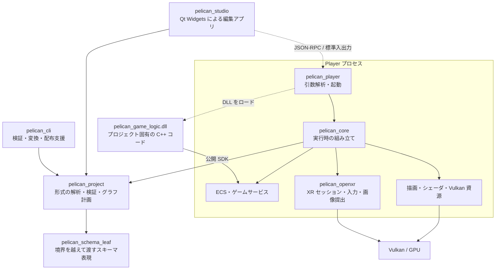
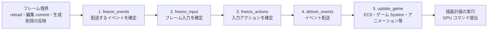
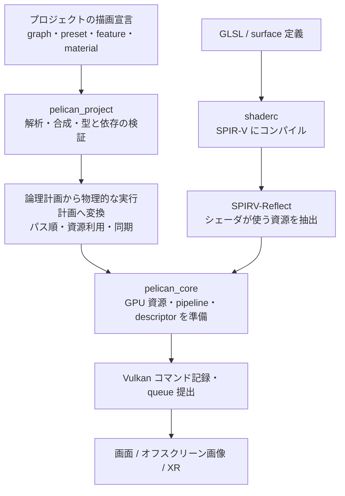
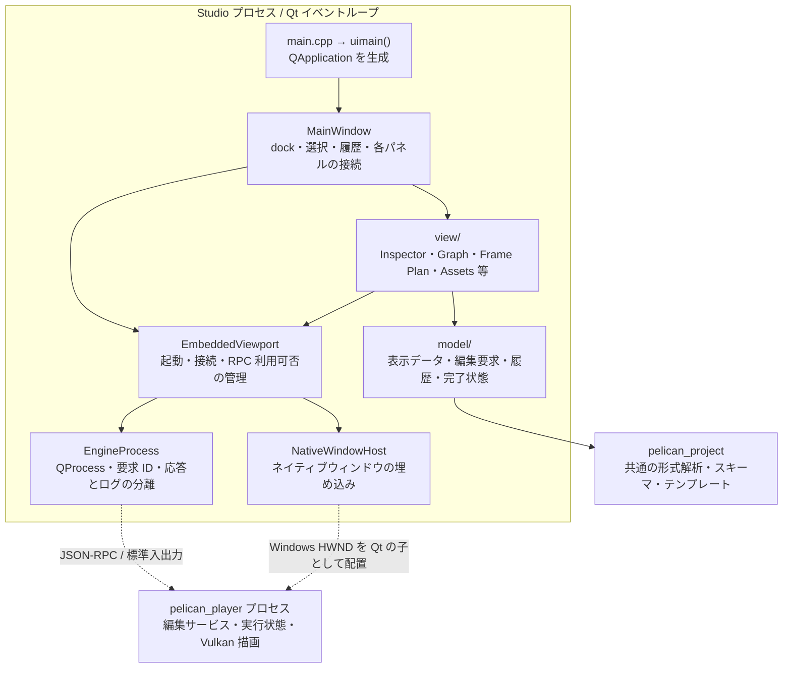
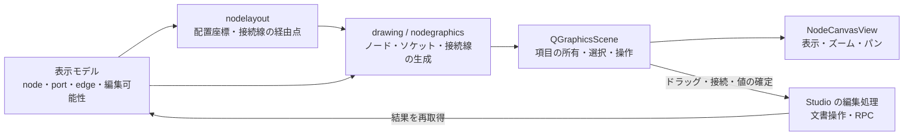
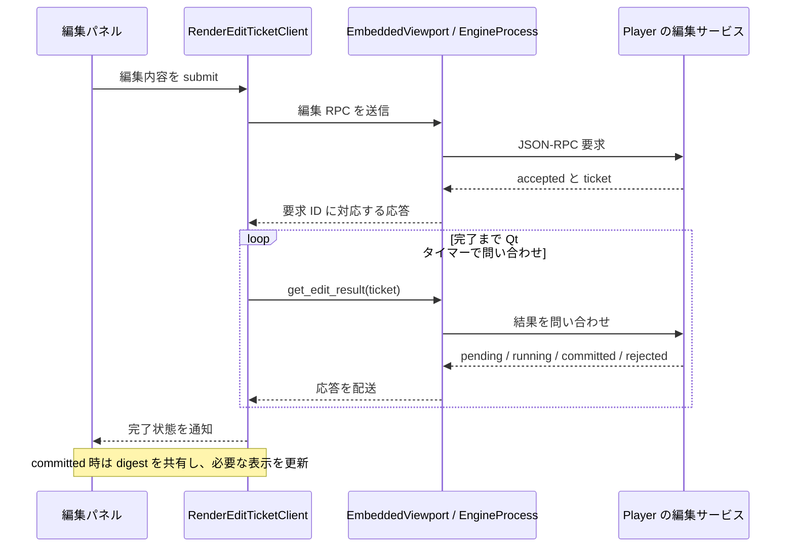

# アーキテクチャと採用技術

[読解ガイドの索引へ戻る](README.md)

Pelican2 は、C++20 で実装されたゲームエンジンです。ゲームを実行する Player、プロジェクトを編集する Studio、素材の変換や配布準備を行う CLI を持ちます。描画には Vulkan、Studio の画面には Qt Widgets を使います。

このページは、ソースコードを読み始める人のために、実装の分割と採用技術の役割を説明します。ビルド条件・起動手順は[利用マニュアル第2章](../manual/02_getting_started.md)、個々のクラスや所有関係は[第1章](01_architecture_and_build.md)以降で扱います。

## 全体構成と依存の境界

次の図の実線は「利用する側 → 利用される側」、破線はプロセス間通信または実行時ロードを表します。ビルド時の生成順を表す図ではありません。

XR は `PELICAN_WITH_OPENXR` が有効な場合の構成です。ECS や描画の箱は主に `pelican_core` 内の実装領域であり、それぞれが独立したプロセスや CMake ライブラリになっているわけではありません。

### データ形式と実行時処理を分ける

[`src/project/`](../../src/project/CMakeLists.txt) は、`project.json`、シーン、マテリアル、グラフなどを読み、検証・合成する層です。Vulkan デバイスやウィンドウを作らず、`nlohmann_json`、`pelican_schema_leaf`、ハッシュ処理を中心とした依存で構成されています。これにより、CLI や Studio、GPU を使わないテストでも同じ解析処理を再利用できます。

[`src/core/`](../../src/core/CMakeLists.txt) は、解析したデータを ECS の Entity、GPU リソース、音声などの実体へ結び付けます。例えば [`PelicanCore::run()`](../../src/core/userpublic/pelican_core.cpp) が設定、ゲーム DLL、シーン、描画、ループを組み立てます。形式を読めることと、実行環境でその機能を使えることを別の責務にしています。

[`src/schema/`](../../src/schema/schema.hpp) は、層をまたいで渡すフィールド型やノードの共通表現を定義します。core の内部スキーマとの変換は [`src/core/communication/`](../../src/core/communication/CMakeLists.txt) の adapter が担い、内部型への直接依存を境界の外へ広げない構成です。

### Studio と Player を別プロセスにする

Studio は [`EngineProcess`](../../src/devstudio/viewport/engineprocess.cpp) の `QProcess` で Player を起動し、標準入出力を通じた JSON-RPC で状態取得や編集を依頼します。UI は Qt のイベントループ、ゲーム更新と描画は Player の実行ループが担当します。

[`src/devstudio/CMakeLists.txt`](../../src/devstudio/CMakeLists.txt) は、Studio が `pelican_project` を直接利用する一方、`pelican_core` と core 配下のターゲットをリンクしないことを検査します。Studio は公開されたデータ形式と RPC を使うクライアントとして構成され、エンジン内部の実体を直接操作する設計にはしていません。`add_dependencies` による Player・CLI の先行ビルドは、エンジンへのリンクとは別です。

### ゲーム固有コードを DLL に分ける

プロジェクトの `code/` は、[`src/player/CMakeLists.txt`](../../src/player/CMakeLists.txt) により `pelican_game_logic` という共有ライブラリへまとめられます。ゲームコードは [`userpublic/`](../../src/core/userpublic) の SDK を利用し、エンジン側が DLL を実行時ロードします。

この境界には ABI の検査、System などの登録と登録解除、ホットリロードの処理があります。実装は [`gamelogicreload.cpp`](../../src/core/gamelogic/gamelogicreload.cpp)、公開契約は [`gamelogic.hpp`](../../src/core/userpublic/gamelogic.hpp) を参照してください。

## ゲーム状態と1フレームの処理

ゲーム状態は独自実装の ECS（Entity Component System）で管理します。Entity は識別対象、Component は位置や描画設定などのデータ、System はそれらを処理するロジックです。同じ Component 構成を持つ Entity をまとめ、Component ごとの連続配列を chunk に格納する構成を採っています。構造と更新依存の詳細は[第4章](04_ecs_deep_dive.md)を参照してください。

次の図は [`updateFrameState()`](../../src/core/appflow/framephase.cpp) を中心とした論理的な順序です。各処理のすべてが同じスレッド上だけで動くことを表す図ではありません。

5 フェーズの順序は [`framephase.hpp`](../../src/core/appflow/framephase.hpp) に定義されています。フレーム途中に観測する入力やイベントを確定させ、変更の公開を境界へ集めることで、更新順の意味を保ちます。編集・一時停止状態では、ゲームステップの有無に応じてイベント配送やゲームコードの実行が制御されます。

[`Loop::run()`](../../src/core/appflow/loop.cpp) は通常ウィンドウ、ヘッドレス、RPC、XR の実行経路を扱います。共通の状態更新と、出力先に応じた描画・提示を分ける構成です。起動から終了までの所有と破棄順は[第2章](02_runtime_lifecycle.md)にまとめています。

## 宣言した描画処理を GPU 実行へ変換する

描画は、C++ にすべてのパス順を直接書く方式だけでなく、プロジェクトのグラフ、描画 preset、feature、マテリアルを解析して実行計画へ変換する構成です。ここでの feature は、影やポストプロセスなどを構成する再利用可能な描画定義を指します。

図のコンパイル経路は runtime shader compiler を有効にした場合です。無効構成では必要なコンパイル済み SPIR-V を用意します。描画設定の入口は [`renderingpass/`](../../src/core/renderingpass)、計画のデータと変換は [`src/project/`](../../src/project/CMakeLists.txt)、実行の中心は [`vkcore/renderer.cpp`](../../src/core/vkcore/renderer.cpp) にあります。

依存する資源と実行順を計画として扱うことで、描画手法の構成と Vulkan での実行処理を分けられます。Vulkan 側は GPU メモリ、バリア、コマンドバッファ、提示先などを管理します。Dynamic Rendering、シェーダ反射、ホットリロードの詳しい流れは[第6章](06_rendering_vulkan_shader.md)を参照してください。

## Pelican Studio の実装

Studio は、Qt Widgets の画面に Player の描画ウィンドウを埋め込み、公開 RPC でプロジェクトを編集するアプリケーションです。エンジンのシーンや GPU 資源は Player が所有し、Studio は表示用データ、選択状態、編集途中の入力、要求の進行状態などを持ちます。

### 実装の構成図

図の実線は呼び出し・利用、破線は別プロセスとの通信・ウィンドウ埋め込みを表します。

この節の **model** は Studio が表示や編集判断に使うデータ・処理を指し、GPU 上のモデル資源とは別です。**ticket** は受け付けた編集の進行状況を後から問い合わせる識別子、**digest** は編集の前提となる文書内容を識別するハッシュ値です。

### 起動と画面の組み立て

[`main.cpp`](../../src/devstudio/main.cpp) が引数を解析し、[`uimain()`](../../src/devstudio/view/uimain.cpp) が `QApplication` と `MainWindow` を生成します。ウィンドウを表示し、指定されたプロジェクトとツールタブを開いた後、`app.exec()` で Qt のイベントループへ入ります。

[`MainWindow`](../../src/devstudio/view/mainwindow.hpp) は `QMainWindow` を継承し、viewport と各 dock、メニュー、ショートカットを組み立てます。さらに、パネル間の選択共有や RPC 応答後の再取得をシグナル・コールバックで接続します。実際の接続を調べる入口は [`mainwindow.cpp`](../../src/devstudio/view/mainwindow.cpp) です。画面配置は [`LayoutPresetManager`](../../src/devstudio/layoutpreset.hpp)、プロジェクトごとのツール配置は [`ToolLayoutPresetManager`](../../src/devstudio/toollayoutpreset.hpp) が扱います。

### `view`・`model`・`viewport` の責務

| 実装領域 | 主な責務 | 読み始めるファイル |
|---|---|---|
| `view/` | Widget の生成、フォーム入力、キャンバス描画、ユーザー操作とモデル・RPC の接続 | [inspectorwidget.cpp](../../src/devstudio/view/inspectorwidget.cpp)、[graphcanvaswidget.cpp](../../src/devstudio/view/graphcanvaswidget.cpp)、[frameplanwidget.cpp](../../src/devstudio/view/frameplanwidget.cpp) |
| `model/` | シーンツリーやグラフの表示用データ、選択、編集要求の組み立て、結果の解釈、履歴 | [project.hpp](../../src/devstudio/model/project.hpp)、[inspectormodel.hpp](../../src/devstudio/model/inspectormodel.hpp)、[graphcanvasmodel.hpp](../../src/devstudio/model/graphcanvasmodel.hpp) |
| `viewport/` | Player のプロセス管理、RPC の送受信、接続準備、埋め込み、終了・失敗の通知 | [embeddedviewport.hpp](../../src/devstudio/viewport/embeddedviewport.hpp)、[engineprocess.hpp](../../src/devstudio/viewport/engineprocess.hpp)、[nativewindowhost.cpp](../../src/devstudio/viewport/nativewindowhost.cpp) |
| `automation/` | GUI テスト用のローカル通信と Qt イベントの合成 | [automationserver.hpp](../../src/devstudio/automation/automationserver.hpp)、[ビルド設定](../../src/devstudio/automation/CMakeLists.txt) |

モデルの多くは Qt Widget を持たない C++ の型として分離されています。例えば `SelectionModel` や `RenderEditTicket` は、表示部品を生成せずに選択や編集の状態遷移を扱えます。モデルの CMake ターゲットと依存は [`model/CMakeLists.txt`](../../src/devstudio/model/CMakeLists.txt) で確認できます。

### UI 部品の実装方式と使用モジュール

Studio の基本部品は **Qt Widgets** を使用し、その組み合わせや継承で Pelican 固有の編集部品を実装しています。ノード編集やフォーム生成についても、描画・入力の土台は Qt、ノードの意味や編集規則は Studio 側という分担です。

| UI 部品・用途 | 使用ライブラリ・モジュールと主なクラス | Studio 独自の部分・実装入口 |
|---|---|---|
| メイン画面・dock・メニュー・タブ | Qt Widgets: `QMainWindow`、`QDockWidget`、`QMenu`、`QToolBar`、`QTabWidget`。アクションは Qt Gui の `QAction` | パネル構成、シグナル接続、ショートカットの適用先、配置の保存・復元。[mainwindow.cpp](../../src/devstudio/view/mainwindow.cpp) |
| シーン階層の Outliner | Qt Widgets: `QTreeWidget`、`QTreeWidgetItem` | `OutlinerTree` が継承し、複製・削除・親変更の操作を追加。[outlinertree.hpp](../../src/devstudio/view/outlinertree.hpp) |
| Assets・Materials・Problems の一覧 | Qt Widgets: `QTreeWidget`、`QTreeWidgetItem` | RPC 結果からの行生成、対象の識別、操作・診断への接続。[assetsdock.cpp](../../src/devstudio/view/assetsdock.cpp)、[materialsdock.cpp](../../src/devstudio/view/materialsdock.cpp)、[problemsdock.cpp](../../src/devstudio/view/problemsdock.cpp) |
| Inspector の編集欄 | Qt Widgets: `QScrollArea`、`QGroupBox`、`QFormLayout`、`QLineEdit`、`QDoubleSpinBox`、`QCheckBox`、`QComboBox`、`QColorDialog` | フィールド記述からの部品選択、vector・回転・方向・色などの複合入力、preview・commit への接続。[inspectorwidget.cpp](../../src/devstudio/view/inspectorwidget.cpp) |
| Feature のパラメータ欄 | Qt Widgets: `QDoubleSpinBox`、`QSlider`、`QCheckBox`、`QComboBox`、`QColorDialog` | スキーマから行を生成し、範囲・既定値・override・Reset を扱う `FeatureParameterForm`。[featureparameterform.hpp](../../src/devstudio/view/featureparameterform.hpp) |
| 描画パスの設定フォーム | Qt Widgets: `QWidget` と各種入力部品 | 設定の一部分を読み書きする `PassForm` 系列を、Pass Editor と Graph 詳細欄で共用。[passforms/](../../src/devstudio/view/passforms) |
| Graph・Frame Plan のノードキャンバス | Qt Widgets の Graphics View Framework: `QGraphicsView`、`QGraphicsScene`、`QGraphicsPathItem`。図形生成は Qt Gui の `QPainterPath` | ノード・ポート・接続線、ドラッグ、折り畳み、接続操作、配置アルゴリズム。[nodegraphics.hpp](../../src/devstudio/view/nodegraphics.hpp)、[graphcanvaswidget.hpp](../../src/devstudio/view/graphcanvaswidget.hpp)、[frameplangraphics.hpp](../../src/devstudio/view/frameplangraphics.hpp) |
| ノード内の直接入力 | Qt Widgets: `QGraphicsProxyWidget`、`QLineEdit`、`QComboBox`、`QDoubleSpinBox` | キャンバス上の項目に応じて入力を開き、確定・取消と文書編集を結ぶ処理。[graphcanvaswidget.cpp](../../src/devstudio/view/graphcanvaswidget.cpp) |
| Graph のタイムライン表示 | Qt Widgets: `QWidget`。描画は Qt Gui の `QPainter` | `GraphTimelineStrip` が目盛り・キーの描画とポインタ操作を実装。[graphcanvaswidget.cpp](../../src/devstudio/view/graphcanvaswidget.cpp) |
| ログ・シェーダ診断 | Qt Widgets: `QPlainTextEdit` など | Player 出力の蓄積・表示、コンパイル診断の整理とソースへの誘導。[shadercompilelogpanel.cpp](../../src/devstudio/view/shadercompilelogpanel.cpp)、[enginelogbuffer.hpp](../../src/devstudio/viewport/enginelogbuffer.hpp) |
| テーマ・色・フォント | Qt Gui: `QPalette`、`QColor`、`QFont`。Qt Widgets: `QStyleFactory` | JSON のテーマ定義、キャンバスの共通配色、変更通知。[studiotheme.hpp](../../src/devstudio/view/studiotheme.hpp) |

Qt の UI を支えるモジュールも用途を分けています。**Qt Core** の `QObject`・シグナル/スロット・`QTimer` はイベント接続と遅延処理、`QProcess` は Player 起動、`QFileSystemWatcher` は外部ファイル変更の検知に使います。**Qt Network** のローカル通信と **Qt Test** のイベント合成は automation 用です。リンク設定は [view](../../src/devstudio/view/CMakeLists.txt)、[viewport](../../src/devstudio/viewport/CMakeLists.txt)、[automation](../../src/devstudio/automation/CMakeLists.txt) にあります。Qt Gui は Widgets が利用する描画・フォントなどの基盤でもあります。

### 独自 UI の設計: ノードキャンバスと自動配置

Graph と Frame Plan は、Qt の Graphics View Framework の上に構築した独自のノード UI です。表示領域の `QGraphicsView`、項目を所有する `QGraphicsScene`、ノードや接続線の `QGraphicsItem` 群に役割を分けています。

共通の [`NodeCanvasView`](../../src/devstudio/view/nodegraphics.hpp) と描画補助が、ズーム・パン、背景、ノード形状、ソケット、接続線の扱いをまとめます。Graph 固有の行・値・ループ領域などの描画は [`GraphCanvasDrawing`](../../src/devstudio/view/graphcanvasdrawing.hpp)、Frame Plan 固有の実行情報や資源表示は [`frameplangraphics`](../../src/devstudio/view/frameplangraphics.hpp) が担当します。見た目と基本操作を共用し、表示対象の意味を各キャンバス側に持たせる構成です。

自動配置は [`layoutNodeGraph()`](../../src/devstudio/view/nodelayout.hpp) という独自の C++ 実装です。ノードの寸法と依存辺を入力に、列への割り当て、交差を減らす上下の並べ替え、座標の調整、長い接続線の経由点を計算します。出力は矩形や点列の数値データで、Qt の画面を生成せずに検証できます。同じ順序の入力に対して同じ配置を返し、Graph と Frame Plan で共用します。

各描画項目には `Qt::UserRole` から派生した data role でノード ID、ポート、種類などを保持します。これにより、見た目の文字列から対象を推測せず、操作対象や automation からの参照を識別できます。ノード移動時の接続線更新や項目検索も [`nodegraphics`](../../src/devstudio/view/nodegraphics.hpp) に共通化されています。

### 独自 UI の設計: スキーマに応じたフォーム

Inspector は [`InspectorModel`](../../src/devstudio/model/inspectormodel.hpp) のフィールド記述に応じて入力部品を選び、数値・選択肢・色などの編集 UI を生成します。vector は複数の数値入力、回転や方向は意味に応じた補助入力を組み合わせ、ユーザー操作を preview や commit の要求へ変換します。Qt は個々の入力と配置を担い、編集対象の意味と transaction は Pelican 側が扱います。

[`FeatureParameterForm`](../../src/devstudio/view/featureparameterform.hpp) は、スキーマ、明示的に設定された値、接続済みパラメータを受け取って行を構成します。数値の範囲や整数表示、既定値と override の区別、Reset 時に override を削除する処理を持ちます。spin・slider の連続変更と選択・チェックなどの変更を区別して所有側へ通知し、送信タイミングの判断をフォームの外へ出しています。

[`PassForm`](../../src/devstudio/view/passforms/passform.hpp) は、描画パス定義の一部分を扱う共通基底です。担当する JSON フィールドを編集し、担当外・未知のキーは保持して返します。値を読み込む間は変更通知を抑え、画面の再表示が新しい編集にならないようにしています。Pass Editor の存在を前提としないため、Graph の詳細欄でも同じフォームを使えます。

### 独自 UI の設計: ツリー操作とテーマ

[`OutlinerTree`](../../src/devstudio/view/outlinertree.hpp) は標準の `QTreeWidget` を基盤に、親変更のための press・move・release 処理を独自に持ちます。ドラッグ先が同じシーンか、子孫への循環になるか、実行時だけのオブジェクトかを判断し、許可された操作を編集処理へ通知します。ツリー表示そのものは Qt、シーン階層を変更する規則は Studio の責務です。

テーマは [`StudioTheme`](../../src/devstudio/view/studiotheme.hpp) に、標準 Widget 用の style・palette、キャンバス用の色、フォント、実行状態の色を集約します。[`studiotheme.cpp`](../../src/devstudio/view/studiotheme.cpp) が埋め込み JSON を読み、Qt の style・palette へ適用します。キャンバス項目は生成時の色を持つため、テーマ変更通知で項目を再構成します。Graph と Frame Plan が同じ配色・フォント定義を読むことで、描画コードごとの定義の重複を抑えています。

ここで説明したのは Studio の編集 UI です。Player 内の開発用 UI に使う Dear ImGui と、ゲーム用 UI の実装は別の領域であり、[第7章](07_tools_rpc_tests.md)および[ゲーム API・サービスの解説](05_gameplay_and_services.md)を参照してください。

### Player の起動・接続・画面埋め込み

[`EmbeddedViewport`](../../src/devstudio/viewport/embeddedviewport.cpp) がプロジェクトの開始・再起動・終了を管理し、[`studioPlayerLaunch()`](../../src/devstudio/viewport/studioplayerarguments.cpp) が Player へ渡す引数を構成します。RPC、編集用 feature overlay、描画設定の不備を表示しながら復旧する fallback などが、この起動構成に含まれます。

[`EngineProcess`](../../src/devstudio/viewport/engineprocess.cpp) は `QProcess` の標準出力・標準エラー・終了通知を受け取ります。標準出力から行単位の JSON-RPC 応答を取り出して要求 ID に対応づけ、通常のテキストや標準エラーはログとして通知します。プロセスが起動したことと、編集 RPC を使えることは別の状態として扱い、`EmbeddedViewport` が readiness の確認と要求の受付可否を管理します。プロセス終了時には、応答待ちの要求にも失敗が通知されます。

Windows での画面埋め込みは [`NativeWindowHost`](../../src/devstudio/viewport/nativewindowhost.cpp) が担当します。Player のプロセス ID と描画ウィンドウの識別プロパティから HWND を探し、DPI awareness を確認したうえで、ウィンドウスタイルと親を変更して Qt の領域へ配置します。表示する画像は引き続き Player の Vulkan が描画します。これにより、見た目は一つの編集画面でも、描画資源と実行ループの所有は Player 側に保たれます。

### 編集要求から反映完了まで

描画設定の編集では、最初の RPC 応答が受付を示し、実際の反映結果は ticket で後から取得する経路があります。以下は、その非同期経路を簡略化した図です。すべての編集 RPC が同じ応答形式を使うわけではありません。

[`RenderEditTicket`](../../src/devstudio/model/rendereditticket.cpp) が受付・処理中・反映済み・拒否・結果未確認を区別し、[`RenderEditTicketClient`](../../src/devstudio/view/rendereditticketclient.cpp) が Qt のシグナルと `QTimer` に接続します。結果の問い合わせに失敗した場合も、編集そのものが拒否されたと断定せず、未確認として再問い合わせします。

寿命管理もこの境界の責務です。`RenderEditTicket` は弱参照と世代番号で古いタイマーの実行を防ぎ、Player が利用できなくなると client は追跡状態を破棄します。ただし、Studio が追跡をやめることは、Player 内の編集をキャンセルすることとは別です。

### 選択・Undo・外部変更への追従

[`SelectionModel`](../../src/devstudio/model/selection.hpp) は、シーン ID と編集対象のオブジェクト ID を使って選択を保持します。Outliner の選択と viewport の pick 結果をここで合流させ、古い pick 応答が新しい選択を上書きしないように token を検査します。選択は Studio 内のクライアント状態であり、エンジンが所有するシーン状態とは分けています。

Undo は編集対象ごとに実装が異なります。

| 対象 | 履歴の扱い |
|---|---|
| Frame Plan・Pass Editor・Render Features などの描画文書編集 | [`RenderEditHistory`](../../src/devstudio/model/renderedithistory.hpp) を共有。送信前の文書と commit 後の情報を記録し、digest を条件に文書を復元 |
| Graph タブ | 操作の逆操作による独自の履歴 |
| Inspector のシーン編集 | Player 側の scene journal を利用 |

描画履歴は [`MainWindow::createRenderHistory()`](../../src/devstudio/view/mainwindow.cpp) が `EmbeddedViewport` の RPC observer に接続し、対象の要求を送る前に文書を取得します。各パネルに履歴処理を重複して持たせず、共通の送信経路で追跡する構成です。Undo の復元時には文書の digest を照合し、他の変更を無条件に上書きしないようにしています。

外部で変更された描画文書の検知は [`RenderDocumentWatcher`](../../src/devstudio/view/renderdocumentwatcher.hpp)、再読込の状態は [`RenderDocumentReload`](../../src/devstudio/model/renderdocumentreload.hpp) が扱います。ファイルの変化、Player での再読込、各パネルの再表示は、別々の段階としてコードを追う必要があります。

### ビルド境界とテスト

Studio は `pelican_studio_view`、`pelican_studio_viewport`、表示用モデル、layout、automation などの static library を組み合わせた実行ファイルです。Qt の `AUTOMOC` によるメタオブジェクト生成と、`AUTORCC`・埋め込み資源を利用します。依存全体の入口は [`src/devstudio/CMakeLists.txt`](../../src/devstudio/CMakeLists.txt) です。

モデルの判断や状態遷移は表示部品から分けて検証し、実際の画面と Player の連携は GUI シナリオで検証する構成です。automation は起動時に明示された場合にだけローカル通信口を開き、Qt Network と Qt Test を使って画面操作を駆動します。テストの入口は [`test/studio_scenarios/README.md`](../../test/studio_scenarios/README.md)、さらに詳しい内部解説は[第7章の Studio 実装節](07_tools_rpc_tests.md#76-pelican-studio-の現在位置)、操作方法は[利用マニュアル第15章](../manual/15_studio.md)を参照してください。

## 採用技術とその役割

以下は、このリポジトリが各技術を何に使っているかの説明です。依存の取得・リンクは主に [ルートの CMakeLists.txt](../../CMakeLists.txt) と各ディレクトリの `CMakeLists.txt` で確認できます。

### 言語・フレームワーク・ビルド基盤

| 技術 | このコードでの用途 | 主な実装・設定 |
|---|---|---|
| C++20 / MSVC | エンジン、ゲーム SDK、Player、CLI、Studio の実装。テンプレートや型消去を使う ECS・登録機構 | [core のビルド設定](../../src/core/CMakeLists.txt)、[実装技法の解説](09_black_magic_and_gotchas.md) |
| CMake / FetchContent | 実行ファイルとライブラリの組み立て、依存取得、機能単位の有効化 | [ルート設定](../../CMakeLists.txt)、[機能 registry](../../cmake/pelican_feature_registry.cmake) |
| Qt 6 / Qt Widgets | Studio のウィンドウ、dock、編集パネル、シグナルによる UI 更新、子プロセス管理 | [Studio](../../src/devstudio/CMakeLists.txt)、[Qt 設定](../../src/devstudio/view/ui_depended_setup.cmake) |
| Catch2 / CTest | C++ テストの記述とテスト実行。GPU を使わない検証と GPU 検証を分ける | [test/CMakeLists.txt](../../test/CMakeLists.txt) |
| Python / MkDocs Material | テスト・保守ツールと、このドキュメントサイトの生成 | [docs_site.py](../../tools/docs_site.py)、[mkdocs.yml](../../mkdocs.yml) |

Python はエンジンの実行依存ではありません。Python を使うテストや実験的 SPIR-V リンカなど、選択した開発機能で必要になります。Studio の現行 UI 基盤は Qt Widgets です。

### 使用 API と公開インターフェース

| API・境界 | 役割 | 主な実装 |
|---|---|---|
| Vulkan / Vulkan-Hpp | GPU デバイス、バッファ・画像、描画・compute、同期、画面提示。Vulkan-Hpp は C++ から呼ぶための層 | [vkcore/](../../src/core/vkcore) |
| OpenXR | XR runtime の検出、セッション、action・pose 入力、描画画像の提出。任意機能 | [openxr/](../../src/core/openxr) |
| Pelican 公開 C++ SDK | `GameContext`、Component、System、入力、イベント、音声・物理などをゲームコードへ提供 | [gamecontext.hpp](../../src/core/userpublic/gamecontext.hpp)、[userpublic/](../../src/core/userpublic) |
| Pelican JSON-RPC | Studio や外部ツールから状態取得・編集・フレーム操作を行うプロセス間インターフェース | [communication/](../../src/core/communication)、[EngineProcess](../../src/devstudio/viewport/engineprocess.cpp) |
| Windows API | DLL のロード、ウィンドウ埋め込みなどの OS 連携。SHA-256 のストリーム処理では CNG / BCrypt も使用 | [gamelogicreload.cpp](../../src/core/gamelogic/gamelogicreload.cpp)、[project のリンク設定](../../src/project/CMakeLists.txt) |
| RenderDoc in-application API | 外部 RenderDoc と連携して GPU キャプチャを制御。任意機能 | [renderdoc/](../../src/core/renderdoc) |

JSON-RPC のメソッド・引数・戻り値は[編集 RPC リファレンス](../manual/13_editor.md)を参照してください。

### 使用ライブラリ

| ライブラリ | このコードでの用途 | 主な実装・設定 |
|---|---|---|
| GLFW | Player のウィンドウ、キーボード・マウス入力、Vulkan surface の生成 | [os/](../../src/core/os) |
| GLM | ベクトル、行列、quaternion の計算 | [core のリンク設定](../../src/core/CMakeLists.txt) |
| VulkanMemoryAllocator / VMA-Hpp | Vulkan バッファ・画像のメモリ割り当て | [vkcore/](../../src/core/vkcore)、[core のリンク設定](../../src/core/CMakeLists.txt) |
| nlohmann/json | プロジェクト、シーン、グラフ、RPC、保存データの JSON 処理 | [project/](../../src/project)、[communication/](../../src/core/communication) |
| shaderc | GLSL から SPIR-V へのコンパイル。Vulkan SDK のライブラリを利用 | [shadercompiler.cpp](../../src/core/shader/shadercompiler.cpp)、[shader の設定](../../src/core/shader/CMakeLists.txt) |
| SPIRV-Reflect | SPIR-V から descriptor、push constant、頂点入力などを抽出 | [shaderreflection.cpp](../../src/core/shader/shaderreflection.cpp) |
| SPIRV-Tools | 実験的 SPIR-V リンク・最適化。`PELICAN_WITH_SPIRV_LINK` の通常既定値は OFF | [spvlink/](../../src/spvlink)、[shader の設定](../../src/core/shader/CMakeLists.txt) |
| TinyGLTF | glTF / GLB と、VRM を含むモデルの読み込み | [model/gltf.cpp](../../src/core/model/gltf.cpp) |
| stb / TinyEXR | 画像の読み書きやフォント処理、EXR 画像の読み込み。EXR は任意機能 | [loader/](../../src/core/loader)、[ルート設定](../../CMakeLists.txt) |
| miniaudio | 音声デコードと再生。音声機能が有効な構成で使用 | [audio/](../../src/core/audio) |
| Jolt Physics | 任意の物理クエリ provider。通常は内蔵 provider を使い、Jolt は既定 OFF | [phys/](../../src/core/phys)、[機能 registry](../../cmake/pelican_feature_registry.cmake) |
| Dear ImGui | Player 内での開発用 UI。Studio の Qt UI とは別の用途 | [imgui/](../../src/core/imgui) |
| quill | エンジンのログ出力 | [log.cpp](../../src/core/log.cpp) |
| argparse | Player・CLI・Studio のコマンドライン引数解析 | [player](../../src/player/CMakeLists.txt)、[devcli](../../src/devcli/CMakeLists.txt)、[devstudio](../../src/devstudio/CMakeLists.txt) |
| PicoSHA2 | コンテンツや定義の SHA-256 ハッシュ | [project](../../src/project/CMakeLists.txt)、[core](../../src/core/CMakeLists.txt) |
| battery::embed | シェーダや JSON、Studio の資源をバイナリへ埋め込む | [エンジン資源](../../src/core/resources/CMakeLists.txt)、[Studio 資源](../../src/devstudio/resources/CMakeLists.txt) |

物理機能でいう provider は、raycast・overlap・shape cast などの問い合わせを実行する実装です。Jolt を依存に含められることだけをもって、剛体シミュレーション全体の実装を意味するものではありません。物理サービスの境界は[第5章](05_gameplay_and_services.md)を参照してください。

依存の固定リビジョンは各 `FetchContent_Declare` の `GIT_TAG`、機能の選択は[ビルド機能台帳](../build_features.md)、配布に含まれる第三者ソフトウェアの一覧は [THIRD_PARTY_NOTICES.md](../../THIRD_PARTY_NOTICES.md)で確認できます。

## コードを読む順番

1. [`src/player/main.cpp`](../../src/player/main.cpp) で起動条件を確認します。
2. [`PelicanCore::run()`](../../src/core/userpublic/pelican_core.cpp) で実行時の組み立てを追います。
3. [`Loop::run()`](../../src/core/appflow/loop.cpp) と [`updateFrameState()`](../../src/core/appflow/framephase.cpp) で、ループと状態更新の順序を確認します。
4. データ定義を変更するなら [`src/project/`](../../src/project)、描画を変更するなら [`vkcore/renderer.cpp`](../../src/core/vkcore/renderer.cpp)、編集 UI を変更するなら [`src/devstudio/`](../../src/devstudio) へ進みます。

型名から探す場合は[クラス・インターフェース索引](08_class_interface_index.md)が入口になります。
